# Setup Multi Account

## ทำไมต้องมีหลายบัญชี?

งานใหญ่ใช้บัญชีเดียวโควตาไม่พอและช้า จึงรวมหลายบัญชีไว้ใน container เดียว แล้วแบ่งงานทำพร้อมกัน

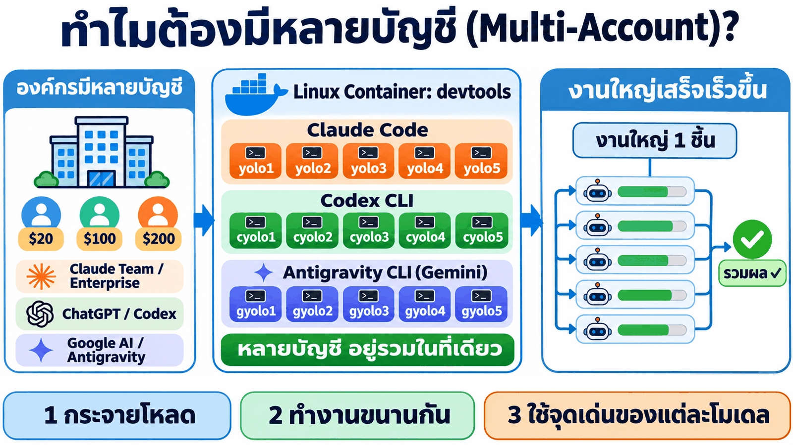

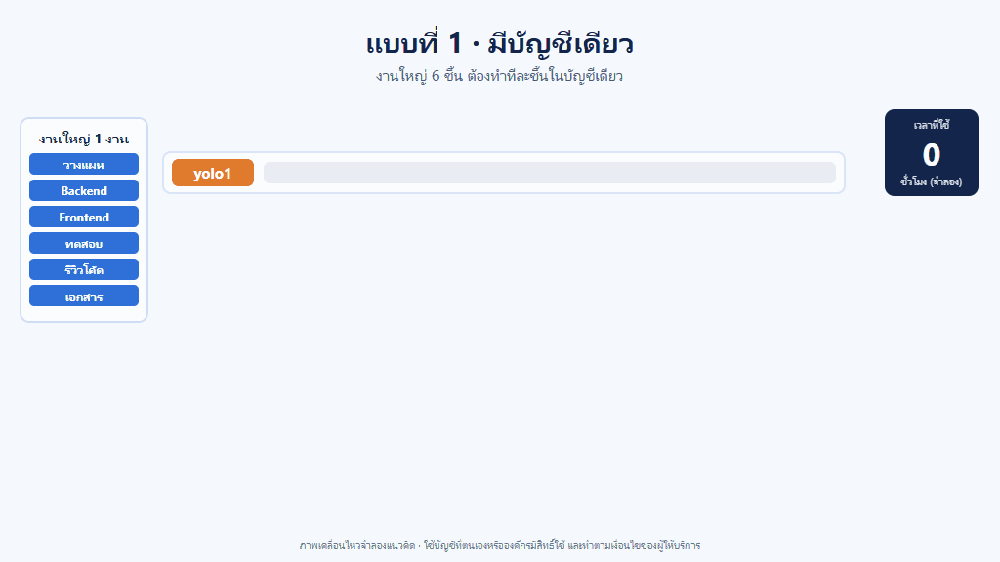

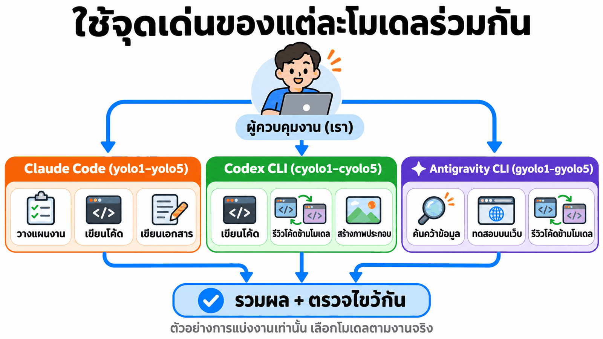

## จุดเริ่มต้น → เป้าหมาย

`devtools` เริ่มจาก Linux เปล่า ยังไม่มี AI CLI ใด ๆ Claude ติดตั้ง Claude Code, Codex CLI และ Antigravity CLI แล้วเพิ่มระบบหลายบัญชีให้ **ขณะที่ container ยังรันอยู่** ทั้งหมด ยกเว้น **การล็อกอิน** ที่เราทำเอง

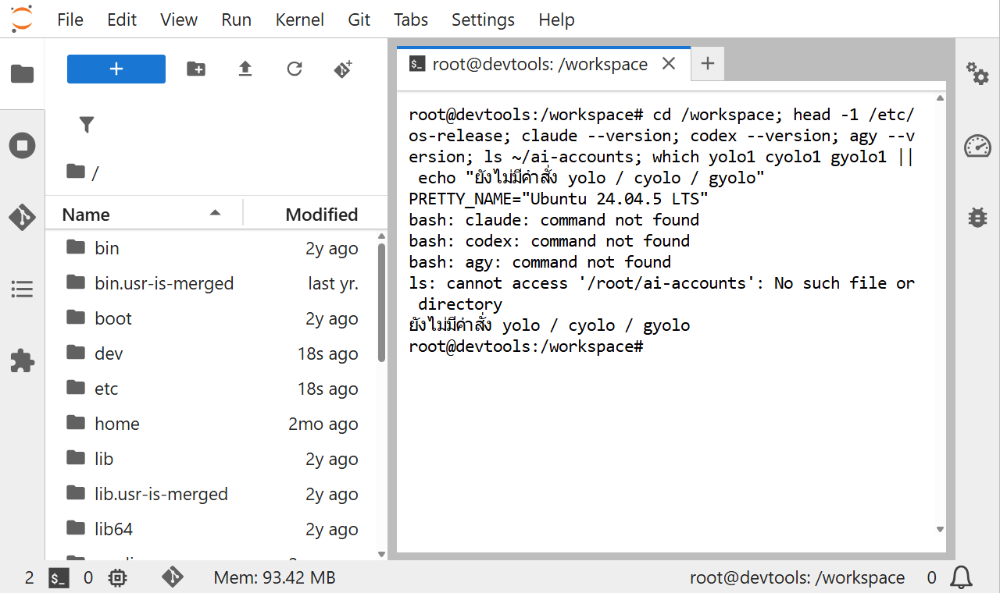

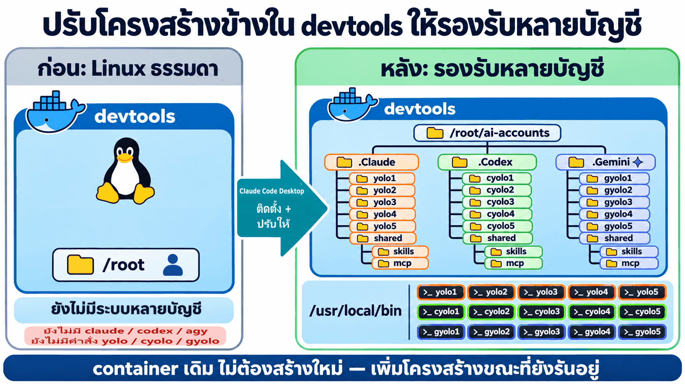

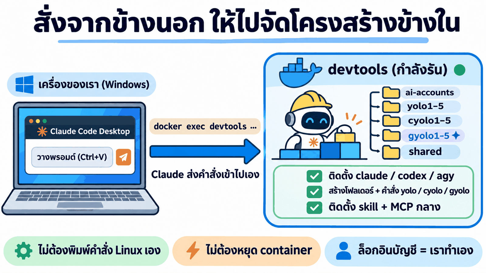

## ภาพรวมการทดลอง

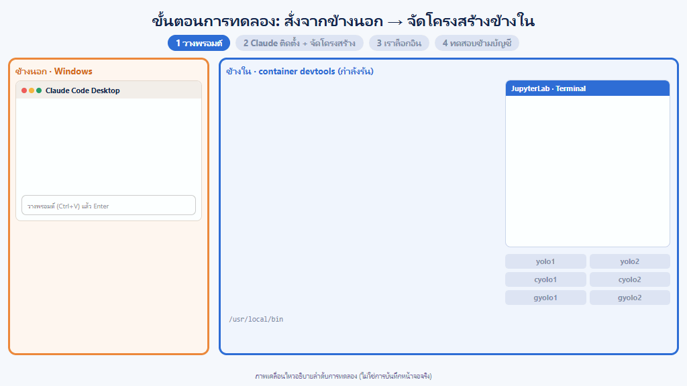

| ขั้น | ทำที่ไหน | ใครทำ |
|---|---|---|
| **1 · ตั้งค่าหลายบัญชี** | 💻 Claude Code Desktop | Claude |
| **2 · ตรวจผลข้างใน** | 🖥️ JupyterLab ของ `devtools` | เรา |
| **3 · ล็อกอิน + ตรวจล็อกอิน** | 🖥️ JupyterLab → 💻 Claude Code Desktop | เรา + Claude |
| **4 · ทดสอบ skill/MCP ข้ามบัญชี** | 💻 Claude Code Desktop | Claude |

**ก่อนเริ่ม:** Docker Desktop ขึ้น **Engine running** · container `devtools` กำลังรัน · Claude Code Desktop ล็อกอินแล้ว

## ขั้นที่ 1 · 💻 ให้ Claude Code Desktop ตั้งค่าหลายบัญชี (~10 นาที)

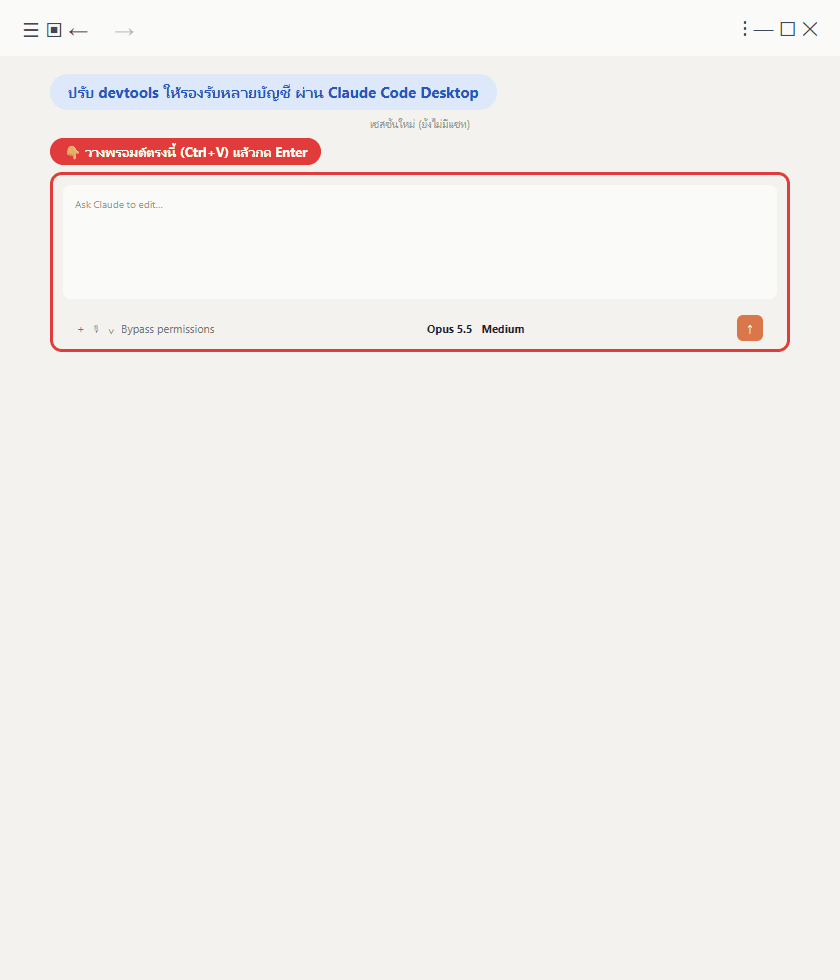

> [!IMPORTANT]
> **📋 คัดลอกกล่องนี้ → Claude Code Desktop → New session → Ctrl+V → Enter แล้วรอจน Claude สรุปผล**
>
> ```text
> ช่วยปรับโครงสร้างข้างใน container ชื่อ devtools ที่กำลังรันอยู่ ให้รองรับหลายบัญชี AI
> ทำทุกอย่างข้างใน container ผ่าน docker exec เท่านั้น ห้ามแก้ไฟล์บนเครื่อง Windows ห้ามหยุด ลบ หรือสร้าง container ใหม่
> ถ้า devtools ไม่ได้รันอยู่ ให้รายงานแล้วหยุด
>
> ข้างในยังไม่มี AI CLI ใด ๆ ให้ติดตั้งครบ 3 ตัว (ตรวจ --version ก่อน ตัวไหนมีแล้วให้ข้าม)
> - Claude Code: npm install -g @anthropic-ai/claude-code
> - Codex CLI: npm install -g @openai/codex
> - Antigravity CLI (agy): curl -fsSL https://antigravity.google/cli/install.sh | bash
> ตรวจ --help ของเวอร์ชันจริงก่อนใช้ env/flag ห้ามเดา
>
> ## เป้าหมาย (BASE=/root/ai-accounts)
> - yolo1..yolo5   → claude --dangerously-skip-permissions  (CLAUDE_CONFIG_DIR=$BASE/.Claude/yoloN)
> - cyolo1..cyolo5 → codex --dangerously-bypass-approvals-and-sandbox  (CODEX_HOME=$BASE/.Codex/cyoloN)
> - gyolo1..gyolo5 → agy --dangerously-skip-permissions  (HOME=$BASE/.Gemini/gyoloN เฉพาะ process ของ agy)
> - wrapper วางใน /usr/local/bin ให้พิมพ์ได้ทันที ส่งต่อ "$@" ครบ แจ้งชัดถ้าโฟลเดอร์บัญชีไม่มี ไม่พิมพ์ secret
> - $BASE/.Claude/shared, $BASE/.Codex/shared และ $BASE/.Gemini/shared มี skills/ และ mcp/
>   แก้ครั้งเดียว ทุกบัญชีของ CLI นั้นเห็นตอนเปิดครั้งถัดไป
>
> ## กติกา
> - แยก credential/config/session ต่อบัญชี เปิดพร้อมกันได้ ใช้ CLAUDE_CONFIG_DIR/CODEX_HOME
>   ห้ามเปลี่ยน $HOME ของระบบ ยกเว้น wrapper gyoloN ที่ตั้ง HOME ให้ agy เท่านั้น (agy ไม่มีตัวแปร config dir)
> - Codex ใช้ file-based credential ต่อ CODEX_HOME ห้ามแชร์ credential ใน shared
> - สร้าง installer เป็นไฟล์ใน container รันซ้ำได้ ไม่เขียนทับ credential/config เดิม ห้ามแก้ .bashrc/Git/SSH
> - MCP ส่วนกลางตัวแรก: Playwright (@playwright/mcp) + Chromium ติดตั้งครั้งเดียว
> - skill ตัวอย่าง shared-check: ตอบ SHARED_SKILL_OK-<tool>-<ค่าสุ่มตอนติดตั้ง> ซึ่งมีในไฟล์ skill เท่านั้น
>
> ## ข้อเท็จจริงจากการทดลอง (ตรวจว่ายังจริงกับเวอร์ชันนี้)
> - npm 12 ไม่รัน postinstall ของ claude-code ให้ ถ้า claude --version ขึ้น "native binary not installed"
>   ให้รัน node "$(npm root -g)/@anthropic-ai/claude-code/install.cjs"
> - root ต้องตั้ง IS_SANDBOX=1; CODEX_HOME ต้อง mkdir -p ก่อน
> - Claude: skill อ่านจาก $CLAUDE_CONFIG_DIR/skills; MCP ส่งผ่าน --mcp-config=<ไฟล์> (ต้องมี =)
>   ห้าม symlink .claude.json (มีสถานะล็อกอิน); claude mcp list ไม่แสดง MCP นี้ ให้ตรวจด้วย /mcp
> - Codex: skill อ่านจาก $CODEX_HOME/skills และเขียน skills/.system เอง ห้าม symlink ทั้งโฟลเดอร์
>   MCP ส่งด้วย -c mcp_servers.<name>={...} (ใช้กับ codex mcp list ได้)
> - Antigravity: เก็บทุกอย่างใต้ $HOME/.gemini และ token เป็นไฟล์ใต้ $HOME (container ไม่มี keyring)
>   skill อ่านจาก ~/.gemini/config/skills (symlink ทีละ skill), MCP อ่านจาก ~/.gemini/config/mcp_config.json
>   (รูปแบบ mcpServers, symlink ไฟล์นี้ไป shared ได้ ใช้กับ gyoloN mcp list ได้)
>   install.sh จะรัน agy install ที่แก้ shell profile ให้รันด้วย HOME ชั่วคราวและ --dir โฟลเดอร์กลาง
>   ปิด auto-update ใน wrapper (AGY_CLI_DISABLE_AUTO_UPDATE=true) เพราะ 5 บัญชีใช้ไบนารีเดียว
>   ตรวจล็อกอินด้วย gyoloN models (ยังไม่ล็อกอิน = "Please sign in")
> - Playwright ใน root container: --browser chromium --headless --isolated --no-sandbox และ --output-dir นอกโฟลเดอร์งาน
>   ติดตั้ง Chromium ด้วย playwright ในแพ็กเกจ @playwright/mcp ให้เวอร์ชันตรงกัน (อาจต้อง install-deps)
>   ตั้ง PLAYWRIGHT_BROWSERS_PATH เป็นโฟลเดอร์กลาง เพราะ gyolo แต่ละบัญชีมี HOME ต่างกัน
>
> ## ทดสอบใน container (PASS/FAIL/SKIP ตามจริง)
> - 15 คำสั่ง --version ครบ, config root คนละโฟลเดอร์, installer รอบ 2 ไม่ทำลายของเดิม, .bashrc ไม่ถูกแก้
> - cyoloN/gyoloN mcp list เห็น playwright, skill shared-check ทุกบัญชี readlink -f ไปไฟล์เดียวกันใน shared
> - อะไรที่ต้องล็อกอิน = SKIP
>
> ## รายงาน (ห้ามมี secret) เขียนไว้ใน container ที่ /workspace/multi-account/
> - setup-report.md: โครงสร้างโฟลเดอร์, wrapper, แต่ละ CLI อ่าน skill/MCP จากไหน, ข้อจำกัด
> - login-guide.md: ล็อกอินทีละบัญชีใน JupyterLab Terminal
> - checklist.md: รายการ | หลักฐาน | PASS/FAIL/SKIP
> เสร็จแล้วสรุปเป็นตารางสั้น ๆ แล้วหยุดรอ ห้ามล็อกอินแทนฉัน
> ```

**ผลจริง:** 0 FAIL ส่วนข้อ SKIP คือข้อที่ต้องล็อกอินก่อน

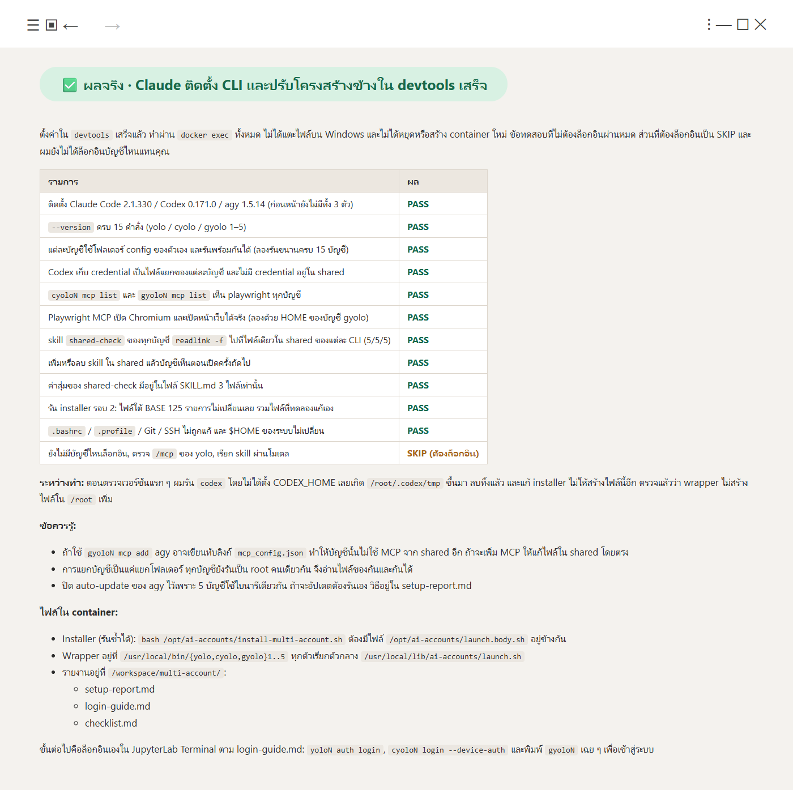

## ขั้นที่ 2 · 🖥️ ตรวจผลข้างใน devtools (~5 นาที)

### 2.1 · เปิด JupyterLab แล้วตรวจคำสั่ง

ใน VS Code คลิกขวา **devtools** → **Open in External Browser** → **8888 localhost:8885** → คลิก **Terminal**

> [!IMPORTANT]
> **📋 คัดลอกกล่องนี้ → JupyterLab Terminal**
>
> ```bash
> which yolo1 cyolo1 gyolo1
> yolo1 --version; cyolo1 --version; gyolo1 --version
> yolo2 --version; cyolo2 --version; gyolo2 --version
> yolo3 --version; cyolo3 --version; gyolo3 --version
> ```

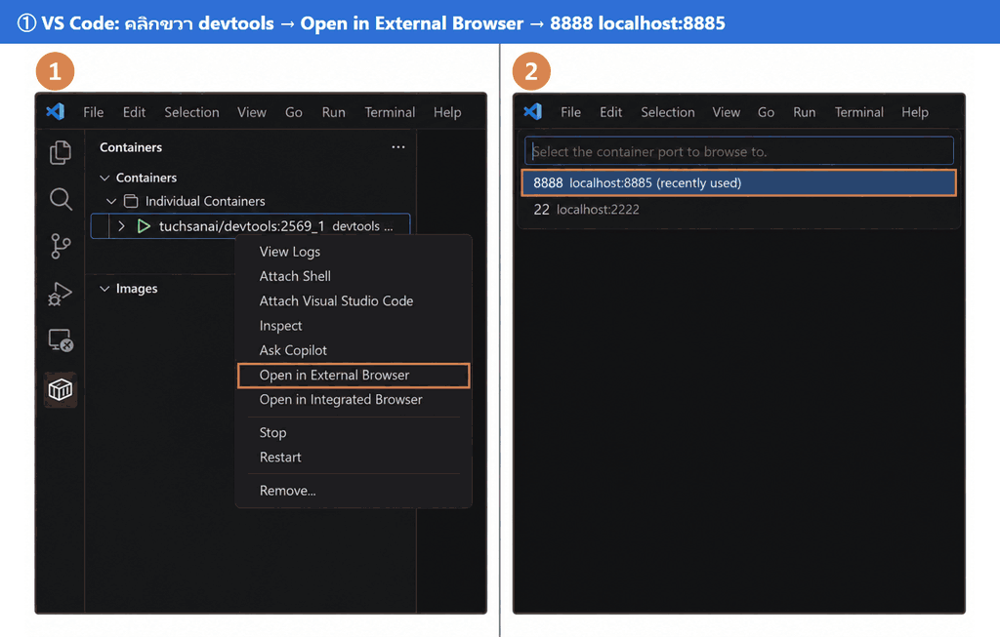

### 2.2 · ตรวจโครงสร้างโฟลเดอร์ใน File Browser

ใน File Browser ไปที่ `/` → **root** → **ai-accounts** จะเห็น `.Claude`, `.Codex` และ `.Gemini` (gyolo1–gyolo5 + shared)

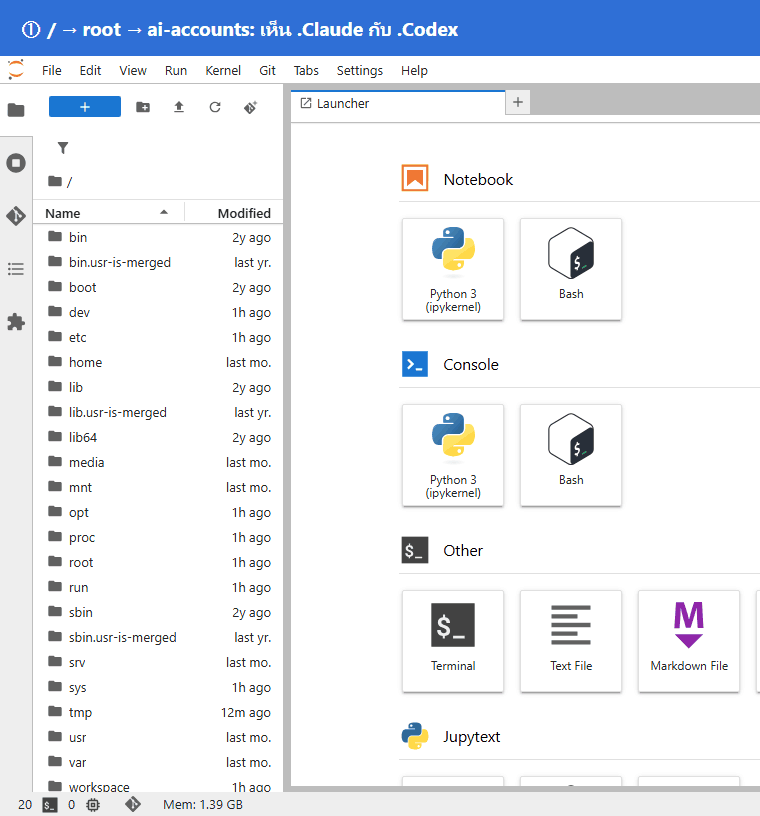

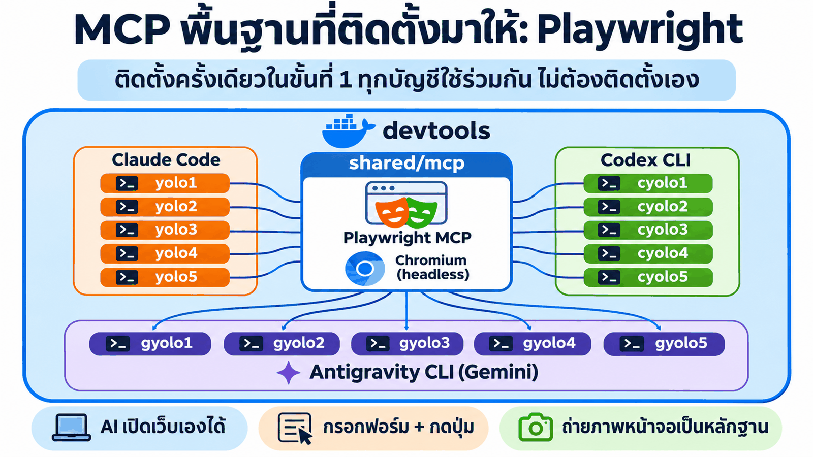

## ขั้นที่ 3 · 🖥️ ล็อกอินทีละบัญชี แล้วให้ Claude ตรวจ (~15 นาที)

### 3.1 · ล็อกอิน: 1 บัญชี = 1 แท็บ Terminal

ใน JupyterLab กด **+ → Terminal** เปิดแท็บใหม่ต่อ 1 บัญชี ทำอย่างน้อย `yolo1`, `yolo2`, `cyolo1`, `cyolo2`, `gyolo1`, `gyolo2` ใช้เฉพาะบัญชีที่มีสิทธิ์ใช้จริง และห้ามแชร์ข้อมูลล็อกอิน

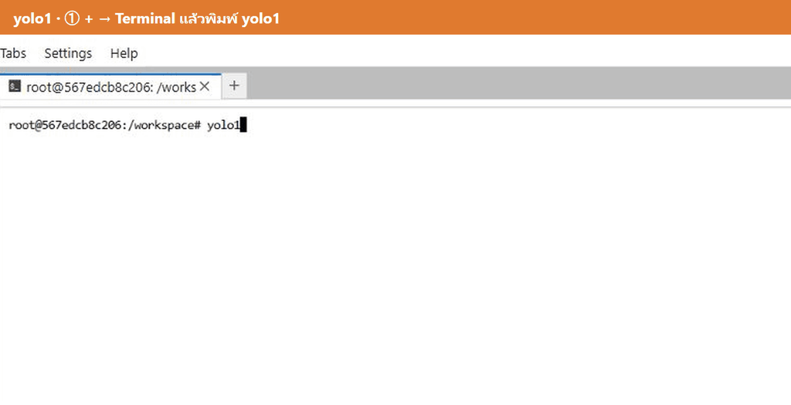

| พิมพ์ | หน้าจอล็อกอิน | เลือก | โมเดลที่ใช้ในแลป |
|---|---|---|---|
| `yolo1` … `yolo5` | Select login method | **Claude account with subscription** → ยืนยันในเบราว์เซอร์ → **Yes, I trust this folder** | `/model` → **Fable** · Medium |
| `cyolo1` … `cyolo5` | Choose how you want to use Codex | **Sign in with ChatGPT** (ถ้าเบราว์เซอร์ส่งผลกลับไม่ได้ ใช้ **Device Code** หรือ `cyolo1 login --device-auth`) | `/model` → **GPT-6-Astra** · Medium |
| `gyolo1` … `gyolo5` | Authentication required + ลิงก์ `accounts.google.com` | คัดลอกลิงก์ไปเปิดในเบราว์เซอร์ → ล็อกอิน Google → คัดลอกรหัสที่ได้กลับมาวางใน Terminal → Enter | ใช้ค่าเริ่มต้น |

เสร็จแต่ละบัญชีพิมพ์ `/exit` (Claude, Antigravity) หรือกด Ctrl+C (Codex)

### 3.2 · 💻 ให้ Claude Code Desktop ตรวจว่าล็อกอินครบหรือยัง

> [!IMPORTANT]
> **📋 คัดลอกกล่องนี้ → Claude Code Desktop แล้วกด Enter**
>
> ```text
> ช่วยตรวจสถานะล็อกอินทุกบัญชีใน container devtools ทำผ่าน docker exec เท่านั้น ห้ามล็อกอินแทนฉัน ห้ามแก้ไฟล์ใด ๆ
> - Claude: yolo1 ถึง yolo5 ใช้คำสั่ง yoloN auth status แล้วดูเฉพาะค่า "loggedIn"
> - Codex: cyolo1 ถึง cyolo5 ใช้คำสั่ง cyoloN login status
> - Antigravity: gyolo1 ถึง gyolo5 ใช้คำสั่ง gyoloN models (ขึ้น "Please sign in" = ยังไม่ล็อกอิน)
> สรุปเป็นตาราง บัญชี | ล็อกอินแล้ว/ยัง เท่านั้น ห้ามแสดงอีเมล ชื่อองค์กร หรือ token
> ถ้ามีบัญชีที่ยังไม่ล็อกอิน ให้บอกวิธีล็อกอินใน JupyterLab Terminal
> (พิมพ์ yoloN แล้วเลือก Claude account with subscription / พิมพ์ cyoloN หรือ cyoloN login --device-auth
>  / พิมพ์ gyoloN แล้วเปิดลิงก์ล็อกอิน Google และวางรหัสกลับมา)
> ```

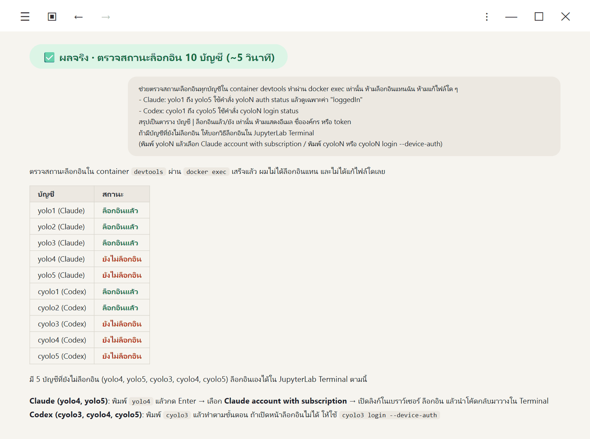

## ขั้นที่ 4 · 💻 ให้ Claude Code Desktop ทดสอบ skill/MCP ข้ามบัญชี (~15 นาที)

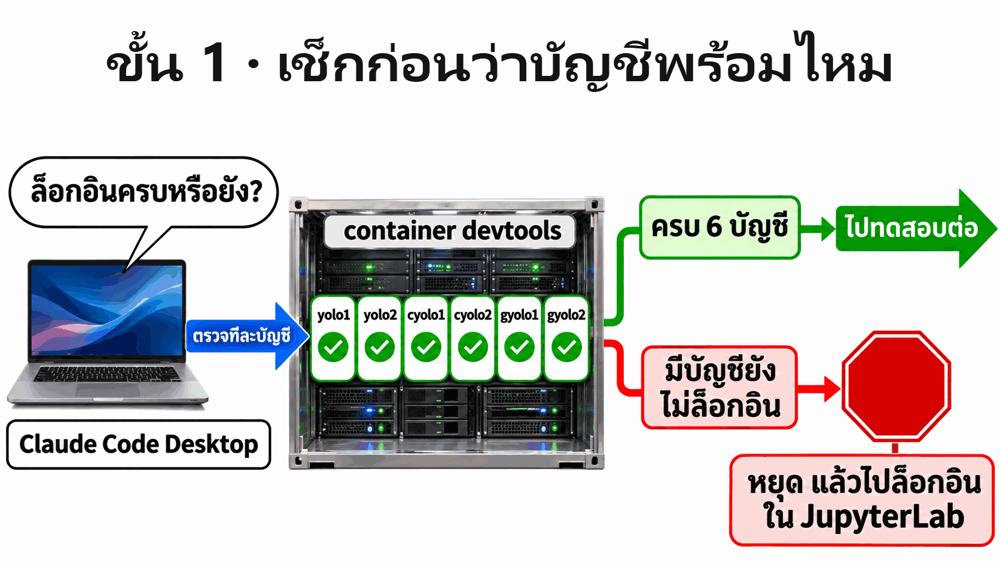

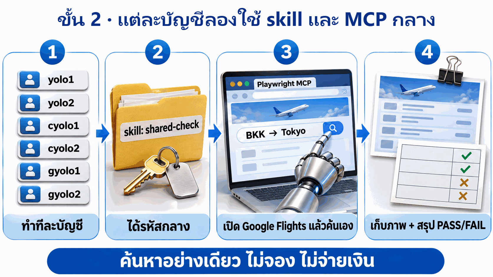

### 4.1 · วางพรอมต์ทดสอบ

> [!IMPORTANT]
> **📋 คัดลอกกล่องนี้ → Claude Code Desktop แล้วกด Enter**
>
> ```text
> ทดสอบบัญชี yolo1 yolo2 cyolo1 cyolo2 gyolo1 gyolo2 ใน container devtools ผ่าน docker exec ห้ามล็อกอินแทนฉัน ห้ามแก้ไฟล์ตั้งค่า
>
> ขั้น 1 ตรวจล็อกอิน: ใช้ yoloN auth status, cyoloN login status และ gyoloN models
> สรุปตาราง บัญชี | ล็อกอินแล้ว/ยัง ห้ามแสดงอีเมลหรือ token ถ้ามีบัญชีที่ยังไม่ล็อกอิน ให้หยุดแล้วบอกฉัน
>
> ขั้น 2 ให้ทีละบัญชีทำ "งาน" ข้างล่าง ในโฟลเดอร์ /workspace/multi-account (timeout บัญชีละ 15 นาที)
> ใช้คำสั่ง yoloN -p "งาน", cyoloN exec --skip-git-repo-check "งาน" หรือ gyoloN -p "งาน" โดยแทน NAME ด้วยชื่อบัญชี
>
> งาน: ใช้ skill shared-check แล้วบอกรหัสที่ได้ จากนั้นใช้ Playwright MCP เท่านั้น เปิด https://www.google.com/travel/flights?hl=en ค้นเที่ยวบินเที่ยวเดียว BKK ไป Tokyo วันที่ 15 ของเดือนหน้า ค้นหาอย่างเดียว ห้ามจอง แล้วบันทึกภาพหน้าผลค้นหาเป็น /workspace/multi-account/evidence/NAME.png และบอกเที่ยวบินอันดับ 1 ถ้าเว็บ error ให้บอกตามจริง
>
> ขั้น 3 บัญชีไหนเว็บ error ให้รันบัญชีนั้นซ้ำอีก 1 รอบ
> แล้วสรุปตาราง บัญชี | รหัส shared-check | เที่ยวบินอันดับ 1 | PASS/FAIL
> ```

ถ้ายังล็อกอินไม่ครบ Claude จะหยุดที่ขั้น 1

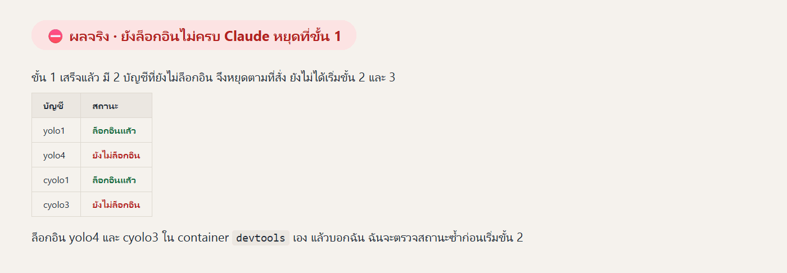

### 4.2 · ผลจริง

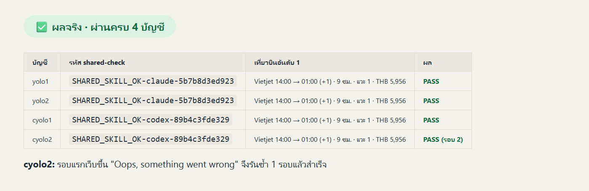

ผลจริงของ gyolo (Antigravity CLI) ด้วยงานเดียวกัน

| บัญชี | รหัส shared-check | เที่ยวบินอันดับ 1 | ผล |
|---|---|---|---|
| `gyolo1` | `SHARED_SKILL_OK-gemini-6af40b8f4f25` | Vietjet BKK→HND · 9 ชม. · แวะ 1 จุด · THB 7,472 | PASS |

บัญชีของ CLI เดียวกันต้องได้รหัส `shared-check` เดียวกัน ถ้าเว็บขึ้น error แบบนี้เป็นปัญหาของเว็บภายนอก พรอมต์จะรันบัญชีนั้นซ้ำให้ 1 รอบ

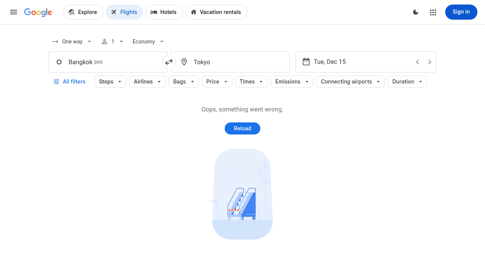

ถ้ายัง FAIL ให้สั่งรันเฉพาะบัญชีนั้นอีกครั้ง

> [!IMPORTANT]
> **📋 คัดลอกกล่องนี้ → Claude Code Desktop (เปลี่ยน yolo2 เป็นบัญชีที่ FAIL)**
>
> ```text
> รัน yolo2 ซ้ำอีกรอบด้วยพรอมต์เดิม แล้วอัปเดตหลักฐาน
> ```

### 4.3 · เปรียบเทียบหลักฐานแต่ละบัญชี

ใน File Browser ไปที่ `/workspace/multi-account/evidence/` แต่ละบัญชีมีภาพผลค้นหาของตัวเอง

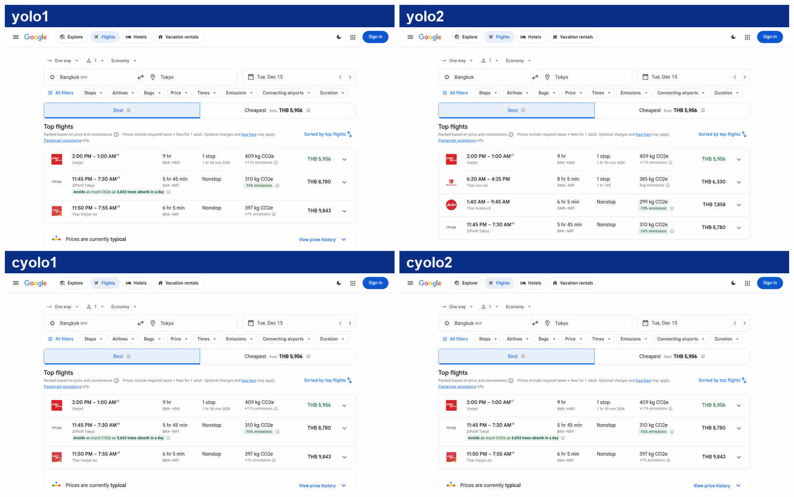

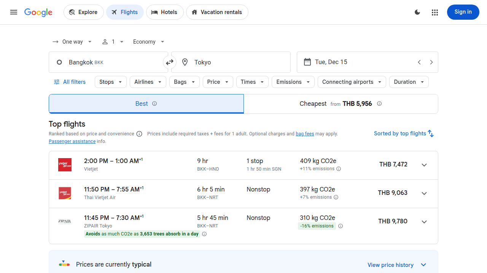

GIF ด้านล่างเปรียบเทียบบัญชี yolo และ cyolo ทีละขั้น มุมซ้ายบนของภาพบอกว่ามาจากบัญชีไหน

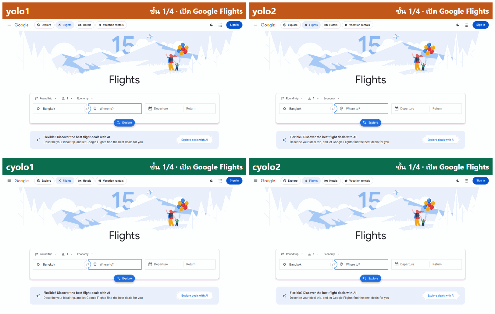

| yolo1 | yolo2 |
|---|---|
| 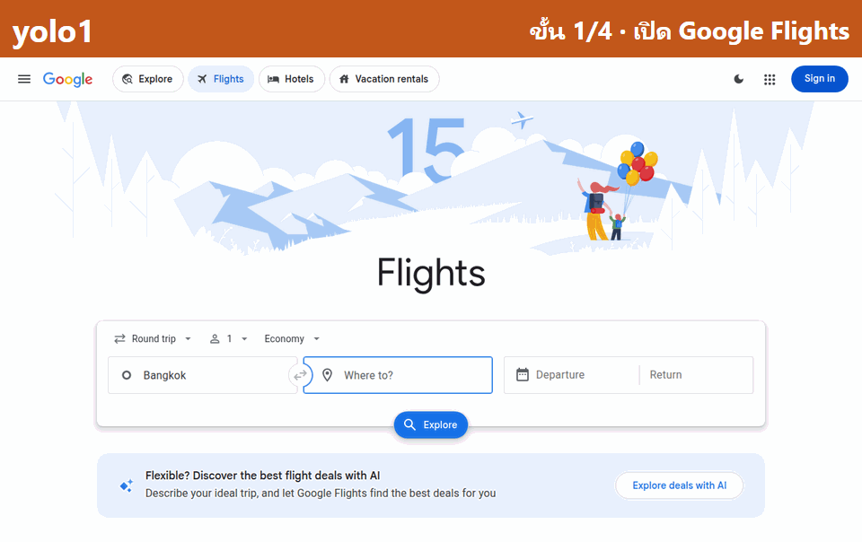 |  |
| **cyolo1** | **cyolo2** |
|  | 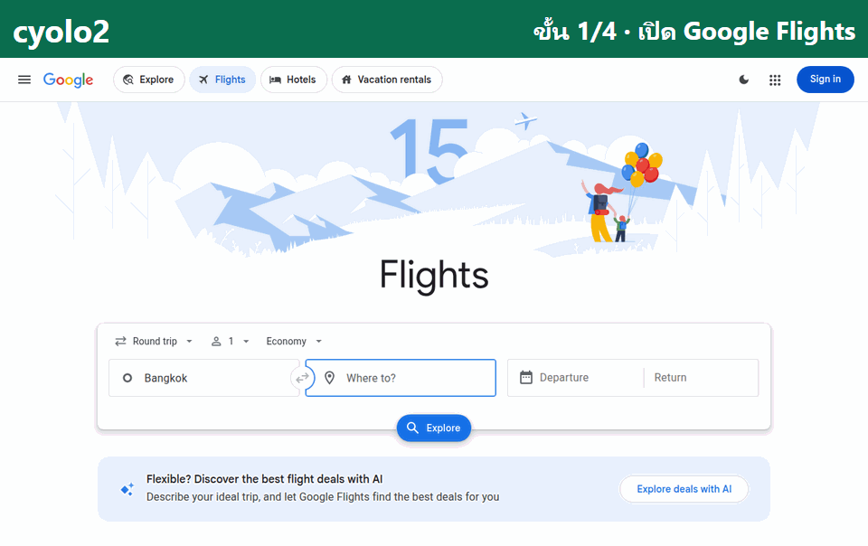 |
