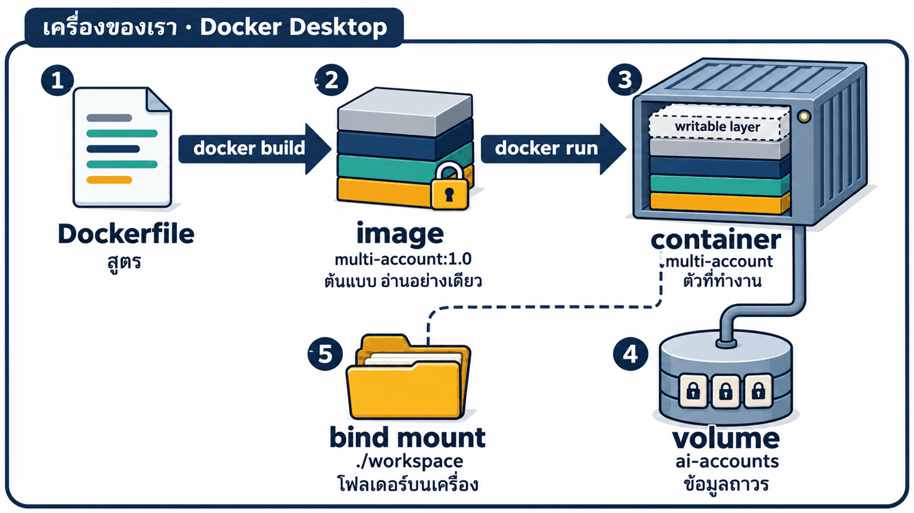
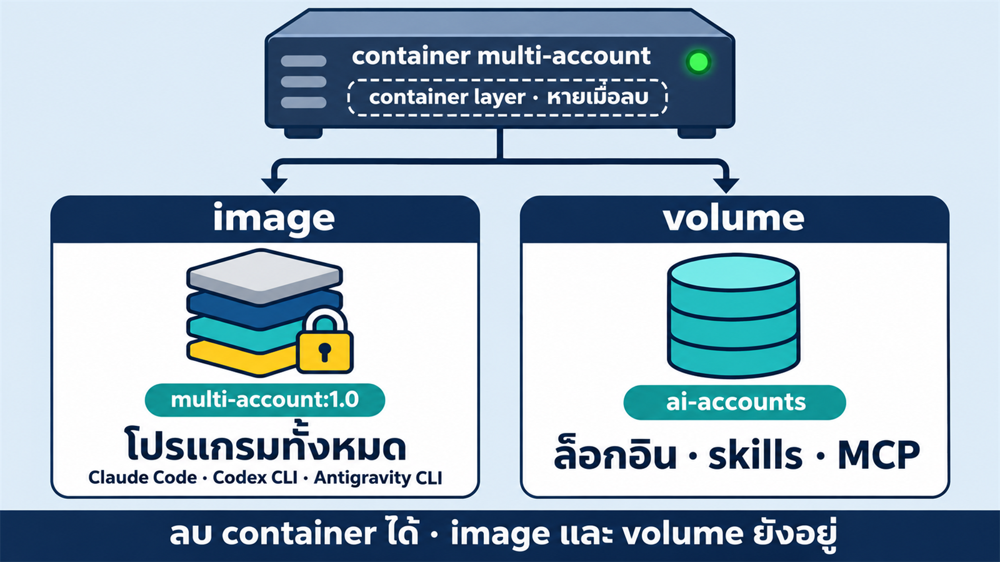
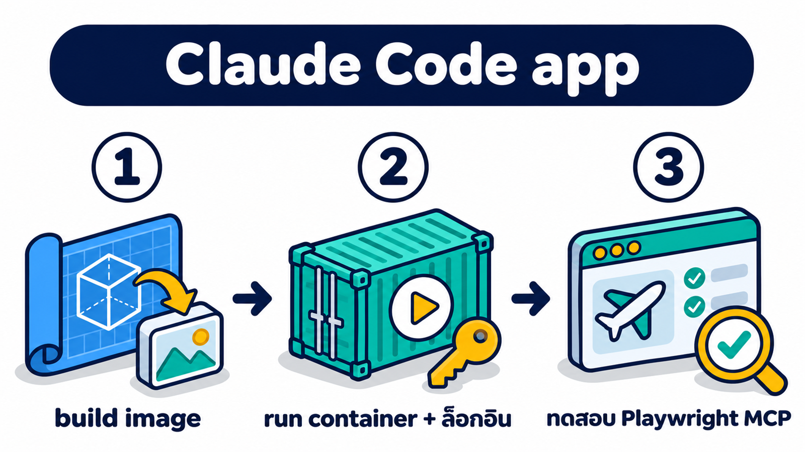
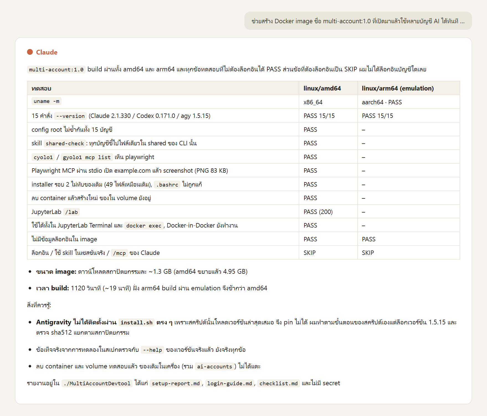
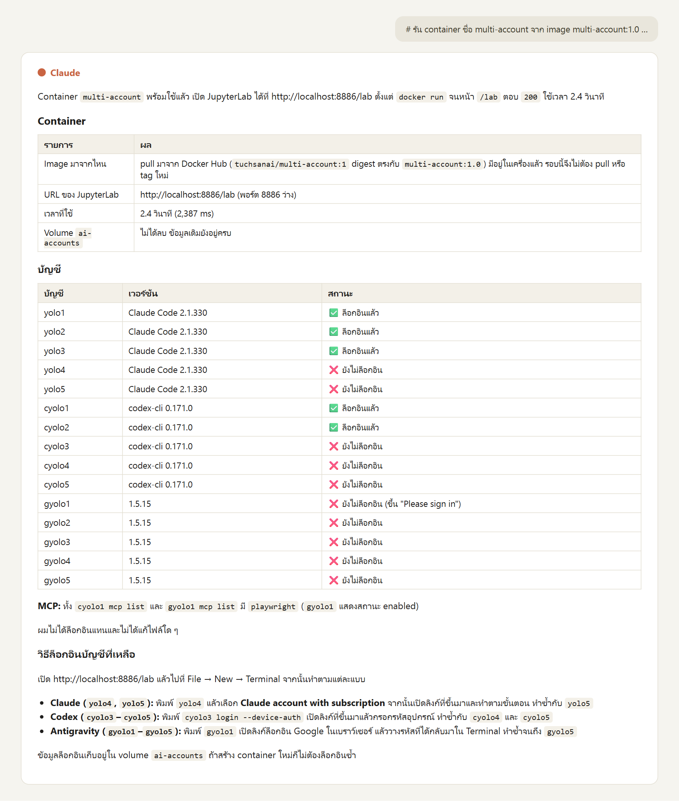
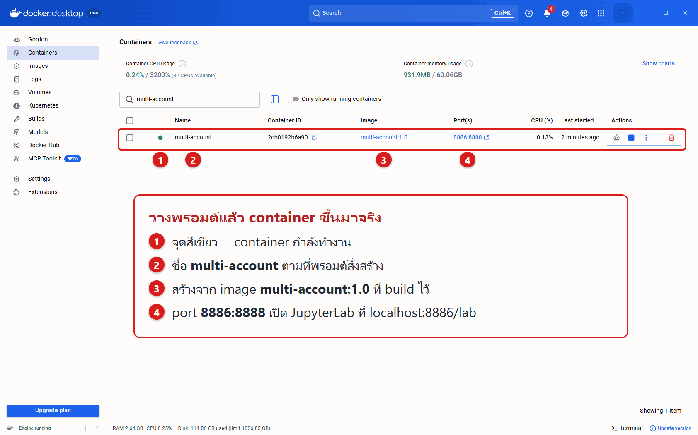
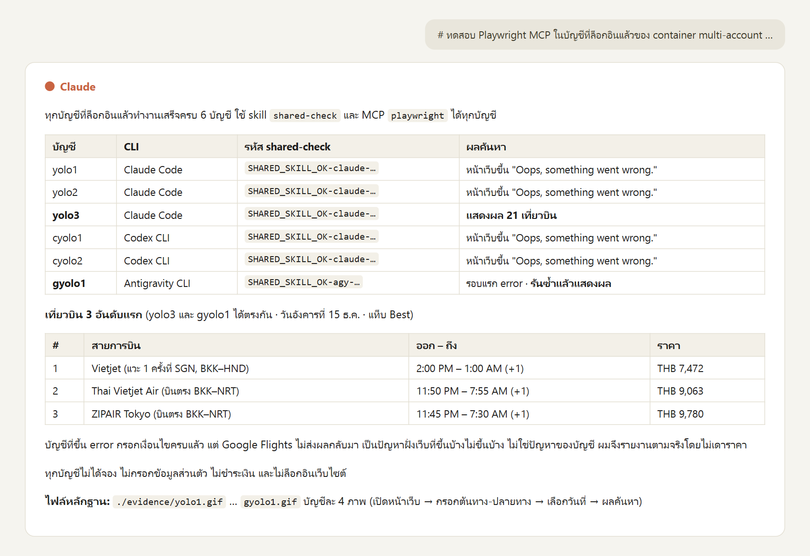

# การสร้าง Docker image สำหรับระบบหลายบัญชีจาก Dockerfile

**สไลด์ประกอบการสอน:** [Multi_Account_Container_Slides.html](Multi_Account_Container_Slides.html) (เปิดในเบราว์เซอร์ กด ← → เปลี่ยนหน้า)

บทนี้นำระบบหลายบัญชีจากบท [`02_Setup_Multi_Account`](../02_Setup_Multi_Account/README.md) ได้แก่ `yolo1–5` (Claude Code), `cyolo1–5` (Codex CLI) และ `gyolo1–5` (Antigravity CLI) มาเขียนเป็น Dockerfile แล้ว build เป็น image `multi-account:1.0` ทุกครั้งที่ `docker run` จะได้ container ที่พร้อมใช้ทันที

## 1. เตรียมสภาพแวดล้อมได้ 3 แบบ


| | แบบที่ 1 · devtools | แบบที่ 2 · ติดตั้งภายหลัง | แบบที่ 3 · build จาก Dockerfile (บทนี้) |
|---|---|---|---|
| บทเรียน | [01_Docker_VSCode_Setup](../01_Docker_VSCode_Setup/README.md) | [02_Setup_Multi_Account](../02_Setup_Multi_Account/README.md) | บทนี้ |
| AI CLI | ไม่มี | ติดตั้งผ่าน `docker exec` | ติดตั้งไว้ใน image |
| ข้อมูลล็อกอิน | – | ภายใน container | volume `ai-accounts` |
| เมื่อลบ container | ได้เครื่องมือพื้นฐานชุดเดิม | ต้องติดตั้งและล็อกอินใหม่ | `docker run` ใหม่ ใช้ต่อได้ทันที |

## 2. องค์ประกอบของ Docker



| องค์ประกอบ | ความหมาย | ในบทนี้ |
|---|---|---|
| **Dockerfile** | ขั้นตอนการสร้าง image ทีละคำสั่ง | `MultiAccountDevtool/Dockerfile` |
| **image** | ต้นแบบที่อ่านได้อย่างเดียว (read-only) | `multi-account:1.0` |
| **container** | ตัวที่ทำงานจริง สร้างจาก image ลบแล้วไฟล์ที่เขียนเพิ่มหายไปด้วย | `multi-account` |
| **volume** | ที่เก็บข้อมูลแยกจาก container ไม่หายเมื่อลบ container | `ai-accounts` → `/root/ai-accounts` |

### 2.1 โปรแกรมอยู่ใน image · ล็อกอินอยู่ใน volume



image **ไม่มีข้อมูลล็อกอินอยู่ภายใน** จึงแชร์ให้ผู้อื่นได้โดยไม่เปิดเผยบัญชีของเรา ทุกครั้งที่ container เริ่มทำงาน installer จะเตรียมโฟลเดอร์ใน volume โดยไม่เขียนทับของเดิม

### 2.2 สาม CLI ใน container เดียว


| คำสั่ง | CLI | แยกบัญชีด้วย | โฟลเดอร์บัญชี |
|---|---|---|---|
| `yolo1` … `yolo5` | Claude Code | `CLAUDE_CONFIG_DIR` | `/root/ai-accounts/.Claude/yoloN` |
| `cyolo1` … `cyolo5` | Codex CLI | `CODEX_HOME` | `/root/ai-accounts/.Codex/cyoloN` |
| `gyolo1` … `gyolo5` | Antigravity CLI (`agy`) | `HOME` เฉพาะ process ของ agy | `/root/ai-accounts/.Gemini/gyoloN` |

Antigravity CLI ไม่มีตัวแปรกำหนดโฟลเดอร์ config จึงต้องเปลี่ยน `HOME` ให้ agy เท่านั้น ส่วน `HOME` ของระบบยังเป็น `/root` เหมือนเดิม

## 3. ภาพรวมการทดลอง



| ขั้น | ทำที่ไหน | ใครทำ | เวลา |
|---|---|---|---|
| **1 · build image (amd64 + arm64)** | Claude Code app | Claude | ~30 นาที |
| **2 · run container + ล็อกอิน** | Claude Code app → JupyterLab | Claude + ผู้เรียน | ~1 นาที + ล็อกอิน ~15 นาที |
| **3 · ทดสอบ Playwright MCP** | Claude Code app | Claude | ~5 นาที |

**ก่อนเริ่ม:** Docker Desktop ขึ้น **Engine running** · Claude Code app ล็อกอินแล้ว · ดิสก์ว่างอย่างน้อย ~10 GB

**เปิดโฟลเดอร์งาน:** Claude Code app → **Code** → **New session** → เลือกโฟลเดอร์ `03_MultiAccount_Container`

```text
03_MultiAccount_Container/
├── 00_Devtool_Container/     ← Dockerfile มาตรฐานของ devtools (input ที่ 1)
├── prompt_multi_account.md   ← สเปกระบบหลายบัญชี (input ที่ 2)
└── _solution/                ← เฉลยจากการรันจริง (ถ้าอยากให้ Claude ทำเองทั้งหมด ให้ย้ายออกก่อน)
```

## ขั้นที่ 1 · ให้ Claude สร้าง image (~30 นาที)

**ทำไมต้อง build:** ถ้าให้ผู้เรียนแต่ละคนติดตั้งเอง ผลจะต่างกันทุกเครื่อง เมื่อเขียนเป็น Dockerfile แล้ว build ครั้งเดียว ทุกเครื่องจะได้ของชุดเดียวกัน

**สองสถาปัตยกรรมใน image ชื่อเดียว:** build ทั้ง `linux/amd64` (Windows / Intel) และ `linux/arm64` (Mac Apple Silicon) เครื่องของผู้เรียนจะดึงแบบที่ตรงกับ CPU ของตัวเองให้อัตโนมัติ ไม่ต้องรันผ่าน emulation


### 1.1 · สเปก `prompt_multi_account.md`

| หัวข้อ | สาระ |
|---|---|
| ฐานของ image | Dockerfile ในโฟลเดอร์ Input (บทนี้ใช้ `00_Devtool_Container`) + AI CLI 3 ตัว (pin เวอร์ชัน) รองรับ amd64 และ arm64 |
| เป้าหมาย | `yolo1–5`, `cyolo1–5`, `gyolo1–5` แยกโฟลเดอร์ต่อบัญชี และ `shared` สำหรับ skill และ MCP กลางของแต่ละ CLI |
| กติกา | แยก credential ต่อบัญชี, installer รันซ้ำได้ไม่ทับของเดิม, MCP ตัวแรกคือ Playwright, skill ตัวอย่าง `shared-check` |
| ข้อเท็จจริงจากการทดลอง | ข้อควรรู้เฉพาะของแต่ละ CLI เพื่อไม่ต้องลองผิดลองถูก |
| ทดสอบ · รายงาน | เกณฑ์ PASS/FAIL/SKIP และรายงาน 3 ไฟล์ |

อ่านฉบับเต็มได้ที่ [`prompt_multi_account.md`](prompt_multi_account.md)

### 1.2 · วางพรอมต์

> [!IMPORTANT]
> **📋 คัดลอกกล่องนี้ → Claude Code app แล้วกด Enter** (อนุญาตคำสั่ง `docker` เมื่อระบบถาม)
>
> ````markdown
> # สร้าง Docker image `multi-account:1.0` ที่เปิดมาแล้วใช้หลายบัญชี AI ได้ทันที
>
> ## 1. Input · Spec · Output
>
> **Input** · `./00_Devtool_Container`
> โฟลเดอร์ที่มี Dockerfile ใช้เป็นฐานของ image (ไม่แก้ไฟล์ในโฟลเดอร์นี้)
>
> **Spec** · `./prompt_multi_account.md`
> สเปกระบบหลายบัญชี ทุกข้อต้องเป็นจริงใน image
> ส่วน "ข้อเท็จจริงจากการทดลอง" ให้ลองกับ CLI เวอร์ชันที่ติดตั้งจริงก่อนใช้ (ดู flag ด้วย `--help`)
>
> **Output** · `./MultiAccountDevtool` และ image `multi-account:1.0`
> คัดลอก Input มาเป็นโฟลเดอร์นี้ แล้วแก้ในนี้เท่านั้น (ถ้ามีอยู่แล้ว ให้เทียบกับ Spec แล้วแก้เฉพาะที่ขาด)
>
> ## 2. สิ่งที่ต้องอยู่ใน image
>
> - Claude Code, Codex CLI, Antigravity CLI และ Playwright MCP (pin เวอร์ชันทุกตัว) + Chromium + ฟอนต์ไทย
> - installer และคำสั่ง `yolo1..5` / `cyolo1..5` / `gyolo1..5` ใน `/usr/local/bin`
>   ใช้ได้ทั้งใน JupyterLab Terminal และ `docker exec`
> - ไม่มีข้อมูลล็อกอินใน image: `/root/ai-accounts` เป็น volume
>   และ installer รันทุกครั้งที่ container start โดยไม่ทับของเดิม
> - คง Docker-in-Docker และ JupyterLab ไว้
> - รองรับ `linux/amd64` และ `linux/arm64` (Mac Apple Silicon) ใน image ชื่อเดียว
>
> ## 3. Build
>
> ```bash
> docker buildx build --platform linux/amd64,linux/arm64 -t multi-account:1.0 --load ./MultiAccountDevtool
> ```
>
> ## 4. ทดสอบ
>
> ใช้ container และ volume ทดสอบชื่อใหม่ แล้วลบทิ้งเมื่อเสร็จ รายงาน PASS / FAIL / SKIP ตามจริง
> ข้อที่ต้องล็อกอินให้เป็น SKIP ห้ามล็อกอินแทนผม
>
> **สถาปัตยกรรมของเครื่องนี้**
>
> - `yolo1..5` / `cyolo1..5` / `gyolo1..5 --version` ครบ 15 คำสั่ง และ config root คนละโฟลเดอร์
> - skill `shared-check` ทุกบัญชีชี้ไปไฟล์เดียวกันใน shared ของ CLI นั้น
> - `cyolo1 mcp list` และ `gyolo1 mcp list` เห็น `playwright`
> - Playwright MCP ผ่าน stdio เปิด https://example.com แล้ว screenshot ได้
> - installer รอบ 2 ไม่ทับของเดิม และ `.bashrc` ไม่ถูกแก้
> - ลบ container แล้วสร้างใหม่ ของใน volume ยังอยู่
> - JupyterLab `/lab` ตอบ `200`
>
> **อีกสถาปัตยกรรมหนึ่ง** (รันผ่าน emulation ด้วย `--platform`)
>
> - `uname -m` ถูกต้อง และ 15 คำสั่ง `--version` ครบ
>
> ## 5. รายงาน
>
> - เขียนรายงานตามหัวข้อ "รายงาน" ของ Spec ไว้ใน Output (`./MultiAccountDevtool`) ห้ามมี secret
> - สรุปเป็นตารางสั้น ๆ: ผลทดสอบแยกตามสถาปัตยกรรม · ขนาด image · เวลา build แล้วหยุด
> ````

### 1.3 · ผลจริง

**0 FAIL ทั้ง 2 สถาปัตยกรรม** (ข้อที่ต้องล็อกอิน = SKIP) amd64 ทดสอบครบทุกข้อ arm64 รันผ่าน emulation ได้ `aarch64` และ 15 คำสั่งครบ ดาวน์โหลดสถาปัตยกรรมละ ~1.3 GB ได้ Claude Code 2.1.330 · Codex CLI 0.171.0 · Antigravity CLI 1.5.15 · Playwright MCP 0.0.86



ไฟล์ที่ Claude สร้าง (เฉลยอยู่ที่ [`_solution/MultiAccountDevtool/`](_solution/MultiAccountDevtool/))

```text
MultiAccountDevtool/
├── Dockerfile        ← devtools + AI CLI 3 ตัว + Playwright MCP/Chromium + ฟอนต์ไทย + ระบบหลายบัญชี (amd64/arm64)
├── start.sh          ← multi-account-install (ทุกครั้งที่ start) + dockerd + jupyter lab
├── multi-account/    ← installer และตัวเรียก yoloN / cyoloN / gyoloN
├── docker-compose.yml
└── setup-report.md · login-guide.md · checklist.md
```

## ขั้นที่ 2 · สร้าง container + ล็อกอิน (~1 นาที + ล็อกอิน)

ถ้าไม่ได้ทำขั้นที่ 1 พรอมต์นี้จะดึง image สำเร็จรูป `tuchsanai/multi-account:1` จาก Docker Hub มาใช้แทน (มีทั้ง amd64 และ arm64 เครื่อง Mac จะได้ arm64 อัตโนมัติ)


> [!IMPORTANT]
> **📋 คัดลอกกล่องนี้ → Claude Code app แล้วกด Enter**
>
> ````markdown
> # รัน container ชื่อ `multi-account` จาก image `multi-account:1.0`
>
> ## 1. เตรียม image และ container
>
> ถ้ายังไม่มี image `multi-account:1.0` ให้ดึงจาก Docker Hub แล้วตั้งชื่อใหม่
>
> ```bash
> docker pull tuchsanai/multi-account:1
> docker tag  tuchsanai/multi-account:1 multi-account:1.0
> ```
>
> ถ้ามี container ชื่อ `multi-account` อยู่แล้ว ให้ลบออก (ห้ามลบ volume `ai-accounts`)
>
> ```bash
> docker rm -f multi-account
> ```
>
> ## 2. สร้าง container
>
> `PORT` เริ่มที่ `8886` ถ้าชนใช้เลขว่างถัดไป
>
> ```bash
> docker run -dit \
>   --name multi-account \
>   --privileged \
>   -p <PORT>:8888 \
>   -v ai-accounts:/root/ai-accounts \
>   multi-account:1.0 \
>   bash -c 'F=/etc/jupyter/jupyter_server_config.py; grep -q delete_to_trash $F || printf "c.FileContentsManager.delete_to_trash = False\nc.FileContentsManager.always_delete_dir = True\n" >> $F; exec /usr/local/bin/start.sh'
> ```
>
> จับเวลาตั้งแต่ `docker run` จน `http://localhost:<PORT>/lab` ตอบ `200`
>
> ## 3. ตรวจผ่าน `docker exec` แล้วสรุปเป็นตาราง
>
> - `yolo1..5`, `cyolo1..5` และ `gyolo1..5 --version`
> - `cyolo1 mcp list` และ `gyolo1 mcp list` ต้องเห็น `playwright`
> - สถานะล็อกอินทุกบัญชี (ห้ามล็อกอินแทนผม ห้ามแก้ไฟล์ใด ๆ)
>   - Claude: `yolo1` ถึง `yolo5` ใช้คำสั่ง `yoloN auth status` แล้วดูเฉพาะค่า `loggedIn`
>   - Codex: `cyolo1` ถึง `cyolo5` ใช้คำสั่ง `cyoloN login status`
>   - Antigravity: `gyolo1` ถึง `gyolo5` ใช้คำสั่ง `gyoloN models` (ขึ้น "Please sign in" = ยังไม่ล็อกอิน)
> - ตารางสรุป: image มาจากไหน (build เอง / pull) · URL ของ JupyterLab · เวลาที่ใช้
>   และตาราง บัญชี | เวอร์ชัน | ล็อกอินแล้ว/ยัง ห้ามแสดงอีเมล ชื่อองค์กร หรือ token
> - ถ้ามีบัญชีที่ยังไม่ล็อกอิน ให้บอกวิธีล็อกอินใน JupyterLab Terminal
>   (พิมพ์ `yoloN` แล้วเลือก Claude account with subscription / พิมพ์ `cyoloN login --device-auth`
>   / พิมพ์ `gyoloN` แล้วเปิดลิงก์ล็อกอิน Google และวางรหัสกลับมา)
> ````

| option | ความหมาย |
|---|---|
| `-dit` | รันเบื้องหลัง (`-d`) พร้อม terminal (`-it`) |
| `--name multi-account` | ตั้งชื่อ container |
| `--privileged` | เปิดให้ใช้ Docker-in-Docker |
| `-p <PORT>:8888` | เปิด JupyterLab ที่ `http://localhost:<PORT>/lab` |
| `-v ai-accounts:/root/ai-accounts` | volume เก็บล็อกอิน skill และ MCP ไม่หายเมื่อลบ container |
| `bash -c '...'` | ให้ JupyterLab ลบไฟล์/โฟลเดอร์ได้จริง แล้วเริ่ม `start.sh` |

**ผลจริง:** container พร้อมใน **2.4 วินาที** ครบ 15 คำสั่ง และ `cyolo1` / `gyolo1 mcp list` เห็น `playwright`



*เครื่องตัวอย่างใช้ volume `ai-accounts` ที่เคยล็อกอิน yolo และ cyolo ไว้แล้ว จึงขึ้น ✅ บางบัญชี ของผู้เรียนจะเป็น ❌ ทั้งหมดจนกว่าจะล็อกอิน*



### ล็อกอิน (~15 นาที)

เปิด JupyterLab ตาม URL ที่ Claude แจ้ง → **+ → Terminal** ล็อกอิน 1 บัญชีต่อ 1 แท็บ อย่างน้อย CLI ละ 1 บัญชี (ดูภาพเคลื่อนไหวที่[ขั้นที่ 3.1 ของบท 02](../02_Setup_Multi_Account/README.md#31--ล็อกอิน-1-บัญชี--1-แท็บ-terminal))

| พิมพ์ | หน้าจอล็อกอิน | เลือก |
|---|---|---|
| `yolo1` … `yolo5` | Select login method | **Claude account with subscription** → ยืนยันในเบราว์เซอร์ → **Yes, I trust this folder** → `/exit` |
| `cyolo1` … `cyolo5` | Choose how you want to use Codex | **Sign in with ChatGPT** หรือ `cyolo1 login --device-auth` |
| `gyolo1` … `gyolo5` | Authentication required + ลิงก์ `accounts.google.com` | เปิดลิงก์ในเบราว์เซอร์ → ล็อกอิน Google → วางรหัสกลับใน Terminal → Enter → `/exit` |

ข้อมูลล็อกอินอยู่ใน **volume `ai-accounts`** ล็อกอินครั้งเดียว ใช้ต่อได้แม้ลบ container หรือ build image ใหม่

> **ผู้เรียนต้องล็อกอินด้วยตนเองเสมอ** ห้ามส่งรหัสผ่าน code หรือ URL ที่มี token ให้ AI หรือผู้อื่น

## ขั้นที่ 3 · ทดสอบ Playwright MCP ทุกบัญชีที่ล็อกอินแล้ว (~5 นาที)

แต่ละบัญชีใช้ **Playwright MCP** ใน image เปิด Google Flights ค้นหา BKK → Tokyo แล้ว screenshot ทุกขั้น **ค้นหาอย่างเดียว ไม่จอง ไม่ชำระเงิน**

> [!IMPORTANT]
> **📋 คัดลอกกล่องนี้ → Claude Code app แล้วกด Enter**
>
> ```markdown
> # ทดสอบ Playwright MCP ในบัญชีที่ล็อกอินแล้วของ container `multi-account`
>
> ให้แต่ละบัญชีที่ล็อกอินแล้วใน container `multi-account` ทำงานต่อไปนี้ ห้ามล็อกอินแทนผม ห้ามแก้ไฟล์ตั้งค่า
>
> - ใช้ skill `shared-check` แล้วบอกรหัสที่ได้
> - ใช้ MCP ชื่อ `playwright` เท่านั้น ห้ามใช้ curl, python หรือ web search
> - เปิด https://www.google.com/travel/flights?hl=en
> - ค้นหาเที่ยวบินเที่ยวเดียว Bangkok (BKK) ไป Tokyo ชั้นประหยัด ผู้ใหญ่ 1 คน วันที่ 15 ของเดือนถัดไป
> - ค้นหาอย่างเดียว ห้ามกดจอง ห้ามกรอกข้อมูลส่วนตัว ห้ามชำระเงิน ห้ามล็อกอินเว็บไซต์ใด
> - screenshot ทุกขั้นตอนด้วย tool ของ playwright: เปิดหน้าเว็บ, กรอกต้นทาง-ปลายทาง, เลือกวันที่, ผลค้นหา
> - รายงานเที่ยวบิน 3 อันดับแรก (สายการบิน เวลาออก-ถึง ราคา) ตามที่เห็นบนหน้าเว็บ
>   ถ้าหน้าเว็บไม่แสดงผล ให้รายงานตามจริง ห้ามเดาราคา
>
> เมื่อทุกบัญชีเสร็จ ให้รวม screenshot ของแต่ละบัญชีตามลำดับขั้นตอนเป็นไฟล์ `./evidence/<บัญชี>.gif` บนเครื่องผม
> ```

**ผลจริง:** ทุกบัญชีที่ล็อกอินแล้ว (`yolo1–3`, `cyolo1–2`, `gyolo1`) ใช้ skill และ Playwright MCP ได้ครบ `yolo3` และ `gyolo1` ได้ 3 อันดับแรกตรงกัน อันดับ 1 คือ Vietjet THB 7,472 ส่วนบัญชีที่เหลือ Google Flights ขึ้น "Oops, something went wrong." Claude จึงรายงานตามจริงโดยไม่เดาราคา



*เครื่องตัวอย่างใช้ volume เดิมที่มี skill `shared-check` จากแลปก่อนหน้า `yolo` กับ `cyolo` จึงได้รหัสขึ้นต้น `claude` เหมือนกัน ใน volume ใหม่ของผู้เรียน แต่ละ CLI จะได้รหัสของตัวเอง (`claude` / `codex` / `agy`) ราคาและผลของผู้เรียนจะต่างตามวันที่ค้นหา*

ไฟล์ `./evidence/<บัญชี>.gif` แต่ละไฟล์มี 4 ภาพตามลำดับ: เปิดหน้าเว็บ → กรอกต้นทาง-ปลายทาง → เลือกวันที่ → ผลค้นหา

| `yolo3.gif` · Claude Code | `gyolo1.gif` · Antigravity CLI | `cyolo1.gif` · Codex CLI (เว็บ error) |
|---|---|---|
|  |  |  |

ถ้าบัญชีไหนเว็บ error ให้สั่งรันเฉพาะบัญชีนั้นซ้ำ

> [!IMPORTANT]
> **📋 คัดลอกกล่องนี้ → Claude Code app (เปลี่ยน cyolo1 เป็นบัญชีที่ error)**
>
> ```text
> รัน cyolo1 ซ้ำอีกรอบด้วยพรอมต์เดิม แล้วอัปเดตหลักฐาน
> ```
