# 04_MultiAccount_Skill · สกิลให้ AI 3 ค่ายทำงานเป็นทีม

**สไลด์ประกอบการสอน:** [MultiAccount_Skill_Slides.html](MultiAccount_Skill_Slides.html) (เปิดในเบราว์เซอร์ กด ← → เปลี่ยนหน้า)

บท [`03_MultiAccount_Container`](../03_MultiAccount_Container/README.md) ให้ container ที่มี AI 3 ค่าย ค่ายละ 5 บัญชี: `yolo1–5` (Claude Code), `cyolo1–5` (Codex CLI) และ `gyolo1–5` (Antigravity CLI) บทนี้สร้าง**สกิล 4 ตัว**ที่ทำให้ Claude Code app สั่งทั้ง 15 บัญชีได้ถูกตั้งแต่ครั้งแรก และให้ทั้ง 3 ค่ายทำงานเป็นทีมเดียวกัน

## 1. ปัญหา: มีคำสั่งครบ 15 บัญชี แต่ AI ยังใช้ไม่เป็น


พิมพ์ `yolo2`, `cyolo1` หรือ `gyolo1` แล้วเปิดบัญชีได้ทันที แต่ AI ที่จะสั่งบัญชีเหล่านี้ต้องรู้เรื่องที่**ต่างกันทุกค่าย**

| เรื่องที่ต้องรู้ | Claude Code | Codex CLI | Antigravity CLI |
|---|---|---|---|
| คำตอบอยู่ที่ไหน | JSON ก้อนเดียว | ไฟล์คำตอบ + เหตุการณ์ทีละบรรทัด | JSON ก้อนเดียว |
| บัญชีไหนใช้ได้จริง | สถานะล็อกอินอาจไม่ตรง ต้องเรียกจริง | อ่านจากข้อความ ไม่ใช่รหัสจบ | ถามรายชื่อรุ่น แล้วเรียกจริง |
| โควตา | เปอร์เซ็นต์ที่**ใช้ไป** | อ่านจากบันทึกการใช้ครั้งล่าสุด | เปอร์เซ็นต์ที่**เหลือ** |
| รุ่น | ชื่อย่อ 4 รุ่น | อ่านจากรายการในบัญชี | ระดับการคิดอยู่ในชื่อรุ่น |

เมื่อไม่รู้ AI ต้องลองผิดลองถูกใหม่ทุกครั้ง สกิลเก็บความรู้นี้ไว้ให้ใช้ซ้ำ

## 2. รู้จัก AI 3 ค่ายใน container

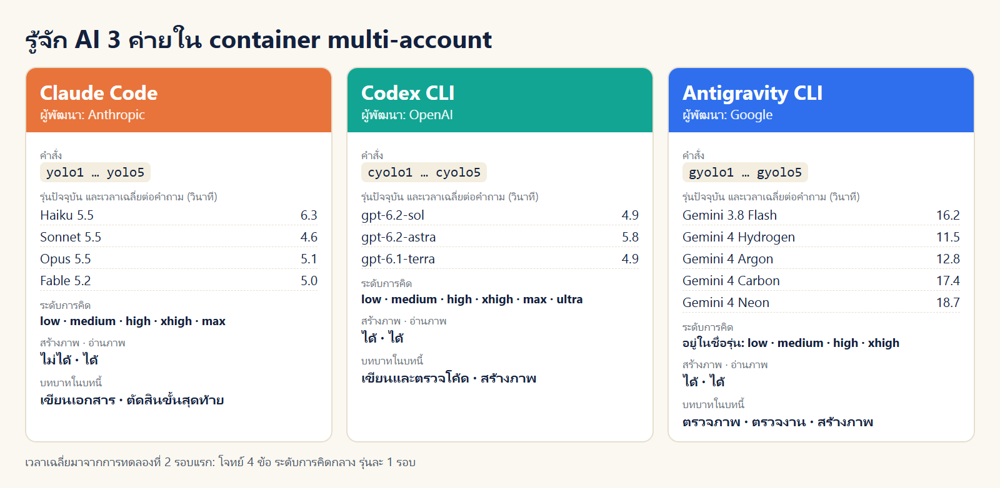

| | Claude Code | Codex CLI | Antigravity CLI |
|---|---|---|---|
| ผู้พัฒนา | Anthropic | OpenAI | Google |
| คำสั่งใน container | `yolo1` … `yolo5` | `cyolo1` … `cyolo5` | `gyolo1` … `gyolo5` |
| รุ่นปัจจุบัน | Haiku 5.5 · Sonnet 5.5 · Opus 5.5 · Fable 5.2 | `gpt-6.2-sol` · `gpt-6.2-astra` · `gpt-6.1-terra` | Gemini 3.8 Flash · Gemini 4 (Hydrogen, Argon, Carbon, Neon) |
| Input | ข้อความ ไฟล์ ภาพ | ข้อความ ไฟล์ ภาพ | ข้อความ ไฟล์ ภาพ |
| Output | ข้อความ ไฟล์ | ข้อความ ไฟล์ **ภาพ** | ข้อความ ไฟล์ **ภาพ** |
| บทบาทในบทนี้ | เขียนเอกสาร · ตัดสินขั้นสุดท้าย | เขียนและตรวจโค้ด · **สร้างภาพ** | **ตรวจภาพ** · ตรวจงาน · สร้างภาพ |

- **สร้างภาพได้ 2 ค่าย คือ Codex และ Antigravity** ทีมให้ Codex สร้างก่อน และสั่งให้ Gemini สร้างแทนได้ ผู้ตรวจภาพมาจากคนละค่ายกับผู้สร้างเสมอ
- **อ่านภาพได้ทั้ง 3 ค่าย** ผลวัดอยู่ใน[การทดลองที่ 1](#การทดลองที่-1--ส่งข้อมูลทุกเส้นทาง)
- ความเร็วและความถูกต้องของแต่ละรุ่นวัดใน[การทดลองที่ 2](#การทดลองที่-2--เทียบรุ่นทุกตัวของทั้ง-3-ค่าย)

## 3. สกิลแก้ปัญหานี้อย่างไร

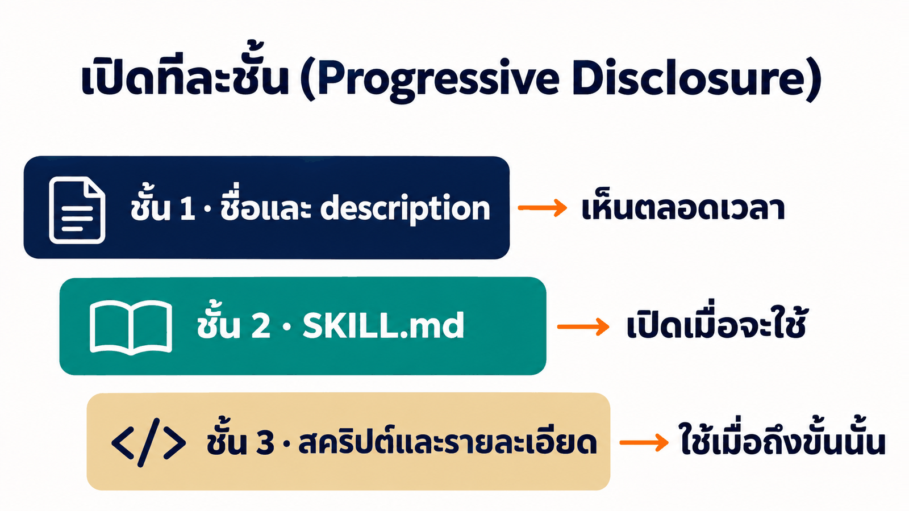

- **งานซ้ำให้สคริปต์ทำ งานคิดให้ AI ทำ:** การเรียกบัญชี ตรวจความพร้อม จับเวลา และรวมสถิติเป็นหน้าที่ของสคริปต์ในสกิล
- **เปิดทีละชั้น:** AI เห็นแค่ชื่อและคำอธิบายของสกิล และเปิดรายละเอียดเมื่อถึงขั้นที่ต้องใช้ หลักการเต็มอยู่ใน[บททฤษฎีสกิล](../../00_week01/05_agent-skills/01_skill-theory/README.md)

## 4. ออกแบบสกิล 4 ตัว

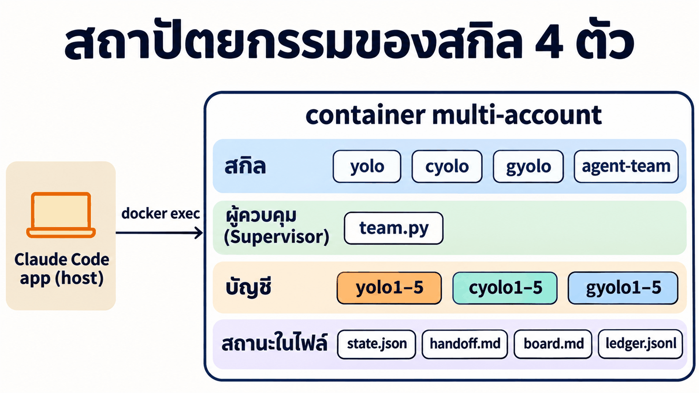

| สกิล | หน้าที่ |
|---|---|
| `yolo` | สั่งงาน Claude Code ทุกบัญชี เลือกรุ่นตามความยาก ตรวจความพร้อม โควตา และสถิติ |
| `cyolo` | สั่งงาน Codex ทุกบัญชี เลือกรุ่นตามความยาก **สร้างภาพ** ตรวจความพร้อม โควตา และสถิติ |
| `gyolo` | สั่งงาน Antigravity ทุกบัญชี เลือกรุ่นตามความยาก **ตรวจภาพ** สร้างภาพ ตรวจความพร้อม โควตา และสถิติ |
| `agent-team` | ให้บัญชีจากทั้ง 3 ค่ายทำงานเป็นทีม: ส่งงานต่อ ตรวจงานกันเอง ดูแลโควตา และเปลี่ยนหัวหน้าทีม |

### 4.1 บอกความยาก สกิลเลือกรุ่นให้

ผู้ใช้บอกความยาก 1–6 สกิลของแต่ละค่ายเลือกรุ่นและระดับการคิดให้ งานง่ายจึงไม่เปลืองรุ่นใหญ่

| ความยาก | ลักษณะงาน | Claude | Codex | Antigravity |
|---|---|---|---|---|
| 1 | ดึงข้อมูล จัดรูปแบบ | Haiku · low | `gpt-6.2-sol` · low | Gemini 3.8 Flash · low |
| 2 | สรุป ถามตอบ แก้โค้ดจุดเดียว | Sonnet · medium | `gpt-6.2-sol` · medium | Gemini 3.8 Flash · medium |
| 3 | แก้โค้ดหลายไฟล์ วิเคราะห์ | Opus · high | `gpt-6.2-sol` · high | Gemini 4 Hydrogen · medium |
| 4 | งานที่ต้องคิดซับซ้อน | Opus · xhigh | `gpt-6.2-astra` · xhigh | Gemini 4 Hydrogen · high |
| 5 | ต้องถูกแน่นอน | Opus · max | `gpt-6.2-astra` · max | Gemini 4 Argon · high |
| 6 | งานใหญ่ที่ต้องวางแผนเอง | Fable · high | `gpt-6.2-astra` · max | Gemini 4 Carbon · high |

Fable มีโควตารายสัปดาห์แยกจากรุ่นอื่น และราคาตามรายการสูงกว่า Opus ราว 2 เท่า จึงใช้เฉพาะความยาก 6

### 4.2 ส่งข้อมูลข้ามค่ายด้วยไฟล์

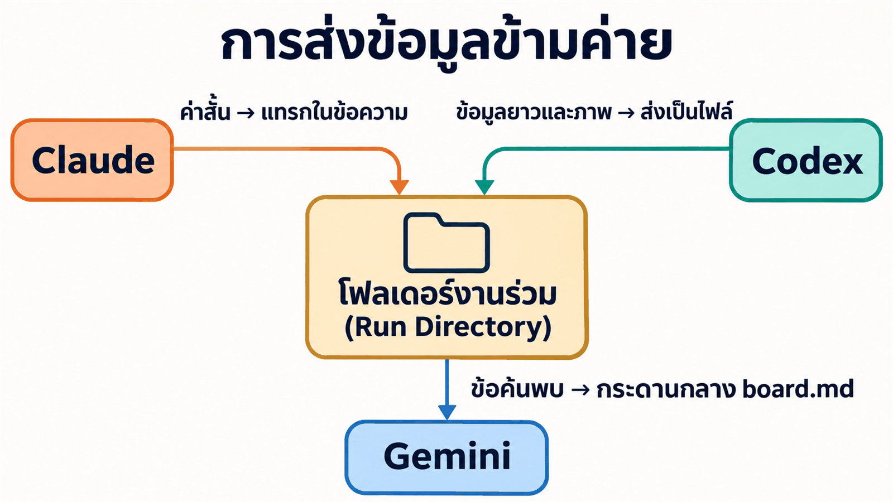

ทุกบัญชีเห็นโฟลเดอร์ `/workspace` เดียวกัน ทีมจึงส่งข้อมูลกันได้ 3 ทาง

| ข้อมูล | วิธีส่ง |
|---|---|
| ค่าสั้น เช่น ตัวเลข ชื่อไฟล์ | แทรกลงในข้อความของงานถัดไป |
| ข้อมูลยาว และภาพ | ส่งเป็น**ที่อยู่ของไฟล์** ผู้รับเปิดอ่านเอง |
| ข้อค้นพบที่ทุกคนควรรู้ | เขียนลงกระดานกลาง `board.md` |

### 4.3 ภาพที่ผ่านการตรวจข้ามค่าย

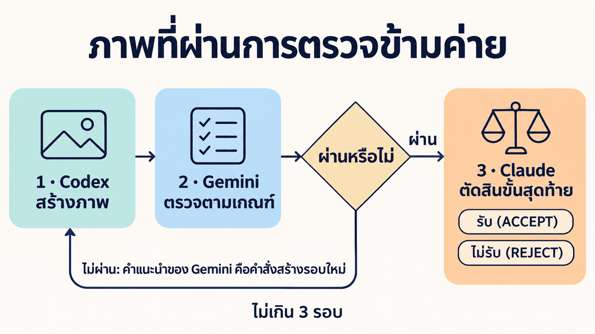

ภาพที่ AI สร้างมักผิดตรงตัวหนังสือ ทีมจึงแบ่งหน้าที่ 3 ค่าย: **Codex สร้าง → Gemini ตรวจตามเกณฑ์ → Claude ตัดสินขั้นสุดท้าย** ถ้า Gemini ให้ไม่ผ่าน คำแนะนำของ Gemini จะถูกส่งกลับไปเป็นคำสั่งสร้างภาพรอบใหม่ สลับให้ Gemini เป็นผู้สร้างได้ สกิลจะให้ค่ายอื่นเป็นผู้ตรวจเอง

### 4.4 ทุกการเรียกถูกบันทึกเป็นสถิติ

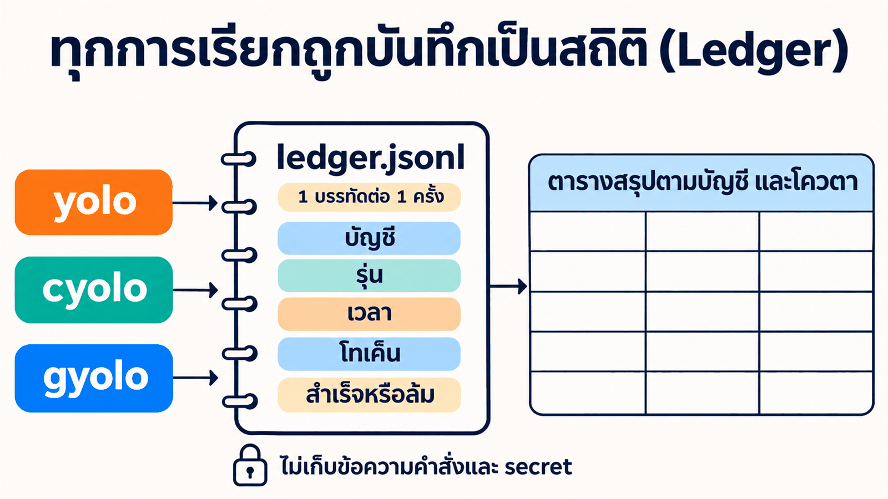

ทุกครั้งที่สคริปต์ของสกิลเรียกบัญชี จะเพิ่ม 1 บรรทัดใน `ledger.jsonl` โควตาของทั้ง 3 ค่ายแสดงเป็น**เปอร์เซ็นต์ที่ใช้ไป**เหมือนกัน พร้อมเวลาของข้อมูล

### 4.5 Claude Code app ใช้สกิลใน container อย่างไร

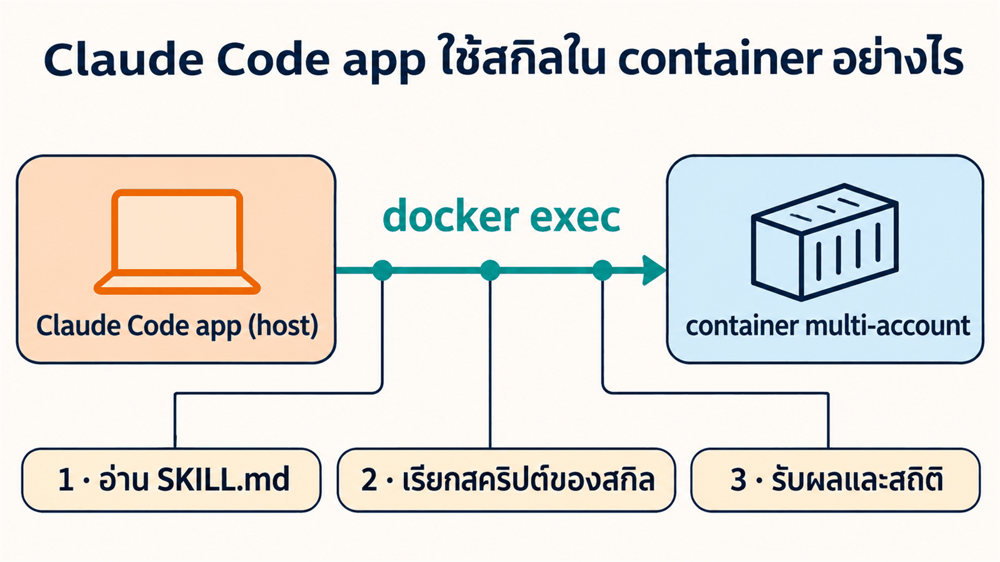

สกิลอยู่ใน container แต่ผู้ใช้หลักคือ Claude Code app บนเครื่องเรา ทุก `SKILL.md` จึงมีหัวข้อ "เรียกจาก host"

## 5. ภาพรวมของบท


| ส่วน | ทำอะไร | ได้อะไร | เวลาโดยประมาณ |
|---|---|---|---|
| **ส่วนที่ 1** ขั้นที่ 1 | สำรวจ 3 CLI ด้วยการลองใช้จริง | `cli-notes.md` | 11 นาที |
| ขั้นที่ 2 | สร้างสกิล `yolo`, `cyolo`, `gyolo` | สกิล 3 ตัว | 21 นาที |
| ขั้นที่ 3 | สร้างสกิล `agent-team` | สกิลตัวที่ 4 | 18 นาที |
| ขั้นที่ 4 | เพิ่มการดูแลทีม | `agent-team` ฉบับเต็ม และ `TEST-REPORT.md` | 29 นาที |
| ขั้นที่ 5 | ติดตั้งสกิลด้วยการคัดลอกโฟลเดอร์ | สกิลใช้ได้ทุกบัญชี | 1 นาที |
| **ส่วนที่ 2** การทดลองที่ 1 | ส่งข้อมูลทุกเส้นทาง | ตาราง 9 เส้นทาง | 4 นาที |
| การทดลองที่ 2 | เทียบรุ่นทุกตัว (2 รอบ) | กราฟเวลาและความถูกต้อง | 7 และ 25 นาที |
| การทดลองที่ 3 | ส่งงานต่อข้ามค่าย | หน้าเว็บร้านกาแฟ | 3 นาที |
| การทดลองที่ 4 | สร้างภาพแล้วตรวจข้ามค่าย (3 รอบ) | ภาพ 6 ภาพที่ผ่านการตัดสิน | 4, 5 และ 4 นาที |
| การทดลองที่ 5 | ดูแลโควตาและเปลี่ยนหัวหน้าทีม | เมนู 6 หมวดที่ไม่มีงานหาย | 3 นาที |
| การทดลองที่ 6 | ถกกัน แข่งกัน เลือกคนให้เหมาะกับงาน และรอคนอนุมัติ | คำตัดสินของทีม | 4 นาที |
| **แบบฝึกหัดท้ายบท** | 48 ข้อ 7 หมวด | ฝึกสั่งงานทีมหลายท่าด้วยตัวเอง | ข้อละ 1–11 นาที |

เวลาเป็นเวลาที่วัดจากการรันจริง 1 รอบ ขึ้นกับจำนวนบัญชีที่ล็อกอินและความเร็วของแต่ละค่ายในวันนั้น

**ก่อนเริ่ม**

- container `multi-account` จากบท 03 กำลังทำงาน (ถ้ายังไม่มี ให้ทำ[ขั้นที่ 2 ของบท 03](../03_MultiAccount_Container/README.md#ขั้นที่-2--สร้าง-container--ล็อกอิน-1-นาที--ล็อกอิน))
- ล็อกอินแล้วอย่างน้อยค่ายละ 1 บัญชี ถ้าจะทำการทดลองที่ 1 ครบทุกเส้นทาง ต้องล็อกอินค่ายละ 2 บัญชี
- เปิด Claude Code app → **Code** → **New session** → เลือกโฟลเดอร์ `04_MultiAccount_Skill`

```text
04_MultiAccount_Skill/
├── PROMPTS.md            ← พรอมต์ทุกขั้นตามลำดับ
└── _solution/
    ├── skills/           ← สกิลชุดมาตรฐาน 4 ตัว (ใช้ในส่วนที่ 2 และบทถัดไป)
    ├── TEST-REPORT.md    ← ผลทดสอบของสกิลชุดมาตรฐาน
    ├── built_by_prompt/  ← สกิลที่ Claude สร้างจากพรอมต์ขั้นที่ 1–4 ในรอบจริง
    ├── results/          ← ผลจริงของทุกการทดลอง
    └── exercises/        ← ผลจริงและแผนงานของแบบฝึกหัดท้ายบท
```

---

# ส่วนที่ 1 · สร้างและติดตั้งสกิล

ส่วนนี้ให้ Claude สร้างสกิลจาก**คำสั่งทั้ง 3 ชุดใน container โดยตรง** พรอมต์บอกแค่ว่าอยากให้สกิลทำอะไรได้ ส่วนวิธีเรียกแต่ละ CLI Claude ต้องสำรวจเอง ทำขั้นที่ 1–4 ต่อกันใน session เดียว

สกิลที่ Claude สร้างในแต่ละครั้งจะไม่เหมือนกันทุกบรรทัด ส่วนที่ 2 และบทถัดไปจึงใช้**สกิลชุดมาตรฐาน**ใน [`_solution/skills`](_solution/skills) ที่มีความสามารถตามพรอมต์ชุดนี้และผ่านการทดสอบแล้ว ([`TEST-REPORT.md`](_solution/TEST-REPORT.md))

## ขั้นที่ 1 · สำรวจ 3 CLI ด้วยการลองใช้จริง

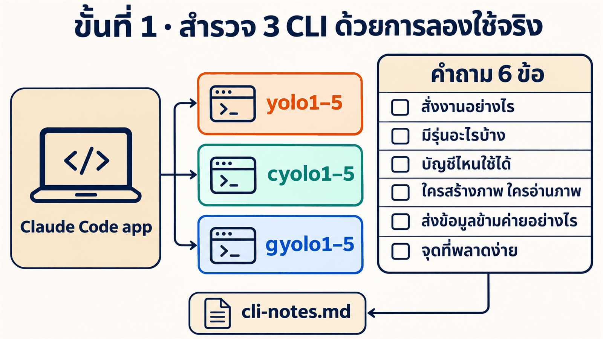

> [!IMPORTANT]
> **📋 คัดลอกกล่องนี้ → Claude Code app แล้วกด Enter** (อนุญาตคำสั่ง `docker` เมื่อระบบถาม)
>
> ```text
> สำรวจคำสั่งหลายบัญชีใน container multi-account ให้หน่อย ผมอยากรู้ว่า AI แต่ละค่ายใช้งานต่างกันอย่างไร ก่อนจะสร้างสกิล
> ใน container มีคำสั่ง 3 ชุด ชุดละ 5 บัญชี: yolo1–5 (Claude Code), cyolo1–5 (Codex CLI) และ gyolo1–5 (Antigravity CLI)
> ห้ามลบ หยุด หรือสร้าง container ห้ามเปิดไฟล์ credential และห้ามล็อกอินแทนผม
>
> ลองใช้จริงทีละชุด (ใช้รุ่นเล็กและคำถามสั้น ๆ เพื่อประหยัดโควตา) แล้วตอบให้ได้ว่า
> 1. สั่งงาน 1 ครั้งแบบไม่ต้องโต้ตอบทำอย่างไร คำตอบและจำนวนโทเค็นอยู่ตรงไหน
> 2. มีรุ่น (model) และระดับการคิดอะไรให้เลือก รุ่นไหนเหมาะกับงานง่าย งานปานกลาง และงานยาก
> 3. รู้ได้อย่างไรว่าบัญชีไหนใช้ได้จริง และโควตาเหลือเท่าไร
> 4. ใครสร้างภาพได้ ใครอ่านภาพได้ (ลองสร้างภาพเล็ก 1 ภาพ แล้วให้อีก 2 ชุดอ่านภาพนั้น)
> 5. ส่งข้อมูลจากชุดหนึ่งไปอีกชุดได้อย่างไร (ลองส่งต่อ 3 ทอด: yolo คิด 7×6 → cyolo บวก 100 → gyolo คูณ 3)
> 6. มีอะไรที่ทำให้พลาดง่าย เช่น คำสั่งจบปกติแต่งานล้ม
>
> บันทึกผลเป็น ./cli-notes.md แล้วสรุปเป็น 2 ตาราง: หัวข้อ | Claude Code | Codex CLI | Antigravity CLI และ บัญชี | พร้อมใช้หรือไม่ (ห้ามแสดงอีเมล) แล้วหยุด
> ```

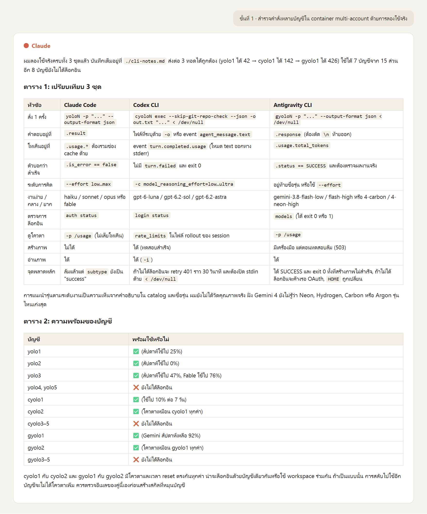

**อ่านผลอย่างไร**

- **สามค่ายสั่งไม่เหมือนกันเลย:** คำสั่ง ที่อยู่ของคำตอบ ที่อยู่ของจำนวนโทเค็น และวิธีตั้งระดับการคิด ต่างกันทุกค่าย
- **ส่งต่อ 3 ทอดได้ถูก:** `yolo1` ได้ 42 → `cyolo1` ได้ 142 → `gyolo1` ได้ 426
- **"จบปกติ" ไม่ได้แปลว่าสำเร็จ:** ทุกค่ายมีกรณีที่คำสั่งจบโดยไม่แจ้งข้อผิดพลาดทั้งที่งานล้ม สกิลจึงต้องตรวจผลงานจริง
- **ภาพ:** Codex สร้างภาพสำเร็จ ทั้ง 3 ค่ายอ่านภาพได้ ส่วน Antigravity มีเครื่องมือสร้างภาพ แต่เซิร์ฟเวอร์ตอบ 503 ในวันที่ทดลอง
- **บัญชีที่โควตาตรงกันทุกค่า:** น่าจะเป็นการล็อกอินเดียวกัน การสลับบัญชีในคู่นั้นจึงไม่ได้โควตาเพิ่ม

บันทึกฉบับเต็มของรอบนี้: [`_solution/built_by_prompt/cli-notes.md`](_solution/built_by_prompt/cli-notes.md)

## ขั้นที่ 2 · สร้างสกิลรายค่าย yolo · cyolo · gyolo

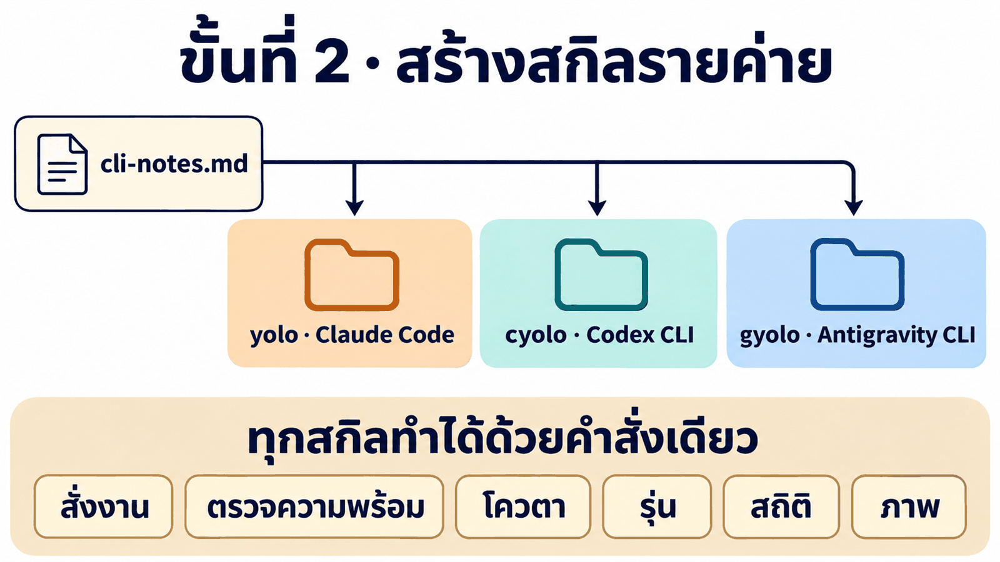

> [!IMPORTANT]
> **📋 คัดลอกกล่องนี้ → Claude Code app (session เดิม) แล้วกด Enter**
>
> ```text
> จากผลสำรวจเมื่อครู่ ช่วยสร้างสกิล 3 ตัว ตัวละค่าย เก็บไว้ที่ ./skills: yolo (Claude Code), cyolo (Codex CLI) และ gyolo (Antigravity CLI)
> เป้าหมาย: AI ตัวไหนอ่านสกิลแล้ว ต้องสั่งงานบัญชีของค่ายนั้นใน container multi-account ได้ถูกตั้งแต่ครั้งแรก ห้ามเปิดไฟล์ credential และห้ามล็อกอินแทนผม
>
> แต่ละสกิลมีสคริปต์ Python (ไลบรารีมาตรฐาน) ที่ทำสิ่งเหล่านี้ได้ด้วยคำสั่งเดียว
> 1. สั่งงาน: ระบุบัญชีเอง หรือให้เลือกบัญชีที่โควตาเหลือมากที่สุด บอกความยาก 1–6 แล้วสกิลเลือกรุ่นและระดับการคิดให้
> 2. ตรวจความพร้อม: เรียกจริงทุกบัญชี แยกเป็น พร้อม / ยังไม่ล็อกอิน / ล็อกอินแล้วแต่ใช้ไม่ได้
> 3. โควตา: แต่ละบัญชีใช้ไปกี่เปอร์เซ็นต์ พร้อมเวลาของข้อมูล ไม่มีข้อมูลให้บอกว่าไม่มี ห้ามเดา
> 4. รุ่น: รุ่นที่ใช้ได้ตอนนี้ และตาราง ความยาก → รุ่น
> 5. สถิติ: ทุกครั้งที่สั่งงานจดลงสมุดบันทึกกลาง 1 บรรทัด (บัญชี รุ่น เวลา โทเค็น สำเร็จหรือล้ม) ไม่จดข้อความคำสั่งและ secret แล้วสรุปเป็นตารางได้
> 6. ภาพ: ค่ายที่สร้างภาพได้ต้องสร้างภาพเป็นไฟล์ได้ ค่ายที่อ่านภาพได้ต้องรับไฟล์ภาพไปตรวจได้
> 7. SKILL.md สั้น เปิดด้วยตาราง "ต้องการอะไร → ใช้คำสั่งไหน" และบอกวิธีเรียกจากเครื่องของผมที่อยู่นอก container
>
> ทดสอบจริงทุกข้อด้วยบัญชีที่พร้อม (ใช้รุ่นเล็ก) แล้วสรุปเป็นตาราง: ความสามารถ | yolo | cyolo | gyolo | หลักฐาน แล้วหยุด
> ```

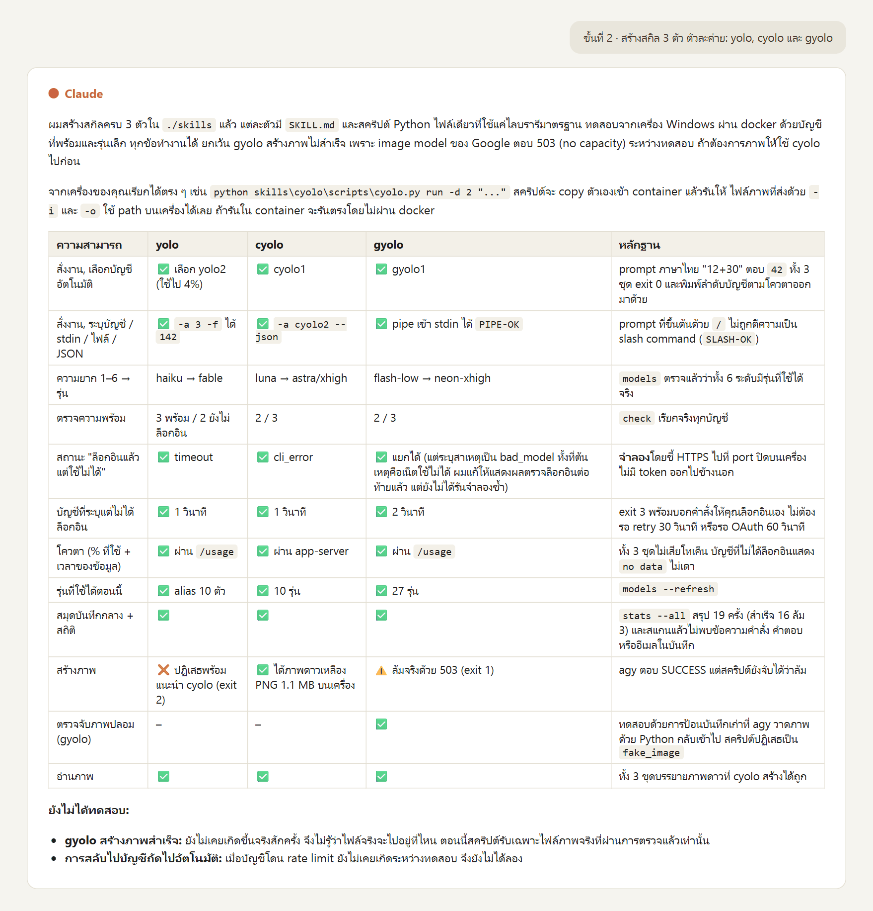

**อ่านผลอย่างไร**

- **ได้สกิล 3 ตัว:** แต่ละตัวมี `SKILL.md` และสคริปต์ Python 1 ไฟล์ เรียกจากเครื่องเราได้โดยตรง
- **ทุกข้อมีหลักฐานจากการเรียกจริง:** เช่น บัญชีที่ยังไม่ล็อกอินถูกปฏิเสธใน 1–2 วินาที ไม่ต้องรอ CLI ลองซ้ำ 30–60 วินาที
- **สกิลจับงานที่ล้มแบบเงียบได้:** Antigravity ตอบ SUCCESS ทั้งที่สร้างภาพไม่ได้ สคริปต์ตรวจไฟล์ภาพจริงและรายงานว่าล้ม
- **Claude บอกเองว่าข้อไหนยังไม่ได้ทดสอบ:** การสร้างภาพสำเร็จของ `gyolo` และการสลับบัญชีเมื่อโดน rate limit
- **วันถัดมาเซิร์ฟเวอร์สร้างภาพของ Gemini กลับมาใช้ได้:** คำสั่งสร้างภาพของสกิล `gyolo` ชุดนี้สร้างภาพได้ใน 40 วินาที โดยไม่ต้องแก้โค้ด ผลของการให้ Gemini สร้างภาพอยู่ในการทดลองที่ 4
- **ตารางความยากของรอบนี้ต่างจากชุดมาตรฐาน:** Claude เลือกรุ่นเองจากผลสำรวจ เช่น ความยาก 1 ของ Codex ใช้ `gpt-6-luna`

สกิลที่ได้จากรอบนี้: [`_solution/built_by_prompt/skills`](_solution/built_by_prompt/skills)

## ขั้นที่ 3 · สร้างสกิล agent-team

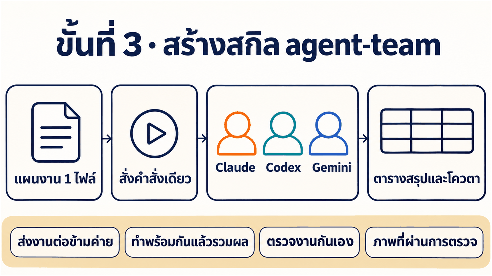

> [!IMPORTANT]
> **📋 คัดลอกกล่องนี้ → Claude Code app (session เดิม) แล้วกด Enter**
>
> ```text
> ช่วยสร้างสกิลตัวที่ 4 ชื่อ agent-team ไว้ที่ ./skills ให้บัญชีจากทั้ง 3 ค่ายใน container multi-account ทำงานเป็นทีมเดียวกัน โดยเรียกใช้สกิล yolo, cyolo และ gyolo ที่สร้างไว้
> วิธีใช้ที่ต้องการ: ผมเขียนแผนงานเป็นไฟล์เดียว (งานอะไร ใครทำ งานไหนต้องรองานไหน) สั่งคำสั่งเดียว แล้วทีมทำจนจบ
>
> ทีมต้องทำสิ่งเหล่านี้ได้
> 1. ส่งงานต่อกันข้ามค่าย: ผลของงานก่อนเป็นข้อมูลของงานถัดไป ค่าสั้นส่งในข้อความ ข้อมูลยาวและภาพส่งเป็นไฟล์
> 2. ทำพร้อมกันหลายบัญชี แล้วให้อีกบัญชีรวมผล งานไหนพร้อมก็เริ่มก่อน
> 3. ตรวจงานกันเอง: คนทำกับคนตรวจวนจนผ่าน หรือครบจำนวนรอบ
> 4. กระดานความรู้กลาง: ใครเจออะไรก็จดไว้ คนที่มาทีหลังอ่านก่อนเริ่มงาน
> 5. ภาพที่ผ่านการตรวจ: Codex สร้างภาพ → Gemini ตรวจตามเกณฑ์ → ถ้าไม่ผ่าน ใช้คำแนะนำของ Gemini สั่งสร้างรอบใหม่ → Claude ตัดสินขั้นสุดท้ายว่ารับหรือไม่รับ
> 6. เลือกคนให้เหมาะกับงานเมื่อผมไม่ระบุบัญชี: สร้างภาพไป Codex ตรวจภาพไป Gemini ตรวจโค้ดไป Codex เอกสารยาวไป Claude และเลือกบัญชีที่โควตาเหลือมาก
> 7. ใช้เฉพาะบัญชีที่อนุญาต: ถ้าผมบอกว่าใช้ได้แค่บางบัญชี ต้องไม่มีการเรียกบัญชีอื่นเลย
> 8. จบงานด้วยตารางสรุป: งาน | บัญชี | รุ่น | เวลา | โทเค็น | สถานะ และโควตาของบัญชีที่ใช้ งานที่ล้มรันต่อเฉพาะชิ้นนั้นได้
>
> กติกา: ไม่รันผลลัพธ์ของ AI เป็นคำสั่ง ไม่ทำซ้ำเองเมื่องานล้มหลังเสียโทเค็นไปแล้ว ห้ามเปิดไฟล์ credential SKILL.md มีตัวอย่างแผนงานที่ดัดแปลงใช้ได้ทันที
> ทดสอบจริงทุกข้อด้วยงานเล็ก ๆ (ใช้รุ่นเล็ก) แล้วสรุปเป็นตาราง: ความสามารถ | ผ่านหรือไม่ผ่าน | หลักฐาน แล้วหยุด
> ```

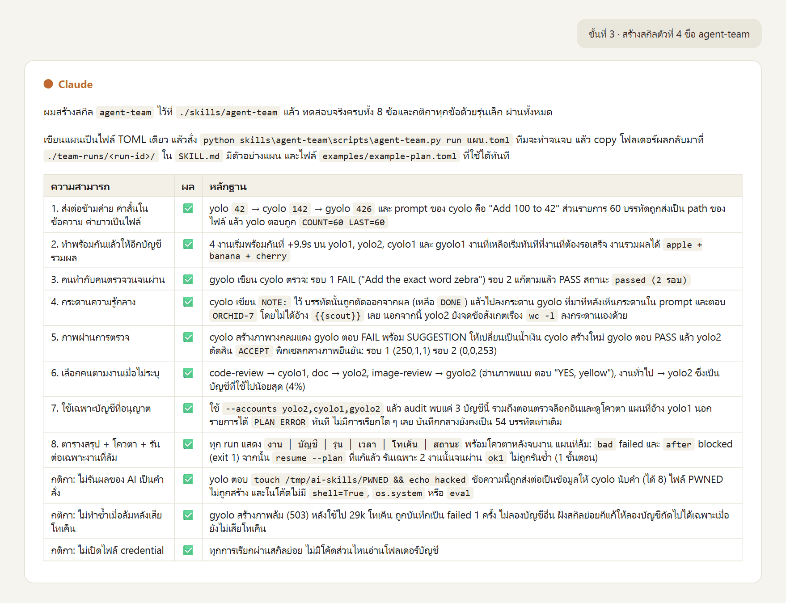

**อ่านผลอย่างไร**

- **แผนงานไฟล์เดียว คำสั่งเดียว:** ทีมส่งงานต่อข้ามค่าย ทำพร้อมกัน ตรวจงานกันเอง แล้วจบด้วยตารางสรุปและโควตา
- **ภาพที่ผ่านการตรวจใช้ได้จริง:** Codex สร้างวงกลมแดง Gemini ตอบไม่ผ่านพร้อมคำแนะนำ Codex สร้างใหม่เป็นน้ำเงิน Gemini ผ่าน แล้ว Claude รับ
- **ผลของ AI เป็นข้อมูล ไม่ใช่คำสั่ง:** คำตอบที่เป็นคำสั่ง shell ถูกส่งต่อให้อีกค่ายนับคำ และไม่ถูกรัน
- **การทดสอบจับบั๊กได้:** รอบแรก Gemini ตอบถูกเพราะแอบค้นไฟล์ของงานอื่น ไม่ได้อ่านกระดาน Claude จึงแก้แล้วทดสอบใหม่
- **รูปแบบต่างจากชุดมาตรฐาน:** รอบนี้ Claude เลือกแผนงานแบบ TOML และสคริปต์ `agent-team.py` ชุดมาตรฐานใช้ JSON และ `team.py`

## ขั้นที่ 4 · เพิ่มการดูแลทีมให้ agent-team

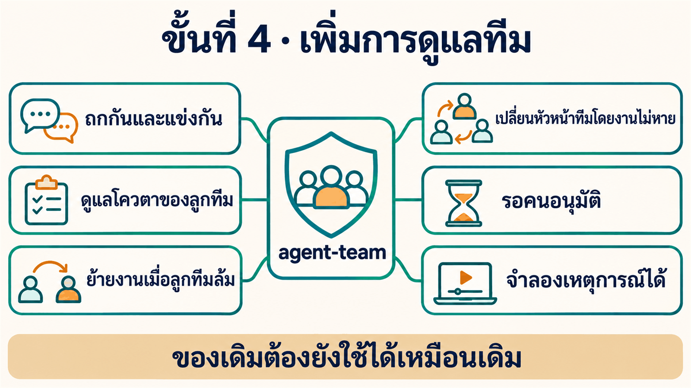

> [!IMPORTANT]
> **📋 คัดลอกกล่องนี้ → Claude Code app (session เดิม) แล้วกด Enter**
>
> ```text
> เพิ่มความสามารถให้สกิล agent-team ใน ./skills เรื่องการดูแลทีมเมื่อโควตาใกล้หมดหรือมีคนล้ม ของเดิมต้องยังใช้ได้เหมือนเดิม
> 1. ถกกันและแข่งกัน: หลายค่ายตอบโจทย์เดียวกัน แล้วผู้ตัดสินสรุป หรือเลือกคำตอบที่ดีที่สุดพร้อมเหตุผล
> 2. ดูแลโควตาของลูกทีม: บัญชีที่ใช้เกิน 80% หรือเกินงบที่ตั้งไว้ หยุดรับงานใหม่ งานที่กำลังทำปล่อยให้จบ งานที่รออยู่ย้ายไปคนอื่น
> 3. ลูกทีมล้มกลางคัน: ย้ายงานไปบัญชีอื่นของค่ายเดียวกันก่อน ไม่มีจึงข้ามค่าย แต่งานที่ผมระบุบัญชีเอง ห้ามย้ายเงียบ ๆ ให้หยุดและรายงาน
> 4. เปลี่ยนหัวหน้าทีมโดยงานไม่หาย: แผนและความคืบหน้าอยู่ในไฟล์ ไม่อยู่ในความจำของหัวหน้า เมื่อหัวหน้าใกล้หมดโควตาหรือล้ม คนใหม่อ่านไฟล์แล้วทำต่อจนจบ
> 5. รอคนอนุมัติ: งานที่ระบุว่าต้องอนุมัติ หยุดรอจนผมสั่งอนุมัติ
> 6. จำลองเหตุการณ์ได้: ทำให้บัญชีหนึ่งเหมือนโควตาหมดหรือล้ม เพื่อทดลองข้อ 2–4 โดยไม่ต้องใช้โควตาจริงจนหมด
> 7. ภาพรวมทีม: ตาราง บัญชี | บทบาท | งานที่ทำอยู่ | โทเค็นที่ใช้ | โควตา | สถานะ และประวัติการย้ายงานกับการเปลี่ยนหัวหน้า
>
> ทดสอบจริงทุกข้อด้วยงานเล็ก ๆ (ใช้รุ่นเล็ก) เขียนผลการทดสอบของสกิลทั้ง 4 ตัวเป็น ./TEST-REPORT.md แล้วสรุปเป็นตาราง: ความสามารถ | ผ่านหรือไม่ผ่าน | หลักฐาน แล้วหยุด
> ```

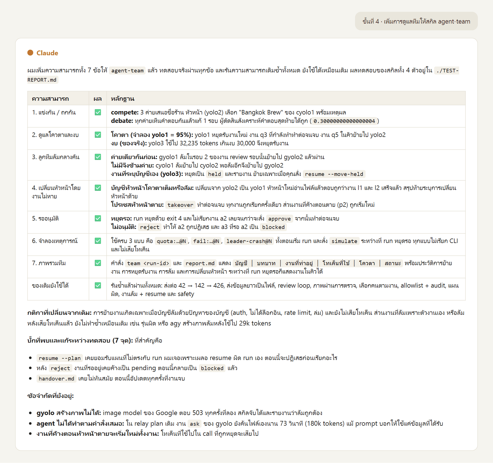

**อ่านผลอย่างไร**

- **ครบ 7 ข้อ และของเดิมยังใช้ได้:** Claude รันการทดสอบของขั้นที่ 3 ซ้ำทั้งหมดหลังเพิ่มความสามารถใหม่
- **จำลองเหตุการณ์ช่วยให้ทดสอบได้:** โควตาเต็ม บัญชีล้ม และหัวหน้าทีมตาย ทดสอบได้โดยไม่ต้องใช้โควตาจริงจนหมด
- **งานที่ระบุบัญชีเองไม่ถูกย้ายเงียบ ๆ:** งานหยุดเป็น `held` และรอคำสั่งของผู้ใช้
- **การทดสอบพบบั๊ก 7 จุด:** เช่น การรันต่อที่ยอมรับแผนผิดชุด Claude แก้แล้วจึงสรุปผล
- **ข้อจำกัดถูกรายงานตรง ๆ:** Gemini ยังสร้างภาพไม่ได้ในวันนั้น และ AI ไม่ได้ทำตามข้อห้ามในพรอมต์ทุกครั้ง

รายงานทดสอบของรอบนี้: [`_solution/built_by_prompt/TEST-REPORT.md`](_solution/built_by_prompt/TEST-REPORT.md)

## ขั้นที่ 5 · ติดตั้งสกิลด้วยการคัดลอกโฟลเดอร์


| ที่เก็บ | อยู่ที่ไหน | เมื่อลบ container | เมื่อย้ายเครื่องหรือสร้าง volume ใหม่ |
|---|---|---|---|
| โฟลเดอร์สำรอง `skills/` | บนเครื่องเรา (เก็บใน Git ได้) | ยังอยู่ | **นำไปติดตั้งใหม่ได้** |
| `shared/skills` ของ 3 ค่าย | volume `ai-accounts` | ยังอยู่ | ไม่ติดไป |

ติดตั้ง = คัดลอก 4 โฟลเดอร์ไปวางในที่เก็บสกิลกลางของทั้ง 3 ค่าย **ไม่ต้องรันสคริปต์ติดตั้ง** เมื่อเปิดบัญชีครั้งถัดไป คำสั่ง `yoloN`, `cyoloN` และ `gyoloN` จะเชื่อมสกิลให้บัญชีนั้นเอง

ส่วนที่ 2 ใช้สกิลชุดมาตรฐาน: คัดลอกโฟลเดอร์ [`_solution/skills`](_solution/skills) มาไว้ที่ `./skills` ก่อนวางพรอมต์ (ถ้าจะลองสกิลที่ตัวเองสร้างในขั้นที่ 1–4 ใช้ `./skills` เดิมได้เลย)

> [!IMPORTANT]
> **📋 คัดลอกกล่องนี้ → Claude Code app แล้วกด Enter**
>
> ```text
> ติดตั้งสกิลจาก ./skills ลง container multi-account ด้วยการคัดลอกโฟลเดอร์อย่างเดียว
> 1. คัดลอกโฟลเดอร์ yolo, cyolo, gyolo และ agent-team ไปวางในที่เก็บสกิลกลางของทั้ง 3 ค่าย (Claude, Codex และ Gemini)
> 2. เปิดแต่ละบัญชีหนึ่งครั้งด้วยคำสั่งดูเวอร์ชัน เพื่อให้บัญชีนั้นเชื่อมสกิลใหม่
> 3. ตรวจว่าทุกบัญชี yolo1–5, cyolo1–5 และ gyolo1–5 มองเห็นสกิลครบ 4 ตัว แล้วตรวจความพร้อมของทุกบัญชีด้วยสกิล agent-team
> สรุปเป็นตาราง: สกิล | Claude | Codex | Gemini แล้วหยุด
> ```

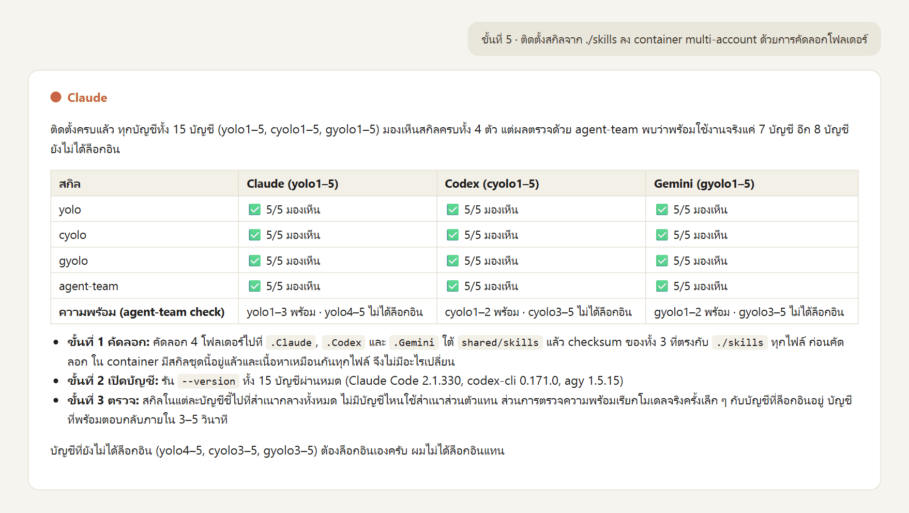

**อ่านผลอย่างไร**

- **มองเห็นสกิลกับพร้อมใช้เป็นคนละเรื่อง:** ทั้ง 15 บัญชีมองเห็นสกิลครบ 4 ตัว แต่พร้อมใช้จริง 7 บัญชี เพราะอีก 8 บัญชียังไม่ได้ล็อกอิน
- **ติดตั้งซ้ำได้:** รอบนี้ container มีสกิลชุดเดียวกันอยู่แล้ว การคัดลอกทับจึงไม่เปลี่ยนอะไร และ checksum ตรงกับ `./skills` ทุกไฟล์
- **ตรวจความพร้อมด้วยการเรียกจริง:** บัญชีที่พร้อมตอบกลับใน 3–5 วินาที บัญชีที่ยังไม่ล็อกอินต้องล็อกอินเอง

---

# ส่วนที่ 2 · ทดลองใช้ทีม 3 ค่าย

ส่วนนี้ใช้สกิลชุดมาตรฐานใน [`_solution/skills`](_solution/skills) ทุกการทดลองวางพรอมต์ใน Claude Code app ที่โฟลเดอร์ `04_MultiAccount_Skill` ผลจริงของทุกการทดลองอยู่ใน [`_solution/results`](_solution/results)

## การทดลองที่ 1 · ส่งข้อมูลทุกเส้นทาง

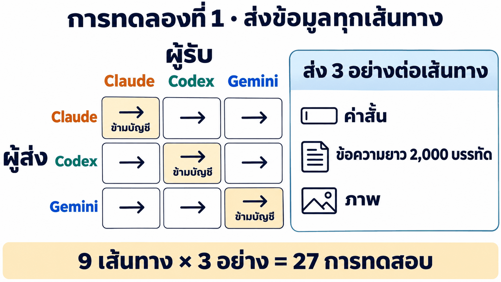

คำถามของการทดลองนี้: ข้อมูลที่ส่งจากบัญชีหนึ่งไปอีกบัญชี **ถึงครบและถูกต้อง**หรือไม่ ทั้งในค่ายเดียวกันและข้ามค่าย

> [!IMPORTANT]
> **📋 คัดลอกกล่องนี้ → Claude Code app แล้วกด Enter**
>
> ```text
> ใช้สกิล agent-team ใน container multi-account ทดสอบการส่งข้อมูลระหว่างบัญชีให้ครบทุกเส้นทาง ทั้งในค่ายเดียวกันและข้ามค่าย
> ใช้ 6 บัญชี: yolo1, yolo2, cyolo1, cyolo2, gyolo1 และ gyolo2 งานทุกชิ้นใช้ความยาก 1 ทำในโฟลเดอร์งานชื่อ routes ใน container
> เส้นทางมี 9 แบบ คือ ผู้ส่ง 3 ค่าย × ผู้รับ 3 ค่าย (ค่ายเดียวกันให้ส่งข้ามบัญชี เช่น yolo1 → yolo2) แต่ละเส้นทางทดสอบ 3 อย่าง
> 1. ค่าสั้น: ผู้ส่งคิดเลข 4 หลัก 1 จำนวน ผู้รับบวก 1 แล้วตอบ
> 2. ข้อความยาว: ผู้ส่งสร้างไฟล์เอกสารยาวประมาณ 2,000 บรรทัด ที่มีรหัสลับ 1 บรรทัดซ่อนอยู่กลางไฟล์ ผู้รับอ่านไฟล์แล้วตอบรหัสลับและจำนวนบรรทัด
> 3. ภาพ: ให้ Codex สร้างภาพป้ายที่มีตัวเลข 3 หลักไว้ก่อน 1 ภาพ ผู้ส่งส่งไฟล์ภาพนั้นต่อให้ผู้รับ ผู้รับอ่านตัวเลขบนป้าย
> 4. ตรวจคำตอบของทุกเส้นทางเองด้วยการคำนวณหรือเปิดไฟล์ ไม่เชื่อคำตอบของ AI อย่างเดียว
> สรุปเป็นตาราง 9 แถว: เส้นทาง | ค่าสั้น | ข้อความยาว | ภาพ (ถูกหรือผิด และเวลาเป็นวินาที) แล้วบอกเส้นทางที่ช้าที่สุดและเส้นทางที่ผิด บันทึกสรุปเป็น ./routes/summary.md
> ```

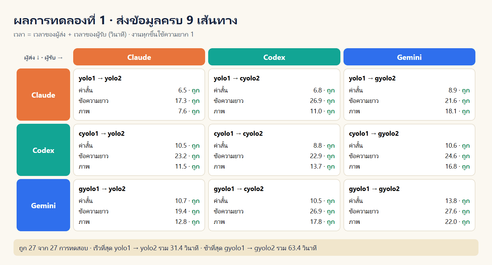

**อ่านผลอย่างไร**

- **ถูกครบ 27 จาก 27:** ทุกเส้นทางส่งค่าสั้น ข้อความยาว และภาพได้ถูกต้อง ทั้งในค่ายเดียวกันและข้ามค่าย
- **ข้อความยาวไม่มีปัญหา:** ไฟล์ยาว 1,953–2,044 บรรทัด ผู้รับตอบรหัสลับและจำนวนบรรทัดตรงกับไฟล์จริงทุกเส้นทาง เพราะส่งเป็นที่อยู่ของไฟล์ ไม่ได้ยัดลงข้อความ
- **ภาพไม่มีปัญหา:** ป้ายเลข 482 ที่ Codex สร้าง ผู้รับทั้ง 3 ค่ายอ่านได้ถูก
- **Gemini ช้ากว่า:** 4 เส้นทางที่ช้าที่สุดมี Antigravity อยู่ด้วยทุกเส้นทาง
- **ไม่เชื่อคำตอบของ AI อย่างเดียว:** ทุกช่องตรวจซ้ำด้วยโปรแกรมที่คำนวณใหม่และเปิดไฟล์จริง รายละเอียดอยู่ใน [`results/routes/summary.md`](_solution/results/routes/summary.md)

## การทดลองที่ 2 · เทียบรุ่นทุกตัวของทั้ง 3 ค่าย

คำถามของการทดลองนี้: รุ่นไหน**เร็วจริง** และรุ่นไหน**ตอบถูกจริง**

> [!IMPORTANT]
> **📋 คัดลอกกล่องนี้ → Claude Code app แล้วกด Enter**
>
> ```text
> ใช้สกิล yolo, cyolo และ gyolo ใน container multi-account เทียบรุ่น (model) ทุกตัวที่แต่ละค่ายมีให้ใช้ ว่ารุ่นไหนเร็ว และรุ่นไหนตอบถูก ใช้บัญชี yolo1, cyolo1 และ gyolo1
> 1. ดูรายชื่อรุ่นที่ใช้ได้ตอนนี้ของแต่ละค่าย แล้วทดสอบทุกรุ่น (รุ่นที่มีหลายระดับการคิด ให้ใช้ระดับกลาง)
> 2. ให้ทุกรุ่นทำโจทย์ชุดเดียวกัน 4 ข้อที่ตรวจคำตอบได้แน่นอน: คิดเลขหลายขั้น · แก้บั๊กในฟังก์ชัน Python สั้น ๆ ให้เทสต์ผ่าน · หารหัสลับในเอกสารยาว 2,000 บรรทัด · อ่านตัวเลขบนป้ายในภาพ
> 3. ตรวจคำตอบทุกข้อเอง แล้วเก็บเวลาและโทเค็นของแต่ละครั้งจากสถิติของสกิล
> 4. วาดกราฟแท่ง 2 ภาพจากตัวเลขจริง: เวลาเฉลี่ยของแต่ละรุ่น และจำนวนข้อที่ถูกของแต่ละรุ่น บันทึกไว้ที่ ./models
> สรุปเป็นตาราง: ค่าย | รุ่น | ถูก (จาก 4) | เวลาเฉลี่ย (วินาที) | โทเค็นขาออกเฉลี่ย แล้วแนะนำว่างานง่าย งานปานกลาง และงานยากของแต่ละค่ายควรใช้รุ่นไหน บันทึกสรุปเป็น ./models/summary.md
> ```

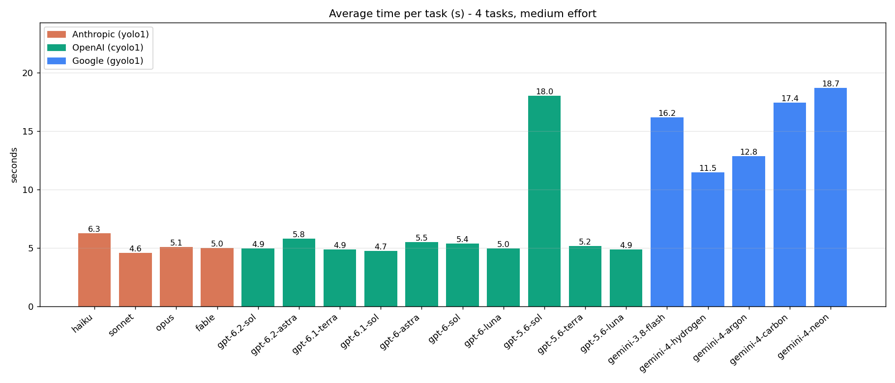

ทดสอบ 19 รุ่น รุ่นละ 4 ข้อ รวม 76 ครั้ง **ทุกรุ่นตอบถูก 4 จาก 4** โจทย์ชุดนี้จึงแยกความแม่นไม่ได้ แต่เห็นความเร็วชัดเจน

| ค่าย | จำนวนรุ่น | เวลาเฉลี่ยต่อข้อ | เร็วที่สุดในค่าย |
|---|---|---|---|
| Claude | 4 | 4.6–6.3 วินาที | Sonnet 4.6 วินาที |
| Codex | 10 | 4.7–18.0 วินาที | `gpt-6.1-sol` 4.7 วินาที |
| Antigravity | 5 | 11.5–18.7 วินาที | Gemini 4 Hydrogen 11.5 วินาที |

- **ความเร็วต่างกันตามค่ายมากกว่าตามรุ่น:** Claude และ Codex ใช้ราว 5 วินาทีต่อข้อ ส่วน Antigravity ใช้ 11–19 วินาที
- **รุ่นเล็กไม่ได้เร็วกว่าเสมอ:** Haiku ช้ากว่า Sonnet และใช้โทเค็นขาออกมากกว่า 3.8 เท่า
- **ค่าที่กระโดด:** `gpt-5.6-sol` ได้ 18.0 วินาที เพราะ 2 ครั้งใช้เวลาเกิน 30 วินาที อีก 2 ข้อใช้ราว 4 วินาทีเท่ารุ่นอื่น

### รอบที่ 2 · โจทย์ที่ยากขึ้น

เมื่อโจทย์ชุดแรกง่ายเกินไป จึงเทียบซ้ำด้วยโจทย์ยาก 5 ข้อ เฉพาะรุ่นปัจจุบัน 12 รุ่น ที่ระดับการคิดต่ำและสูง รวม 120 ครั้ง

> [!IMPORTANT]
> **📋 คัดลอกกล่องนี้ → Claude Code app (session เดิม) แล้วกด Enter**
>
> ```text
> โจทย์ชุดแรกง่ายเกินไป ทุกรุ่นตอบถูกหมด ช่วยเทียบอีกรอบด้วยโจทย์ที่ยากขึ้น เพื่อดูว่ารุ่นไหนตอบถูกจริง ใช้บัญชีเดิม
> 1. ใช้เฉพาะรุ่นปัจจุบันของแต่ละค่าย: Claude 4 รุ่น (haiku, sonnet, opus, fable) · Codex 3 รุ่น (gpt-6.2-sol, gpt-6.2-astra, gpt-6.1-terra) · Gemini 5 รุ่น (3.8 flash และ Gemini 4 ทั้ง 4 ตระกูล)
> 2. โจทย์ยาก 5 ข้อที่มีคำตอบเดียวและตรวจด้วยโปรแกรมได้: คณิตหลายขั้น · ปริศนาตรรกะ · แก้บั๊กที่ซ่อนในโค้ดราว 60 บรรทัด · เขียนอัลกอริทึมให้ผ่านเทสต์ที่ซ่อนไว้ · รวมข้อมูล 3 จุดจากเอกสารยาว 2,000 บรรทัด
> 3. ทุกรุ่นทำ 2 ระดับการคิด: ต่ำ และ สูง
> 4. ตรวจคำตอบทุกข้อด้วยโปรแกรม แล้ววาดกราฟแท่ง 2 ภาพจากตัวเลขจริง: จำนวนข้อที่ถูกแยกตามระดับการคิด และเวลาเฉลี่ย บันทึกไว้ที่ ./models/hard
> สรุปเป็นตาราง: ค่าย | รุ่น | ถูกที่ระดับต่ำ (จาก 5) | ถูกที่ระดับสูง (จาก 5) | เวลาเฉลี่ยระดับต่ำ / สูง (วินาที) แล้วบอกว่าผลนี้เปลี่ยนคำแนะนำการเลือกรุ่นจากรอบแรกหรือไม่ บันทึกสรุปเป็น ./models/hard/summary.md
> ```

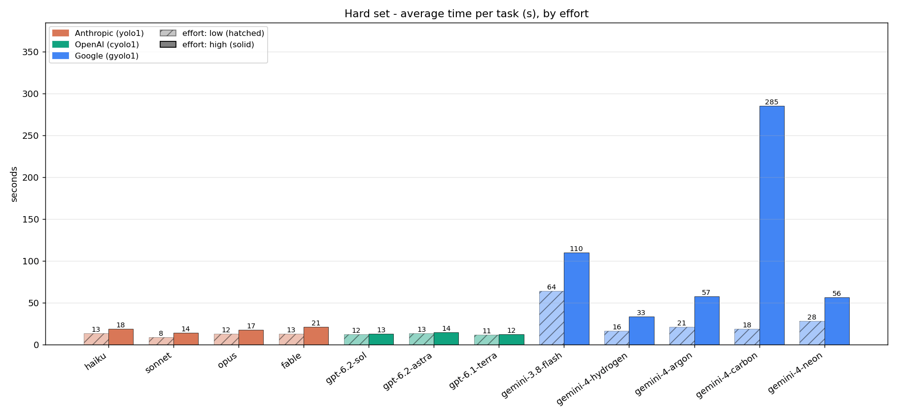

| ค่าย | รุ่น | ถูกที่ระดับต่ำ (จาก 5) | ถูกที่ระดับสูง (จาก 5) | เวลาเฉลี่ย ต่ำ / สูง (วินาที) |
|---|---|---|---|---|
| Claude | Haiku | 5 | 5 | 13.0 / 18.5 |
| Claude | Sonnet | 5 | 5 | 8.4 / 13.6 |
| Claude | Opus | 5 | 5 | 12.4 / 17.3 |
| Claude | Fable | 5 | 5 | 12.7 / 21.0 |
| Codex | `gpt-6.2-sol` | 5 | 5 | 12.0 / 12.8 |
| Codex | `gpt-6.2-astra` | 5 | 5 | 13.4 / 14.4 |
| Codex | `gpt-6.1-terra` | 5 | 5 | 11.3 / 12.2 |
| Antigravity | Gemini 3.8 Flash | 5 | 5 | 63.9 / 109.9 |
| Antigravity | Gemini 4 Hydrogen | 5 | 5 | 16.1 / 33.4 |
| Antigravity | Gemini 4 Argon | 5 | 5 | 21.1 / 57.4 |
| Antigravity | Gemini 4 Carbon | 5 | 5 | 18.5 / 284.8 |
| Antigravity | Gemini 4 Neon | 5 | 5 | 28.1 / 56.1 |

**อ่านผลอย่างไร**

- **ยังแยกความแม่นไม่ได้:** ทุกรุ่นตอบถูก 5 จาก 5 ทั้ง 2 ระดับ (ถูก 120 จาก 120 ครั้ง) ตัวตรวจถูกทดสอบก่อนแล้วว่าจับคำตอบผิดได้จริง
- **ระดับการคิดสูงไม่ได้ทำให้ถูกเพิ่ม แต่ช้าลง:** Claude ช้าลง 1.4–1.7 เท่า Codex ช้าลงราว 1 วินาที Antigravity ช้าลง 1.7–15 เท่า
- **หลักที่ใช้ได้ทุกค่าย:** เริ่มที่ความยากต่ำก่อน แล้วเพิ่มเมื่อคำตอบผิดหรือเทสต์ไม่ผ่าน ตรงกับตารางในหัวข้อ 4.1 ที่ให้งานส่วนใหญ่ใช้ความยาก 1–3
- **ข้อจำกัด:** แต่ละรุ่นรันข้อละ 1 ครั้ง ตัวเลขเวลาจึงแกว่งได้ ถ้าจะหาจุดที่รุ่นเริ่มตอบผิด ต้องใช้โจทย์ที่ยากกว่านี้และรันซ้ำหลายรอบ

## การทดลองที่ 3 · ทีม 3 ค่ายทำหน้าเว็บร้านดอยหมอก

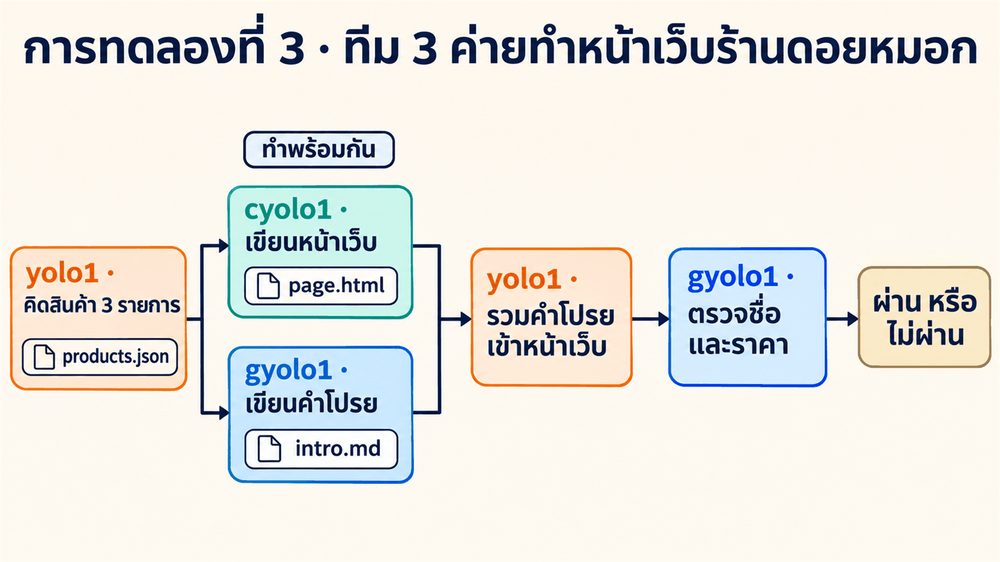

"ดอยหมอก" เป็นร้านกาแฟสมมติ งานนี้ใช้ทั้งการส่งต่อทีละทอด การทำพร้อมกัน และการตรวจข้ามค่าย

> [!IMPORTANT]
> **📋 คัดลอกกล่องนี้ → Claude Code app แล้วกด Enter**
>
> ```text
> ใช้ทีมเอเจนต์ใน container multi-account ทำหน้าแนะนำสินค้าของร้านกาแฟสมมติชื่อ "ดอยหมอก" ด้วยสกิล agent-team
> ใช้เฉพาะ 3 บัญชี: yolo1, cyolo1 และ gyolo1 งานทุกชิ้นใช้ความยาก 2 ทำในโฟลเดอร์งานชื่อ cafe ใน container
> 1. yolo1 คิดสินค้า 3 รายการ (ชื่อ ราคาเป็นบาท คำบรรยาย 1 ประโยค) บันทึกเป็น products.json แล้วตอบจำนวนรายการเป็นตัวเลขตัวเดียว
> 2. ทำพร้อมกัน: cyolo1 เขียนหน้าเว็บ page.html ที่แสดงสินค้าครบทุกรายการจากไฟล์นั้น และ gyolo1 เขียนคำโปรย 1 ย่อหน้าสำหรับส่วนหัวของหน้าเว็บ บันทึกเป็น intro.md
> 3. yolo1 รวมคำโปรยเข้าไปใน page.html
> 4. gyolo1 ตรวจ page.html เทียบกับ products.json ว่าชื่อและราคาตรงกันทุกรายการ ตอบ ผ่าน หรือ ไม่ผ่าน พร้อมรายการที่ผิด
> สรุปเป็นตาราง: งาน | บัญชี | รับข้อมูลจากใคร | ส่งต่อด้วยอะไร (ค่าในข้อความ หรือ ไฟล์) | เวลา (วินาที) | โทเค็น แล้วคัดลอกโฟลเดอร์งานกลับมาที่ ./cafe
> ```

| งาน | บัญชี | รับข้อมูลจาก | ส่งต่อด้วย | เวลา (วินาที) |
|---|---|---|---|---|
| คิดสินค้า 3 รายการ | `yolo1` | โจทย์ | ค่าในข้อความ (`3`) และไฟล์ `products.json` | 6.8 |
| เขียน `page.html` | `cyolo1` | `yolo1` | ไฟล์ `products.json` | 46.7 |
| เขียนคำโปรย `intro.md` | `gyolo1` | `yolo1` | ไฟล์ `products.json` | 24.4 |
| รวมคำโปรยเข้าหน้าเว็บ | `yolo1` | `cyolo1` และ `gyolo1` | ไฟล์ `page.html` และ `intro.md` | 8.8 |
| ตรวจชื่อและราคา | `gyolo1` | `yolo1` | ไฟล์ `page.html` และ `products.json` → **ผ่าน** | 17.7 |

- **งานที่ทำพร้อมกันเริ่มพร้อมกันจริง:** `cyolo1` และ `gyolo1` เริ่มทันทีที่ `products.json` เสร็จ ทั้งกราฟใช้เวลาราว 80 วินาที
- **ผลตรวจข้ามค่าย:** `gyolo1` เทียบหน้าเว็บกับไฟล์ต้นทางแล้วให้ผ่าน ชื่อและราคาตรงกันทั้ง 3 รายการ

## การทดลองที่ 4 · สร้างภาพแล้วตรวจข้ามค่าย


> [!IMPORTANT]
> **📋 คัดลอกกล่องนี้ → Claude Code app แล้วกด Enter**
>
> ```text
> ใช้ทีมเอเจนต์ใน container multi-account สร้างภาพสำหรับหน้าเว็บร้าน "ดอยหมอก" ในโฟลเดอร์งาน cafe ของการทดลองที่ 3 ด้วยสกิล agent-team
> ให้ Codex สร้างภาพ Gemini ตรวจ และ Claude ตัดสินขั้นสุดท้าย ไม่เกิน 3 รอบต่อภาพ
> 1. ภาพ hero.png: แก้วลาเต้ร้อนบนโต๊ะไม้ ฉากหลังเป็นภูเขาและหมอกยามเช้า เกณฑ์: เห็นแก้วกาแฟชัดเจน และไม่มีตัวหนังสือในภาพ
> 2. ภาพ sign.png: ป้ายไม้หน้าร้าน บรรทัดบนเขียนว่า "ดอยหมอก" บรรทัดล่างเขียนว่า "เปิด 07:00–17:00" เกณฑ์: ตัวหนังสือทั้ง 2 บรรทัดสะกดถูกทุกตัวอักษร
> 3. ใส่ภาพที่ผ่านการตัดสินแล้วลงใน page.html
> สรุปเป็นตาราง: ภาพ | รอบ | ผลตรวจของ Gemini | คำแนะนำที่ส่งกลับไปให้ Codex | คำตัดสินของ Claude | เวลา (วินาที) และสถิติโทเค็นแยกตามบัญชี แล้วคัดลอกภาพของทุกรอบและ page.html กลับมาที่ ./cafe
> ```

| `hero.png` | `sign.png` |
|---|---|
|  | 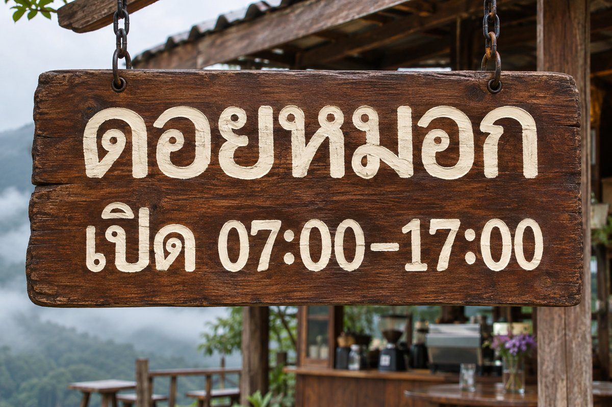 |

| ภาพ | รอบ | Gemini ตรวจ | Claude ตัดสิน | เวลา (วินาที) |
|---|---|---|---|---|
| `hero.png` | 1 | **PASS** เห็นแก้วลาเต้ชัดเจน ไม่มีตัวหนังสือ | **ACCEPT** | 90.2 (สร้าง 66.1 · ตรวจ 17.9 · ตัดสิน 6.1) |
| `sign.png` | 1 | **PASS** สะกดถูกทั้ง 2 บรรทัด | **ACCEPT** | 76.5 (สร้าง 43.8 · ตรวจ 16.9 · ตัดสิน 15.7) |

ทั้ง 2 ภาพผ่านตั้งแต่รอบแรก จึงยังไม่เห็นรอบแก้ไข การทดลองต่อไปนี้เพิ่มภาพที่ยากขึ้น

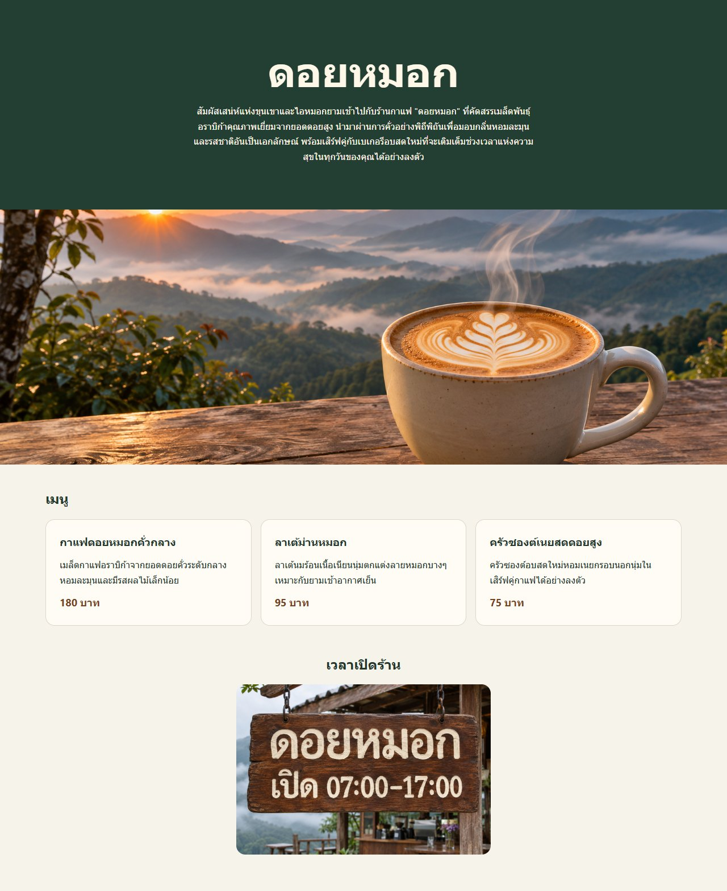

*หน้าเว็บจริงจากการทดลองที่ 3 และ 4 ข้อความจาก Claude และ Gemini โค้ดจาก Codex ภาพจาก Codex ที่ Gemini ตรวจและ Claude รับ*

### ภาพที่ไม่ผ่านรอบแรก

> [!IMPORTANT]
> **📋 คัดลอกกล่องนี้ → Claude Code app (session เดิม) แล้วกด Enter**
>
> ```text
> ทดลองต่ออีก 2 ภาพในโฟลเดอร์งาน cafe ด้วยสกิล agent-team เพื่อดูรอบแก้ไขเมื่อภาพไม่ผ่านการตรวจ ให้ Codex สร้าง Gemini ตรวจ และ Claude ตัดสินขั้นสุดท้าย ไม่เกิน 3 รอบต่อภาพ
> 1. ภาพ menu.png: กระดานดำเขียนเมนูด้วยชอล์ก 5 บรรทัด คือ ลาเต้ม่านหมอก 95 · อเมริกาโน่ 70 · ชาเขียวมัทฉะ 85 · ครัวซองต์เนยสด 75 · บราวนี่ 60 เกณฑ์: ตัวหนังสือและราคาถูกทุกบรรทัด
> 2. ภาพ staff.png: บอก Codex แค่ว่า "บาริสต้ากำลังชงกาแฟหลังเคาน์เตอร์ไม้" โดยไม่บอกเกณฑ์ของร้าน
> 3. ให้ Gemini ตรวจ staff.png ตามเกณฑ์ของร้านที่ผู้สร้างภาพไม่รู้: บาริสต้าใส่ผ้ากันเปื้อนสีเขียว และผนังด้านหลังมีป้ายชื่อร้าน "ดอยหมอก"
> สรุปเป็นตาราง: ภาพ | รอบ | ผลตรวจของ Gemini | คำแนะนำที่ส่งกลับไปให้ Codex | คำตัดสินของ Claude | เวลา (วินาที) แล้วคัดลอกภาพของทุกรอบกลับมาที่ ./cafe
> ```

| `staff.png` รอบที่ 1 · ไม่ผ่าน | `staff.png` รอบที่ 2 · ผ่าน |
|---|---|
|  |  |

| ภาพ | รอบ | Gemini ตรวจ | คำแนะนำที่ส่งกลับไปให้ Codex | Claude ตัดสิน | เวลา (วินาที) |
|---|---|---|---|---|---|
| `menu.png` | 1 | **PASS** ครบ 5 บรรทัด ตัวหนังสือและราคาถูก | – | **ACCEPT** | 85.0 |
| `staff.png` | 1 | **FAIL** ผ้ากันเปื้อนเป็นสีน้ำตาล และไม่มีป้ายชื่อร้าน | เปลี่ยนผ้ากันเปื้อนเป็นสีเขียว · เพิ่มป้าย "ดอยหมอก" บนผนังด้านหลัง · คงภาพเดิมไว้ | – | 70.4 |
| `staff.png` | 2 | **PASS** ผ้ากันเปื้อนสีเขียว ป้าย "ดอยหมอก" สะกดถูก | – | **ACCEPT** | 134.9 |

*`menu.png` ผ่านตั้งแต่รอบแรก*

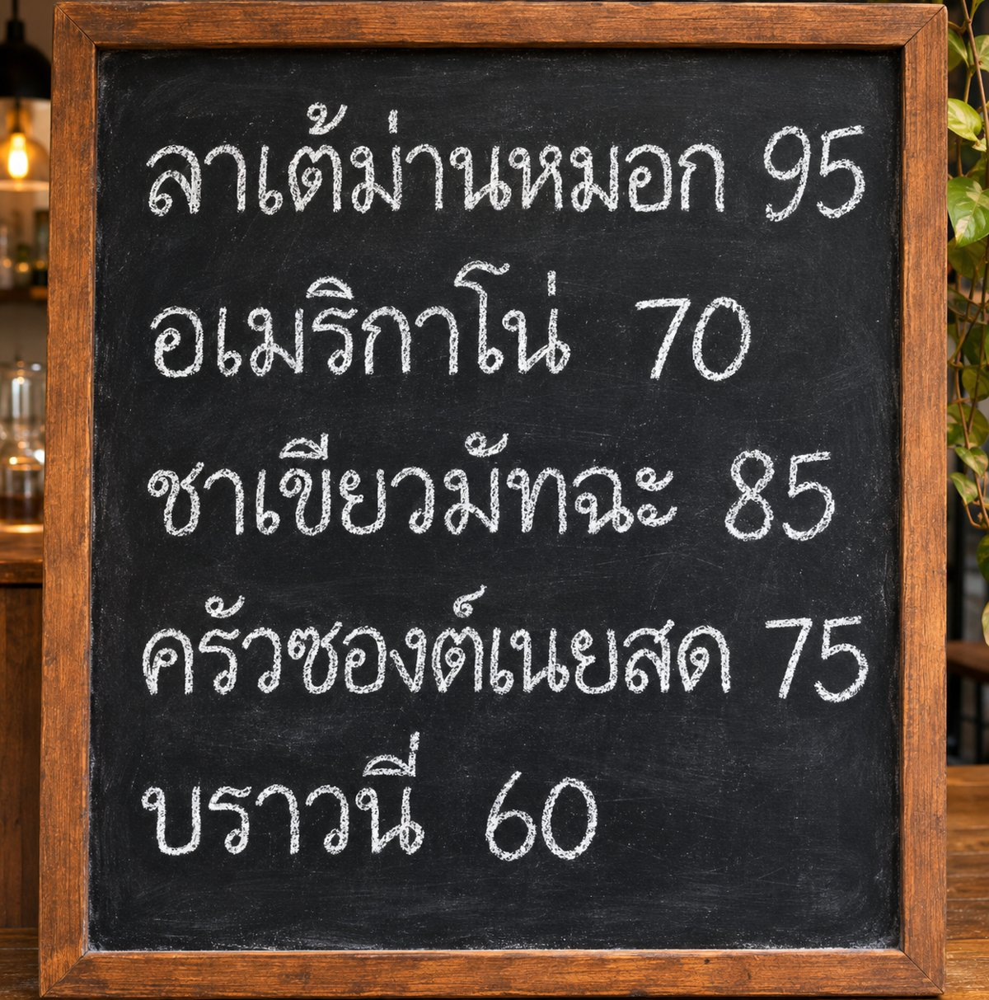

**อ่านผลอย่างไร**

- **คำแนะนำของผู้ตรวจคือคำสั่งรอบใหม่:** Codex ไม่เคยได้เกณฑ์ของร้าน รอบที่ 2 ได้เพียงคำแนะนำ 3 ข้อของ Gemini แล้วแก้ตรงจุด โดยคงคน ท่า และฉากเดิมไว้
- **ภาพที่มีตัวหนังสือไทยผ่านรอบแรก:** ป้ายร้าน 2 บรรทัดและกระดานเมนู 5 บรรทัดสะกดถูกทุกตัว
- **ผู้ตรวจต้องรู้เกณฑ์:** Gemini ตรวจตามเกณฑ์ที่เขียนไว้ในแผนงานเท่านั้น เกณฑ์ที่ไม่ได้เขียนจะไม่ถูกตรวจ
- **รอบแก้ไขใช้เวลา:** `staff.png` ใช้รวม 205.3 วินาทีสำหรับ 2 รอบ เทียบกับ 85.0 วินาทีของภาพที่ผ่านรอบแรก

### ให้ Gemini เป็นผู้สร้างภาพ

สลับบทบาท: **Gemini สร้าง → Codex ตรวจ → Claude ตัดสิน** ผู้ตรวจมาจากคนละค่ายกับผู้สร้างเสมอ และเมื่อภาพไม่ผ่าน Gemini จะแก้จากภาพของรอบก่อน

> [!IMPORTANT]
> **📋 คัดลอกกล่องนี้ → Claude Code app แล้วกด Enter**
>
> ```text
> ใช้ทีมเอเจนต์ใน container multi-account ทดลองสลับบทบาทของงานสร้างภาพ ในโฟลเดอร์งาน cafe ด้วยสกิล agent-team ให้ Gemini สร้างภาพ Codex ตรวจ และ Claude ตัดสินขั้นสุดท้าย ไม่เกิน 3 รอบต่อภาพ
> 1. ภาพ cup.png: แก้วอเมริกาโน่เย็นบนเคาน์เตอร์ไม้ ข้างแก้วมีป้ายตั้งโต๊ะเล็ก ๆ เขียนว่า "ดอยหมอก" เกณฑ์: ตัวหนังสือสะกดถูกทุกตัวอักษร และเห็นน้ำแข็งในแก้ว
> 2. ภาพ counter.png: บอก Gemini แค่ว่า "เคาน์เตอร์ร้านกาแฟทำจากไม้ มีเครื่องชงกาแฟ" โดยไม่บอกเกณฑ์ของร้าน
> 3. ให้ Codex ตรวจ counter.png ตามเกณฑ์ของร้านที่ผู้สร้างภาพไม่รู้: มีกระถางต้นไม้บนเคาน์เตอร์ และมีป้ายราคาเขียนว่า "ลาเต้ 65 บาท"
> สรุปเป็นตาราง: ภาพ | รอบ | ผู้สร้าง | ผู้ตรวจ | ผลตรวจ | คำแนะนำที่ส่งกลับไปให้ผู้สร้าง | คำตัดสินของ Claude | เวลา (วินาที) แล้วคัดลอกภาพของทุกรอบกลับมาที่ ./cafe
> ```

| `counter.png` รอบที่ 1 · ไม่ผ่าน | `counter.png` รอบที่ 2 · ผ่าน |
|---|---|
| 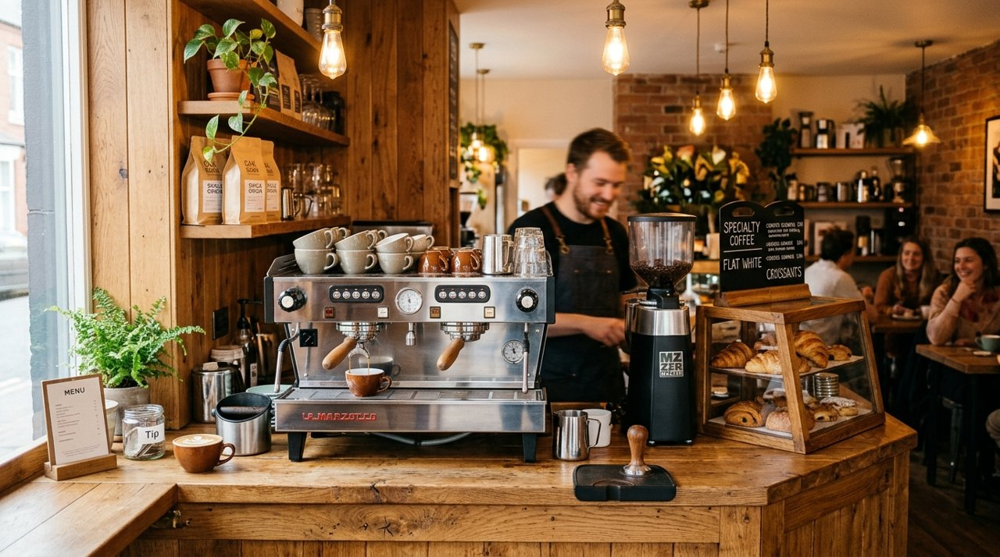 | 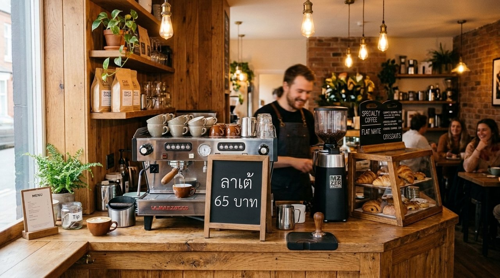 |

| ภาพ | รอบ | Gemini สร้าง | Codex ตรวจ | คำแนะนำที่ส่งกลับไปให้ Gemini | Claude ตัดสิน | เวลา (วินาที) |
|---|---|---|---|---|---|---|
| `cup.png` | 1 | `gyolo1` | **PASS** ป้าย "ดอยหมอก" ถูกทุกตัวอักษร เห็นน้ำแข็งชัด | – | **ACCEPT** | 80.2 |
| `counter.png` | 1 | `gyolo2` | **FAIL** มีกระถางต้นไม้แล้ว แต่ไม่มีป้าย "ลาเต้ 65 บาท" | คงกระถางต้นไม้ไว้ · เพิ่มป้ายราคาที่เห็นชัด เขียนว่า "ลาเต้ 65 บาท" ให้ถูกทุกตัว | – | 51.7 |
| `counter.png` | 2 | `gyolo2` ใช้ภาพรอบที่ 1 เป็นภาพตั้งต้น | **PASS** มีกระถางต้นไม้ และป้ายถูกต้อง | – | **ACCEPT** | 95.1 |

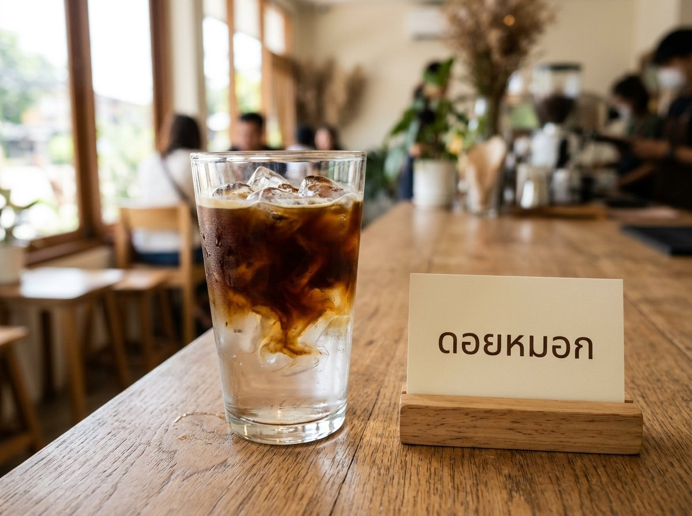

**อ่านผลอย่างไร**

- **Gemini สร้างภาพที่มีตัวหนังสือไทยได้ถูก:** ป้าย "ดอยหมอก" และ "ลาเต้ 65 บาท" สะกดถูกทุกตัว ใช้ 42–76 วินาทีต่อภาพ
- **รอบแก้ไขเป็นการแก้ภาพเดิม:** ภาพรอบที่ 2 มีคน เครื่องชง และฉากเดิมทุกอย่าง เพิ่มเพียงป้ายราคา เพราะสกิลส่งภาพรอบที่ 1 ให้ Gemini เป็นภาพตั้งต้น
- **ผู้ตรวจย้ายค่ายตามผู้สร้าง:** เมื่อ Gemini สร้าง สกิลให้ Codex ตรวจเอง โดยไม่ต้องระบุบัญชี
- **สิ่งที่อยู่นอกเกณฑ์จะไม่ถูกตรวจ:** ตัวหนังสือภาษาอังกฤษบนป้ายเมนูด้านหลังเพี้ยน แต่ภาพผ่าน เพราะเกณฑ์ไม่ได้พูดถึง

## การทดลองที่ 5 · ดูแลโควตาของลูกทีม และเปลี่ยนหัวหน้าทีม

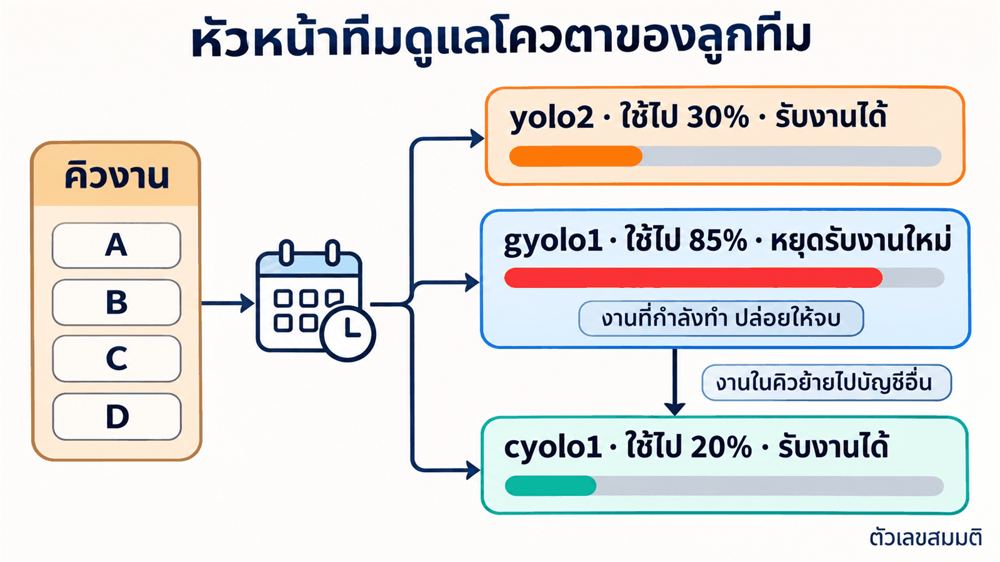

| สถานการณ์ของลูกทีม | ทีมทำอะไร |
|---|---|
| ใช้โควตาเกิน 80% หรือเกินงบที่ตั้งไว้ | **หยุดรับงานใหม่** งานที่กำลังทำปล่อยให้จบ งานที่รออยู่ย้ายไปคนอื่น |
| ล้มกลางคัน | ย้ายงานไปบัญชีอื่นของค่ายเดียวกันก่อน ไม่มีจึงข้ามค่าย |
| งานที่ผู้ใช้ระบุบัญชีเอง | ไม่ย้ายเงียบ ๆ หยุดและรายงาน |

ถ้าแผนงานอยู่ในความจำของหัวหน้าทีม เมื่อหัวหน้าโควตาหมด แผนและงานที่ค้างจะหายไปด้วย วิธีแก้เหมือนการส่งเวรของพยาบาล


*(ภาพจำลอง) `handoff.md` ทำหน้าที่เดียวกับใบส่งเวร*

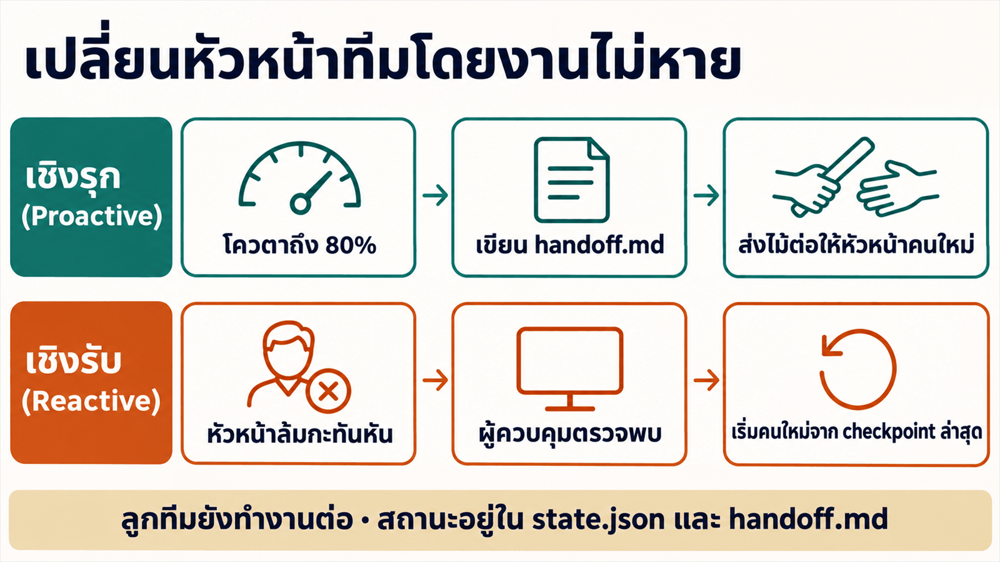

| หลักการ | รายละเอียด |
|---|---|
| สถานะอยู่ในไฟล์ | `state.json` และ `handoff.md` เก็บแผน ความคืบหน้า และขั้นต่อไป |
| ผู้ควบคุมเป็นสคริปต์ | `team.py` ไม่ใช้โทเค็น จึงไม่หมดโควตา |
| ลูกทีมไม่ผูกกับหัวหน้า | หัวหน้าเปลี่ยนตัวแล้ว งานที่สั่งไปยังทำต่อ |

> [!IMPORTANT]
> **📋 คัดลอกกล่องนี้ → Claude Code app แล้วกด Enter**
>
> ```text
> ใช้ทีมเอเจนต์ใน container multi-account ทดลองการดูแลทีมของสกิล agent-team เมื่อโควตาใกล้หมดและเมื่อหัวหน้าทีมล้ม โดยจำลองเหตุการณ์ ไม่ใช้โควตาจริงจนหมด
> งานของทีม: เขียนเมนูร้าน "ดอยหมอก" 6 หมวด (กาแฟร้อน กาแฟเย็น ชา ขนมอบ อาหารเช้า ของฝาก) หมวดละ 3 รายการพร้อมราคา ลูกทีมทำคนละหมวด แล้วรวมเป็นไฟล์เดียวชื่อ menu.md ในโฟลเดอร์งาน cafe งานทุกชิ้นใช้ความยาก 1
> 1. ให้หัวหน้าทีมเป็นผู้แบ่งงานและรวมผลเอง
> 2. จำลองให้หัวหน้าคนแรกล้มกลางคัน เพื่อดูการเปลี่ยนหัวหน้าแบบเชิงรับ
> 3. ตั้งงบโทเค็นของหัวหน้าคนถัดไปให้ต่ำ เพื่อดูการเปลี่ยนหัวหน้าแบบเชิงรุก
> 4. ตั้งงบโทเค็นของลูกทีมคนหนึ่งให้ต่ำ และจำลองให้ gyolo1 โควตาหมด เพื่อดูการย้ายงานของลูกทีม
> สรุปเป็นตาราง: ประวัติการเปลี่ยนหัวหน้า (จากใคร ไปใคร เพราะอะไร) · การย้ายงานของลูกทีม · เมนูครบ 6 หมวดหรือไม่ · สถิติแยกตามบัญชี แล้วคัดลอก menu.md กลับมาที่ ./cafe
> ```

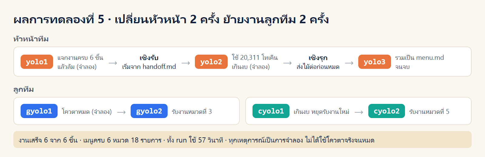

| เหตุการณ์ | จาก → ไป | เพราะอะไร |
|---|---|---|
| เปลี่ยนหัวหน้า**เชิงรับ** | `yolo1` → `yolo2` | `yolo1` ถูกจำลองให้ล้มหลังแจกงานครบ 6 ชิ้น |
| เปลี่ยนหัวหน้า**เชิงรุก** | `yolo2` → `yolo3` | `yolo2` ใช้ไป 20,311 โทเค็น เกินงบที่ตั้งไว้ 1 |
| ย้ายงานลูกทีม | `gyolo1` → `gyolo2` | `gyolo1` ถูกจำลองว่าโควตาหมด |
| ย้ายงานลูกทีม | `cyolo1` → `cyolo2` | `cyolo1` ใช้ไป 1,544 โทเค็น เกินงบที่ตั้งไว้ 1 จึงหยุดรับงานใหม่ |

- **งานไม่หาย:** งานทั้ง 6 ชิ้นเสร็จ และ `yolo3` รวมเป็น [`menu.md`](_solution/results/cafe/menu.md) ครบ 6 หมวด หมวดละ 3 รายการ ทั้ง run ใช้ 57 วินาที
- **ย้ายในค่ายเดียวกันก่อน:** งานของ Gemini ไป `gyolo2` และงานของ Codex ไป `cyolo2`
- **งบ 1 โทเค็นเป็นสวิตช์จำลอง:** การใช้งานจริงให้ตั้งงบตามโควตาของบัญชี หรือใช้เกณฑ์ 80% ที่เป็นค่าเริ่มต้น
- **ข้อจำกัด:** การเปลี่ยนหัวหน้าเชิงรุกระหว่างรอบทำได้เมื่อหัวหน้าเป็น Claude จึงควรมี Claude ที่พร้อมอย่างน้อย 2 บัญชี

## การทดลองที่ 6 · ถกกัน แข่งกัน เลือกคนให้เหมาะกับงาน และรอคนอนุมัติ

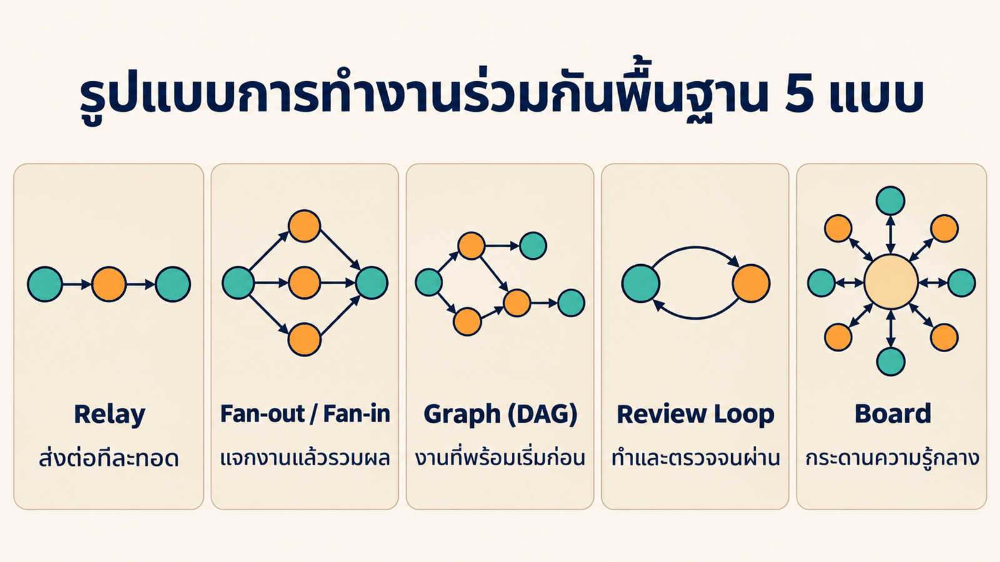

การทดลองที่ 1 และ 3 ใช้รูปแบบพื้นฐานไปแล้ว การทดลองนี้ใช้รูปแบบขั้นสูงอีก 5 แบบ

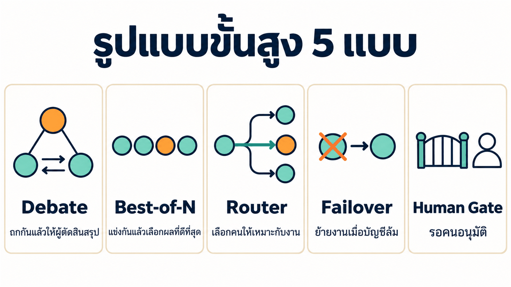

> [!IMPORTANT]
> **📋 คัดลอกกล่องนี้ → Claude Code app แล้วกด Enter**
>
> ```text
> ใช้ทีมเอเจนต์ใน container multi-account ทดลองรูปแบบขั้นสูงของสกิล agent-team กับงานร้าน "ดอยหมอก" ในโฟลเดอร์งาน cafe ของการทดลองก่อนหน้า งานทุกชิ้นใช้ความยาก 2 ห้ามแก้ page.html
> 1. ถกกัน: ให้ Claude, Codex และ Gemini ตอบว่าราคาบนหน้าเว็บควรเขียนเป็น "65 บาท" หรือ "฿65" แล้วให้ผู้ตัดสินสรุปพร้อมเหตุผล
> 2. แข่งกัน: ให้ทั้ง 3 ค่ายเขียนสโลแกนร้านไม่เกิน 12 คำ ผู้ตัดสินให้คะแนนแล้วเลือก 1 อัน บันทึกเป็น slogan.md
> 3. เลือกคนให้เหมาะกับงาน: ส่งงาน 3 ชิ้นโดยไม่ระบุบัญชี ได้แก่ ตรวจโค้ด page.html หาจุดเสี่ยง 3 ข้อ · ดูภาพ hero.png แล้วเขียนคำบรรยายภาพ 1 ประโยค · เขียนคู่มือดูแลหน้าเว็บยาว 1 หน้า
> 4. ย้ายงาน: จำลองให้ gyolo1 โควตาหมด แล้วดูว่างานของค่าย Gemini ย้ายไปบัญชีไหน
> 5. รออนุมัติ: งานสุดท้ายคัดลอก page.html ไปไว้ในโฟลเดอร์ publish ต้องรออนุมัติก่อน เมื่องานหยุดรอ ให้แสดงสถานะให้ผมเห็น แล้วอนุมัติแทนผมได้ในการทดลองนี้
> สรุปเป็นตาราง: รูปแบบ | บัญชีที่เกี่ยวข้อง | เกิดอะไรขึ้นจริง | เวลา (วินาที) และสถิติโทเค็นแยกตามบัญชี
> ```

| รูปแบบ | บัญชี | เกิดอะไรขึ้นจริง | เวลา (วินาที) |
|---|---|---|---|
| ถกกัน | `yolo1` · `cyolo2` · `gyolo2` ผู้ตัดสิน `cyolo1` | ทั้ง 3 ค่ายตอบว่าควรใช้ **"65 บาท"** ผู้ตัดสินให้เหตุผลว่าอ่านตามลำดับที่คนไทยพูด และตรงกับราคาเดิมบนหน้าเว็บ | 45 |
| แข่งกัน | `yolo1` · `cyolo2` · `gyolo2` ผู้ตัดสิน `yolo2` | สโลแกนของ Gemini ชนะด้วย 9 คะแนน: "จิบกาแฟแท้ สัมผัสไอหมอก เติมเต็มความสุขแห่งขุนเขา" อีก 2 ค่ายได้ 7 คะแนน | 45 |
| เลือกคนให้เหมาะกับงาน | ระบบเลือกเอง | ตรวจโค้ด → `cyolo1` · ดูภาพ → `gyolo1` · เขียนคู่มือ → `yolo2` | 21 |
| ย้ายงาน | `gyolo1` → `gyolo2` | `gyolo1` ถูกจำลองว่าโควตาหมด งานล้มใน 0.05 วินาที แล้วย้ายไป `gyolo2` ในค่ายเดียวกัน | 10.2 |
| รออนุมัติ | `cyolo2` | งานหยุดที่สถานะ `waiting_approval` โดยยังไม่เรียกโมเดล หลังอนุมัติจึงคัดลอก `page.html` ไปที่ `publish/` | 19 + 8.5 |

- **ผู้ตัดสินไม่ซ้ำกับผู้ตอบ:** ทั้งการถกกันและการแข่งกันใช้บัญชีที่ไม่ได้ตอบเป็นผู้ตัดสิน
- **`page.html` ไม่ถูกแก้:** ค่า SHA-256 ก่อนและหลังตรงกัน และสำเนาใน `publish/` ตรงทุกไบต์
- **รออนุมัติ:** ในการทดลองนี้พรอมต์อนุญาตให้ app อนุมัติแทน การใช้งานจริงให้คนสั่งอนุมัติเอง

---

## สรุป

| สิ่งที่ถาม | คำตอบจากการทดลอง |
|---|---|
| ส่งข้อมูลในค่ายเดียวกันและข้ามค่ายได้ถูกหรือไม่ | ถูก 27 จาก 27 การทดสอบ ครบ 9 เส้นทาง |
| ส่งข้อความยาวและภาพมีปัญหาหรือไม่ | ไม่มี ไฟล์ราว 2,000 บรรทัดและภาพป้ายตัวเลข ผู้รับตอบถูกทุกเส้นทาง |
| ค่ายไหนเร็ว | Claude และ Codex ราว 5 วินาทีต่อข้อ Antigravity 11–19 วินาที |
| รุ่นไหนตอบถูกกว่า | ยังแยกไม่ได้ ทุกรุ่นตอบถูกทั้งโจทย์ง่าย 4 ข้อและโจทย์ยาก 5 ข้อ |
| ระดับการคิดสูงคุ้มหรือไม่ | กับโจทย์ชุดนี้ไม่คุ้ม ถูกเท่าเดิมแต่ช้าลง โดยเฉพาะ Antigravity |
| ภาพที่ไม่ผ่านถูกแก้ได้หรือไม่ | ได้ ภาพบาริสต้าไม่ผ่านรอบแรก Gemini สั่งแก้ Codex สร้างรอบ 2 จนผ่าน และ Claude รับ |
| หัวหน้าทีมหรือลูกทีมโควตาหมด งานหายหรือไม่ | ไม่หาย เปลี่ยนหัวหน้า 2 ครั้ง ย้ายงาน 2 ครั้ง งานเสร็จ 6 จาก 6 ชิ้น |

**ไม่มีสกิลเทียบกับมีสกิล**

| | ไม่มีสกิล | มีสกิล |
|---|---|---|
| วิธีสั่งแต่ละค่าย | ลองผิดลองถูกทุกครั้ง | สคริปต์ของสกิลสั่งให้ถูกและตรวจผลให้ |
| บัญชีไหนใช้ได้ | ดูสถานะล็อกอิน ซึ่งอาจไม่ตรงจริง | ตรวจด้วยการเรียกจริงทั้ง 15 บัญชี |
| เลือกรุ่น | ต้องจำชื่อรุ่นของ 3 ค่าย | บอกความยาก 1–6 |
| ส่งงานข้ามค่าย | สั่งทีละตัวและคัดลอกผลเอง | เขียนแผนงานไฟล์เดียว สั่งคำสั่งเดียว |
| ภาพ | สร้างแล้วต้องตรวจเอง | ค่ายหนึ่งสร้าง อีกค่ายตรวจ Claude ตัดสิน |
| สถิติและโควตา | รวมตัวเลขเอง | บันทึกทุกครั้งที่เรียก โควตาแสดงแบบเดียวกันทั้ง 3 ค่าย |
| โควตาหมดกลางงาน | งานค้างหรือหาย | ย้ายงานและเปลี่ยนหัวหน้าทีมโดยงานไม่หาย |

## ข้อควรรู้

- **ล็อกอินเองเสมอ:** สกิลไม่ล็อกอินแทน และไม่อ่านไฟล์ credential
- **ทุกบัญชีทำงานแบบข้ามการขออนุญาต:** ใช้กับงานที่อนุญาตเท่านั้น และตรวจผลของ AI ซ้ำเสมอ
- **ไม่ทำซ้ำเองเมื่องานล้มหลังเสียโทเค็น:** งานที่ล้มจะหยุดและรายงาน ผู้ใช้สั่งรันต่อเฉพาะงานที่ล้มได้
- **สร้างภาพด้วย Gemini:** ใช้เวลาราว 45–80 วินาทีต่อภาพ ถ้าเซิร์ฟเวอร์สร้างภาพของ Gemini ไม่มีกำลังประมวลผล (ตอบ 503 เหมือนวันที่สร้างสกิลในส่วนที่ 1) งานจะย้ายไป Codex พร้อมบันทึกเหตุผล ส่วนงานที่เจาะจงบัญชี `gyolo` จะหยุดและรายงาน
- **โควตาของ `gyolo` หลายบัญชี:** ถ้าล็อกอินด้วยบัญชี Google เดียวกัน โควตาจะใช้ร่วมกัน การกระจายงานจึงไม่ได้โควตาเพิ่ม
- **แก้สกิลที่ต้นฉบับ:** แก้ใน `skills/` บนเครื่องเรา แล้วคัดลอกทับในที่เก็บสกิลกลางอีกครั้ง
- **ติดตั้งให้ครบ 4 โฟลเดอร์:** `agent-team` เรียกใช้สกิลรายค่ายที่วางอยู่ข้างกัน

## คำสั่งที่ใช้บ่อย

ใน container (JupyterLab Terminal)

```bash
T=/root/ai-accounts/.Claude/shared/skills/agent-team/scripts/team.py
python3 $T check            # บัญชีไหนใช้ได้ (เรียกจริงทั้ง 3 ค่าย)
python3 $T quota            # โควตาทุกบัญชี เป็น % ที่ใช้ พร้อมเวลาของข้อมูล
python3 $T run graph.json   # รันแผนงานจนจบ แล้วพิมพ์ตารางสรุปและโควตา
python3 $T status           # ภาพรวมทีม
python3 $T stats            # สถิติตามบัญชี รุ่น และ run
```

จากเครื่องเรา

```bash
docker exec multi-account cat //root/ai-accounts/.Claude/shared/skills/agent-team/SKILL.md
docker exec multi-account python3 //root/ai-accounts/.Claude/shared/skills/agent-team/scripts/team.py check
docker exec multi-account python3 //root/ai-accounts/.Claude/shared/skills/gyolo/scripts/gyolo.py models
cat graph.json | docker exec -i multi-account python3 //root/ai-accounts/.Claude/shared/skills/agent-team/scripts/team.py run - --workers yolo1,cyolo1,gyolo1
```

---

# แบบฝึกหัดท้ายบท

แบบฝึกหัด 48 ข้อสำหรับฝึกสั่งงานทีม 3 ค่ายด้วยสกิลชุดมาตรฐาน ทุกกล่องคัดลอกไปวางใน Claude Code app ได้ทันที แต่ละข้อจบในตัวเอง ทำข้อไหนก่อนก็ได้


- **ก่อนเริ่ม:** ติดตั้งสกิลชุดมาตรฐานแล้ว (ขั้นที่ 5) และมีบัญชีที่ใช้งานได้อย่างน้อยค่ายละ 1 บัญชี คือ `yolo1`, `cyolo1` และ `gyolo1`
- **เวลาจริง:** เวลาที่ Claude Code app ใช้ทำข้อนั้นจนจบ จากการรันจริง 1 ครั้ง
- **ผลจริง:** คำตอบและแผนงานจากการรันจริงของทุกข้ออยู่ใน [`_solution/exercises`](_solution/exercises)

## สั่งงานทีมให้ครบ 4 ส่วน

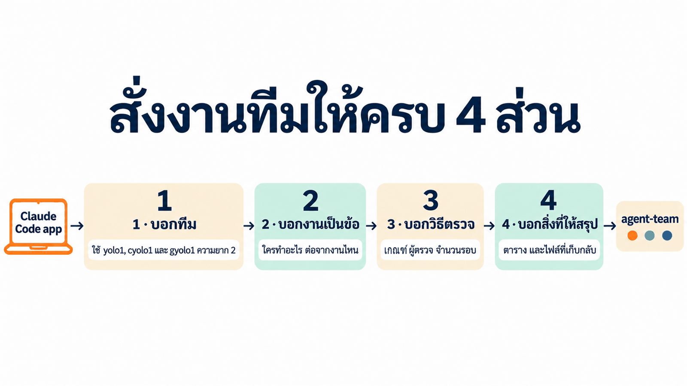

| ท่า | ประโยคที่ใช้สั่ง | แบบฝึกหัด |
|---|---|---|
| ส่งต่อ | `yolo1` ทำ… แล้ว `cyolo1` ทำต่อ… | 8, 42 |
| ทำพร้อมกันแล้วรวม | ทำพร้อมกัน: … แล้ว `yolo1` รวม… | 9, 12, 41 |
| ส่งข้อมูลยาวด้วยไฟล์ | บันทึกเป็นไฟล์… แล้วให้อีกบัญชีอ่านไฟล์นั้น | 5, 10, 15 |
| ตรวจรูปแบบคำตอบ | ตอบเป็นตัวเลขตัวเดียว · ตอบเป็น JSON เท่านั้น | 4, 11 |
| ให้สกิลเลือกคนเอง | งาน… ที่ไม่ระบุบัญชี | 13, 14 |
| กระดานความรู้ของทีม | ประกาศบนกระดานของทีม · อ่านจากกระดานเอง | 16 |
| ตรวจวนรอบ | A เขียน B ตรวจตามเกณฑ์… วนจนผ่าน ไม่เกิน 3 รอบ | 17, 18, 41 |
| ถกกัน | ให้ A และ B ตอบพร้อมเหตุผล แล้วให้ C ตัดสิน | 19, 44 |
| แข่งกัน | ให้ 3 ค่ายแข่งกัน… ผู้ตัดสินเลือก 1 ผลงาน | 20, 21 |
| ภาพที่ผ่านการตรวจ | ให้ Codex สร้าง Gemini ตรวจ และ Claude ตัดสิน ไม่เกิน 3 รอบ | 27, 28, 29, 40 |
| แก้ภาพจากภาพเดิม | ใช้ภาพจากข้อ 1 เป็นภาพตั้งต้น แล้วแก้… | 26 |
| ย้ายงานเมื่อโควตาหมด | จำลองให้ `cyolo1` โควตาหมด | 32, 33, 34 |
| รออนุมัติ | งานนี้ต้องรออนุมัติก่อน | 35, 40 |
| หัวหน้าทีม | ให้หัวหน้าทีมแบ่งงานและรวมผลเอง | 36, 37 |

ภาพของแต่ละท่าอยู่ในการทดลองที่ 6

## หมวด 1 · สกิลรายค่าย

อุ่นเครื่องกับสกิล `yolo` `cyolo` `gyolo` ทีละค่าย ก่อนให้ทำงานเป็นทีม

### แบบฝึกหัดที่ 1 · ตรวจทีมก่อนเริ่มงาน

**ท่า:** ตรวจความพร้อมและโควตา · **เวลาจริง:** 1 นาที · [ผลจริง](_solution/exercises/01)

```text
ใช้สกิล agent-team ใน container multi-account ตรวจความพร้อมของทีมก่อนเริ่มงาน
1. ตรวจว่าบัญชีไหนใช้งานได้จริงบ้าง จากทั้ง 15 บัญชีของ 3 ค่าย
2. ดูโควตาที่ใช้ไปของบัญชีที่ใช้งานได้
3. แนะนำว่าวันนี้ควรใช้บัญชีไหนเป็นหลักของแต่ละค่าย เพราะอะไร
สรุปเป็นตาราง: บัญชี | ค่าย | ใช้ได้หรือไม่ | โควตาที่ใช้ไป (%) | เวลาที่โควตาเริ่มนับใหม่
```

**ผลจากการรันจริง:** พบบัญชีที่ใช้งานได้ 7 จาก 15 บัญชี และ Claude ตั้งข้อสังเกตเองว่าบัญชีที่มีโควตาและเวลานับใหม่ตรงกันทุกค่า อาจล็อกอินด้วยบัญชีจริงเดียวกัน

### แบบฝึกหัดที่ 2 · คำถามเดียว ถาม 3 ค่าย

**ท่า:** สั่งงานทีละค่าย · **เวลาจริง:** 1 นาที · [ผลจริง](_solution/exercises/02)

```text
ใช้สกิล yolo, cyolo และ gyolo ใน container multi-account ถามคำถามเดียวกันกับ 3 ค่าย ด้วยความยาก 1
1. ถาม yolo1, cyolo1 และ gyolo1 ว่า "Docker volume ต่างจาก bind mount อย่างไร ตอบไม่เกิน 2 ประโยค"
2. เทียบคำตอบของทั้ง 3 ค่าย
สรุปเป็นตาราง: บัญชี | รุ่นที่สกิลเลือก | คำตอบ | เวลา (วินาที) | โทเค็นขาเข้า | โทเค็นขาออก แล้วบอกว่าคำตอบของค่ายไหนชัดที่สุด เพราะอะไร
```

**ผลจากการรันจริง:** ทั้ง 3 ค่ายตอบถูก Claude เร็วที่สุด (3.4 วินาที) Codex 5.9 วินาที และ Claude Code app เลือกคำตอบของ Codex ว่าชัดที่สุด

### แบบฝึกหัดที่ 3 · ความยากกับรุ่นที่สกิลเลือก

**ท่า:** บอกความยาก 1–6 · **เวลาจริง:** 1 นาที · [ผลจริง](_solution/exercises/03)

```text
ใช้สกิล gyolo ใน container multi-account ดูว่าความยากมีผลกับรุ่นและเวลาอย่างไร ใช้บัญชี gyolo1
1. ถามโจทย์เดียวกัน 3 ครั้ง ด้วยความยาก 1, 3 และ 5: "ร้านขายน้ำเปิด 3 วัน วันแรกขายได้ 120 แก้ว วันที่สองขายได้มากกว่าวันแรก 25% วันที่สามขายได้น้อยกว่าวันที่สอง 30 แก้ว รวม 3 วันขายได้กี่แก้ว ตอบเป็นตัวเลขตัวเดียว"
2. ตรวจคำตอบด้วยการคำนวณเอง
สรุปเป็นตาราง: ความยาก | รุ่นที่สกิลเลือก | คำตอบ | ถูกหรือไม่ | เวลา (วินาที) | โทเค็น
```

**ผลจากการรันจริง:** ทั้ง 3 ระดับตอบ 390 ถูก สกิลเลือกรุ่นต่างกัน (flash-low · hydrogen-medium · argon-high) แต่โจทย์ง่ายเกินกว่าจะเห็นความต่าง ความยาก 5 ช้าที่สุด (9.7 วินาที)

### แบบฝึกหัดที่ 4 · คำตอบเป็น JSON

**ท่า:** กำหนดรูปแบบคำตอบ · **เวลาจริง:** 1 นาที · [ผลจริง](_solution/exercises/04)

```text
ใช้สกิล cyolo ใน container multi-account ให้ cyolo1 แปลงข้อความเป็นข้อมูล ด้วยความยาก 1
1. ข้อความ: "คุณสมชายสั่งลาเต้เย็น 2 แก้ว แก้วละ 65 บาท และครัวซองต์ 1 ชิ้น 75 บาท รับที่ร้านเวลา 08:30"
2. ให้ตอบเป็น JSON เท่านั้น มีช่อง ลูกค้า · รายการ (ชื่อ จำนวน ราคาต่อหน่วย) · ยอดรวม · เวลารับ
3. ตรวจว่า JSON อ่านได้จริง และยอดรวมเท่ากับ 205
สรุป: JSON ที่ได้ · ผ่านการตรวจหรือไม่ · เวลา (วินาที)
```

**ผลจากการรันจริง:** ได้ JSON ล้วนที่อ่านได้จริง มีครบ 4 ช่อง ยอดรวม 205 ตรงกับที่คำนวณซ้ำ ใช้ 6 วินาที

### แบบฝึกหัดที่ 5 · อ่านไฟล์ยาว

**ท่า:** ส่งข้อมูลยาวด้วยไฟล์ · **เวลาจริง:** 1 นาที · [ผลจริง](_solution/exercises/05)

```text
ใช้สกิล yolo และ gyolo ใน container multi-account ทดสอบการอ่านไฟล์ยาว ทำในโฟลเดอร์งาน ex/05 ใน container
1. สร้างไฟล์ log.txt ยาว 1,500 บรรทัด เป็นบันทึกการทำงานของเซิร์ฟเวอร์สมมติ และซ่อนบรรทัด "ERROR รหัส 7741 ที่เครื่อง db-3" ไว้ 1 บรรทัดกลางไฟล์
2. ให้ yolo1 และ gyolo1 อ่านไฟล์นั้น แล้วตอบว่า ERROR เกิดที่เครื่องไหน รหัสอะไร และอยู่บรรทัดที่เท่าไร ใช้ความยาก 2
สรุปเป็นตาราง: บัญชี | คำตอบ | ถูกหรือไม่ | เวลา (วินาที) | โทเค็นขาเข้า
```

**ผลจากการรันจริง:** ทั้ง Claude และ Gemini หาบรรทัดที่ซ่อนไว้เจอ (เครื่อง db-3 รหัส 7741 บรรทัด 742) ใช้ 5 และ 11 วินาที และตัวเลขโทเค็นขาเข้าต้องรวมส่วนที่อ่านจาก cache จึงจะเทียบกันได้

### แบบฝึกหัดที่ 6 · สถิติของสกิลรายค่าย

**ท่า:** อ่านสถิติ · **เวลาจริง:** 1 นาที · [ผลจริง](_solution/exercises/06)

```text
ใช้สกิล yolo, cyolo และ gyolo ใน container multi-account ดูสถิติการใช้งานที่สกิลบันทึกไว้
1. สถิติของแต่ละค่าย: เรียกกี่ครั้ง สำเร็จกี่ครั้ง ใช้โทเค็นเท่าไร แยกตามบัญชีและรุ่น
2. หาการเรียกที่ช้าที่สุด และการเรียกที่ใช้โทเค็นมากที่สุด
สรุปเป็นตาราง 1 ตารางต่อค่าย แล้วบอกว่าค่ายไหนใช้เวลาเฉลี่ยต่อการเรียกน้อยที่สุด
```

**ผลจากการรันจริง:** จากการเรียก 352 ครั้งของวันที่รัน เวลาเฉลี่ยต่อการเรียกคือ Claude 7.3 วินาที Codex 15.6 วินาที และ Gemini 29.6 วินาที และ Claude เตือนเองว่าตัวเลขนี้ขึ้นกับชนิดงานที่แต่ละค่ายได้รับ

## หมวด 2 · ท่าพื้นฐานของ agent-team

ส่งต่อ ทำพร้อมกัน ส่งไฟล์ ตรวจรูปแบบคำตอบ และให้สกิลเลือกคนเอง

### แบบฝึกหัดที่ 7 · ให้ Claude อธิบายสกิลเป็นภาษาคน

**ท่า:** อ่านคู่มือของสกิล · **เวลาจริง:** 1 นาที · [ผลจริง](_solution/exercises/07)

```text
อ่านคู่มือของสกิล agent-team จากใน container multi-account แล้วอธิบายให้คนที่ไม่เคยใช้เข้าใจ อ่านอย่างเดียว ไม่ต้องสั่งงานบัญชีใด
1. สกิลนี้ทำอะไรได้บ้าง เขียนเป็นรายการ ข้อละ 1 บรรทัด
2. ยกตัวอย่างประโยคภาษาคนที่ผมพิมพ์สั่งได้ ข้อละ 1 ประโยค
3. บอกสิ่งที่สกิลไม่ทำให้ และข้อควรระวัง
สรุปเป็นตาราง: ความสามารถ | ตัวอย่างประโยคสั่ง | ข้อควรระวัง
```

**ผลจากการรันจริง:** Claude อ่านคู่มือ 2 ไฟล์จากใน container แล้วสรุปเป็นตารางความสามารถ ตัวอย่างประโยคสั่ง และข้อควรระวัง โดยไม่ได้สั่งงานบัญชีใด

### แบบฝึกหัดที่ 8 · ส่งต่อ 3 ทอด

**ท่า:** ส่งต่อ (relay) · **เวลาจริง:** 1 นาที · [ผลจริง](_solution/exercises/08)

```text
ใช้สกิล agent-team ใน container multi-account ส่งงานต่อกัน 3 ทอด ด้วย yolo1, cyolo1 และ gyolo1 งานทุกชิ้นใช้ความยาก 1
1. yolo1 เขียนคำขวัญของร้านหนังสือเล็ก ๆ 1 ประโยคเป็นภาษาไทย
2. cyolo1 แปลคำขวัญนั้นเป็นภาษาอังกฤษ
3. gyolo1 นับจำนวนคำของประโยคภาษาอังกฤษ ตอบเป็นตัวเลขตัวเดียว
สรุปเป็นตาราง: งาน | บัญชี | ผลที่ได้ | รับข้อมูลจากใคร | เวลา (วินาที) แล้วเก็บแผนงานที่ใช้ไว้ที่ ./exercises/08
```

**ผลจากการรันจริง:** คำขวัญ → คำแปล → 12 คำ ส่งต่อครบ 3 ค่ายใน 16 วินาที และ Claude Code app นับคำซ้ำเองเพื่อยืนยัน

### แบบฝึกหัดที่ 9 · ทำพร้อมกันแล้วรวมผล

**ท่า:** แยกงานแล้วรวม (fan-out / fan-in) · **เวลาจริง:** 1 นาที · [ผลจริง](_solution/exercises/09)

```text
ใช้สกิล agent-team ใน container multi-account ให้ 3 ค่ายทำงานพร้อมกันแล้วรวมผล ด้วย yolo1, cyolo1 และ gyolo1 งานทุกชิ้นใช้ความยาก 1
1. ทำพร้อมกัน: แต่ละบัญชีเขียนข้อควรระวัง 2 ข้อของการใช้ AI เขียนโค้ด
2. yolo1 รวมทั้ง 6 ข้อเป็นรายการเดียว และตัดข้อที่ซ้ำกันออก
สรุปเป็นตาราง: งาน | บัญชี | เวลา (วินาที) แล้วเทียบเวลาที่ใช้จริงทั้งหมดกับผลรวมเวลาของทุกงาน ว่าการทำพร้อมกันประหยัดเวลาไปเท่าไร เก็บแผนงานที่ใช้ไว้ที่ ./exercises/09
```

**ผลจากการรันจริง:** 3 ค่ายเขียนพร้อมกัน แล้วรวมเหลือ 4 ข้อ (ตัดข้อซ้ำ 2 ข้อ) ใช้เวลาจริง 14 วินาที เทียบกับ 25.6 วินาทีถ้าทำทีละงาน ประหยัดราว 45%

### แบบฝึกหัดที่ 10 · ส่งข้อมูลยาวข้ามค่ายด้วยไฟล์

**ท่า:** ส่งต่อด้วยไฟล์ · **เวลาจริง:** 2 นาที · [ผลจริง](_solution/exercises/10)

```text
ใช้สกิล agent-team ใน container multi-account ส่งข้อมูลยาวข้ามค่ายด้วยไฟล์ ด้วย yolo1, cyolo1 และ gyolo1 ทำในโฟลเดอร์งาน ex/10 ใน container งานทุกชิ้นใช้ความยาก 2
1. cyolo1 สร้างไฟล์ products.csv มีสินค้า 200 รายการ (รหัส ชื่อ หมวด ราคา) โดยราคาไม่ซ้ำกัน
2. ทำพร้อมกันหลังงานที่ 1: gyolo1 อ่านไฟล์แล้วตอบรหัสของสินค้าที่แพงที่สุด และ yolo1 อ่านไฟล์เดียวกันแล้วตอบรหัสของสินค้าที่ถูกที่สุด
3. ตรวจคำตอบทั้งสองด้วยการคำนวณจากไฟล์เอง
สรุปเป็นตาราง: งาน | บัญชี | คำตอบ | ถูกหรือไม่ | ส่งข้อมูลด้วยอะไร (ค่าในข้อความ หรือ ไฟล์) แล้วเก็บแผนงานที่ใช้ไว้ที่ ./exercises/10
```

**ผลจากการรันจริง:** Codex สร้างไฟล์ 200 แถว แล้ว Gemini กับ Claude อ่านไฟล์เดียวกันตอบถูกทั้งคู่ (แพงสุด P099 ถูกสุด P087) ข้อมูลทั้งหมดส่งด้วยไฟล์

### แบบฝึกหัดที่ 11 · ตรวจรูปแบบคำตอบ แล้วรันต่อเฉพาะงานที่ล้ม

**ท่า:** ตรวจก่อนส่งต่อ · รันต่อ · **เวลาจริง:** 2 นาที · [ผลจริง](_solution/exercises/11)

```text
ใช้สกิล agent-team ใน container multi-account ทดลองการตรวจรูปแบบคำตอบก่อนส่งต่อ ด้วย yolo1 และ cyolo1 งานทุกชิ้นใช้ความยาก 1
1. งานที่ 1: yolo1 ตั้งรหัสคูปองส่วนลด 1 รหัส โดยคำสั่งของงานไม่บอกรูปแบบของรหัส แต่กำหนดว่าคำตอบของงานนี้ต้องอยู่ในรูป CP- ตามด้วยตัวเลข 4 หลักเท่านั้น
2. งานที่ 2: cyolo1 เขียนข้อความแจ้งลูกค้า 1 ประโยค ที่มีรหัสคูปองจากงานที่ 1
3. รันแผนนี้ แล้วแสดงสถานะของทั้ง 2 งาน
4. แก้คำสั่งของงานที่ 1 ให้บอกรูปแบบของรหัส แล้วรันต่อเฉพาะงานที่ยังไม่เสร็จ
สรุปเป็นตาราง: งาน | รอบแรกเกิดอะไรขึ้น | รอบที่รันต่อเกิดอะไรขึ้น แล้วบอกว่ามีงานไหนถูกทำซ้ำโดยไม่จำเป็นหรือไม่ เก็บแผนงานที่ใช้ไว้ที่ ./exercises/11
```

**ผลจากการรันจริง:** รอบแรกงานที่ 1 ตอบ `SAVE15ONLINE` ไม่ตรงรูปแบบ จึงถูกตีกลับ และงานที่ 2 ถูกพักโดยไม่เรียกโมเดลเลย เมื่อแก้คำสั่งแล้วรันต่อ ได้ `CP-7429` และผ่านทั้ง 2 งาน

### แบบฝึกหัดที่ 12 · แผนงานที่มีทั้งลำดับและทำพร้อมกัน

**ท่า:** กราฟงาน (DAG) · **เวลาจริง:** 2 นาที · [ผลจริง](_solution/exercises/12)

```text
ใช้สกิล agent-team ใน container multi-account วางแผนเที่ยวเชียงใหม่ 1 วัน ด้วย yolo1, cyolo1 และ gyolo1 งานทุกชิ้นใช้ความยาก 2
1. yolo1 เลือกสถานที่ 3 แห่งในตัวเมืองเชียงใหม่ พร้อมเหตุผลสั้น ๆ
2. ทำพร้อมกันหลังงานที่ 1: cyolo1 ทำตารางเวลา 09:00–18:00 สำหรับ 3 แห่งนั้น และ gyolo1 ประเมินค่าใช้จ่ายต่อคนเป็นบาท
3. yolo1 รวมตารางเวลาและค่าใช้จ่ายเป็นแผนเดียว
4. cyolo1 ตรวจแผนรวมว่าเวลาไม่ชนกันและยอดรวมค่าใช้จ่ายบวกถูก ตอบ ผ่าน หรือ ไม่ผ่าน
สรุปเป็นตาราง: งาน | บัญชี | ต้องรองานไหนก่อน | เวลา (วินาที) พร้อมแผนเที่ยวฉบับสุดท้าย แล้วเก็บแผนงานที่ใช้ไว้ที่ ./exercises/12
```

**ผลจากการรันจริง:** แผน 5 งานรันตามลำดับที่กำหนด 2 งานกลางทำพร้อมกัน (27 และ 30 วินาที) รวมใช้ราว 66 วินาที และผู้ตรวจตอบ ผ่าน

### แบบฝึกหัดที่ 13 · ให้สกิลเลือกคนเอง

**ท่า:** เลือกคนตามชนิดงาน (router) · **เวลาจริง:** 2 นาที · [ผลจริง](_solution/exercises/13)

```text
ใช้สกิล agent-team ใน container multi-account ให้สกิลเลือกบัญชีเองตามชนิดของงาน โดยไม่ระบุบัญชีในงานใดเลย งานทุกชิ้นใช้ความยาก 2
1. งานเขียนโค้ด: ฟังก์ชัน Python ตรวจว่าปีใดเป็นปีอธิกสุรทิน
2. งานตรวจโค้ด: ตรวจฟังก์ชันจากงานที่ 1 แล้วเขียนจุดที่ควรแก้
3. งานเอกสารยาว: คู่มือการตั้งรหัสผ่านให้ปลอดภัย ยาวประมาณ 1 หน้า
4. งานทั่วไป: ตั้งชื่อทีมฟุตบอลของบริษัท 5 ชื่อ
สรุปเป็นตาราง: งาน | ชนิดของงาน | บัญชีที่สกิลเลือก | เหตุผลที่สกิลเลือกค่ายนั้น แล้วเก็บแผนงานที่ใช้ไว้ที่ ./exercises/13
```

**ผลจากการรันจริง:** งานโค้ดและงานตรวจโค้ดไปที่ Codex (คนละบัญชี เพราะบัญชีแรกมีงานอยู่) งานเอกสารยาวไปที่ Claude ส่วนงานทั่วไปไปที่บัญชีที่ใช้โควตาน้อยที่สุด

### แบบฝึกหัดที่ 14 · ดูแผนก่อนรัน และจำกัดทีม

**ท่า:** ดูแผนก่อนลงมือ · จำกัดบัญชี · **เวลาจริง:** 1 นาที · [ผลจริง](_solution/exercises/14)

```text
ใช้สกิล agent-team ใน container multi-account ดูแผนก่อนลงมือ และจำกัดทีมให้ใช้เฉพาะ yolo1 และ gyolo1 งานทุกชิ้นใช้ความยาก 1
งาน 4 ชิ้นที่ไม่ระบุบัญชี: แปลคำว่า "ขอบคุณ" เป็นภาษาอังกฤษ ญี่ปุ่น ฝรั่งเศส และเยอรมัน ชิ้นละ 1 ภาษา
1. แสดงแผนก่อนโดยยังไม่เรียกโมเดล ว่างานไหนจะไปบัญชีไหน
2. รันจริง แล้วเทียบกับแผน
สรุปเป็นตาราง: งาน | บัญชีตามแผน | บัญชีที่ทำจริง | คำตอบ แล้วยืนยันว่าไม่มีบัญชีอื่นนอกจาก 2 บัญชีนี้ถูกเรียก เก็บแผนงานที่ใช้ไว้ที่ ./exercises/14
```

**ผลจากการรันจริง:** แผนที่แสดงก่อนรันตรงกับของจริงทุกงาน สกิลให้ `gyolo1` 3 งานและ `yolo1` 1 งาน เพราะ `gyolo1` ใช้โควตาไปน้อยกว่า และไม่มีบัญชีอื่นถูกเรียก

### แบบฝึกหัดที่ 15 · เขียนโค้ด เขียนชุดทดสอบ แล้วแก้จนผ่าน

**ท่า:** ทำพร้อมกัน → ทดสอบ · **เวลาจริง:** 1 นาที · [ผลจริง](_solution/exercises/15)

```text
ใช้สกิล agent-team ใน container multi-account เขียนโปรแกรมเล็ก ๆ ร่วมกัน ด้วย yolo1, cyolo1 และ gyolo1 ทำในโฟลเดอร์งาน ex/15 ใน container งานทุกชิ้นใช้ความยาก 2
ข้อกำหนด: ฟังก์ชันคิดราคาหลังหักส่วนลด ซื้อครบ 500 บาทลด 5% ซื้อครบ 1,000 บาทลด 10% ยอดซื้อติดลบถือว่าผิด
1. ทำพร้อมกัน: yolo1 เขียน discount.py ตามข้อกำหนด และ cyolo1 เขียนชุดทดสอบ test_discount.py จากข้อกำหนดเดียวกัน
2. gyolo1 รันชุดทดสอบ ถ้าไม่ผ่านให้แก้จนผ่าน แล้วตอบบรรทัดสรุปผลการทดสอบ
สรุปเป็นตาราง: งาน | บัญชี | ไฟล์ที่ได้ | เวลา (วินาที) พร้อมผลการทดสอบรอบสุดท้าย แล้วคัดลอกโฟลเดอร์งานและแผนงานกลับมาที่ ./exercises/15
```

**ผลจากการรันจริง:** โค้ดและชุดทดสอบถูกเขียนพร้อมกันโดยคนละค่าย แล้วชุดทดสอบ 7 ข้อผ่านตั้งแต่รอบแรก Gemini จึงไม่ต้องแก้ไฟล์ใด

### แบบฝึกหัดที่ 16 · กระดานความรู้ของทีม

**ท่า:** แชร์ความรู้ผ่านกระดาน · **เวลาจริง:** 1 นาที · [ผลจริง](_solution/exercises/16)

```text
ใช้สกิล agent-team ใน container multi-account ทดลองกระดานความรู้ที่ทุกบัญชีในทีมอ่านร่วมกัน ด้วย yolo1, cyolo1 และ gyolo1 งานทุกชิ้นใช้ความยาก 1
1. yolo1 ตั้งรหัสโครงการขึ้นเอง 1 รหัส (ตัวอักษร 3 ตัวตามด้วยตัวเลข 3 หลัก) แล้วประกาศบนกระดานของทีม
2. ทำพร้อมกันหลังงานที่ 1: cyolo1 และ gyolo1 ตั้งชื่อไฟล์รายงานของตัวเองคนละ 1 ชื่อ ที่ขึ้นต้นด้วยรหัสโครงการ โดยคำสั่งของงานนี้ไม่บอกรหัส ให้อ่านจากกระดานเอง
สรุป: รหัสโครงการ · ชื่อไฟล์ของแต่ละบัญชี · ทั้งสองบัญชีใช้รหัสถูกหรือไม่ พร้อมข้อความบนกระดานของทีม แล้วเก็บแผนงานที่ใช้ไว้ที่ ./exercises/16
```

**ผลจากการรันจริง:** `yolo1` ประกาศรหัส `TMX482` บนกระดาน แล้ว `cyolo1` กับ `gyolo1` ตั้งชื่อไฟล์ขึ้นต้นด้วยรหัสนั้นถูกทั้งคู่ ทั้งที่คำสั่งของงานไม่ได้บอกรหัส

## หมวด 3 · ตรวจ ถก แข่ง

ให้ AI ต่างค่ายตรวจงานกัน เถียงกัน และแข่งกัน

### แบบฝึกหัดที่ 17 · เขียนแล้วให้อีกค่ายตรวจ วนจนผ่าน

**ท่า:** ตรวจวนรอบ (review loop) · **เวลาจริง:** 2 นาที · [ผลจริง](_solution/exercises/17)

```text
ใช้สกิล agent-team ใน container multi-account ให้คนหนึ่งเขียน อีกคนตรวจ วนจนผ่าน ไม่เกิน 3 รอบ งานทุกชิ้นใช้ความยาก 2
1. cyolo1 เขียนข้อความขอโทษลูกค้าที่ได้รับสินค้าช้า 3 วัน
2. gyolo1 ตรวจตามเกณฑ์: ไม่เกิน 3 ประโยค · บอกวันที่สินค้าจะถึง · เสนอส่วนลด 10% · ไม่มีคำว่า "ขออภัยในความไม่สะดวก"
สรุปเป็นตาราง: รอบ | ผลตรวจ | คำแนะนำของผู้ตรวจ พร้อมข้อความฉบับที่ผ่าน แล้วเก็บแผนงานที่ใช้ไว้ที่ ./exercises/17
```

**ผลจากการรันจริง:** ผ่านในรอบที่ 2 รอบแรกผู้ตรวจตีกลับเพราะไม่มีวันที่และส่วนลด แต่ฉบับที่ผ่านยังมีที่ว่าง `[วันที่ได้รับสินค้า]` ผู้ตรวจปล่อยผ่านเพราะเกณฑ์ไม่ได้ห้ามไว้

### แบบฝึกหัดที่ 18 · สลับคนเขียนกับคนตรวจ

**ท่า:** ตรวจวนรอบ 2 ทิศ · **เวลาจริง:** 2 นาที · [ผลจริง](_solution/exercises/18)

```text
ใช้สกิล agent-team ใน container multi-account ทำโจทย์เดียวกัน 2 ครั้ง โดยสลับคนเขียนกับคนตรวจ ไม่เกิน 3 รอบต่อครั้ง งานทุกชิ้นใช้ความยาก 2
โจทย์: เขียนประกาศรับสมัครพนักงานร้านกาแฟ 1 ตำแหน่ง เกณฑ์ของผู้ตรวจ: ไม่เกิน 5 บรรทัด · มีเวลาทำงาน · มีค่าจ้างเป็นตัวเลข · มีช่องทางสมัคร
1. ครั้งที่ 1: yolo1 เขียน cyolo1 ตรวจ
2. ครั้งที่ 2: cyolo1 เขียน yolo1 ตรวจ
สรุปเป็นตาราง: ครั้ง | คนเขียน | คนตรวจ | จำนวนรอบ | คำแนะนำที่ผู้ตรวจให้ แล้วบอกว่าผู้ตรวจค่ายไหนเข้มกว่า เก็บแผนงานที่ใช้ไว้ที่ ./exercises/18
```

**ผลจากการรันจริง:** ผ่านในรอบที่ 2 ทั้ง 2 ครั้ง Codex ตรวจตามเกณฑ์ตรง ๆ และสั้น (ให้ย่อจาก 35 บรรทัดเหลือ 5 บรรทัด) ส่วน Claude ให้แก้ 5 ข้อและเพิ่มกฎเองนอกเกณฑ์

### แบบฝึกหัดที่ 19 · ถกกัน แล้วให้ค่ายที่สามตัดสิน

**ท่า:** ถกกัน (debate) · **เวลาจริง:** 2 นาที · [ผลจริง](_solution/exercises/19)

```text
ใช้สกิล agent-team ใน container multi-account ให้ 2 ค่ายถกกัน แล้วให้ค่ายที่สามตัดสิน งานทุกชิ้นใช้ความยาก 2
คำถาม: "ร้านอาหารเล็ก ๆ ที่มีพนักงาน 3 คน ควรรับออร์เดอร์ผ่านแอปเดลิเวอรี หรือรับเฉพาะหน้าร้าน"
1. yolo1 และ gyolo1 ตอบคำถามนี้พร้อมเหตุผล
2. cyolo1 เป็นผู้ตัดสิน สรุปคำตอบสุดท้ายพร้อมเหตุผล
สรุปเป็นตาราง: บัญชี | จุดยืน | เหตุผลหลัก พร้อมคำตัดสิน แล้วเก็บแผนงานที่ใช้ไว้ที่ ./exercises/19
```

**ผลจากการรันจริง:** ผู้ตัดสิน (Codex) ให้ฝั่ง Claude ชนะ และสรุปให้ใช้แบบผสม คือขายหน้าร้านเป็นหลักและทดลองแอปเดลิเวอรี 1 เจ้า พร้อมเตือนว่าตัวเลขค่าคอมมิชชันของทั้งสองฝั่งเป็นค่าประมาณ

### แบบฝึกหัดที่ 20 · แข่งกัน แล้วเลือกผลงานที่ดีที่สุด

**ท่า:** แข่งกัน (best-of-N) · **เวลาจริง:** 2 นาที · [ผลจริง](_solution/exercises/20)

```text
ใช้สกิล agent-team ใน container multi-account ให้ 3 ค่ายแข่งกันทำงานเดียวกัน แล้วเลือกผลงานที่ดีที่สุด งานทุกชิ้นใช้ความยาก 2
1. yolo1, cyolo1 และ gyolo1 ตั้งชื่อแอปจดรายรับรายจ่ายสำหรับนักศึกษา พร้อมสโลแกนไม่เกิน 10 คำ
2. ผู้ตัดสินเลือก 1 ผลงานตามเกณฑ์: จำง่าย · สื่อความหมาย · ไม่ซ้ำกับแอปที่มีชื่อเสียง
สรุปเป็นตาราง: บัญชี | ชื่อแอปและสโลแกน | ความเห็นของผู้ตัดสิน พร้อมผลงานที่ชนะและบัญชีที่เป็นผู้ตัดสิน แล้วเก็บแผนงานที่ใช้ไว้ที่ ./exercises/20
```

**ผลจากการรันจริง:** ผลงานของ Codex ชื่อ "กระเป๋าเทอม" ชนะ (9/10) สกิลเลือก `gyolo1` เป็นผู้ตัดสินเอง ซึ่งเป็นผู้แข่งด้วย ถ้าต้องการผู้ตัดสินที่เป็นกลางต้องระบุบัญชีที่ไม่ได้แข่ง

### แบบฝึกหัดที่ 21 · ผู้ตัดสินต่างค่าย ผลต่างกันหรือไม่

**ท่า:** แข่งกัน 3 ครั้ง เปลี่ยนผู้ตัดสิน · **เวลาจริง:** 2 นาที · [ผลจริง](_solution/exercises/21)

```text
ใช้สกิล agent-team ใน container multi-account ดูว่าผู้ตัดสินต่างค่ายเลือกผลงานต่างกันหรือไม่ งานทุกชิ้นใช้ความยาก 2
1. yolo1, cyolo1 และ gyolo1 แข่งกันเขียนคำบรรยายสินค้า "กระเป๋าผ้ารักษ์โลก" ไม่เกิน 2 ประโยค
2. จัดการแข่งนี้ 3 ครั้งด้วยโจทย์เดิม โดยเปลี่ยนผู้ตัดสินเป็น yolo1, cyolo1 และ gyolo1 ตามลำดับ
สรุปเป็นตาราง: ครั้ง | ผู้ตัดสิน | ผลงานของบัญชีไหนชนะ | เหตุผล แล้วบอกว่ามีผู้ตัดสินคนไหนเลือกผลงานของค่ายตัวเองหรือไม่ เก็บแผนงานที่ใช้ไว้ที่ ./exercises/21
```

**ผลจากการรันจริง:** ผู้ตัดสินเลือกไม่เหมือนกัน: Codex และ Gemini เลือกผลงานของค่ายตัวเอง ส่วน Claude เลือกของ Gemini และ Claude Code app ชี้ข้อจำกัดเองว่าผู้ตัดสินเห็นชื่อบัญชีของแต่ละผลงาน

### แบบฝึกหัดที่ 22 · ตอบแยกกัน แล้วเทียบคำตอบ

**ท่า:** เสียงข้างมาก · **เวลาจริง:** 1 นาที · [ผลจริง](_solution/exercises/22)

```text
ใช้สกิล agent-team ใน container multi-account ให้ 3 ค่ายตอบโจทย์เดียวกันแยกกัน แล้วเทียบคำตอบ งานทุกชิ้นใช้ความยาก 2
โจทย์: "ฝากเงิน 20,000 บาท ได้ดอกเบี้ยทบต้นปีละ 5% ครบ 3 ปีจะมีเงินกี่บาท ตอบเป็นตัวเลข ทศนิยม 2 ตำแหน่ง"
1. yolo1, cyolo1 และ gyolo1 ตอบพร้อมกัน โดยไม่เห็นคำตอบของกัน
2. งานสุดท้ายเทียบ 3 คำตอบ ว่าตรงกันกี่ค่าย และคำตอบของเสียงข้างมากคืออะไร
3. ตรวจคำตอบด้วยการคำนวณเอง
สรุปเป็นตาราง: บัญชี | คำตอบ | ถูกหรือไม่ พร้อมคำตอบของเสียงข้างมาก แล้วเก็บแผนงานที่ใช้ไว้ที่ ./exercises/22
```

**ผลจากการรันจริง:** ทั้ง 3 ค่ายตอบ 23,152.50 ตรงกันและถูก งานเทียบคำตอบรายงานว่าตรงกัน 3 จาก 3 ค่าย

### แบบฝึกหัดที่ 23 · เขียน ตรวจ แก้ ตรวจซ้ำ คนละค่าย

**ท่า:** ตรวจไขว้โค้ด · **เวลาจริง:** 4 นาที · [ผลจริง](_solution/exercises/23)

```text
ใช้สกิล agent-team ใน container multi-account เขียนโค้ด ตรวจ แก้ และตรวจซ้ำ โดยใช้คนละค่ายในแต่ละขั้น ทำในโฟลเดอร์งาน ex/23 ใน container งานทุกชิ้นใช้ความยาก 2
1. yolo1 เขียน slug.py มีฟังก์ชันแปลงชื่อบทความภาษาอังกฤษเป็นชื่อไฟล์ (ตัวพิมพ์เล็ก เว้นวรรคเป็นขีดกลาง ตัดอักขระพิเศษ)
2. cyolo1 ตรวจโค้ด แล้วเขียนรายการปัญหาที่ต้องแก้
3. gyolo1 แก้โค้ดตามรายการนั้น
4. cyolo1 ตรวจซ้ำ ตอบ ผ่าน หรือ ไม่ผ่าน
สรุปเป็นตาราง: งาน | บัญชี | ผลที่ได้ พร้อมรายการปัญหาที่พบและสิ่งที่ถูกแก้ แล้วคัดลอกโฟลเดอร์งานและแผนงานกลับมาที่ ./exercises/23
```

**ผลจากการรันจริง:** ผู้ตรวจลองรัน 11 กรณีแล้วพบปัญหา 1 ข้อ Gemini แก้ตามนั้น แต่การตรวจซ้ำด้วย 25 กรณียังล้ม 4 กรณี จึงตอบ ไม่ผ่าน แผนงานแบบเส้นตรงจบที่ตรงนี้ ต่างจากการตรวจวนรอบที่จะส่งกลับไปแก้อีก

## หมวด 4 · ภาพ

สร้างภาพด้วย Codex และ Gemini ตรวจข้ามค่าย แก้ภาพ และส่งภาพให้ค่ายอื่นอ่าน

### แบบฝึกหัดที่ 24 · Codex สร้างภาพ

**ท่า:** สร้างภาพด้วยสกิล cyolo · **เวลาจริง:** 1 นาที · [ผลจริง](_solution/exercises/24)

```text
ใช้สกิล cyolo ใน container multi-account ให้ cyolo1 สร้างภาพ 1 ภาพ
1. ภาพ: แมวส้มนอนบนกองหนังสือข้างหน้าต่าง แสงยามบ่าย ภาพถ่ายสมจริง
2. ตรวจว่าไฟล์ที่ได้เป็นภาพจริง แล้วคัดลอกกลับมาที่ ./exercises/24/cat-codex.png
สรุป: เวลา (วินาที) · ขนาดภาพ · โทเค็น แล้วเปิดดูภาพและบรรยายสิ่งที่เห็น 1 ประโยค
```

**ผลจากการรันจริง:** Codex สร้างภาพ 1536×1024 ใน 33 วินาที

### แบบฝึกหัดที่ 25 · Gemini สร้างภาพ

**ท่า:** สร้างภาพด้วยสกิล gyolo · **เวลาจริง:** 1 นาที · [ผลจริง](_solution/exercises/25)

```text
ใช้สกิล gyolo ใน container multi-account ให้ gyolo1 สร้างภาพ 1 ภาพ
1. ภาพ: แมวส้มนอนบนกองหนังสือข้างหน้าต่าง แสงยามบ่าย ภาพถ่ายสมจริง
2. ตรวจว่าไฟล์ที่ได้เป็นภาพจริง แล้วคัดลอกกลับมาที่ ./exercises/25/cat-gemini.png
สรุป: เวลา (วินาที) · ขนาดภาพ · โทเค็น แล้วเปิดดูภาพและบรรยายสิ่งที่เห็น 1 ประโยค
```

**ผลจากการรันจริง:** Gemini สร้างภาพ 1200×896 ใน 54 วินาที

| Codex (ข้อ 24) | Gemini (ข้อ 25) |
|---|---|
|  |  |

### แบบฝึกหัดที่ 26 · แก้ภาพจากภาพเดิม

**ท่า:** ภาพตั้งต้น → ภาพที่แก้แล้ว · **เวลาจริง:** 2 นาที · [ผลจริง](_solution/exercises/26)

```text
ใช้สกิล gyolo ใน container multi-account ให้ gyolo1 สร้างภาพ แล้วแก้ภาพนั้นโดยคงส่วนที่ไม่ได้สั่งให้เปลี่ยนไว้
1. สร้างภาพ: แก้วกาแฟสีขาวบนโต๊ะไม้ มีต้นไม้กระถางเล็กอยู่ด้านหลัง ภาพถ่ายสมจริง
2. ใช้ภาพจากข้อ 1 เป็นภาพตั้งต้น แล้วแก้: เปลี่ยนแก้วเป็นสีแดง และวางคุกกี้ 2 ชิ้นข้างแก้ว
3. คัดลอกทั้ง 2 ภาพกลับมาที่ ./exercises/26
สรุป: เวลาของแต่ละภาพ (วินาที) แล้วเปิดดูทั้ง 2 ภาพและบอกว่าอะไรเปลี่ยน อะไรคงเดิม
```

**ผลจากการรันจริง:** สร้างภาพแรก 42 วินาที และแก้จากภาพเดิม 47 วินาที แก้วเปลี่ยนเป็นสีแดงและมีคุกกี้ 2 ชิ้นตามสั่ง ส่วนโต๊ะ ต้นไม้ หน้าต่าง และมุมกล้องคงเดิม

| ภาพตั้งต้น | ภาพที่แก้แล้ว |
|---|---|
|  |  |

### แบบฝึกหัดที่ 27 · Codex สร้าง Gemini ตรวจ Claude ตัดสิน

**ท่า:** ภาพ + ตรวจข้ามค่าย · **เวลาจริง:** 3 นาที · [ผลจริง](_solution/exercises/27)

```text
ใช้สกิล agent-team ใน container multi-account สร้างภาพที่ผ่านการตรวจข้ามค่าย ให้ Codex สร้าง Gemini ตรวจ และ Claude ตัดสินขั้นสุดท้าย ไม่เกิน 3 รอบ
1. ภาพ: ป้ายไม้หน้าร้านขนมไทย บรรทัดบนเขียนว่า "บ้านขนมแม่ละเอียด" บรรทัดล่างเขียนว่า "เปิดทุกวัน 08:00–18:00"
2. เกณฑ์ของผู้ตรวจ: ตัวหนังสือทั้ง 2 บรรทัดสะกดถูกทุกตัวอักษร · เป็นป้ายไม้ · ไม่มีตัวหนังสืออื่นในภาพ
สรุปเป็นตาราง: รอบ | ผู้สร้าง | ผลตรวจ | คำแนะนำของผู้ตรวจ | คำตัดสิน | เวลา (วินาที) แล้วคัดลอกภาพของทุกรอบและแผนงานกลับมาที่ ./exercises/27
```

**ผลจากการรันจริง:** ผ่านตั้งแต่รอบแรก ตัวหนังสือไทยทั้ง 2 บรรทัดสะกดถูก ใช้ 76 วินาที (สร้าง 54 ตรวจ 13 ตัดสิน 9)

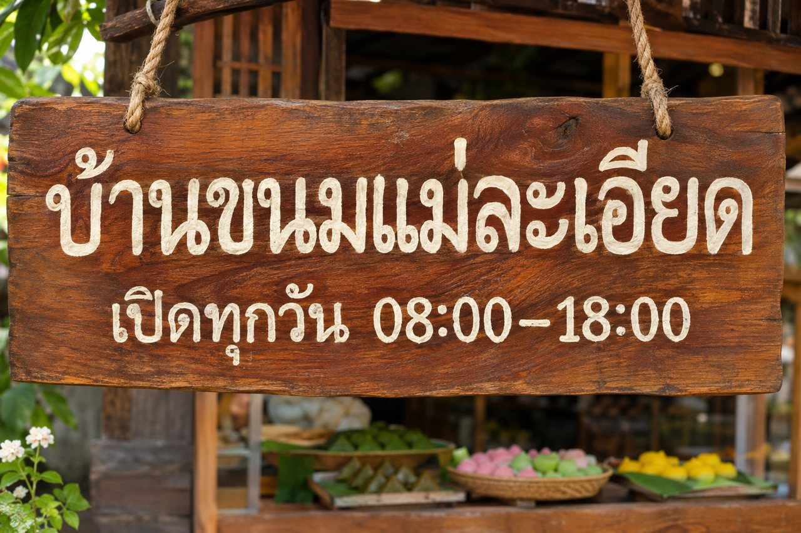

### แบบฝึกหัดที่ 28 · สลับบทบาท: Gemini สร้าง Codex ตรวจ

**ท่า:** ภาพ + ตรวจข้ามค่าย (สลับผู้สร้าง) · **เวลาจริง:** 4 นาที · [ผลจริง](_solution/exercises/28)

```text
ใช้สกิล agent-team ใน container multi-account สร้างภาพที่ผ่านการตรวจข้ามค่าย ให้ Gemini สร้าง Codex ตรวจ และ Claude ตัดสินขั้นสุดท้าย ไม่เกิน 3 รอบ
1. ภาพ: โปสเตอร์งานวิ่งการกุศล มีนักวิ่ง 3 คนบนถนนริมทะเลยามเช้า ด้านบนเขียนว่า "วิ่งเพื่อน้อง 5 กม."
2. เกณฑ์ของผู้ตรวจ: ข้อความสะกดถูกทุกตัวอักษร · เห็นนักวิ่งครบ 3 คน · เห็นทะเล
สรุปเป็นตาราง: รอบ | ผู้สร้าง | ผู้ตรวจ | ผลตรวจ | คำแนะนำของผู้ตรวจ | คำตัดสิน | เวลา (วินาที) แล้วคัดลอกภาพของทุกรอบและแผนงานกลับมาที่ ./exercises/28
```

**ผลจากการรันจริง:** รอบแรก Codex ตีกลับเพราะมีนักวิ่งเกิน 3 คน Gemini แก้จากภาพเดิมแล้วผ่านในรอบที่ 2 และ Claude รับภาพ

### แบบฝึกหัดที่ 29 · ภาพที่ไม่ผ่านรอบแรก

**ท่า:** คำแนะนำของผู้ตรวจ = คำสั่งรอบใหม่ · **เวลาจริง:** 8 นาที · [ผลจริง](_solution/exercises/29)

```text
ใช้สกิล agent-team ใน container multi-account ดูรอบแก้ไขเมื่อภาพไม่ผ่านการตรวจ ให้ Gemini สร้าง Codex ตรวจ และ Claude ตัดสินขั้นสุดท้าย ไม่เกิน 3 รอบ
1. บอกผู้สร้างภาพแค่ว่า "รถเข็นขายน้ำผลไม้ริมถนน ภาพถ่ายสมจริง" โดยไม่บอกเกณฑ์ของร้าน
2. ให้ผู้ตรวจใช้เกณฑ์ที่ผู้สร้างไม่รู้: ร่มของรถเข็นเป็นสีเหลือง · มีป้ายเขียนว่า "น้ำส้มคั้นสด 25 บาท"
สรุปเป็นตาราง: รอบ | ผลตรวจ | คำแนะนำที่ส่งกลับไปให้ผู้สร้าง | สิ่งที่เปลี่ยนในภาพรอบถัดไป | คำตัดสิน แล้วคัดลอกภาพของทุกรอบและแผนงานกลับมาที่ ./exercises/29
```

**ผลจากการรันจริง:** ใช้ครบ 3 รอบ: รอบ 1 ร่มหลายสีและป้ายผิด · รอบ 2 แก้จากภาพเดิมได้ร่มเหลืองและป้ายถูก แต่คำว่า "บาท" ถูกขอบภาพตัด · รอบ 3 Gemini วาดฉากใหม่ทั้งภาพ จึงผ่าน และ Claude รับภาพ

| รอบที่ 1 · ไม่ผ่าน | รอบที่ 2 · ไม่ผ่าน | รอบที่ 3 · ผ่าน |
|---|---|---|
| 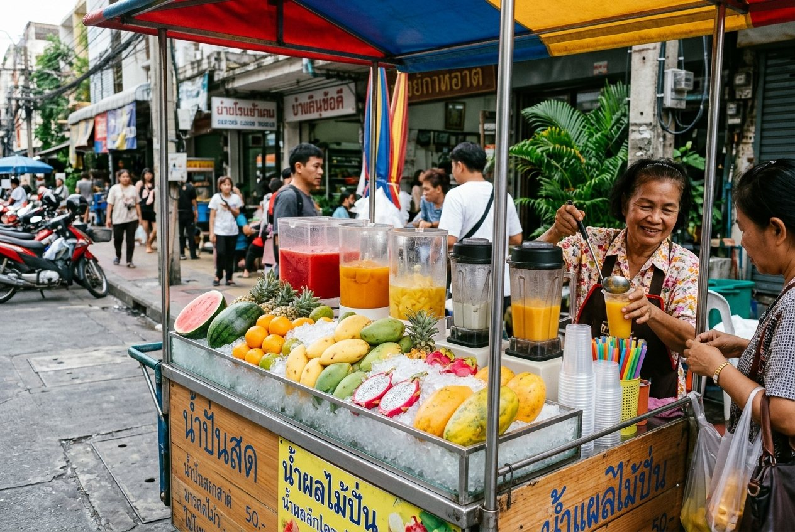 | 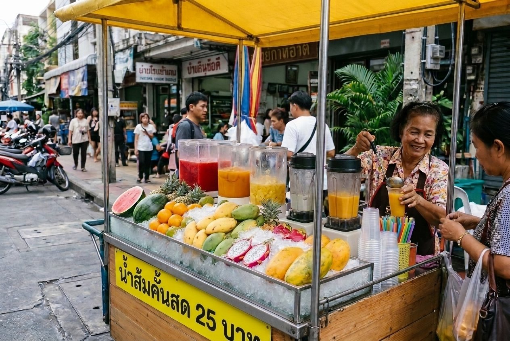 | 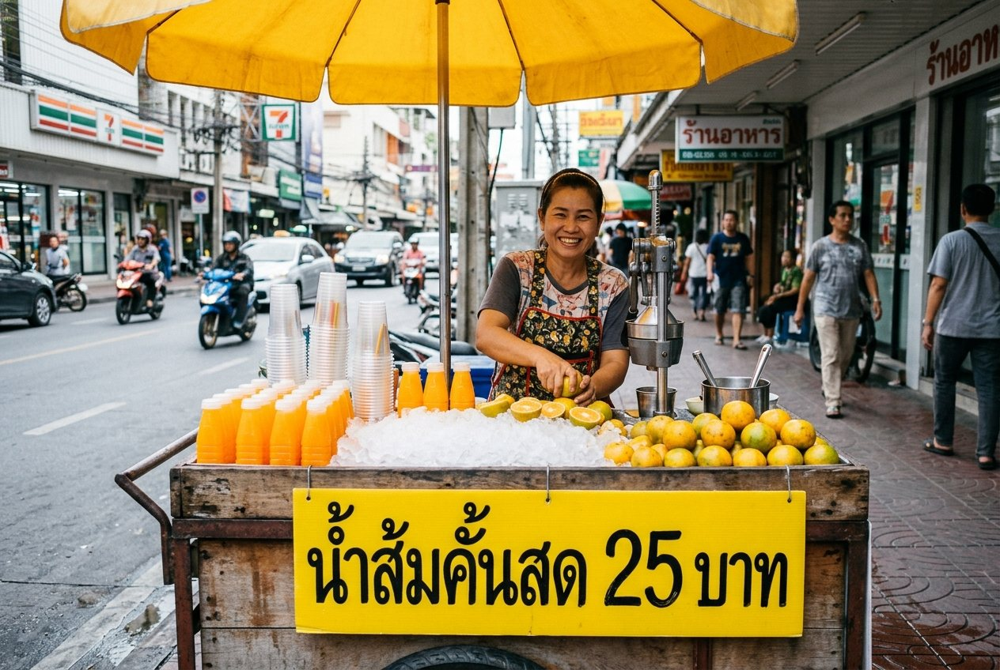 |

### แบบฝึกหัดที่ 30 · 3 ค่ายอ่านภาพเดียวกัน

**ท่า:** ส่งภาพข้ามค่าย · **เวลาจริง:** 2 นาที · [ผลจริง](_solution/exercises/30)

```text
ใช้สกิล agent-team ใน container multi-account ให้ 3 ค่ายอ่านภาพเดียวกัน งานทุกชิ้นใช้ความยาก 2
1. cyolo1 สร้างภาพใบเสร็จร้านกาแฟ มี 3 รายการ คือ ลาเต้ 65 · มัทฉะ 85 · บราวนี่ 60 และบรรทัดรวม 210 บาท
2. ทำพร้อมกันหลังงานที่ 1: yolo1, cyolo1 และ gyolo1 อ่านภาพนั้น แล้วตอบยอดรวมเป็นตัวเลขตัวเดียว
สรุปเป็นตาราง: บัญชี | ยอดรวมที่อ่านได้ | ถูกหรือไม่ | เวลา (วินาที) แล้วคัดลอกภาพและแผนงานกลับมาที่ ./exercises/30
```

**ผลจากการรันจริง:** Codex สร้างภาพใบเสร็จ แล้วทั้ง 3 ค่ายอ่านยอดรวมได้ 210 ถูกทุกบัญชี (Claude 5.5 · Codex 8.2 · Gemini 13.5 วินาที)

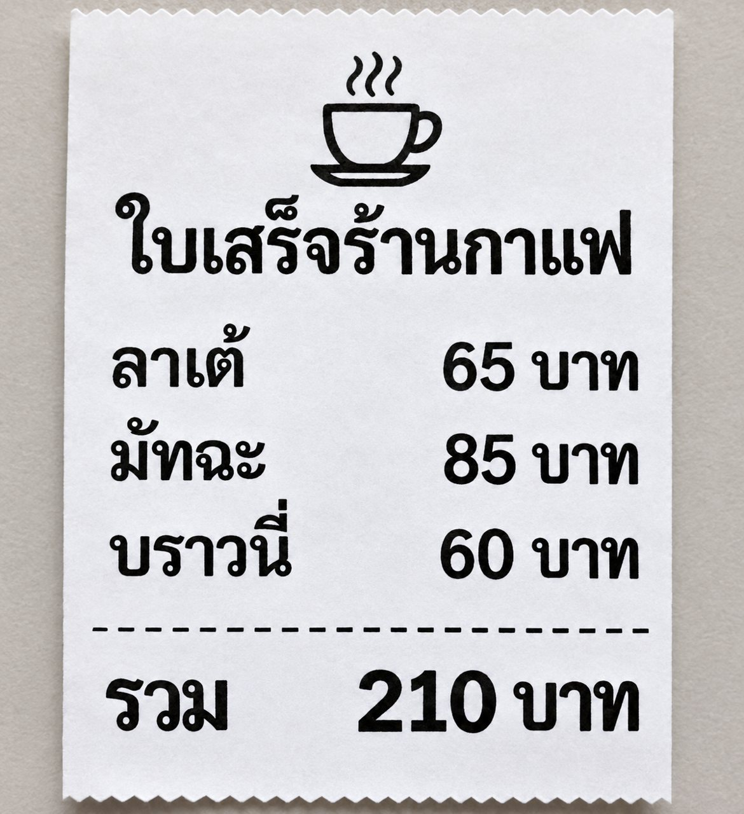

### แบบฝึกหัดที่ 31 · ภาพ → คำบรรยาย → ภาพ

**ท่า:** ส่งต่อภาพและข้อความสลับกัน · **เวลาจริง:** 5 นาที · [ผลจริง](_solution/exercises/31)

```text
ใช้สกิล agent-team ใน container multi-account เล่นเกมส่งต่อภาพข้ามค่าย งานทุกชิ้นใช้ความยาก 2
1. cyolo1 สร้างภาพ: ตลาดน้ำยามเช้า มีเรือขายผลไม้ 3 ลำ และสะพานไม้
2. gyolo1 ดูภาพนั้น แล้วเขียนคำบรรยายภาพอย่างละเอียด 1 ย่อหน้า
3. gyolo1 สร้างภาพใหม่จากคำบรรยายของงานที่ 2 เท่านั้น โดยไม่เห็นภาพแรก
4. yolo1 ดูทั้ง 2 ภาพ แล้วบอกสิ่งที่เหมือนกัน และสิ่งที่หายไประหว่างทาง
สรุปเป็นตาราง: งาน | บัญชี | ผลที่ได้ | เวลา (วินาที) แล้วคัดลอกทั้ง 2 ภาพและแผนงานกลับมาที่ ./exercises/31
```

**ผลจากการรันจริง:** ภาพที่สองยังมีเรือ 3 ลำและคน 3 คนในตำแหน่งเดิม แต่สะพานเล็กลง และรายละเอียดที่คำบรรยายไม่ได้พูดถึงหายไป Claude แยกให้เห็นว่าอะไรหายตอนบรรยาย และอะไรเปลี่ยนตอนสร้างภาพใหม่

| ภาพแรกจาก Codex | ภาพที่ Gemini สร้างจากคำบรรยาย |
|---|---|
|  |  |

## หมวด 5 · ดูแลทีม

โควตา ย้ายงาน งบโทเค็น รออนุมัติ หัวหน้าทีม และสถิติ

### แบบฝึกหัดที่ 32 · ลูกทีมโควตาหมดกลางงาน

**ท่า:** ย้ายงาน (จำลองโควตาหมด) · **เวลาจริง:** 2 นาที · [ผลจริง](_solution/exercises/32)

```text
ใช้สกิล agent-team ใน container multi-account ดูการย้ายงานเมื่อลูกทีมโควตาหมด โดยจำลองเหตุการณ์ ไม่ใช้โควตาจริงจนหมด งานทุกชิ้นใช้ความยาก 1
1. งานเขียนโค้ด 3 ชิ้นที่ไม่ระบุบัญชี: ฟังก์ชัน Python หาค่ามากที่สุด ค่าน้อยที่สุด และค่าเฉลี่ยของรายการตัวเลข ชิ้นละ 1 ฟังก์ชัน
2. จำลองให้ cyolo1 โควตาหมด
สรุปเป็นตาราง: งาน | บัญชีที่ได้รับงานตอนแรก | บัญชีที่ทำจนเสร็จ | เหตุผลที่ย้าย แล้วเก็บแผนงานที่ใช้ไว้ที่ ./exercises/32
```

**ผลจากการรันจริง:** งาน 2 ชิ้นที่ได้ `cyolo1` ถูกย้ายไป `cyolo2` ซึ่งเป็นค่ายเดียวกันก่อนจะข้ามค่าย การจำลองทำให้การเรียกล้มทันทีใน 0.1 วินาที โดยไม่ใช้โทเค็น

### แบบฝึกหัดที่ 33 · บัญชีที่เจาะจงจะไม่ถูกย้าย

**ท่า:** งานล้ม → งานถัดไปถูกพัก → รันต่อ · **เวลาจริง:** 1 นาที · [ผลจริง](_solution/exercises/33)

```text
ใช้สกิล agent-team ใน container multi-account ดูว่าเกิดอะไรขึ้นเมื่อบัญชีที่เจาะจงไว้โควตาหมด โดยจำลองเหตุการณ์ งานทุกชิ้นใช้ความยาก 1
1. งาน A เจาะจง gyolo1: ตั้งชื่อร้านดอกไม้ 1 ชื่อ
2. งาน B ทำต่อจากงาน A โดย yolo1: เขียนสโลแกนของร้านชื่อนั้น
3. รันครั้งแรกโดยจำลองให้ gyolo1 โควตาหมด แล้วแสดงสถานะของทั้ง 2 งาน
4. รันต่อเฉพาะงานที่ยังไม่เสร็จ โดยไม่จำลองแล้ว
สรุปเป็นตาราง: งาน | รอบแรก | รอบที่รันต่อ แล้วอธิบายว่าทำไมงาน A ไม่ถูกย้ายไปบัญชีอื่น เก็บแผนงานที่ใช้ไว้ที่ ./exercises/33
```

**ผลจากการรันจริง:** รอบแรกงาน A ล้มและไม่ถูกย้าย เพราะเจาะจงบัญชีไว้ งาน B จึงถูกพัก เมื่อรันต่อโดยไม่จำลอง ทั้ง 2 งานผ่าน (8 และ 3 วินาที)

### แบบฝึกหัดที่ 34 · งบโทเค็นของลูกทีม

**ท่า:** หยุดรับงานใหม่เมื่อเกินงบ · **เวลาจริง:** 2 นาที · **ต้องมี:** บัญชี Claude ที่ใช้งานได้ 2 บัญชีขึ้นไป · [ผลจริง](_solution/exercises/34)

```text
ใช้สกิล agent-team ใน container multi-account ตั้งงบโทเค็นให้ลูกทีม งานทุกชิ้นใช้ความยาก 1
1. งาน 4 ชิ้นทำต่อกันเป็นลำดับ ให้ค่าย Claude ทำทั้งหมดโดยไม่เจาะจงบัญชี: เขียนกลอนสั้น 4 บรรทัดเกี่ยวกับ ฤดูร้อน ฤดูฝน ฤดูหนาว และวันหยุด ชิ้นละ 1 เรื่อง
2. ตั้งงบโทเค็นของ yolo1 ให้ต่ำพอที่จะเต็มหลังทำงานแรก
สรุปเป็นตาราง: งาน | บัญชี | โทเค็นสะสมของบัญชีนั้น แล้วบอกว่า yolo1 หยุดรับงานใหม่เมื่อไร และงานที่เหลือไปที่บัญชีไหน เก็บแผนงานที่ใช้ไว้ที่ ./exercises/34
```

**ผลจากการรันจริง:** `yolo1` หยุดรับงานใหม่ทันทีหลังงานแรก งานที่เหลือ 3 ชิ้นไปที่บัญชี Claude อีกบัญชี และ Claude Code app ต้องจำกัดทีมก่อน เพื่อให้งานแรกไปที่ `yolo1`

### แบบฝึกหัดที่ 35 · รอคนอนุมัติ

**ท่า:** จุดรออนุมัติ (human gate) · **เวลาจริง:** 2 นาที · [ผลจริง](_solution/exercises/35)

```text
ใช้สกิล agent-team ใน container multi-account ใส่จุดรออนุมัติในแผนงาน ทำในโฟลเดอร์งาน ex/35 ใน container งานทุกชิ้นใช้ความยาก 1
1. yolo1 เขียนประกาศปิดร้าน 1 วันเพื่อซ่อมแซม บันทึกเป็น notice.md
2. cyolo1 ตรวจคำสะกดในประกาศ ตอบ ผ่าน หรือ ไม่ผ่าน
3. งานสุดท้ายคัดลอก notice.md ไปไว้ในโฟลเดอร์ publish งานนี้ต้องรออนุมัติก่อน
4. เมื่องานหยุดรอ ให้แสดงประกาศและสถานะของทุกงานให้ผมดู แล้วหยุดรอคำตอบจากผม ห้ามอนุมัติเอง
สรุป: สถานะของทุกงานขณะหยุดรอ และสิ่งที่จะเกิดขึ้นเมื่อผมตอบว่าอนุมัติ
```

เมื่องานหยุดรอ วางพรอมต์นี้ต่อใน session เดิม

```text
อนุมัติงานที่รออยู่ แล้วรันต่อจนจบ
1. แสดงสถานะของทุกงานหลังรันต่อ
2. ยืนยันว่ามีไฟล์ notice.md ในโฟลเดอร์ publish
สรุปเป็นตาราง: งาน | สถานะก่อนอนุมัติ | สถานะหลังอนุมัติ แล้วคัดลอกโฟลเดอร์งานและแผนงานกลับมาที่ ./exercises/35
```

**ผลจากการรันจริง:** 2 งานแรกเสร็จ งานสุดท้ายหยุดที่สถานะรออนุมัติ และ Claude ไม่อนุมัติเอง เมื่อวางพรอมต์อนุมัติ ระบบรันเฉพาะงานที่ค้าง (5 วินาที) งานที่เสร็จแล้วไม่ถูกทำซ้ำ

### แบบฝึกหัดที่ 36 · หัวหน้าทีมวางแผนเอง

**ท่า:** หัวหน้าทีม (lead) · **เวลาจริง:** 1 นาที · [ผลจริง](_solution/exercises/36)

```text
ใช้สกิล agent-team ใน container multi-account ให้หัวหน้าทีมวางแผนและแบ่งงานเองจากเป้าหมายอย่างเดียว ลูกทีมคือ yolo1, cyolo1 และ gyolo1 งานทุกชิ้นใช้ความยาก 1
1. เป้าหมาย: ทำคู่มือต้อนรับพนักงานใหม่ของร้านกาแฟ 4 หัวข้อ คือ เวลาทำงาน · การแต่งกาย · ขั้นตอนเปิดร้าน · ขั้นตอนปิดร้าน หัวข้อละไม่เกิน 5 บรรทัด รวมเป็นไฟล์เดียวชื่อ welcome.md
2. ให้หัวหน้าทีมแบ่งงานให้ลูกทีมและรวมผลเอง
สรุปเป็นตาราง: รอบของหัวหน้า | หัวหน้าสั่งงานอะไร | ให้บัญชีไหน พร้อมเนื้อหาของ welcome.md แล้วคัดลอกไฟล์กลับมาที่ ./exercises/36
```

**ผลจากการรันจริง:** หัวหน้าทีมแบ่งงานเป็น 4 หัวข้อเอง ส่งให้ 3 ค่าย แล้วรวมเป็น `welcome.md` จบในรอบเดียว ใช้ 25 วินาที

### แบบฝึกหัดที่ 37 · หัวหน้าทีมล้มกลางงาน

**ท่า:** เปลี่ยนหัวหน้าทีม · **เวลาจริง:** 2 นาที · **ต้องมี:** บัญชีที่เป็นหัวหน้าได้ 2 บัญชีขึ้นไป · [ผลจริง](_solution/exercises/37)

```text
ใช้สกิล agent-team ใน container multi-account ดูการเปลี่ยนหัวหน้าทีมเมื่อหัวหน้าล้มกลางงาน โดยจำลองเหตุการณ์ งานทุกชิ้นใช้ความยาก 1
1. เป้าหมายของทีม: เขียนคำถามที่พบบ่อยของร้านซักรีด 6 ข้อพร้อมคำตอบ รวมเป็นไฟล์เดียวชื่อ faq.md
2. ให้หัวหน้าทีมแบ่งงานและรวมผลเอง
3. จำลองให้หัวหน้าคนแรกล้มกลางคัน
สรุปเป็นตาราง: หัวหน้าคนที่ | บัญชี | ทำอะไรไปแล้ว | ส่งต่ออะไรให้คนถัดไป แล้วบอกว่ามีงานไหนถูกทำซ้ำหรือหายหรือไม่ และ faq.md ครบ 6 ข้อหรือไม่ คัดลอกไฟล์และบันทึกส่งต่องานกลับมาที่ ./exercises/37
```

**ผลจากการรันจริง:** หัวหน้าคนแรกสั่งงาน 3 ชิ้นแล้วล้ม หัวหน้าคนที่สองอ่านบันทึกส่งต่อ ไม่สั่งงานซ้ำ รอผลแล้วรวมเป็น `faq.md` ครบ 6 ข้อ ใช้ 31 วินาที

### แบบฝึกหัดที่ 38 · จำกัดจำนวนงานที่ทำพร้อมกัน

**ท่า:** งานพร้อมกันต่อบัญชี · **เวลาจริง:** 2 นาที · [ผลจริง](_solution/exercises/38)

```text
ใช้สกิล agent-team ใน container multi-account ดูผลของการจำกัดจำนวนงานที่ทำพร้อมกัน ใช้เฉพาะ yolo1 งานทุกชิ้นใช้ความยาก 1
งาน 6 ชิ้นที่ไม่ขึ้นต่อกัน: เขียนคำคมเกี่ยวกับ ความพยายาม เวลา มิตรภาพ การเรียนรู้ สุขภาพ และการเดินทาง ชิ้นละ 1 ประโยค
1. รันครั้งที่ 1: ให้บัญชีทำพร้อมกันได้ทีละ 1 งาน
2. รันครั้งที่ 2: ให้บัญชีทำพร้อมกันได้ทีละ 3 งาน
สรุปเป็นตาราง: ครั้ง | งานพร้อมกันสูงสุด | เวลาที่ใช้จริงทั้งหมด (วินาที) | ผลรวมเวลาของทุกงาน (วินาที) แล้วเก็บแผนงานที่ใช้ไว้ที่ ./exercises/38
```

**ผลจากการรันจริง:** ทีละ 1 งานใช้ 23 วินาที ทีละ 3 งานใช้ 9 วินาที เร็วขึ้นราว 2.5 เท่า แต่แต่ละงานช้าลงเล็กน้อยเมื่อรันพร้อมกัน

### แบบฝึกหัดที่ 39 · สถิติและโควตาหลังจบงาน

**ท่า:** อ่านสถิติของทีม · **เวลาจริง:** 2 นาที · [ผลจริง](_solution/exercises/39)

```text
ใช้สกิล agent-team ใน container multi-account สรุปการใช้งานของทีมจากสถิติที่สกิลบันทึกไว้ ห้ามรันงานใหม่
1. สถิติของงานครั้งล่าสุด แยกตามบัญชีและรุ่น
2. สถิติรวมทุกครั้งที่เคยรัน: บัญชีไหนถูกใช้มากที่สุด และค่ายไหนใช้เวลาเฉลี่ยต่อการเรียกน้อยที่สุด
3. โควตาปัจจุบันของทุกบัญชีที่ใช้งานได้
สรุปเป็นตาราง 3 ตารางตามข้อ 1–3 แล้วแนะนำว่างานถัดไปควรส่งให้บัญชีไหน
```

**ผลจากการรันจริง:** จาก 355 การเรียก บัญชีที่ถูกใช้มากที่สุดคือ `yolo1` (92 ครั้ง) ค่าย Claude เฉลี่ย 7.3 วินาทีต่อการเรียก และ Claude แนะนำบัญชีสำหรับงานถัดไปจากโควตาที่เหลือ โดยไม่เรียกโมเดลเลย

## หมวด 6 · โจทย์รวม

ใช้หลายท่าในงานเดียว

### แบบฝึกหัดที่ 40 · โปสเตอร์งานตลาดนัดหนังสือ

**ท่า:** ส่งต่อ + ภาพที่ผ่านการตรวจ + รออนุมัติ · **เวลาจริง:** 5 นาที · [ผลจริง](_solution/exercises/40)

```text
ใช้สกิล agent-team ใน container multi-account ทำโปสเตอร์งาน "ตลาดนัดหนังสือมือสอง" เป็นหน้าเว็บ 1 หน้า ด้วย yolo1, cyolo1 และ gyolo1 ทำในโฟลเดอร์งาน ex/40 ใน container งานทุกชิ้นใช้ความยาก 2
1. yolo1 เขียนข้อความของโปสเตอร์: ชื่องาน วันเวลา สถานที่ และจุดเด่น 3 ข้อ บันทึกเป็น text.md
2. ภาพประกอบ cover.png: แผงหนังสือมือสองกลางแจ้งยามเย็น ไม่มีตัวหนังสือในภาพ ให้ Gemini สร้าง Codex ตรวจ และ Claude ตัดสิน
3. cyolo1 เขียน poster.html ที่ใช้ข้อความจาก text.md และภาพ cover.png
4. gyolo1 ตรวจ poster.html เทียบกับ text.md ว่าข้อมูลครบและตรงกัน ตอบ ผ่าน หรือ ไม่ผ่าน
5. งานสุดท้ายคัดลอกไฟล์ทั้งหมดไปโฟลเดอร์ publish ต้องรออนุมัติก่อน ในแบบฝึกหัดนี้ให้อนุมัติแทนผมได้หลังแสดงผลตรวจของงานที่ 4
สรุปเป็นตาราง: งาน | บัญชี | ต้องรองานไหนก่อน | เวลา (วินาที) แล้วคัดลอกโฟลเดอร์งานและแผนงานกลับมาที่ ./exercises/40
```

**ผลจากการรันจริง:** ครบ 5 งาน: ภาพจาก Gemini ผ่านรอบแรก (81 วินาที) หน้าเว็บผ่านการตรวจเทียบข้อความ แล้วงานสุดท้ายรออนุมัติก่อนคัดลอกไปโฟลเดอร์ publish

### แบบฝึกหัดที่ 41 · รายงาน 3 มุมมอง

**ท่า:** ทำพร้อมกัน + รวม + ตรวจวนรอบ · **เวลาจริง:** 3 นาที · [ผลจริง](_solution/exercises/41)

```text
ใช้สกิล agent-team ใน container multi-account เขียนรายงานสั้นเรื่อง "ควรให้นักศึกษาใช้ AI ทำการบ้านหรือไม่" ด้วย yolo1, cyolo1 และ gyolo1 งานทุกชิ้นใช้ความยาก 2
1. ทำพร้อมกัน: yolo1 เขียนมุมมองของนักศึกษา cyolo1 เขียนมุมมองของอาจารย์ และ gyolo1 เขียนมุมมองของนายจ้าง มุมมองละ 1 ย่อหน้า
2. yolo1 รวมเป็นรายงาน 1 หน้า มีบทนำและข้อเสนอแนะ 3 ข้อ
3. gyolo1 ตรวจรายงานตามเกณฑ์: ครบ 3 มุมมอง · ข้อเสนอแนะทำได้จริง · ยาวไม่เกิน 1 หน้า ถ้าไม่ผ่านให้ผู้เขียนแก้ ไม่เกิน 2 รอบ
สรุปเป็นตาราง: งาน | บัญชี | เวลา (วินาที) | โทเค็น พร้อมรายงานฉบับสุดท้าย แล้วเก็บรายงานและแผนงานไว้ที่ ./exercises/41
```

**ผลจากการรันจริง:** 3 มุมมองเขียนพร้อมกัน แล้วรวมเป็นรายงาน ผู้ตรวจให้ผ่านตั้งแต่รอบแรก ใช้เวลาจริง 85 วินาที และโทเค็นรวมราว 106,000

### แบบฝึกหัดที่ 42 · แปลไปกลับเพื่อตรวจความหมาย

**ท่า:** ส่งต่อ 3 ทอดแบบปิดตา · **เวลาจริง:** 1 นาที · [ผลจริง](_solution/exercises/42)

```text
ใช้สกิล agent-team ใน container multi-account ตรวจคำแปลด้วยการแปลกลับ งานทุกชิ้นใช้ความยาก 2
ข้อความต้นฉบับ: "ร้านเปิดทุกวันยกเว้นวันพุธ ลูกค้าที่จองล่วงหน้า 1 วันจะได้ส่วนลด 15% และจอดรถฟรีได้ไม่เกิน 2 ชั่วโมง"
1. cyolo1 แปลข้อความต้นฉบับเป็นภาษาอังกฤษ
2. gyolo1 แปลผลของงานที่ 1 กลับเป็นภาษาไทย โดยไม่เห็นต้นฉบับ
3. yolo1 เทียบต้นฉบับกับคำแปลกลับ แล้วตอบว่าความหมายตรงกันครบทุกเงื่อนไขหรือไม่ และเงื่อนไขไหนเพี้ยน
สรุปเป็นตาราง: งาน | บัญชี | ผลที่ได้ พร้อมคำตัดสินของงานที่ 3 แล้วเก็บแผนงานที่ใช้ไว้ที่ ./exercises/42
```

**ผลจากการรันจริง:** คำแปลกลับตรงกับต้นฉบับครบ 4 เงื่อนไข ต่างกันเพียงคำ ("ไม่เกิน 2 ชั่วโมง" กลายเป็น "สูงสุด 2 ชั่วโมง")

### แบบฝึกหัดที่ 43 · เว็บหารค่าอาหาร

**ท่า:** ข้อกำหนด → โค้ด → ตรวจ → แก้ → คู่มือ · **เวลาจริง:** 6 นาที · [ผลจริง](_solution/exercises/43)

```text
ใช้สกิล agent-team ใน container multi-account ทำเว็บหารค่าอาหารแบบไฟล์เดียว ด้วย yolo1, cyolo1 และ gyolo1 ทำในโฟลเดอร์งาน ex/43 ใน container งานทุกชิ้นใช้ความยาก 3
1. yolo1 เขียนข้อกำหนดสั้น ๆ: กรอกยอดรวม จำนวนคน และค่าบริการเป็นเปอร์เซ็นต์ แล้วแสดงยอดต่อคน ปัดขึ้นเป็นบาทเต็ม บันทึกเป็น spec.md
2. cyolo1 เขียน split.html ตามข้อกำหนด โดยรวม HTML และ JavaScript ไว้ในไฟล์เดียว
3. gyolo1 ตรวจโค้ดเทียบกับข้อกำหนด ทดสอบสูตรด้วยตัวอย่าง 3 ชุด แล้วเขียนรายการปัญหา
4. cyolo1 แก้โค้ดตามรายการปัญหา
5. yolo1 เขียนวิธีใช้ 5 บรรทัด บันทึกเป็น README.md
สรุปเป็นตาราง: งาน | บัญชี | ไฟล์ที่ได้ | เวลา (วินาที) พร้อมรายการปัญหาที่พบ แล้วคัดลอกโฟลเดอร์งานและแผนงานกลับมาที่ ./exercises/43
```

**ผลจากการรันจริง:** ครบ 5 งานที่ความยาก 3 (Claude ใช้ opus Codex ใช้ระดับ high) รวม 5 นาที Gemini ทดสอบสูตร 3 ชุดแล้วไม่พบปัญหา ขั้นแก้โค้ดจึงไม่ต้องแก้อะไร

### แบบฝึกหัดที่ 44 · ออกแบบทีมเอง 2 แบบ แล้วเทียบ

**ท่า:** เลือกท่าเอง · **เวลาจริง:** 5 นาที · [ผลจริง](_solution/exercises/44)

```text
ใช้สกิล agent-team ใน container multi-account ออกแบบทีมเอง 2 แบบสำหรับงานเดียวกัน แล้วเทียบผล ใช้ได้เฉพาะ yolo1, cyolo1 และ gyolo1
งาน: เขียนคำอธิบายรายวิชา "การใช้ AI ในงานสำนักงาน" ยาว 1 ย่อหน้า พร้อมหัวข้อเรียน 5 สัปดาห์
1. แบบเร็ว: ใช้จำนวนงานน้อยที่สุด และความยากต่ำ
2. แบบละเอียด: มีการแข่งกันหรือถกกัน และมีการตรวจวนรอบ
3. แสดงแผนของทั้ง 2 แบบก่อนรัน แล้วรันทั้งคู่
สรุปเป็นตาราง: แบบ | จำนวนงาน | รูปแบบที่ใช้ | เวลาที่ใช้จริง (วินาที) | โทเค็นรวม พร้อมผลงานของทั้ง 2 แบบ แล้วบอกว่าแบบละเอียดดีขึ้นคุ้มกับเวลาและโทเค็นที่เพิ่มหรือไม่ เก็บแผนงานทั้ง 2 แบบไว้ที่ ./exercises/44
```

**ผลจากการรันจริง:** แบบเร็วใช้ 1 งาน 8 วินาที และราว 21,000 โทเค็น แบบละเอียด (ถกกันแล้วตรวจวนรอบ) ใช้ 195 วินาที และราว 156,000 โทเค็น คือช้ากว่า 24 เท่าและใช้โทเค็นมากกว่า 7.5 เท่า

## หมวด 7 · เข้าใจและปรับสกิล

อ่านสกิล ให้ค่ายอื่นใช้สกิล เพิ่มความสามารถ และสร้างสกิลใหม่

### แบบฝึกหัดที่ 45 · ให้ Gemini เป็นคนใช้สกิล

**ท่า:** สกิลเดียวกัน ใช้ได้ทุกค่าย · **เวลาจริง:** 1 นาที · [ผลจริง](_solution/exercises/45)

```text
ใช้สกิล gyolo ใน container multi-account ให้ gyolo1 เป็นคนใช้สกิล agent-team แทน Claude Code app ด้วยความยาก 3
1. สั่ง gyolo1 ว่า: ใช้สกิล agent-team ส่งงานต่อ 2 ทอด ให้ yolo1 คิดชื่อเมนูน้ำปั่น 1 ชื่อ แล้วให้ cyolo1 ตั้งราคาเป็นบาทพร้อมเหตุผล 1 ประโยค งานทุกชิ้นใช้ความยาก 1
2. ให้ gyolo1 รายงานผลของทั้ง 2 งาน พร้อมตารางสรุปที่สกิลพิมพ์ให้
สรุป: gyolo1 เรียกสกิลเองได้หรือไม่ · ผลของงาน 2 ทอด · เวลา (วินาที) แล้วบอกว่าสกิลชุดเดียวกันใช้ได้กับค่ายอื่นหรือไม่ จากหลักฐานที่เห็น
```

**ผลจากการรันจริง:** `gyolo1` อ่านคู่มือของสกิล เขียนแผนงาน 2 ทอด และสั่งรันเองจนจบ (`yolo1` คิดชื่อเมนู → `cyolo1` ตั้งราคา 79 บาท) ใช้ 40 วินาที และ Claude Code app เปิดไฟล์ผลตรวจซ้ำว่าตรงกับที่รายงาน

### แบบฝึกหัดที่ 46 · ตรวจว่าสกิลที่ติดตั้งตรงกับต้นฉบับ

**ท่า:** ตรวจการติดตั้ง · **เวลาจริง:** 1 นาที · [ผลจริง](_solution/exercises/46)

```text
ตรวจว่าสกิล yolo, cyolo, gyolo และ agent-team ในที่เก็บสกิลกลางของทั้ง 3 ค่ายใน container multi-account ตรงกับโฟลเดอร์ ./skills บนเครื่องเรา ห้ามแก้ไขหรือคัดลอกทับ
1. เทียบไฟล์ทุกไฟล์ของทั้ง 4 สกิล ในที่เก็บสกิลกลางทั้ง 3 ที่
2. ตรวจว่าบัญชีที่ใช้งานได้ของแต่ละค่ายมองเห็นสกิลครบ 4 ตัว
สรุปเป็นตาราง: สกิล | ค่าย Claude | ค่าย Codex | ค่าย Gemini (ตรง หรือ ต่าง) พร้อมรายชื่อไฟล์ที่ต่าง
```

**ผลจากการรันจริง:** สกิลทั้ง 4 ตัวในที่เก็บสกิลกลาง 3 ค่ายตรงกับ `./skills` ทุกไฟล์ (16 ไฟล์ต่อค่าย เทียบด้วย sha256) และทุกบัญชีที่ใช้งานได้มองเห็นสกิลครบ

### แบบฝึกหัดที่ 47 · เพิ่มคำสั่งใหม่ให้สกิล

**ท่า:** ปรับสกิลในสำเนา · **เวลาจริง:** 6 นาที · [ผลจริง](_solution/exercises/47)

```text
เพิ่มความสามารถเล็ก ๆ ให้สกิล agent-team ในสำเนาสำหรับทดลอง ห้ามแตะที่เก็บสกิลกลางใน container multi-account
1. คัดลอกโฟลเดอร์ ./skills เป็น ./skills-lab แล้วแก้เฉพาะใน ./skills-lab
2. เพิ่มคำสั่งที่สรุปงานครั้งล่าสุดเป็นไฟล์ Markdown 1 ไฟล์ มีเป้าหมาย ตารางงาน (งาน บัญชี รุ่น สถานะ เวลา โทเค็น) และผลของงานสุดท้าย
3. เพิ่มคำอธิบายคำสั่งใหม่ในคู่มือของสกิล
4. ทดสอบในโฟลเดอร์ทดลองใน container ด้วยงานส่งต่อ 2 ทอด ความยาก 1 และยืนยันว่าคำสั่งเดิมยังใช้ได้
สรุป: ไฟล์ที่แก้ · ตัวอย่างรายงานที่คำสั่งใหม่สร้าง · ผลทดสอบ แล้วบอกวิธีติดตั้งสำเนานี้ถ้าผมต้องการใช้จริง
```

**ผลจากการรันจริง:** ได้คำสั่งใหม่ `report` ในสำเนา `./skills-lab` ที่สรุปงานครั้งล่าสุดเป็นไฟล์ Markdown โดยไม่เรียกโมเดล คำสั่งเดิมยังใช้ได้ และที่เก็บสกิลกลางไม่ถูกแตะ ใช้ 6 นาที

### แบบฝึกหัดที่ 48 · สร้างสกิลใหม่ที่เรียกใช้ agent-team

**ท่า:** สกิลเวอร์ชัน 0 · **เวลาจริง:** 11 นาที · [ผลจริง](_solution/exercises/48)

```text
สร้างสกิลใหม่ชื่อ poster-team เวอร์ชัน 0 ไว้ที่ ./skills-lab/poster-team ห้ามแตะที่เก็บสกิลกลางใน container multi-account
1. สกิลรับหัวข้อของงานอีเวนต์ แล้วใช้สกิล agent-team ทำ 3 อย่าง คือ ข้อความของโปสเตอร์ ภาพประกอบที่ผ่านการตรวจข้ามค่าย และหน้าเว็บ 1 หน้าที่รวมข้อความกับภาพ
2. เขียนคู่มือของสกิลให้สั้น: ใช้เมื่อไร สั่งอย่างไร ได้ผลอะไร และแผนงานต้นแบบ
3. ทดสอบ 1 ครั้งในโฟลเดอร์ทดลองใน container ด้วยหัวข้อ "งานวิ่งการกุศล 5 กิโลเมตร" งานทุกชิ้นใช้ความยาก 2 แล้วคัดลอกผลกลับมาที่ ./exercises/48
สรุป: โครงสร้างไฟล์ของสกิล · ผลทดสอบ · สิ่งที่ควรปรับในเวอร์ชันถัดไป
```

**ผลจากการรันจริง:** ได้สกิล `poster-team` ที่มีคู่มือ แผนงานต้นแบบ และสคริปต์ 1 ไฟล์ การทดสอบจบครบทุกงาน แต่ภาพไม่ผ่านผู้ตรวจทั้ง 3 รอบ เพราะเกณฑ์ที่ Claude เขียนเองขัดกัน (ให้ภาพสื่อระยะ 5 กิโลเมตร แต่ห้ามมีตัวเลข) ผู้ตัดสินจึงเป็นผู้รับภาพ ใช้ 11 นาที
