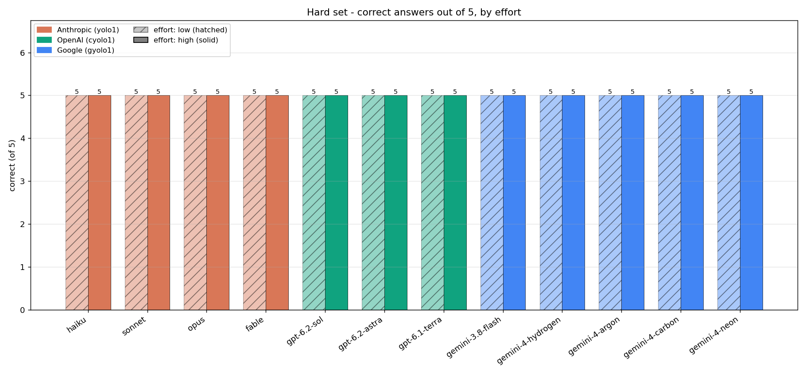
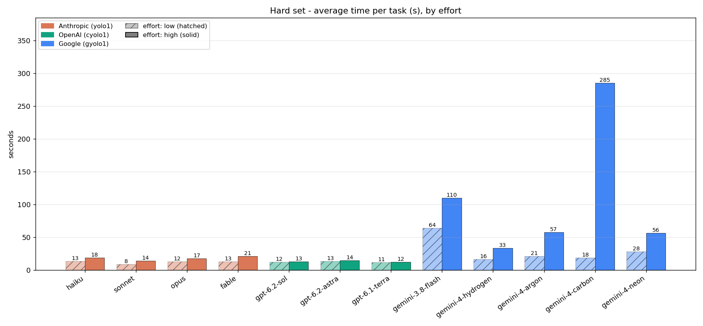

# เทียบรุ่นรอบ 2: โจทย์ยาก × ระดับการคิดต่ำ/สูง

วันที่ทดสอบ: 2026-11-23 · container `multi-account` · บัญชี yolo1 / cyolo1 / gyolo1 · สกิล `yolo` / `cyolo` / `gyolo`
ทดสอบ 12 รุ่น × 2 ระดับการคิด × 5 ข้อ = เรียก 120 ครั้ง สำเร็จทั้ง 120 ครั้ง ไม่มี error และไม่มี timeout
ตรวจจาก ledger แล้วว่าใช้รุ่นและระดับการคิดตามที่สั่งจริงทุกครั้ง (เช่น `gemini-4-carbon-high`, effort `low`/`high`) และระดับสูงใช้โทเค็นคิดมากกว่าจริง

## โจทย์ (มีคำตอบเดียว ตรวจด้วยโปรแกรม)

| ข้อ | โจทย์ | เฉลย / วิธีตรวจ |
|---|---|---|
| h1 คณิตหลายขั้น | A = จำนวน 0 ท้าย 2026! · B = 7^2026 mod 1000 · C = จำนวนตัวหารของ 2026² · D = ผลรวม n ≤ 1000 ที่ ห.ร.ม.(n,6)=1 · หาค่า A×B + C×D (ห้ามใช้เครื่องมือ) | 1824742 · เทียบตัวเลขตรงตัว |
| h2 ปริศนาตรรกะ | บ้าน 5 หลัง 4 คุณสมบัติ 13 เงื่อนไข (สร้างด้วยโปรแกรม และตรวจด้วย solver แล้วว่ามีคำตอบเดียว) ห้ามใช้เครื่องมือ | ชัย,บีม,ดาว,อรุณ,เอก · ต้องถูกทั้งลำดับ (เดาสุ่มถูกโอกาส 1/120) |
| h3 แก้บั๊กที่ซ่อน | ตัวคำนวณนิพจน์แบบ recursive descent มีบั๊ก 4 จุด (`//` แทน `/`, unary ผิดลำดับ, `^` เป็น left-assoc และรับเลขชี้กำลังติดลบไม่ได้, ไม่ตรวจโทเค็นที่เหลือ) | เทสต์ที่ซ่อนไว้ 23 ข้อ · ตรวจแล้วว่าโค้ดต้นฉบับไม่ผ่าน และโค้ดเฉลยผ่าน |
| h4 อัลกอริทึม | `shortest_subarray(nums, k)` มีเลขติดลบ (ต้องใช้ prefix sum + monotonic deque) | 15 กรณีขอบ + สุ่ม 400 กรณีเทียบกับเฉลย + กรณีใหญ่ 200,000 ตัว 3 ชุด ต้องเสร็จใน 3 วินาที · ตรวจแล้วว่าคำตอบ sliding window แบบตรง ๆ ไม่ผ่าน |
| h5 รวมข้อมูล 3 จุด | สมุดบัญชี 2,000 บรรทัด หา (ก) ยอดเปิดบัญชี (ข) ดอกเบี้ยล่าสุด (ค) ยอดถอนที่มีผลของ ACC-7731 แล้วคำนวณ (ก−ค)×(1+ข) | 13383.84 · มีตัวหลอก: บัญชีเลขคล้ายกัน (7713, 7371), อัตราดอกเบี้ยเก่าที่ถูกแทนที่แล้ว, รายการถอนที่ถูกยกเลิก |

เฉลยและเทสต์ที่ซ่อนไว้อยู่บน host เท่านั้น ไม่ได้คัดลอกเข้า container ที่โมเดลทำงาน

## ผลลัพธ์

| ค่าย | รุ่น | ถูกที่ระดับต่ำ (จาก 5) | ถูกที่ระดับสูง (จาก 5) | เวลาเฉลี่ยระดับต่ำ / สูง (วินาที) |
|---|---|---|---|---|
| Anthropic | haiku | 5 | 5 | 13.0 / 18.5 |
| Anthropic | sonnet | 5 | 5 | **8.4** / **13.6** |
| Anthropic | opus | 5 | 5 | 12.4 / 17.3 |
| Anthropic | fable | 5 | 5 | 12.7 / 21.0 |
| OpenAI | gpt-6.2-sol | 5 | 5 | 12.0 / 12.8 |
| OpenAI | gpt-6.2-astra | 5 | 5 | 13.4 / 14.4 |
| OpenAI | gpt-6.1-terra | 5 | 5 | **11.3** / **12.2** |
| Google | gemini-3.8-flash | 5 | 5 | 63.9 / 109.9 |
| Google | gemini-4-hydrogen | 5 | 5 | **16.1** / **33.4** |
| Google | gemini-4-argon | 5 | 5 | 21.1 / 57.4 |
| Google | gemini-4-carbon | 5 | 5 | 18.5 / 284.8 |
| Google | gemini-4-neon | 5 | 5 | 28.1 / 56.1 |

ตัวหนา = เร็วที่สุดในค่ายที่ระดับนั้น · โทเค็นขาออกเฉลี่ยและผลรายข้ออยู่ใน `bench/results.json`

### ข้อสังเกต
- **ทุกรุ่นถูก 5/5 ทั้งระดับต่ำและสูง (120/120)** แม้โจทย์ยากขึ้นมาก ก็ยังแยกความแม่นของรุ่นปัจจุบันไม่ได้ ระดับนี้ยังไม่ถึงจุดที่รุ่นใดตอบผิด แม้แต่ haiku ระดับต่ำก็หา 7^2026 mod 1000 ด้วย CRT ได้ถูก
- **การคิดระดับสูงไม่ได้ทำให้ถูกเพิ่มขึ้นเลยในชุดนี้ แต่ทำให้ช้าลงเสมอ**
  - Claude ช้าลง 1.4–1.7 เท่า
  - Codex ช้าลงแค่ราว 1 วินาที (ไม่ถึง 10%)
  - Gemini ช้าลง 1.7–15 เท่า โดยเฉพาะ **gemini-4-carbon-high เฉลี่ย 285 วินาที** (ข้อ h3 ใช้ 523 วินาที และใช้โทเค็นคิดสูงถึง 35,000 โทเค็นต่อข้อ) ขณะที่ carbon-low ใช้ 18.5 วินาที
- **gemini-3.8-flash ช้าที่สุดในระดับต่ำ** (64 วินาที) เพราะข้อ h3 ใช้ 228 วินาทีและคิดไป 21,000 โทเค็น รุ่น flash จึงไม่ได้เร็วในงานยาก
- Codex ใช้เวลาเกือบเท่ากันทั้ง 3 รุ่นและทั้ง 2 ระดับ ใช้โทเค็นขาออกน้อยที่สุด (ราว 300–470 ต่อข้อ)

## ผลนี้เปลี่ยนคำแนะนำจากรอบแรกหรือไม่

**เรื่องความแม่น ไม่เปลี่ยน** ทั้งสองรอบทุกรุ่นถูกหมด จึงยังไม่มีหลักฐานว่ารุ่นไหนแม่นกว่ากัน
**เรื่องระดับการคิด เปลี่ยน** รอบนี้แสดงว่าโจทย์ระดับนี้ใช้ระดับต่ำก็พอ ส่วนระดับสูงทำให้เสียเวลาเปล่า และฝั่ง Gemini เสียเวลามาก

| ค่าย | งานง่าย | งานปานกลาง | งานยาก | เปลี่ยนจากรอบแรก |
|---|---|---|---|---|
| Anthropic | sonnet / low | sonnet / low | sonnet / low ก่อน ถ้าผิดค่อยใช้ opus / high | **เปลี่ยน**: งานยากระดับนี้ sonnet/low ก็ถูกครบและเร็วที่สุด (8.4 วิ) · เก็บ opus/high ไว้สำหรับงานที่ยากกว่าชุดนี้ · haiku ยังช้ากว่า sonnet และใช้โทเค็นมากกว่า เหมือนรอบแรก · fable/high ช้าที่สุดในค่าย และไม่ได้ถูกมากกว่า |
| OpenAI | gpt-6.2-sol / low (หรือ gpt-6.1-terra) | gpt-6.2-sol / low | gpt-6.2-sol / high | **เปลี่ยนบางส่วน**: งานยากระดับนี้ไม่ต้องใช้ astra (ช้ากว่า sol เล็กน้อยและไม่ได้ถูกมากกว่า) · ระดับสูงของ Codex เพิ่มเวลาแค่ราว 1 วินาที จึงใช้ high กับงานยากได้เพื่อความปลอดภัยโดยแทบไม่เสียอะไร |
| Google | gemini-4-hydrogen-low | gemini-4-hydrogen-low | gemini-4-hydrogen-low ก่อน ถ้าผิดค่อยใช้ argon-high | **เปลี่ยน**: รอบแรกแนะนำ argon-medium สำหรับงานปานกลาง และ carbon-high สำหรับงานใหญ่ · รอบนี้ hydrogen-low เร็วที่สุดในค่ายและถูกครบ · **หลีกเลี่ยง carbon-high** (ช้ากว่า carbon-low 15 เท่าโดยไม่ได้ถูกมากกว่า) · หลีกเลี่ยง flash กับงานยาก |

หลักที่ใช้ได้ทุกค่าย: **เริ่มที่ระดับต่ำ แล้วเพิ่มระดับก็ต่อเมื่อคำตอบผิดหรือไม่ผ่านเทสต์** ทั้งสองรอบยังไม่มีงานไหนที่ระดับสูงแก้ได้แต่ระดับต่ำแก้ไม่ได้

## ขอบเขตของการทดสอบ
- รันข้อละ 1 ครั้งต่อรุ่นต่อระดับ ตัวเลขเวลาจึงแกว่งได้ โดยเฉพาะ Gemini ที่บางครั้งช้ากว่าปกติมาก
- h1/h2 สั่งห้ามใช้เครื่องมือ แต่ JSON ของสกิลไม่บันทึกว่ามีการเรียกเครื่องมือหรือไม่ (Claude ใช้ `--no-session-persistence` ส่วน Codex ใช้ `--ephemeral`) จึงยืนยันไม่ได้ 100% ว่าไม่มีรุ่นใดแอบรันโค้ด โฟลเดอร์ทำงานของทุกครั้งว่างเปล่า และคำตอบที่สุ่มอ่านมีขั้นคิดด้วยมือครบ
- h3 โจทย์ขอโค้ดราว 60 บรรทัด แต่ไฟล์จริงยาวราว 80 บรรทัด (รวม docstring ที่เป็นสเปก)
- ถ้าจะหาจุดที่รุ่นเริ่มตอบผิด ต้องใช้โจทย์ยากกว่านี้อีกขั้น เช่น แก้บั๊กหลายไฟล์ในโปรเจกต์จริง, คณิตระดับโอลิมปิก, ปริศนาตรรกะ 6×6 ที่มีเงื่อนไขทางอ้อม หรือเอกสารที่ต้องรวมข้อมูลมากกว่า 10 จุด และควรรันซ้ำหลายรอบ

## ไฟล์
- `correct_by_effort.png`, `avg_time_by_effort.png` = กราฟ
- `bench/make_tasks.py` = สร้างโจทย์และเฉลย (`bench/key.json`) · `bench/tasks/` = โจทย์
- `bench/hidden_tests.py` = เทสต์ที่ซ่อนไว้ของ h3/h4 · `bench/ref_h3.py`, `bench/ref_h4.py` = เฉลยที่ใช้ยืนยันเทสต์ · `bench/naive_h4.py` = คำตอบผิดที่ใช้ยืนยันว่าเทสต์จับได้
- `bench/run_bench.py` = ตัวรันใน container · `bench/out/` = JSON ดิบของทั้ง 120 ครั้ง
- `bench/grade.py` = ตรวจคำตอบและวาดกราฟ · `bench/results.json` = ผลตรวจรายข้อ
- ledger ของสกิล: `/workspace/.agent-team/ledger.jsonl` ใน container (run_id `hard-<ค่าย>__<รุ่น>__<ระดับ>__<ข้อ>`)
