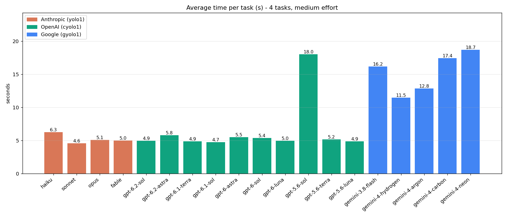
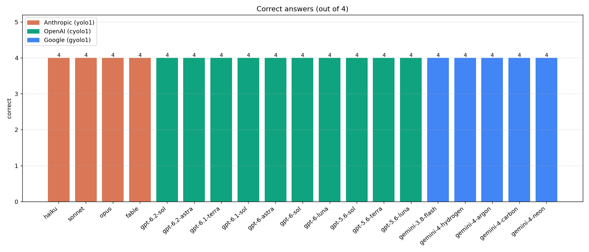

# เทียบรุ่นโมเดล 3 ค่าย: yolo1 · cyolo1 · gyolo1

วันที่ทดสอบ: 2026-11-23 · container `multi-account` · สกิล `yolo` / `cyolo` / `gyolo` · ทุกรุ่นใช้ระดับการคิดกลาง (medium)
ทดสอบ 19 รุ่น × 4 ข้อ = เรียก 76 ครั้ง สำเร็จทั้ง 76 ครั้ง ไม่มี error และไม่มี timeout

## โจทย์ (ตรวจคำตอบได้แน่นอน)

| ข้อ | โจทย์ | เฉลย | วิธีตรวจ |
|---|---|---|---|
| 1 | โจทย์ปัญหาคิดเลข 7 ขั้น (คูณ ลบ หาร กำลังสอง ทศนิยม) ห้ามใช้เครื่องมือ | 490428.75 | เทียบตัวเลขในบรรทัด `ANSWER:` |
| 2 | แก้บั๊กฟังก์ชัน `second_largest` (ค่าซ้ำ และเทียบกับ `None`) | ผ่านเทสต์ 7 ข้อ | ดึงโค้ดที่โมเดลตอบมารันกับเทสต์จริง |
| 3 | หารหัสลับในเอกสาร 2,000 บรรทัด มีรหัสหลอกที่ถูกยกเลิกแล้วที่บรรทัด 412 | VX-7318-KAPPA (บรรทัด 1374) | ต้องตอบรหัสนี้และต้องไม่ตอบ SIGMA |
| 4 | อ่านตัวเลขบนป้ายในภาพ PNG (ภาพเอียงและเบลอเล็กน้อย) | 73915 | เทียบเฉพาะตัวเลข |

นอกจากตรวจด้วยสคริปต์แล้ว ยังอ่านคำตอบจริงทุกข้อด้วยตาอีกรอบ ทุกรุ่นแสดงขั้นคิดถูก และในข้อ 3 ทุกรุ่นตัดรหัสที่ถูกยกเลิกทิ้งได้

## ผลลัพธ์

| ค่าย | รุ่น | ถูก (จาก 4) | เวลาเฉลี่ย (วินาที) | โทเค็นขาออกเฉลี่ย |
|---|---|---|---|---|
| Anthropic (yolo1) | haiku (claude-haiku-5-5) | 4 | 6.26 | 758.8 |
| Anthropic (yolo1) | sonnet (claude-sonnet-5-5) | 4 | **4.59** | 201.0 |
| Anthropic (yolo1) | opus (claude-opus-5-5) | 4 | 5.09 | 247.8 |
| Anthropic (yolo1) | fable (claude-fable-5-2) | 4 | 4.99 | 281.2 |
| OpenAI (cyolo1) | gpt-6.2-sol | 4 | 4.94 | 51.8 |
| OpenAI (cyolo1) | gpt-6.2-astra | 4 | 5.78 | **46.8** |
| OpenAI (cyolo1) | gpt-6.1-terra | 4 | 4.87 | 72.2 |
| OpenAI (cyolo1) | gpt-6.1-sol | 4 | **4.74** | 55.0 |
| OpenAI (cyolo1) | gpt-6-astra | 4 | 5.48 | 52.0 |
| OpenAI (cyolo1) | gpt-6-sol | 4 | 5.37 | 93.8 |
| OpenAI (cyolo1) | gpt-6-luna | 4 | 4.97 | 87.5 |
| OpenAI (cyolo1) | gpt-5.6-sol | 4 | 18.02 ⚠️ | 103.8 |
| OpenAI (cyolo1) | gpt-5.6-terra | 4 | 5.16 | 70.0 |
| OpenAI (cyolo1) | gpt-5.6-luna | 4 | 4.86 | 97.0 |
| Google (gyolo1) | gemini-3.8-flash | 4 | 16.20 | 1142.5 |
| Google (gyolo1) | gemini-4-hydrogen | 4 | **11.49** | 1024.5 |
| Google (gyolo1) | gemini-4-argon | 4 | 12.84 | **193.5** |
| Google (gyolo1) | gemini-4-carbon | 4 | 17.45 | 747.5 |
| Google (gyolo1) | gemini-4-neon | 4 | 18.70 | 1166.0 |

ตัวหนา = ดีที่สุดในค่าย · เวลา = เวลาทั้งหมดที่ใช้ต่อครั้งจาก ledger ของสกิล (`duration_s`) นับรวมเวลาเปิด CLI · โทเค็นขาออก = `output_tokens` จาก ledger ซึ่ง**รวมโทเค็นที่ใช้คิดแล้ว**

### ข้อสังเกต
- **ทุกรุ่นตอบถูกครบ 4/4** โจทย์ชุดนี้จึงง่ายเกินกว่าจะแยกได้ว่ารุ่นไหนเก่งกว่า สิ่งที่แยกรุ่นได้จริงคือ**ความเร็ว**และ**จำนวนโทเค็น**
- ส่วนต่างที่เห็นส่วนใหญ่มาจาก**ค่าย ไม่ใช่รุ่น**: Claude และ Codex ใช้ราว 5 วินาทีต่อครั้ง Gemini (agy) ใช้ 11–19 วินาที ตอนทดสอบด้วยคำสั่ง "ตอบ OK" ที่สั้นที่สุด CLI แต่ละตัวก็ใช้เวลาต่างกันอยู่แล้ว (Claude 3.0 · Codex 5.1 · agy 7.0 วินาที)
- รุ่นในค่าย Claude และค่าย Codex ส่วนใหญ่ห่างกันไม่ถึง 1 วินาที ส่วนต่างระดับนี้อยู่ในช่วงความแกว่งปกติ ห้ามถือว่าตัวที่เลขน้อยกว่าเร็วกว่าจริง
- ⚠️ **gpt-5.6-sol**: ข้อ 1 ใช้ 33.9 วินาที ข้อ 2 ใช้ 30.3 วินาที แต่ข้อ 3–4 ใช้ประมาณ 4 วินาทีเท่ากับรุ่นอื่น และโทเค็นก็ไม่ได้มากขึ้น จึงน่าจะเป็นความหน่วงชั่วคราวของฝั่งเซิร์ฟเวอร์ ไม่ใช่ตัวรุ่นช้าเอง (ถ้าไม่นับ 2 ครั้งนี้ จะอยู่ราว 4–5 วินาที)
- Codex ตอบสั้นมาก (47–104 โทเค็น) Claude และ Gemini ชอบอธิบายเพิ่ม ส่วน haiku, gemini-3.8-flash, hydrogen และ neon ใช้โทเค็นคิดเยอะ (ข้อ 1 ใช้ 2,000–3,000 โทเค็น)
- haiku ช้ากว่า sonnet และใช้โทเค็นมากกว่า 3.8 เท่าบนโจทย์ชุดนี้ ส่วน gemini-3.8-flash ช้ากว่า hydrogen และ argon ในงานชุดนี้รุ่นเล็กจึงไม่ได้เร็วกว่าเสมอไป
- haiku และ fable บอกเองว่าไม่ได้รันโค้ดข้อ 2 จริง แค่ไล่ตรรกะในหัว แต่โค้ดที่ส่งมาผ่านเทสต์ทั้งคู่

## คำแนะนำการเลือกรุ่น

คำแนะนำสำหรับ**งานง่าย**และ**งานปานกลาง**อิงจากผลวัดครั้งนี้ ส่วน**งานยาก**ยังวัดไม่ได้ (ทุกรุ่นได้ 4/4 เท่ากัน) จึงอิงตามระดับรุ่นของแต่ละค่าย และตารางความยากในสกิล (`yolo.py models`)

| ค่าย | งานง่าย | งานปานกลาง | งานยาก |
|---|---|---|---|
| Anthropic (yoloN) | **sonnet / low** เร็วที่สุดและใช้โทเค็นน้อยที่สุดในค่าย (haiku ราคาต่อโทเค็นถูกกว่า แต่ในงานชุดนี้ช้ากว่าและใช้โทเค็นมากกว่า) | **sonnet / medium** ถูกครบ เร็ว ประหยัด | **opus / high–xhigh** เวลาเกือบเท่า sonnet · ใช้ **fable** เฉพาะงานใหญ่ที่ต้องวางแผนเอง (ราคาประมาณ 2 เท่าของ opus และมีโควตาแยก) |
| OpenAI (cyoloN) | **gpt-6.2-sol / low** (gpt-6.1-sol และ gpt-5.6-luna เร็วพอ ๆ กัน) · งานดูภาพใช้ **gpt-6.1-terra** | **gpt-6.2-sol / medium** ถูกครบ ประมาณ 5 วินาที ตอบสั้นที่สุดกลุ่มหนึ่ง | **gpt-6.2-astra / xhigh** (ต้องถูกแน่นอนใช้ max) · ตอบสั้นสุดในค่าย ช้ากว่า sol ไม่ถึง 1 วินาที |
| Google (gyoloN) | **gemini-4-hydrogen-low** hydrogen-medium เร็วที่สุดในค่าย ส่วน flash ไม่ได้เร็วกว่า | **gemini-4-argon-medium** เร็วอันดับ 2 และใช้โทเค็นน้อยที่สุดในค่าย (น้อยกว่ารุ่นอื่นประมาณ 5 เท่า) | **gemini-4-argon-high** · งานใหญ่ที่ต้องวางแผนเอง: **gemini-4-carbon-high** · neon ช้าที่สุดและไม่ได้ถูกมากกว่า |

ถ้าต้องการความเร็วโดยรวม งานง่ายถึงปานกลางควรใช้ Claude หรือ Codex เพราะเร็วกว่า Gemini ผ่าน agy ประมาณ 2–3 เท่าในงานชุดนี้

## ขอบเขตของการทดสอบ
- รันข้อละ 1 ครั้งต่อรุ่น เวลาจึงมีความแกว่ง (ดูกรณี gpt-5.6-sol) ถ้าจะสรุปเรื่องความเร็วให้มั่นใจขึ้น ควรรันซ้ำ 3–5 รอบแล้วใช้ค่ามัธยฐาน
- ถ้าต้องการแยกรุ่นตามความเก่ง ต้องมีโจทย์ที่ยากกว่านี้ (เช่น แก้บั๊กหลายไฟล์ หรือคณิตที่ต้องพิสูจน์)
- รุ่นที่ไม่ได้ทดสอบ: Codex `gpt-reserve` และ `codex-auto-review` (ซ่อนไว้ ใช้ภายใน) · Antigravity มี `gemini-pro-orchestrator*` (เป็นตัวประสานหลาย agent ไม่ใช่รุ่นเดี่ยว) และมีรุ่นของค่ายอื่นที่ให้ใช้ผ่าน agy (`claude-opus/sonnet-5-5`, `gpt-oss-120b`) ซึ่งไม่นับเป็นรุ่นของ Google
- ข้อ 4 ของ Claude: สกิล yolo ไม่มี `--image` จึงใส่ path ของภาพไว้ใน prompt ให้ Claude Code เปิดอ่านเอง ส่วน cyolo และ gyolo ใช้ `--image`

## ไฟล์
- `avg_time.png`, `correct.png` = กราฟ
- `bench/make_tasks.py` = สร้างโจทย์ · `bench/tasks/` = โจทย์และภาพ
- `bench/run_bench.py` = ตัวรันใน container · `bench/out/` = JSON ดิบของทั้ง 76 ครั้ง
- `bench/grade.py` = ตรวจคำตอบและวาดกราฟ · `bench/results.json` = ผลตรวจรายข้อ
- ledger ของสกิล: `/workspace/.agent-team/ledger.jsonl` ใน container (run_id `bench-<ค่าย>-<รุ่น>-<ข้อ>`)
