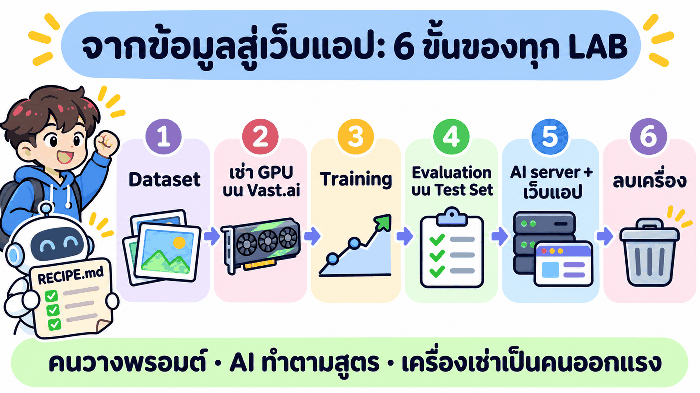
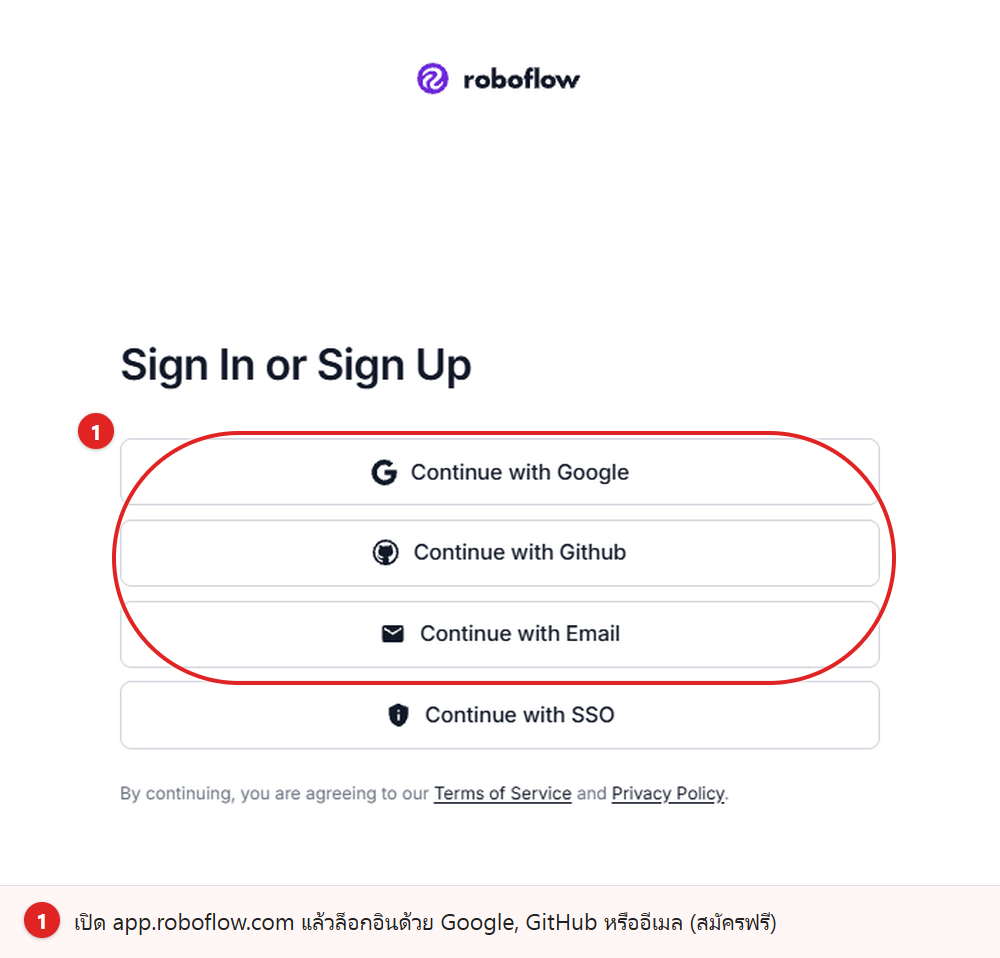
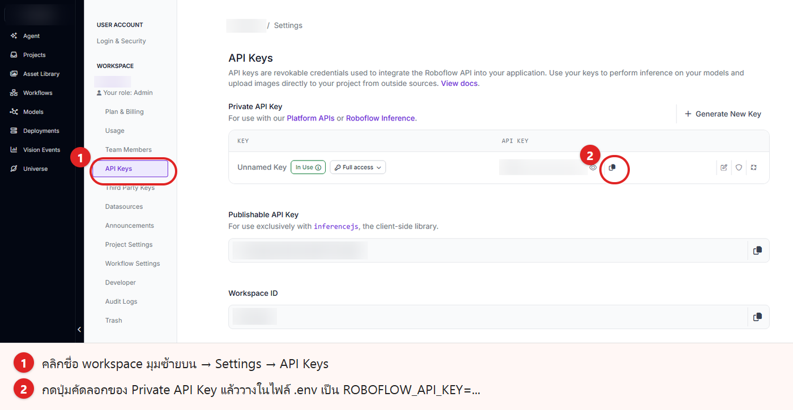

# เช่า GPU บน Vast.ai มาเทรนโมเดล แล้วต่อเข้าเว็บแอป

บทนี้ต่อจาก [01_VastAi_Skill](../01_VastAi_Skill/readme.md) · บทก่อนเราเช่า GPU มา **รัน**โมเดลสำเร็จรูป บทนี้เราเช่า GPU มา **เทรน**โมเดลของเราเอง วัดผลว่าดีขึ้นจริงไหม แล้วต่อโมเดลเข้ากับเว็บแอป

ทุกขั้นเป็นพรอมต์ Copy & Paste ใน **Claude Code** ด้วยสกิล `vastai` · แต่ละ LAB อยู่ในโฟลเดอร์ของตัวเอง มี `README.md` ของตัวเอง (ทฤษฎี การทดลอง พรอมต์ทีละขั้น ผลจริง) · พรอมต์บอกเป้าหมายเป็นข้อ ๆ ส่วนคำสั่งจริง AI คิดเอง · LAB ส่วนใหญ่ปิดท้ายด้วยการเก็บงานเป็นสกิลเวอร์ชัน 0

| LAB | โฟลเดอร์ | ทำอะไร | คำถามของการทดลอง | ค่าเช่าจริง |
|---|---|---|---|---|
| [LAB 0](#lab-0--เตรียม-key-3-ตัว) | — | เตรียม key 3 ตัวในไฟล์ `.env` | — | ฟรี |
| [LAB 1](lab1_yolo/README.md) | [lab1_yolo](lab1_yolo/README.md) | เทรน YOLO ตรวจหมวกนิรภัย ด้วย Dataset จาก Roboflow → เว็บตรวจความปลอดภัยหน้างาน | เทรนต่อด้วยข้อมูลของเราแล้วดีขึ้นแค่ไหน | $0.38 |
| [LAB 2](lab2_vlm/README.md) | [lab2_vlm](lab2_vlm/README.md) | Fine-tune VLM อ่านใบเสร็จ → เว็บสมุดรายจ่าย | เทรนด้วยใบเสร็จ 800 ใบ แล้วอ่านแม่นขึ้นเท่าไร | $0.58 |
| [LAB 3](lab3_qlora/README.md) | [lab3_qlora](lab3_qlora/README.md) | QLoRA โมเดลเล็กให้แชทบอทร้านนวด (ข้อมูลฝึกจากโมเดลครู) | โมเดลเล็กที่เทรนเพิ่ม แทนโมเดลใหญ่ได้ไหม | $0.69 |
| [LAB 4](lab4_multigpu/README.md) | [lab4_multigpu](lab4_multigpu/README.md) | เทรน LLM ด้วย LoRA 3 แบบ: Single GPU · Data Parallelism · Model Parallelism ด้วย GPU 1, 2 และ 4 ใบ (3 LAB ย่อย) | มี GPU หลายใบ จะใช้แบบไหน: แบบไหนได้ความเร็ว แบบไหนได้ที่ว่างของ VRAM และเพิ่มเป็น 4 ใบแล้วได้อะไร | $2.22 |
| [LAB 5](lab5_cluster/README.md) | [lab5_cluster](lab5_cluster/README.md) | เทรน LLM ด้วย LoRA บนคลัสเตอร์ 2 และ 3 เครื่อง เครื่องละ 2 GPU: Data Parallelism · Model Parallelism (2 LAB ย่อย) เทียบกับ 1 เครื่องของ LAB 4 | เพิ่มเครื่องผ่านอินเทอร์เน็ตแล้วเร็วขึ้นกี่เท่า คุ้มเงินไหม และเวลาของ 1 step หมดไปกับอะไร | $7.04 |
| [LAB 6](lab6_microbatch_lb/README.md) | [lab6_microbatch_lb](lab6_microbatch_lb/README.md) | API ตรวจภาพ YOLO: Load Test · Micro-batching · server หลายตัว · Load Balancer NGINX แบบ container · Round Robin · Least Connections · p2c | GPU 1 ใบรับผู้ใช้พร้อมกันได้กี่คน ทำอย่างไรให้รับได้มากขึ้น และแจกงานแบบไหนดีเมื่อ GPU เร็วไม่เท่ากัน | $0.74 · ขั้นที่ 10.2 $0.77 |
| [LAB 7](lab7_llm_serving_lb/README.md) | [lab7_llm_serving_lb](lab7_llm_serving_lb/README.md) | LLM Serving หลัง NGINX แบบ Least Connections: Continuous Batching · Data Parallel · Model Parallel | แชทบอท LLM บน GPU 4 ใบรับผู้ใช้พร้อมกันได้กี่คน แต่ละคนได้คำตอบเร็วแค่ไหน และควรจัด GPU อย่างไร | $0.60 × 2 เครื่อง |
| [LAB 8](lab8_job_queue/README.md) | [lab8_job_queue](lab8_job_queue/README.md) | อ่านใบเสร็จด้วย VLM เป็นงานคิว: RabbitMQ + GPU Worker 1 → 2 ใบ | งานหนักเข้าพร้อมกันเกินความจุ ระบบคิวช่วยอะไร และเพิ่ม Worker แล้วรับได้เพิ่มเท่าไร | $0.78 |
| [LAB 9](lab9_hybrid/README.md) | [lab9_hybrid](lab9_hybrid/README.md) | บริการสร้างภาพ: API gateway + RabbitMQ + GPU Worker 1 → 2 ใบ | GPU 1 ใบรับผู้ใช้พร้อมกันได้กี่คน และออกแบบระบบอย่างไรให้รับได้มากขึ้น | $0.57 |

สไลด์ประกอบการสอน (เปิดในเบราว์เซอร์): [LAB 1](lab1_yolo/LAB1_YOLO_Slides.html) · [LAB 2](lab2_vlm/LAB2_VLM_Slides.html) · [LAB 3](lab3_qlora/LAB3_QLoRA_Slides.html) · [LAB 6](lab6_microbatch_lb/LAB6_Microbatch_LB_Slides.html) · [LAB 7](lab7_llm_serving_lb/LAB7_LLM_Serving_LB_Slides.html) · [LAB 8](lab8_job_queue/LAB8_Job_Queue_Slides.html) · [LAB 9](lab9_hybrid/LAB9_Hybrid_Slides.html)

**ต้องมีก่อน**
- ทำ [บท 01](../01_VastAi_Skill/readme.md) ถึง LAB 2 แล้ว: container `multi-account` รันอยู่ · มีสกิล `vastai` · ตั้ง API key และกุญแจ SSH ของ Vast.ai แล้ว
- Docker Desktop บนเครื่องนี้ (เว็บของทุก LAB รันด้วย `docker compose` บนเครื่องเรา)
- Claude Code เปิดที่โฟลเดอร์ของบทนี้ (`03_week03/02_VastAi_Application`) · "โฟลเดอร์ปัจจุบัน" ในทุกพรอมต์หมายถึงโฟลเดอร์นี้

> ⚠️ **เสียเงินจริง** — ทุก LAB จบด้วยพรอมต์ **ลบเครื่อง** ห้ามข้าม แล้วดูหน้า [Instances](https://cloud.vast.ai/instances/) ว่าว่าง

---

## LAB 0 · เตรียม key 3 ตัว

คัดลอกไฟล์ `.env_example` เป็น `.env` แล้วใส่ค่า 3 บรรทัด · ไฟล์ `.env` ไม่ถูกส่งขึ้น Git

| บรรทัดใน `.env` | ใช้ทำอะไร | เอามาจากไหน |
|---|---|---|
| `VAST_API_KEY` | เช่าเครื่อง | ตัวเดียวกับ [บท 01 LAB 0](../01_VastAi_Skill/readme.md#lab-0--เตรียมบัญชี-vastai-และกุญแจ-2-ดอก) |
| `ROBOFLOW_API_KEY` | ดาวน์โหลด Dataset ของ LAB 1 | 2 ขั้นข้างล่าง |
| `HF_TOKEN` | ดาวน์โหลดโมเดลและ Dataset ของ LAB 2–3, LAB 5 และ LAB 7–9 | [huggingface.co/settings/tokens](https://huggingface.co/settings/tokens) → Create new token → ชนิด Read |

### API key ของ Roboflow

**ขั้นที่ 1** · เปิด [app.roboflow.com](https://app.roboflow.com) แล้วล็อกอิน (สมัครฟรี)

**ขั้นที่ 2** · คลิกชื่อ workspace มุมซ้ายบน → **Settings** → **API Keys** → กดปุ่มคัดลอกของ **Private API Key** แล้ววางในไฟล์ `.env`

*ค่า key และชื่อ workspace ในภาพถูกเบลอ*

- ใช้ **Private API Key** เท่านั้น · Publishable API Key ใช้ดาวน์โหลด Dataset ไม่ได้
- key เป็นความลับ ห้ามวางในแชท ในภาพหน้าจอ หรือในไฟล์อื่นนอกจาก `.env`

---

## ไฟล์ในโฟลเดอร์นี้

| ไฟล์ / โฟลเดอร์ | คืออะไร |
|---|---|
| `.env_example` | ตัวอย่างไฟล์ `.env` (key 3 ตัว) |
| `lab1_yolo/` | LAB 1 · เทรน YOLO ตรวจหมวกนิรภัย + เว็บตรวจความปลอดภัยหน้างาน |
| `lab2_vlm/` | LAB 2 · Fine-tune VLM อ่านใบเสร็จ + เว็บสมุดรายจ่าย |
| `lab3_qlora/` | LAB 3 · QLoRA โมเดลเล็กให้แชทบอทร้านนวด |
| `lab4_multigpu/` | LAB 4 · Single GPU · Data Parallelism · Model Parallelism (3 LAB ย่อย) |
| `lab5_cluster/` | LAB 5 · เทรน LLM บนคลัสเตอร์ 2 และ 3 เครื่อง เครื่องละ 2 GPU (2 LAB ย่อย) |
| `lab6_microbatch_lb/` | LAB 6 · API ตรวจภาพ: Load Test, Micro-batching และ Load Balancer ด้วย NGINX (ทฤษฎี + LAB 12 ขั้น) |
| `lab7_llm_serving_lb/` | LAB 7 · LLM Serving หลัง NGINX แบบ Least Connections |
| `lab8_job_queue/` | LAB 8 · งานคิวอ่านใบเสร็จด้วย RabbitMQ + GPU Worker |
| `lab9_hybrid/` | LAB 9 · ระบบผสมสำหรับบริการสร้างภาพ (RabbitMQ) + เว็บ PixelQueue |
| `image/` | ภาพประกอบของหน้ารวม |
