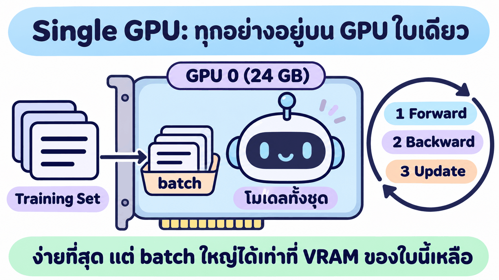
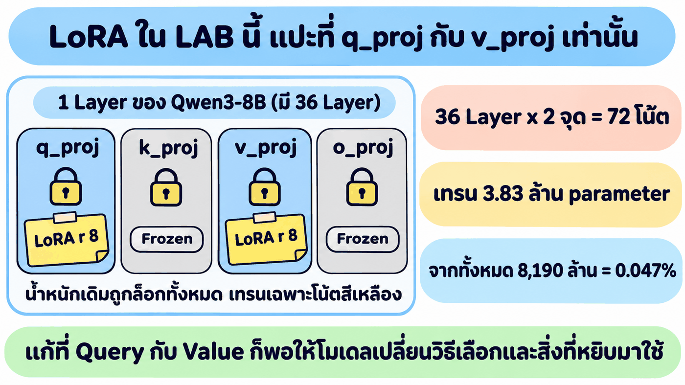
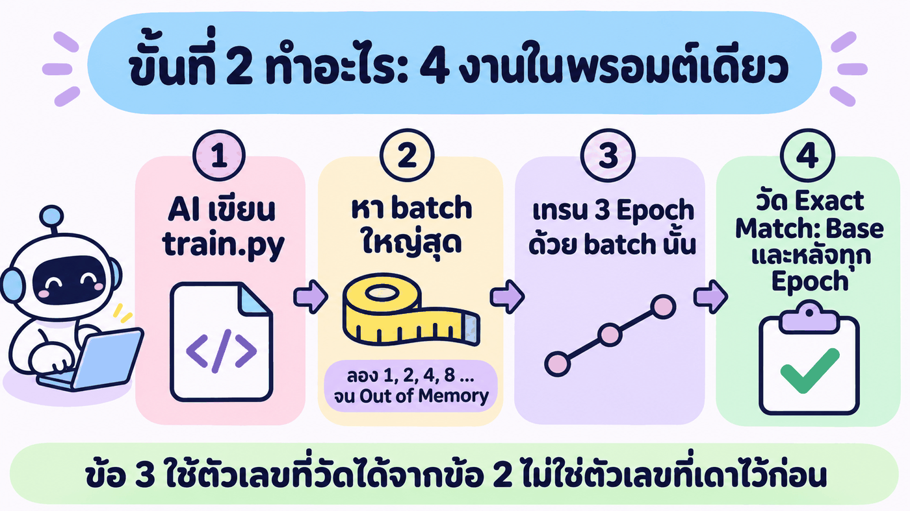
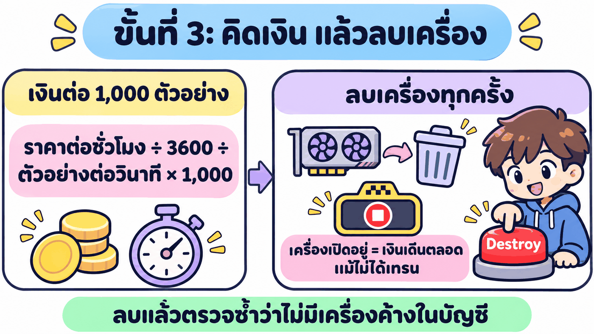
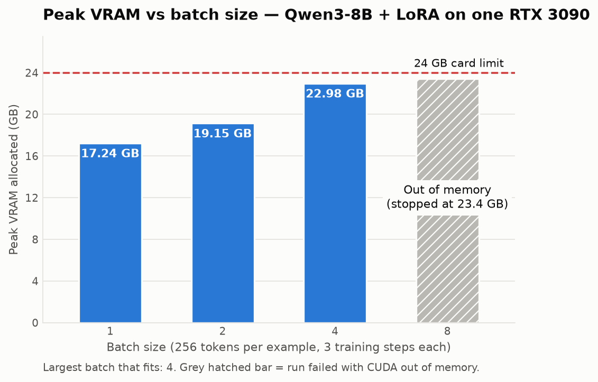
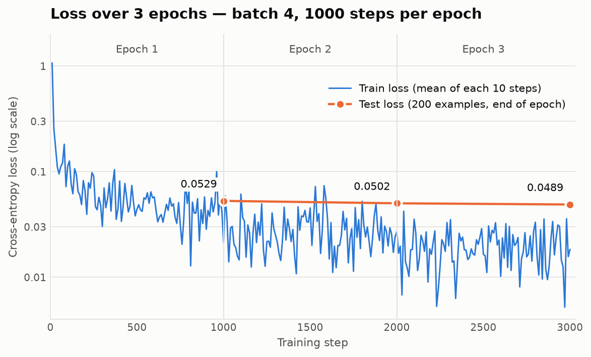
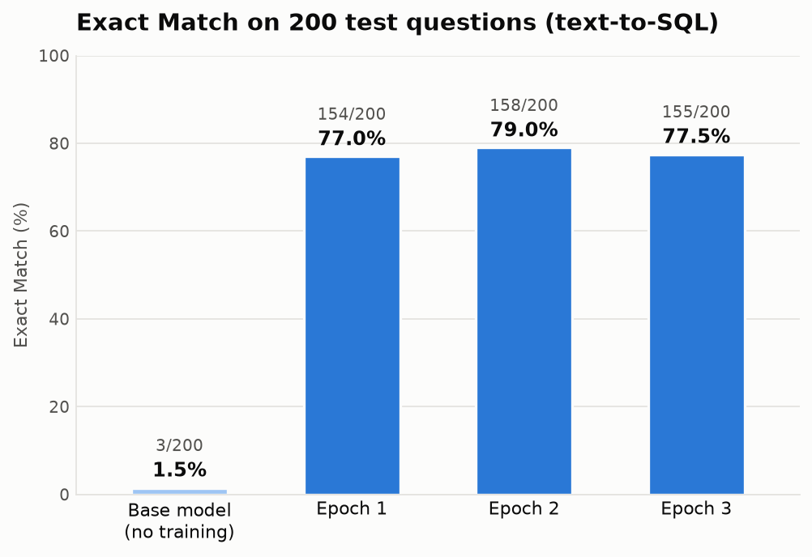

# LAB 4.1 · Single GPU: เทรนด้วย GPU ใบเดียว และหาขีดจำกัดของมัน

[← กลับหน้ารวม LAB 4](../README.md) · [LAB 4.2 Data Parallelism](../2_data_parallel/README.md) · [LAB 4.3 Model Parallelism](../3_model_parallel/README.md) · เปิด Claude Code ที่โฟลเดอร์ของบท `02_VastAi_Application`

## ทำไปเพื่ออะไร



เทรนโมเดลภาษา Qwen3-8B ให้แปลงคำถามภาษาอังกฤษเป็นคำสั่ง SQL ด้วย GPU **ใบเดียว** 3 Epoch

โมเดลทั้งชุดและข้อมูลทั้ง batch อยู่บนใบเดียว · ผลของ LAB นี้คือจุดเริ่มต้นไว้เทียบกับการใช้ GPU หลายใบใน LAB 4.2 และ 4.3

คำถามของ LAB: **GPU 1 ใบ เทรนโมเดล 8 พันล้าน parameter ได้ batch ใหญ่แค่ไหน และเร็วเท่าไร**

LAB นี้มี **3 ขั้น ทุกขั้นคือ 1 พรอมต์ · โค้ดทุกไฟล์ AI เขียนให้จากพรอมต์ เริ่มจากโฟลเดอร์ว่าง**

# ภาคทฤษฎี

## รู้จัก Dataset


| หัวข้อ | sql-create-context |
|---|---|
| ชื่อ | [b-mc2/sql-create-context](https://huggingface.co/datasets/b-mc2/sql-create-context) |
| คืออะไร | คำถามภาษาอังกฤษ + โครงสร้างตาราง (`CREATE TABLE`) + คำสั่ง SQL เฉลย ใช้สอนโมเดลให้แปลงคำถามเป็น SQL |
| ที่มา | สร้างจาก WikiSQL และ Spider โดยเติมคำสั่ง `CREATE TABLE` ให้ทุกคำถาม |
| จำนวน | 78,577 ตัวอย่าง |
| สัญญาอนุญาต | CC BY 4.0 |
| LAB นี้ใช้อย่างไร | สับด้วย seed 0 แล้วแบ่ง **Training Set 4,000** ตัวอย่าง และ **Test Set 200** ตัวอย่าง (ไม่ซ้ำกัน) |


ตัวอย่างจริง 6 รายการแรกของ Training Set (AI ทำให้ในขั้นที่ 1 · ไฟล์ [results/dataset_samples.md](results/dataset_samples.md))

| # | คำถาม (`question`) | โครงสร้างตาราง (`context`) | SQL เฉลย (`answer`) |
|---|---|---|---|
| 1 | What is the lowest unlock order for the athens circuit? | `CREATE TABLE table_24463470_1 (unlock_order INTEGER, circuit VARCHAR)` | `SELECT MIN(unlock_order) FROM table_24463470_1 WHERE circuit = "Athens"` |
| 2 | What is the highest pick number of a defensive back with less than 136 overall points? | `CREATE TABLE table_name_99 (pick__number INTEGER, overall VARCHAR, position VARCHAR)` | `SELECT MAX(pick__number) FROM table_name_99 WHERE overall < 136 AND position = "defensive back"` |
| 3 | Which engine has a year larger than 1956? | `CREATE TABLE table_name_74 (engine VARCHAR, year INTEGER)` | `SELECT engine FROM table_name_74 WHERE year > 1956` |
| 4 | What is the average Attendance, when Venue is "Candlestick Park", and when Date is "December 27"? | `CREATE TABLE table_name_71 (attendance INTEGER, venue VARCHAR, date VARCHAR)` | `SELECT AVG(attendance) FROM table_name_71 WHERE venue = "candlestick park" AND date = "december 27"` |
| 5 | What is the Netflix number having a segment D, of NED can corn? | `CREATE TABLE table_name_2 (netflix VARCHAR, segment_d VARCHAR)` | `SELECT netflix FROM table_name_2 WHERE segment_d = "ned can corn"` |
| 6 | What is the smallest number of fastest laps listed? | `CREATE TABLE table_19312274_3 (fastest_laps INTEGER)` | `SELECT MIN(fastest_laps) FROM table_19312274_3` |

**อธิบาย 1 รายการทีละช่อง** (แถวที่ 1)

| ช่อง | หน้าที่ | ในแถวนี้ |
|---|---|---|
| `question` | คำถามภาษาคน · Input ส่วนที่ 1 | ถามหา unlock order ที่น้อยที่สุดของสนาม athens |
| `context` | โครงสร้างตาราง · Input ส่วนที่ 2 บอกว่ามีตารางและคอลัมน์อะไรให้ใช้ | ตาราง `table_24463470_1` มีคอลัมน์ `unlock_order` (ตัวเลข) และ `circuit` (ข้อความ) |
| `answer` | SQL ที่ถูกต้อง · Output ที่โมเดลต้องเขียนให้ได้ และใช้เทียบ Exact Match | "lowest" → `MIN(unlock_order)` · "athens circuit" → `WHERE circuit = "Athens"` |

## รู้จักโมเดลที่ใช้


| หัวข้อ | Qwen3-8B |
|---|---|
| ประเภท | Large Language Model (LLM) · 36 Layer |
| Input | ข้อความ · LAB นี้ใส่โครงสร้างตาราง + คำถาม |
| Output | ข้อความ · LAB นี้ให้ตอบเป็นคำสั่ง SQL อย่างเดียว (ปิดโหมด thinking) |
| ขนาด | 8.19 พันล้าน parameter · 16.4 GB บน disk (วัดใน LAB นี้) · **15.27 GiB ใน VRAM** แบบ bf16 (วัดใน LAB นี้) |
| ที่มา | ทีม Qwen ของ Alibaba Cloud · [Qwen/Qwen3-8B](https://huggingface.co/Qwen/Qwen3-8B) · Apache-2.0 |
| LAB นี้ใช้ทำอะไร | **Base** = โมเดลตามที่โหลดมา · **Fine-tuned** = โมเดลนี้ + LoRA ที่เทรนด้วย Training Set 4,000 ตัวอย่าง (วัดหลังจบ Epoch 1, 2, 3) |

## ทฤษฎีที่ต้องรู้

### 1 · LoRA กับ q_proj / v_proj


**คืออะไร** ในแต่ละ Layer โมเดลแปลงทุกคำเป็น 3 อย่าง

| ชื่อ | เปรียบเหมือน | หน้าที่ |
|---|---|---|
| Query (`q_proj`) | คำค้นที่ถือไว้ | "ฉันต้องการข้อมูลอะไร" |
| Key (`k_proj`) | ป้ายสันหนังสือ | "คำนี้เกี่ยวกับอะไร" ใช้เทียบกับ Query |
| Value (`v_proj`) | เนื้อหาในเล่ม | ข้อมูลที่ถูกหยิบไปใช้ต่อ |

**LoRA** = ล็อกน้ำหนักเดิมของโมเดลทั้งหมด แล้วแปะตารางตัวเลขเล็ก ๆ (rank 8) ไว้ข้างจุดที่เลือก เทรนเฉพาะตารางเล็กนั้น


**ทำไมต้องใช้** เทรนทั้ง 8 พันล้านค่าไม่พอ VRAM ของ GPU 24 GB ใบเดียว · เทรนแค่ LoRA ส่วนที่ต้องเก็บเพิ่ม (Gradient และค่าของ Optimizer) จึงเล็กมาก

**ทำงานอย่างไร** แก้แค่ Query (เลือกอะไร) กับ Value (หยิบอะไรมาใช้) ก็พอให้โมเดลเปลี่ยนวิธีตอบ · 36 Layer × 2 จุด = 72 จุด

**ตัวเลขจาก LAB นี้** LoRA r 8 · alpha 16 · เทรน **3,833,856** parameter จากราว 8.19 พันล้าน = **0.047%**

### 2 · Single GPU: ทุกอย่างอยู่บนใบเดียว


**คืออะไร** โมเดล **ทั้งชุด** และข้อมูล **ทั้ง batch** อยู่บน GPU ใบเดียว ไม่มีการแบ่งงานหรือส่งข้อมูลข้าม GPU

**ทำไมต้องใช้** ง่ายที่สุด เขียนโค้ดน้อยที่สุด และเป็นตัวตั้งไว้วัดว่าการเพิ่ม GPU ช่วยได้จริงแค่ไหน

**ทำงานอย่างไร** 1 step มี 3 ช่วง ทำต่อกันบนใบเดียว

| ช่วง | เกิดอะไรขึ้น |
|---|---|
| 1 · Forward | ส่ง batch ผ่านโมเดลทั้ง 36 Layer ได้คำตอบและ loss |
| 2 · Backward | ย้อนกลับคำนวณ Gradient ของ LoRA |
| 3 · Update | Optimizer ปรับค่าของ LoRA ตาม Gradient |

**ตัวเลขจาก LAB นี้**

| | ค่า |
|---|---|
| batch ที่ใช้เทรน | 4 |
| จำนวน step | 4,000 ÷ 4 = 1,000 ต่อ Epoch · 3 Epoch = 3,000 step |
| เวลาเฉลี่ยต่อ step | 0.4712 วินาที |

### 3 · VRAM ตอนเทรนใช้ไปกับอะไร

**คืออะไร** VRAM ของ GPU ถูกใช้ 3 ส่วน

| ส่วน | ลักษณะ | ใน LAB นี้ |
|---|---|---|
| Weights | คงที่ ไม่ขึ้นกับ batch | 15.27 GiB (วัดก่อนเทรน) |
| LoRA + Optimizer | เล็กมาก | ราว 61 MB (คำนวณ: น้ำหนัก Gradient และค่าของ Optimizer 2 ชุด ของ 3.83 ล้านค่า แบบ fp32) |
| Activation | โตตาม batch และตามความยาวข้อความ | VRAM สูงสุด batch 1 → 17.24 · batch 2 → 19.15 · batch 4 → 22.98 GiB (ข้อความยาว 256 token) |


**ทำไมต้องรู้** Weights กินไปราว 2 ใน 3 ของใบตั้งแต่ยังไม่เริ่มเทรน · การ์ดนี้ใช้ได้จริง 23.80 GiB (ค่าที่ CUDA รายงาน) ที่เหลือราว 8.5 GiB คือทั้งหมดที่ Activation ใช้ได้ · batch จึงใหญ่ได้แค่เท่าที่ที่ว่างตรงนี้รับไหว

**ทำงานอย่างไร** batch เพิ่ม 1 เท่าตัว Activation ก็เพิ่มตาม (1 → 2 เพิ่ม 1.91 GiB · 2 → 4 เพิ่ม 3.83 GiB) · batch 8 ต้องใช้มากกว่าที่เหลือ จึง Out of Memory

**ตัวเลขจาก LAB นี้** batch ใหญ่สุด **4** · batch 8 **Out of Memory** (PyTorch ใช้ไป 23.40 GiB แล้วขอเพิ่มไม่ได้) · ที่ batch 4 เหลือที่ว่างจริงแค่ 23.80 − 22.98 = 0.82 GiB

### 4 · ทำไมต้องวัด VRAM ก่อนเทรน


**คืออะไร** ก่อนเทรนจริง ลอง batch 1, 2, 4, 8 … อย่างละ 3 step จนเจอ Out of Memory แล้วเลือก batch ใหญ่สุดที่ผ่าน

**หาให้ฉลาดขึ้น: ประมาณก่อน แล้วลองค่าระหว่างกลาง** การเพิ่มทีละเท่าตัวบอกได้แค่ว่าคำตอบอยู่ระหว่าง 4 กับ 8 · VRAM โตเกือบเป็นเส้นตรงตาม batch จึงประมาณต่อได้: จาก batch 2 ไป 4 ใช้เพิ่ม 22.98 − 19.15 = 3.83 GiB หรือราว 1.9 GiB ต่อ 1 ตัวอย่าง · batch 5 จึงน่าจะใช้ราว 22.98 + 1.9 = 24.9 GiB เกิน 23.80 GiB ที่การ์ดใช้ได้ คำตอบที่คาดไว้จึงเป็น 4 · ตัวเลขนี้เป็นการคำนวณ ผลในหน้านี้ไม่ได้ลอง batch 5–7 จริง · พรอมต์ขั้นที่ 2 ให้ AI ประมาณแบบนี้ แล้วลองค่าระหว่างตัวที่ผ่านกับตัวที่ล้มเพื่อยืนยัน

**ทำไมใช้ตัวอย่างที่ยาวที่สุด** batch ที่หนักที่สุดเป็นตัวตัดสินว่างานล้มหรือไม่ · ถ้าวัดด้วยข้อความความยาวเฉลี่ย (ใน LAB นี้เฉลี่ย 112.2 token) batch ที่ยาวผิดปกติเพียงครั้งเดียวกลางทางก็ทำให้งานหยุดได้

**เรื่องจริงใน LAB นี้: วัดผ่านแล้ว ก็ยังล้มได้**

| | ผล |
|---|---|
| ตอนวัด (3 step ที่ batch 4) | ผ่าน · ใช้สูงสุด 22.98 GiB |
| เทรนจริงครั้งแรก | **Out of Memory หลัง step 740** จาก 1,000 ของ Epoch 1 (batch 4 เท่าเดิม) |
| ตอนล้ม | PyTorch ใช้อยู่ 22.84 GiB · จองค้างไว้แต่ไม่ได้ใช้แค่ 55 MiB · การ์ดเหลือว่าง 583 MiB · แต่ต้องการก้อนใหม่ 592 MiB |
| ที่ตั้งไว้แล้วแต่ไม่ช่วย | `PYTORCH_CUDA_ALLOC_CONF=expandable_segments:True` (ตั้งใน `run_all.sh` ตั้งแต่แรก) |
| สิ่งที่ AI แก้ | ตอนเทรนไม่ส่ง `attention_mask` เข้าโมเดล แล้วรันใหม่ตั้งแต่การวัด batch |
| หลังแก้ | ผ่านจุดเดิม เทรนครบ 3 Epoch · VRAM สูงสุดตอนเทรน 22.98 GiB เท่ากับตอนวัดพอดี |

**ทำไมถึงล้ม (ภาษาคน)**

- ตอนวัด batch ใช้ตัวอย่างที่ยาวที่สุด **ซ้ำกัน 4 ชุด** ทุกแถวยาวเท่ากัน **ไม่มี padding**
- ตอนเทรนจริง แถวใน batch ยาวไม่เท่ากัน แถวสั้นถูกเติม padding ทางขวา และโค้ดส่ง `attention_mask` บอกว่าตรงไหนเป็น padding
- AI สันนิษฐานว่าเมื่อมี mask ที่มี padding ส่วน attention ใช้วิธีคำนวณที่กินหน่วยความจำมากกว่า batch ตอนวัด · ตัวเลขตอนล้มสนับสนุนว่าไม่ใช่ที่ว่างแตกเป็นช่อง (fragmentation) เพราะที่จองค้างไว้แต่ไม่ได้ใช้มีแค่ 55 MiB · AI บอกเองว่าไม่ได้ทดสอบแยกเพื่อยืนยันกลไกนี้
- ทำไมตัด mask ได้โดยผลไม่เปลี่ยน: padding อยู่ด้านขวา และ attention ของโมเดลนี้มองย้อนหลังได้อย่างเดียว คำจริงจึงไม่เคยเห็น padding · ตำแหน่ง padding ไม่ถูกนับ loss (label = −100)

**บทเรียน** การวัด 3 step บอกได้แค่ว่า batch **แบบที่ใช้วัด** ต้องใช้เท่าไร · batch ที่ใช้วัดต้องหน้าตาเหมือน batch จริง (มี padding และ mask แบบเดียวกัน) · batch ที่ผ่านแบบเฉียดฉิว (ในที่นี้เหลือไม่ถึง 1 GiB) ล้มทีหลังได้ · ทางที่ปลอดภัยคือ **เผื่อที่ว่างไว้** และให้งานรันต่อจาก checkpoint ได้

### 5 · batch กับความเร็ว

**คืออะไร**

| คำ | ความหมาย |
|---|---|
| วินาทีต่อ step | เวลาที่ใช้ Forward + Backward + Update 1 batch |
| ตัวอย่างต่อวินาที (Throughput) | batch ÷ วินาทีต่อ step · ยิ่งมากยิ่งเทรนเสร็จเร็ว |
| GPU util | สัดส่วนเวลาที่ GPU กำลังคำนวณ |

**ทำไมต้องรู้** batch ใหญ่ขึ้นไม่ได้แปลว่าเร็วขึ้นเท่าตัวเสมอ · ถ้า GPU ทำงานเต็มแล้ว เพิ่ม batch ก็ได้ความเร็วเพิ่มนิดเดียว

**ตัวเลขจาก LAB นี้** ตอนวัด VRAM (ข้อความยาว 256 token ทุกแถว)

| batch | วินาทีต่อ step | ตัวอย่างต่อวินาที (คำนวณ) |
|---|---|---|
| 1 | 0.327 | 3.1 |
| 2 | 0.348 | 5.7 |
| 4 | 0.647 | 6.2 |

ตอนเทรนจริงที่ batch 4 (ข้อความเฉลี่ย 112.2 token สั้นกว่าตอนวัด จึงเร็วกว่า)

| | Epoch 1 | Epoch 2 | Epoch 3 | รวม 3 Epoch |
|---|---|---|---|---|
| วินาทีต่อ step | 0.4671 | 0.4737 | 0.4728 | 0.4712 |
| ตัวอย่างต่อวินาที | 8.56 | 8.45 | 8.46 | **8.49** |
| เวลาเทรน | 467.1 วินาที | 473.7 วินาที | 472.8 วินาที | 1,413.6 วินาที (23.6 นาที) |
| GPU util เฉลี่ย | 96.3% | 97.4% | 97.4% | **97.0%** |

GPU util ใกล้ 100% แปลว่า **GPU คือคอขวด** ไม่ใช่ CPU หรือการโหลดข้อมูล · จะเร็วกว่านี้ต้องใช้การ์ดที่เร็วกว่า หรือเพิ่มการ์ด


### 6 · Exact Match, loss และการเทรนหลาย Epoch

**คืออะไร** Exact Match นับว่าโมเดลตอบ SQL ตรงกับเฉลยกี่ข้อจาก Test Set 200 ข้อ · 1 ข้อ = 0.5 จุด

| แบบ | เทียบอย่างไร |
|---|---|
| Exact Match (ตัวหลัก) | ยุบช่องว่างซ้ำ ตัด `;` ท้ายออก ที่เหลือต้องตรงทุกตัวอักษร รวมตัวพิมพ์เล็กใหญ่ |
| แบบผ่อนปรน | เหมือนข้างบน แต่ไม่สนตัวพิมพ์เล็กใหญ่ และนับ `"` กับ `'` เป็นตัวเดียวกัน |

**train loss กับ test loss** train loss วัดบนข้อมูลที่ใช้เทรน · test loss วัดบน Test Set ที่โมเดลไม่เคยเห็น · ถ้า train loss ลดต่อแต่ test loss เริ่ม **ขึ้น** แปลว่าเริ่มจำข้อสอบแทนที่จะเข้าใจ (overfitting)

**ตัวเลขจาก LAB นี้**

| จุดวัด | train loss | test loss | Exact Match | แบบผ่อนปรน |
|---|---|---|---|---|
| Base | – | 1.7298 | 3/200 = **1.5%** | 105/200 = 52.5% |
| หลัง Epoch 1 | 0.0713 | 0.0529 | 154/200 = **77.0%** | 158/200 = 79.0% |
| หลัง Epoch 2 | 0.0290 | 0.0502 | 158/200 = **79.0%** | 162/200 = 81.0% |
| หลัง Epoch 3 | 0.0198 | 0.0489 | 155/200 = **77.5%** | 158/200 = 79.0% |

**กราฟบอกอะไร** test loss ยังลดลงเล็กน้อยทุก Epoch ยังไม่เห็นสัญญาณ overfitting · แต่ Exact Match ขึ้นเกือบหมดใน Epoch แรก แล้วแกว่งอยู่ 77–79% · Epoch 2 กับ 3 ต่างกันแค่ 3 ข้อ ซึ่งน้อยเกินกว่าจะบอกได้ว่าดีขึ้นหรือแย่ลงจริง

**ข้อควรระวัง** Exact Match ของ Base ต่ำมาก **ส่วนใหญ่เพราะสไตล์การเขียนต่างจากเฉลย ไม่ใช่ตรรกะผิด** · Base เขียน `'Ray Allen (20)'` ส่วนเฉลยเขียน `"ray allen (20)"` · พอไม่สนตัวพิมพ์และชนิดเครื่องหมายคำพูด Base ได้ถึง 52.5% · ส่วนที่เพิ่มขึ้นหลัง Fine-tune จึงมาจากการที่โมเดลเรียนสไตล์ของ Dataset เป็นส่วนใหญ่

### 7 · ขีดจำกัดของ GPU ใบเดียว และทางออก 2 แบบ

**ขีดจำกัด** GPU ใบเดียวจำกัดทั้ง 2 อย่างพร้อมกัน

| ขีดจำกัด | หลักฐานจาก LAB นี้ |
|---|---|
| ความเร็ว | GPU util 97.0% · ใบนี้ทำงานเต็มที่แล้ว |
| batch | Weights 15.27 GiB · batch 4 ใช้จนเหลือไม่ถึง 1 GiB · batch 8 Out of Memory |


- **อยากเร็วขึ้น** → [LAB 4.2 Data Parallelism](../2_data_parallel/README.md) · GPU หลายใบถือโมเดลคนละชุด แบ่งข้อมูลกันเทรน
- **อยากได้ที่ว่างเพิ่ม** → [LAB 4.3 Model Parallelism](../3_model_parallel/README.md) · แบ่ง Layer ของโมเดลชุดเดียวลง GPU หลายใบ

การเทียบทั้ง 3 แบบอยู่ที่ [หน้ารวม LAB 4](../README.md) (แต่ละ LAB รันบนเครื่องเช่าคนละเครื่อง ความเร็วที่เทียบกันจึงรวมความต่างของเครื่องด้วย)

# ภาค LAB

## การทดลอง

| หัวข้อ | รายละเอียด |
|---|---|
| Dataset | b-mc2/sql-create-context · Training Set 4,000 · Test Set 200 · สับด้วย seed 0 |
| โมเดล | Qwen/Qwen3-8B แบบ bf16 + LoRA r 8 alpha 16 ที่ `q_proj` `v_proj` |
| สิ่งที่ทดลอง | เทรนบน GPU 1 ใบ: batch ใหญ่สุดเท่าไร และเทรนได้เร็วแค่ไหน |
| ค่าที่ตรึง | ปิด thinking · ไม่ใช้ Gradient Checkpointing · learning rate 2e-4 · seed 0 · ข้อความยาวไม่เกิน 256 token · 3 Epoch |
| วิธีวัด | หา batch: ลอง 1, 2, 4 … อย่างละ 3 step ด้วยตัวอย่างที่ยาวที่สุด · ความเร็ว: วินาทีต่อ step และตัวอย่างต่อวินาทีตลอด 3 Epoch · GPU util และ VRAM · คุณภาพ: loss และ Exact Match บน Test Set 200 ข้อ ของ Base และหลังจบแต่ละ Epoch |
| เครื่อง (ที่เช่าได้) | RTX 3090 24 GB × 1 · Ontario, แคนาดา · $0.1944/ชม. (รวม disk 60 GB) · เน็ตดาวน์โหลด 700 Mbps ขึ้นไปตามเงื่อนไข |
| เวลาและค่าเช่าจริง | 3 ขั้นรวมราว 56 นาที · เครื่องเปิด 55.0 นาที · ใบคิดเงิน **$0.190** |

ทำตามลำดับขั้นที่ 1 → 3 ให้ครบในรอบเดียว · โค้ดที่ AI เขียนจะอยู่ใน `lab4_multigpu/1_single_gpu/code` ซึ่งเริ่มจากว่าง

> ⚠️ เครื่องคิดเงินตั้งแต่ขั้นที่ 1 จนกว่าจะลบในขั้นที่ 3 · **ต้องทำขั้นที่ 3 ทุกครั้ง** แม้งานระหว่างทางจะล้ม

## ขั้นที่ 1 · เช่าเครื่องและเตรียมของ


*สังเกตว่าเงินเริ่มเดินตั้งแต่ขั้นนี้*

AI เช่าเครื่อง โหลดโมเดลและ Dataset แบ่งชุดข้อมูล แล้วเขียน `prepare_data.py` กับ `results/dataset_samples.md`

```text
[ที่ทำงาน]
container `multi-account` · โฟลเดอร์ /workspace/vastapp_lab · สกิล vastai
กุญแจ SSH: /workspace/vastai_lab/Devtool_SSH/devtoolSSH
เก็บโค้ดและผลที่: lab4_multigpu/1_single_gpu ของโฟลเดอร์ที่เปิด Claude Code อยู่ (ไม่ใช่ใน container)

[งาน]
เช่าเครื่อง GPU 1 ใบ แล้วเตรียมโมเดลกับ Dataset

[เครื่องที่ต้องการ]
GPU: RTX 4090 1 ใบ · ราคาไม่เกิน $0.30 ต่อชั่วโมง · ป้าย vapp-lab4-single
เงื่อนไข: verified · reliability 0.95 ขึ้นไป · ความเร็วเน็ตไม่ต่ำกว่า 1,200 Mbps · ค่าดาวน์โหลดไม่เกิน $0.01 ต่อ GB · ไม่อยู่ในจีน
ระบบ: PyTorch 2.8 ที่มี CUDA 12.8 · disk 60 GB

[ขั้นตอน]
1. เช่าเครื่องที่ถูกที่สุดตามเงื่อนไข ถ้าเกิน 10 นาทียังไม่พร้อม ให้ลบแล้วเช่าเครื่องอื่น
2. โหลดโมเดล Qwen/Qwen3-8B และ Dataset b-mc2/sql-create-context ลงเครื่อง
3. สับ Dataset ด้วย seed 0 แล้วแบ่ง Training Set 4,000 ตัวอย่าง และ Test Set 200 ตัวอย่าง
4. ทำตารางตัวอย่าง 6 รายการ (คำถาม · โครงสร้างตาราง · SQL เฉลย) เก็บที่ results/dataset_samples.md

[รายงาน]
สรุปเป็นตาราง: เครื่องที่ได้ · ราคาต่อชั่วโมง · จำนวนตัวอย่างของแต่ละชุด
อธิบายตัวอย่าง 1 รายการว่าแต่ละช่องคืออะไร · ห้ามแสดงค่า key · บอกว่าเครื่องยังเปิดอยู่
```


*ใช้เวลาราว 7 นาที*

ตัวอย่างโค้ดที่ AI เขียนให้ในรอบจริง (ของคุณอาจต่างกัน): [code_reference/prepare_data.py](code_reference/prepare_data.py) · ผล: [results/dataset_samples.md](results/dataset_samples.md) · [results/prepare_summary.json](results/prepare_summary.json)

**อ่านผลอย่างไร**

- AI เช่าเครื่อง $0.2067/ชม. ได้ก่อน แล้วเห็นข้อเสนอ $0.1944/ชม. ที่ตรงเงื่อนไขโผล่มา จึงลบเครื่องแรกภายในไม่กี่วินาทีแล้วเช่าเครื่องที่ถูกกว่า · เครื่องนี้พร้อมใช้ในไม่ถึง 1 นาที
- ข้อเสนอที่ถูกกว่า ($0.19 และ $0.2033) ถูกข้าม เพราะรองรับ CUDA ได้แค่ 12.4 และ 12.2 ซึ่งต่ำกว่า CUDA 12.8 ที่พรอมต์ต้องการ
- ถ้ากุญแจ SSH ยังไม่ได้ลงทะเบียนในบัญชี AI จะผูกกุญแจสาธารณะกับเครื่องนี้เครื่องเดียว ไม่เพิ่มเข้าบัญชี
- ต้องได้ Training Set **4,000** และ Test Set **200** ที่ไม่ซ้ำกัน · Test Set ใช้วัดผลอย่างเดียว ห้ามใช้เทรน · ตั้งแต่ขั้นนี้เงินเดินชั่วโมงละ $0.1944

## ขั้นที่ 2 · เทรนด้วย GPU 1 ใบ


*นี่คือแนวคิดที่บรรทัด "แนวคิด" ในพรอมต์บรรยายไว้*


*`[ค่าที่ตรึง]` ในพรอมต์ระบุ LoRA ที่ `q_proj` กับ `v_proj` ตามภาพนี้*


*ข้อ 2 ของพรอมต์คือการชั่งกระเป๋าก่อนขึ้นเครื่อง*


*ข้อ 3 ใช้ batch ที่วัดได้จริงจากข้อ 2 · ข้อ 4 วัดทั้งหมด 4 ครั้ง (Base + หลัง 3 Epoch)*

AI เขียน `code/train.py` `code/eval.py` `code/common.py` พร้อมสคริปต์รันต่อเนื่อง `code/run_all.sh` (รันใน tmux) แล้วหา batch → วัด Base → เทรน 3 Epoch และวัดหลังจบแต่ละ Epoch บนเครื่องเช่า

```text
[ที่ทำงาน]
container `multi-account` · โฟลเดอร์ /workspace/vastapp_lab · สกิล vastai
เครื่อง: ป้าย vapp-lab4-single · กุญแจ SSH: /workspace/vastai_lab/Devtool_SSH/devtoolSSH
เก็บโค้ดและผลที่: lab4_multigpu/1_single_gpu ของโฟลเดอร์ที่เปิด Claude Code อยู่ (ไม่ใช่ใน container)

[งาน]
เทรน Qwen3-8B ให้แปลงคำถามเป็น SQL ด้วย GPU 1 ใบ
แนวคิด: โมเดลทั้งชุดและข้อมูลทั้ง batch อยู่บน GPU ใบเดียว

[ขั้นตอน]
1. เขียน code/train.py เทรนด้วย LoRA บน GPU 1 ใบ
2. หา batch ใหญ่สุด: ลอง 1, 2, 4, 8 … อย่างละ 3 step ด้วยตัวอย่างที่ยาวที่สุด จน Out of Memory
   แล้วประมาณจาก VRAM ที่วัดได้ว่า batch เท่าไรจะพอดี และลองค่าระหว่างตัวที่ผ่านกับตัวที่ล้ม จนได้ batch ใหญ่สุดที่ผ่านจริง
3. เทรน 3 Epoch ด้วย batch ใหญ่สุดที่หาได้ในข้อ 2
4. เขียน code/eval.py วัด Exact Match บน Test Set ของโมเดลก่อนเทรน (Base) และหลังจบแต่ละ Epoch
5. ให้งานรันต่อได้แม้การเชื่อมต่อหลุด และรายงานทุก 2–3 นาที

[ค่าที่ตรึง]
โมเดล: Qwen/Qwen3-8B แบบ bf16 · ปิด thinking · ไม่ใช้ Gradient Checkpointing
LoRA: r 8 · alpha 16 · ที่ q_proj กับ v_proj
การเทรน: learning rate 2e-4 · seed 0 · ข้อความยาวไม่เกิน 256 token

[รายงาน]
สรุปเป็นตาราง: batch เทียบ VRAM สูงสุด · batch ที่ประมาณไว้ · batch ที่ใช้เทรน · วินาทีต่อ step · ตัวอย่างต่อวินาที · GPU util · loss และ Exact Match ของ Base และหลังจบแต่ละ Epoch
บอกว่าเครื่องยังเปิดอยู่
```

> ผลที่แสดงในหน้านี้ได้จากการไล่ batch แบบเพิ่มทีละเท่าตัว (1, 2, 4, 8 …) เท่านั้น ยังไม่ได้ลองค่าระหว่างตัวที่ผ่านกับตัวที่ล้ม พรอมต์นี้ให้ AI ลองต่อ batch ที่คุณได้จึงอาจใหญ่กว่าในหน้านี้


*ใช้เวลาราว 46 นาที (รวมการเทรนครั้งแรกที่ Out of Memory การแก้ และการรันใหม่ทั้งหมด ซึ่งใช้ 30 นาที)*

**หา batch ใหญ่สุด** (ตัวอย่างที่ยาวที่สุด 256 token · อย่างละ 3 step · ไฟล์ [results/probe.json](results/probe.json))

| batch | ผล | PyTorch ใช้สูงสุด (allocated) | PyTorch จองสูงสุด (reserved) | วินาทีต่อ step |
|---|---|---|---|---|
| โมเดลอย่างเดียว | – | 15.27 GiB | – | – |
| 1 | ผ่าน | 17.24 GiB | 17.26 GiB | 0.327 |
| 2 | ผ่าน | 19.15 GiB | 19.17 GiB | 0.348 |
| 4 | ผ่าน | 22.98 GiB | 23.04 GiB | 0.647 |
| 8 | **Out of Memory** | 23.40 GiB ก่อนล้ม | 23.44 GiB | – |

**เทรน 3 Epoch ที่ batch 4** ([results/train_metrics.json](results/train_metrics.json) · log รายสิบ step [results/train_log.jsonl](results/train_log.jsonl))

| จุดวัด | train loss | test loss | Exact Match | วินาทีต่อ step | ตัวอย่างต่อวินาที | GPU util | VRAM สูงสุด |
|---|---|---|---|---|---|---|---|
| Base | – | 1.7298 | 1.5% (3/200) | – | – | – | – |
| Epoch 1 | 0.0713 | 0.0529 | 77.0% (154/200) | 0.4671 | 8.56 | 96.3% | 22.98 GiB |
| Epoch 2 | 0.0290 | 0.0502 | 79.0% (158/200) | 0.4737 | 8.45 | 97.4% | 22.98 GiB |
| Epoch 3 | 0.0198 | 0.0489 | 77.5% (155/200) | 0.4728 | 8.46 | 97.4% | 22.98 GiB |

ข้อความที่ยาวเกิน 256 token: 1 จาก 4,000 (ถูกตัดท้าย) · วัดผลแต่ละครั้งใช้เวลาราว 70 วินาที

ตัวอย่างข้อแรกของ Test Set ([results/eval_base.json](results/eval_base.json) · [results/eval_epoch3.json](results/eval_epoch3.json))

| | SQL |
|---|---|
| เฉลย | `SELECT record FROM table_name_98 WHERE high_points = "ray allen (20)"` |
| Base | `SELECT record FROM table_name_98 WHERE high_points = 'Ray Allen (20)'` → ไม่ตรง (แบบผ่อนปรนตรง) |
| หลัง Epoch 3 | `SELECT record FROM table_name_98 WHERE high_points = "ray allen (20)"` → ตรง |

ตัวอย่างโค้ดที่ AI เขียนให้ในรอบจริง (ของคุณอาจต่างกัน): [code_reference/train.py](code_reference/train.py) · [eval.py](code_reference/eval.py) · [common.py](code_reference/common.py) · [run_all.sh](code_reference/run_all.sh)

**อ่านผลอย่างไร**

- **วัดผ่าน แต่เทรนจริงครั้งแรกล้มหลัง step 740 ของ Epoch 1** · batch จริงมี padding แต่ batch ตอนวัดไม่มี (ทฤษฎีข้อ 4) · AI เลิกส่ง `attention_mask` ตอนเทรน แล้วรันใหม่ตั้งแต่การวัด batch ตัวเลขทุกตารางมาจากรอบที่จบ · log ของครั้งที่ล้มอยู่ที่ [results/attempt1_oom/run.log](results/attempt1_oom/run.log)
- **batch 4 แทบไม่มีที่เหลือ** · ตอนเทรนใช้ 22.98 GiB บนการ์ดที่ใช้ได้ 23.80 GiB
- **หน่วยในไฟล์ผลเขียนว่า GB แต่ค่าจริงเป็น GiB** · โค้ดหารด้วย 1024³ · README นี้จึงเขียน GiB
- **3 Epoch: ได้ผลเกือบทั้งหมดตั้งแต่ Epoch แรก** · Exact Match 77.0 → 79.0 → 77.5% ต่างกันไม่เกิน 4 ข้อจาก 200 · test loss ยังลดเล็กน้อย ยังไม่ overfit · Base ต่ำมากเพราะสไตล์การเขียน (แบบผ่อนปรนได้ 52.5%)

## ขั้นที่ 3 · สรุปและลบเครื่อง (ห้ามข้าม)


*สูตรเงินต่อ 1,000 ตัวอย่างในภาพคือสูตรที่ `report.py` ใช้*

AI นำผลดิบกลับมา ค้นราคาตลาด ลบเครื่อง แล้วเขียน `code/report.py` (รวมตัวเลข + ใบคิดเงิน + วาดกราฟ)

```text
[ที่ทำงาน]
container `multi-account` · โฟลเดอร์ /workspace/vastapp_lab · สกิล vastai
เครื่อง: ป้าย vapp-lab4-single · กุญแจ SSH: /workspace/vastai_lab/Devtool_SSH/devtoolSSH
เก็บโค้ดและผลที่: lab4_multigpu/1_single_gpu ของโฟลเดอร์ที่เปิด Claude Code อยู่ (ไม่ใช่ใน container)

[งาน]
สรุปผลเป็นกราฟ แล้วลบเครื่อง

[ขั้นตอน]
1. นำผลดิบกลับมาที่ results/raw
2. ค้นราคาตลาดของ RTX 4090 1 ใบที่ถูกที่สุด
3. เขียน code/report.py รวมตัวเลขลง results/metrics.json พร้อมเงินต่อ 1,000 ตัวอย่าง
4. ให้สคริปต์วาดกราฟที่ results/images (ข้อความอังกฤษ): VRAM เทียบ batch พร้อมเส้น 24 GB · loss ตลอด 3 Epoch · Exact Match ของแต่ละ Epoch
5. ลบเครื่องป้าย vapp-lab4-single แล้วตรวจว่าไม่เหลือ (ห้ามแตะเครื่องป้ายอื่น)

[รายงาน]
สรุปเป็นตาราง: batch ใหญ่สุด · ตัวอย่างต่อวินาที · Exact Match · เงินต่อ 1,000 ตัวอย่าง
ค่าใช้จ่ายจริงของเครื่อง: อายุเครื่อง · ยอดที่ถูกคิด · ห้ามแสดงค่า key
```


*ใช้เวลาราว 3 นาที*

**กราฟที่ AI วาดให้** ([results/images/](results/images/))







**ราคาตลาด RTX 3090 1 ใบ** (ค้นตอนขั้นที่ 3 · คิดที่ 8.49 ตัวอย่างต่อวินาที · ไฟล์ [results/raw/market_rtx3090.json](results/raw/market_rtx3090.json))

| ราคาที่ใช้คิด | $ ต่อชั่วโมง | $ ต่อ 1,000 ตัวอย่าง |
|---|---|---|
| เครื่องที่เช่าจริง (Ontario, แคนาดา) | 0.1944 | 0.00636 |
| verified ถูกสุด (California, US) | 0.1394 | 0.00456 |
| ทุกเครื่องรวมที่ไม่ verified ถูกสุด (Ukraine) | 0.0943 | 0.00308 |

**ค่าใช้จ่ายจริงจากใบคิดเงิน** ([results/raw/billing.json](results/raw/billing.json))

| รายการ | ค่า |
|---|---|
| GPU | $0.167 (0.926 ชั่วโมง × $0.180) |
| disk | $0.013 (0.934 ชั่วโมง) |
| ดาวน์โหลด | $0.010 (15.1 GB) |
| อัปโหลด | $0.000 (0.3 GB) |
| **รวม** | **$0.190** (เครื่องเปิด 55.0 นาที) |

ตัวอย่างโค้ดที่ AI เขียนให้ในรอบจริง (ของคุณอาจต่างกัน): [code_reference/report.py](code_reference/report.py) · ตัวเลขรวม: [results/metrics.json](results/metrics.json) · สรุปสั้น: [results/summary.json](results/summary.json)

**อ่านผลอย่างไร**

- **เงินต่อ 1,000 ตัวอย่างนับแค่เวลาเทรน** · เทรน 3 Epoch (12,000 ตัวอย่าง) ที่ราคาเช่าจริงคิดเป็นราว $0.076 แต่ใบคิดเงินทั้งเครื่องคือ $0.190 ราว 2.5 เท่า เพราะรวมการโหลดโมเดล การหา batch การวัดผล 4 ครั้ง การเทรนครั้งแรกที่ล้ม และเวลาที่เครื่องว่าง
- **ค่าดาวน์โหลดคิดแยก** · เครื่องนี้คิด $0.010 สำหรับ 15.1 GB · พรอมต์จำกัดค่าดาวน์โหลดไม่เกิน $0.01 ต่อ GB ไว้แล้ว ตอนเลือกเครื่องให้ดูด้วย ไม่ใช่ดูแค่ราคาต่อชั่วโมง
- **ยอดในใบคิดเงินอาจขยับเล็กน้อยหลังลบเครื่อง** · AI อ่านครั้งแรกได้ $0.188 แล้วขยับเป็น $0.190
- AI ลบเครื่องก่อนรัน `report.py` (หลังเทียบ checksum ว่าผลดิบครบ) เพื่อหยุดค่าเช่าและให้ยอดจริงเข้าไปอยู่ใน `metrics.json` · ต้องเห็นว่าตรวจซ้ำแล้วไม่เหลือเครื่องป้าย `vapp-lab4-single`

## ไฟล์ในโฟลเดอร์นี้

| ไฟล์ / โฟลเดอร์ | คืออะไร |
|---|---|
| [PROMPTS.md](PROMPTS.md) | พรอมต์ Copy & Paste ทั้ง 3 ขั้น (ชุดเดียวกับใน README นี้) |
| `code/` | โค้ดที่ AI เขียนให้คุณจากพรอมต์ · **เริ่มจากโฟลเดอร์ว่าง** |
| [code_reference/](code_reference/) | ตัวอย่างโค้ดที่ AI เขียนในรอบจริง ไว้เทียบ (ของคุณอาจต่างกัน) |
| [results/](results/) | ผลของรอบจริง: คำตอบของ AI ทุกขั้น (`answers/`) · `metrics.json` · `summary.json` · `probe.json` · `train_metrics.json` · `train_log.jsonl` · `run.log` · คำตอบรายข้อของ Base และ Epoch 3 (`eval_*.json`) · กราฟ (`images/`) · ราคาตลาดและใบคิดเงิน (`raw/`) · log ของการเทรนครั้งแรกที่ Out of Memory (`attempt1_oom/`) |
| [../images/](../images/) | ภาพประกอบใน README นี้ (รวมศูนย์ไว้ที่โฟลเดอร์ `images/` ระดับบน: `shared/` และ `single_gpu/`) |
