# LAB 4.2 · Data Parallelism: GPU หลายใบ ถือโมเดลคนละชุด แบ่งข้อมูลกันเทรน (2 ใบ และ 4 ใบ)

[← กลับหน้ารวม LAB 4](../README.md) · [LAB 4.1 Single GPU](../1_single_gpu/README.md) · [LAB 4.3 Model Parallelism](../3_model_parallel/README.md) · เปิด Claude Code ที่โฟลเดอร์ของบท `02_VastAi_Application`

## ทำไปเพื่ออะไร


เทรนโมเดลภาษา Qwen3-8B ให้แปลงคำถามภาษาอังกฤษเป็นคำสั่ง SQL ด้วย GPU หลายใบในเครื่องเดียว

GPU แต่ละใบถือโมเดล **ครบชุด** แล้วแบ่งข้อมูลกันเทรน · ทุก step เฉลี่ย Gradient ให้ทุกใบเท่ากัน

คำถามของ LAB: **ให้ GPU 2 ใบถือโมเดลคนละชุดแล้วแบ่งข้อมูลกันเทรน จะเร็วแค่ไหน และรับ batch ต่อใบได้ใหญ่แค่ไหน** · แล้วทำซ้ำด้วย GPU 4 ใบ

LAB นี้มี **6 ขั้น ทุกขั้นคือ 1 พรอมต์** · ขั้นที่ 1–3 ใช้ GPU 2 ใบ · ขั้นที่ 4–6 ทำซ้ำด้วย GPU 4 ใบบนเครื่องใหม่ · **โค้ดทุกไฟล์ AI เขียนให้จากพรอมต์ เริ่มจากโฟลเดอร์ว่าง**

# ภาคทฤษฎี

## รู้จัก Dataset


| หัวข้อ | sql-create-context |
|---|---|
| ชื่อ | [b-mc2/sql-create-context](https://huggingface.co/datasets/b-mc2/sql-create-context) |
| คืออะไร | คำถามภาษาอังกฤษ + โครงสร้างตาราง (`CREATE TABLE`) + คำสั่ง SQL เฉลย ใช้สอนโมเดลให้แปลงคำถามเป็น SQL |
| ที่มา | สร้างจาก WikiSQL และ Spider โดยเติมคำสั่ง `CREATE TABLE` ให้ทุกคำถาม |
| จำนวน | 78,577 ตัวอย่าง |
| สัญญาอนุญาต | CC BY 4.0 |
| LAB นี้ใช้อย่างไร | สับด้วย seed 0 แล้วแบ่ง **Training Set 4,000** ตัวอย่าง และ **Test Set 200** ตัวอย่าง (ไม่ซ้ำกัน) · ทั้งส่วน 2 ใบและ 4 ใบได้ชุดเดียวกัน |


ตัวอย่างจริง 6 รายการแรกของ Training Set (AI ทำให้ในขั้นที่ 1 · ไฟล์ [results/dataset_samples.md](results/dataset_samples.md))

| # | คำถาม (`question`) | โครงสร้างตาราง (`context`) | SQL เฉลย (`answer`) |
|---|---|---|---|
| 1 | What is the lowest unlock order for the athens circuit? | `CREATE TABLE table_24463470_1 (unlock_order INTEGER, circuit VARCHAR)` | `SELECT MIN(unlock_order) FROM table_24463470_1 WHERE circuit = "Athens"` |
| 2 | What is the highest pick number of a defensive back with less than 136 overall points? | `CREATE TABLE table_name_99 (pick__number INTEGER, overall VARCHAR, position VARCHAR)` | `SELECT MAX(pick__number) FROM table_name_99 WHERE overall < 136 AND position = "defensive back"` |
| 3 | Which engine has a year larger than 1956? | `CREATE TABLE table_name_74 (engine VARCHAR, year INTEGER)` | `SELECT engine FROM table_name_74 WHERE year > 1956` |
| 4 | What is the average Attendance, when Venue is "Candlestick Park", and when Date is "December 27"? | `CREATE TABLE table_name_71 (attendance INTEGER, venue VARCHAR, date VARCHAR)` | `SELECT AVG(attendance) FROM table_name_71 WHERE venue = "candlestick park" AND date = "december 27"` |
| 5 | What is the Netflix number having a segment D, of NED can corn? | `CREATE TABLE table_name_2 (netflix VARCHAR, segment_d VARCHAR)` | `SELECT netflix FROM table_name_2 WHERE segment_d = "ned can corn"` |
| 6 | What is the smallest number of fastest laps listed? | `CREATE TABLE table_19312274_3 (fastest_laps INTEGER)` | `SELECT MIN(fastest_laps) FROM table_19312274_3` |

**อธิบาย 1 รายการทีละช่อง** (แถวที่ 1)

| ช่อง | หน้าที่ | ในแถวนี้ |
|---|---|---|
| `question` | คำถามภาษาคน · Input ส่วนที่ 1 | ถามหา unlock order ที่น้อยที่สุดของสนาม athens |
| `context` | โครงสร้างตาราง · Input ส่วนที่ 2 บอกว่ามีตารางและคอลัมน์อะไรให้ใช้ | ตาราง `table_24463470_1` มีคอลัมน์ `unlock_order` (ตัวเลข) และ `circuit` (ข้อความ) |
| `answer` | SQL ที่ถูกต้อง · Output ที่โมเดลต้องเขียนให้ได้ และใช้เทียบ Exact Match | "lowest" → `MIN(unlock_order)` · "athens circuit" → `WHERE circuit = "Athens"` |

## รู้จักโมเดลที่ใช้


| หัวข้อ | Qwen3-8B |
|---|---|
| ประเภท | Large Language Model (LLM) · 36 Layer |
| Input | ข้อความ · LAB นี้ใส่โครงสร้างตาราง + คำถาม |
| Output | ข้อความ · LAB นี้ให้ตอบเป็นคำสั่ง SQL อย่างเดียว (ปิดโหมด thinking) |
| ขนาด | 8,194,569,216 parameter (8.19 พันล้าน) · **16.4 GB บน disk** (วัดใน LAB นี้) · **15.29 GiB ใน VRAM ของทุกใบ** แบบ bf16 (วัดก่อนเทรน · ส่วน 4 ใบวัดได้ 15.27 GiB) |
| ที่มา | ทีม Qwen ของ Alibaba Cloud · [Qwen/Qwen3-8B](https://huggingface.co/Qwen/Qwen3-8B) · Apache-2.0 |
| LAB นี้ใช้ทำอะไร | **Base** = โมเดลตามที่โหลดมา · **Fine-tuned** = โมเดลนี้ + LoRA ที่เทรนด้วย Training Set 4,000 ตัวอย่าง วัดหลังจบแต่ละ Epoch |

## ทฤษฎีที่ต้องรู้

### 1 · LoRA กับ q_proj / v_proj


**คืออะไร** ในแต่ละ Layer โมเดลแปลงทุกคำเป็น 3 อย่าง

| ชื่อ | เปรียบเหมือน | หน้าที่ |
|---|---|---|
| Query (`q_proj`) | คำค้นที่ถือไว้ | "ฉันต้องการข้อมูลอะไร" |
| Key (`k_proj`) | ป้ายสันหนังสือ | "คำนี้เกี่ยวกับอะไร" ใช้เทียบกับ Query |
| Value (`v_proj`) | เนื้อหาในเล่ม | ข้อมูลที่ถูกหยิบไปใช้ต่อ |

**LoRA** = ล็อกน้ำหนักเดิมของโมเดลทั้งหมด แล้วแปะตารางตัวเลขเล็ก ๆ (rank 8) ไว้ข้างจุดที่เลือก เทรนเฉพาะตารางเล็กนั้น


**ทำไมต้องใช้** เทรนทั้ง 8 พันล้านค่าไม่พอ VRAM · เทรนแค่ LoRA ใช้หน่วยความจำน้อย และ Gradient ที่ต้องส่งระหว่าง GPU ก็เล็กตาม (ดูข้อ 3)

**ทำงานอย่างไร** แก้แค่ Query (เลือกอะไร) กับ Value (หยิบอะไรมาใช้) ก็พอให้โมเดลเปลี่ยนวิธีตอบ · 36 Layer × 2 จุด = 72 จุด

**ตัวเลขจาก LAB นี้** LoRA r 8 · alpha 16 · เทรน **3,833,856** จาก 8,194,569,216 parameter = **0.047%** (เท่ากันทั้ง 2 ใบและ 4 ใบ)

### 2 · Data Parallelism คืออะไร

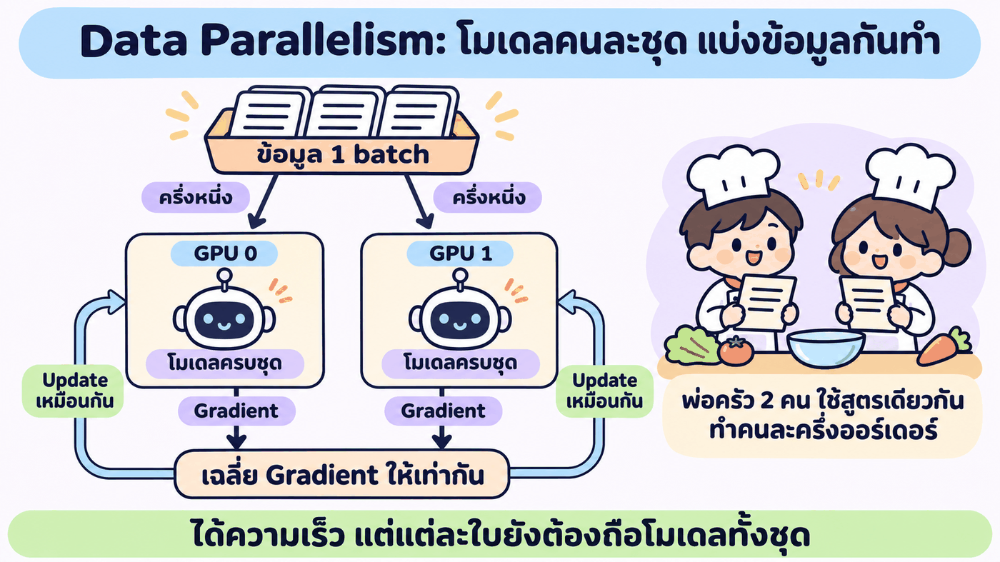

**คืออะไร** GPU ทุกใบมีโมเดล **ครบชุด** (เรียกว่า replica) · batch ถูกแบ่งให้แต่ละใบ · Gradient ของทุกใบถูกเฉลี่ย แล้วทุกใบ Update ด้วยค่าเดียวกัน โมเดลทุกชุดจึงเหมือนกันเสมอ

**ทำไมต้องใช้** ให้ GPU หลายใบทำงานพร้อมกัน งานจึงเสร็จเร็วขึ้น โดยไม่ต้องแก้โครงสร้างโมเดล

**ทำงานอย่างไร** โปรแกรมเทรนถูกเปิด 1 ตัวต่อ GPU · ตัวแบ่งข้อมูลส่งตัวอย่างคนละชุดให้แต่ละตัว ไม่ซ้ำกัน

**ตัวเลขจาก LAB นี้** (ส่วน GPU 2 ใบ)

| | ค่า |
|---|---|
| batch ต่อ GPU / batch รวม | 4 / 8 |
| ตัวอย่างที่แต่ละใบได้ใน 1 Epoch | 2,000 (รวม 4,000) |
| จำนวน step ใน 1 Epoch | 4,000 ÷ 8 = 500 · 3 Epoch = 1,500 step |
| น้ำหนัก LoRA ของสองใบหลังจบแต่ละ Epoch | เท่ากันทุกค่า (โค้ดตรวจให้ทุก Epoch) |

### 3 · 1 step ทำงานอย่างไร (DDP)

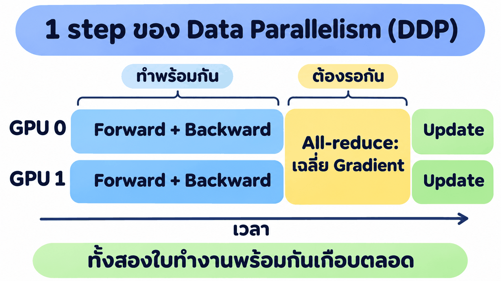

**คืออะไร** DDP (DistributedDataParallel) คือ Data Parallelism แบบที่ PyTorch มีให้ · 1 step มี 3 ช่วง

| ช่วง | เกิดอะไรขึ้น | GPU ทำพร้อมกันไหม |
|---|---|---|
| 1 · Forward + Backward | แต่ละใบคำนวณ loss และ Gradient จากข้อมูลส่วนของตัวเอง | พร้อมกัน |
| 2 · All-reduce | GPU ส่ง Gradient ให้กัน แล้วได้ค่าเฉลี่ยเท่ากันทุกใบ | ต้องรอกัน |
| 3 · Update | ทุกใบปรับน้ำหนักด้วย Gradient เฉลี่ยเดียวกัน | พร้อมกัน |

**ทำไมโมเดลทุกชุดยังเหมือนกัน** เริ่มจากน้ำหนักเดียวกัน + ใช้ Gradient เฉลี่ยตัวเดียวกัน + Optimizer ตั้งค่าเดียวกัน → น้ำหนักหลัง Update ตรงกันทุก step

**ทำไมการเฉลี่ยใน LAB นี้ถูก** ส่งเฉพาะ Gradient ของ LoRA

| | ค่า |
|---|---|
| Gradient ที่ต้องเฉลี่ยต่อ step | **ราว 15 MB** · 3,833,856 ค่า × 4 byte (LoRA เก็บแบบ fp32) |
| ที่มาของตัวเลข | **คำนวณ** จากจำนวน parameter ที่เทรน ไม่ได้วัดจริง |
| ทางที่ GPU คุยกัน (เครื่อง 2 ใบ) | ผ่าน PCIe ข้าม NUMA node ของ CPU (`SYS`) · ไม่มี NVLink · GPU 0 ต่อแค่ x4 ส่วน GPU 1 x16 ([results/gpu_topology.txt](results/gpu_topology.txt)) |

15 MB ต่อ step เล็กมาก · แม้เครื่องนี้ทางเชื่อมจะช้าที่สุดแบบหนึ่ง ช่วงที่ต้องรอกันก็สั้น (GPU util ราว 98% ในข้อ 5)

### 4 · VRAM ตอนเทรนใช้ไปกับอะไร และทำไมต้องวัดก่อน

**คืออะไร** VRAM ของแต่ละใบถูกใช้ 3 ส่วน

| ส่วน | ลักษณะ | ใน LAB นี้ (GPU 2 ใบ ต่อใบ) |
|---|---|---|
| Weights | คงที่ · **ทุกใบถือครบชุด** | 15.29 GiB (วัดก่อนเทรน) |
| LoRA + Optimizer | เล็กมาก | ราว 61 MB (คำนวณ: น้ำหนัก Gradient และค่าของ Optimizer 2 ชุด ของ 3.83 ล้านค่า แบบ fp32) |
| Activation | โตตาม batch | batch 1 → 17.19 GiB · batch 2 → 19.02 GiB · batch 4 → 22.71 GiB (PyTorch ใช้สูงสุด ที่ 256 token) |


**ทำไมต้องวัดก่อน** ถ้าเดา batch ใหญ่เกินไป งานจะล้มกลางทาง เสียทั้งเวลาและค่าเช่า · ลองอย่างละ 3 step ใช้เวลาไม่กี่วินาที แล้วเลือก batch ใหญ่สุดที่ผ่าน


**หาให้ฉลาดขึ้น: ประมาณก่อน แล้วลองค่าระหว่างกลาง** การเพิ่มทีละเท่าตัวบอกได้แค่ว่า batch ต่อ GPU ใหญ่สุดอยู่ระหว่าง 4 กับ 8 · VRAM โตเกือบเป็นเส้นตรงตาม batch จึงประมาณต่อได้: ส่วน 2 ใบ จาก batch 2 ไป 4 ใช้เพิ่ม 22.71 − 19.02 = 3.69 GiB ต่อใบ หรือราว 1.8 GiB ต่อ 1 ตัวอย่าง · batch 5 ต่อใบจึงน่าจะใช้ราว 24.5 GiB เกิน 23.68 GiB ที่การ์ดใช้ได้ คำตอบที่คาดไว้จึงเป็น 4 · ตัวเลขนี้เป็นการคำนวณ ผลในหน้านี้ไม่ได้ลอง batch 5–7 จริง · พรอมต์ขั้นที่ 2 และ 5 ให้ AI ประมาณแบบนี้ แล้วลองค่าระหว่างตัวที่ผ่านกับตัวที่ล้มเพื่อยืนยัน

**แต่การวัดก่อนก็พลาดได้** (เกิดจริงทั้งส่วน 2 ใบและ 4 ใบ) · batch 4 ผ่านการลอง 3 step แต่ตอนเทรนจริงล้มด้วย Out of Memory ภายใน 60 step แรก

| | ตอนลอง batch | ตอนเทรนจริง |
|---|---|---|
| ข้อมูลใน batch | ตัวอย่างที่ยาวที่สุด **ยาวเท่ากันทุกตัว** ไม่มี padding | ตัวอย่างยาวไม่เท่ากัน ต้องเติม padding ให้ยาวเท่าตัวที่ยาวสุดใน batch |
| ผล | ผ่าน · ใช้ไป 22.71 GiB ต่อใบ | ล้มตอน Backward ขณะขอเพิ่มอีก 594 MiB บน GPU 0 ซึ่งใช้ไปแล้ว 23.08 GiB จากที่ใช้ได้ 23.68 GiB ([results/logs/train_attempt1_oom.log](results/logs/train_attempt1_oom.log)) |

batch 4 เหลือที่ว่างแค่ราว 1 GiB ต่อใบ · ส่วนที่ต่างไปเล็กน้อยเพราะ padding ก็พอให้เกิน 24 GB · AI แก้โค้ดให้ใช้หน่วยความจำน้อยลง แล้วลอง batch ใหม่ (รายละเอียดในขั้นที่ 2 และขั้นที่ 5)

**บทเรียนสำคัญของ LAB นี้** เพิ่ม GPU แบบ Data Parallelism **ไม่ได้ที่ว่างต่อใบเพิ่ม** · ทุกใบยังต้องถือ Weights 15.29 GiB เหมือนตอนมี GPU ใบเดียว · batch ต่อใบใหญ่สุดจึงเท่าเดิม (4 ทั้งส่วน 2 ใบและ 4 ใบ) ที่เพิ่มคือ batch **รวม**

### 5 · ได้อะไร และไม่ได้อะไร


| | ผลจาก LAB นี้ (GPU 2 ใบ) |
|---|---|
| **ได้: Throughput** | GPU ทั้งสองใบทำงานเกือบตลอด · GPU util เฉลี่ย **97.8% / 98.6%** · **19.08 ตัวอย่างต่อวินาที** (0.419 วินาทีต่อ step ละ 8 ตัวอย่าง) |
| **ไม่ได้: ที่ว่าง VRAM** | Weights 15.29 GiB อยู่บนทุกใบ · batch ต่อใบใหญ่สุดคือ 4 · batch 8 ต่อใบ Out of Memory |
| ค่าเช่า | $0.3767/ชม. สำหรับ GPU 2 ใบ ที่ทำงานเต็มทั้งคู่ · **$0.00548 ต่อ 1,000 ตัวอย่าง** |

### 6 · จาก 2 ใบเป็น 4 ใบ: คาดว่าอะไรจะเปลี่ยน


**คืออะไร** วิธีเดิมทุกอย่าง แต่มีโมเดล 4 ชุดบน 4 ใบ · แต่ละใบได้ข้อมูล 1 ใน 4 (1,000 ตัวอย่างต่อ Epoch)

| สิ่งที่ดู | คาดว่า | เพราะ |
|---|---|---|
| Weights ต่อใบ | **เท่าเดิม** (ราว 15.3 GiB) | ทุกใบยังถือโมเดลครบชุด |
| batch ต่อใบใหญ่สุด | **เท่าเดิม** | ที่ว่างให้ Activation ต่อใบเท่าเดิม |
| batch รวม | **ใหญ่ขึ้นเท่าตัว** | 4 ใบ × batch ต่อใบเท่าเดิม |
| step ต่อ Epoch | **ลดครึ่ง** | batch รวมใหญ่ขึ้นเท่าตัว |
| ตัวอย่างต่อวินาที | **เกือบ 2 เท่า** แต่ไม่ถึง 2 เท่าพอดี | ทุกใบทำงานพร้อมกัน แต่การเฉลี่ย Gradient ต้องรอกัน 4 ใบ และต้องรอใบที่ช้าที่สุดทุก step |
| GPU util ต่อใบ | **ยังสูงใกล้ 100%** | แต่ละใบคำนวณงานของตัวเองตลอด |
| ค่าเช่าต่อ 1,000 ตัวอย่าง | **ใกล้เดิม** | จ่ายค่า GPU 2 เท่า แต่ได้งานเกือบ 2 เท่า · ขึ้นกับราคาเครื่องที่เช่าได้ |

ผลจริงอยู่ที่ [2 ใบเทียบ 4 ใบ](#2-ใบเทียบ-4-ใบ)

### 7 · เมื่อไรควรใช้


ใช้ Data Parallelism เมื่อ **โมเดลเทรนบน GPU ใบเดียวได้อยู่แล้ว และอยากให้เสร็จเร็วขึ้น** · ยิ่งเพิ่มใบยิ่งเร็วขึ้นเกือบตามจำนวนใบ · ถ้าโมเดลใส่ GPU ใบเดียวไม่ลง วิธีนี้ไม่ช่วย

การเทียบกับอีก 2 LAB อยู่ที่ [หน้ารวม LAB 4](../README.md) (แต่ละ LAB รันบนเครื่องเช่าคนละเครื่อง ความเร็วที่เทียบกันจึงรวมความต่างของเครื่องด้วย) · การทำแบบเดียวกันข้ามหลายเครื่องอยู่ที่ [LAB 5](../../lab5_cluster/README.md)

# ภาค LAB

## การทดลอง

| หัวข้อ | ส่วนที่ 1 · GPU 2 ใบ (ขั้นที่ 1–3) | ส่วนที่ 2 · GPU 4 ใบ (ขั้นที่ 4–6) |
|---|---|---|
| Dataset | b-mc2/sql-create-context · Training Set 4,000 · Test Set 200 · สับด้วย seed 0 | ชุดเดียวกัน |
| โมเดล | Qwen/Qwen3-8B แบบ bf16 + LoRA r 8 alpha 16 ที่ `q_proj` `v_proj` | เหมือนกัน |
| สิ่งที่ทดลอง | Data Parallelism (DDP) บน GPU 2 ใบ: batch ต่อ GPU ใหญ่สุดเท่าไร และเทรนได้เร็วแค่ไหน | เหมือนกัน บน GPU 4 ใบ |
| ค่าที่ตรึง | ปิด thinking · ไม่ใช้ Gradient Checkpointing · learning rate 2e-4 · seed 0 · ข้อความยาวไม่เกิน 256 token · **3 Epoch** | เหมือนกัน |
| วิธีวัด | หา batch: ลอง 1, 2, 4 … ต่อ GPU อย่างละ 3 step ด้วยตัวอย่างที่ยาวที่สุด · ความเร็ว: วินาทีต่อ step และตัวอย่างต่อวินาทีตลอด 3 Epoch · GPU util และ VRAM ของแต่ละใบ · คุณภาพ: loss และ Exact Match บน Test Set 200 ข้อ ของ Base และหลังจบแต่ละ Epoch | เหมือนกัน |
| เครื่อง (ที่เช่าได้) | RTX 3090 24 GB × 2 ในเครื่องเดียว · แคนาดา (Quebec) · $0.3767/ชม. · AMD EPYC 7551P · GPU ต่อกันผ่าน PCIe ข้าม NUMA node ไม่มี NVLink | RTX 3090 24 GB × 4 ในเครื่องเดียว · ชิลี · $0.87/ชม. · Xeon E5-2680 v4 2 ซ็อกเก็ต · PCIe 3.0 x16 ไม่มี NVLink |
| เวลาและค่าเช่าจริง | 3 ขั้นรวม 71.9 นาที · เครื่องเปิด 50.7 นาที · ใบคิดเงิน **$0.351** (+ $0.008 ของเครื่องแรกที่เปิดไม่ขึ้น) | 3 ขั้นรวม 62.1 นาที · เครื่องเปิด 49.5 นาที · ใบคิดเงิน **$0.665** (+ $0.006 ของเครื่องแรกที่เปิดไม่ขึ้น) |

ทำตามลำดับขั้นที่ 1 → 6 · แต่ละส่วนทำให้ครบในรอบเดียว · โค้ดของส่วนที่ 1 อยู่ใน `lab4_multigpu/2_data_parallel/code` (เริ่มจากว่าง) · ของส่วนที่ 2 อยู่ใน `gpu4/`

> ⚠️ เครื่องคิดเงินตั้งแต่ขั้นเช่าจนกว่าจะลบ · **ต้องทำขั้นที่ 3 และขั้นที่ 6 ทุกครั้ง** แม้งานระหว่างทางจะล้ม

## ส่วนที่ 1 · GPU 2 ใบ (ขั้นที่ 1–3)

## ขั้นที่ 1 · เช่าเครื่อง 2 GPU และเตรียมของ


*สังเกตว่า GPU 2 ใบอยู่ใน **เครื่องเดียวกัน** และเงินเริ่มเดินตั้งแต่ขั้นนี้*

AI เช่าเครื่อง โหลดโมเดลและ Dataset แบ่งชุดข้อมูล แล้วเขียน `prepare.py` กับ `results/dataset_samples.md`

```text
[ที่ทำงาน]
container `multi-account` · โฟลเดอร์ /workspace/vastapp_lab · สกิล vastai
กุญแจ SSH: /workspace/vastai_lab/Devtool_SSH/devtoolSSH
เก็บโค้ดและผลที่: lab4_multigpu/2_data_parallel ของโฟลเดอร์ที่เปิด Claude Code อยู่ (ไม่ใช่ใน container)

[งาน]
เช่าเครื่อง GPU 2 ใบ แล้วเตรียมโมเดลกับ Dataset

[เครื่องที่ต้องการ]
GPU: RTX 4090 2 ใบในเครื่องเดียว · ราคาไม่เกิน $0.60 ต่อชั่วโมง · ป้าย vapp-lab4-dp
เงื่อนไข: verified · reliability 0.95 ขึ้นไป · ความเร็วเน็ตไม่ต่ำกว่า 1,200 Mbps · ค่าดาวน์โหลดไม่เกิน $0.01 ต่อ GB · CPU 16 cores ขึ้นไป · ไม่อยู่ในจีน
ระบบ: PyTorch 2.8 ที่มี CUDA 12.8 · disk 60 GB

[ขั้นตอน]
1. เช่าเครื่องที่ถูกที่สุดตามเงื่อนไข ถ้าเกิน 10 นาทียังไม่พร้อม ให้ลบแล้วเช่าเครื่องอื่น
2. โหลดโมเดล Qwen/Qwen3-8B และ Dataset b-mc2/sql-create-context ลงเครื่อง
3. สับ Dataset ด้วย seed 0 แล้วแบ่ง Training Set 4,000 ตัวอย่าง และ Test Set 200 ตัวอย่าง
4. ทำตารางตัวอย่าง 6 รายการ (คำถาม · โครงสร้างตาราง · SQL เฉลย) เก็บที่ results/dataset_samples.md

[รายงาน]
สรุปเป็นตาราง: เครื่องที่ได้ · ราคาต่อชั่วโมง · GPU ต่อถึงกันแบบไหน · จำนวนตัวอย่างของแต่ละชุด
อธิบายตัวอย่าง 1 รายการว่าแต่ละช่องคืออะไร · ห้ามแสดงค่า key · บอกว่าเครื่องยังเปิดอยู่
```

![ช่องพิมพ์ของ Claude Code ที่วางพรอมต์ขั้นที่ 1 และคำตอบ: เครื่องแรกที่สหรัฐฯ $0.38 ต่อชั่วโมงดึง image เกิน 10 นาทีจึงลบแล้วเช่าเครื่องถัดไป ได้ RTX 3090 24 GB 2 ใบที่ Quebec แคนาดา ราคา $0.3767 ต่อชั่วโมงรวม disk CPU AMD EPYC 7551P ใช้ได้จริง 25.6 cores PyTorch 2.8.0 CUDA 12.8 verified reliability 0.989 ดาวน์โหลด 935 Mbps ค่าดาวน์โหลด $0.0026 ต่อ GB GPU ต่อกันแบบ SYS ข้าม NUMA node ไม่มี NVLink GPU0 ต่อ PCIe แค่ x4 ส่วน GPU1 x16 โมเดล 16.4 GB Dataset 78,577 ตัวอย่าง Training Set 4,000 Test Set 200 ไม่ซ้ำกัน พร้อมตารางอธิบายตัวอย่างแถวที่ 1 ทีละช่อง และบอกว่าเครื่องยังเปิดอยู่](../images/data_parallel/lab4b-step1.png)
*ใช้เวลา 30.4 นาที (รวมราว 10 นาทีที่รอเครื่องแรกที่เปิดไม่ขึ้น)*

ตัวอย่างโค้ดที่ AI เขียนให้ในรอบจริง (ของคุณอาจต่างกัน): [code_reference/prepare.py](code_reference/prepare.py) · ผล: [results/dataset_samples.md](results/dataset_samples.md) · [results/prepare_info.json](results/prepare_info.json) · [results/gpu_topology.txt](results/gpu_topology.txt)

**อ่านผลอย่างไร**

- **เครื่องแรก (สหรัฐฯ $0.38) ดึง image เกิน 10 นาที** · AI ลบแล้วเช่าเครื่องถัดไปเองตามข้อ 1 ของพรอมต์ · เครื่องเช่าเปิดไม่ขึ้นเป็นเรื่องปกติ ต้องตั้งเวลาจำกัดไว้เสมอ · เครื่องที่ลบไปถูกคิดค่า disk $0.008
- แถว **GPU ต่อถึงกันแบบไหน**: `SYS` = ผ่าน PCIe และข้ามทางเชื่อมระหว่าง NUMA node ของ CPU เป็นเส้นทางที่ช้าที่สุดแบบหนึ่ง และ GPU 0 ได้แค่ x4 · แต่ Gradient ของ LoRA มีแค่ราว 15 MB ต่อ step จึงไม่เป็นปัญหา (ทฤษฎีข้อ 3 · GPU util ในขั้นที่ 2 ยังราว 98%)
- ต้องได้ Training Set **4,000** และ Test Set **200** ที่ไม่ซ้ำกัน · Test Set ใช้วัดผลอย่างเดียว ห้ามใช้เทรน
- ตั้งแต่ขั้นนี้เงินเดินชั่วโมงละ $0.3767

## ขั้นที่ 2 · เทรนแบบ Data Parallelism


*นี่คือแนวคิดที่บรรทัด "แนวคิด" ในพรอมต์บรรยายไว้*

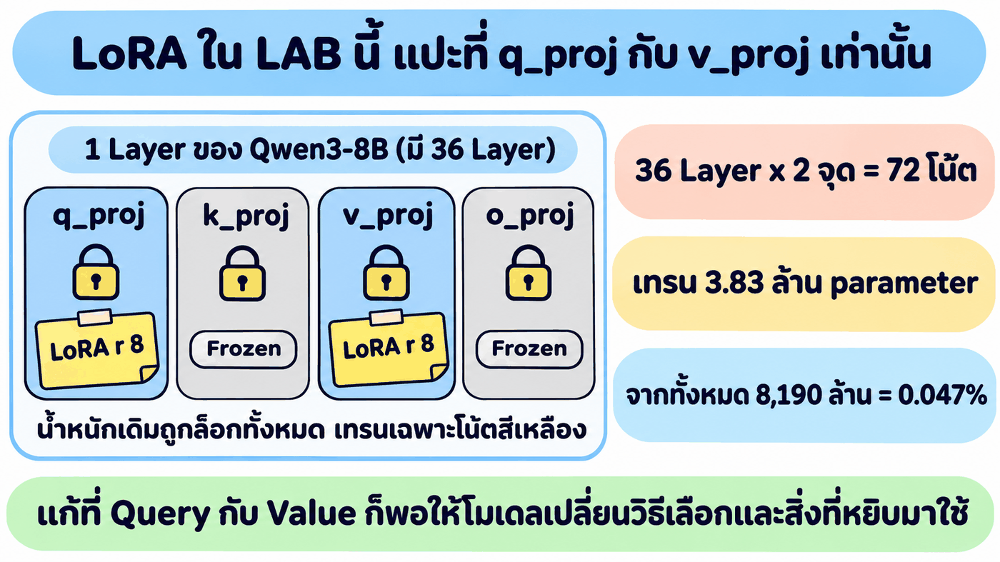
*`[ค่าที่ตรึง]` ในพรอมต์ระบุ LoRA ที่ `q_proj` กับ `v_proj` ตามภาพนี้*


*ข้อ 2 ของพรอมต์คือการชั่งกระเป๋าก่อนขึ้นเครื่อง · ในขั้นนี้ batch ที่ผ่านการชั่งยังล้มตอนเทรนจริงหนึ่งครั้ง (ดูอ่านผลด้านล่าง)*

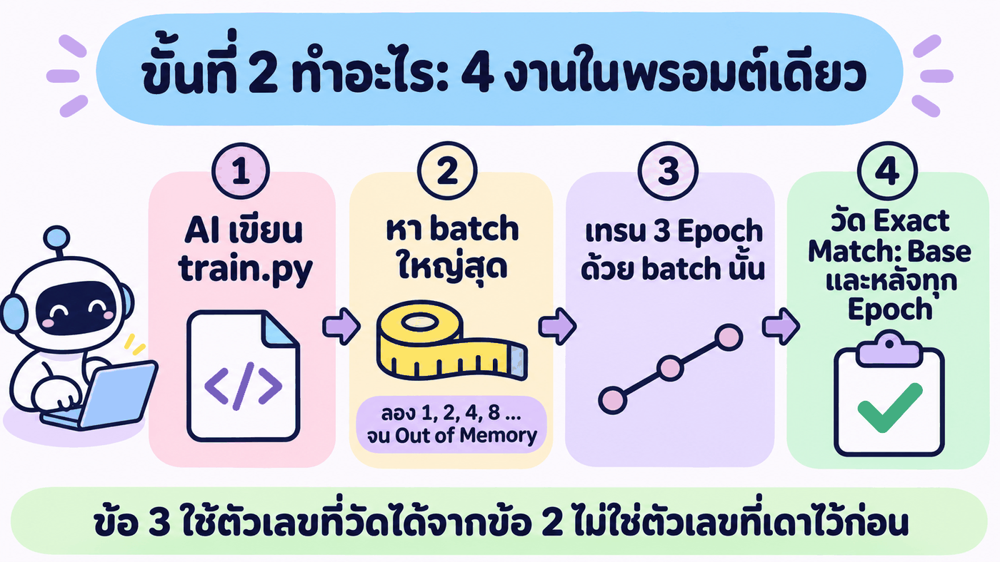
*ข้อ 3 ใช้ batch ที่วัดได้จริงจากข้อ 2*

AI เขียน `code/train.py` (DDP) `code/eval.py` `code/common.py` และ `code/run_all.sh` (รันต่อเนื่องใน tmux ต่อจาก checkpoint ได้) แล้วหา batch → เทรน 3 Epoch → วัด Exact Match ของ Base และทุก Epoch บนเครื่องเช่า

```text
[ที่ทำงาน]
container `multi-account` · โฟลเดอร์ /workspace/vastapp_lab · สกิล vastai
เครื่อง: ป้าย vapp-lab4-dp · กุญแจ SSH: /workspace/vastai_lab/Devtool_SSH/devtoolSSH
เก็บโค้ดและผลที่: lab4_multigpu/2_data_parallel ของโฟลเดอร์ที่เปิด Claude Code อยู่ (ไม่ใช่ใน container)

[งาน]
เทรน Qwen3-8B ให้แปลงคำถามเป็น SQL แบบ Data Parallelism
แนวคิด: GPU 2 ใบถือโมเดลคนละชุด แบ่งข้อมูลใบละครึ่ง แล้วเฉลี่ย Gradient ให้เท่ากัน

[ขั้นตอน]
1. เขียน code/train.py เทรนด้วย LoRA บน GPU 2 ใบ ใช้ DDP ของ PyTorch
2. หา batch ต่อ GPU ใหญ่สุด: ลอง 1, 2, 4, 8 … อย่างละ 3 step ด้วยตัวอย่างที่ยาวที่สุด จน Out of Memory
   แล้วประมาณจาก VRAM ที่วัดได้ว่า batch เท่าไรจะพอดี และลองค่าระหว่างตัวที่ผ่านกับตัวที่ล้ม จนได้ batch ใหญ่สุดที่ผ่านจริง
3. เทรน 3 Epoch ด้วย batch ต่อ GPU ใหญ่สุดที่หาได้ในข้อ 2
4. เขียน code/eval.py วัด Exact Match บน Test Set ของโมเดลก่อนเทรน (Base) และหลังจบแต่ละ Epoch
5. ให้งานรันต่อได้แม้การเชื่อมต่อหลุด และรายงานทุก 2–3 นาที

[ค่าที่ตรึง]
โมเดล: Qwen/Qwen3-8B แบบ bf16 · ปิด thinking · ไม่ใช้ Gradient Checkpointing
LoRA: r 8 · alpha 16 · ที่ q_proj กับ v_proj
การเทรน: learning rate 2e-4 · seed 0 · ข้อความยาวไม่เกิน 256 token

[รายงาน]
สรุปเป็นตาราง: batch ต่อ GPU เทียบ VRAM สูงสุดของแต่ละใบ · batch ที่ประมาณไว้ · batch ที่ใช้เทรน (ต่อ GPU และรวม) · วินาทีต่อ step · ตัวอย่างต่อวินาที · GPU util ของแต่ละใบ · loss และ Exact Match ของ Base และหลังจบแต่ละ Epoch
บอกว่าเครื่องยังเปิดอยู่
```

> ผลที่แสดงในหน้านี้ได้จากการไล่ batch แบบเพิ่มทีละเท่าตัว (1, 2, 4, 8 …) เท่านั้น ยังไม่ได้ลองค่าระหว่างตัวที่ผ่านกับตัวที่ล้ม พรอมต์นี้ให้ AI ลองต่อ batch ที่คุณได้จึงอาจใหญ่กว่าในหน้านี้

![ช่องพิมพ์ของ Claude Code ที่วางพรอมต์ขั้นที่ 2 และคำตอบ: ตาราง batch ต่อ GPU เทียบ VRAM จาก nvidia-smi batch 1 ใช้ 18,227 และ 18,233 MiB batch 2 ใช้ 20,123 MiB ทั้งสองใบ batch 4 ใช้ 24,075 MiB ทั้งสองใบ batch 8 Out of Memory ทั้งสองใบ เทรนที่ batch 4 ต่อ GPU รวม 8 ได้ 500 step ต่อ Epoch 0.419 วินาทีต่อ step 19.08 ตัวอย่างต่อวินาที GPU util ราว 97–98% และ 98.6% ตาราง loss และ Exact Match Base 0.0% แล้ว 70.0% 77.5% 79.0% หัวข้อสิ่งที่ควรรู้ เทรนรอบแรกล้มด้วย Out of Memory ที่ step 59 แก้โดยไม่ส่ง attention mask ตอนเทรนแล้วรันใหม่ตั้งแต่หา batch CUDA เปิดไม่ได้ตอนแรกแก้ด้วย LD_LIBRARY_PATH และทดสอบรันต่อจาก checkpoint บอกว่าเครื่องยังเปิดอยู่](../images/data_parallel/lab4b-step2.png)
*ใช้เวลา 28.9 นาที (บนเครื่องเช่า: หา batch 4 ขนาดราว 1.5 นาที · เทรน 3 Epoch 10.5 นาที · วัดผล Base และ 3 Epoch ราว 3 นาที)*

**หา batch ต่อ GPU ใหญ่สุด** (ตัวอย่างที่ยาวที่สุด 256 token · อย่างละ 3 step · [results/probe/](results/probe/))

| batch ต่อ GPU | batch รวม | ผล | PyTorch ใช้สูงสุด GPU 0 / GPU 1 | nvidia-smi GPU 0 / GPU 1 | วินาทีต่อ step |
|---|---|---|---|---|---|
| 1 | 2 | ผ่าน | 17.19 / 17.18 GiB | 18,227 / 18,233 MiB | 0.269 |
| 2 | 4 | ผ่าน | 19.02 / 19.02 GiB | 20,123 / 20,123 MiB | 0.379 |
| 4 | 8 | ผ่าน | 22.71 / 22.71 GiB | 24,075 / 24,075 MiB | 0.714 |
| 8 | 16 | **Out of Memory** ตั้งแต่ step แรก ทั้งสองใบ | 23.15 GiB ก่อนล้ม | – | – |

**เทรน 3 Epoch ที่ batch 4 ต่อ GPU (รวม 8)** ([results/train_summary.json](results/train_summary.json) · [results/eval_summary.json](results/eval_summary.json))

| Epoch | วินาทีต่อ step | ตัวอย่างต่อวินาที | GPU util GPU 0 / GPU 1 | train loss | test loss | Exact Match |
|---|---|---|---|---|---|---|
| Base | – | – | – | – | 1.8453 | 0.0% (0/200) |
| 1 | 0.418 | 19.15 | 97.1% / 98.6% | 0.0885 | 0.0581 | 70.0% (140/200) |
| 2 | 0.418 | 19.12 | 97.9% / 98.6% | 0.0322 | **0.0520** | 77.5% (155/200) |
| 3 | 0.422 | 18.97 | 98.3% / 98.6% | 0.0205 | 0.0578 | **79.0%** (158/200) |
| **รวม 3 Epoch** | **0.419** | **19.08** | **97.8% / 98.6%** | | | |

- 500 step ต่อ Epoch · รวม 12,000 ตัวอย่างใน 1,500 step × 0.419 วินาที = 10.5 นาที · GPU util ของ Epoch 1 วัดเฉพาะ step 101–500
- VRAM สูงสุดตอนเทรน: PyTorch ใช้ **22.71 / 22.71 GiB** · nvidia-smi เห็น 24,145 / 24,147 MiB จาก 24,576 MiB
- **Exact Match** ของรอบนี้ยุบแค่ช่องว่าง ที่เหลือต้องตรงทุกตัวอักษร รวมถึง `;` ท้าย · แบบผ่อนปรน (ไม่สนตัวพิมพ์ ชนิดเครื่องหมายคำพูด และ `;` ท้าย) ได้ Base 54.5% → 72.0% → 79.5% → 81.0%

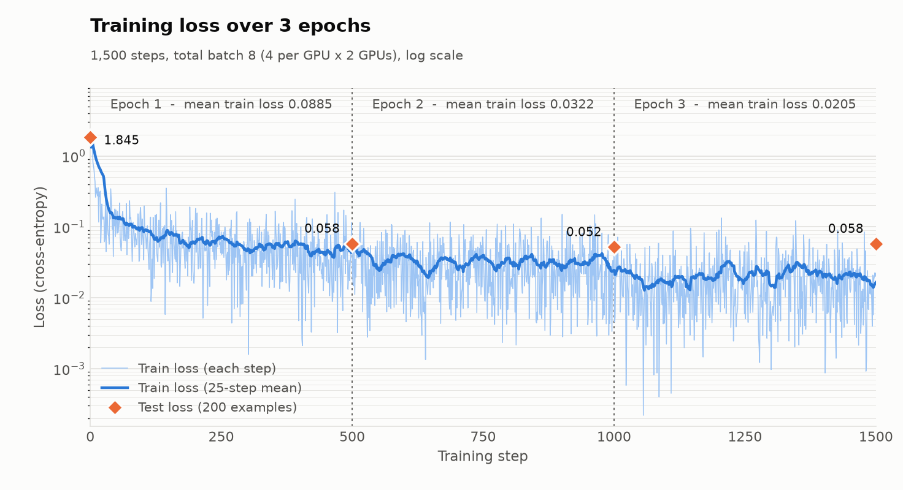

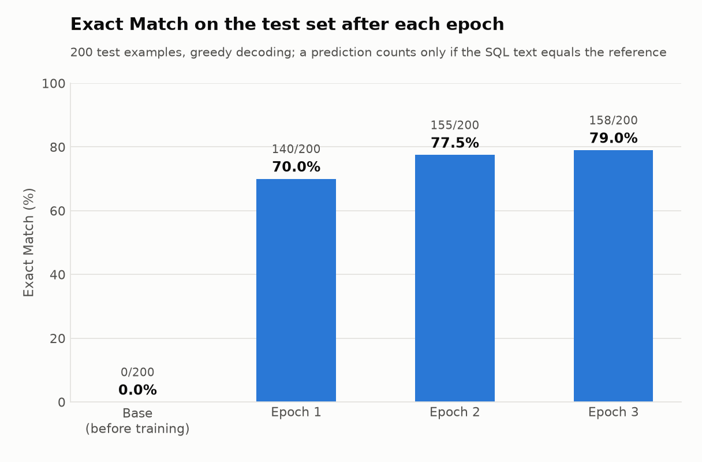

ตัวอย่างข้อแรกของ Test Set ([results/eval/base_predictions.json](results/eval/base_predictions.json) · [results/eval/epoch3_predictions.json](results/eval/epoch3_predictions.json))

| | SQL |
|---|---|
| เฉลย | `SELECT record FROM table_name_98 WHERE high_points = "ray allen (20)"` |
| Base | `SELECT record FROM table_name_98 WHERE high_points = 'Ray Allen (20)'` → ไม่ตรง |

ตัวอย่างโค้ดที่ AI เขียนให้ในรอบจริง (ของคุณอาจต่างกัน): [code_reference/train.py](code_reference/train.py) · [eval.py](code_reference/eval.py) · [common.py](code_reference/common.py) · [run_all.sh](code_reference/run_all.sh)

**อ่านผลอย่างไร**

- **batch ที่ใช้เทรน = batch ใหญ่สุดที่ผ่าน (4 ต่อ GPU)** แต่ไม่ได้ผ่านในครั้งแรก · เทรนครั้งแรกล้มด้วย Out of Memory ราว step 59 ของ Epoch 1 ([results/logs/train_attempt1_oom.log](results/logs/train_attempt1_oom.log)) ตรงกับ batch แรกที่มีตัวอย่างยาวที่สุด (319 token ตัดเหลือ 256) ปนกับตัวอย่างสั้นที่ต้องเติม padding · AI แก้ `train.py` ไม่ส่ง attention mask ตอนเทรน (padding อยู่ทางขวาและ attention มองย้อนหลังอย่างเดียว ผล loss จึงเท่าเดิม: วัดบน batch ทดสอบได้ 1.6797 เทียบ 1.6786) และคืนหน่วยความจำที่จองค้างเมื่อเจอ batch ที่ใหญ่กว่าเดิม แล้วลอง batch ใหม่ทั้งหมด ได้ 4 เท่าเดิมและเทรนจบ · **บทเรียน: batch ที่ผ่านการลองแบบเฉียดขีด (เหลือราว 1 GiB) อาจล้มตอนเจอข้อมูลจริง**
- **VRAM ของสองใบเท่ากันทุกตัวเลข** ตอนหา batch (17.19 / 19.02 / 22.71 GiB) และสูงกว่า 15.29 GiB ของโมเดลเสมอ · นี่คือหลักฐานว่าทุกใบถือโมเดลครบชุดและทำงานเท่ากัน
- **3 Epoch บอกอะไร** · train loss ลดต่อเนื่อง แต่ test loss ต่ำสุดที่ Epoch 2 แล้วขยับขึ้นที่ Epoch 3 (0.0520 → 0.0578) = **เริ่มมีสัญญาณ overfitting** · Exact Match 77.5% → 79.0% ต่างกัน 3 ข้อจาก 200 (1 ข้อ = 0.5 จุด) จึงยังบอกไม่ได้ชัดว่าดีขึ้นจริง
- **Exact Match ของ Base ต่ำมาก ส่วนใหญ่เพราะสไตล์การเขียน ไม่ใช่ตรรกะผิด** · Base ใช้ `'...'` และตัวพิมพ์ตามคำถาม ส่วนเฉลยใช้ `"..."` (แบบผ่อนปรน Base ได้ 54.5%) · ส่วนที่เพิ่มขึ้นหลัง Fine-tune จึงมาจากการที่โมเดลเรียนสไตล์ของ Dataset เป็นส่วนใหญ่
- **ปัญหาที่อาจเจอ: CUDA เปิดไม่ได้ (error 804)** · image ของเครื่องมีไลบรารี CUDA รุ่นใหม่กว่า driver ของเครื่องบังอยู่ AI แก้ด้วยการตั้ง `LD_LIBRARY_PATH` ให้ใช้ไลบรารีของ driver ก่อน ใน `run_all.sh`
- ข้อ 5 ของพรอมต์ถูกทดสอบจริง · AI หยุดงานเองที่ราว step 140 แล้วสั่งใหม่ งานรันต่อจาก checkpoint step 100 ได้

## ขั้นที่ 3 · สรุปและลบเครื่อง (ห้ามข้าม)

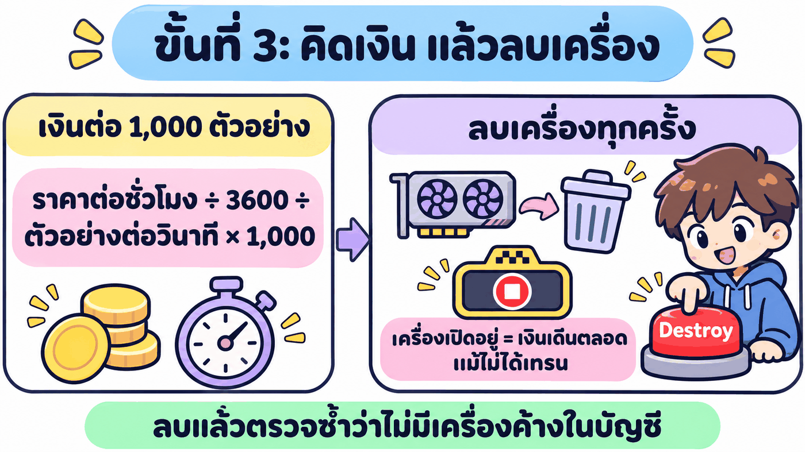
*สูตรเงินต่อ 1,000 ตัวอย่างในภาพคือสูตรที่ `report.py` ใช้*

AI นำผลดิบกลับมา ค้นราคาตลาด เขียน `code/report.py` (รวมตัวเลข + วาดกราฟ + อ่านใบคิดเงิน) แล้วลบเครื่อง

```text
[ที่ทำงาน]
container `multi-account` · โฟลเดอร์ /workspace/vastapp_lab · สกิล vastai
เครื่อง: ป้าย vapp-lab4-dp · กุญแจ SSH: /workspace/vastai_lab/Devtool_SSH/devtoolSSH
เก็บโค้ดและผลที่: lab4_multigpu/2_data_parallel ของโฟลเดอร์ที่เปิด Claude Code อยู่ (ไม่ใช่ใน container)

[งาน]
สรุปผลเป็นกราฟ แล้วลบเครื่อง

[ขั้นตอน]
1. นำผลดิบกลับมาที่ results/raw
2. ค้นราคาตลาดของเครื่อง RTX 4090 2 ใบที่ถูกที่สุด
3. เขียน code/report.py รวมตัวเลขลง results/metrics.json พร้อมเงินต่อ 1,000 ตัวอย่าง
4. ให้สคริปต์วาดกราฟที่ results/images (ข้อความอังกฤษ): VRAM ของแต่ละใบเทียบ batch พร้อมเส้น 24 GB · GPU util ของแต่ละใบ · loss ตลอด 3 Epoch · Exact Match ของแต่ละ Epoch
5. ลบเครื่องป้าย vapp-lab4-dp แล้วตรวจว่าไม่เหลือ (ห้ามแตะเครื่องป้ายอื่น)

[รายงาน]
สรุปเป็นตาราง: batch ต่อ GPU ใหญ่สุด · ตัวอย่างต่อวินาที · Exact Match · เงินต่อ 1,000 ตัวอย่าง
ค่าใช้จ่ายจริงของเครื่อง: อายุเครื่อง · ยอดที่ถูกคิด · ห้ามแสดงค่า key
```


*ใช้เวลา 12.6 นาที*

**กราฟที่ AI วาดให้** ([results/images/](results/images/))


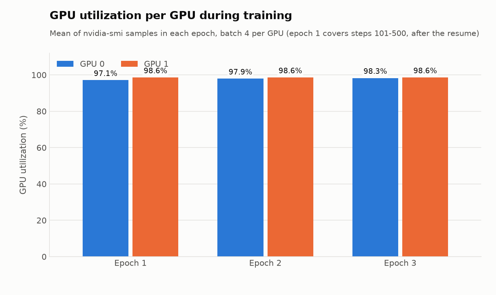

กราฟ VRAM เขียนหน่วยว่า GB แต่ตัวเลขคือ MiB ÷ 1024 (เช่น 24,075 MiB = 23.5) จึงเป็น GiB

**ราคาตลาด RTX 3090 2 ใบ** (ค้นตอนขั้นที่ 3 · รวม disk 60 GB · คิดที่ 19.08 ตัวอย่างต่อวินาที)

| ราคาที่ใช้คิด | $ ต่อชั่วโมง | $ ต่อ 1,000 ตัวอย่าง |
|---|---|---|
| เครื่องที่เช่าจริง (แคนาดา) | 0.3767 | **0.00548** |
| on-demand verified ถูกสุด (California · เน็ต 570 Mbps ไม่ผ่านเงื่อนไข 700 Mbps ของ LAB) | 0.3389 | 0.00493 |
| on-demand ถูกสุดรวมเครื่องไม่ verified (Quebec) | 0.2567 | 0.00374 |
| interruptible verified ถูกสุด (Taiwan) · ถูกหยุดได้เมื่อมีคนเสนอราคาสูงกว่า | 0.2356 | 0.00343 |

เทรน 3 Epoch (12,000 ตัวอย่าง) บนเครื่องที่เช่าจริงคิดเป็นราว $0.066 (คำนวณ)

**ค่าใช้จ่ายจริงจากใบคิดเงิน** ([results/raw/billing.json](results/raw/billing.json))

| รายการ | ค่า |
|---|---|
| GPU | $0.295 (0.820 ชั่วโมงที่ $0.360) |
| disk | $0.016 |
| ดาวน์โหลด | $0.039 (14.8 GB ที่ราว $0.003 ต่อ GB) |
| อัปโหลด | $0.001 |
| **รวม** | **$0.351** · เครื่องเปิด 50.7 นาที |
| เครื่องแรกที่เปิดไม่ขึ้นในขั้นที่ 1 | $0.008 (ค่า disk) |

ตัวอย่างโค้ดที่ AI เขียนให้ในรอบจริง (ของคุณอาจต่างกัน): [code_reference/report.py](code_reference/report.py) · ตัวเลขรวม: [results/metrics.json](results/metrics.json) · [results/summary.json](results/summary.json)

**อ่านผลอย่างไร**

- **เวลาส่วนใหญ่ไม่ใช่การเทรน** · เครื่องเปิด 50.7 นาที เทรนจริง 10.5 นาที ที่เหลือคือรอเครื่อง โหลดโมเดล หา batch แก้ปัญหา และวัดผล · เงินต่อ 1,000 ตัวอย่างนับแค่เวลาเทรน จึงไม่เห็นส่วนนี้
- **ค่าดาวน์โหลดถูกเพราะเงื่อนไขในพรอมต์** · โหลดโมเดล 14.8 GB เสียแค่ $0.039 เพราะพรอมต์กำหนด "ค่าดาวน์โหลดไม่เกิน $0.01 ต่อ GB"
- **ราคาตลาดที่ AI ใช้เป็นตัวเลขหลัก ($0.3389) เป็นเครื่องที่ไม่ผ่านเงื่อนไขของ LAB** (เน็ต 570 Mbps) · อ่านคำตอบของ AI แล้วต้องเทียบกับเงื่อนไขของเราเองด้วย
- ต้องเห็นว่า AI ลบเครื่องแล้วและตรวจซ้ำว่าไม่เหลือเครื่องป้าย `vapp-lab4-dp` · ถ้าไม่แน่ใจ ให้สั่งตรวจซ้ำอีกครั้ง

## ส่วนที่ 2 · GPU 4 ใบ (ขั้นที่ 4–6)

ทำซ้ำการทดลองเดิมทุกอย่าง เปลี่ยนแค่จำนวน GPU จาก 2 เป็น 4 ใบ บนเครื่องเช่าเครื่องใหม่ · โค้ดและผลเก็บแยกที่ `gpu4/`

## ขั้นที่ 4 · เช่าเครื่อง 4 GPU และเตรียมของ


*สังเกตว่า GPU ทั้ง 4 ใบต้องอยู่ใน **เครื่องเดียวกัน** และเพดานราคาสูงขึ้นเป็น $1.40/ชม.*

AI เช่าเครื่องใหม่ เตรียมโมเดลและ Dataset ชุดเดิม แล้วเขียน `gpu4/code/rent.sh` `prepare.py` และ `gpu4/results/dataset_samples.md`

```text
[ที่ทำงาน]
container `multi-account` · โฟลเดอร์ /workspace/vastapp_lab · สกิล vastai
กุญแจ SSH: /workspace/vastai_lab/Devtool_SSH/devtoolSSH
เก็บโค้ดและผลที่: lab4_multigpu/2_data_parallel/gpu4 ของโฟลเดอร์ที่เปิด Claude Code อยู่ (ไม่ใช่ใน container)

[งาน]
เช่าเครื่อง GPU 4 ใบ แล้วเตรียมโมเดลกับ Dataset

[เครื่องที่ต้องการ]
GPU: RTX 4090 4 ใบในเครื่องเดียว · ราคาไม่เกิน $1.40 ต่อชั่วโมง · ป้าย vapp-lab4-dp4
เงื่อนไข: verified · reliability 0.95 ขึ้นไป · ความเร็วเน็ตไม่ต่ำกว่า 1,200 Mbps · ค่าดาวน์โหลดไม่เกิน $0.01 ต่อ GB · CPU 16 cores ขึ้นไป · ไม่อยู่ในจีน
ระบบ: PyTorch 2.8 ที่มี CUDA 12.8 · disk 60 GB

[ขั้นตอน]
1. เช่าเครื่องที่ถูกที่สุดตามเงื่อนไข ถ้าเกิน 10 นาทียังไม่พร้อม ให้ลบแล้วเช่าเครื่องอื่น
2. โหลดโมเดล Qwen/Qwen3-8B และ Dataset b-mc2/sql-create-context ลงเครื่อง
3. สับ Dataset ด้วย seed 0 แล้วแบ่ง Training Set 4,000 ตัวอย่าง และ Test Set 200 ตัวอย่าง
4. ทำตารางตัวอย่าง 6 รายการ (คำถาม · โครงสร้างตาราง · SQL เฉลย) เก็บที่ results/dataset_samples.md

[รายงาน]
สรุปเป็นตาราง: เครื่องที่ได้ · ราคาต่อชั่วโมง · GPU ต่อถึงกันแบบไหน · จำนวนตัวอย่างของแต่ละชุด
อธิบายตัวอย่าง 1 รายการว่าแต่ละช่องคืออะไร · ห้ามแสดงค่า key · บอกว่าเครื่องยังเปิดอยู่
```

![ช่องพิมพ์ของ Claude Code ที่วางพรอมต์ขั้นที่ 4 และคำตอบ: ได้เครื่อง RTX 3090 24 GB 4 ใบที่ชิลี verified reliability 0.987 CPU Xeon E5-2680 v4 2 ซ็อกเก็ต 56 cores RAM 94 GB disk 60 GB ดาวน์โหลด 897 Mbps ค่าดาวน์โหลด $0.0026 ต่อ GB PyTorch 2.8.0 CUDA 12.8 ราคา $0.87 ต่อชั่วโมง GPU ต่อกันผ่าน PCIe 3.0 x16 ไม่มี NVLink GPU0 กับ GPU1 และ GPU2 กับ GPU3 อยู่ใต้ CPU เดียวกัน ข้ามคู่เป็น SYS โมเดล 16.4 GB Dataset 78,577 ตัวอย่าง Training Set 4,000 Test Set 200 เรื่องที่ควรรู้ เครื่องถูกสุด $0.78 ค้างที่ loading เกิน 10 นาทีจึงลบ ข้ามข้อเสนอ $0.76 ที่ไต้หวันเพราะ driver รองรับ CUDA ถึง 12.2 เท่านั้น พร้อมตารางอธิบายตัวอย่างแถวที่ 1](../images/data_parallel/lab4b-step4.png)
*ใช้เวลา 23.1 นาที (รวมราว 10 นาทีที่รอเครื่องแรกที่เปิดไม่ขึ้น)*

ตัวอย่างโค้ดที่ AI เขียนให้ในรอบจริง (ของคุณอาจต่างกัน): [code_reference/gpu4/rent.sh](code_reference/gpu4/rent.sh) · [prepare.py](code_reference/gpu4/prepare.py) · ผล: [gpu4/results/dataset_samples.md](gpu4/results/dataset_samples.md) · [gpu4/results/prepare_info.json](gpu4/results/prepare_info.json) · [gpu4/results/gpu_topology.txt](gpu4/results/gpu_topology.txt)

**อ่านผลอย่างไร**

- **ได้ Dataset ชุดเดียวกับส่วนที่ 1** (seed 0 · 4,000 / 200 · ตัวอย่าง 6 แถวแรกตรงกัน) จึงเทียบผลระหว่าง 2 ใบกับ 4 ใบได้
- **เครื่องถูกสุดที่ผ่านเงื่อนไข ($0.78 สหรัฐฯ) ค้างที่ loading เกิน 10 นาที** · AI ลบแล้วเช่าเครื่องถัดไป ($0.87) ซึ่งพร้อมใน 436 วินาที · เครื่องที่ลบถูกคิดค่า disk $0.006
- **ข้อเสนอที่ถูกกว่า ($0.76 ไต้หวัน) ใช้ไม่ได้** เพราะ driver ของเครื่องรองรับ CUDA ได้ถึง 12.2 แต่พรอมต์ขอ PyTorch ที่มี CUDA 12.8 · ราคาต่อชั่วโมงไม่ใช่เงื่อนไขเดียวที่ต้องดู
- แถว **GPU ต่อถึงกันแบบไหน**: ไม่มี NVLink · GPU 0–1 และ GPU 2–3 อยู่ใต้ CPU ตัวเดียวกัน (PHB) ข้ามคู่ต้องผ่านทางเชื่อมระหว่าง CPU 2 ตัว (SYS) · ใน DDP ทุก step Gradient ราว 15 MB ต้องเฉลี่ยข้ามทั้ง 4 ใบ
- เครื่องนี้ **ราคา $0.87/ชม.** ราว 2.3 เท่าของเครื่อง 2 ใบ ($0.3767)

## ขั้นที่ 5 · เทรนแบบ Data Parallelism ด้วย GPU 4 ใบ

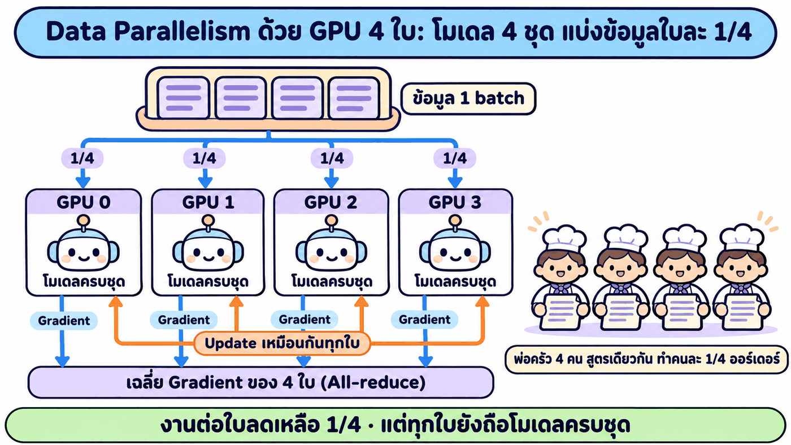
*นี่คือ "GPU 4 ใบถือโมเดลคนละชุด แบ่งข้อมูลใบละ 1 ใน 4" ตามบรรทัดแนวคิดในพรอมต์*


*ลำดับงานเหมือนขั้นที่ 2 ทุกข้อ ต่างแค่จำนวน GPU*

AI เขียน `gpu4/code/train.py` (DDP 4 ใบ) `find_batch.py` `eval.py` `common.py` `run_all.sh` และ `summarize.py` แล้วหา batch → เทรน 3 Epoch → วัดผล Base และทุก Epoch

```text
[ที่ทำงาน]
container `multi-account` · โฟลเดอร์ /workspace/vastapp_lab · สกิล vastai
เครื่อง: ป้าย vapp-lab4-dp4 · กุญแจ SSH: /workspace/vastai_lab/Devtool_SSH/devtoolSSH
เก็บโค้ดและผลที่: lab4_multigpu/2_data_parallel/gpu4 ของโฟลเดอร์ที่เปิด Claude Code อยู่ (ไม่ใช่ใน container)

[งาน]
เทรน Qwen3-8B ให้แปลงคำถามเป็น SQL แบบ Data Parallelism
แนวคิด: GPU 4 ใบถือโมเดลคนละชุด แบ่งข้อมูลใบละ 1 ใน 4 แล้วเฉลี่ย Gradient ให้เท่ากัน

[ขั้นตอน]
1. เขียน code/train.py เทรนด้วย LoRA บน GPU 4 ใบ ใช้ DDP ของ PyTorch
2. หา batch ต่อ GPU ใหญ่สุด: ลอง 1, 2, 4, 8 … อย่างละ 3 step ด้วยตัวอย่างที่ยาวที่สุด จน Out of Memory
   แล้วประมาณจาก VRAM ที่วัดได้ว่า batch เท่าไรจะพอดี และลองค่าระหว่างตัวที่ผ่านกับตัวที่ล้ม จนได้ batch ใหญ่สุดที่ผ่านจริง
3. เทรน 3 Epoch ด้วย batch ต่อ GPU ใหญ่สุดที่หาได้ในข้อ 2
4. เขียน code/eval.py วัด Exact Match บน Test Set ของโมเดลก่อนเทรน (Base) และหลังจบแต่ละ Epoch
5. ให้งานรันต่อได้แม้การเชื่อมต่อหลุด และรายงานทุก 2–3 นาที

[ค่าที่ตรึง]
โมเดล: Qwen/Qwen3-8B แบบ bf16 · ปิด thinking · ไม่ใช้ Gradient Checkpointing
LoRA: r 8 · alpha 16 · ที่ q_proj กับ v_proj
การเทรน: learning rate 2e-4 · seed 0 · ข้อความยาวไม่เกิน 256 token

[รายงาน]
สรุปเป็นตาราง: batch ต่อ GPU เทียบ VRAM สูงสุดของแต่ละใบ · batch ที่ประมาณไว้ · batch ที่ใช้เทรน (ต่อ GPU และรวม) · วินาทีต่อ step · ตัวอย่างต่อวินาที · GPU util ของแต่ละใบ · loss และ Exact Match ของ Base และหลังจบแต่ละ Epoch
บอกว่าเครื่องยังเปิดอยู่
```

> ผลที่แสดงในหน้านี้ได้จากการไล่ batch แบบเพิ่มทีละเท่าตัว (1, 2, 4, 8 …) เท่านั้น ยังไม่ได้ลองค่าระหว่างตัวที่ผ่านกับตัวที่ล้ม พรอมต์นี้ให้ AI ลองต่อ batch ที่คุณได้จึงอาจใหญ่กว่าในหน้านี้

![ช่องพิมพ์ของ Claude Code ที่วางพรอมต์ขั้นที่ 5 และคำตอบ: ตาราง batch ต่อ GPU เทียบ VRAM จาก nvidia-smi เท่ากันทั้ง 4 ใบ batch 1 ใช้ 18,266 MiB batch 2 ใช้ 19,268 MiB batch 4 ใช้ 22,340 MiB batch 8 Out of Memory ทั้ง 4 ใบ เทรนที่ batch 4 ต่อ GPU รวม 16 ได้ 250 step ต่อ Epoch รวม 750 step ใน 337 วินาที 0.449 วินาทีต่อ step 35.6 ตัวอย่างต่อวินาที GPU util ราว 97% ทุกใบ ตาราง loss และ Exact Match Base 1.5% แล้ว 70.5% 75.0% 76.5% สิ่งที่ควรรู้ batch 4 ล้มในการเทรนจริง 2 รอบแรกราว step 20–25 รอบสองเปิด expandable_segments ก็ยังล้ม แก้โดยคำนวณ loss เฉพาะ token ของคำตอบ VRAM ที่ batch 4 จึงลดเหลือ 22,340 MiB Gradient เท่ากันทุกใบ ทดสอบรันต่อหลังหยุดหลัง Epoch 1 บอกว่าเครื่องยังเปิดอยู่](../images/data_parallel/lab4b-step5.png)
*ใช้เวลา 33.2 นาที (บนเครื่องเช่า: เทรน 3 Epoch 337 วินาที · ที่เหลือคือหา batch แก้ปัญหา Out of Memory และวัดผล)*

**หา batch ต่อ GPU ใหญ่สุด** (หลังแก้โค้ด · ตัวอย่างที่ยาวที่สุด 256 token · อย่างละ 3 step · [gpu4/results/batch_probe.json](gpu4/results/batch_probe.json))

| batch ต่อ GPU | batch รวม | ผล | PyTorch ใช้สูงสุด (ทุกใบเท่ากัน) | nvidia-smi (ทุกใบเท่ากัน) | วินาทีต่อ step |
|---|---|---|---|---|---|
| 1 | 4 | ผ่าน | 16.82 GiB | 18,266 MiB | 0.277 |
| 2 | 8 | ผ่าน | 18.30 GiB | 19,268 MiB | 0.381 |
| 4 | 16 | ผ่าน | 21.25 GiB | 22,340 MiB | 0.688 |
| 8 | 32 | **Out of Memory** ทั้ง 4 ใบ | 23.10 GiB ก่อนล้ม | – | – |

**ก่อนแก้โค้ด** ([gpu4/results/before_fix/](gpu4/results/before_fix/)) batch 4 ก็ผ่านการลอง (22.71 GiB ต่อใบ) แต่เทรนจริงล้มที่ราว step 20–25 ทั้งสองครั้ง

| ครั้ง | ตั้งค่า | ผล |
|---|---|---|
| 1 | ค่าเริ่มต้นของ PyTorch | GPU 2 ขอเพิ่ม 594 MiB แต่เหลือ 338 MiB → Out of Memory |
| 2 | เปิด `expandable_segments` (ลดการจองหน่วยความจำเป็นชิ้นกระจัดกระจาย) | GPU 2 ขอเพิ่ม 594 MiB แต่เหลือ 520 MiB → ยังล้ม |
| แก้ | คำนวณคะแนนคำศัพท์ (lm_head) และ loss **เฉพาะตำแหน่งที่เป็นคำตอบ** ไม่ใช่ทุกตำแหน่ง | batch 4 ลดจาก 22.71 เหลือ 21.25 GiB ต่อใบ · เทรนจบ 3 Epoch |

594 MiB เท่ากับขนาดตารางคะแนนของคำศัพท์ทุกคำสำหรับทุก token พอดี: 4 ตัวอย่าง × 256 token × 151,936 คำศัพท์ × 4 byte = 594 MiB (คำนวณเทียบ) · ตารางนี้จึงเป็นส่วนที่ทำให้ล้ม และการคิดเฉพาะตำแหน่งคำตอบตัดส่วนใหญ่ของมันออก

**เทรน 3 Epoch ที่ batch 4 ต่อ GPU (รวม 16)** ([gpu4/results/train_metrics.json](gpu4/results/train_metrics.json) · [gpu4/results/eval/](gpu4/results/eval/))

| Epoch | วินาทีต่อ step | ตัวอย่างต่อวินาที | GPU util GPU 0 / 1 / 2 / 3 | train loss | test loss | Exact Match |
|---|---|---|---|---|---|---|
| Base | – | – | – | – | 1.7702 | 1.5% (3/200) |
| 1 | 0.470 | 34.02 | 96.3 / 97.5 / 96.2 / 97.8% | 0.1167 | 0.0607 | 70.5% (141/200) |
| 2 | 0.437 | 36.64 | 97.4 / 97.2 / 97.8 / 97.1% | 0.0386 | 0.0553 | 75.0% (150/200) |
| 3 | 0.440 | 36.40 | 97.1 / 97.2 / 98.1 / 97.3% | 0.0248 | **0.0543** | **76.5%** (153/200) |
| **รวม 3 Epoch** | **0.449** | **35.64** | **96.9 / 97.3 / 97.3 / 97.4%** | | | |

- 250 step ต่อ Epoch · รวม 12,000 ตัวอย่างใน 336.7 วินาที (5.6 นาที) · Epoch 1 ช้ากว่าเล็กน้อยเพราะรวม step แรกที่ใช้ราว 10 วินาที (ค่ากลางของวินาทีต่อ step ราว 0.41–0.42 ทุก Epoch)
- VRAM สูงสุดตอนเทรน: PyTorch ใช้ **21.59 / 20.61 / 21.60 / 21.63 GiB** · nvidia-smi เห็น 22,680 / 21,692 / 22,700 / 22,720 MiB
- **Exact Match** ของรอบนี้ตัด `;` ท้ายออกก่อนเทียบ ที่เหลือต้องตรงทุกตัวอักษร · แบบผ่อนปรน (ไม่สนตัวพิมพ์และชนิดเครื่องหมายคำพูด) ได้ 54.5% → 72.5% → 77.5% → 78.5%

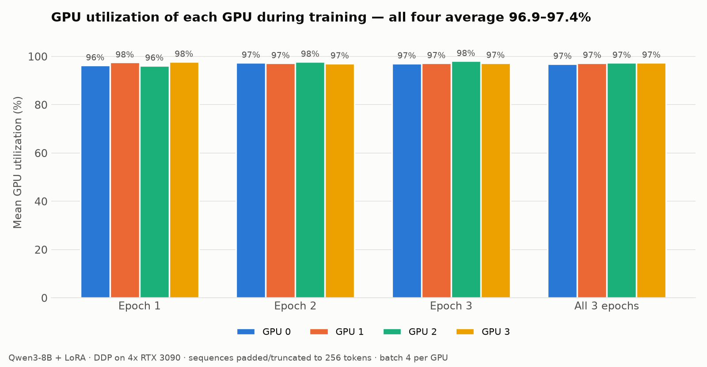

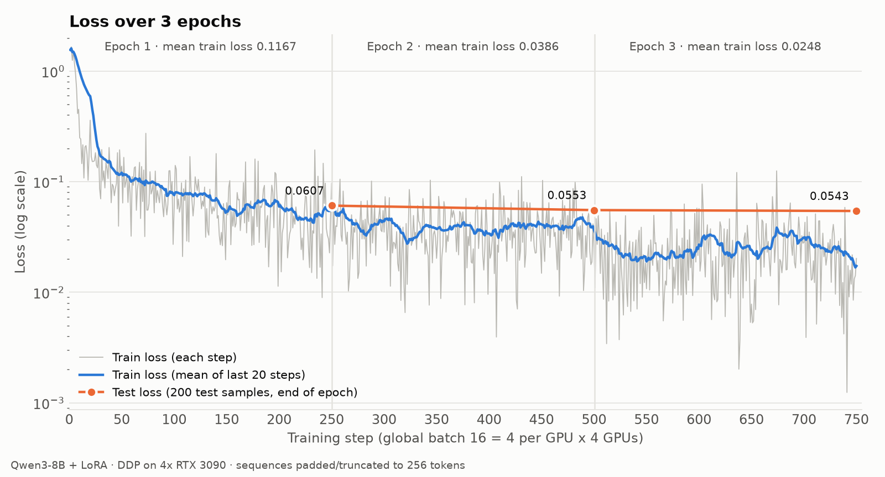

ตัวอย่างโค้ดที่ AI เขียนให้ในรอบจริง (ของคุณอาจต่างกัน): [code_reference/gpu4/train.py](code_reference/gpu4/train.py) (คลาส `AnswerLoss` คือส่วนที่แก้) · [find_batch.py](code_reference/gpu4/find_batch.py) · [eval.py](code_reference/gpu4/eval.py) · [common.py](code_reference/gpu4/common.py) · [run_all.sh](code_reference/gpu4/run_all.sh) · [summarize.py](code_reference/gpu4/summarize.py)

**อ่านผลอย่างไร**

- **batch ที่ใช้เทรน = batch ใหญ่สุดที่ผ่าน (4 ต่อ GPU) เท่ากับส่วนที่ 1** ตามทฤษฎีข้อ 6 · batch รวมใหญ่ขึ้นเป็น 16 และ step ต่อ Epoch ลดเหลือ 250
- **ปัญหาเดียวกับขั้นที่ 2 แต่ AI แก้คนละวิธี** · ทั้งสองครั้งล้มเพราะขอ 594 MiB ตอน Backward ที่ batch 4 · `expandable_segments` ไม่ช่วยเพราะปัญหาไม่ใช่หน่วยความจำกระจัดกระจาย แต่ไม่พอจริง · ทางที่ได้ผลคือลดงานที่ไม่จำเป็น (คิดคะแนนเฉพาะคำตอบ) ซึ่งได้ loss ค่าเดียวกับเดิม
- **GPU ทั้ง 4 ใบเร็วพอ ๆ กัน** · util 96.9–97.4% ทุกใบ และวินาทีต่อ step ตอนลอง batch 1 / 2 (0.277 / 0.381) เกือบเท่าเครื่อง 2 ใบ (0.269 / 0.379) · ใน DDP ทุกใบต้องรอกันตอนเฉลี่ย Gradient ถ้ามีใบหนึ่งช้ามาก ทุก step จะช้าตามทันที ซึ่งไม่เกิดที่นี่
- **3 Epoch บอกอะไร** · test loss ยังลดทุก Epoch (0.0607 → 0.0553 → 0.0543) และ Exact Match ยังขึ้น (70.5 → 75.0 → 76.5%) = **ยังเรียนรู้ได้อีก** · batch รวม 16 ทำให้มี Update แค่ 250 ครั้งต่อ Epoch (ส่วนที่ 1 มี 500) โมเดลจึงเรียนช้ากว่าต่อ Epoch
- ข้อ 5 ของพรอมต์ถูกทดสอบจริง · หยุดหลัง Epoch 1 แล้วรันต่อ ได้ train loss ของ Epoch 2 เท่ากับรอบปกติ (0.0386)

## ขั้นที่ 6 · สรุปและลบเครื่อง 4 GPU (ห้ามข้าม)


*สูตรเดียวกับขั้นที่ 3 · เครื่อง 4 ใบเงินเดินเร็วกว่าเกือบ 2.3 เท่า จึงยิ่งต้องลบทันทีที่เสร็จ*

AI นำผลดิบกลับมา ค้นราคาตลาดของเครื่อง 4 ใบ เขียน `gpu4/code/report.py` (รวมตัวเลข + วาดกราฟ) และ `teardown.sh` (ลบเครื่องตามป้าย + เก็บใบคิดเงิน) แล้วลบเครื่อง

```text
[ที่ทำงาน]
container `multi-account` · โฟลเดอร์ /workspace/vastapp_lab · สกิล vastai
เครื่อง: ป้าย vapp-lab4-dp4 · กุญแจ SSH: /workspace/vastai_lab/Devtool_SSH/devtoolSSH
เก็บโค้ดและผลที่: lab4_multigpu/2_data_parallel/gpu4 ของโฟลเดอร์ที่เปิด Claude Code อยู่ (ไม่ใช่ใน container)

[งาน]
สรุปผลเป็นกราฟ แล้วลบเครื่อง

[ขั้นตอน]
1. นำผลดิบกลับมาที่ results/raw
2. ค้นราคาตลาดของเครื่อง RTX 4090 4 ใบที่ถูกที่สุด
3. เขียน code/report.py รวมตัวเลขลง results/metrics.json พร้อมเงินต่อ 1,000 ตัวอย่าง
4. ให้สคริปต์วาดกราฟที่ results/images (ข้อความอังกฤษ): VRAM ของแต่ละใบเทียบ batch พร้อมเส้น 24 GB · GPU util ของแต่ละใบ · loss ตลอด 3 Epoch · Exact Match ของแต่ละ Epoch
5. ลบเครื่องป้าย vapp-lab4-dp4 แล้วตรวจว่าไม่เหลือ (ห้ามแตะเครื่องป้ายอื่น)

[รายงาน]
สรุปเป็นตาราง: batch ต่อ GPU ใหญ่สุด · ตัวอย่างต่อวินาที · Exact Match · เงินต่อ 1,000 ตัวอย่าง
ค่าใช้จ่ายจริงของเครื่อง: อายุเครื่อง · ยอดที่ถูกคิด · ห้ามแสดงค่า key
```

![ช่องพิมพ์ของ Claude Code ที่วางพรอมต์ขั้นที่ 6 และคำตอบ: ลบเครื่อง vapp-lab4-dp4 แล้วตรวจซ้ำ batch ต่อ GPU ใหญ่สุด 4 รวม 16 batch 8 Out of Memory ทั้ง 4 ใบ ได้ 35.6 ตัวอย่างต่อวินาที Exact Match 76.5% หลัง Epoch 3 Base 1.5% Epoch 1 70.5% Epoch 2 75.0% เงินต่อ 1,000 ตัวอย่าง $0.00678 ที่ราคาเครื่องที่เช่า $0.87 และ $0.00470 ที่ราคาตลาดถูกสุด $0.603 ตารางราคาตลาด อายุเครื่อง 49.5 นาที ยอดที่ถูกคิด $0.665 แยกเป็น GPU $0.610 ดิสก์ $0.014 ดาวน์โหลด 15.1 GB $0.039 อัปโหลด $0.002 เครื่องที่ค้างในขั้นที่ 4 ถูกคิดค่า disk $0.006](../images/data_parallel/lab4b-step6.png)
*ใช้เวลา 5.8 นาที*

**กราฟที่ AI วาดให้** ([gpu4/results/images/](gpu4/results/images/))

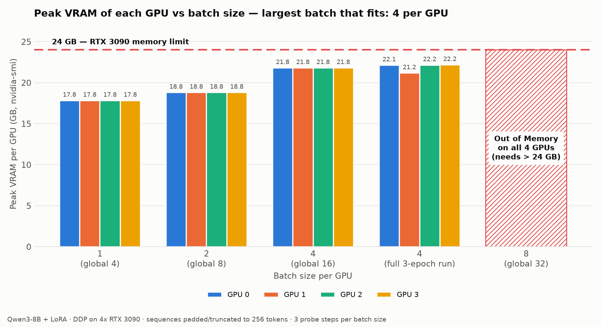

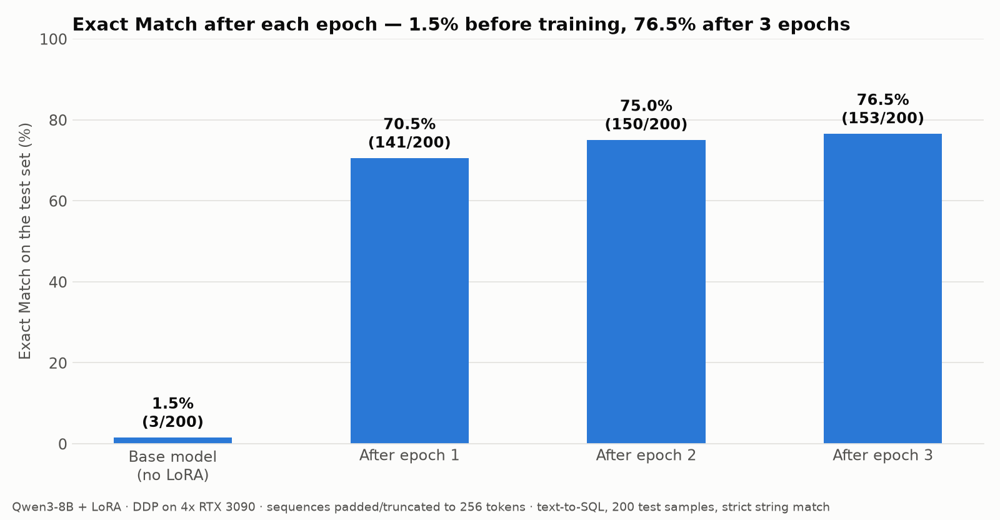

**ราคาตลาด RTX 3090 4 ใบ** (ค้นตอนขั้นที่ 6 · รวม disk 60 GB · คิดที่ 35.64 ตัวอย่างต่อวินาที)

| ราคาที่ใช้คิด | $ ต่อชั่วโมง | $ ต่อ 1,000 ตัวอย่าง |
|---|---|---|
| เครื่องที่เช่าจริง (ชิลี) | 0.87 | **0.00678** |
| on-demand ถูกสุด (สหรัฐฯ · ไม่ verified · เน็ต 374 Mbps ไม่ผ่านเงื่อนไขของ LAB) | 0.6033 | 0.00470 |
| on-demand verified ถูกสุด (California · เน็ต 570 Mbps ไม่ผ่านเงื่อนไขของ LAB) | 0.6056 | 0.00472 |
| interruptible verified (min bid · Taiwan) | 0.4853 | 0.00378 |
| ถูกสุดที่ผ่านเงื่อนไขของ LAB ตอนค้น (สหรัฐฯ) | 0.78 | – |

เทรน 3 Epoch (12,000 ตัวอย่าง) บนเครื่องที่เช่าจริงคิดเป็นราว $0.081 (คำนวณ)

**ค่าใช้จ่ายจริงจากใบคิดเงิน** ([gpu4/results/raw/billing.json](gpu4/results/raw/billing.json))

| รายการ | ค่า |
|---|---|
| GPU | $0.610 (0.715 ชั่วโมงที่ $0.853) |
| disk | $0.014 |
| ดาวน์โหลด | $0.039 (15.1 GB) |
| อัปโหลด | $0.002 |
| **รวม** | **$0.665** · เครื่องเปิด 49.5 นาที |
| เครื่องแรกที่เปิดไม่ขึ้นในขั้นที่ 4 | $0.006 (ค่า disk) |

ตัวอย่างโค้ดที่ AI เขียนให้ในรอบจริง (ของคุณอาจต่างกัน): [code_reference/gpu4/report.py](code_reference/gpu4/report.py) · [teardown.sh](code_reference/gpu4/teardown.sh) · ตัวเลขรวม: [gpu4/results/metrics.json](gpu4/results/metrics.json) · [gpu4/results/summary.json](gpu4/results/summary.json)

**อ่านผลอย่างไร**

- **ราคาตลาดที่ AI ใช้เป็นตัวเลขหลัก ($0.603) เป็นเครื่องที่ไม่ผ่านเงื่อนไขของ LAB** · ตัวเลขที่ใช้ได้จริงคือ $0.00678 ต่อ 1,000 ตัวอย่างของเครื่องที่เช่า · เครื่องถูกสุดที่ผ่านเงื่อนไขตอนนั้น ($0.78) คือเครื่องที่ค้างในขั้นที่ 4
- **ใบคิดเงิน $0.665 ราว 1.9 เท่าของส่วนที่ 1** ($0.351) · ราคาต่อชั่วโมงสูงกว่า 2.3 เท่า แต่เครื่องเปิดสั้นกว่าเล็กน้อย (49.5 เทียบ 50.7 นาที)
- ใน `metrics.json` ของส่วนนี้ Exact Match เก็บเป็น **สัดส่วน** (0.765) ส่วนของส่วนที่ 1 เก็บเป็น **เปอร์เซ็นต์** (79.0) · ใน README และ `summary.json` แปลงเป็นเปอร์เซ็นต์ทั้งหมดแล้ว · และชื่อโมเดลใน `metrics.json` เขียนว่า "gradient checkpointing" ซึ่งผิด โค้ด [train.py](code_reference/gpu4/train.py) ตรวจว่า **ไม่ได้** เปิด Gradient Checkpointing ตามค่าที่ตรึง
- ต้องเห็นว่า AI ลบเครื่องแล้วและตรวจซ้ำว่าไม่เหลือเครื่องป้าย `vapp-lab4-dp4`

## 2 ใบเทียบ 4 ใบ


| สิ่งที่วัด | GPU 2 ใบ (แคนาดา) | GPU 4 ใบ (ชิลี) |
|---|---|---|
| Weights ก่อนเทรน ต่อใบ | 15.29 GiB | 15.27 GiB |
| batch ต่อ GPU (ที่ใช้เทรน) / batch รวม | 4 / 8 · batch 8 ต่อใบ ล้ม | 4 / 16 · batch 8 ต่อใบ ล้ม |
| step ต่อ Epoch | 500 | 250 |
| วินาทีต่อ step | 0.419 (8 ตัวอย่าง) | 0.449 (16 ตัวอย่าง) |
| ตัวอย่างต่อวินาที | **19.08** | **35.64** |
| เร็วขึ้นเทียบ 2 ใบ | 1.00 เท่า | **1.87 เท่า** |
| ตัวอย่างต่อวินาทีต่อใบ (ประสิทธิภาพต่อใบ) | 9.54 (100%) | 8.91 (**93.4%**) |
| GPU util ต่อใบ | 97.8 / 98.6% | 96.9 / 97.3 / 97.3 / 97.4% |
| VRAM สูงสุดตอนเทรน (PyTorch) | 22.71 / 22.71 GiB | 21.59 / 20.61 / 21.60 / 21.63 GiB |
| Exact Match Base → Epoch 1 / 2 / 3 | 0.0% (1.5%*) → 70.0 / 77.5 / 79.0% | 1.5% → 70.5 / 75.0 / 76.5% |
| test loss Epoch 1 / 2 / 3 | 0.0581 / 0.0520 / 0.0578 | 0.0607 / 0.0553 / 0.0543 |
| เวลาเทรน 3 Epoch | 10.5 นาที | 5.6 นาที |
| ราคาเครื่องที่เช่า | $0.3767/ชม. | $0.87/ชม. |
| $ ต่อ 1,000 ตัวอย่าง (ราคาเช่าจริง) | **$0.00548** | **$0.00678** |
| ใบคิดเงินทั้งส่วน | $0.351 | $0.665 |

\* วัดด้วยกฎเดียวกับส่วนที่ 2 (ตัด `;` ท้ายก่อนเทียบ) Base ของส่วนที่ 1 ก็ได้ 1.5% (3/200) เท่ากัน · ผลหลังแต่ละ Epoch ไม่เปลี่ยนตามกฎนี้ (คำนวณใหม่จากคำตอบรายข้อใน `results/eval/*_predictions.json` · ดู `results/summary.json`)

**อ่านผลอย่างไร**

- **ความเร็วเป็นไปตามคาด** · 4 ใบเร็วกว่า 2 ใบ **1.87 เท่า** · ต่อใบได้ 93.4% ของส่วนที่ 1 · ส่วนที่หายไปมาจากการต้องรอกันตอนเฉลี่ย Gradient ของ 4 ใบ (ข้าม CPU 2 ตัว) และ step แรกที่ช้า
- **ที่ว่าง VRAM ไม่เพิ่ม ตามคาด** · Weights ต่อใบเท่าเดิม batch ต่อใบใหญ่สุดเท่าเดิม (4) ที่เพิ่มคือ batch รวม (8 → 16)
- **สองส่วนรันบนเครื่องเช่าคนละเครื่อง** (คนละประเทศ คนละ CPU คนละรุ่น PCIe) · และโค้ดส่วน 4 ใบคิดคะแนนคำศัพท์เฉพาะตำแหน่งคำตอบ ซึ่งลดงานต่อ step ลงเล็กน้อย (batch 4 ตอนลอง 0.688 เทียบ 0.714 วินาทีต่อ step) · ตัวเลขความเร็วที่เทียบกันจึงรวมความต่างทั้งสองอย่างด้วย · ไม่พบ GPU ที่ช้าผิดปกติในทั้งสองเครื่อง (util ทุกใบ 96.9–98.6%)
- **คุณภาพหลัง Epoch 3 ต่างกัน 2.5 จุด** (79.0 เทียบ 76.5% = 5 ข้อจาก 200) · สาเหตุหลักคือ batch รวม 16 ทำให้มี Update น้อยกว่าครึ่งหนึ่งต่อ Epoch ที่ learning rate เท่ากัน · ส่วนที่ 2 test loss ยังลดอยู่ ถ้าเทรนต่อน่าจะไล่ทัน ส่วนที่ 1 test loss เริ่มขึ้นแล้วที่ Epoch 3 · ถ้าต้องการผลเท่ากันเมื่อเพิ่มใบ มักต้องปรับ learning rate หรือจำนวน Epoch ตาม batch รวม
- **เงินต่อ 1,000 ตัวอย่างแพงขึ้นราว 24%** ($0.00548 → $0.00678) ทั้งที่งานต่อใบเกือบเท่าเดิม · เพราะเครื่อง 4 ใบที่เช่าได้แพงกว่า 2.3 เท่าแต่เร็วขึ้น 1.87 เท่า · ราคาต่อใบของเครื่องที่เช่าได้จึงมีผลต่อความคุ้มพอ ๆ กับวิธีเทรน · ข้อดีที่ได้แน่ ๆ คือ **เสร็จเร็วขึ้น** (เทรน 10.5 → 5.6 นาที)

## ไฟล์ในโฟลเดอร์นี้

| ไฟล์ / โฟลเดอร์ | คืออะไร |
|---|---|
| [PROMPTS.md](PROMPTS.md) | พรอมต์ Copy & Paste ทั้ง 6 ขั้น (ชุดเดียวกับใน README นี้) |
| `code/` | โค้ดที่ AI เขียนให้คุณจากพรอมต์ขั้นที่ 1–3 · **เริ่มจากโฟลเดอร์ว่าง** |
| [code_reference/](code_reference/) | ตัวอย่างโค้ดที่ AI เขียนในรอบจริงของส่วน GPU 2 ใบ ไว้เทียบ (ของคุณอาจต่างกัน) |
| [results/](results/) | ผลของรอบจริงส่วน GPU 2 ใบ: คำตอบของ AI ขั้นที่ 1–3 (`answers/`) · `metrics.json` · `summary.json` · `REPORT.md` · `dataset_samples.md` · ผลหา batch (`probe/`) · ผลเทรนและวัดผล (`train_summary.json` `train_log.jsonl` `eval_summary.json`) · คำตอบ SQL ของ Base และ Epoch 3 (`eval/`) · log รวมถึงครั้งที่ Out of Memory (`logs/`) · กราฟ (`images/`) · ใบคิดเงินและราคาตลาด (`raw/`) |
| `gpu4/` | ส่วน GPU 4 ใบ (ขั้นที่ 4–6) · โค้ดที่ AI เขียนให้คุณจะอยู่ใน `gpu4/code/` |
| [code_reference/gpu4/](code_reference/gpu4/) | ตัวอย่างโค้ดของส่วน GPU 4 ใบในรอบจริง |
| [gpu4/results/](gpu4/results/) | ผลของรอบจริงส่วน GPU 4 ใบ: คำตอบของ AI ขั้นที่ 4–6 (`answers/`) · `metrics.json` · `summary.json` · `batch_probe.json` · `train_metrics.json` · ผลวัดและคำตอบ SQL (`eval/`) · log (`logs/`) · การลอง batch และ log ของสองครั้งที่ Out of Memory ก่อนแก้โค้ด (`before_fix/`) · กราฟ (`images/`) · ใบคิดเงินและราคาตลาด (`raw/`) |
| [../images/](../images/) | ภาพประกอบใน README นี้ (รวมศูนย์ไว้ที่โฟลเดอร์ `images/` ระดับบน: `shared/` และ `data_parallel/`) |
