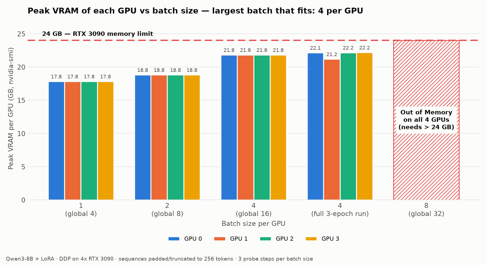
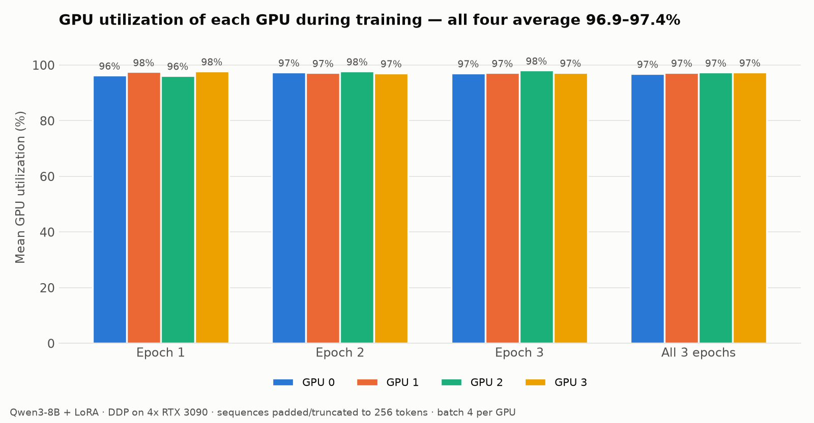
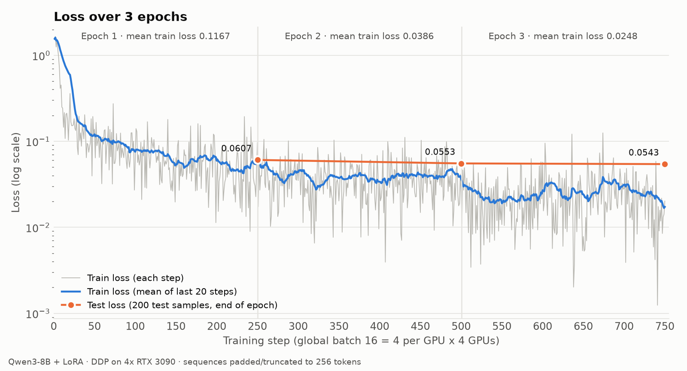
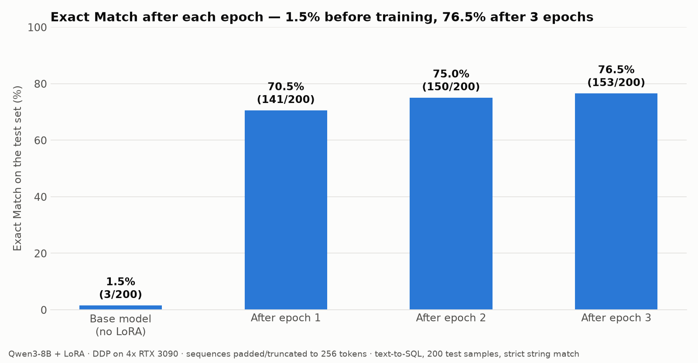

# Lab 4 · Data Parallelism · RTX 3090 x 4

| batch ต่อ GPU ใหญ่สุด | ตัวอย่างต่อวินาที | Exact Match (หลัง Epoch 3) | เงินต่อ 1,000 ตัวอย่าง (ราคาเครื่องที่เช่า) | เงินต่อ 1,000 ตัวอย่าง (ราคาตลาดถูกสุด) |
|---|---|---|---|---|
| 4 (รวม 16) | 35.6 | 76.5% | $0.00678 ($0.870/ชม.) | $0.00470 ($0.603/ชม.) |

## ราคา

| ราคา | $/ชม. | $ ต่อ 1,000 ตัวอย่าง | $ ต่อการเทรน 3 Epoch |
|---|---|---|---|
| rented_machine | 0.8700 | 0.00678 | 0.0814 |
| market_cheapest_on_demand_any | 0.6033 | 0.00470 | 0.0564 |
| market_cheapest_on_demand_verified | 0.6056 | 0.00472 | 0.0566 |
| market_cheapest_interruptible_verified_min_bid | 0.4853 | 0.00378 | 0.0454 |

## ค่าใช้จ่ายจริง

- อายุเครื่อง: 49.5 นาที (0.825 ชม.) ที่ $0.870/ชม.
- ยอดที่ถูกคิด (เครื่อง <id>): $0.665
- เครื่องที่ค้างตอนเช่าในขั้นที่ 4 (ลบแล้ว): $0.006 (ค่า disk)
- ลบเครื่องแล้วและตรวจว่าไม่เหลือ: True

## กราฟ

