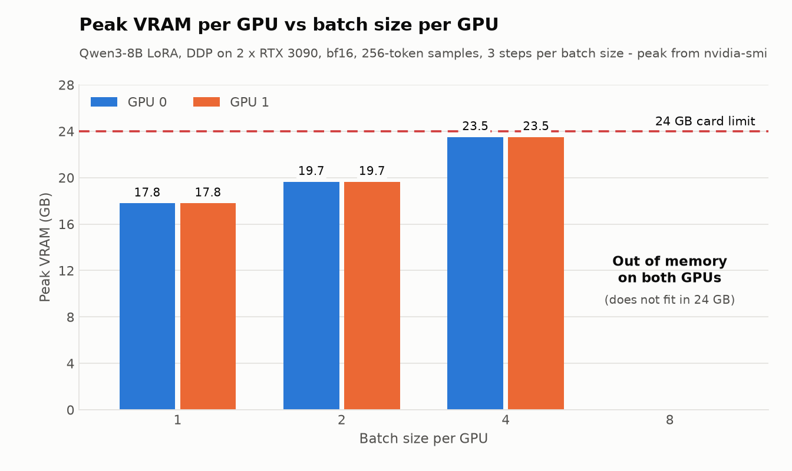
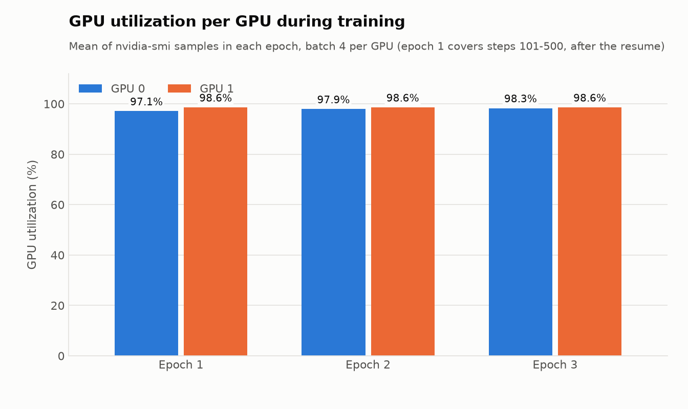
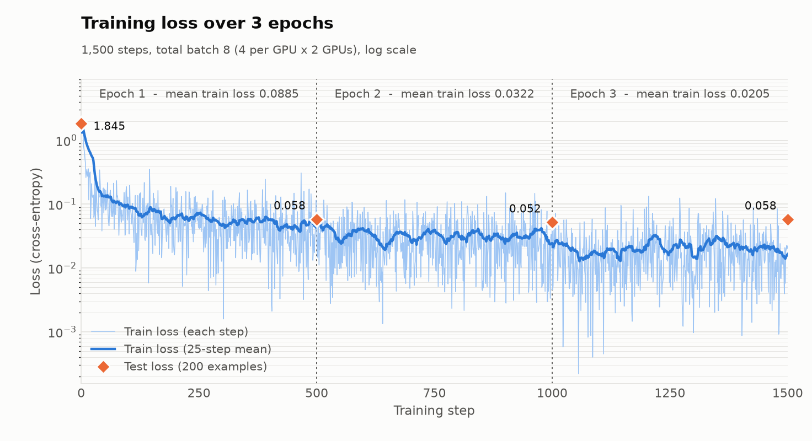
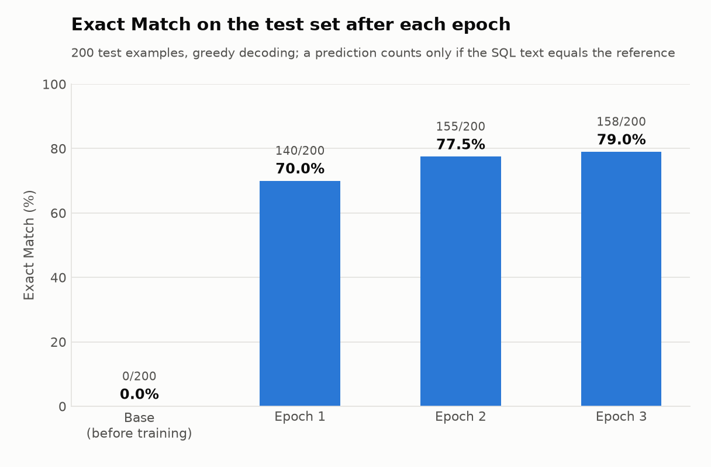

# Lab4 / 2_data_parallel — Qwen3-8B Text-to-SQL ด้วย LoRA + DDP (GPU 2 ใบ)

เครื่อง `vapp-lab4-dp` (Vast.ai id <id>) · RTX 3090 24 GB × 2 · torch 2.8.0+cu128 · transformers 5.24.0 · peft 0.22.0
ข้อมูล `b-mc2/sql-create-context` · Training Set 4,000 · Test Set 200 · seed 0
ค่าที่ตรึง: bf16 · ปิด thinking · ไม่ใช้ Gradient Checkpointing · LoRA r 8 / alpha 16 ที่ q_proj, v_proj (3,833,856 พารามิเตอร์) · lr 2e-4 (คงที่, AdamW) · ยาวไม่เกิน 256 token (มี 1 ตัวอย่างที่ยาว 319 token ถูกตัดเหลือ 256)

## 1. batch ต่อ GPU เทียบ VRAM สูงสุด (3 step, ตัวอย่างยาวสุด 256 token)

| batch ต่อ GPU | ผล | VRAM สูงสุด GPU0 (nvidia-smi) | VRAM สูงสุด GPU1 (nvidia-smi) | PyTorch allocated สูงสุด GPU0 / GPU1 | วินาทีต่อ step (step 2–3) |
|---|---|---|---|---|---|
| 1 | ผ่าน | 18,227 MiB | 18,233 MiB | 17,606 / 17,592 MiB | 0.27 |
| 2 | ผ่าน | 20,123 MiB | 20,123 MiB | 19,479 / 19,479 MiB | 0.38 |
| 4 | ผ่าน | 24,075 MiB | 24,075 MiB | 23,253 / 23,253 MiB | 0.71 |
| 8 | Out of Memory ทั้งสองใบ | — | — | ล้มตอน allocated 23,705 MiB | — |

การ์ดมี 24,576 MiB ต่อใบ · โมเดลอย่างเดียวใช้ 15,652 MiB

## 2. การเทรน 3 Epoch

batch ต่อ GPU 4 · batch รวม 8 · 500 step ต่อ Epoch · รวม 1,500 step
เฉลี่ยทั้งการเทรน: 0.419 วินาทีต่อ step · 19.08 ตัวอย่างต่อวินาที

| Epoch | train loss เฉลี่ย | วินาทีต่อ step | ตัวอย่างต่อวินาที | GPU util GPU0 | GPU util GPU1 | VRAM สูงสุด GPU0 / GPU1 (nvidia-smi) |
|---|---|---|---|---|---|---|
| 1 | 0.0885 | 0.418 | 19.15 | 97.1% | 98.6% | 22,445 / 22,585 MiB * |
| 2 | 0.0322 | 0.418 | 19.12 | 97.9% | 98.6% | 22,585 / 24,145 MiB |
| 3 | 0.0205 | 0.422 | 18.97 | 98.3% | 98.6% | 24,145 / 24,147 MiB |

\* GPU util และ VRAM ของ Epoch 1 วัดเฉพาะ step 101–500 (ช่วงหลังรันต่อจาก checkpoint) ส่วน loss และเวลาต่อ step นับครบ 500 step
หลังจบทุก Epoch ตรวจแล้วว่าน้ำหนัก LoRA ของ GPU ทั้งสองใบเท่ากัน (`replicas_identical: true`)

## 3. loss และ Exact Match บน Test Set (200 ตัวอย่าง, greedy)

| โมเดล | train loss เฉลี่ย | test loss | Exact Match | Exact Match แบบผ่อน ** |
|---|---|---|---|---|
| Base (ก่อนเทรน) | — | 1.8453 | 0.0% (0/200) | 54.5% |
| หลัง Epoch 1 | 0.0885 | 0.0581 | 70.0% (140/200) | 72.0% |
| หลัง Epoch 2 | 0.0322 | 0.0520 | 77.5% (155/200) | 79.5% |
| หลัง Epoch 3 | 0.0205 | 0.0578 | 79.0% (158/200) | 81.0% |

Exact Match = ข้อความ SQL ตรงกับเฉลยทุกตัวอักษรหลังยุบช่องว่าง (ตัวพิมพ์เล็กใหญ่และเครื่องหมายคำพูดต้องตรง)
\*\* แบบผ่อน = ไม่สนตัวพิมพ์เล็กใหญ่ · นับ ' เท่ากับ " · ไม่สน ; ท้ายคำสั่ง
Base ได้ 0% เพราะตอบ SQL ด้วย single quote และคงตัวพิมพ์ใหญ่ของค่าไว้ ต่างจากรูปแบบของเฉลย

## 4. สิ่งที่เกิดระหว่างรัน

1. CUDA เปิดไม่ได้ตอนแรก (error 804) เพราะ image มี libcuda รุ่น compat 570 บังของ driver 550 — แก้ด้วย `LD_LIBRARY_PATH` ใน `run_all.sh`
2. เทรนรอบแรกด้วย batch 4 เกิด Out of Memory ที่ step 59 (batch ที่มีตัวอย่าง 256 token ปนกับตัวอย่างสั้น) ทั้งที่ขั้นหา batch ผ่าน
   สาเหตุ: batch ที่มี padding ส่ง attention mask ที่มีเลข 0 ทำให้ attention ใช้หน่วยความจำมากกว่า batch ในขั้นหา batch ที่ไม่มี padding
   แก้: ไม่ส่ง attention mask ตอนเทรน (pad ทางขวา + causal attention จึงได้ loss เท่าเดิม ต่างกันแค่ระดับการปัดเศษ bf16: 1.6797 เทียบ 1.6786 บน batch ทดสอบ) แล้วรันใหม่ทั้งหมดตั้งแต่ขั้นหา batch — log ของรอบที่ล้มอยู่ที่ `logs/train_attempt1_oom.log`
3. ทดสอบการรันต่อ: หยุดงานเองที่ step ~140 แล้วสั่ง `run_all.sh` ใหม่ → รันต่อจาก checkpoint step 100 และ log ต่อเนื่อง 1–1500

## 5. การรันต่อเมื่อการเชื่อมต่อหลุด

งานรันใน tmux บนเครื่อง GPU (`tmux new -d -s dp "bash /workspace/lab4_dp/code/run_all.sh"`) · สั่งซ้ำได้: ขั้นที่เสร็จแล้วถูกข้าม · การเทรนบันทึก checkpoint ทุก 50 step และทุกจบ Epoch

## 6. กราฟ ราคา และค่าใช้จ่าย (สร้างด้วย `code/report.py` จาก `results/raw` → `results/metrics.json`)

เงินต่อ 1,000 ตัวอย่าง = ราคาต่อชั่วโมง ÷ (19.08 ตัวอย่างต่อวินาที × 3,600) × 1,000 (ราคารวมดิสก์ 60 GB · ค้นตลาดเมื่อ 22 พ.ย. 2026 07:12 UTC)

| ราคาที่ใช้ | $ ต่อชั่วโมง | $ ต่อ 1,000 ตัวอย่าง |
|---|---|---|
| ตลาด: on-demand ที่ verified ถูกสุด | 0.3389 | 0.00493 |
| ตลาด: on-demand รวมเครื่องที่ไม่ verified ถูกสุด | 0.2567 | 0.00374 |
| ตลาด: interruptible ที่ verified ถูกสุด | 0.2356 | 0.00343 |
| เครื่องที่เช่าจริง (id <id>) | 0.3767 | 0.00548 |

เครื่อง `vapp-lab4-dp` (id <id>) ถูกลบเมื่อ 07:14:32 UTC อายุ 50.7 นาทีนับจากเริ่มรัน · ยอดที่ถูกคิด $0.351 (GPU 0.820 ชม. $0.295 · ดิสก์ 0.931 ชม. $0.016 · ดาวน์โหลด 14.8 GB $0.039 · อัปโหลด 0.4 GB $0.001)
