# LAB 4.3 · Model Parallelism: โมเดลชุดเดียว แบ่ง Layer ลง GPU 2 ใบ และ 4 ใบ

[← กลับหน้ารวม LAB 4](../README.md) · [LAB 4.1 Single GPU](../1_single_gpu/README.md) · [LAB 4.2 Data Parallelism](../2_data_parallel/README.md) · เปิด Claude Code ที่โฟลเดอร์ของบท `02_VastAi_Application`

## ทำไปเพื่ออะไร


เทรนโมเดลภาษา Qwen3-8B ให้แปลงคำถามภาษาอังกฤษเป็นคำสั่ง SQL ด้วย GPU หลายใบในเครื่องเดียว

โมเดลมี **ชุดเดียว** · Layer ถูกแบ่งไปไว้หลายใบ · ข้อมูลไหลผ่าน GPU 0 ก่อน แล้วต่อไปทีละใบ

คำถามของ LAB: **แบ่งโมเดล 1 ชุดลง GPU 2 ใบ แล้วรับ batch ได้ใหญ่แค่ไหน และเร็วแค่ไหน** · แล้วทำซ้ำด้วย GPU 4 ใบ

LAB นี้มี **6 ขั้น ทุกขั้นคือ 1 พรอมต์** · ขั้นที่ 1–3 ใช้ GPU 2 ใบ · ขั้นที่ 4–6 ทำซ้ำด้วย GPU 4 ใบบนเครื่องใหม่ · **โค้ดทุกไฟล์ AI เขียนให้จากพรอมต์ เริ่มจากโฟลเดอร์ว่าง**

# ภาคทฤษฎี

## รู้จัก Dataset


| หัวข้อ | sql-create-context |
|---|---|
| ชื่อ | [b-mc2/sql-create-context](https://huggingface.co/datasets/b-mc2/sql-create-context) |
| คืออะไร | คำถามภาษาอังกฤษ + โครงสร้างตาราง (`CREATE TABLE`) + คำสั่ง SQL เฉลย ใช้สอนโมเดลให้แปลงคำถามเป็น SQL |
| ที่มา | สร้างจาก WikiSQL และ Spider โดยเติมคำสั่ง `CREATE TABLE` ให้ทุกคำถาม |
| จำนวน | 78,577 ตัวอย่าง |
| สัญญาอนุญาต | CC BY 4.0 |
| LAB นี้ใช้อย่างไร | สับด้วย seed 0 แล้วแบ่ง **Training Set 4,000** ตัวอย่าง และ **Test Set 200** ตัวอย่าง (ไม่ซ้ำกัน) · ทั้งส่วน 2 ใบและ 4 ใบได้ชุดเดียวกัน |


ตัวอย่างจริง 6 รายการแรกของ Training Set (AI ทำให้ในขั้นที่ 1 · ไฟล์ [results/dataset_samples.md](results/dataset_samples.md))

| # | คำถาม (`question`) | โครงสร้างตาราง (`context`) | SQL เฉลย (`answer`) |
|---|---|---|---|
| 1 | What is the lowest unlock order for the athens circuit? | `CREATE TABLE table_24463470_1 (unlock_order INTEGER, circuit VARCHAR)` | `SELECT MIN(unlock_order) FROM table_24463470_1 WHERE circuit = "Athens"` |
| 2 | What is the highest pick number of a defensive back with less than 136 overall points? | `CREATE TABLE table_name_99 (pick__number INTEGER, overall VARCHAR, position VARCHAR)` | `SELECT MAX(pick__number) FROM table_name_99 WHERE overall < 136 AND position = "defensive back"` |
| 3 | Which engine has a year larger than 1956? | `CREATE TABLE table_name_74 (engine VARCHAR, year INTEGER)` | `SELECT engine FROM table_name_74 WHERE year > 1956` |
| 4 | What is the average Attendance, when Venue is "Candlestick Park", and when Date is "December 27"? | `CREATE TABLE table_name_71 (attendance INTEGER, venue VARCHAR, date VARCHAR)` | `SELECT AVG(attendance) FROM table_name_71 WHERE venue = "candlestick park" AND date = "december 27"` |
| 5 | What is the Netflix number having a segment D, of NED can corn? | `CREATE TABLE table_name_2 (netflix VARCHAR, segment_d VARCHAR)` | `SELECT netflix FROM table_name_2 WHERE segment_d = "ned can corn"` |
| 6 | What is the smallest number of fastest laps listed? | `CREATE TABLE table_19312274_3 (fastest_laps INTEGER)` | `SELECT MIN(fastest_laps) FROM table_19312274_3` |

**อธิบาย 1 รายการทีละช่อง** (แถวที่ 1)

| ช่อง | หน้าที่ | ในแถวนี้ |
|---|---|---|
| `question` | คำถามภาษาคน · Input ส่วนที่ 1 | ถามหา unlock order ที่น้อยที่สุดของสนาม athens |
| `context` | โครงสร้างตาราง · Input ส่วนที่ 2 บอกว่ามีตารางและคอลัมน์อะไรให้ใช้ | ตาราง `table_24463470_1` มีคอลัมน์ `unlock_order` (ตัวเลข) และ `circuit` (ข้อความ) |
| `answer` | SQL ที่ถูกต้อง · Output ที่โมเดลต้องเขียนให้ได้ และใช้เทียบ Exact Match | "lowest" → `MIN(unlock_order)` · "athens circuit" → `WHERE circuit = "Athens"` |

## รู้จักโมเดลที่ใช้


| หัวข้อ | Qwen3-8B |
|---|---|
| ประเภท | Large Language Model (LLM) · 36 Layer |
| Input | ข้อความ · LAB นี้ใส่โครงสร้างตาราง + คำถาม |
| Output | ข้อความ · LAB นี้ให้ตอบเป็นคำสั่ง SQL อย่างเดียว (ปิดโหมด thinking) |
| ขนาด | 8.19 พันล้าน parameter · **16.4 GB บน disk** (วัดใน LAB นี้) · ราว 15 GiB ใน VRAM แบบ bf16 ถ้าวางทั้งชุดบน GPU ใบเดียว · แบ่ง 2 ใบ: **ใบละ 7.64 GiB** (วัดจริง) · แบ่ง 4 ใบ: **ใบละราว 3.24–4.40 GiB** (คำนวณ) |
| ที่มา | ทีม Qwen ของ Alibaba Cloud · [Qwen/Qwen3-8B](https://huggingface.co/Qwen/Qwen3-8B) · Apache-2.0 |
| LAB นี้ใช้ทำอะไร | **Base** = โมเดลตามที่โหลดมา · **Fine-tuned** = โมเดลนี้ + LoRA ที่เทรนด้วย Training Set 4,000 ตัวอย่าง วัดหลังจบแต่ละ Epoch |

## ทฤษฎีที่ต้องรู้

### 1 · LoRA กับ q_proj / v_proj


**คืออะไร** ในแต่ละ Layer โมเดลแปลงทุกคำเป็น 3 อย่าง

| ชื่อ | เปรียบเหมือน | หน้าที่ |
|---|---|---|
| Query (`q_proj`) | คำค้นที่ถือไว้ | "ฉันต้องการข้อมูลอะไร" |
| Key (`k_proj`) | ป้ายสันหนังสือ | "คำนี้เกี่ยวกับอะไร" ใช้เทียบกับ Query |
| Value (`v_proj`) | เนื้อหาในเล่ม | ข้อมูลที่ถูกหยิบไปใช้ต่อ |

**LoRA** = ล็อกน้ำหนักเดิมของโมเดลทั้งหมด แล้วแปะตารางตัวเลขเล็ก ๆ (rank 8) ไว้ข้างจุดที่เลือก เทรนเฉพาะตารางเล็กนั้น


**ทำไมต้องใช้** เทรนทั้ง 8 พันล้านค่าไม่พอ VRAM · เทรนแค่ LoRA ใช้หน่วยความจำน้อย

**ทำงานอย่างไร** แก้แค่ Query (เลือกอะไร) กับ Value (หยิบอะไรมาใช้) ก็พอให้โมเดลเปลี่ยนวิธีตอบ · 36 Layer × 2 จุด = 72 จุด · LoRA ของแต่ละ Layer อยู่บน GPU ใบเดียวกับ Layer นั้น

**ตัวเลขจาก LAB นี้** LoRA r 8 · alpha 16 · เทรน **3,833,856** parameter (3.83 ล้าน) จาก 8,190 ล้าน = **0.047%** (เท่ากันทั้ง 2 ใบและ 4 ใบ)

### 2 · Model Parallelism คืออะไร

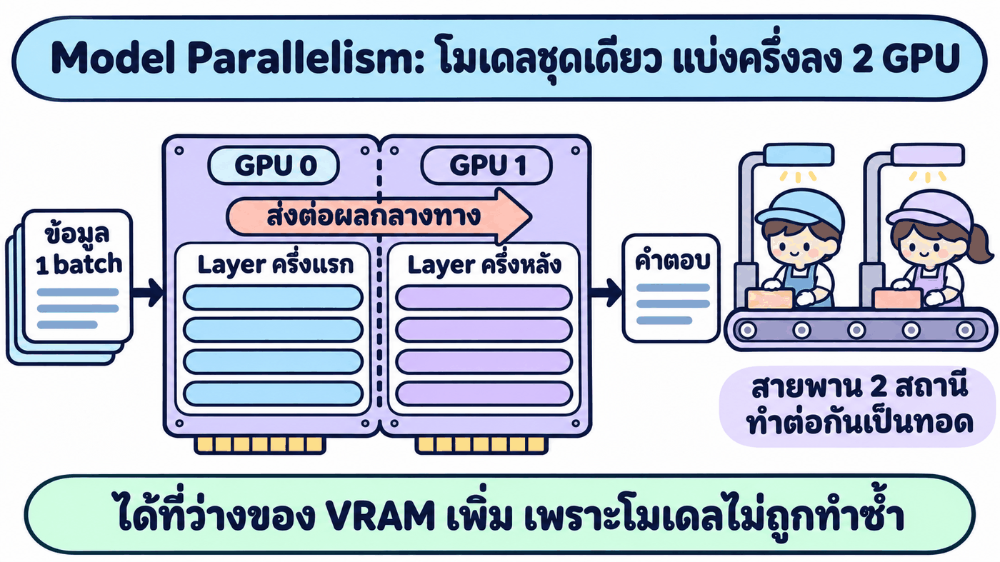

**คืออะไร** โมเดลมี **ชุดเดียว** · Layer ทั้ง 36 ถูกแบ่งไปไว้หลายใบ · ข้อมูลทุก batch ไหลผ่าน GPU 0 ก่อน แล้วต่อไปทีละใบ

**ทำไมต้องใช้** แต่ละใบถือ Weights แค่บางส่วน · VRAM ที่เหลือจึงมากขึ้น ใช้กับ batch ที่ใหญ่ขึ้น หรือโมเดลที่ใหญ่เกินใบเดียว

**ทำงานอย่างไร** AI เขียนตารางบอกว่าชิ้นไหนของโมเดลอยู่ใบไหน (`device_map`) แล้วให้ไลบรารีโหลดตามนั้น · Input เข้าที่ GPU 0 · เฉลย (labels) และ loss อยู่ที่ใบสุดท้าย

**ตัวเลขจาก LAB นี้** (จาก [results/layer_map.json](results/layer_map.json))

| GPU | ถืออะไร | Weights ก่อนเทรน |
|---|---|---|
| GPU 0 | embedding (ตารางแปลงคำเป็นตัวเลข) + **Layer 0–17** (18 Layer) | 7.64 GiB |
| GPU 1 | **Layer 18–35** (18 Layer) + final norm + lm_head (ส่วนที่แปลงผลเป็นคะแนนของคำศัพท์ทุกคำ) | 7.64 GiB |

### 3 · 1 step ทำงานอย่างไร: GPU ผลัดกันทำงาน


**คืออะไร** 1 step มี 4 ช่วง ทำต่อกันเป็นทอด

| ช่วง | ใครทำ | อีกใบทำอะไร |
|---|---|---|
| 1 · Forward ครึ่งแรก | GPU 0 คำนวณ Layer 0–17 แล้วส่งผลกลางทางให้ GPU 1 | GPU 1 รอ |
| 2 · Forward ครึ่งหลัง + loss | GPU 1 คำนวณ Layer 18–35 + lm_head + loss | GPU 0 รอ |
| 3 · Backward ครึ่งหลัง | GPU 1 คำนวณ Gradient แล้วส่งกลับให้ GPU 0 | GPU 0 รอ |
| 4 · Backward ครึ่งแรก + Update | GPU 0 คำนวณ Gradient ของครึ่งแรก · แต่ละใบ Update LoRA ของตัวเอง | GPU 1 แทบว่าง |

**ทำไมเป็นแบบนี้** ครึ่งหลังต้องใช้ผลของครึ่งแรก · Backward ต้องใช้ผลของ Forward · จึงคำนวณพร้อมกันไม่ได้ **มีใบเดียวที่คำนวณอยู่ในแต่ละขณะ**

**ตัวเลขจาก LAB นี้** (GPU util เฉลี่ยตลอด 3 Epoch · nvidia-smi วัดราววินาทีละครั้ง)

| | GPU 0 | GPU 1 | รวม |
|---|---|---|---|
| GPU util เฉลี่ย | **46.5%** | **51.8%** | 98.3% · เท่ากับมี GPU ทำงานอยู่ราว 1 ใบตลอดเวลา |

### 4 · VRAM ตอนเทรนใช้ไปกับอะไร และทำไมต้องวัดก่อน

**คืออะไร** VRAM ของแต่ละใบถูกใช้ 3 ส่วน

| ส่วน | ลักษณะ | ใน LAB นี้ (GPU 2 ใบ ต่อใบ) |
|---|---|---|
| Weights | คงที่ · **แต่ละใบถือแค่ราวครึ่งโมเดล** | **7.64 GiB** (วัดหลังโหลดโมเดล ก่อนเทรน) |
| LoRA + Optimizer | เล็กมาก | 3.83 ล้านค่าแบ่งกันสองใบ · รวมไม่ถึง 0.1 GiB |
| Activation | โตตาม batch | ดูตารางด้านล่าง |

| batch | PyTorch ใช้สูงสุด GPU 0 | GPU 1 | GPU 1 มากกว่า GPU 0 |
|---|---|---|---|
| 1 | 8.44 GiB | 8.82 GiB | 0.37 GiB |
| 2 | 9.21 GiB | 9.96 GiB | 0.74 GiB |
| 4 | 10.76 GiB | 12.25 GiB | 1.49 GiB |
| 8 | 13.85 GiB | 16.82 GiB | 2.97 GiB |
| 16 | 19.09 GiB | 22.50 GiB แล้วขอเพิ่มอีก 2.32 GiB ไม่ได้ → **Out of Memory** | – |


**ทำไมสองใบไม่เท่ากัน และทำไม GPU 1 เต็มก่อน**

- ส่วนต่างโตเป็นเท่าตัวตาม batch (0.37 → 0.74 → 1.49 → 2.97 GiB) · จึงมาจาก **Activation** ไม่ใช่ Weights (Weights เท่ากัน 7.64 GiB)
- GPU 1 ถือ lm_head ซึ่งสร้าง **ตารางคะแนนของคำศัพท์ทั้งหมดให้ทุก token** แล้วคิด loss จากตารางนี้ (โค้ดส่งเฉลยไปคิด loss ที่ GPU 1 · [code_reference/train.py](code_reference/train.py))
- ส่วน GPU 4 ใบก็เป็นแบบเดียวกัน: ใบสุดท้าย (GPU 3) ถือ lm_head และเต็มก่อน · batch 32 ขอเพิ่ม 4.64 GiB = 32 × 256 × 151,936 × 4 byte
- ตอน batch 16 ล้ม GPU 1 ขอจองเพิ่ม **2.32 GiB** ([results/probe_b16.json](results/probe_b16.json)) · เท่ากับขนาดตารางคะแนนนี้พอดี: 16 ตัวอย่าง × 256 token × 151,936 คำศัพท์ × 4 byte = 2.32 GiB (คำนวณเทียบ)

**ทำไมต้องวัดก่อน** ถ้าเดา batch ใหญ่เกินไป งานจะล้มกลางทาง เสียทั้งเวลาและค่าเช่า · ลองอย่างละ 3 step ใช้เวลาไม่กี่วินาที แล้วเลือก batch ใหญ่สุดที่ผ่าน


ใน LAB นี้ (GPU 2 ใบ) batch 1, 2, 4, 8 ผ่านทั้งหมด · batch 16 Out of Memory ที่ GPU 1 (ขณะที่ GPU 0 ยังเหลือที่)

**หาให้ละเอียดขึ้น: ประมาณจาก VRAM แล้วลองค่าระหว่างกลาง**

- เพิ่มทีละเท่าตัว (1, 2, 4, 8 …) หาช่วงได้เร็ว: รู้ว่า batch ใหญ่สุดอยู่ระหว่าง 8 (ผ่าน) กับ 16 (ล้ม)
- VRAM โตเกือบเป็นเส้นตรงตาม batch · 2 จุดที่วัดได้จึงพอประมาณว่า batch เท่าไรจะพอดี
- ตัวอย่างจากตัวเลขของ LAB นี้ (คำนวณ ไม่ได้วัด): GPU 1 ใช้ 12.25 GiB ที่ batch 4 และ 16.82 GiB ที่ batch 8 → ตัวอย่างละราว 1.14 GiB · การ์ดใช้ได้ 23.56 GiB เหลือราว 6.7 GiB → เพิ่มได้อีกราว 5 ตัวอย่าง → ประมาณ batch 13 · แล้วลองจริงที่ค่าระหว่าง 8 กับ 16 เช่น 12 · ควรเผื่อที่ไว้ด้วย เพราะตอนเทรนจริง VRAM อาจขึ้นสูงกว่าตอนวัด

### 5 · ได้อะไร และไม่ได้อะไร


| | ผลจาก LAB นี้ (GPU 2 ใบ) |
|---|---|
| **ได้: ที่ว่าง VRAM** | แต่ละใบถือ Weights แค่ครึ่งเดียว (7.64 GiB) · **batch ใหญ่สุด 8** (batch 16 Out of Memory) |
| **ไม่ได้: ความเร็ว** | แต่ละใบทำงานราวครึ่งเวลา (GPU util **46.5% / 51.8%**) · **10.13 ตัวอย่างต่อวินาที** · 0.789 วินาทีต่อ step ละ 8 ตัวอย่าง |
| ค่าเช่า | จ่าย $0.4067/ชม. สำหรับ GPU 2 ใบ แต่ได้งานเท่ากับมีใบเดียวทำงานตลอดเวลา · **$0.01115 ต่อ 1,000 ตัวอย่าง** |

มีเทคนิคที่แบ่งโมเดลเป็นหลายช่วงแล้วป้อนข้อมูลเป็นชิ้นเล็ก ๆ ต่อกัน ให้ทุกช่วงทำงานพร้อมกันได้ (Pipeline Parallelism) · LAB นี้ **ไม่ได้** ทำแบบนั้น

### 6 · จาก 2 ใบเป็น 4 ใบ: คาดว่าอะไรจะเปลี่ยน


**คืออะไร** วิธีเดิมทุกอย่าง แต่แบ่ง 36 Layer เป็น 4 ส่วน ส่วนละ 9 Layer (ตำแหน่งจริงจาก [gpu4/results/placement.json](gpu4/results/placement.json))

| สิ่งที่ดู | คาดว่า | เพราะ |
|---|---|---|
| Weights ต่อใบ | **เล็กลงราวครึ่ง** (7.64 → 3.24–4.40 GiB คำนวณ) | แต่ละใบถือแค่ 9 Layer · GPU 0 ถือ embedding และ GPU 3 ถือ lm_head เพิ่มใบละ 1.16 GiB |
| batch ใหญ่สุด | **ใหญ่ขึ้น** แต่ไม่ถึง 4 เท่า | ใบสุดท้ายยังต้องเก็บตารางคะแนนของ lm_head ไว้คนเดียวเหมือนเดิม (ทฤษฎีข้อ 4) |
| ใบไหนเต็มก่อน | **ใบสุดท้ายที่ถือ lm_head** (GPU 3) | เหตุผลเดียวกับ GPU 1 ในแบบ 2 ใบ |
| GPU util ต่อใบ | **ลดเหลือราว 1/4** (รวมกันยังราว 100%) | ยังมีใบเดียวที่คำนวณอยู่ในแต่ละขณะ |
| ตัวอย่างต่อวินาที | **ไม่เร็วขึ้น** อาจช้าลงเล็กน้อย | งานคำนวณต่อตัวอย่างเท่าเดิม แต่ต้องส่งผลกลางทางข้ามใบ 3 ครั้งแทน 1 ครั้ง |
| ใบที่ช้าที่สุด | **กำหนดความเร็วทั้งสาย** | ทุกใบต้องรอใบที่ช้าทุก step · จึงต้องวัดความเร็วทีละใบก่อน (ขั้นที่ 4) |
| ค่าเช่าต่อ 1,000 ตัวอย่าง | **แพงขึ้น** | จ่ายค่า GPU 4 ใบ แต่ได้งานราว 1 ใบ |

ผลจริงอยู่ที่ [2 ใบเทียบ 4 ใบ](#2-ใบเทียบ-4-ใบ)

### 7 · เมื่อไรควรใช้


ใช้ Model Parallelism เมื่อ **โมเดลหรือ batch ที่ต้องการใส่ GPU ใบเดียวไม่ลง** · ถ้าโมเดลใส่ใบเดียวได้อยู่แล้วและอยากได้ความเร็ว วิธีนี้ไม่ช่วย และยิ่งแบ่งหลายใบยิ่งเสียค่าเช่าให้ใบที่รอ

การเทียบกับอีก 2 LAB อยู่ที่ [หน้ารวม LAB 4](../README.md) (แต่ละ LAB รันบนเครื่องเช่าคนละเครื่อง ความเร็วที่เทียบกันจึงรวมความต่างของเครื่องด้วย) · การแบ่งโมเดลแบบเดียวกันนี้ถูกใช้ในทุกเครื่องของคลัสเตอร์ที่ [LAB 5](../../lab5_cluster/README.md)

# ภาค LAB

## การทดลอง

| หัวข้อ | ส่วนที่ 1 · GPU 2 ใบ (ขั้นที่ 1–3) | ส่วนที่ 2 · GPU 4 ใบ (ขั้นที่ 4–6) |
|---|---|---|
| Dataset | b-mc2/sql-create-context · Training Set 4,000 · Test Set 200 · สับด้วย seed 0 | ชุดเดียวกัน |
| โมเดล | Qwen/Qwen3-8B แบบ bf16 + LoRA r 8 alpha 16 ที่ `q_proj` `v_proj` | เหมือนกัน |
| สิ่งที่ทดลอง | โมเดลชุดเดียวแบ่ง Layer ลง GPU 2 ใบ (18 + 18 Layer) | แบ่งลง GPU 4 ใบ (9 Layer ต่อใบ) · วัดความเร็ว GPU ทีละใบก่อนเทรน |
| ค่าที่ตรึง | ปิด thinking · ไม่ใช้ Gradient Checkpointing · learning rate 2e-4 · seed 0 · ข้อความยาวไม่เกิน 256 token · **3 Epoch** | เหมือนกัน |
| วิธีวัด | หา batch: ลอง 1, 2, 4 … อย่างละ 3 step ด้วยตัวอย่างที่ยาวที่สุด · ความเร็ว: วินาทีต่อ step และตัวอย่างต่อวินาทีตลอด 3 Epoch · GPU util และ VRAM ของแต่ละใบ · คุณภาพ: loss และ Exact Match บน Test Set 200 ข้อ ของ Base และหลังจบแต่ละ Epoch | เหมือนกัน |
| เครื่อง (ที่เช่าได้) | RTX 3090 24 GB × 2 ในเครื่องเดียว · สหรัฐฯ · $0.4067/ชม. · GPU ต่อกันผ่าน PCIe Gen3 x16 ไม่มี NVLink | RTX 3090 24 GB × 4 ในเครื่องเดียว · ชิลี · $0.87/ชม. · PCIe Gen3 x16 ไม่มี NVLink (GPU 0–1 และ GPU 2–3 อยู่คนละ CPU) · GPU ช้าสุดช้ากว่าใบเร็วสุด 13.7% |
| เวลาและค่าเช่าจริง | 3 ขั้นรวม 58.4 นาที · เครื่องเปิด 55.0 นาที · ใบคิดเงิน **$0.356** | 3 ขั้นรวม 59.4 นาที · เครื่องเปิด 46.3 นาที · ใบคิดเงิน **$0.637** (+ $0.006 ของเครื่องแรกที่เปิดไม่ทัน) |

ทำตามลำดับขั้นที่ 1 → 6 · แต่ละส่วนทำให้ครบในรอบเดียว · โค้ดของส่วนที่ 1 อยู่ใน `lab4_multigpu/3_model_parallel/code` (เริ่มจากว่าง) · ของส่วนที่ 2 อยู่ใน `gpu4/`

> ⚠️ เครื่องคิดเงินตั้งแต่ขั้นเช่าจนกว่าจะลบ · **ต้องทำขั้นที่ 3 และขั้นที่ 6 ทุกครั้ง** แม้งานระหว่างทางจะล้ม

## ส่วนที่ 1 · GPU 2 ใบ (ขั้นที่ 1–3)

## ขั้นที่ 1 · เช่าเครื่อง 2 GPU และเตรียมของ


*สังเกตว่า GPU 2 ใบอยู่ใน **เครื่องเดียวกัน** และเงินเริ่มเดินตั้งแต่ขั้นนี้*

AI เช่าเครื่อง โหลดโมเดลและ Dataset แบ่งชุดข้อมูล แล้วเขียน `rent.py` `prepare.py` และ `results/dataset_samples.md`

```text
[ที่ทำงาน]
container `multi-account` · โฟลเดอร์ /workspace/vastapp_lab · สกิล vastai
กุญแจ SSH: /workspace/vastai_lab/Devtool_SSH/devtoolSSH
เก็บโค้ดและผลที่: lab4_multigpu/3_model_parallel ของโฟลเดอร์ที่เปิด Claude Code อยู่ (ไม่ใช่ใน container)

[งาน]
เช่าเครื่อง GPU 2 ใบ แล้วเตรียมโมเดลกับ Dataset

[เครื่องที่ต้องการ]
GPU: RTX 4090 2 ใบในเครื่องเดียว · ราคาไม่เกิน $0.60 ต่อชั่วโมง · ป้าย vapp-lab4-mp
เงื่อนไข: verified · reliability 0.95 ขึ้นไป · ความเร็วเน็ตไม่ต่ำกว่า 1,200 Mbps · ค่าดาวน์โหลดไม่เกิน $0.01 ต่อ GB · CPU 16 cores ขึ้นไป · ไม่อยู่ในจีน
ระบบ: PyTorch 2.8 ที่มี CUDA 12.8 · disk 60 GB

[ขั้นตอน]
1. เช่าเครื่องที่ถูกที่สุดตามเงื่อนไข ถ้าเกิน 10 นาทียังไม่พร้อม ให้ลบแล้วเช่าเครื่องอื่น
2. โหลดโมเดล Qwen/Qwen3-8B และ Dataset b-mc2/sql-create-context ลงเครื่อง
3. สับ Dataset ด้วย seed 0 แล้วแบ่ง Training Set 4,000 ตัวอย่าง และ Test Set 200 ตัวอย่าง
4. ทำตารางตัวอย่าง 6 รายการ (คำถาม · โครงสร้างตาราง · SQL เฉลย) เก็บที่ results/dataset_samples.md

[รายงาน]
สรุปเป็นตาราง: เครื่องที่ได้ · ราคาต่อชั่วโมง · GPU ต่อถึงกันแบบไหน · จำนวนตัวอย่างของแต่ละชุด
อธิบายตัวอย่าง 1 รายการว่าแต่ละช่องคืออะไร · ห้ามแสดงค่า key · บอกว่าเครื่องยังเปิดอยู่
```


*ใช้เวลา 16.5 นาที*

ตัวอย่างโค้ดที่ AI เขียนให้ในรอบจริง (ของคุณอาจต่างกัน): [code_reference/rent.py](code_reference/rent.py) · [prepare.py](code_reference/prepare.py) · [ssh.sh](code_reference/ssh.sh) · ผล: [results/dataset_samples.md](results/dataset_samples.md) · [results/prepare_summary.json](results/prepare_summary.json) · [results/gpu_topology.txt](results/gpu_topology.txt)

**อ่านผลอย่างไร**

- **เครื่องที่ถูกที่สุดอาจถูกคนอื่นเช่าไปก่อน** · ตอนค้นเครื่อง $0.38 ถูกที่สุด แต่หายไปก่อนกดเช่า AI จึงได้เครื่องถูกสุดถัดมา $0.4067 · ราคาในตลาดเปลี่ยนเป็นนาที
- **เครื่องพร้อมใน 542 วินาที** ยังไม่เกิน 10 นาทีตามข้อ 1 จึงไม่ต้องเปลี่ยนเครื่อง · เงื่อนไข "เน็ตดาวน์โหลด 700 Mbps ขึ้นไป" ช่วยให้โหลดโมเดล 16.4 GB ได้เร็ว
- แถว **GPU ต่อถึงกันแบบไหน**: PHB = ผ่าน PCIe และ Host Bridge ของ CPU ไม่มี NVLink · ใน Model Parallelism สิ่งที่วิ่งผ่านทางนี้คือผลกลางทางระหว่าง Layer 17 กับ 18 (ขาไป) และ Gradient ของจุดเดียวกัน (ขากลับ) ทุก step
- ต้องได้ Training Set **4,000** และ Test Set **200** ที่ไม่ซ้ำกัน · ตั้งแต่ขั้นนี้เงินเดินชั่วโมงละ $0.4067

## ขั้นที่ 2 · เทรนแบบ Model Parallelism


*นี่คือแนวคิดที่บรรทัด "แนวคิด" ในพรอมต์บรรยายไว้*

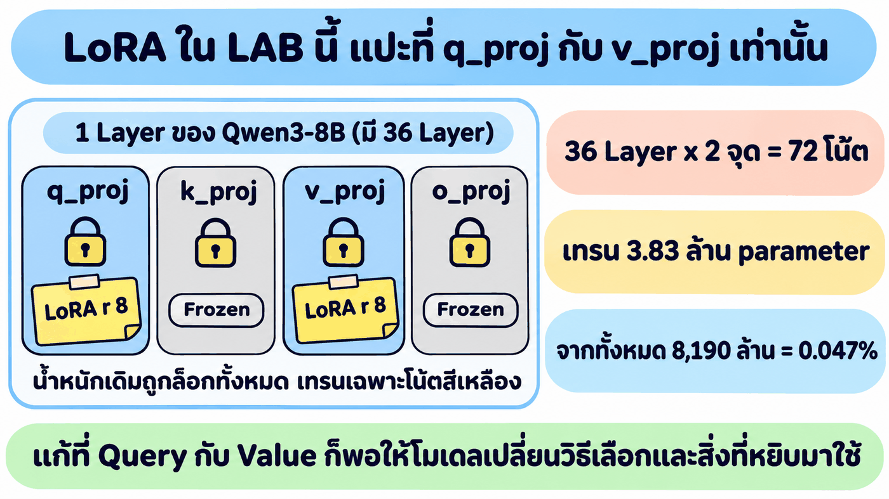
*`[ค่าที่ตรึง]` ในพรอมต์ระบุ LoRA ที่ `q_proj` กับ `v_proj` ตามภาพนี้*


*ข้อ 2 ของพรอมต์คือการชั่งกระเป๋าก่อนขึ้นเครื่อง*

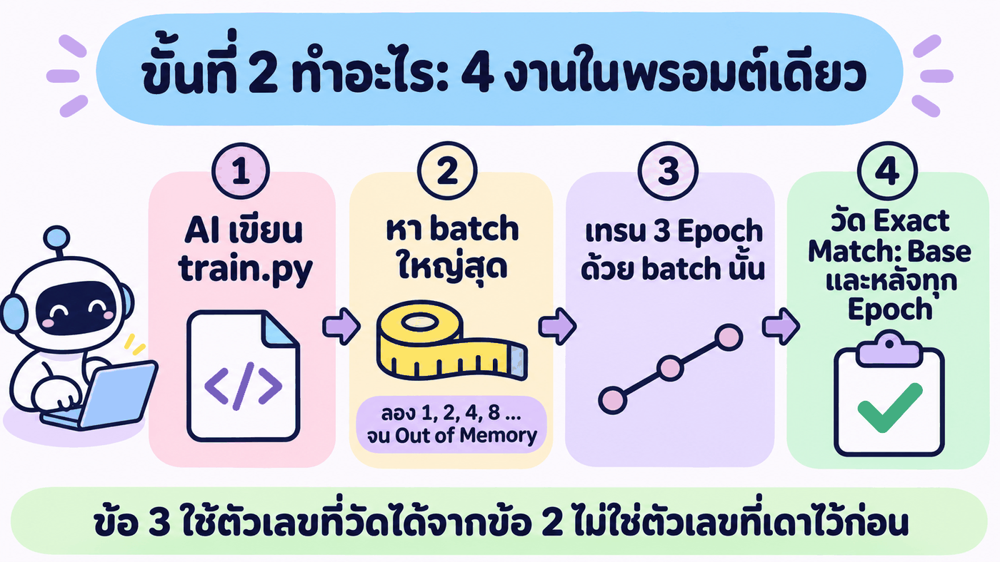
*ข้อ 3 ใช้ batch ที่วัดได้จริงจากข้อ 2*

AI เขียน `code/common.py` (ตารางแบ่ง Layer) `code/train.py` `code/eval.py` และ `code/run_all.sh` (รันต่อเนื่องใน tmux) แล้ววัด Base → หา batch → เทรน 3 Epoch → วัดผลหลังแต่ละ Epoch บนเครื่องเช่า

```text
[ที่ทำงาน]
container `multi-account` · โฟลเดอร์ /workspace/vastapp_lab · สกิล vastai
เครื่อง: ป้าย vapp-lab4-mp · กุญแจ SSH: /workspace/vastai_lab/Devtool_SSH/devtoolSSH
เก็บโค้ดและผลที่: lab4_multigpu/3_model_parallel ของโฟลเดอร์ที่เปิด Claude Code อยู่ (ไม่ใช่ใน container)

[งาน]
เทรน Qwen3-8B ให้แปลงคำถามเป็น SQL แบบ Model Parallelism
แนวคิด: โมเดลชุดเดียว แบ่ง Layer ครึ่งแรกไว้ GPU 0 ครึ่งหลังไว้ GPU 1

[ขั้นตอน]
1. เขียน code/train.py เทรนด้วย LoRA โดยแบ่งโมเดลชุดเดียวลง GPU 2 ใบ
2. หา batch ใหญ่สุด: ลอง 1, 2, 4, 8 … อย่างละ 3 step ด้วยตัวอย่างที่ยาวที่สุด จน Out of Memory
   แล้วประมาณจาก VRAM ที่วัดได้ว่า batch เท่าไรจะพอดี และลองค่าระหว่างตัวที่ผ่านกับตัวที่ล้ม จนได้ batch ใหญ่สุดที่ผ่านจริง
3. เทรน 3 Epoch ด้วย batch ใหญ่สุดที่หาได้ในข้อ 2
4. เขียน code/eval.py วัด Exact Match บน Test Set ของโมเดลก่อนเทรน (Base) และหลังจบแต่ละ Epoch
5. ให้งานรันต่อได้แม้การเชื่อมต่อหลุด และรายงานทุก 2–3 นาที

[ค่าที่ตรึง]
โมเดล: Qwen/Qwen3-8B แบบ bf16 · ปิด thinking · ไม่ใช้ Gradient Checkpointing
LoRA: r 8 · alpha 16 · ที่ q_proj กับ v_proj
การเทรน: learning rate 2e-4 · seed 0 · ข้อความยาวไม่เกิน 256 token

[รายงาน]
สรุปเป็นตาราง: batch เทียบ VRAM สูงสุดของแต่ละใบ · batch ที่ประมาณไว้ · batch ที่ใช้เทรน · Layer ไหนอยู่ใบไหน · วินาทีต่อ step · ตัวอย่างต่อวินาที · GPU util ของแต่ละใบ · loss และ Exact Match ของ Base และหลังจบแต่ละ Epoch
บอกว่าเครื่องยังเปิดอยู่
```

> ผลที่แสดงในหน้านี้ได้จากการไล่ batch แบบเพิ่มทีละเท่าตัว (1, 2, 4, 8 …) เท่านั้น ยังไม่ได้ลองค่าระหว่างตัวที่ผ่านกับตัวที่ล้ม พรอมต์นี้ให้ AI ลองต่อ batch ที่คุณได้จึงอาจใหญ่กว่าในหน้านี้

![ช่องพิมพ์ของ Claude Code ที่วางพรอมต์ขั้นที่ 2 และคำตอบ: GPU 0 ถือ embed_tokens กับ Layer 0–17 GPU 1 ถือ Layer 18–35 norm และ lm_head ใบละ 8.19 GB ตาราง batch เทียบ VRAM จาก nvidia-smi batch 1 ถึง 8 ผ่าน batch 16 Out of Memory ที่ GPU 1 ตั้งแต่ step แรก เทรนที่ batch 8 ได้ 500 step ต่อ Epoch 0.789 วินาทีต่อ step 10.14 ตัวอย่างต่อวินาที util 46.5% และ 51.8% train loss 0.0876 0.0305 0.0168 test loss 0.0580 0.0506 0.0529 Exact Match Base 0.0% แล้ว 70.0% 77.5% 77.0% แบบผ่อนปรน Base 54.5% และบอกว่าเครื่องยังเปิดอยู่](../images/model_parallel/lab4c-step2.png)
*ใช้เวลา 36.6 นาที (บนเครื่องเช่า: วัด Base 44 วินาที · หา batch 5 ขนาด · เทรน 3 Epoch 1,184 วินาที · วัดผลหลังแต่ละ Epoch ราว 47 วินาที)*

**หา batch ใหญ่สุด** (ตัวอย่างที่ยาวที่สุด ตัดเหลือ 256 token · อย่างละ 3 step · [results/probe_b*.json](results/probe_b8.json))

| batch | ผล | PyTorch ใช้สูงสุด GPU 0 / GPU 1 | nvidia-smi GPU 0 / GPU 1 | วินาทีต่อ step |
|---|---|---|---|---|
| 1 | ผ่าน | 8.44 / 8.82 GiB | 9,008 / 9,462 MiB | 0.274 |
| 2 | ผ่าน | 9.21 / 9.96 GiB | 9,816 / 10,720 MiB | 0.364 |
| 4 | ผ่าน | 10.76 / 12.25 GiB | 11,738 / 13,246 MiB | 0.704 |
| 8 | ผ่าน | 13.85 / 16.82 GiB | 14,682 / 18,280 MiB | 1.357 |
| 16 | **Out of Memory ที่ GPU 1** | 19.09 / 22.50 GiB ก่อนล้ม | 19,980 / 23,416 MiB ก่อนล้ม | – |

**เทรน 3 Epoch ที่ batch 8** ([results/train_summary.json](results/train_summary.json))

| Epoch | วินาทีต่อ step | ตัวอย่างต่อวินาที | GPU util GPU 0 / GPU 1 | train loss | test loss | Exact Match |
|---|---|---|---|---|---|---|
| Base | – | – | – | – | 1.914 | 0.0% (0/200) |
| 1 | 0.791 | 10.12 | 44.7% / 53.4% | 0.0876 | 0.0580 | 70.0% (140/200) |
| 2 | 0.791 | 10.11 | 45.9% / 53.2% | 0.0305 | **0.0506** | **77.5%** (155/200) |
| 3 | 0.785 | 10.20 | 49.0% / 48.7% | 0.0168 | 0.0529 | 77.0% (154/200) |
| **รวม 3 Epoch** | **0.789** | **10.13** | **46.5% / 51.8%** | | | |

- 500 step ต่อ Epoch · รวม 12,000 ตัวอย่างใน 1,184 วินาที (19.7 นาที)
- VRAM สูงสุดตอนเทรน: PyTorch ใช้ **14.29 / 17.26 GiB** · nvidia-smi เห็น 18,640 / 23,826 MiB
- **Exact Match** ของรอบนี้ยุบแค่ช่องว่าง ที่เหลือต้องตรงทุกตัวอักษร รวมถึง `;` ท้าย · แบบผ่อนปรน (ไม่สนตัวพิมพ์ ชนิดเครื่องหมายคำพูด และ `;` ท้าย) ได้ Base 54.5% → 72.5% → 79.5% → 79.5%

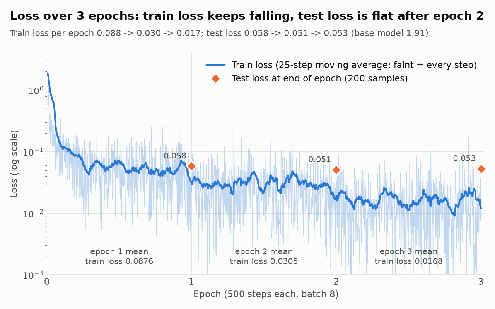

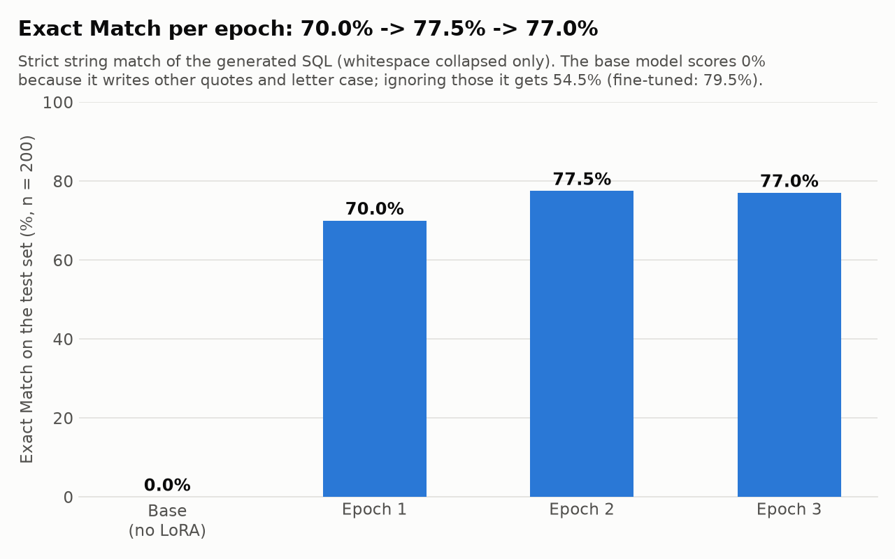

ตัวอย่าง 2 ข้อแรกของ Test Set ([results/pred_base.jsonl](results/pred_base.jsonl) · [results/pred_epoch3.jsonl](results/pred_epoch3.jsonl))

| | ข้อ 1 | ข้อ 2 |
|---|---|---|
| เฉลย | `SELECT record FROM table_name_98 WHERE high_points = "ray allen (20)"` | `SELECT date FROM table_25428629_1 WHERE stadium = "Thuwunna stadium"` |
| Base | `... WHERE high_points = 'Ray Allen (20)'` → ไม่ตรง | `... WHERE stadium = 'Thuwunna Stadium'` → ไม่ตรง |

ตัวอย่างโค้ดที่ AI เขียนให้ในรอบจริง (ของคุณอาจต่างกัน): [code_reference/common.py](code_reference/common.py) (ตารางแบ่ง Layer) · [train.py](code_reference/train.py) · [eval.py](code_reference/eval.py) · [run_all.sh](code_reference/run_all.sh)

**อ่านผลอย่างไร**

- **batch ที่ใช้เทรน = batch ใหญ่สุดที่ผ่าน (8)** และเทรนจบทั้ง 3 Epoch ไม่ล้ม · แต่ VRAM ตอนเทรนจริงเฉียดขีด: nvidia-smi เห็น GPU 1 ถึง 23,826 MiB ใน Epoch 1 เพราะ PyTorch กันพื้นที่ที่เคยใช้ค้างไว้ · batch ที่ "ผ่าน" ตอนวัดก็ยังอาจเฉียดขีดจำกัด
- **VRAM ของสองใบไม่เท่ากัน และ GPU 1 เต็มก่อนเสมอ** · ทุก batch GPU 1 ใช้มากกว่า และ batch 16 ล้มที่ GPU 1 · สาเหตุคือตารางคะแนนของ lm_head (ทฤษฎีข้อ 4) · แบ่ง Layer 18/18 เท่ากันไม่ได้แปลว่า VRAM เท่ากัน
- **GPU util ราว 46–52% ต่อใบคือลักษณะของวิธีนี้** · สองใบผลัดกันคำนวณ (ทฤษฎีข้อ 3) · ตอนเทรนจริงเร็วกว่าตอนหา batch (0.789 เทียบ 1.357 วินาทีต่อ step) เพราะตอนหา batch ใช้ตัวอย่างยาวสุด 256 token ส่วนตัวอย่างจริงยาวเฉลี่ยราว 107 token
- **3 Epoch บอกอะไร** · train loss ลดต่อเนื่อง แต่ test loss ต่ำสุดที่ Epoch 2 แล้วขยับขึ้นที่ Epoch 3 (0.0506 → 0.0529) = **เริ่มมีสัญญาณ overfitting** · Exact Match 77.5% → 77.0% ต่างกันแค่ 1 ข้อจาก 200 (1 ข้อ = 0.5 จุด) จึงถือว่าทรงตัว
- **Exact Match ของ Base ต่ำมาก ส่วนใหญ่เพราะสไตล์การเขียน ไม่ใช่ตรรกะผิด** · Base ใช้ `'...'` ตัวพิมพ์ตามคำถาม และบางข้อปิดท้ายด้วย `;` ส่วนเฉลยใช้ `"..."` (แบบผ่อนปรน Base ได้ 54.5%) · ส่วนที่เพิ่มขึ้นหลัง Fine-tune จึงมาจากการที่โมเดลเรียนสไตล์ของ Dataset เป็นส่วนใหญ่

## ขั้นที่ 3 · สรุปและลบเครื่อง (ห้ามข้าม)

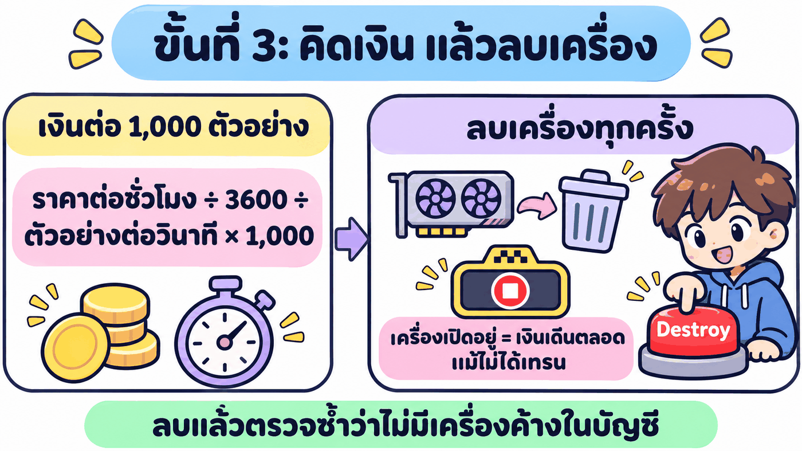
*สูตรเงินต่อ 1,000 ตัวอย่างในภาพคือสูตรที่ `report.py` ใช้*

AI นำผลดิบกลับมา ค้นราคาตลาด เขียน `code/report.py` (รวมตัวเลข + วาดกราฟ) และ `code/collect_cost.py` (ดึงข้อมูลเครื่องและใบคิดเงิน) แล้วลบเครื่อง

```text
[ที่ทำงาน]
container `multi-account` · โฟลเดอร์ /workspace/vastapp_lab · สกิล vastai
เครื่อง: ป้าย vapp-lab4-mp · กุญแจ SSH: /workspace/vastai_lab/Devtool_SSH/devtoolSSH
เก็บโค้ดและผลที่: lab4_multigpu/3_model_parallel ของโฟลเดอร์ที่เปิด Claude Code อยู่ (ไม่ใช่ใน container)

[งาน]
สรุปผลเป็นกราฟ แล้วลบเครื่อง

[ขั้นตอน]
1. นำผลดิบกลับมาที่ results/raw
2. ค้นราคาตลาดของเครื่อง RTX 4090 2 ใบที่ถูกที่สุด
3. เขียน code/report.py รวมตัวเลขลง results/metrics.json พร้อมเงินต่อ 1,000 ตัวอย่าง
4. ให้สคริปต์วาดกราฟที่ results/images (ข้อความอังกฤษ): VRAM ของแต่ละใบเทียบ batch พร้อมเส้น 24 GB · GPU util ของแต่ละใบ · loss ตลอด 3 Epoch · Exact Match ของแต่ละ Epoch
5. ลบเครื่องป้าย vapp-lab4-mp แล้วตรวจว่าไม่เหลือ (ห้ามแตะเครื่องป้ายอื่น)

[รายงาน]
สรุปเป็นตาราง: batch ใหญ่สุด · ตัวอย่างต่อวินาที · Exact Match · เงินต่อ 1,000 ตัวอย่าง
ค่าใช้จ่ายจริงของเครื่อง: อายุเครื่อง · ยอดที่ถูกคิด · ห้ามแสดงค่า key
```


*ใช้เวลา 5.3 นาที*

**กราฟที่ AI วาดให้** ([results/images/](results/images/))

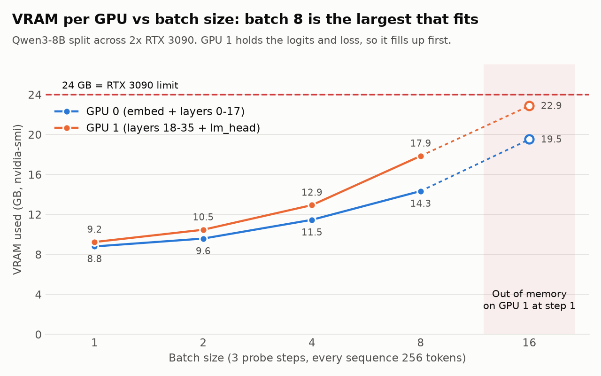

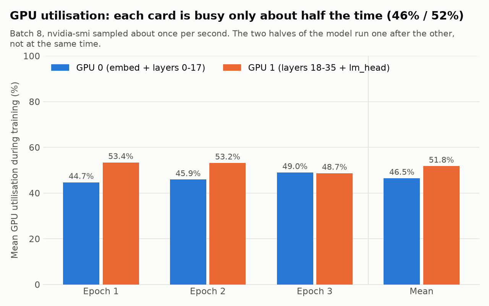

**ราคาตลาด RTX 3090 2 ใบ** (ค้นตอนขั้นที่ 3 · on-demand · คิดที่ 10.13 ตัวอย่างต่อวินาที)

| ราคาที่ใช้คิด | $ ต่อชั่วโมง | $ ต่อ 1,000 ตัวอย่าง |
|---|---|---|
| เครื่องที่เช่าจริง (สหรัฐฯ) | 0.4067 | 0.01115 |
| verified ถูกสุด (Hong Kong) | 0.2947 | 0.00808 |
| ถูกสุดทั้งตลาด (Quebec ไม่ verified ไม่ผ่านเงื่อนไขของ LAB) | 0.2414 | 0.00662 |

เทรน 3 Epoch (12,000 ตัวอย่าง) บนเครื่องที่เช่าจริงคิดเป็นราว $0.13 (คำนวณ)

**ค่าใช้จ่ายจริงจากใบคิดเงิน** ([results/raw/billing.json](results/raw/billing.json))

| รายการ | ค่า |
|---|---|
| GPU | $0.287 (0.770 ชั่วโมงที่ $0.373) |
| disk | $0.030 |
| ดาวน์โหลด | $0.038 (14.7 GB) |
| อัปโหลด | $0.001 |
| **รวม** | **$0.356** · เครื่องเปิด 55.0 นาที |

ตัวอย่างโค้ดที่ AI เขียนให้ในรอบจริง (ของคุณอาจต่างกัน): [code_reference/report.py](code_reference/report.py) · [collect_cost.py](code_reference/collect_cost.py) · ตัวเลขรวม: [results/metrics.json](results/metrics.json) · [results/summary.json](results/summary.json)

**อ่านผลอย่างไร**

- **เงินต่อ 1,000 ตัวอย่าง $0.01115 จ่ายค่า GPU 2 ใบ แต่ได้งานราว 1 ใบ** · ค่าเช่าราวครึ่งหนึ่งจ่ายให้ GPU ที่กำลังรอ · Model Parallelism ซื้อที่ว่าง VRAM ไม่ได้ซื้อความเร็ว
- **เวลาส่วนใหญ่ไม่ใช่การเทรน** · เครื่องเปิด 55.0 นาที เทรนจริง 19.7 นาที ที่เหลือคือรอเครื่อง โหลดโมเดล หา batch และวัดผล
- ราคาเป็นตัวเลขของ **ช่วงเวลาที่ค้น** · ถ้าเลือกเครื่อง verified ที่ถูกที่สุดตอนนั้น จะถูกลงราวหนึ่งในสี่
- ต้องเห็นว่า AI ลบเครื่องแล้วและตรวจซ้ำว่าไม่เหลือเครื่องป้าย `vapp-lab4-mp` · ถ้าไม่แน่ใจ ให้สั่งตรวจซ้ำอีกครั้ง

## ส่วนที่ 2 · GPU 4 ใบ (ขั้นที่ 4–6)

ทำซ้ำการทดลองเดิมทุกอย่าง เปลี่ยนแค่จำนวน GPU จาก 2 เป็น 4 ใบ บนเครื่องเช่าเครื่องใหม่ · ผลเก็บแยกที่ `gpu4/`

## ขั้นที่ 4 · เช่าเครื่อง 4 GPU และเตรียมของ


*สังเกตงานที่ 4: วัดความเร็ว GPU ทีละใบก่อนเริ่มเทรน*

**ทำไมต้องวัดความเร็วทีละใบ** เครื่องเช่าที่มีหลาย GPU อาจมีบางใบช้ากว่าใบอื่น (เช่น ติดเพดานไฟหรือความร้อน) · ใน Model Parallelism ข้อมูลต้องผ่านทุกใบตามลำดับ **ใบที่ช้าที่สุดจึงกำหนดความเร็วทั้งสาย** · ข้อ 5 ของพรอมต์จึงให้วัดก่อน และเปลี่ยนเครื่องถ้าช้ากว่ากันเกิน 20%

AI เช่าเครื่องใหม่ เตรียมโมเดลและ Dataset ชุดเดิม วัดความเร็วทีละใบ แล้วเขียน `gpu4/code/prepare_data.py` `gpu_bench.py` `wait_ready.sh` และ `gpu4/results/dataset_samples.md`

```text
[ที่ทำงาน]
container `multi-account` · โฟลเดอร์ /workspace/vastapp_lab · สกิล vastai
กุญแจ SSH: /workspace/vastai_lab/Devtool_SSH/devtoolSSH
เก็บโค้ดและผลที่: lab4_multigpu/3_model_parallel/gpu4 ของโฟลเดอร์ที่เปิด Claude Code อยู่ (ไม่ใช่ใน container)

[งาน]
เช่าเครื่อง GPU 4 ใบ แล้วเตรียมโมเดลกับ Dataset

[เครื่องที่ต้องการ]
GPU: RTX 4090 4 ใบในเครื่องเดียว · ราคาไม่เกิน $1.40 ต่อชั่วโมง · ป้าย vapp-lab4-mp4
เงื่อนไข: verified · reliability 0.95 ขึ้นไป · ความเร็วเน็ตไม่ต่ำกว่า 1,200 Mbps · ค่าดาวน์โหลดไม่เกิน $0.01 ต่อ GB · CPU 16 cores ขึ้นไป · ไม่อยู่ในจีน
ระบบ: PyTorch 2.8 ที่มี CUDA 12.8 · disk 60 GB

[ขั้นตอน]
1. เช่าเครื่องที่ถูกที่สุดตามเงื่อนไข ถ้าเกิน 10 นาทียังไม่พร้อม ให้ลบแล้วเช่าเครื่องอื่น
2. โหลดโมเดล Qwen/Qwen3-8B และ Dataset b-mc2/sql-create-context ลงเครื่อง
3. สับ Dataset ด้วย seed 0 แล้วแบ่ง Training Set 4,000 ตัวอย่าง และ Test Set 200 ตัวอย่าง
4. ทำตารางตัวอย่าง 6 รายการ (คำถาม · โครงสร้างตาราง · SQL เฉลย) เก็บที่ results/dataset_samples.md
5. วัดความเร็ว GPU ทีละใบด้วยงานเดียวกัน ถ้ามีใบที่ช้ากว่าใบอื่นเกิน 20% ให้ลบแล้วเช่าเครื่องอื่น

[รายงาน]
สรุปเป็นตาราง: เครื่องที่ได้ · ราคาต่อชั่วโมง · GPU ต่อถึงกันแบบไหน · ความเร็วของ GPU แต่ละใบ · จำนวนตัวอย่างของแต่ละชุด
อธิบายตัวอย่าง 1 รายการว่าแต่ละช่องคืออะไร · ห้ามแสดงค่า key · บอกว่าเครื่องยังเปิดอยู่
```

![ช่องพิมพ์ของ Claude Code ที่วางพรอมต์ขั้นที่ 4 และคำตอบ: ได้เครื่อง RTX 3090 24 GB 4 ใบ ที่ชิลี ราคา $0.87 ต่อชั่วโมง CPU Xeon E5-2680 v4 56 cores disk 60 GB PyTorch 2.8.0 CUDA 12.8 GPU ต่อกันผ่าน PCIe Gen 3 x16 ไม่มี NVLink GPU 0–1 อยู่ใต้ CPU ตัวหนึ่ง GPU 2–3 อยู่ใต้อีกตัว ตารางความเร็ว GPU คูณเมทริกซ์ 56.42 57.99 53.41 61.88 รอบต่อวินาที ใบช้าสุด GPU 2 ช้ากว่า 13.7% ไม่เกินเกณฑ์ 20% เครื่องแรกที่เช่า $0.78 ดึง image ไม่เสร็จใน 10 นาทีจึงลบแล้วเช่าเครื่องถัดไป Training Set 4,000 Test Set 200 พร้อมอธิบายตัวอย่างแถวที่ 1](../images/model_parallel/lab4c-step4.png)
*ใช้เวลา 23.2 นาที (รวมเวลารอเครื่องแรกที่เปิดไม่ทัน 10 นาที)*

**ความเร็วของ GPU แต่ละใบ** (วัดทีละใบด้วยงานเดียวกัน · [gpu4/results/gpu_bench.json](gpu4/results/gpu_bench.json))

| GPU | คูณเมทริกซ์ FP16 8192×8192 (รอบ/วินาที) | ช้ากว่าใบที่เร็วที่สุด | train step ของ Transformer 1 ชั้น (รอบ/วินาที) | ช้ากว่าใบที่เร็วที่สุด |
|---|---|---|---|---|
| 0 | 56.42 | 8.8% | 130.19 | 3.3% |
| 1 | 57.99 | 6.3% | 129.27 | 4.0% |
| 2 | 53.41 | **13.7%** (ช้าสุด) | 126.65 | 5.9% |
| 3 | 61.88 | เร็วสุด | 134.62 | เร็วสุด |

ใบที่ช้าที่สุดช้ากว่า 13.7% ไม่เกินเกณฑ์ 20% → ใช้เครื่องนี้ต่อ

ตัวอย่างโค้ดที่ AI เขียนให้ในรอบจริง (ของคุณอาจต่างกัน): [code_reference/gpu4/prepare_data.py](code_reference/gpu4/prepare_data.py) · [gpu_bench.py](code_reference/gpu4/gpu_bench.py) · [wait_ready.sh](code_reference/gpu4/wait_ready.sh) · ผล: [gpu4/results/dataset_samples.md](gpu4/results/dataset_samples.md) · [gpu4/results/prepare_info.json](gpu4/results/prepare_info.json) · [gpu4/results/gpu_topology.txt](gpu4/results/gpu_topology.txt)

**อ่านผลอย่างไร**

- **เครื่องแรกเปิดไม่ทัน** · เครื่องที่ถูกที่สุด ($0.78 ในสหรัฐฯ) ดึง image ไม่เสร็จใน 10 นาที AI จึงลบแล้วเช่าเครื่องถัดไป ($0.87 ชิลี) พร้อมใน 7 นาที ตามข้อ 1 ของพรอมต์ · เครื่องที่ถูกลบเสียแค่ค่า disk $0.006 · AI ยังข้ามข้อเสนอ $0.76 ที่ไต้หวัน เพราะรองรับ CUDA ได้ถึง 12.2 เท่านั้น
- **ได้ Dataset ชุดเดียวกับส่วนที่ 1** (seed 0 · 4,000 / 200 · ตัวอย่าง 6 แถวแรกตรงกัน) จึงเทียบผลระหว่าง 2 ใบกับ 4 ใบได้
- แถว **GPU ต่อถึงกันแบบไหน**: PCIe Gen3 x16 ไม่มี NVLink · GPU 0–1 อยู่ใต้ CPU ตัวหนึ่ง GPU 2–3 อยู่ใต้อีกตัว (PHB) · ผลกลางทางจาก GPU 1 ไป GPU 2 ต้องข้ามระหว่าง CPU (SYS)
- เครื่องนี้ **ราคา $0.87/ชม.** ราว 2.1 เท่าของเครื่อง 2 ใบ

## ขั้นที่ 5 · เทรนแบบ Model Parallelism ด้วย GPU 4 ใบ

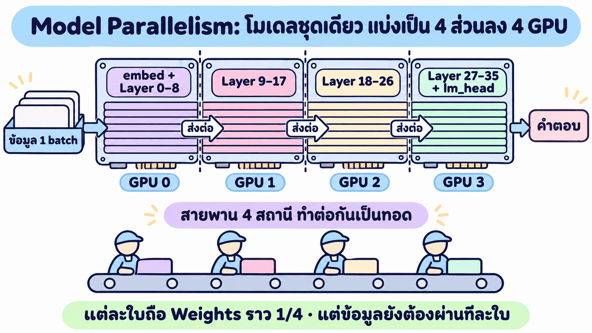
*นี่คือ "แบ่ง Layer เป็น 4 ส่วนเท่ากัน" ตามบรรทัดแนวคิดในพรอมต์ (ช่วง Layer ในภาพคือที่ AI แบ่งจริง)*


*ลำดับงานเหมือนขั้นที่ 2 ทุกข้อ ต่างแค่จำนวน GPU*

AI เขียน `gpu4/code/common.py` (ตารางแบ่ง Layer 4 ส่วน) `train.py` `eval.py` และ `run_all.sh` (รันต่อเนื่องใน tmux) แล้วหา batch → วัด Base → เทรน 3 Epoch → วัดผลหลังแต่ละ Epoch

```text
[ที่ทำงาน]
container `multi-account` · โฟลเดอร์ /workspace/vastapp_lab · สกิล vastai
เครื่อง: ป้าย vapp-lab4-mp4 · กุญแจ SSH: /workspace/vastai_lab/Devtool_SSH/devtoolSSH
เก็บโค้ดและผลที่: lab4_multigpu/3_model_parallel/gpu4 ของโฟลเดอร์ที่เปิด Claude Code อยู่ (ไม่ใช่ใน container)

[งาน]
เทรน Qwen3-8B ให้แปลงคำถามเป็น SQL แบบ Model Parallelism
แนวคิด: โมเดลชุดเดียว แบ่ง Layer เป็น 4 ส่วนเท่ากัน ไว้ GPU ละ 1 ส่วน เรียงจาก GPU 0 ถึง GPU 3

[ขั้นตอน]
1. เขียน code/train.py เทรนด้วย LoRA โดยแบ่งโมเดลชุดเดียวลง GPU 4 ใบ
2. หา batch ใหญ่สุด: ลอง 1, 2, 4, 8 … อย่างละ 3 step ด้วยตัวอย่างที่ยาวที่สุด จน Out of Memory
   แล้วประมาณจาก VRAM ที่วัดได้ว่า batch เท่าไรจะพอดี และลองค่าระหว่างตัวที่ผ่านกับตัวที่ล้ม จนได้ batch ใหญ่สุดที่ผ่านจริง
3. เทรน 3 Epoch ด้วย batch ใหญ่สุดที่หาได้ในข้อ 2
4. เขียน code/eval.py วัด Exact Match บน Test Set ของโมเดลก่อนเทรน (Base) และหลังจบแต่ละ Epoch
5. ให้งานรันต่อได้แม้การเชื่อมต่อหลุด และรายงานทุก 2–3 นาที

[ค่าที่ตรึง]
โมเดล: Qwen/Qwen3-8B แบบ bf16 · ปิด thinking · ไม่ใช้ Gradient Checkpointing
LoRA: r 8 · alpha 16 · ที่ q_proj กับ v_proj
การเทรน: learning rate 2e-4 · seed 0 · ข้อความยาวไม่เกิน 256 token

[รายงาน]
สรุปเป็นตาราง: batch เทียบ VRAM สูงสุดของแต่ละใบ · batch ที่ประมาณไว้ · batch ที่ใช้เทรน · Layer ไหนอยู่ใบไหน · วินาทีต่อ step · ตัวอย่างต่อวินาที · GPU util ของแต่ละใบ · loss และ Exact Match ของ Base และหลังจบแต่ละ Epoch
บอกว่าเครื่องยังเปิดอยู่
```

> ผลที่แสดงในหน้านี้ได้จากการไล่ batch แบบเพิ่มทีละเท่าตัว (1, 2, 4, 8 …) เท่านั้น ยังไม่ได้ลองค่าระหว่างตัวที่ผ่านกับตัวที่ล้ม พรอมต์นี้ให้ AI ลองต่อ batch ที่คุณได้จึงอาจใหญ่กว่าในหน้านี้

![ช่องพิมพ์ของ Claude Code ที่วางพรอมต์ขั้นที่ 5 และคำตอบ: เทรนครบ 3 Epoch ผลดีสุดหลัง Epoch 2 Exact Match 77.5% Base 1.5% ตาราง batch เทียบ VRAM ที่ PyTorch จอง batch 1 ถึง 16 ผ่าน batch 32 Out of Memory ที่ GPU 3 ซึ่งมี LM Head batch ที่ใช้เทรน 16 250 step ต่อ Epoch GPU 0 ถือ Embedding กับ Layer 0–8 GPU 1 Layer 9–17 GPU 2 Layer 18–26 GPU 3 Layer 27–35 Norm และ LM Head ราว 1.6 วินาทีต่อ step 9.84 ถึง 10.00 ตัวอย่างต่อวินาที GPU util ใบละ 19 ถึง 31% train loss 0.1233 0.0382 0.0252 test loss 0.0629 0.0536 0.0540 Exact Match 69.0% 77.5% 74.5% และบอกว่าเครื่องยังเปิดอยู่](../images/model_parallel/lab4c-step5.png)
*ใช้เวลา 30.2 นาที (บนเครื่องเช่า: หา batch 6 ขนาด · วัด Base 44 วินาที · เทรน 3 Epoch 1,211.5 วินาที · วัดผลหลังแต่ละ Epoch 46–56 วินาที)*

**หา batch ใหญ่สุด** (ตัวอย่างที่ยาวที่สุด 256 token · อย่างละ 3 step · [gpu4/results/probe.json](gpu4/results/probe.json))

| batch | ผล | PyTorch ใช้สูงสุด GPU 0 / 1 / 2 / 3 (GiB) | วินาทีต่อ step |
|---|---|---|---|
| 1 | ผ่าน | 4.84 / 3.64 / 3.64 / 5.21 | 0.556 |
| 2 | ผ่าน | 5.26 / 4.01 / 4.01 / 6.00 | 0.386 |
| 4 | ผ่าน | 6.10 / 4.75 / 4.75 / 7.59 | 0.710 |
| 8 | ผ่าน | 7.78 / 6.24 / 6.24 / 10.75 | 1.379 |
| 16 | ผ่าน | 11.14 / 9.21 / 9.21 / 17.08 | 2.690 |
| 32 | **Out of Memory ที่ GPU 3** | 16.04 / 14.97 / 14.97 / 22.84 แล้วขอเพิ่มอีก 4.64 GiB ไม่ได้ | – |

**เทรน 3 Epoch ที่ batch 16** ([gpu4/results/train.json](gpu4/results/train.json) · [eval_all.json](gpu4/results/eval_all.json))

| Epoch | วินาทีต่อ step | ตัวอย่างต่อวินาที | GPU util GPU 0 / 1 / 2 / 3 | train loss | test loss | Exact Match |
|---|---|---|---|---|---|---|
| Base | – | – | – | – | 1.918 | 1.5% (3/200) |
| 1 | 1.626 | 9.84 | 24.6 / 21.4 / 22.3 / 29.7% | 0.1233 | 0.0629 | 69.0% (138/200) |
| 2 | 1.620 | 9.88 | 24.8 / 24.7 / 25.2 / 30.0% | 0.0382 | **0.0536** | **77.5%** (155/200) |
| 3 | 1.600 | 10.00 | 25.2 / 19.4 / 21.8 / 31.4% | 0.0252 | 0.0540 | 74.5% (149/200) |
| **รวม 3 Epoch** | **1.615** | **9.91** | **24.9 / 21.8 / 23.1 / 30.3%** | | | |

- 250 step ต่อ Epoch · รวม 12,000 ตัวอย่างใน 1,211.5 วินาที (20.2 นาที)
- VRAM สูงสุดตอนเทรน: PyTorch ใช้ **11.72 / 9.70 / 9.70 / 17.52 GiB** · nvidia-smi เห็น 12,530 / 10,468 / 10,468 / 19,748 MiB
- **Exact Match** ของรอบนี้ยุบช่องว่างและตัด `;` ท้ายออกก่อนเทียบ ที่เหลือต้องตรงทุกตัวอักษร · ถ้าไม่สนตัวพิมพ์ได้ 1.5% → 71.5% → 79.0% → 76.5%

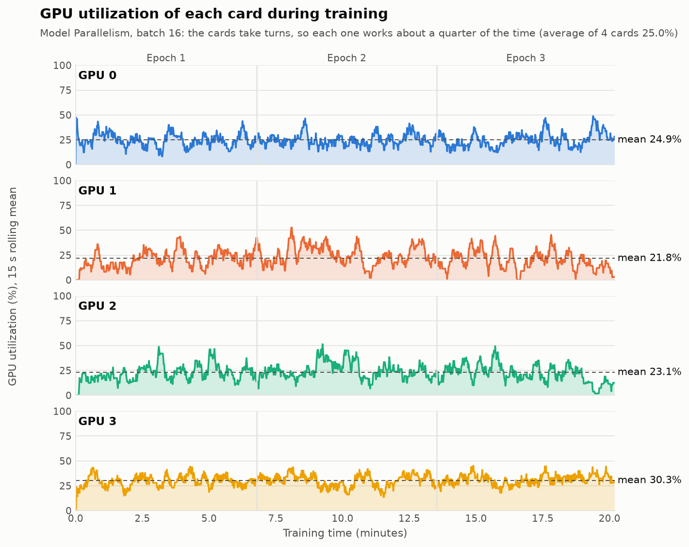

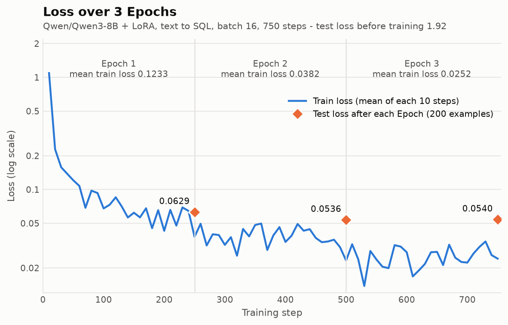

ตัวอย่างโค้ดที่ AI เขียนให้ในรอบจริง (ของคุณอาจต่างกัน): [code_reference/gpu4/common.py](code_reference/gpu4/common.py) (ตารางแบ่ง Layer) · [train.py](code_reference/gpu4/train.py) · [eval.py](code_reference/gpu4/eval.py) · [run_all.sh](code_reference/gpu4/run_all.sh)

**อ่านผลอย่างไร**

- **batch ที่ใช้เทรน = batch ใหญ่สุดที่ผ่าน (16)** ใหญ่กว่าส่วนที่ 1 สองเท่า และเทรนจบทั้ง 3 Epoch ไม่ล้ม
- **GPU 3 เต็มก่อน เหตุผลเดียวกับ GPU 1 ในส่วนที่ 1** · GPU 3 ถือ lm_head ที่สร้างตารางคะแนนคำศัพท์ทุก token · ตอน batch 32 ขอเพิ่ม **4.64 GiB** = 32 × 256 × 151,936 × 4 byte (คำนวณเทียบ) · ขณะที่ GPU 1 และ 2 ยังเหลือที่ราว 9 GiB · Weights ต่อใบเล็กลงก็จริง แต่ตารางคะแนนนี้ยังกองอยู่ที่ใบสุดท้ายใบเดียว
- **util ใบละราว 22–30% รวมราว 100%** = ยังมีใบเดียวที่ทำงานในแต่ละขณะ ตามทฤษฎี · GPU 3 สูงสุดเพราะทำ lm_head และ loss เพิ่ม
- **3 Epoch บอกอะไร** · train loss ลดต่อเนื่อง แต่ test loss ต่ำสุดที่ Epoch 2 แล้วทรงตัว (0.0536 → 0.0540) และ Exact Match ลดจาก 77.5% เป็น 74.5% (6 ข้อจาก 200) = **เริ่มมีสัญญาณ overfitting** เหมือนส่วนที่ 1
- ตอนหา batch ใช้ตัวอย่างยาวสุด 256 token จึงช้ากว่าตอนเทรนจริง (2.690 เทียบ 1.615 วินาทีต่อ step) · batch 1 วัดได้ช้ากว่า batch 2 (0.556 เทียบ 0.386) เพราะวัดแค่ 3 step ครั้งแรกยังมีช่วงอุ่นเครื่อง

## ขั้นที่ 6 · สรุปและลบเครื่อง 4 GPU (ห้ามข้าม)


*สูตรเดียวกับขั้นที่ 3 · เครื่อง 4 ใบเงินเดินเร็วกว่าเท่าตัว จึงยิ่งต้องลบทันทีที่เสร็จ*

AI นำผลดิบกลับมา ค้นราคาตลาดของเครื่อง 4 ใบ เขียน `gpu4/code/report.py` (รวมตัวเลข + วาดกราฟ + ดึงใบคิดเงิน) แล้วลบเครื่อง

```text
[ที่ทำงาน]
container `multi-account` · โฟลเดอร์ /workspace/vastapp_lab · สกิล vastai
เครื่อง: ป้าย vapp-lab4-mp4 · กุญแจ SSH: /workspace/vastai_lab/Devtool_SSH/devtoolSSH
เก็บโค้ดและผลที่: lab4_multigpu/3_model_parallel/gpu4 ของโฟลเดอร์ที่เปิด Claude Code อยู่ (ไม่ใช่ใน container)

[งาน]
สรุปผลเป็นกราฟ แล้วลบเครื่อง

[ขั้นตอน]
1. นำผลดิบกลับมาที่ results/raw
2. ค้นราคาตลาดของเครื่อง RTX 4090 4 ใบที่ถูกที่สุด
3. เขียน code/report.py รวมตัวเลขลง results/metrics.json พร้อมเงินต่อ 1,000 ตัวอย่าง
4. ให้สคริปต์วาดกราฟที่ results/images (ข้อความอังกฤษ): VRAM ของแต่ละใบเทียบ batch พร้อมเส้น 24 GB · GPU util ของแต่ละใบ · loss ตลอด 3 Epoch · Exact Match ของแต่ละ Epoch
5. ลบเครื่องป้าย vapp-lab4-mp4 แล้วตรวจว่าไม่เหลือ (ห้ามแตะเครื่องป้ายอื่น)

[รายงาน]
สรุปเป็นตาราง: batch ใหญ่สุด · ตัวอย่างต่อวินาที · Exact Match · เงินต่อ 1,000 ตัวอย่าง
ค่าใช้จ่ายจริงของเครื่อง: อายุเครื่อง · ยอดที่ถูกคิด · ห้ามแสดงค่า key
```


*ใช้เวลา 6.0 นาที*

**กราฟที่ AI วาดให้** ([gpu4/results/images/](gpu4/results/images/))

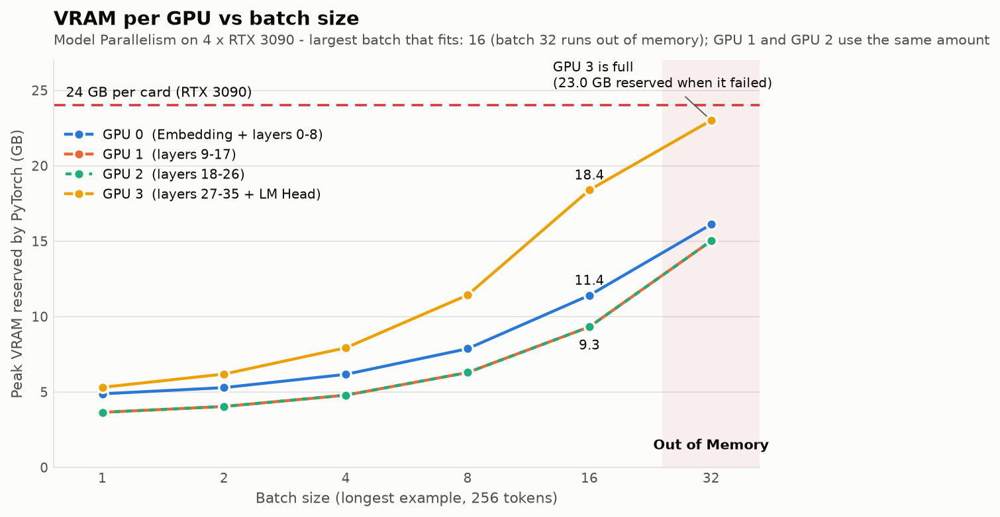

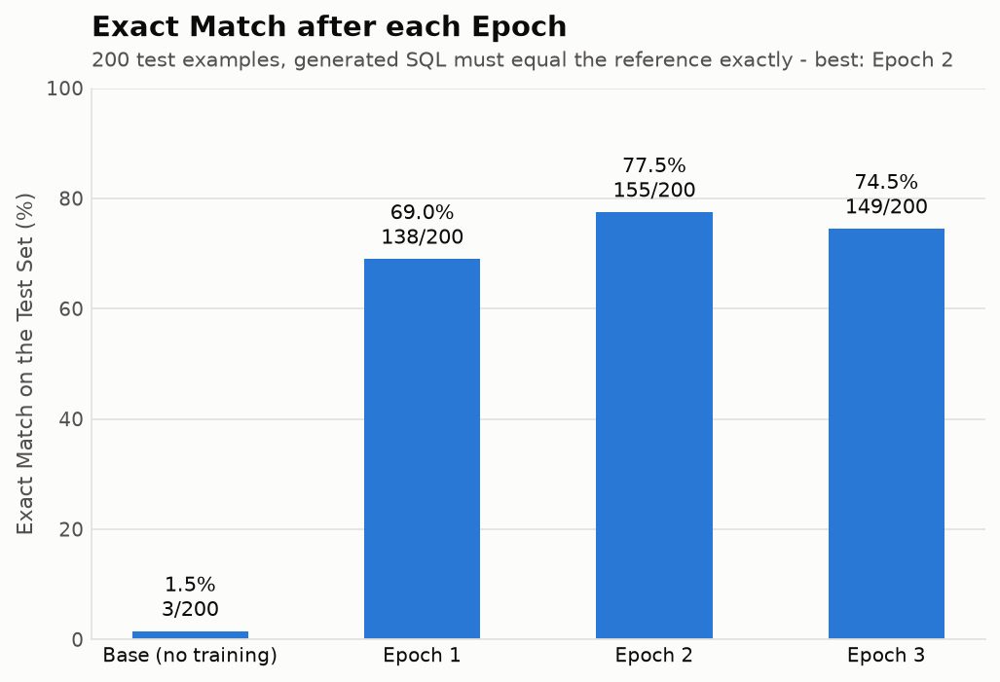

**ราคาตลาด RTX 3090 4 ใบ** (ค้นตอนขั้นที่ 6 · on-demand · คิดที่ 9.91 ตัวอย่างต่อวินาที)

| ราคาที่ใช้คิด | $ ต่อชั่วโมง | $ ต่อ 1,000 ตัวอย่าง |
|---|---|---|
| เครื่องที่เช่าจริง (ชิลี) | 0.87 | 0.0244 |
| verified ถูกสุด (California) | 0.5394 | 0.0151 |

**ค่าใช้จ่ายจริงจากใบคิดเงิน** ([gpu4/results/raw/billing/charges.json](gpu4/results/raw/billing/charges.json))

| รายการ | ค่า |
|---|---|
| GPU | $0.583 (0.684 ชั่วโมงที่ $0.853) |
| disk | $0.013 |
| ดาวน์โหลด | $0.039 (15.1 GB) |
| อัปโหลด | $0.002 |
| **รวมเครื่องที่ใช้** | **$0.637** · เครื่องเปิด 46.3 นาที |
| เครื่องแรกที่เปิดไม่ทันในขั้นที่ 4 | $0.006 (ค่า disk) |

ตัวอย่างโค้ดที่ AI เขียนให้ในรอบจริง (ของคุณอาจต่างกัน): [code_reference/gpu4/report.py](code_reference/gpu4/report.py) · ตัวเลขรวม: [gpu4/results/metrics.json](gpu4/results/metrics.json) · [gpu4/results/summary.json](gpu4/results/summary.json)

**อ่านผลอย่างไร**

- **เงินต่อ 1,000 ตัวอย่าง $0.0244** จ่ายค่า GPU 4 ใบ แต่ได้งานราว 1 ใบ · ถ้าได้เครื่อง verified ที่ถูกที่สุดตอนค้น ($0.5394) จะเหลือ $0.0151
- AI บอกเองว่าข้อเสนอ $0.5394 ไม่ขึ้นเมื่อค้นด้วยตัวกรองเริ่มต้นของ CLI (ถูกสุดจะเป็น $0.646) · ราคาตลาดขึ้นกับวิธีค้นและเวลาที่ค้น
- ใบคิดเงิน **$0.637 + $0.006** · เครื่องเปิด 46.3 นาที เทรนจริง 20.2 นาที
- ต้องเห็นว่า AI ลบเครื่องแล้วและตรวจซ้ำว่าไม่เหลือเครื่องป้าย `vapp-lab4-mp4`

## 2 ใบเทียบ 4 ใบ


| สิ่งที่วัด | GPU 2 ใบ (สหรัฐฯ) | GPU 4 ใบ (ชิลี) |
|---|---|---|
| Weights ก่อนเทรน ต่อใบ | 7.64 / 7.64 GiB (วัด) | 4.40 / 3.24 / 3.24 / 4.40 GiB (คำนวณ) |
| batch ใหญ่สุด (ที่ใช้เทรน) | 8 · batch 16 ล้มที่ GPU 1 (lm_head) | **16** · batch 32 ล้มที่ GPU 3 (lm_head) |
| วินาทีต่อ step | 0.789 (8 ตัวอย่าง) | 1.615 (16 ตัวอย่าง) |
| ตัวอย่างต่อวินาที | **10.13** | **9.91** |
| เร็วขึ้นเทียบ 2 ใบ | 1.00 เท่า | **0.98 เท่า** |
| GPU util ต่อใบ | 46.5 / 51.8% | 24.9 / 21.8 / 23.1 / 30.3% |
| VRAM สูงสุดตอนเทรน (PyTorch) | 14.29 / 17.26 GiB | 11.72 / 9.70 / 9.70 / 17.52 GiB |
| Exact Match Base → Epoch 1 / 2 / 3 | 0.0% (1.5%*) → 70.0 / 77.5 / 77.0% | 1.5% → 69.0 / 77.5 / 74.5% |
| test loss Epoch 1 / 2 / 3 | 0.0580 / 0.0506 / 0.0529 | 0.0629 / 0.0536 / 0.0540 |
| ราคาเครื่องที่เช่า | $0.4067/ชม. | $0.87/ชม. |
| $ ต่อ 1,000 ตัวอย่าง (ราคาเช่าจริง) | **$0.01115** | **$0.0244** |
| ใบคิดเงินทั้งส่วน | $0.356 | $0.637 + $0.006 |

\* วัดด้วยกฎเดียวกับส่วนที่ 2 (ตัด `;` ท้ายก่อนเทียบ) Base ของส่วนที่ 1 ก็ได้ 1.5% (3/200) เท่ากัน · ผลหลังแต่ละ Epoch ของทั้งสองส่วนไม่เปลี่ยนตามกฎนี้ (คำนวณใหม่จากคำตอบรายข้อใน `pred_*.jsonl` · ดู `summary.json` ของแต่ละส่วน)

**อ่านผลอย่างไร**

- **ความเร็วเท่าเดิม ตามที่ทฤษฎีคาด** · 10.13 → 9.91 ตัวอย่างต่อวินาที (0.98 เท่า) · util รวมยังราว 100% ทั้งสองส่วน = ทำงานทีละใบเหมือนเดิม · การส่งผลกลางทางข้ามใบเพิ่มจาก 1 เป็น 3 ครั้ง (รวมข้าม CPU 1 ครั้ง) แทบไม่ทำให้ช้าลง
- **batch ใหญ่ขึ้นแค่ 2 เท่า ไม่ใช่ 4 เท่า** · Weights ต่อใบลดจาก 7.64 เหลือ 3.24–4.40 GiB ก็จริง แต่ใบสุดท้ายที่ถือ lm_head ต้องเก็บตารางคะแนนคำศัพท์ทุก token ไว้คนเดียวเหมือนเดิม จึงเต็มก่อนทุกครั้ง (ทฤษฎีข้อ 4) · GPU 1 และ 2 ยังว่างราว 14 GiB ตอนเทรน
- **คุณภาพเท่ากัน** · ทั้งสองส่วนดีสุด 77.5% หลัง Epoch 2 และ test loss ต่ำสุดที่ Epoch 2 เหมือนกัน · Epoch 3 ต่างกัน 77.0% กับ 74.5% (5 ข้อจาก 200) ซึ่งมาจากค่าที่ AI เลือกเองนอกค่าที่ตรึงไม่เหมือนกันด้วย: batch 16 = Update ครึ่งหนึ่งต่อ Epoch และส่วนที่ 1 ลด learning rate แบบ linear ส่วนส่วนที่ 2 ใช้ค่าคงที่
- **ค่าเช่าต่องานแพงขึ้นราว 2.2 เท่า** ($0.01115 → $0.0244) · จ่ายค่า GPU 4 ใบ แต่ได้งานราว 1 ใบ · แบ่งมากใบขึ้นคุ้มเฉพาะเมื่อโมเดลหรือ batch ใส่ 2 ใบไม่ลงจริง ๆ
- **สองส่วนรันบนเครื่องเช่าคนละเครื่อง** (สหรัฐฯ กับชิลี คนละ CPU) · ตัวเลขความเร็วที่เทียบกันจึงรวมความต่างของเครื่องด้วย

## ไฟล์ในโฟลเดอร์นี้

| ไฟล์ / โฟลเดอร์ | คืออะไร |
|---|---|
| [PROMPTS.md](PROMPTS.md) | พรอมต์ Copy & Paste ทั้ง 6 ขั้น (ชุดเดียวกับใน README นี้) |
| `code/` | โค้ดที่ AI เขียนให้คุณจากพรอมต์ขั้นที่ 1–3 · **เริ่มจากโฟลเดอร์ว่าง** |
| [code_reference/](code_reference/) | ตัวอย่างโค้ดที่ AI เขียนในรอบจริงของส่วน GPU 2 ใบ ไว้เทียบ (ของคุณอาจต่างกัน) · โค้ดของส่วน GPU 4 ใบอยู่ใน [code_reference/gpu4/](code_reference/gpu4/) |
| [results/](results/) | ผลของรอบจริงส่วน GPU 2 ใบ: คำตอบของ AI ขั้นที่ 1–3 (`answers/`) · `metrics.json` · `summary.json` · `dataset_samples.md` · ผลหา batch (`probe_b*.json`) · ผลเทรนและวัดผล (`train_summary.json` `eval_*.json`) · คำตอบ SQL ของ Base และ Epoch 3 (`pred_*.jsonl`) · กราฟ (`images/`) · ใบคิดเงินและราคาตลาด (`raw/`) |
| `gpu4/` | ส่วน GPU 4 ใบ (ขั้นที่ 4–6) · โค้ดที่ AI เขียนให้คุณจะอยู่ใน `gpu4/code/` |
| [gpu4/results/](gpu4/results/) | ผลของรอบจริงส่วน GPU 4 ใบ: คำตอบของ AI ขั้นที่ 4–6 (`answers/`) · `metrics.json` · `summary.json` · ความเร็วทีละใบ (`gpu_bench.json`) · ผลหา batch (`probe.json`) · ผลเทรนและวัดผล (`train.json` `eval_*.json`) · คำตอบ SQL (`pred_*.jsonl`) · กราฟ (`images/`) · ใบคิดเงิน ราคาตลาด และ log (`raw/`) |
| [../images/](../images/) | ภาพประกอบใน README นี้ (รวมศูนย์ไว้ที่โฟลเดอร์ `images/` ระดับบน: `shared/` และ `model_parallel/`) |
