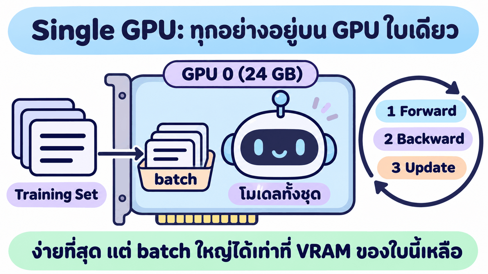
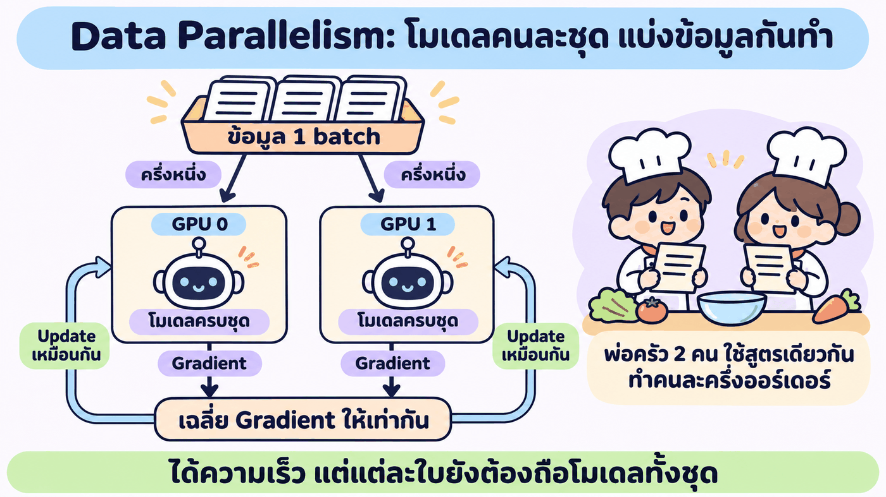
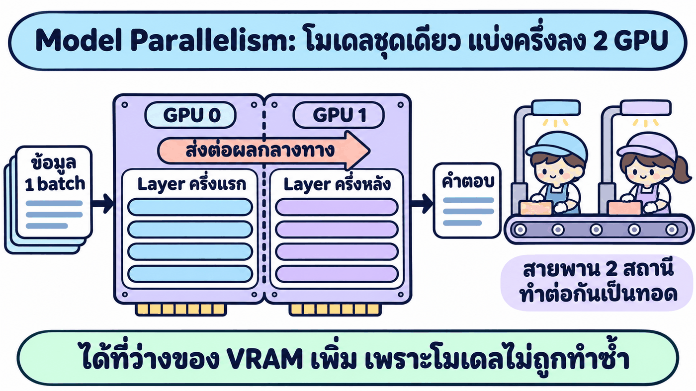

# LAB 4 · Multi-GPU ในเครื่องเดียว: Single GPU · Data Parallelism · Model Parallelism

[← กลับหน้ารวมของบท](../README.md) · [สไลด์ประกอบการสอน (HTML)](LAB4_MultiGPU_Slides.html) · เปิด Claude Code ที่โฟลเดอร์ของบท `02_VastAi_Application` ("โฟลเดอร์ปัจจุบัน" ในพรอมต์หมายถึงโฟลเดอร์นั้น) · ทำ [LAB 0](../README.md#lab-0--เตรียม-key-3-ตัว) ก่อน

## ขอบเขตของบทนี้ (อ่านก่อนเริ่ม)

> **บทนี้ใช้เครื่องเช่าเพียง 1 เครื่องต่อการทดลอง — แต่เป็น Multi-GPU (มี GPU หลายใบอยู่ในเครื่องเดียวกัน)**
>
> ทุกการทดลองใน LAB 4 เป็นแบบ **Single-Node Multi-GPU** คือเช่าเครื่องแค่ **1 เครื่อง** ที่มี RTX 3090 เสียบอยู่ภายในเครื่องเดียวกัน 1 ใบ, 2 ใบ หรือ 4 ใบ เพื่อให้เห็นชัดว่าการเพิ่ม GPU ภายในเครื่องเดียวช่วยเรื่องใดได้บ้าง — ยังไม่ใช่การนำหลายเครื่องมาต่อเป็นคลัสเตอร์ (การเทรนข้ามหลายเครื่องอยู่ใน [LAB 5](../lab5_cluster/README.md))

เมื่อใน **1 เครื่อง** มี GPU มากกว่า 1 ใบ มีวิธีใช้งานหลัก 2 แบบที่แก้ปัญหาคนละด้าน บทนี้แบ่งเป็น **3 LAB ย่อย โฟลเดอร์ละ 1 แบบ** โดยทุก LAB ย่อยมีทั้งภาคทฤษฎีและภาคปฏิบัติครบในโฟลเดอร์เดียว:

| LAB ย่อย | โฟลเดอร์ | จำนวนเครื่อง | GPU ในเครื่อง | คำถามของการทดลอง |
|---|---|---|---|---|
| LAB 4.1 · Single GPU | [1_single_gpu](1_single_gpu/README.md) | **1 เครื่อง** | RTX 3090 × **1 ใบ** | เครื่องที่มี GPU 1 ใบ เทรนโมเดล 8 พันล้าน parameter ได้ batch ใหญ่แค่ไหน และเร็วเท่าไร (ใช้เป็นจุดตั้งต้น) |
| LAB 4.2 · Data Parallelism | [2_data_parallel](2_data_parallel/README.md) | **1 เครื่อง** ต่อรอบ (ทำ 2 รอบ) | รอบแรก: RTX 3090 × **2 ใบ** รอบสอง: RTX 3090 × **4 ใบ** | ให้ GPU ทุกใบในเครื่องเดียวกันถือโมเดลคนละชุดแล้วแบ่งข้อมูลกันเทรน จะเร็วขึ้นกี่เท่า และเพิ่มจาก 2 เป็น 4 ใบในเครื่องเดียวแล้วเร็วขึ้นอีกเท่าไร |
| LAB 4.3 · Model Parallelism | [3_model_parallel](3_model_parallel/README.md) | **1 เครื่อง** ต่อรอบ (ทำ 2 รอบ) | รอบแรก: RTX 3090 × **2 ใบ** รอบสอง: RTX 3090 × **4 ใบ** | แบ่งโมเดล 1 ชุดลง GPU หลายใบในเครื่องเดียวกัน จะขยาย batch ได้ใหญ่แค่ไหน และเพิ่มจาก 2 เป็น 4 ใบในเครื่องเดียวแล้วได้อะไรเพิ่ม |

## 3 แบบต่างกันอย่างไร

| | Single GPU | Data Parallelism | Model Parallelism |
|---|---|---|---|
| ภาพ |  |  |  |
| จำนวนเครื่องและ GPU | 1 เครื่อง · 1 ใบ | 1 เครื่อง · 2 หรือ 4 ใบ | 1 เครื่อง · 2 หรือ 4 ใบ |
| โมเดลมีกี่ชุด | 1 ชุด | ใบละ 1 ชุด (ทำซ้ำทุกใบ) | 1 ชุด (แบ่งเป็นส่วน) |
| สิ่งที่ถูกแบ่ง | ไม่มี | **ข้อมูล (Batch)** | **Layer ของโมเดล** |
| จังหวะการทำงานของ GPU | ใบเดียวทำทุกอย่าง | ทุกใบทำ **พร้อมกัน** | ทุกใบ **ผลัดกัน** ทำทีละช่วง |
| เพิ่ม GPU ในเครื่องแล้วได้อะไร | – | **ความเร็ว** | **ที่ว่าง VRAM** (batch ใหญ่ขึ้น) |
| เปรียบเหมือน | พ่อครัวคนเดียว | พ่อครัวหลายคน ใช้สูตรเดียวกัน แบ่งออร์เดอร์กันทำ | สายพานหลายสถานี ทำต่อกันเป็นทอด |

## ผลการทดลองจริงทั้ง 5 กรณี

ทุกกรณีเช่า **1 เครื่องต่อรอบ** (GPU ทุกใบอยู่ในเครื่องเดียวกัน) เทรน **3 Epoch** ด้วยโมเดลและข้อมูลชุดเดียวกัน แล้ววัด Exact Match บน Test Set 200 ข้อหลังจบทุก Epoch

![ผลจริง 5 แบบ โมเดลเดียวกัน Dataset เดียวกัน เทรน 3 Epoch: Single GPU 1 ใบ batch ใหญ่สุด 4 ได้ 8.5 ตัวอย่างต่อวินาที GPU utilization 97% Exact Match 77.5% · Data Parallelism 2 ใบ batch 4 ต่อใบ รวม 8 ได้ 19.1 ตัวอย่างต่อวินาที GPU utilization 98% ทุกใบ Exact Match 79.0% · Data Parallelism 4 ใบ batch 4 ต่อใบ รวม 16 ได้ 35.6 ตัวอย่างต่อวินาที GPU utilization 97% ทุกใบ Exact Match 76.5% เพิ่มใบเท่ากับเร็วขึ้น 2 ใบเป็น 4 ใบเร็วขึ้น 1.87 เท่า · Model Parallelism 2 ใบ batch 8 ได้ 10.1 ตัวอย่างต่อวินาที GPU utilization ราว 50% ต่อใบ Exact Match 77.0% · Model Parallelism 4 ใบ batch 16 ได้ 9.9 ตัวอย่างต่อวินาที GPU utilization ราว 25% ต่อใบ Exact Match 74.5% เพิ่มใบเท่ากับ batch ใหญ่ขึ้น ความเร็วเท่าเดิม](images/shared/r-compare.png)

| ค่าที่วัด | [Single GPU](1_single_gpu/README.md) (1 เครื่อง × 1 ใบ) | [Data Parallelism](2_data_parallel/README.md) (1 เครื่อง × 2 ใบ) | Data Parallelism (1 เครื่อง × 4 ใบ) | [Model Parallelism](3_model_parallel/README.md) (1 เครื่อง × 2 ใบ) | Model Parallelism (1 เครื่อง × 4 ใบ) |
|---|---|---|---|---|---|
| Weights ที่แต่ละใบต้องถือ | 15.3 GiB | 15.3 GiB ทุกใบ | 15.3 GiB ทุกใบ | 7.6 GiB ต่อใบ | 3.2–4.4 GiB ต่อใบ (คำนวณ) |
| **batch ใหญ่สุดที่เทรนได้** | 4 | 4 ต่อใบ (รวม 8) | 4 ต่อใบ (รวม 16) | **8** | **16** |
| batch ถัดไปที่ Out of Memory | 8 | 8 ต่อใบ | 8 ต่อใบ | 16 | 32 |
| จำนวน step ใน 1 Epoch | 1,000 | 500 | 250 | 500 | 250 |
| วินาทีต่อ step | 0.471 | 0.419 | 0.449 | 0.789 | 1.615 |
| **ความเร็ว (ตัวอย่างต่อวินาที)** | 8.5 | **19.1** | **35.6** | 10.1 | 9.9 |
| VRAM สูงสุดตอนเทรน (GiB ต่อใบ) | 23.0 | 22.7 / 22.7 | 20.6–21.6 | 14.3 / 17.3 | 11.7 / 9.7 / 9.7 / 17.5 |
| GPU utilization ต่อใบ | 97.0% | 97.8 / 98.6% | 96.9 / 97.3 / 97.3 / 97.4% | 46.5 / 51.8% | 24.9 / 21.8 / 23.1 / 30.3% |
| Exact Match: Base | 1.5% | 1.5% | 1.5% | 1.5% | 1.5% |
| Exact Match หลัง Epoch 1 / 2 / 3 | 77.0 / 79.0 / 77.5% | 70.0 / 77.5 / 79.0% | 70.5 / 75.0 / 76.5% | 70.0 / 77.5 / 77.0% | 69.0 / 77.5 / 74.5% |
| ราคาเครื่องที่เช่าต่อชั่วโมง | $0.194 | $0.377 | $0.870 | $0.407 | $0.870 |
| **เงินต่อ 1,000 ตัวอย่าง** | $0.0064 | **$0.0055** | $0.0068 | $0.0112 | $0.0244 |

Exact Match ในตารางนับด้วยกติกาเดียวกันทุกแบบ (ไม่นับ `;` ท้ายคำสั่งเป็นข้อผิด) · เงินต่อ 1,000 ตัวอย่างคิดจากราคาเครื่องที่เช่าจริงและเวลาเทรนเท่านั้น

### สรุปผลการทดลองให้อ่านง่าย (4 ประเด็นหลัก)

1. **ด้านความเร็ว — Data Parallelism เร็วขึ้นตามจำนวน GPU, Model Parallelism ความเร็วเท่าเดิม**
   - **Data Parallelism**: GPU ทุกใบทำงานพร้อมกันที่ 97–99% เมื่อเพิ่มจาก 2 เป็น 4 ใบในเครื่องเดียว เร็วขึ้น **1.87 เท่า** (19.1 → 35.6 ตัวอย่างต่อวินาที หรือ 93% ของอุดมคติ)
   - **Model Parallelism**: ความเร็วคงที่ราว 10 ตัวอย่างต่อวินาทีทั้ง 2 ใบ (10.1) และ 4 ใบ (9.9) เพราะ GPU ผลัดกันทำงานทีละใบ ทำให้ GPU utilization รวมทุกใบได้ราว 100% เสมอ (2 ใบใบละ ~50%, 4 ใบใบละ ~25%)
2. **ด้าน VRAM และขนาด batch — Model Parallelism ขยาย batch ได้, Data Parallelism batch ต่อใบเท่าเดิม**
   - **Data Parallelism**: ทุกใบต้องถือน้ำหนักโมเดลเต็มชุด 15.3 GiB จึงรับ batch ต่อใบได้เท่ากับ GPU ใบเดียวคือ **4** (batch 8 ต่อใบเกิด Out of Memory)
   - **Model Parallelism**: โมเดลไม่ถูกทำซ้ำ ทำให้ขยาย batch ใหญ่สุดได้จาก **4 → 8 → 16** เมื่อใช้ 1 → 2 → 4 ใบ แต่ **GPU ใบสุดท้ายที่ถือ `lm_head` จะเต็มก่อนเสมอ** (17.3 และ 17.5 GiB) เพราะต้องคำนวณคะแนนคำศัพท์ทั้ง 151,936 คำเพียงใบเดียว
3. **ด้านคุณภาพ (Exact Match) — ใกล้เคียงกันทุกวิธี**
   - หลังเทรน 3 Epoch ทั้ง 5 กรณีได้ Exact Match ระหว่าง **74.5–79.0%** (การจัดวางบน GPU เปลี่ยนความเร็วและพื้นที่ VRAM ไม่ได้เปลี่ยนสิ่งที่โมเดลเรียน)
   - Epoch 1 → 2 ดีขึ้นชัดทุกแบบ (สูงสุด +8.5 จุด) ส่วน Epoch 2 → 3 แกว่งเพียง −3 ถึง +1.5 จุด และ 3 จาก 5 แบบได้ค่าดีที่สุดที่ Epoch 2 (Test Set มี 200 ข้อ = 0.5 จุดต่อข้อ ส่วนต่าง 1–2 จุดจึงยังสรุปไม่ได้ว่าแบบไหนแม่นกว่า)
   - แบบที่ batch รวมใหญ่ (16) ปรับน้ำหนักเพียง 250 ครั้งต่อ Epoch จึงเริ่มเรียนรู้ช้ากว่าเล็กน้อยใน Epoch 1
4. **ด้านความคุ้มค่า (เงินต่อ 1,000 ตัวอย่าง)**
   - **Data Parallelism** คุ้มค่าใกล้เคียง Single GPU ($0.0055–0.0068) เพราะจ่ายค่า GPU เพิ่มแล้วได้ความเร็วเพิ่มตาม
   - **Model Parallelism** แพงขึ้นตามจำนวน GPU ($0.0112 และ $0.0244) เพราะจ่ายค่า GPU ทุกใบแต่มีใบที่ทำงานจริงทีละ 1 ใบ จึงควรใช้เมื่อ **VRAM ไม่พอจริง ๆ เท่านั้น**

### ข้อจำกัดที่ควรรู้เมื่ออ่านตัวเลขเทียบกัน

| ข้อจำกัด | ผลต่อการอ่านตัวเลข |
|---|---|
| แต่ละรอบเช่าเครื่องใหม่แยกกัน (รอบละ 1 เครื่อง) | ทั้ง 5 รอบไม่ได้รันบนเครื่องโฮสต์ตัวเดียวกัน ความเร็วที่เทียบข้ามรอบจึงรวมความต่างของสเปกเครื่องไว้ด้วย (เช่น Data Parallelism 2 ใบเร็วกว่า Single GPU 2.25 เท่า ซึ่งเกิน 2 เท่าที่เป็นไปได้บนเครื่องเดียวกัน) |
| แต่ละแบบเทรนที่ batch ใหญ่สุดของตัวเอง | batch ไม่เท่ากัน (4, 8, 16) ทำให้จำนวนครั้งที่ปรับน้ำหนักต่อ Epoch ต่างกัน (1,000 · 500 · 250) ความเร็วและ Exact Match จึงมีผลของขนาด batch ปนอยู่ |
| โค้ดเขียนโดย AI ทีละ LAB | ค่าที่พรอมต์ไม่ได้ตรึงอาจต่างกันเล็กน้อย เช่น ตารางลด learning rate และวิธีคำนวณ loss · กติกา Exact Match ในตารางนี้ปรับให้เป็นกติกาเดียวกันแล้ว |
| การหา batch เพิ่มทีละเท่าตัว | ผลตัวอย่างลองเฉพาะ 1, 2, 4, 8, 16, 32 ยังไม่ได้ลองค่าระหว่างกลาง · พรอมต์ปัจจุบันให้ AI ประมาณและลองค่าระหว่างกลางต่อ batch ที่คุณได้จึงอาจใหญ่กว่านี้ โดยเฉพาะ Model Parallelism |
| batch ที่ผ่านการวัดอาจเกิด Out of Memory ตอนเทรนจริง | Single GPU และ Data Parallelism ผ่าน batch 4 แบบเหลือที่ว่างไม่ถึง 1 GiB แล้วเกิด Out of Memory ตอนเทรนจริงครั้งแรก AI ต้องแก้โค้ดให้ใช้หน่วยความจำน้อยลง ([LAB 4.1](1_single_gpu/README.md), [LAB 4.2](2_data_parallel/README.md)) |
| Exact Match ของ Base ต่ำเพราะสไตล์การเขียน | Base เขียน SQL ถูกตรรกะเป็นส่วนใหญ่ แต่ใช้เครื่องหมายคำพูดและตัวพิมพ์ต่างจากเฉลย · เมื่อไม่สนสองอย่างนี้ Base ได้ราว 52–55% |
| เงินต่อ 1,000 ตัวอย่างนับเฉพาะเวลาเทรน | ไม่รวมเวลาเตรียมเครื่อง การวัด batch การวัดผล และค่าดาวน์โหลดโมเดล 16 GB |

## เลือกใช้แบบไหนดี

| สถานการณ์ | ใช้ | เหตุผล |
|---|---|---|
| โมเดลเทรนบน GPU ใบเดียวได้ และไม่รีบ | **Single GPU** | ถูกที่สุดต่อตัวอย่าง และเขียนโค้ดง่ายที่สุด |
| โมเดลเทรนบน GPU ใบเดียวได้ แต่อยากให้เสร็จเร็วขึ้น | **Data Parallelism** | GPU ทุกใบในเครื่องทำงานพร้อมกัน · 4 ใบเร็วกว่า 2 ใบ 1.87 เท่า |
| โมเดลหรือ batch ที่ต้องการ ใส่ GPU ใบเดียวไม่ลง | **Model Parallelism** | รวม VRAM ของหลายใบในเครื่องเดียวมาถือโมเดลชุดเดียว · ยิ่งเพิ่มใบ batch ยิ่งใหญ่ได้ แต่ไม่เร็วขึ้น |
| ต้องการทั้งสองอย่าง หรือมีหลายเครื่อง | **ใช้ร่วมกัน (LAB 5)** | แบ่งโมเดลภายในเครื่อง แล้วแบ่งข้อมูลข้ามเครื่อง ดู [LAB 5](../lab5_cluster/README.md) |

## สิ่งที่เหมือนกันทั้ง 3 LAB ย่อย

ทั้ง 3 LAB ย่อยใช้โมเดล Dataset และค่าการเทรนชุดเดียวกัน ต่างกันแค่ **จำนวน GPU ในเครื่องเดียวและการจัดวางบน GPU** ผลจึงนำมาเทียบกันได้

| หัวข้อ | ค่า |
|---|---|
| โมเดล | [Qwen/Qwen3-8B](https://huggingface.co/Qwen/Qwen3-8B) แบบ bf16 · เทรนด้วย LoRA r 8 alpha 16 ที่ `q_proj` กับ `v_proj` |
| Dataset | [b-mc2/sql-create-context](https://huggingface.co/datasets/b-mc2/sql-create-context) · แปลงคำถามเป็น SQL · Training Set 4,000 · Test Set 200 · สับด้วย seed 0 |
| ค่าที่ตรึง | ปิด thinking · ไม่ใช้ Gradient Checkpointing · learning rate 2e-4 · seed 0 · ข้อความยาวไม่เกิน 256 token · 3 Epoch |
| สิ่งที่วัด | batch ใหญ่สุดที่เทรนได้ · ความเร็ว (ตัวอย่างต่อวินาที) · VRAM และ GPU utilization ของแต่ละใบ · Exact Match บน Test Set ของ Base และหลังจบแต่ละ Epoch · เงินต่อ 1,000 ตัวอย่าง |

LAB 4.1 มี **3 ขั้น** (1 เครื่อง × 1 GPU) · LAB 4.2 และ 4.3 มี **6 ขั้น** (ขั้นที่ 1–3 ใช้ 1 เครื่อง × 2 GPU · ขั้นที่ 4–6 ทำซ้ำบนเครื่องใหม่ 1 เครื่อง × 4 GPU) · **ทุกขั้นคือ 1 พรอมต์** และแบ่งเป็น 3 ช่วงชัดเจน: **สร้างเครื่อง → เทรนโมเดล → สรุปผลและลบเครื่อง**

| หัวข้อในพรอมต์ | บอกอะไร |
|---|---|
| `[ที่ทำงาน]` | AI ทำงานที่ไหน และเก็บโค้ดกับผลไว้ที่ไหน |
| `[งาน]` | ขั้นนี้ทำอะไร และแนวคิดของแบบที่ทดลอง |
| `[ขั้นตอน]` | งานย่อยตามลำดับ |
| `[ค่าที่ตรึง]` | ค่าที่ห้ามเปลี่ยน เพื่อให้ทุกแบบเทียบกันได้ |
| `[รายงาน]` | สิ่งที่ให้ AI สรุปกลับมา |

แนะนำให้ทำตามลำดับ 4.1 → 4.2 → 4.3 · ทุกส่วนเช่าเครื่องของตัวเอง (รอบละ 1 เครื่อง) และลบเครื่องในขั้นสุดท้ายเสมอ (ขั้นที่ 3 และขั้นที่ 6)

## เวลาและค่าเช่าจริง

| ส่วน | เครื่องที่ได้ (รอบละ 1 เครื่อง) | เวลา 3 ขั้น | ค่าเช่าจริง |
|---|---|---|---|
| LAB 4.1 · Single GPU | 1 เครื่อง (RTX 3090 × 1 ใบ) · Ontario, Canada · $0.194/ชม. | 56 นาที | $0.19 |
| LAB 4.2 · Data Parallelism (2 ใบ) | 1 เครื่อง (RTX 3090 × 2 ใบ) · Quebec, Canada · $0.377/ชม. | 72 นาที | $0.36 |
| LAB 4.2 · Data Parallelism (4 ใบ) | 1 เครื่อง (RTX 3090 × 4 ใบ) · Chile · $0.870/ชม. | 61 นาที | $0.67 |
| LAB 4.3 · Model Parallelism (2 ใบ) | 1 เครื่อง (RTX 3090 × 2 ใบ) · United States · $0.407/ชม. | 58 นาที | $0.36 |
| LAB 4.3 · Model Parallelism (4 ใบ) | 1 เครื่อง (RTX 3090 × 4 ใบ) · Chile · $0.870/ชม. | 58 นาที | $0.64 |
| **รวม** | | ราว 5 ชั่วโมง | **$2.22** |

ค่าเช่ารวมค่า GPU ค่า disk ค่าดาวน์โหลดโมเดล และค่าของเครื่องที่โหลดไม่เสร็จใน 10 นาทีแล้วถูกเปลี่ยนในขั้นแรก

## ไฟล์ในโฟลเดอร์นี้

| โฟลเดอร์ / ไฟล์ | คืออะไร |
|---|---|
| `1_single_gpu/` | LAB 4.1 · 1 เครื่อง (GPU 1 ใบ) — โค้ดอ้างอิงและผลทดลองจริง (`results/`) |
| `2_data_parallel/` | LAB 4.2 · 1 เครื่อง (GPU 2 ใบ และ 4 ใบใน `gpu4/`) ถือโมเดลคนละชุด แบ่งข้อมูลกันเทรน |
| `3_model_parallel/` | LAB 4.3 · 1 เครื่อง (GPU 2 ใบ และ 4 ใบใน `gpu4/`) ถือโมเดลชุดเดียว แบ่ง Layer |
| `images/` | ภาพประกอบการสอนและภาพสไลด์ทั้งหมด รวมไว้ที่เดียว (`shared/` · `single_gpu/` · `data_parallel/` · `model_parallel/` · `slides/`) |
| [PROMPTS.md](PROMPTS.md) | หน้ารวมลิงก์พรอมต์ของทั้ง 3 LAB ย่อย |
| [LAB4_MultiGPU_Slides.html](LAB4_MultiGPU_Slides.html) | สไลด์ประกอบการสอนแบบ HTML ไฟล์เดียว (99 หน้า · สร้างด้วย `python tools/build_slides.py`) |
| `tools/` | สคริปต์สร้างสไลด์ (`slides_engine.py` · `slides_figures.py` · `build_slides.py`) |
