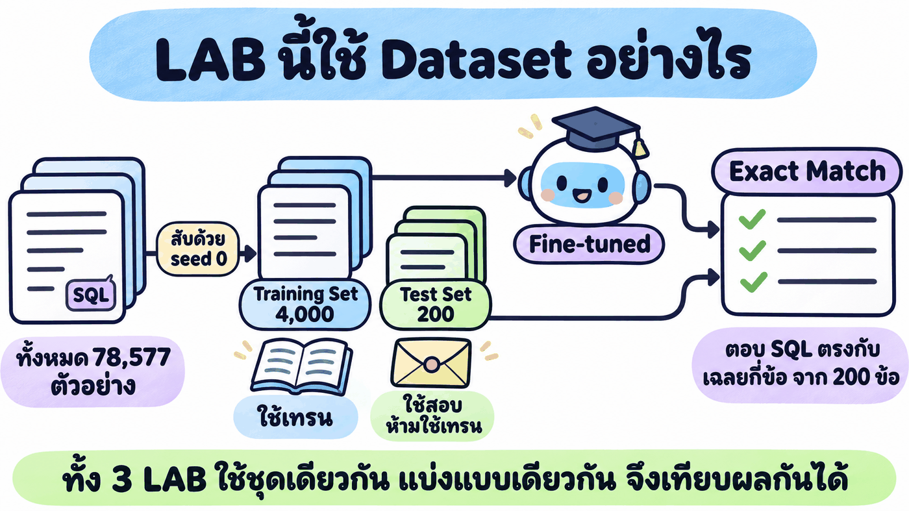
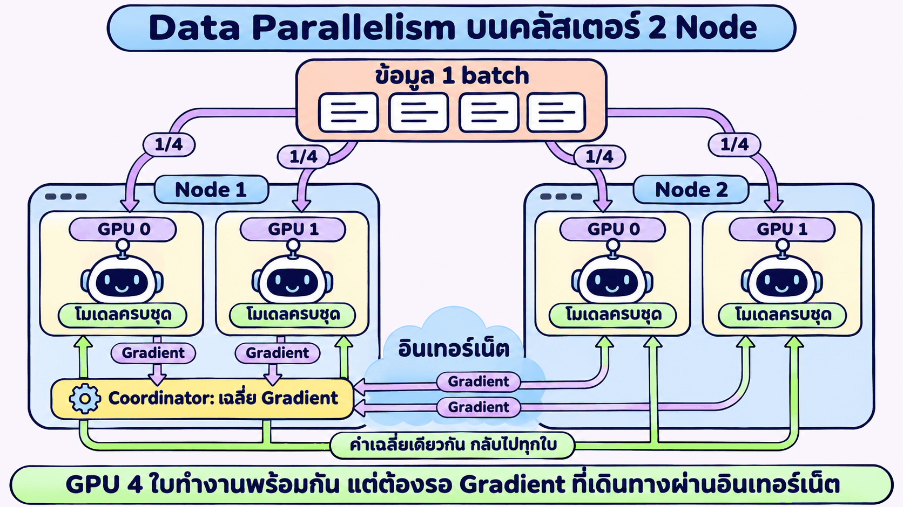
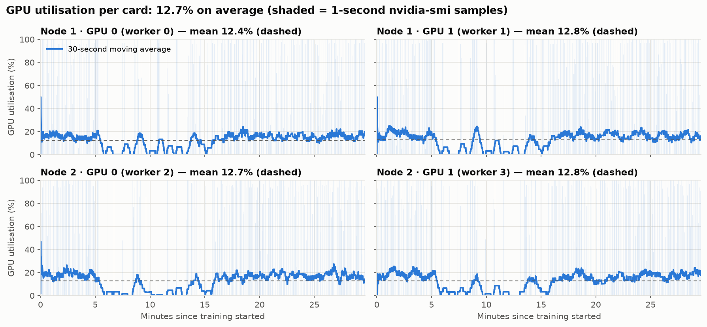
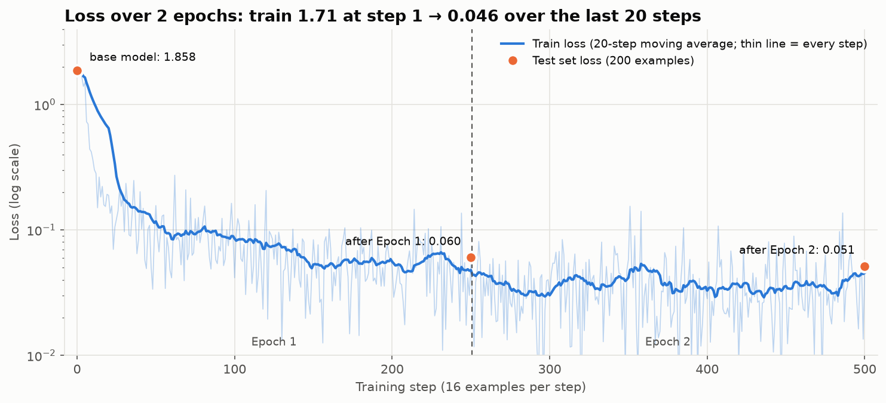
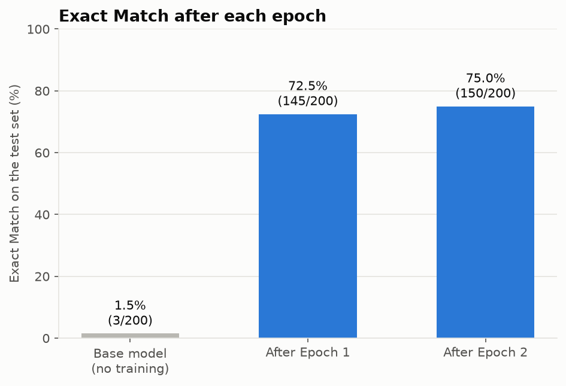
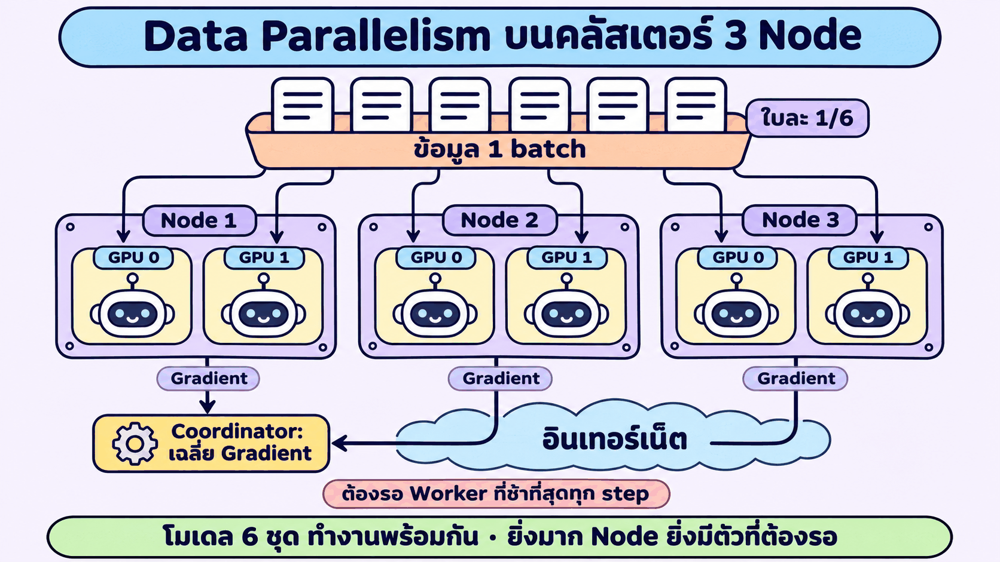
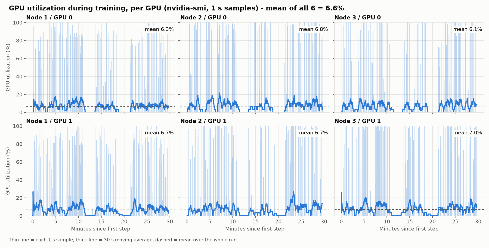
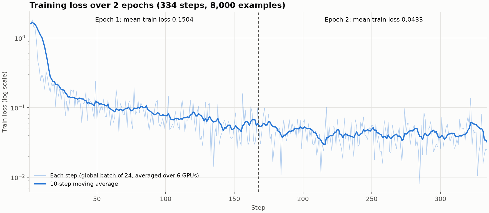
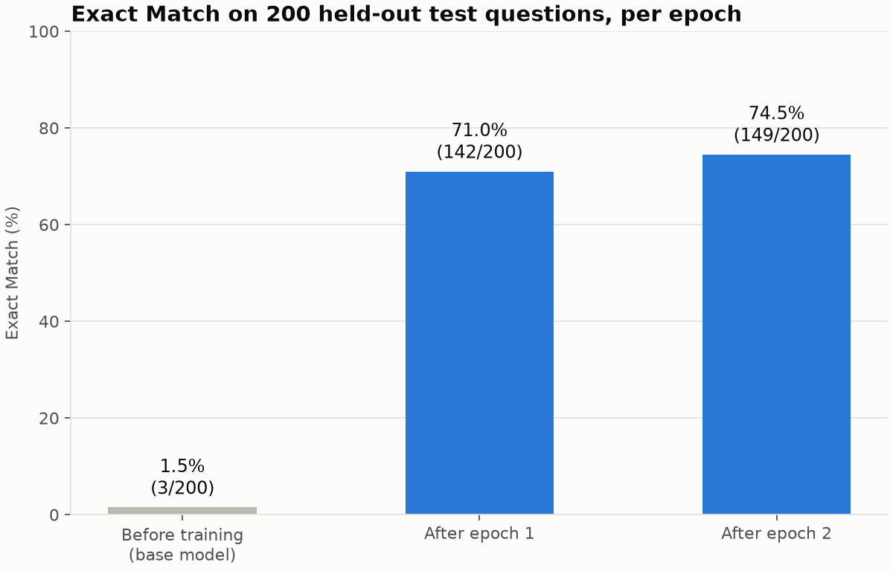

# LAB 5.1 · Data Parallelism บนคลัสเตอร์: หลายเครื่อง แบ่งข้อมูลกันเทรน (2 Node และ 3 Node)

[← กลับหน้ารวม LAB 5](../README.md) · [LAB 5.2 Model Parallelism บนคลัสเตอร์](../2_model_parallel/README.md) · [LAB 4.2 Data Parallelism ในเครื่องเดียว](../../lab4_multigpu/2_data_parallel/README.md) · เปิด Claude Code ที่โฟลเดอร์ของบท `02_VastAi_Application`

## ทำไปเพื่ออะไร


LAB 4.2 เทรน Qwen3-8B แบบ Data Parallelism ด้วย GPU 2 ใบ **ในเครื่องเดียว** (1 Node)

LAB นี้ทำงานเดิม แต่ใช้ **หลายเครื่อง** เครื่องละ 2 GPU ต่อกันผ่านอินเทอร์เน็ต เรียกว่า **คลัสเตอร์** · 1 เครื่อง = 1 **Node**

คำถามของ LAB: **เพิ่มเครื่องเป็น 2 Node และ 3 Node แล้วเทรนเร็วขึ้นกี่เท่าเมื่อเทียบกับ 1 Node และเวลาของ 1 step หมดไปกับอะไร**

- **1 Node ไม่ต้องรันใหม่** ใช้ผลของ [LAB 4.2 ส่วน GPU 2 ใบ](../../lab4_multigpu/2_data_parallel/README.md) เป็นตัวเทียบ · LAB นี้จึงใช้โมเดล Dataset และ batch ต่อ GPU เท่ากับ LAB 4.2
- LAB นี้มี **6 ขั้น ทุกขั้นคือ 1 พรอมต์** · ขั้นที่ 1–3 ใช้ 2 Node · ขั้นที่ 4–6 ทำซ้ำด้วย 3 Node · **โค้ดทุกไฟล์ AI เขียนให้จากพรอมต์ เริ่มจากโฟลเดอร์ว่าง**

# ภาคทฤษฎี

## รู้จัก Dataset


| หัวข้อ | sql-create-context |
|---|---|
| ชื่อ | [b-mc2/sql-create-context](https://huggingface.co/datasets/b-mc2/sql-create-context) |
| คืออะไร | คำถามภาษาอังกฤษ + โครงสร้างตาราง (`CREATE TABLE`) + คำสั่ง SQL เฉลย ใช้สอนโมเดลให้แปลงคำถามเป็น SQL |
| ที่มา | สร้างจาก WikiSQL และ Spider โดยเติมคำสั่ง `CREATE TABLE` ให้ทุกคำถาม |
| จำนวน | 78,577 ตัวอย่าง |
| สัญญาอนุญาต | CC BY 4.0 |
| LAB นี้ใช้อย่างไร | สับด้วย seed 0 แล้วแบ่ง **Training Set 4,000** และ **Test Set 200** (ไม่ซ้ำกัน) · **ทุก Node ต้องได้ชุดเดียวกัน** และเป็นชุดเดียวกับ LAB 4 |



ตัวอย่างจริง 3 รายการของ Training Set (AI ทำให้ในขั้นที่ 1 · ครบ 6 รายการที่ [results/dataset_samples.md](results/dataset_samples.md))

| คำถาม (`question`) | โครงสร้างตาราง (`context`) | SQL เฉลย (`answer`) |
|---|---|---|
| What is the lowest unlock order for the athens circuit? | `CREATE TABLE table_24463470_1 (unlock_order INTEGER, circuit VARCHAR)` | `SELECT MIN(unlock_order) FROM table_24463470_1 WHERE circuit = "Athens"` |
| Which engine has a year larger than 1956? | `CREATE TABLE table_name_74 (engine VARCHAR, year INTEGER)` | `SELECT engine FROM table_name_74 WHERE year > 1956` |
| What is the smallest number of fastest laps listed? | `CREATE TABLE table_19312274_3 (fastest_laps INTEGER)` | `SELECT MIN(fastest_laps) FROM table_19312274_3` |

| ช่อง | หน้าที่ | ในแถวที่ 2 |
|---|---|---|
| `question` | คำถามภาษาคน · Input ส่วนที่ 1 | ถามหา engine ที่ปีมากกว่า 1956 |
| `context` | โครงสร้างตาราง · Input ส่วนที่ 2 | ตาราง `table_name_74` มีคอลัมน์ `engine` (ข้อความ) และ `year` (ตัวเลข) |
| `answer` | SQL ที่ถูกต้อง · Output ที่โมเดลต้องเขียนให้ได้ และใช้เทียบ Exact Match | `SELECT engine … WHERE year > 1956` |

## รู้จักโมเดลที่ใช้


| หัวข้อ | Qwen3-8B |
|---|---|
| ประเภท | Large Language Model (LLM) · 36 Layer |
| Input | ข้อความ · LAB นี้ใส่โครงสร้างตาราง + คำถาม |
| Output | ข้อความ · LAB นี้ให้ตอบเป็นคำสั่ง SQL อย่างเดียว (ปิดโหมด thinking) |
| ขนาด | 8.19 พันล้าน parameter · 16.4 GB บน disk · ราว 15.3 GiB ใน VRAM แบบ bf16 |
| ที่มา | ทีม Qwen ของ Alibaba Cloud · [Qwen/Qwen3-8B](https://huggingface.co/Qwen/Qwen3-8B) · Apache-2.0 |
| LAB นี้ใช้ทำอะไร | **Base** = โมเดลตามที่โหลดมา · **Fine-tuned** = โมเดลนี้ + LoRA ที่เทรนด้วย Training Set 4,000 ตัวอย่าง วัดหลังจบแต่ละ Epoch |

## ทฤษฎีที่ต้องรู้

### 1 · LoRA: สิ่งที่ถูกเทรน และสิ่งที่ต้องส่งข้ามเครื่อง


**คืออะไร** LoRA = ล็อกน้ำหนักเดิมของโมเดลทั้งหมด แล้วแปะตารางตัวเลขเล็ก ๆ (rank 8) ไว้ที่ `q_proj` กับ `v_proj` ของทุก Layer เทรนเฉพาะตารางเล็กนั้น (ที่มาของ Query Key Value อยู่ในภาพ [t-qkv.png](image/t-qkv.png) และ [LAB 4.2 ข้อ 1](../../lab4_multigpu/2_data_parallel/README.md))

**ทำไมสำคัญกับคลัสเตอร์** สิ่งที่ต้องส่งข้ามเครื่องทุก step คือ Gradient ของส่วนที่เทรนเท่านั้น · เทรนแค่ LoRA จึงส่งแค่ราว 15 MB ไม่ใช่ 16 GB

**ตัวเลขจาก LAB นี้** LoRA r 8 · alpha 16 · เทรน **3,833,856** parameter (0.047% ของโมเดล) · Gradient 1 ชุด = 3,833,856 ค่า × 4 byte = **15.3 MB** (วัดได้ 15,335,424 byte)

### 2 · Data Parallelism จากในเครื่องเดียว สู่คลัสเตอร์


**คืออะไร** หลักเดิมของ LAB 4.2: GPU ทุกใบถือโมเดล **ครบชุด** แบ่งข้อมูลกันเทรน แล้วเฉลี่ย Gradient ให้ทุกใบปรับน้ำหนักเหมือนกัน · ต่างกันที่ GPU อยู่คนละเครื่อง Gradient จึงต้องเดินทางผ่านอินเทอร์เน็ต

**ทำงานอย่างไร** เปิดโปรแกรมเทรน (Worker) 1 ตัวต่อ GPU · 2 Node จึงมี Worker 4 ตัว โมเดล 4 ชุด

| | 1 Node (LAB 4.2) | 2 Node | 3 Node |
|---|---|---|---|
| GPU ทั้งหมด = จำนวนโมเดล | 2 | 4 | 6 |
| batch ต่อ GPU | 4 | 4 | 4 |
| batch รวม | 8 | 16 | 24 |
| ตัวอย่างที่แต่ละใบได้ใน 1 Epoch | 2,000 | 1,000 | ราว 667 |
| step ต่อ Epoch | 500 | 250 | 167 |

### 3 · Coordinator: โปรแกรมกลางที่เฉลี่ย Gradient


**คืออะไร** ในเครื่องเดียว PyTorch (DDP) เฉลี่ย Gradient ระหว่าง GPU ให้เอง · ข้ามเครื่องเช่า GPU ไม่เห็นกันโดยตรง จึงต้องมีโปรแกรมกลาง 1 ตัวบน Node 1 เรียกว่า **Coordinator**

**ทำไมออกแบบแบบนี้** เครื่องเช่าเปิดรับการเชื่อมต่อจากภายนอกได้ไม่กี่ port · จึงให้ Node 1 เปิด **port เดียว** แล้วให้ Worker ทุกตัว **ต่อออก** ไปหา Coordinator

**ทำงานอย่างไร** (Synchronous)

| ลำดับ | Coordinator ทำอะไร |
|---|---|
| 1 | รอ Gradient จาก Worker **ครบทุกตัว** |
| 2 | เฉลี่ย |
| 3 | ส่งค่าเฉลี่ยเดียวกันกลับทุก Worker แล้วทุกตัว Update พร้อมกัน |

เพราะรอครบทุกตัว น้ำหนัก LoRA ของทุก Worker จึงเท่ากันเสมอ (LAB นี้ตรวจทุก Epoch) · แต่ทั้งคลัสเตอร์เดินได้เร็วเท่า **Worker ที่ช้าที่สุด**

### 4 · 1 step ใช้เวลากับอะไร: คำนวณ กับ ส่งและรอ


**เวลาต่อ step = เวลาคำนวณ + เวลาส่งและรอ**

| ส่วน | เกิดอะไรขึ้น | ขึ้นกับ |
|---|---|---|
| คำนวณ | Forward + Backward + Update บน GPU | ความเร็ว GPU และ batch |
| ส่งและรอ | ส่ง Gradient → รอ Coordinator ได้ครบและเฉลี่ย → รับค่าเฉลี่ยกลับ | ความเร็วเน็ตระหว่าง Node และ Worker ที่ช้าที่สุด |

ระหว่าง "ส่งและรอ" GPU **ไม่ได้ทำงาน** · ถ้าส่วนนี้ยาว GPU util จะต่ำ และค่าเช่าที่จ่ายไปก็ไม่ได้งาน


**ประมาณก่อนเทรนได้** จากขนาด Gradient และความเร็วเน็ตที่วัดในขั้นที่ 1 (ตัวเลขของส่วน 2 Node)

| | ค่า |
|---|---|
| Node 2 มี Worker 2 ตัว ส่ง Gradient ขึ้นต่อ step | 2 × 15.3 MB = 30.7 MB = 245 Mbit |
| ความเร็ว Node 2 → Node 1 ที่วัดได้ | 143 Mbps |
| เวลาส่งขึ้นที่ **คำนวณ** ได้ | 245 ÷ 143 ≈ **1.7 วินาที** (ยังไม่รวมขากลับ) |
| เวลาคำนวณบน GPU ต่อ step ที่วัดได้ | 0.43 วินาที |
| เวลาส่งและรอที่ **วัดได้จริง** | ค่ากลาง 2.24 วินาที · เฉลี่ย 3.11 วินาที |

แค่ส่ง Gradient ขึ้นก็นานกว่าการคำนวณราว 4 เท่าแล้ว · นี่คือเหตุผลที่ต้องวัดเน็ตก่อนเทรน

### 5 · Speedup และ Efficiency: วัดความคุ้มของการเพิ่มเครื่อง


| ตัววัด | สูตร | อุดมคติ |
|---|---|---|
| Speedup | ตัวอย่างต่อวินาทีของ N Node ÷ ของ 1 Node | N เท่า |
| Efficiency | Speedup ÷ N | 100% |
| เงินต่อ 1,000 ตัวอย่าง | ราคาต่อชั่วโมงของทุกเครื่องรวมกัน ÷ 3600 ÷ ตัวอย่างต่อวินาที × 1,000 | เท่ากับ 1 Node |

Speedup **ต่ำกว่า 1** แปลว่าเพิ่มเครื่องแล้ว **ช้าลง** · เกิดได้เมื่อเวลาส่งและรอยาวกว่าเวลาที่ประหยัดได้จากการแบ่งงาน

### 6 · จาก 2 Node เป็น 3 Node: คาดว่าอะไรจะเปลี่ยน


| สิ่งที่ดู | คาดว่า | เพราะ |
|---|---|---|
| batch รวม | 16 → **24** | เพิ่ม GPU 2 ใบ ใบละ 4 |
| step ต่อ Epoch | 250 → **167** | batch รวมใหญ่ขึ้น |
| เวลาคำนวณต่อ step | **ใกล้เดิม** | batch ต่อ GPU เท่าเดิม |
| เวลาส่งและรอต่อ step | **นานขึ้น** | Gradient เข้า Coordinator มากขึ้น (6 ชุด) และต้องรอ Worker ที่ช้าที่สุดจาก 6 ตัว |
| ตัวอย่างต่อวินาที | **ขึ้นกับเน็ต** | ได้ตัวอย่างต่อ step เพิ่ม 1.5 เท่า · ถ้าเวลาต่อ step นานขึ้นเกิน 1.5 เท่า จะไม่เร็วขึ้นเลย |
| เงินต่อ 1,000 ตัวอย่าง | **แพงขึ้น** ถ้าไม่เร็วขึ้น | จ่ายค่าเช่า 3 เครื่อง |

ผลจริงอยู่ที่ [1 Node เทียบ 2 Node เทียบ 3 Node](#1-node-เทียบ-2-node-เทียบ-3-node)

# ภาค LAB

## การทดลอง

| หัวข้อ | ส่วนที่ 1 · 2 Node (ขั้นที่ 1–3) | ส่วนที่ 2 · 3 Node (ขั้นที่ 4–6) |
|---|---|---|
| Dataset | b-mc2/sql-create-context · Training Set 4,000 · Test Set 200 · สับด้วย seed 0 | ชุดเดียวกัน |
| โมเดล | Qwen/Qwen3-8B แบบ bf16 + LoRA r 8 alpha 16 ที่ `q_proj` `v_proj` | เหมือนกัน |
| สิ่งที่ทดลอง | Data Parallelism ข้าม 2 Node (GPU 4 ใบ โมเดล 4 ชุด) เฉลี่ย Gradient ผ่าน Coordinator | เหมือนกัน ข้าม 3 Node (GPU 6 ใบ โมเดล 6 ชุด) |
| ค่าที่ตรึง | batch 4 ต่อ GPU (รวม 16) · learning rate 2e-4 · seed 0 · ข้อความยาวไม่เกิน 256 token · ปิด thinking · ไม่ใช้ Gradient Checkpointing · **2 Epoch** | เหมือนกัน · batch รวม 24 |
| วิธีวัด | เน็ตระหว่าง Node (RTT และความเร็ว) · เวลาต่อ step แยกเป็นคำนวณ กับ ส่งและรอ · ตัวอย่างต่อวินาที · GPU util · น้ำหนัก LoRA ของทุก Worker เท่ากันหรือไม่ · loss และ Exact Match บน Test Set ของ Base และหลังจบแต่ละ Epoch | เหมือนกัน |
| ตัวเทียบ 1 Node | [LAB 4.2 ส่วน GPU 2 ใบ](../../lab4_multigpu/2_data_parallel/README.md) (ไม่รันใหม่) | ตัวเดียวกัน |
| เครื่อง (ที่เช่าได้) | RTX 3090 24 GB × 2 จำนวน 2 เครื่อง · ไต้หวันทั้งคู่ · $0.4862 + $0.4940 = **$0.9802/ชม.** | RTX 3090 24 GB × 2 จำนวน 3 เครื่อง · เอสโตเนีย บัลแกเรีย โรมาเนีย · $0.4140 + $0.4164 + $0.5180 = **$1.3484/ชม.** |
| เวลาและค่าเช่าจริง | 3 ขั้นรวม 84 นาที · เครื่องเปิดเครื่องละ 1.25 ชม. · ใบคิดเงิน **$1.588** | 3 ขั้นรวม 75 นาที · เครื่องเปิดเครื่องละ 1.14 ชม. · ใบคิดเงิน **$1.883** |

ทำตามลำดับขั้นที่ 1 → 6 · แต่ละส่วนทำให้ครบในรอบเดียว · โค้ดของส่วนที่ 1 อยู่ใน `lab5_cluster/1_data_parallel/code` (เริ่มจากว่าง) · ของส่วนที่ 2 อยู่ใน `node3/`

> ⚠️ เงินเดินพร้อมกันทุกเครื่องตั้งแต่ขั้นเช่าจนกว่าจะลบ · **ต้องทำขั้นที่ 3 และขั้นที่ 6 ทุกครั้ง** แม้งานระหว่างทางจะล้ม

## ส่วนที่ 1 · 2 Node (ขั้นที่ 1–3)

## ขั้นที่ 1 · เช่า 2 Node เตรียมของ และวัดเน็ต


*สิ่งที่เพิ่มจาก LAB 4 คือช่องขวาสุด: วัดเน็ตระหว่าง Node ก่อนเทรน*

AI เช่า 2 เครื่อง โหลดโมเดลและ Dataset ลงทั้ง 2 Node แบ่งชุดข้อมูลให้ตรงกัน แล้ววัดเน็ตระหว่าง Node

```text
[ที่ทำงาน]
container `multi-account` · โฟลเดอร์ /workspace/vastapp_lab · สกิล vastai
กุญแจ SSH: /workspace/vastai_lab/Devtool_SSH/devtoolSSH
เก็บโค้ดและผลที่: lab5_cluster/1_data_parallel ของโฟลเดอร์ที่เปิด Claude Code อยู่ (ไม่ใช่ใน container)

[งาน]
เช่าเครื่อง 2 เครื่อง (เรียกว่า Node 1 และ Node 2) เครื่องละ GPU 2 ใบ แล้วเตรียมโมเดลกับ Dataset ให้ทั้งสอง Node

[เครื่องที่ต้องการ]
จำนวน: 2 เครื่อง ที่มี IP สาธารณะต่างกัน · ป้าย vapp-lab5-dp-1 และ vapp-lab5-dp-2
GPU: RTX 4090 2 ใบในเครื่องเดียว · ราคาไม่เกิน $0.60 ต่อชั่วโมงต่อเครื่อง
เงื่อนไข: verified · reliability 0.95 ขึ้นไป · ความเร็วเน็ตไม่ต่ำกว่า 1,200 Mbps · ค่าดาวน์โหลดไม่เกิน $0.01 ต่อ GB · CPU 16 cores ขึ้นไป · ไม่อยู่ในจีน
ระบบ: PyTorch 2.8 ที่มี CUDA 12.8 · disk 60 GB · Node 1 เปิด port ให้เครื่องอื่นต่อเข้ามาได้ 1 port

[ขั้นตอน]
1. เช่าเครื่องที่ถูกที่สุดตามเงื่อนไขทั้ง 2 เครื่อง โดยเลือกให้อยู่ใกล้กัน ถ้าเครื่องไหนเกิน 10 นาทียังไม่พร้อม ให้ลบแล้วเช่าเครื่องอื่น
2. โหลดโมเดล Qwen/Qwen3-8B และ Dataset b-mc2/sql-create-context ลงทั้ง 2 Node
3. สับ Dataset ด้วย seed 0 แล้วแบ่ง Training Set 4,000 ตัวอย่าง และ Test Set 200 ตัวอย่าง ให้ทั้ง 2 Node ได้ชุดเดียวกัน
4. ทำตารางตัวอย่าง 6 รายการ (คำถาม · โครงสร้างตาราง · SQL เฉลย) เก็บที่ results/dataset_samples.md
5. วัดเน็ตระหว่าง 2 Node: Node 2 ต่อเข้า port ของ Node 1 ได้หรือไม่ · เวลาไปกลับ (RTT) · ความเร็วส่งข้อมูลทั้งสองทิศ
   ถ้า RTT ของ Node ใดเกิน 100 ms ให้ลบเครื่องนั้นแล้วเช่าเครื่องใหม่แทน แล้ววัดซ้ำ (เปลี่ยนได้ไม่เกิน 2 ครั้ง)

[รายงาน]
สรุปเป็นตาราง: เครื่องที่ได้ของแต่ละ Node · ราคาต่อชั่วโมง · เน็ตระหว่าง Node (RTT และความเร็ว) · จำนวนตัวอย่างของแต่ละชุด
อธิบายตัวอย่าง 1 รายการว่าแต่ละช่องคืออะไร · ห้ามแสดงค่า key · บอกว่าเครื่องยังเปิดอยู่
```


*ใช้เวลา 27 นาที*

**เน็ตระหว่าง Node ที่วัดได้** ([results/network.json](results/network.json))

| การวัด | ผล |
|---|---|
| Node 2 ต่อเข้า port ของ Node 1 | ได้ |
| RTT | เฉลี่ย 5.95 ms |
| ความเร็ว Node 2 → Node 1 | **143 Mbps** |
| ความเร็ว Node 1 → Node 2 | 784 Mbps |

ตัวอย่างโค้ดที่ AI เขียนให้ในรอบจริง (ของคุณอาจต่างกัน): [rent.py](code_reference/rent.py) · [prepare_node.py](code_reference/prepare_node.py) · [setup_nodes.py](code_reference/setup_nodes.py) · [nettest.py](code_reference/nettest.py) · ผล: [results/dataset_samples.md](results/dataset_samples.md) · [results/network.json](results/network.json)

**อ่านผลอย่างไร**

- **RTT ต่ำไม่ได้แปลว่าส่งข้อมูลเร็ว** · สองเครื่องอยู่ประเทศเดียวกัน RTT แค่ 6 ms แต่ทิศ Node 2 → Node 1 ส่งได้เพียง 143 Mbps ทั้งที่ตอนเลือกเครื่องกรองไว้ที่ 700 Mbps ขึ้นไป · ตัวเลขในหน้าเช่าคือความเร็วออกอินเทอร์เน็ตของเครื่อง ไม่ใช่ความเร็วระหว่างสองเครื่องที่เช่ามา **ต้องวัดเอง**
- **สองทิศเร็วไม่เท่ากัน** (143 กับ 784 Mbps) · ทิศที่ช้าคือทิศที่ Worker ของ Node 2 ใช้ส่ง Gradient ขึ้น จึงเป็นตัวกำหนดเวลาต่อ step (ทฤษฎีข้อ 4)
- ทั้ง 2 Node ต้องได้ Training Set 4,000 และ Test Set 200 **ชุดเดียวกัน** · ถ้าแบ่งไม่ตรงกัน บาง Worker จะเทรนด้วยข้อมูลที่อีกตัวใช้สอบ
- ตั้งแต่ขั้นนี้เงินเดินชั่วโมงละ $0.98 (2 เครื่องรวมกัน)

## ขั้นที่ 2 · เทรนแบบ Data Parallelism ข้าม 2 Node


*นี่คือแนวคิดที่บรรทัด "แนวคิด" ในพรอมต์บรรยายไว้*


*batch ถูกตรึงไว้เท่ากับ LAB 4.2 · ข้อ 2 จึงเป็นการตรวจว่า batch นั้นไม่ Out of Memory กับข้อมูลที่มี padding*

AI เขียน `code/coordinator.py` `code/worker.py` และ `code/eval.py` แล้วลอง 3 step → เทรน 2 Epoch พร้อมจับเวลาทุก step → วัด Exact Match ของ Base และทุก Epoch

```text
[ที่ทำงาน]
container `multi-account` · โฟลเดอร์ /workspace/vastapp_lab · สกิล vastai
เครื่อง: ป้าย vapp-lab5-dp-1 (Node 1) และ vapp-lab5-dp-2 (Node 2) · กุญแจ SSH: /workspace/vastai_lab/Devtool_SSH/devtoolSSH
เก็บโค้ดและผลที่: lab5_cluster/1_data_parallel ของโฟลเดอร์ที่เปิด Claude Code อยู่ (ไม่ใช่ใน container)

[งาน]
เทรน Qwen3-8B ให้แปลงคำถามเป็น SQL แบบ Data Parallelism บนคลัสเตอร์ 2 Node
แนวคิด: GPU ทั้ง 4 ใบถือโมเดลคนละชุด แบ่งข้อมูลใบละ 1 ใน 4 · ทุก step ส่ง Gradient ของ LoRA ไปเฉลี่ยที่โปรแกรมกลางบน Node 1 แล้วทุกใบปรับน้ำหนักด้วยค่าเฉลี่ยเดียวกัน

[ขั้นตอน]
1. เขียนโปรแกรมกลาง code/coordinator.py รันบน Node 1 เปิด port เดียว: รอ Gradient จากทุกโปรแกรมเทรนให้ครบ เฉลี่ย แล้วส่งค่าเฉลี่ยกลับ (Synchronous)
2. เขียนโปรแกรมเทรน code/worker.py เปิด 1 ตัวต่อ GPU รวม 4 ตัว แต่ละตัวต่อออกไปหาโปรแกรมกลาง และได้ข้อมูลคนละส่วนไม่ซ้ำกัน
3. ลอง 3 step ด้วย batch ที่มีตัวอย่างยาวที่สุดปนกับตัวอย่างสั้น (มี padding เหมือนตอนเทรนจริง) ถ้า Out of Memory ให้แก้โค้ดให้ใช้หน่วยความจำน้อยลง โดยไม่เปลี่ยนค่าที่ตรึง
4. เทรน 2 Epoch และจับเวลาของทุก step แยกเป็น 2 ส่วน: เวลาคำนวณบน GPU และเวลาส่งกับรอ Gradient
5. เขียน code/eval.py วัด Exact Match บน Test Set ของโมเดลก่อนเทรน (Base) และหลังจบแต่ละ Epoch (ไม่นับ ; ท้ายคำสั่งเป็นข้อผิด)
6. หลังจบแต่ละ Epoch ตรวจว่าน้ำหนัก LoRA ของทั้ง 4 ตัวเท่ากัน
7. ให้งานรันต่อได้แม้การเชื่อมต่อหลุด และรายงานทุก 2–3 นาที

[ค่าที่ตรึง]
โมเดล: Qwen/Qwen3-8B แบบ bf16 · ปิด thinking · ไม่ใช้ Gradient Checkpointing
LoRA: r 8 · alpha 16 · ที่ q_proj กับ v_proj
การเทรน: learning rate 2e-4 · seed 0 · ข้อความยาวไม่เกิน 256 token · 2 Epoch
batch: 4 ต่อ GPU (รวม 16) เท่ากับ batch ต่อ GPU ของ LAB 4.2 เพื่อเทียบกับผล 1 Node ได้

[รายงาน]
สรุปเป็นตาราง: batch ต่อ GPU และรวม · VRAM สูงสุดของแต่ละใบ · วินาทีต่อ step (แยกเวลาคำนวณ กับเวลาส่งและรอ) · ขนาด Gradient ที่ส่งต่อ step · ตัวอย่างต่อวินาที · GPU util ของแต่ละใบ · loss และ Exact Match ของ Base และหลังจบแต่ละ Epoch
บอกว่าเครื่องยังเปิดอยู่
```

![ช่องพิมพ์ของ Claude Code ที่วางพรอมต์ขั้นที่ 2 และคำตอบ: เทรนครบ 2 Epoch 500 step batch 4 ต่อ GPU รวม 16 เฉลี่ย 3.56 วินาทีต่อ step เป็นเวลาคำนวณบน GPU 0.43 วินาที 12% และเวลาส่งและรอ Gradient 3.11 วินาที 88% ได้ 4.50 ตัวอย่างต่อวินาที ตาราง Worker 4 ตัว GPU util เฉลี่ยราว 12–13% ตาราง loss และ Exact Match Base 1.5% จบ Epoch 1 72.5% จบ Epoch 2 75.0% น้ำหนัก LoRA 4 ตัวเท่ากัน หัวข้อสิ่งที่เกิดระหว่างทำ ลอง 3 step แล้ว Out of Memory จึงแก้ให้คำนวณ logits เฉพาะตำแหน่งคำตอบ และเน็ตสะดุด 2 ช่วง บอกว่าเครื่องยังเปิดอยู่](image/lab5a-step2.png)
*ใช้เวลา 46 นาที (บนเครื่องเช่า: เทรน 2 Epoch 29.6 นาที)*

**เวลาของ 1 step** ([results/metrics.json](results/metrics.json))

| | เฉลี่ย | ส่วนแบ่ง |
|---|---|---|
| วินาทีต่อ step | **3.56** (ค่ากลาง 2.67) | 100% |
| คำนวณบน GPU | 0.43 | **12%** |
| ส่งและรอ Gradient | 3.11 (ค่ากลาง 2.24) | **88%** |


**ทั้งรอบ**

| รายการ | ค่า |
|---|---|
| batch ต่อ GPU / รวม | 4 / 16 · 250 step ต่อ Epoch · รวม 500 step |
| ตัวอย่างต่อวินาที | **4.50** (8,000 ตัวอย่างใน 1,777.5 วินาที) · Epoch 1 ได้ 3.63 · Epoch 2 ได้ 5.92 |
| GPU util เฉลี่ยของ 4 ใบ | **12.4% / 12.8% / 12.7% / 12.8%** |
| VRAM สูงสุด (nvidia-smi) | 22,772 / 21,404 / 22,776 / 21,642 MiB จาก 24,576 |
| Gradient ที่ส่งต่อ step | 15.3 MB ต่อ Worker (float32 ไม่บีบอัด) · ค่าเฉลี่ยที่ส่งกลับขนาดเท่ากัน |



| จุดวัด | train loss | test loss | Exact Match (200 ข้อ) | น้ำหนัก LoRA ของ Worker 4 ตัว |
|---|---|---|---|---|
| Base | – | 1.8575 | 1.5% (3/200) | – |
| จบ Epoch 1 | 0.1198 | 0.0603 | 72.5% (145/200) | เท่ากันทุกค่า |
| จบ Epoch 2 | 0.0371 | 0.0515 | **75.0%** (150/200) | เท่ากันทุกค่า |





ตัวอย่างโค้ดที่ AI เขียนให้ในรอบจริง (ของคุณอาจต่างกัน): [coordinator.py](code_reference/code/coordinator.py) · [worker.py](code_reference/code/worker.py) · [eval.py](code_reference/code/eval.py) · [common.py](code_reference/code/common.py) · [ctl.py](code_reference/code/ctl.py) · ผลราย step: [results/train/](results/train/)

**อ่านผลอย่างไร**

- **88% ของเวลาคือการส่งและรอ** · GPU คำนวณ 0.43 วินาที แล้วรอเครือข่ายอีกราว 3 วินาที · GPU util จึงเหลือ 12–13% เทียบกับราว 98% ของ 1 Node · ตรงกับที่ประมาณไว้ในทฤษฎีข้อ 4
- **Worker ทั้ง 4 ตัวใช้เวลาเท่ากัน** แม้ 2 ตัวของ Node 1 อยู่เครื่องเดียวกับ Coordinator · เพราะเป็นแบบ Synchronous ทุกตัวต้องรอ Gradient ของ Node 2 ให้มาถึงก่อน
- **เน็ตไม่นิ่ง** · ช่วง step 120–200 ทิศ Node 2 → Node 1 ช้าลงมาก 16 step ใช้ 6–44 วินาที (รวม 462 วินาที) · Epoch 1 จึงได้ 3.63 ตัวอย่างต่อวินาที ส่วน Epoch 2 ที่เน็ตนิ่งได้ 5.92 · ค่ากลาง (2.67 วินาทีต่อ step) บอกวันที่เน็ตปกติได้ดีกว่าค่าเฉลี่ย
- **น้ำหนัก LoRA เท่ากันทุกค่าทั้ง 4 ตัว** หลังจบทั้ง 2 Epoch = การเฉลี่ยข้ามเครื่องทำงานถูก โมเดล 4 ชุดคือโมเดลเดียวกัน
- **Exact Match 75.0% ใกล้กับ 1 Node (77.5% หลัง Epoch 2)** · ต่างกัน 5 ข้อจาก 200 · batch รวมใหญ่กว่า (16 เทียบ 8) จึงปรับน้ำหนักเพียง 250 ครั้งต่อ Epoch
- **Base ได้ 1.5% เพราะสไตล์** · Base ใช้ `'...'` และตัวพิมพ์ต่างจากเฉลย การวัดนี้ตัดแค่ช่องว่างซ้ำและ `;` ท้ายคำสั่ง
- **batch ที่ตรึงไว้ยังล้มได้** · การลอง 3 step ครั้งแรก Out of Memory บน GPU ที่ได้ batch ยาว 256 token · AI แก้ `worker.py` ให้คำนวณคะแนนคำศัพท์เฉพาะตำแหน่งคำตอบ SQL (loss เท่าเดิม) แล้วผ่านที่ 22,063 MiB โดยไม่แตะค่าที่ตรึง · นี่คือเหตุผลที่ข้อ 2 ของพรอมต์ให้ลองด้วย batch ที่มี padding ก่อน
- ข้อ 6 ของพรอมต์ถูกทดสอบจริง · AI ปิดโปรแกรมกลางทางแล้วเปิดใหม่ Worker ต่อกลับเองและน้ำหนักยังเท่ากัน

## ขั้นที่ 3 · สรุป คิดเงิน และลบเครื่องทั้ง 2 Node (ห้ามข้าม)


*ต่างจาก LAB 4 ตรงที่ราคาต่อชั่วโมงคือ **ผลรวมของทุกเครื่อง***

AI เก็บผลดิบจากทั้ง 2 Node เขียน `code/report.py` ทำ `results/metrics.json` และกราฟ แล้วลบเครื่องทั้งสอง

```text
[ที่ทำงาน]
container `multi-account` · โฟลเดอร์ /workspace/vastapp_lab · สกิล vastai
เครื่อง: ป้าย vapp-lab5-dp-1 (Node 1) และ vapp-lab5-dp-2 (Node 2) · กุญแจ SSH: /workspace/vastai_lab/Devtool_SSH/devtoolSSH
เก็บโค้ดและผลที่: lab5_cluster/1_data_parallel ของโฟลเดอร์ที่เปิด Claude Code อยู่ (ไม่ใช่ใน container)

[งาน]
สรุปผลเป็นกราฟ แล้วลบเครื่องทั้ง 2 Node

[ขั้นตอน]
1. นำผลดิบของทั้ง 2 Node กลับมาที่ results/raw
2. เขียน code/report.py รวมตัวเลขลง results/metrics.json พร้อมเงินต่อ 1,000 ตัวอย่าง (คิดจากราคาของ 2 เครื่องรวมกัน)
3. ให้สคริปต์วาดกราฟที่ results/images (ข้อความอังกฤษ): เวลาต่อ step แยกเวลาคำนวณกับเวลาส่งและรอ · GPU util ของแต่ละใบ · loss ตลอด 2 Epoch · Exact Match ของแต่ละ Epoch
4. ลบเครื่องป้าย vapp-lab5-dp-1 และ vapp-lab5-dp-2 แล้วตรวจว่าไม่เหลือ (ห้ามแตะเครื่องป้ายอื่น)

[รายงาน]
สรุปเป็นตาราง: ตัวอย่างต่อวินาที · สัดส่วนเวลาที่ใช้ส่งและรอ · Exact Match · เงินต่อ 1,000 ตัวอย่าง
ค่าใช้จ่ายจริงของแต่ละเครื่อง: อายุเครื่อง · ยอดที่ถูกคิด · ห้ามแสดงค่า key
```


*ใช้เวลา 11 นาที*

| รายการ | ค่า |
|---|---|
| ราคา 2 เครื่องรวมกัน | $0.9802 ต่อชั่วโมง |
| เงินต่อ 1,000 ตัวอย่าง | 0.9802 ÷ 3600 ÷ 4.50 × 1,000 = **$0.0605** |
| ค่าเช่าเฉพาะช่วงเทรน 29.6 นาที | $0.48 |
| ใบคิดเงินจริงของทั้ง 2 เครื่อง | **$1.588** = GPU $1.151 + disk $0.049 + ดาวน์โหลด $0.217 + อัปโหลด $0.171 ([results/billing.json](results/billing.json)) |

ตัวอย่างโค้ดที่ AI เขียนให้ในรอบจริง (ของคุณอาจต่างกัน): [report.py](code_reference/code/report.py) · [teardown.py](code_reference/code/teardown.py) · ผล: [results/metrics.json](results/metrics.json) · [results/summary.json](results/summary.json)

**อ่านผลอย่างไร**

- **$0.0605 ต่อ 1,000 ตัวอย่าง แพงกว่า 1 Node ($0.00548) ราว 11 เท่า** · จ่ายค่าเช่า 2.6 เท่า แต่ได้งานต่อวินาทีน้อยลง
- **ค่าส่งข้อมูลกลายเป็นเงินจริง** · ค่าดาวน์โหลดและอัปโหลดรวม $0.388 หรือราว 1 ใน 4 ของใบคิดเงิน · Node 1 อัปโหลด 19.5 GB เพราะส่งค่าเฉลี่ยกลับให้ทุก Worker ทุก step · ใน LAB 4 ค่านี้มีแค่ตอนโหลดโมเดล
- ต้องเห็นว่าไม่มีเครื่องป้าย `vapp-lab5-dp` เหลือในบัญชี · เหลือค้างเครื่องเดียวเงินก็ยังเดิน

## ส่วนที่ 2 · 3 Node (ขั้นที่ 4–6)

## ขั้นที่ 4 · เช่า 3 Node เตรียมของ และวัดเน็ต


*ทำเหมือนขั้นที่ 1 แต่เป็น 3 เครื่อง และต้องวัดเน็ต 2 เส้นทาง*

```text
[ที่ทำงาน]
container `multi-account` · โฟลเดอร์ /workspace/vastapp_lab · สกิล vastai
กุญแจ SSH: /workspace/vastai_lab/Devtool_SSH/devtoolSSH
เก็บโค้ดและผลที่: lab5_cluster/1_data_parallel/node3 ของโฟลเดอร์ที่เปิด Claude Code อยู่ (ไม่ใช่ใน container)

[งาน]
เช่าเครื่อง 3 เครื่อง (เรียกว่า Node 1 Node 2 และ Node 3) เครื่องละ GPU 2 ใบ แล้วเตรียมโมเดลกับ Dataset ให้ทั้ง 3 Node

[เครื่องที่ต้องการ]
จำนวน: 3 เครื่อง ที่มี IP สาธารณะต่างกัน · ป้าย vapp-lab5-3dp-1 vapp-lab5-3dp-2 และ vapp-lab5-3dp-3
GPU: RTX 4090 2 ใบในเครื่องเดียว · ราคาไม่เกิน $0.60 ต่อชั่วโมงต่อเครื่อง
เงื่อนไข: verified · reliability 0.95 ขึ้นไป · ความเร็วเน็ตไม่ต่ำกว่า 1,200 Mbps · ค่าดาวน์โหลดไม่เกิน $0.01 ต่อ GB · CPU 16 cores ขึ้นไป · ไม่อยู่ในจีน
ระบบ: PyTorch 2.8 ที่มี CUDA 12.8 · disk 60 GB · Node 1 เปิด port ให้เครื่องอื่นต่อเข้ามาได้ 1 port

[ขั้นตอน]
1. เช่าเครื่องที่ถูกที่สุดตามเงื่อนไขทั้ง 3 เครื่อง โดยเลือกให้อยู่ใกล้กัน ถ้าเครื่องไหนเกิน 10 นาทียังไม่พร้อม ให้ลบแล้วเช่าเครื่องอื่น
2. โหลดโมเดล Qwen/Qwen3-8B และ Dataset b-mc2/sql-create-context ลงทั้ง 3 Node
3. สับ Dataset ด้วย seed 0 แล้วแบ่ง Training Set 4,000 ตัวอย่าง และ Test Set 200 ตัวอย่าง ให้ทั้ง 3 Node ได้ชุดเดียวกัน
4. ทำตารางตัวอย่าง 6 รายการ (คำถาม · โครงสร้างตาราง · SQL เฉลย) เก็บที่ results/dataset_samples.md
5. วัดเน็ตระหว่าง Node: Node 2 และ Node 3 ต่อเข้า port ของ Node 1 ได้หรือไม่ · เวลาไปกลับ (RTT) · ความเร็วส่งข้อมูลทั้งสองทิศ
   ถ้า RTT ของ Node ใดเกิน 100 ms ให้ลบเครื่องนั้นแล้วเช่าเครื่องใหม่แทน แล้ววัดซ้ำ (เปลี่ยนได้ไม่เกิน 2 ครั้ง)

[รายงาน]
สรุปเป็นตาราง: เครื่องที่ได้ของแต่ละ Node · ราคาต่อชั่วโมง · เน็ตระหว่าง Node (RTT และความเร็ว) · จำนวนตัวอย่างของแต่ละชุด
อธิบายตัวอย่าง 1 รายการว่าแต่ละช่องคืออะไร · ห้ามแสดงค่า key · บอกว่าเครื่องยังเปิดอยู่
```


*ใช้เวลา 16 นาที*

**เน็ตระหว่าง Node ที่วัดได้**

| เส้นทาง | RTT เฉลี่ย | ส่งไป Node 1 | รับจาก Node 1 |
|---|---|---|---|
| Node 2 ↔ Node 1 | 73.6 ms | 281.6 Mbps | 185.8 Mbps |
| Node 3 ↔ Node 1 | 81.2 ms | 233.9 Mbps | **73.2 Mbps** |

ตัวอย่างโค้ดที่ AI เขียนให้ในรอบจริง (ของคุณอาจต่างกัน): [prepare_node.py](code_reference/node3/prepare_node.py) · [net_probe.py](code_reference/node3/net_probe.py) · [deploy.sh](code_reference/node3/deploy.sh) · ผล: [node3/results/dataset_samples.md](node3/results/dataset_samples.md) · [network_node3_to_node1.json](node3/results/network_node3_to_node1.json)

**อ่านผลอย่างไร**

- **หา 3 เครื่องที่อยู่ใกล้กันยากกว่า 2 เครื่อง** · เครื่องที่ถูกที่สุด 3 อันดับแรกอยู่คนละทวีป AI จึงเลือกชุดที่ถูกที่สุดในยุโรปแทน · ได้ 3 ประเทศ RTT 74–81 ms (ส่วน 2 Node ได้ 6 ms)
- **เส้นทางที่ช้าที่สุดคือ Node 1 → Node 3 (73.2 Mbps)** · ค่าเฉลี่ย Gradient ที่ส่งกลับ Node 3 ต้องผ่านเส้นนี้ทุก step และทั้งคลัสเตอร์ต้องรอ
- ข้อ 5 ของพรอมต์ให้เปลี่ยนเครื่องถ้า RTT เกิน 100 ms · รอบนี้ทุกเส้นทางต่ำกว่า จึงไม่ต้องเปลี่ยน
- ตั้งแต่ขั้นนี้เงินเดินชั่วโมงละ $1.35 (3 เครื่องรวมกัน)

## ขั้นที่ 5 · เทรนแบบ Data Parallelism ข้าม 3 Node


*วิธีเดิม เพิ่มเป็นโมเดล 6 ชุด และ Coordinator ต้องรอ 6 ตัว*

```text
[ที่ทำงาน]
container `multi-account` · โฟลเดอร์ /workspace/vastapp_lab · สกิล vastai
เครื่อง: ป้าย vapp-lab5-3dp-1 (Node 1) vapp-lab5-3dp-2 (Node 2) และ vapp-lab5-3dp-3 (Node 3) · กุญแจ SSH: /workspace/vastai_lab/Devtool_SSH/devtoolSSH
เก็บโค้ดและผลที่: lab5_cluster/1_data_parallel/node3 ของโฟลเดอร์ที่เปิด Claude Code อยู่ (ไม่ใช่ใน container)

[งาน]
เทรน Qwen3-8B ให้แปลงคำถามเป็น SQL แบบ Data Parallelism บนคลัสเตอร์ 3 Node
แนวคิด: GPU ทั้ง 6 ใบถือโมเดลคนละชุด แบ่งข้อมูลใบละ 1 ใน 6 · ทุก step ส่ง Gradient ของ LoRA ไปเฉลี่ยที่โปรแกรมกลางบน Node 1 แล้วทุกใบปรับน้ำหนักด้วยค่าเฉลี่ยเดียวกัน

[ขั้นตอน]
1. เขียนโปรแกรมกลาง code/coordinator.py รันบน Node 1 เปิด port เดียว: รอ Gradient จากทุกโปรแกรมเทรนให้ครบ เฉลี่ย แล้วส่งค่าเฉลี่ยกลับ (Synchronous)
2. เขียนโปรแกรมเทรน code/worker.py เปิด 1 ตัวต่อ GPU รวม 6 ตัว แต่ละตัวต่อออกไปหาโปรแกรมกลาง และได้ข้อมูลคนละส่วนไม่ซ้ำกัน
3. ลอง 3 step ด้วย batch ที่มีตัวอย่างยาวที่สุดปนกับตัวอย่างสั้น (มี padding เหมือนตอนเทรนจริง) ถ้า Out of Memory ให้แก้โค้ดให้ใช้หน่วยความจำน้อยลง โดยไม่เปลี่ยนค่าที่ตรึง
4. เทรน 2 Epoch และจับเวลาของทุก step แยกเป็น 2 ส่วน: เวลาคำนวณบน GPU และเวลาส่งกับรอ Gradient
5. เขียน code/eval.py วัด Exact Match บน Test Set ของโมเดลก่อนเทรน (Base) และหลังจบแต่ละ Epoch (ไม่นับ ; ท้ายคำสั่งเป็นข้อผิด)
6. หลังจบแต่ละ Epoch ตรวจว่าน้ำหนัก LoRA ของทั้ง 6 ตัวเท่ากัน
7. ให้งานรันต่อได้แม้การเชื่อมต่อหลุด และรายงานทุก 2–3 นาที

[ค่าที่ตรึง]
โมเดล: Qwen/Qwen3-8B แบบ bf16 · ปิด thinking · ไม่ใช้ Gradient Checkpointing
LoRA: r 8 · alpha 16 · ที่ q_proj กับ v_proj
การเทรน: learning rate 2e-4 · seed 0 · ข้อความยาวไม่เกิน 256 token · 2 Epoch
batch: 4 ต่อ GPU (รวม 24) เท่ากับ batch ต่อ GPU ของ LAB 4.2 เพื่อเทียบกับผล 1 Node และ 2 Node ได้

[รายงาน]
สรุปเป็นตาราง: batch ต่อ GPU และรวม · VRAM สูงสุดของแต่ละใบ · วินาทีต่อ step (แยกเวลาคำนวณ กับเวลาส่งและรอ) · ขนาด Gradient ที่ส่งต่อ step · ตัวอย่างต่อวินาที · GPU util ของแต่ละใบ · loss และ Exact Match ของ Base และหลังจบแต่ละ Epoch
บอกว่าเครื่องยังเปิดอยู่
```


*ใช้เวลา 47 นาที (บนเครื่องเช่า: เทรน 2 Epoch 29.7 นาที)*

**เวลาของ 1 step** ([node3/results/metrics.json](node3/results/metrics.json))

| | เฉลี่ย | ส่วนแบ่ง |
|---|---|---|
| วินาทีต่อ step | **5.34** (ค่ากลาง 3.97) | 100% |
| คำนวณบน GPU | 0.36 | **7%** |
| ส่งและรอ Gradient | 4.97 | **93%** |


**ทั้งรอบ**

| รายการ | ค่า |
|---|---|
| batch ต่อ GPU / รวม | 4 / 24 · 167 step ต่อ Epoch · รวม 334 step |
| ตัวอย่างต่อวินาที | **4.49** (8,000 ตัวอย่างใน 1,783 วินาที) |
| GPU util เฉลี่ยของ 6 ใบ | **6.1–7.0%** |
| VRAM สูงสุด (nvidia-smi) | 20,868–22,290 MiB จาก 24,576 |
| Gradient ที่ส่งต่อ step ต่อ Worker | ส่งขึ้น 7.67 MB (แปลงเป็น bf16) · รับค่าเฉลี่ยกลับ 15.34 MB |
| การเชื่อมต่อหลุด | 0 ครั้ง |



| จุดวัด | train loss | test loss | Exact Match (200 ข้อ) | น้ำหนัก LoRA ของ Worker 6 ตัว |
|---|---|---|---|---|
| Base | – | 1.8470 | 1.5% (3/200) | – |
| จบ Epoch 1 | 0.1504 | 0.0639 | 71.0% (142/200) | เท่ากัน (sha256 ตรงกัน) |
| จบ Epoch 2 | 0.0433 | 0.0564 | **74.5%** (149/200) | เท่ากัน (sha256 ตรงกัน) |





ตัวอย่างโค้ดที่ AI เขียนให้ในรอบจริง (ของคุณอาจต่างกัน): [coordinator.py](code_reference/node3/code/coordinator.py) · [worker.py](code_reference/node3/code/worker.py) · [eval.py](code_reference/node3/code/eval.py) · [common.py](code_reference/node3/code/common.py) · [run_node.sh](code_reference/node3/code/run_node.sh) · ผลราย step: [node3/results/raw/](node3/results/raw/)

**อ่านผลอย่างไร**

- **เวลาคำนวณเท่าเดิม แต่เวลาส่งและรอนานขึ้น** · คำนวณ 0.36 วินาที (2 Node: 0.43) ส่วนส่งและรอ 4.97 วินาที (2 Node: 3.11) · ตรงกับที่คาดไว้ในทฤษฎีข้อ 6
- **GPU 6 ใบว่างราว 93% ของเวลา** · GPU util เหลือ 6–7%
- **ยิ่งมากเส้นทาง ยิ่งมีโอกาสสะดุด** · มี 5 step ที่ช้าเกิน 15 วินาที ช้าสุด 128 วินาที · ช่วงหนึ่งเครือข่ายเข้า Node 1 ค้างราว 2 นาที และต้น Epoch 2 เส้นทางไป Node 3 ช้าลง · งานเดินต่อเองได้โดยไม่หลุด
- **รอบนี้ AI ส่ง Gradient ขาขึ้นแบบ bf16** ขนาดจึงเหลือครึ่งหนึ่ง (7.67 MB) · ส่วน 2 Node ส่งแบบ float32 เต็ม (15.3 MB) · เป็นค่าที่พรอมต์ไม่ได้ตรึง ถ้าส่งเต็มเวลาส่งและรอจะนานกว่านี้
- **บั๊กที่ AI เจอในรอบทดสอบ** · ตั้งขนาด buffer ของ socket เองแล้วช้า 16 วินาทีต่อ step เอาออกแล้วเหลือราว 4 วินาที · การตั้งค่าเครือข่ายเล็กน้อยเปลี่ยนความเร็วได้หลายเท่า
- น้ำหนัก LoRA ของทั้ง 6 ตัวเท่ากันทั้ง 2 Epoch · Exact Match 74.5% ใกล้กับ 2 Node (75.0%)

## ขั้นที่ 6 · สรุป คิดเงิน และลบเครื่องทั้ง 3 Node (ห้ามข้าม)

```text
[ที่ทำงาน]
container `multi-account` · โฟลเดอร์ /workspace/vastapp_lab · สกิล vastai
เครื่อง: ป้าย vapp-lab5-3dp-1 (Node 1) vapp-lab5-3dp-2 (Node 2) และ vapp-lab5-3dp-3 (Node 3) · กุญแจ SSH: /workspace/vastai_lab/Devtool_SSH/devtoolSSH
เก็บโค้ดและผลที่: lab5_cluster/1_data_parallel/node3 ของโฟลเดอร์ที่เปิด Claude Code อยู่ (ไม่ใช่ใน container)

[งาน]
สรุปผลเป็นกราฟ แล้วลบเครื่องทั้ง 3 Node

[ขั้นตอน]
1. นำผลดิบของทั้ง 3 Node กลับมาที่ results/raw
2. เขียน code/report.py รวมตัวเลขลง results/metrics.json พร้อมเงินต่อ 1,000 ตัวอย่าง (คิดจากราคาของ 3 เครื่องรวมกัน)
3. ให้สคริปต์วาดกราฟที่ results/images (ข้อความอังกฤษ): เวลาต่อ step แยกเวลาคำนวณกับเวลาส่งและรอ · GPU util ของแต่ละใบ · loss ตลอด 2 Epoch · Exact Match ของแต่ละ Epoch
4. ลบเครื่องป้าย vapp-lab5-3dp-1 vapp-lab5-3dp-2 และ vapp-lab5-3dp-3 แล้วตรวจว่าไม่เหลือ (ห้ามแตะเครื่องป้ายอื่น)

[รายงาน]
สรุปเป็นตาราง: ตัวอย่างต่อวินาที · สัดส่วนเวลาที่ใช้ส่งและรอ · Exact Match · เงินต่อ 1,000 ตัวอย่าง
ค่าใช้จ่ายจริงของแต่ละเครื่อง: อายุเครื่อง · ยอดที่ถูกคิด · ห้ามแสดงค่า key
```


*ใช้เวลา 12 นาที*

| รายการ | ค่า |
|---|---|
| ราคา 3 เครื่องรวมกัน | $1.3484 ต่อชั่วโมง |
| เงินต่อ 1,000 ตัวอย่าง | 1.3484 ÷ 3600 ÷ 4.49 × 1,000 = **$0.0835** |
| ค่าเช่าเฉพาะช่วงเทรน 29.7 นาที | $0.67 |
| ใบคิดเงินจริงของทั้ง 3 เครื่อง | **$1.883** = $0.622 + $0.572 + $0.689 |

ตัวอย่างโค้ดที่ AI เขียนให้ในรอบจริง (ของคุณอาจต่างกัน): [report.py](code_reference/node3/code/report.py) · [billing.py](code_reference/node3/code/billing.py) · [destroy_nodes.py](code_reference/node3/code/destroy_nodes.py) · ผล: [node3/results/metrics.json](node3/results/metrics.json) · [node3/results/summary.json](node3/results/summary.json)

**อ่านผลอย่างไร**

- **Node 1 อัปโหลด 21.9 GB ส่วนอีก 2 เครื่องราว 6 GB** · เครื่องที่รัน Coordinator ต้องส่งค่าเฉลี่ยกลับให้ทุก Worker จึงมีค่าส่งข้อมูลสูงที่สุด
- ต้องเห็นว่าไม่มีเครื่องป้าย `vapp-lab5-3dp` เหลือในบัญชี

## 1 Node เทียบ 2 Node เทียบ 3 Node


| | 1 Node (LAB 4.2) | 2 Node | 3 Node |
|---|---|---|---|
| GPU ทั้งหมด | 2 | 4 | 6 |
| ทางที่ GPU ส่ง Gradient ถึงกัน | ในเครื่อง (PCIe) | อินเทอร์เน็ต · RTT 6 ms · 143 Mbps ในทิศที่ช้า | อินเทอร์เน็ต · RTT 74–81 ms · 73 Mbps ในทิศที่ช้า |
| batch ต่อ GPU / รวม | 4 / 8 | 4 / 16 | 4 / 24 |
| วินาทีต่อ step | 0.419 | 3.56 | 5.34 |
| – คำนวณ | – | 0.43 | 0.36 |
| – ส่งและรอ | สั้นมาก (GPU util ราว 98%) | 3.11 (88%) | 4.97 (93%) |
| ตัวอย่างต่อวินาที | **19.08** | **4.50** | **4.49** |
| Speedup เทียบ 1 Node | 1.00 | **0.24** | **0.24** |
| Efficiency | 100% | 12% | 8% |
| GPU util เฉลี่ย | 97.8% / 98.6% | 12.7% | 6.6% |
| Exact Match หลัง Epoch 1 → 2 | 70.0% → 77.5% | 72.5% → 75.0% | 71.0% → 74.5% |
| ราคาต่อชั่วโมง | $0.3767 | $0.9802 | $1.3484 |
| เงินต่อ 1,000 ตัวอย่าง | **$0.00548** | **$0.0605** | **$0.0835** |

ตัวเลข 1 Node มาจาก [LAB 4.2](../../lab4_multigpu/2_data_parallel/README.md) (ความเร็วรวม 3 Epoch · Exact Match ของ Epoch 1 และ 2)

**อ่านผลอย่างไร**

- **เพิ่มเครื่องผ่านอินเทอร์เน็ตแล้วช้าลงราว 4 เท่า** · 1 Node ได้ 19.08 ตัวอย่างต่อวินาที ส่วน 2 Node และ 3 Node ได้ราว 4.5 · Speedup 0.24 ไม่ใช่ 2 หรือ 3
- **สาเหตุคือเครือข่าย ไม่ใช่ GPU** · เวลาคำนวณต่อ step ยังราว 0.4 วินาทีทุกแบบ · ที่เพิ่มคือเวลาส่งและรอ 3–5 วินาที
- **ถ้าเครือข่ายเร็วพอ ผลจะกลับกัน** · ถ้า step ใช้เวลาเท่าเวลาคำนวณ 2 Node จะได้ 16 ÷ 0.43 ≈ 37 ตัวอย่างต่อวินาที และ 3 Node จะได้ 24 ÷ 0.36 ≈ 66 (ตัวเลขนี้เป็นการ **คำนวณ** ไม่ได้วัด) · คลัสเตอร์จริงจึงวาง Node ไว้ในห้องเดียวกันและต่อกันด้วยเครือข่ายความเร็วสูง
- **2 Node → 3 Node ไม่ได้อะไรเพิ่ม** · ได้ตัวอย่างต่อ step เพิ่ม 1.5 เท่า (16 → 24) แต่เวลาต่อ step ก็นานขึ้น 1.5 เท่า (3.56 → 5.34 วินาที) ความเร็วจึงเท่าเดิม ส่วนค่าเช่าเพิ่ม
- **แพงขึ้น 11 และ 15 เท่าต่อตัวอย่าง** · จ่ายค่า GPU ที่ว่างอยู่ราว 90% ของเวลา
- **คุณภาพโมเดลไม่เสีย** · Exact Match หลัง Epoch 2 อยู่ที่ 74.5–77.5% · Test Set มี 200 ข้อ 1 ข้อ = 0.5 จุด ความต่าง 2–3 จุดยังสรุปไม่ได้ว่าแบบไหนดีกว่า

**ข้อจำกัดของการเทียบนี้**

| ข้อจำกัด | ผลต่อการอ่านตัวเลข |
|---|---|
| ทั้ง 3 แบบรันบนเครื่องเช่าคนละชุด คนละประเทศ | ความเร็วเน็ตของแต่ละรอบต่างกันมาก ตัวเลขของ 2 Node และ 3 Node จึงเทียบกันได้แค่คร่าว ๆ · รอบของคุณอาจต่างจากนี้หลายเท่าตามเครื่องที่เช่าได้ |
| 1 Node ใช้ DDP ของ PyTorch ส่วนคลัสเตอร์ใช้ Coordinator ที่ AI เขียน | วิธีส่ง Gradient ต่างกัน · โค้ดของ 2 Node และ 3 Node ก็เขียนคนละรอบ (เช่น 3 Node ส่ง Gradient ขาขึ้นแบบ bf16) |
| batch รวมไม่เท่ากัน (8, 16, 24) | จำนวนครั้งที่ปรับน้ำหนักต่อ Epoch ต่างกัน (500, 250, 167) Exact Match จึงมีผลของ batch ปนอยู่ |
| 1 Node เทรน 3 Epoch ส่วนคลัสเตอร์เทรน 2 Epoch | ใช้ Exact Match ของ Epoch 1 และ 2 เทียบกัน · ความเร็วของ 1 Node เป็นค่ารวม 3 Epoch |
| ค่าที่พรอมต์ไม่ได้ตรึงต่างกันได้ | เช่น ตารางลด learning rate และกติกา Exact Match (1 Node รอบนั้นนับ `;` ท้ายคำสั่ง Base จึงได้ 0.0% ส่วน LAB นี้ไม่นับ ได้ 1.5%) |
| เงินต่อ 1,000 ตัวอย่างนับเฉพาะเวลาเทรน | ไม่รวมเวลาเตรียมเครื่อง การวัดผล และค่าส่งข้อมูล ซึ่งในคลัสเตอร์สูงถึงราว 1 ใน 4 ของใบคิดเงิน |

## เมื่อไรควรใช้

| สถานการณ์ | ควรทำ |
|---|---|
| งานเทรนบน 1 Node ได้ | อยู่บน 1 Node · ถ้าอยากเร็วขึ้นให้เพิ่ม GPU **ในเครื่องเดียว** ก่อน ([LAB 4.2](../../lab4_multigpu/2_data_parallel/README.md): 4 ใบเร็วกว่า 2 ใบ 1.87 เท่า) |
| GPU ในเครื่องเดียวไม่พอ และ Node ต่อกันด้วยเครือข่ายเร็ว (ห้องเดียวกัน) | ใช้คลัสเตอร์แบบ Data Parallelism ได้ผลใกล้อุดมคติมากขึ้น |
| Node ต่อกันผ่านอินเทอร์เน็ตเท่านั้น | วัดเน็ตก่อน · ถ้าเวลาส่ง Gradient ที่คำนวณได้นานกว่าเวลาคำนวณ ไม่คุ้ม · ทางลดคือส่งให้น้อยลง (บีบ Gradient) หรือส่งให้ห่างขึ้น (เฉลี่ยทุกหลาย step) |

การแบ่งโมเดลภายในเครื่องแล้วเฉลี่ยข้ามเครื่องอยู่ที่ [LAB 5.2](../2_model_parallel/README.md) · การเทียบทั้งสองแบบอยู่ที่ [หน้ารวม LAB 5](../README.md)

## ไฟล์ในโฟลเดอร์นี้

| ไฟล์ | คืออะไร |
|---|---|
| [PROMPTS.md](PROMPTS.md) | พรอมต์ทั้ง 6 ขั้น |
| `code/` | โค้ดที่ AI ของคุณเขียน (เริ่มจากว่าง · ไม่อยู่ใน repo) |
| [code_reference/](code_reference/) | ตัวอย่างโค้ดที่ AI เขียนให้ในรอบจริงของส่วน 2 Node · [code_reference/node3/](code_reference/node3/) ของส่วน 3 Node |
| [results/](results/) | ผลของส่วน 2 Node: `metrics.json` `summary.json` กราฟใน `images/` คำตอบของ AI ใน `answers/` |
| [node3/results/](node3/results/) | ผลของส่วน 3 Node แบบเดียวกัน |
| `image/` | ภาพประกอบของหน้านี้ |
