# LAB 5.2 · Model Parallelism บนคลัสเตอร์: แบ่งโมเดลในเครื่อง แล้วเฉลี่ยข้ามเครื่อง (2 Node และ 3 Node)

[← กลับหน้ารวม LAB 5](../README.md) · [LAB 5.1 Data Parallelism บนคลัสเตอร์](../1_data_parallel/README.md) · [LAB 4.3 Model Parallelism ในเครื่องเดียว](../../lab4_multigpu/3_model_parallel/README.md) · เปิด Claude Code ที่โฟลเดอร์ของบท `02_VastAi_Application`

## ทำไปเพื่ออะไร


LAB 4.3 เทรน Qwen3-8B แบบ Model Parallelism: โมเดล **ชุดเดียว** แบ่ง Layer ไปวางบน GPU 2 ใบ **ในเครื่องเดียว** (1 Node)

LAB นี้ใช้ **หลายเครื่อง** เครื่องละ 2 GPU · **ในเครื่อง** แบ่งโมเดลเหมือน LAB 4.3 · **ข้ามเครื่อง** แบ่งข้อมูลแล้วเฉลี่ย Gradient ผ่านอินเทอร์เน็ต

คำถามของ LAB: **เพิ่มเครื่องเป็น 2 Node และ 3 Node แล้วเทรนเร็วขึ้นกี่เท่าเมื่อเทียบกับ 1 Node และเวลาของ 1 step หมดไปกับอะไร**

- **1 Node ไม่ต้องรันใหม่** ใช้ผลของ [LAB 4.3 ส่วน GPU 2 ใบ](../../lab4_multigpu/3_model_parallel/README.md) เป็นตัวเทียบ · LAB นี้จึงใช้โมเดล Dataset และ batch ต่อ Node เท่ากับ LAB 4.3
- LAB นี้มี **6 ขั้น ทุกขั้นคือ 1 พรอมต์** · ขั้นที่ 1–3 ใช้ 2 Node · ขั้นที่ 4–6 ทำซ้ำด้วย 3 Node · **โค้ดทุกไฟล์ AI เขียนให้จากพรอมต์ เริ่มจากโฟลเดอร์ว่าง**

# ภาคทฤษฎี

## รู้จัก Dataset


| หัวข้อ | sql-create-context |
|---|---|
| ชื่อ | [b-mc2/sql-create-context](https://huggingface.co/datasets/b-mc2/sql-create-context) |
| คืออะไร | คำถามภาษาอังกฤษ + โครงสร้างตาราง (`CREATE TABLE`) + คำสั่ง SQL เฉลย ใช้สอนโมเดลให้แปลงคำถามเป็น SQL |
| จำนวน · สัญญาอนุญาต | 78,577 ตัวอย่าง · CC BY 4.0 |
| LAB นี้ใช้อย่างไร | สับด้วย seed 0 แล้วแบ่ง **Training Set 4,000** และ **Test Set 200** (ไม่ซ้ำกัน) · **ทุก Node ต้องได้ชุดเดียวกัน** และเป็นชุดเดียวกับ LAB 4 |

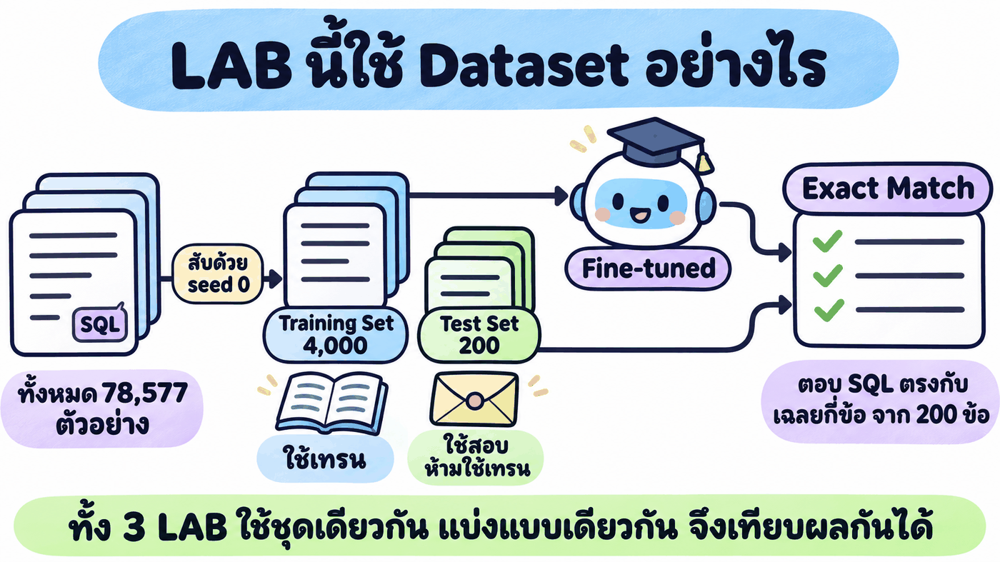

ตัวอย่างจริงของ Training Set (AI ทำให้ในขั้นที่ 1 · ครบ 6 รายการที่ [results/dataset_samples.md](results/dataset_samples.md))

| ช่อง | หน้าที่ | ตัวอย่าง |
|---|---|---|
| `question` | คำถามภาษาคน · Input ส่วนที่ 1 | Which engine has a year larger than 1956? |
| `context` | โครงสร้างตาราง · Input ส่วนที่ 2 | `CREATE TABLE table_name_74 (engine VARCHAR, year INTEGER)` |
| `answer` | SQL ที่ถูกต้อง · Output ที่โมเดลต้องเขียนให้ได้ และใช้เทียบ Exact Match | `SELECT engine FROM table_name_74 WHERE year > 1956` |

## รู้จักโมเดลที่ใช้


| หัวข้อ | Qwen3-8B |
|---|---|
| ประเภท | Large Language Model (LLM) · **36 Layer** |
| Input → Output | ข้อความ (โครงสร้างตาราง + คำถาม) → คำสั่ง SQL (ปิดโหมด thinking) |
| ขนาด | 8.19 พันล้าน parameter · 16.4 GB บน disk · ราว 15.3 GiB ใน VRAM แบบ bf16 |
| ที่มา | ทีม Qwen ของ Alibaba Cloud · [Qwen/Qwen3-8B](https://huggingface.co/Qwen/Qwen3-8B) · Apache-2.0 |
| LAB นี้ใช้ทำอะไร | **Base** = โมเดลตามที่โหลดมา · **Fine-tuned** = โมเดลนี้ + LoRA ที่เทรนด้วย Training Set 4,000 ตัวอย่าง วัดหลังจบแต่ละ Epoch |

## ทฤษฎีที่ต้องรู้

### 1 · LoRA: สิ่งที่ถูกเทรน และสิ่งที่ต้องส่งข้ามเครื่อง


**คืออะไร** LoRA = ล็อกน้ำหนักเดิมของโมเดลทั้งหมด แล้วแปะตารางตัวเลขเล็ก ๆ (rank 8) ไว้ที่ `q_proj` กับ `v_proj` ของทุก Layer เทรนเฉพาะตารางเล็กนั้น (ที่มาของ Query Key Value อยู่ในภาพ [t-qkv.png](image/t-qkv.png) และ [LAB 4.3 ข้อ 1](../../lab4_multigpu/3_model_parallel/README.md))

**ทำไมสำคัญกับคลัสเตอร์** สิ่งที่ต้องส่งข้ามเครื่องทุก step คือ Gradient ของส่วนที่เทรนเท่านั้น จึงส่งแค่ราว 15 MB ไม่ใช่ 16 GB

**ตัวเลขจาก LAB นี้** เทรน **3,833,856** parameter (0.047%) · Gradient 1 ชุดแบบ float32 = **15.3 MB**

### 2 · Model Parallelism ในเครื่องเดียว (ทบทวน LAB 4.3)

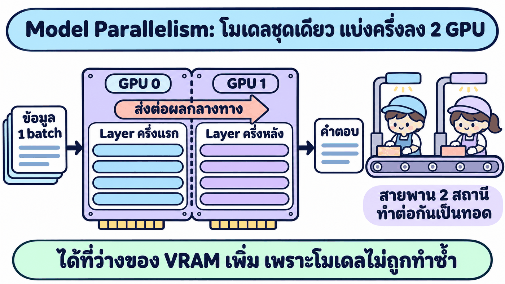

**คืออะไร** โมเดล **ชุดเดียว** แบ่ง Layer ไปวางบน GPU หลายใบ · ข้อมูลไหลผ่าน GPU 0 แล้วต่อไป GPU 1

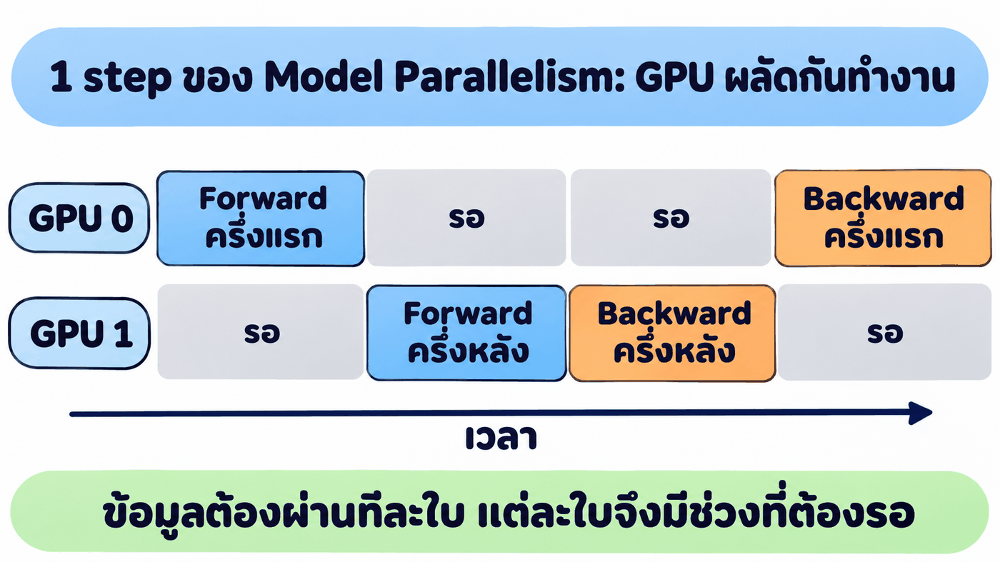

**ได้อะไร ไม่ได้อะไร** ได้ **ที่ว่าง VRAM** (batch 8 ได้ ในขณะที่ GPU ใบเดียวได้แค่ 4) · ไม่ได้ความเร็ว เพราะ GPU **ผลัดกันทำ** · 1 Node ของ LAB 4.3 จึงมี GPU util แค่ 46.5% / 51.8%

### 3 · ต่อ Model Parallelism ข้ามเครื่อง: ในเครื่องแบ่ง Layer ข้ามเครื่องแบ่งข้อมูล


**คืออะไร** แต่ละ Node ถือโมเดล **1 ชุด** แบ่งบน GPU 2 ใบของตัวเอง · ระหว่าง Node ทำแบบ Data Parallelism: แบ่งข้อมูลให้แต่ละ Node แล้วเฉลี่ย Gradient

**ทำไมไม่แบ่ง Layer ข้ามเครื่อง** ผลกลางทางระหว่าง Layer ใหญ่และต้องส่งทั้งขาไปและขากลับทุก step · ส่งผ่านอินเทอร์เน็ตจะช้ามาก · Gradient ของ LoRA เล็กกว่ามาก จึงส่งข้ามเครื่องแค่ส่วนนี้

| | 1 Node (LAB 4.3) | 2 Node | 3 Node |
|---|---|---|---|
| GPU ทั้งหมด | 2 | 4 | 6 |
| จำนวนโมเดล (= Worker) | 1 | 2 | 3 |
| batch ต่อ Node | 8 | 8 | 8 |
| batch รวม | 8 | 16 | 24 |
| step ต่อ Epoch | 500 | 250 | 167 |
| Gradient ที่เข้า Coordinator ต่อ step | – | 2 ชุด | 3 ชุด |

เทียบกับ LAB 5.1 ที่ 2 Node มี Worker 4 ตัว · แบบนี้มี Worker ครึ่งเดียว จึงส่ง Gradient ข้ามเครื่องน้อยกว่า

### 4 · Coordinator: โปรแกรมกลางที่เฉลี่ย Gradient


**คืออะไร** โปรแกรมกลาง 1 ตัวบน Node 1 · เปิด **port เดียว** ให้ Worker ของทุก Node **ต่อออก** มาหา (LAB นี้มี Worker 1 ตัวต่อ Node ไม่ใช่ 2 ตัวตามภาพ)

**ทำงานอย่างไร** (Synchronous) รอ Gradient ครบทุก Worker → เฉลี่ย → ส่งค่าเฉลี่ยเดียวกันกลับ → ทุกตัว Update พร้อมกัน · น้ำหนัก LoRA ของทุก Node จึงเท่ากันเสมอ และทั้งคลัสเตอร์เดินได้เร็วเท่า **Node ที่ช้าที่สุด**

### 5 · 1 step ใช้เวลากับอะไร: คำนวณ กับ ส่งและรอ


**GPU รอ 2 ชั้น**

| ชั้น | รออะไร | มาจาก |
|---|---|---|
| ในเครื่อง | รอ GPU อีกใบของ Node เดียวกันทำส่วนของตัวเอง | Model Parallelism (มีอยู่แล้วใน LAB 4.3) |
| ข้ามเครื่อง | รอส่ง Gradient รอ Coordinator เฉลี่ย และรอรับกลับ | คลัสเตอร์ (เพิ่มมาใน LAB นี้) |


**ประมาณก่อนเทรนได้** (ตัวเลขของส่วน 2 Node)

| | ค่า |
|---|---|
| Gradient ที่ Node 2 ส่งขึ้นต่อ step | 15.3 MB = 123 Mbit (ถ้าส่งแบบ float32) |
| ความเร็วระหว่าง Node ที่วัดได้ | ราว 82–93 Mbps ทั้งสองทิศ |
| เวลาส่งที่ **คำนวณ** ได้ | ขาขึ้น 123 ÷ 90 ≈ 1.4 วินาที + ขากลับอีก ≈ 1.4 วินาที |
| เวลาคำนวณบน GPU ต่อ step ที่วัดได้ | 0.70 วินาที |
| เวลาส่งและรอที่ **วัดได้จริง** | ค่ากลาง 1.9 วินาที · เฉลี่ย 2.56 วินาที (รอบจริง AI ส่งขาขึ้นแบบ bf16 ขนาดจึงเหลือครึ่งหนึ่ง) |

### 6 · Speedup และ Efficiency


| ตัววัด | สูตร | อุดมคติ |
|---|---|---|
| Speedup | ตัวอย่างต่อวินาทีของ N Node ÷ ของ 1 Node | N เท่า |
| Efficiency | Speedup ÷ N | 100% |
| เงินต่อ 1,000 ตัวอย่าง | ราคาต่อชั่วโมงของทุกเครื่องรวมกัน ÷ 3600 ÷ ตัวอย่างต่อวินาที × 1,000 | เท่ากับ 1 Node |

Speedup **ต่ำกว่า 1** แปลว่าเพิ่มเครื่องแล้ว **ช้าลง**

### 7 · จาก 2 Node เป็น 3 Node: คาดว่าอะไรจะเปลี่ยน


| สิ่งที่ดู | คาดว่า | เพราะ |
|---|---|---|
| batch รวม | 16 → **24** | เพิ่มโมเดล 1 ชุด batch 8 |
| step ต่อ Epoch | 250 → **167** | batch รวมใหญ่ขึ้น |
| เวลาคำนวณต่อ step | **ใกล้เดิม** | batch ต่อ Node เท่าเดิม |
| เวลาส่งและรอต่อ step | **นานขึ้น** | Gradient เข้า Coordinator 3 ชุด และต้องรอ Node ที่ช้าที่สุดจาก 3 เครื่อง |
| ตัวอย่างต่อวินาที | **ขึ้นกับเน็ต** | ได้ตัวอย่างต่อ step เพิ่ม 1.5 เท่า · ถ้าเวลาต่อ step นานขึ้นเกิน 1.5 เท่า จะไม่เร็วขึ้น |

ผลจริงอยู่ที่ [1 Node เทียบ 2 Node เทียบ 3 Node](#1-node-เทียบ-2-node-เทียบ-3-node)

# ภาค LAB

## การทดลอง

| หัวข้อ | ส่วนที่ 1 · 2 Node (ขั้นที่ 1–3) | ส่วนที่ 2 · 3 Node (ขั้นที่ 4–6) |
|---|---|---|
| Dataset | b-mc2/sql-create-context · Training Set 4,000 · Test Set 200 · สับด้วย seed 0 | ชุดเดียวกัน |
| โมเดล | Qwen/Qwen3-8B แบบ bf16 + LoRA r 8 alpha 16 ที่ `q_proj` `v_proj` | เหมือนกัน |
| สิ่งที่ทดลอง | แต่ละ Node ถือโมเดล 1 ชุดแบ่ง Layer บน GPU 2 ใบ · 2 Node เฉลี่ย Gradient ผ่าน Coordinator | เหมือนกัน · 3 Node โมเดล 3 ชุด |
| ค่าที่ตรึง | batch 8 ต่อ Node (รวม 16) · learning rate 2e-4 · seed 0 · ข้อความยาวไม่เกิน 256 token · ปิด thinking · ไม่ใช้ Gradient Checkpointing · **2 Epoch** | เหมือนกัน · batch รวม 24 |
| วิธีวัด | เน็ตระหว่าง Node · Layer และ VRAM ของแต่ละ GPU · เวลาต่อ step แยกเป็นคำนวณ กับ ส่งและรอ · ตัวอย่างต่อวินาที · GPU util · น้ำหนัก LoRA ของทุก Node เท่ากันหรือไม่ · loss และ Exact Match บน Test Set ของ Base และหลังจบแต่ละ Epoch | เหมือนกัน |
| ตัวเทียบ 1 Node | [LAB 4.3 ส่วน GPU 2 ใบ](../../lab4_multigpu/3_model_parallel/README.md) (ไม่รันใหม่) | ตัวเดียวกัน |
| เครื่อง (ที่เช่าได้) | RTX 3090 24 GB × 2 จำนวน 2 เครื่อง · ฝรั่งเศส และเช็กเกีย · $0.3956 + $0.5102 = **$0.9058/ชม.** | RTX 3090 24 GB × 2 จำนวน 3 เครื่อง · อาร์เจนตินา 1 และชิลี 2 · $0.3900 + $0.4433 + $0.4967 = **$1.3300/ชม.** |
| เวลาและค่าเช่าจริง | 3 ขั้นรวม 117 นาที · เครื่องเปิดเครื่องละ 1.84 ชม. · ใบคิดเงิน **$1.838** | 3 ขั้นรวม 73 นาที · เครื่องเปิดเครื่องละ 1.18 ชม. · ใบคิดเงิน **$1.730** |

ทำตามลำดับขั้นที่ 1 → 6 · แต่ละส่วนทำให้ครบในรอบเดียว · โค้ดของส่วนที่ 1 อยู่ใน `lab5_cluster/2_model_parallel/code` (เริ่มจากว่าง) · ของส่วนที่ 2 อยู่ใน `node3/`

> ⚠️ เงินเดินพร้อมกันทุกเครื่องตั้งแต่ขั้นเช่าจนกว่าจะลบ · **ต้องทำขั้นที่ 3 และขั้นที่ 6 ทุกครั้ง** แม้งานระหว่างทางจะล้ม

## ส่วนที่ 1 · 2 Node (ขั้นที่ 1–3)

## ขั้นที่ 1 · เช่า 2 Node เตรียมของ และวัดเน็ต


*สิ่งที่เพิ่มจาก LAB 4 คือช่องขวาสุด: วัดเน็ตระหว่าง Node ก่อนเทรน*

```text
[ที่ทำงาน]
container `multi-account` · โฟลเดอร์ /workspace/vastapp_lab · สกิล vastai
กุญแจ SSH: /workspace/vastai_lab/Devtool_SSH/devtoolSSH
เก็บโค้ดและผลที่: lab5_cluster/2_model_parallel ของโฟลเดอร์ที่เปิด Claude Code อยู่ (ไม่ใช่ใน container)

[งาน]
เช่าเครื่อง 2 เครื่อง (เรียกว่า Node 1 และ Node 2) เครื่องละ GPU 2 ใบ แล้วเตรียมโมเดลกับ Dataset ให้ทั้งสอง Node

[เครื่องที่ต้องการ]
จำนวน: 2 เครื่อง ที่มี IP สาธารณะต่างกัน · ป้าย vapp-lab5-mp-1 และ vapp-lab5-mp-2
GPU: RTX 4090 2 ใบในเครื่องเดียว · ราคาไม่เกิน $0.60 ต่อชั่วโมงต่อเครื่อง
เงื่อนไข: verified · reliability 0.95 ขึ้นไป · ความเร็วเน็ตไม่ต่ำกว่า 1,200 Mbps · ค่าดาวน์โหลดไม่เกิน $0.01 ต่อ GB · CPU 16 cores ขึ้นไป · ไม่อยู่ในจีน
ระบบ: PyTorch 2.8 ที่มี CUDA 12.8 · disk 60 GB · Node 1 เปิด port ให้เครื่องอื่นต่อเข้ามาได้ 1 port

[ขั้นตอน]
1. เช่าเครื่องที่ถูกที่สุดตามเงื่อนไขทั้ง 2 เครื่อง โดยเลือกให้อยู่ใกล้กัน ถ้าเครื่องไหนเกิน 10 นาทียังไม่พร้อม ให้ลบแล้วเช่าเครื่องอื่น
2. โหลดโมเดล Qwen/Qwen3-8B และ Dataset b-mc2/sql-create-context ลงทั้ง 2 Node
3. สับ Dataset ด้วย seed 0 แล้วแบ่ง Training Set 4,000 ตัวอย่าง และ Test Set 200 ตัวอย่าง ให้ทั้ง 2 Node ได้ชุดเดียวกัน
4. ทำตารางตัวอย่าง 6 รายการ (คำถาม · โครงสร้างตาราง · SQL เฉลย) เก็บที่ results/dataset_samples.md
5. วัดเน็ตระหว่าง 2 Node: Node 2 ต่อเข้า port ของ Node 1 ได้หรือไม่ · เวลาไปกลับ (RTT) · ความเร็วส่งข้อมูลทั้งสองทิศ
   ถ้า RTT ของ Node ใดเกิน 100 ms ให้ลบเครื่องนั้นแล้วเช่าเครื่องใหม่แทน แล้ววัดซ้ำ (เปลี่ยนได้ไม่เกิน 2 ครั้ง)

[รายงาน]
สรุปเป็นตาราง: เครื่องที่ได้ของแต่ละ Node · ราคาต่อชั่วโมง · เน็ตระหว่าง Node (RTT และความเร็ว) · จำนวนตัวอย่างของแต่ละชุด
อธิบายตัวอย่าง 1 รายการว่าแต่ละช่องคืออะไร · ห้ามแสดงค่า key · บอกว่าเครื่องยังเปิดอยู่
```


*ใช้เวลา 34 นาที (Node 1 โหลดโมเดล 16 GB นานราว 20 นาที)*

**เน็ตระหว่าง Node ที่วัดได้** ([results/network_test.json](results/network_test.json))

| การวัด | ผล |
|---|---|
| Node 2 ต่อเข้า port ของ Node 1 | ได้ |
| RTT (50 ครั้ง) | ค่ากลาง 30.0 ms · สูงสุด 97.8 ms |
| ความเร็ว Node 2 → Node 1 | 82.7 Mbps (1 สาย) · 92.5 Mbps (8 สาย) |
| ความเร็ว Node 1 → Node 2 | 81.7 Mbps (1 สาย) · 90.1 Mbps (8 สาย) |

ตัวอย่างโค้ดที่ AI เขียนให้ในรอบจริง (ของคุณอาจต่างกัน): [prepare_node.py](code_reference/code/prepare_node.py) · [net_server.py](code_reference/code/net_server.py) · [net_client.py](code_reference/code/net_client.py) · [make_samples.py](code_reference/code/make_samples.py) · ผล: [results/dataset_samples.md](results/dataset_samples.md) · [results/network_test.json](results/network_test.json)

**อ่านผลอย่างไร**

- **ความเร็วที่วัดได้ต่ำกว่าที่เครื่องประกาศราว 8 เท่า** · ตอนเลือกเครื่องกรองไว้ที่ 700 Mbps ขึ้นไป แต่ระหว่างสองเครื่องส่งได้ราว 82–93 Mbps · ตัวเลขในหน้าเช่าไม่ใช่ความเร็วระหว่างเครื่องที่เช่ามา **ต้องวัดเอง**
- AI ชี้ว่าตัวที่ช้าน่าจะเป็น Node 1 เพราะโหลดโมเดล 16 GB ใช้ราว 20 นาที ขณะที่ Node 2 ใช้ไม่ถึง 1 นาที และเสนอให้พิจารณาเปลี่ยน Node 1 · รอบนี้ RTT ไม่เกิน 100 ms ตามเกณฑ์ในพรอมต์ จึงใช้ต่อ
- เปิดหลายสายพร้อมกัน (8 สาย) เร็วขึ้นแค่เล็กน้อย (82.7 → 92.5 Mbps) = คอขวดอยู่ที่เส้นทาง ไม่ใช่ที่การเชื่อมต่อเส้นเดียว
- ตั้งแต่ขั้นนี้เงินเดินชั่วโมงละ $0.91 (2 เครื่องรวมกัน)

## ขั้นที่ 2 · เทรนแบบ Model Parallelism ข้าม 2 Node

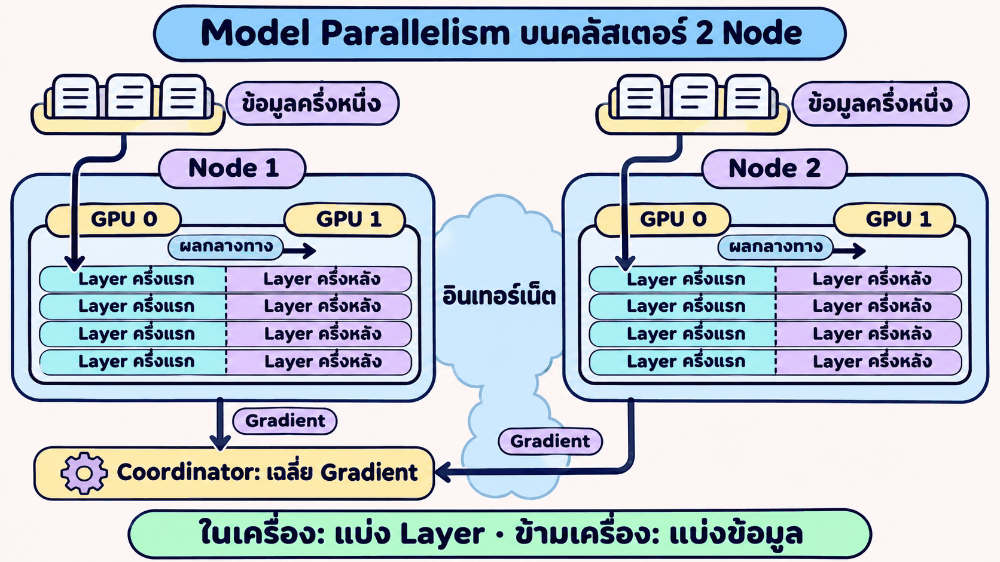
*นี่คือแนวคิดที่บรรทัด "แนวคิด" ในพรอมต์บรรยายไว้*


*batch ถูกตรึงไว้เท่ากับ LAB 4.3 (8 ต่อ Node)*

AI เขียน `code/coordinator.py` `code/worker.py` และ `code/eval.py` แล้วลอง 3 step → เทรน 2 Epoch พร้อมจับเวลาทุก step → วัด Exact Match ของ Base และทุก Epoch

```text
[ที่ทำงาน]
container `multi-account` · โฟลเดอร์ /workspace/vastapp_lab · สกิล vastai
เครื่อง: ป้าย vapp-lab5-mp-1 (Node 1) และ vapp-lab5-mp-2 (Node 2) · กุญแจ SSH: /workspace/vastai_lab/Devtool_SSH/devtoolSSH
เก็บโค้ดและผลที่: lab5_cluster/2_model_parallel ของโฟลเดอร์ที่เปิด Claude Code อยู่ (ไม่ใช่ใน container)

[งาน]
เทรน Qwen3-8B ให้แปลงคำถามเป็น SQL แบบ Model Parallelism บนคลัสเตอร์ 2 Node
แนวคิด: แต่ละ Node ถือโมเดล 1 ชุด แบ่ง Layer ครึ่งแรกไว้ GPU 0 ครึ่งหลังไว้ GPU 1 · สอง Node แบ่งข้อมูลคนละครึ่ง · ทุก step ส่ง Gradient ของ LoRA ไปเฉลี่ยที่โปรแกรมกลางบน Node 1 แล้วทั้งสอง Node ปรับน้ำหนักด้วยค่าเฉลี่ยเดียวกัน

[ขั้นตอน]
1. เขียนโปรแกรมกลาง code/coordinator.py รันบน Node 1 เปิด port เดียว: รอ Gradient จากทุก Node ให้ครบ เฉลี่ย แล้วส่งค่าเฉลี่ยกลับ (Synchronous)
2. เขียนโปรแกรมเทรน code/worker.py เปิด 1 ตัวต่อ Node รวม 2 ตัว แต่ละตัวแบ่งโมเดลชุดเดียวลง GPU 2 ใบของ Node นั้น ต่อออกไปหาโปรแกรมกลาง และได้ข้อมูลคนละครึ่งไม่ซ้ำกัน
3. ลอง 3 step ด้วย batch ที่มีตัวอย่างยาวที่สุดปนกับตัวอย่างสั้น (มี padding เหมือนตอนเทรนจริง) ถ้า Out of Memory ให้แก้โค้ดให้ใช้หน่วยความจำน้อยลง โดยไม่เปลี่ยนค่าที่ตรึง
4. เทรน 2 Epoch และจับเวลาของทุก step แยกเป็น 2 ส่วน: เวลาคำนวณบน GPU และเวลาส่งกับรอ Gradient
5. เขียน code/eval.py วัด Exact Match บน Test Set ของโมเดลก่อนเทรน (Base) และหลังจบแต่ละ Epoch (ไม่นับ ; ท้ายคำสั่งเป็นข้อผิด)
6. หลังจบแต่ละ Epoch ตรวจว่าน้ำหนัก LoRA ของทั้ง 2 Node เท่ากัน
7. ให้งานรันต่อได้แม้การเชื่อมต่อหลุด และรายงานทุก 2–3 นาที

[ค่าที่ตรึง]
โมเดล: Qwen/Qwen3-8B แบบ bf16 · ปิด thinking · ไม่ใช้ Gradient Checkpointing
LoRA: r 8 · alpha 16 · ที่ q_proj กับ v_proj
การเทรน: learning rate 2e-4 · seed 0 · ข้อความยาวไม่เกิน 256 token · 2 Epoch
batch: 8 ต่อ Node (รวม 16) เท่ากับ batch ของ LAB 4.3 เพื่อเทียบกับผล 1 Node ได้

[รายงาน]
สรุปเป็นตาราง: batch ต่อ Node และรวม · Layer ไหนอยู่ใบไหน · VRAM สูงสุดของแต่ละใบ · วินาทีต่อ step (แยกเวลาคำนวณ กับเวลาส่งและรอ) · ขนาด Gradient ที่ส่งต่อ step · ตัวอย่างต่อวินาที · GPU util ของแต่ละใบ · loss และ Exact Match ของ Base และหลังจบแต่ละ Epoch
บอกว่าเครื่องยังเปิดอยู่
```

![ช่องพิมพ์ของ Claude Code ที่วางพรอมต์ขั้นที่ 2 และคำตอบ: เทรนครบ 2 Epoch 500 step batch 8 ต่อ Node รวม 16 GPU 0 ของทั้ง 2 Node ถือ embed_tokens และ layer 0–17 GPU 1 ถือ layer 18–35 norm และ lm_head VRAM สูงสุดราว 14,300 และ 14,700 MiB จาก 24,576 เฉลี่ย 3.27 วินาทีต่อ step เป็นเวลาคำนวณ 0.70 วินาที และส่งและรอ 2.56 วินาที 78% ได้ 4.90 ตัวอย่างต่อวินาที GPU util ราว 9–11% ตาราง loss และ Exact Match Base 1.5% หลัง Epoch 1 69.5% หลัง Epoch 2 74.0% LoRA ของ 2 Node เท่ากัน หัวข้อสิ่งที่เกิดระหว่างรัน รันแรกถูกยกเลิกเพราะการส่งค้าง และ host ของ Node 1 reboot เองกลางรัน บอกว่าเครื่องทั้ง 2 ยังเปิดอยู่](image/lab5b-step2.png)
*ใช้เวลา 73 นาที (บนเครื่องเช่า: เทรน 500 step ราว 27 นาที ไม่นับช่วงที่เครื่องดับ)*

**โมเดลถูกแบ่งอย่างไร** (เหมือนกันทั้ง 2 Node)

| GPU | ถืออะไร | VRAM สูงสุด Node 1 / Node 2 |
|---|---|---|
| GPU 0 | `embed_tokens` + Layer 0–17 (18 Layer) | 14,312 / 14,332 MiB |
| GPU 1 | Layer 18–35 (18 Layer) + `norm` + `lm_head` | 14,694 / 14,696 MiB |

**เวลาของ 1 step** ([results/metrics.json](results/metrics.json))

| | เฉลี่ย | ส่วนแบ่ง |
|---|---|---|
| วินาทีต่อ step | **3.27** (ค่ากลาง 2.61) | 100% |
| คำนวณบน GPU | 0.70 | **21.5%** |
| ส่งและรอ Gradient | 2.56 (ค่ากลาง 1.9) | **78.5%** |

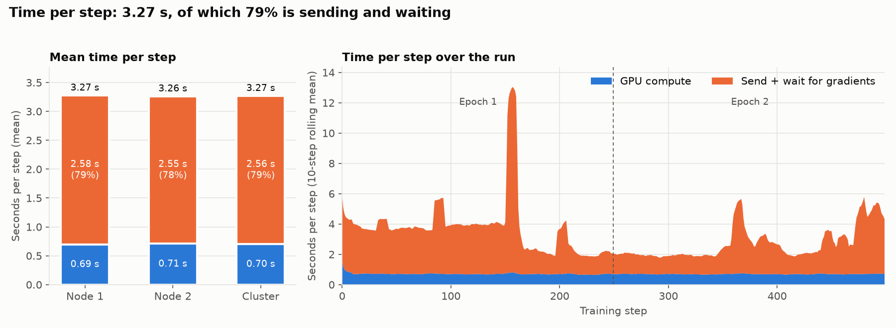

**ทั้งรอบ**

| รายการ | ค่า |
|---|---|
| batch ต่อ Node / รวม | 8 / 16 · 250 step ต่อ Epoch · รวม 500 step |
| ตัวอย่างต่อวินาที | **4.90** · Epoch 1 ได้ 4.27 · Epoch 2 ได้ 5.76 |
| GPU util เฉลี่ย (GPU 0 / GPU 1) | Node 1: **10.6% / 10.8%** · Node 2: **10.8% / 9.4%** |
| Gradient ต่อ step ต่อ Node | ส่งขึ้น 7.67 MB (แปลงเป็น bf16) · รับค่าเฉลี่ยกลับ 15.34 MB |

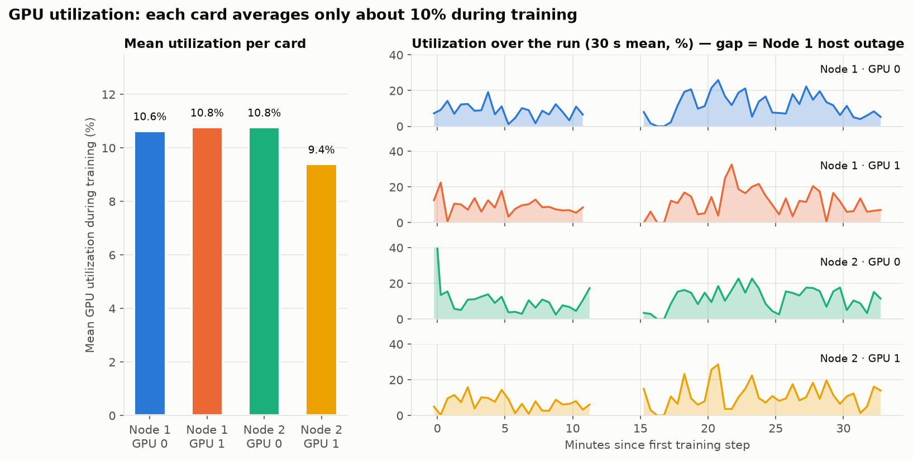

| จุดวัด | train loss | test loss | Exact Match (200 ข้อ) | น้ำหนัก LoRA ของ 2 Node |
|---|---|---|---|---|
| Base | – | 1.915 | 1.5% (3/200) | – |
| จบ Epoch 1 | 0.121 | 0.0604 | 69.5% (139/200) | เท่ากัน (sha256 ตรงกัน) |
| จบ Epoch 2 | 0.038 | 0.0544 | **74.0%** (148/200) | เท่ากัน (sha256 ตรงกัน) |

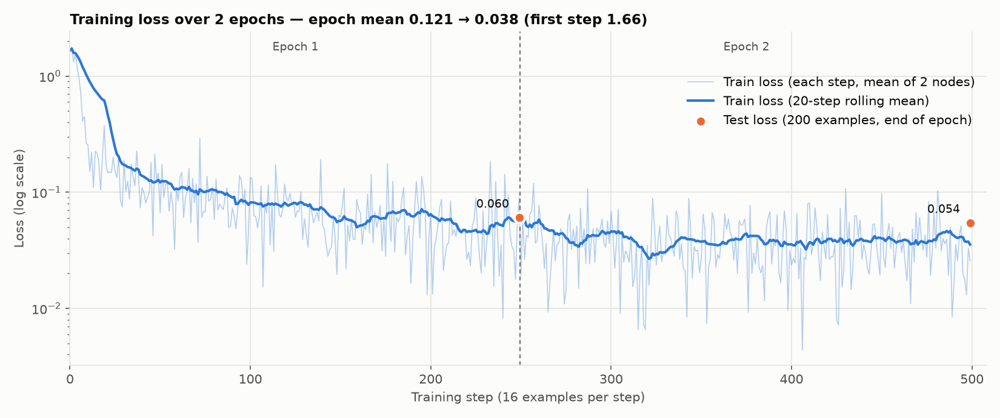

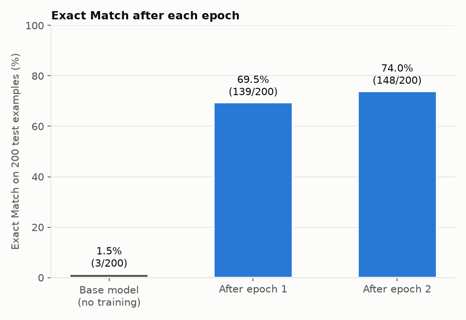

ตัวอย่างโค้ดที่ AI เขียนให้ในรอบจริง (ของคุณอาจต่างกัน): [coordinator.py](code_reference/code/coordinator.py) · [worker.py](code_reference/code/worker.py) · [eval.py](code_reference/code/eval.py) · [common.py](code_reference/code/common.py) · [start_worker.sh](code_reference/code/start_worker.sh) · ผลราย step: [results/run/](results/run/)

**อ่านผลอย่างไร**

- **78.5% ของเวลาคือการส่งและรอ** · แต่ละ Node คำนวณ 0.70 วินาที (ใกล้กับ 0.79 วินาทีต่อ step ของ 1 Node ใน LAB 4.3) แล้วรอเครือข่ายอีก 2.56 วินาที
- **GPU util เหลือราว 10%** · 1 Node ได้ 46.5% / 51.8% เพราะ GPU ผลัดกันทำ · พอมีการรอข้ามเครื่องซ้อนเข้าไป (รอ 2 ชั้นในทฤษฎีข้อ 5) จึงเหลือ 1 ใน 5
- **VRAM ยังว่างมาก** (ราว 14.5 จาก 24 GB ต่อใบ) · นี่คือข้อดีเดิมของ Model Parallelism: batch 8 ต่อ Node ผ่านการลอง 3 step ตั้งแต่ครั้งแรก ไม่ Out of Memory
- **เครื่องเช่าดับเองได้** · host ของ Node 1 reboot กลางรัน (ราว step 162–168 ดับ 5 นาที) · งานต่อจาก checkpoint step 150 ได้ แต่ AI ต้องสั่งเปิด Coordinator กับ Worker ใหม่เอง · ข้อ 6 ของพรอมต์ (รันต่อได้เมื่อหลุด) จึงจำเป็นจริง
- **การส่งแบบสายเดียวค้างได้** · การเทรนครั้งแรกใช้การเชื่อมต่อ 1 สายต่อ Node แล้วบาง step รอถึง 92 วินาที AI จึงเขียนใหม่เป็น 4 สายต่อ Node และตัดแล้วต่อใหม่เมื่อข้อมูลไม่ไหล 8 วินาที แล้วเริ่มเทรนใหม่จาก step 0 · ผลในหน้านี้เป็นของรอบที่เทรนครบ
- **AI ลดขนาด Gradient ขาขึ้นเอง** โดยส่งเป็น bf16 (7.67 MB) และตรวจทุก step ว่าค่าไม่เปลี่ยน · เป็นค่าที่พรอมต์ไม่ได้ตรึง
- น้ำหนัก LoRA ของ 2 Node เท่ากันทั้ง 2 Epoch · Exact Match 74.0% ใกล้กับ 1 Node (77.5% หลัง Epoch 2) ต่างกัน 7 ข้อจาก 200

## ขั้นที่ 3 · สรุป คิดเงิน และลบเครื่องทั้ง 2 Node (ห้ามข้าม)


*ราคาต่อชั่วโมงคือ **ผลรวมของทุกเครื่อง***

```text
[ที่ทำงาน]
container `multi-account` · โฟลเดอร์ /workspace/vastapp_lab · สกิล vastai
เครื่อง: ป้าย vapp-lab5-mp-1 (Node 1) และ vapp-lab5-mp-2 (Node 2) · กุญแจ SSH: /workspace/vastai_lab/Devtool_SSH/devtoolSSH
เก็บโค้ดและผลที่: lab5_cluster/2_model_parallel ของโฟลเดอร์ที่เปิด Claude Code อยู่ (ไม่ใช่ใน container)

[งาน]
สรุปผลเป็นกราฟ แล้วลบเครื่องทั้ง 2 Node

[ขั้นตอน]
1. นำผลดิบของทั้ง 2 Node กลับมาที่ results/raw
2. เขียน code/report.py รวมตัวเลขลง results/metrics.json พร้อมเงินต่อ 1,000 ตัวอย่าง (คิดจากราคาของ 2 เครื่องรวมกัน)
3. ให้สคริปต์วาดกราฟที่ results/images (ข้อความอังกฤษ): เวลาต่อ step แยกเวลาคำนวณกับเวลาส่งและรอ · GPU util ของแต่ละใบ · loss ตลอด 2 Epoch · Exact Match ของแต่ละ Epoch
4. ลบเครื่องป้าย vapp-lab5-mp-1 และ vapp-lab5-mp-2 แล้วตรวจว่าไม่เหลือ (ห้ามแตะเครื่องป้ายอื่น)

[รายงาน]
สรุปเป็นตาราง: ตัวอย่างต่อวินาที · สัดส่วนเวลาที่ใช้ส่งและรอ · Exact Match · เงินต่อ 1,000 ตัวอย่าง
ค่าใช้จ่ายจริงของแต่ละเครื่อง: อายุเครื่อง · ยอดที่ถูกคิด · ห้ามแสดงค่า key
```


*ใช้เวลา 10 นาที*

| รายการ | ค่า |
|---|---|
| ราคา 2 เครื่องรวมกัน | $0.9058 ต่อชั่วโมง |
| เงินต่อ 1,000 ตัวอย่าง | 0.9058 ÷ 3600 ÷ 4.90 × 1,000 = **$0.0513** |
| ค่าเช่าเฉพาะช่วงเทรน (ราว 27 นาที) | $0.41 |
| ใบคิดเงินจริงของทั้ง 2 เครื่อง | **$1.838** = Node 1 $0.801 + Node 2 $1.037 (ในนี้เป็นค่าดาวน์โหลดและอัปโหลด $0.221) |

ตัวอย่างโค้ดที่ AI เขียนให้ในรอบจริง (ของคุณอาจต่างกัน): [report.py](code_reference/code/report.py) · [summarize.py](code_reference/code/summarize.py) · ผล: [results/metrics.json](results/metrics.json) · [results/summary.json](results/summary.json)

**อ่านผลอย่างไร**

- **$0.0513 ต่อ 1,000 ตัวอย่าง แพงกว่า 1 Node ($0.01115) ราว 4.6 เท่า**
- **ค่าเทรนจริงเป็นแค่ราว 1 ใน 4 ของใบคิดเงิน** ($0.41 จาก $1.838) · ที่เหลือคือเวลาเตรียมเครื่อง ทดสอบ แก้ปัญหาการส่งค้าง และวัดผล ซึ่งเงินเดินอยู่ตลอด
- ต้องเห็นว่าไม่มีเครื่องป้าย `vapp-lab5-mp` เหลือในบัญชี

## ส่วนที่ 2 · 3 Node (ขั้นที่ 4–6)

## ขั้นที่ 4 · เช่า 3 Node เตรียมของ และวัดเน็ต


*ทำเหมือนขั้นที่ 1 แต่เป็น 3 เครื่อง และต้องวัดเน็ต 2 เส้นทาง*

```text
[ที่ทำงาน]
container `multi-account` · โฟลเดอร์ /workspace/vastapp_lab · สกิล vastai
กุญแจ SSH: /workspace/vastai_lab/Devtool_SSH/devtoolSSH
เก็บโค้ดและผลที่: lab5_cluster/2_model_parallel/node3 ของโฟลเดอร์ที่เปิด Claude Code อยู่ (ไม่ใช่ใน container)

[งาน]
เช่าเครื่อง 3 เครื่อง (เรียกว่า Node 1 Node 2 และ Node 3) เครื่องละ GPU 2 ใบ แล้วเตรียมโมเดลกับ Dataset ให้ทั้ง 3 Node

[เครื่องที่ต้องการ]
จำนวน: 3 เครื่อง ที่มี IP สาธารณะต่างกัน · ป้าย vapp-lab5-3mp-1 vapp-lab5-3mp-2 และ vapp-lab5-3mp-3
GPU: RTX 4090 2 ใบในเครื่องเดียว · ราคาไม่เกิน $0.60 ต่อชั่วโมงต่อเครื่อง
เงื่อนไข: verified · reliability 0.95 ขึ้นไป · ความเร็วเน็ตไม่ต่ำกว่า 1,200 Mbps · ค่าดาวน์โหลดไม่เกิน $0.01 ต่อ GB · CPU 16 cores ขึ้นไป · ไม่อยู่ในจีน
ระบบ: PyTorch 2.8 ที่มี CUDA 12.8 · disk 60 GB · Node 1 เปิด port ให้เครื่องอื่นต่อเข้ามาได้ 1 port

[ขั้นตอน]
1. เช่าเครื่องที่ถูกที่สุดตามเงื่อนไขทั้ง 3 เครื่อง โดยเลือกให้อยู่ใกล้กัน ถ้าเครื่องไหนเกิน 10 นาทียังไม่พร้อม ให้ลบแล้วเช่าเครื่องอื่น
2. โหลดโมเดล Qwen/Qwen3-8B และ Dataset b-mc2/sql-create-context ลงทั้ง 3 Node
3. สับ Dataset ด้วย seed 0 แล้วแบ่ง Training Set 4,000 ตัวอย่าง และ Test Set 200 ตัวอย่าง ให้ทั้ง 3 Node ได้ชุดเดียวกัน
4. ทำตารางตัวอย่าง 6 รายการ (คำถาม · โครงสร้างตาราง · SQL เฉลย) เก็บที่ results/dataset_samples.md
5. วัดเน็ตระหว่าง Node: Node 2 และ Node 3 ต่อเข้า port ของ Node 1 ได้หรือไม่ · เวลาไปกลับ (RTT) · ความเร็วส่งข้อมูลทั้งสองทิศ
   ถ้า RTT ของ Node ใดเกิน 100 ms ให้ลบเครื่องนั้นแล้วเช่าเครื่องใหม่แทน แล้ววัดซ้ำ (เปลี่ยนได้ไม่เกิน 2 ครั้ง)

[รายงาน]
สรุปเป็นตาราง: เครื่องที่ได้ของแต่ละ Node · ราคาต่อชั่วโมง · เน็ตระหว่าง Node (RTT และความเร็ว) · จำนวนตัวอย่างของแต่ละชุด
อธิบายตัวอย่าง 1 รายการว่าแต่ละช่องคืออะไร · ห้ามแสดงค่า key · บอกว่าเครื่องยังเปิดอยู่
```


*ใช้เวลา 20 นาที*

**เน็ตระหว่าง Node ที่วัดได้** (วัด 2 รอบ รอบละ 10 วินาทีต่อทิศ)

| เส้นทาง | RTT เฉลี่ย | ส่งไป Node 1 (รอบ 1 / รอบ 2) | รับจาก Node 1 (รอบ 1 / รอบ 2) |
|---|---|---|---|
| Node 2 ↔ Node 1 | 34–36 ms | 644 / 210 Mbps | 262 / 619 Mbps |
| Node 3 ↔ Node 1 | 29 ms | **82** / 306 Mbps | 198 / 148 Mbps |

ตัวอย่างโค้ดที่ AI เขียนให้ในรอบจริง (ของคุณอาจต่างกัน): [rent.sh](code_reference/node3/rent.sh) · [prepare.py](code_reference/node3/node_code/prepare.py) · [netprobe.py](code_reference/node3/node_code/netprobe.py) · [net_test.sh](code_reference/node3/net_test.sh) · ผล: [node3/results/dataset_samples.md](node3/results/dataset_samples.md) · [net_probe_run1.json](node3/results/net_probe_run1.json) · [net_probe_run2.json](node3/results/net_probe_run2.json)

**อ่านผลอย่างไร**

- **RTT นิ่ง แต่ความเร็วส่งข้อมูลแกว่งมาก** · เส้นทางเดียวกันวัดห่างกันไม่กี่นาทีได้ 82 แล้ว 306 Mbps · การวัดรอบเดียวจึงบอกได้แค่คร่าว ๆ เวลาต่อ step ตอนเทรนจะแกว่งตาม
- **ทุกเส้นทาง RTT ต่ำกว่า 100 ms** จึงไม่ต้องเปลี่ยนเครื่องตามข้อ 5 ของพรอมต์ · เกณฑ์นี้มีไว้กันกรณีได้ Node ที่อยู่ไกลมาก ซึ่งทำให้แต่ละ step ช้าจนเทรนไม่จบในเวลาที่ตั้งใจ
- AI เลือก 3 เครื่องในทวีปเดียวกัน (อเมริกาใต้) เพราะอยู่ใกล้กันและราคารวมถูกที่สุด
- ตั้งแต่ขั้นนี้เงินเดินชั่วโมงละ $1.33 (3 เครื่องรวมกัน)

## ขั้นที่ 5 · เทรนแบบ Model Parallelism ข้าม 3 Node

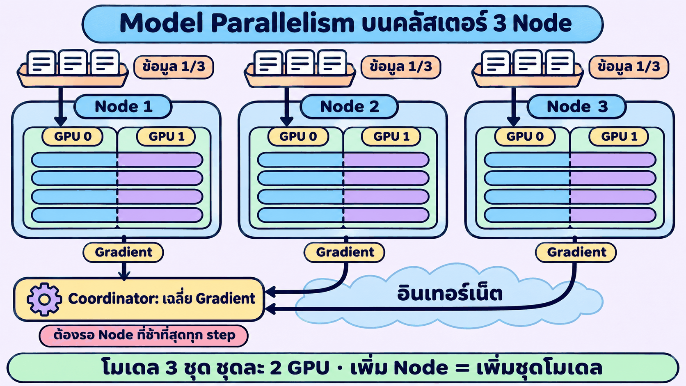
*วิธีเดิม เพิ่มเป็นโมเดล 3 ชุด และ Coordinator ต้องรอ 3 ตัว*

```text
[ที่ทำงาน]
container `multi-account` · โฟลเดอร์ /workspace/vastapp_lab · สกิล vastai
เครื่อง: ป้าย vapp-lab5-3mp-1 (Node 1) vapp-lab5-3mp-2 (Node 2) และ vapp-lab5-3mp-3 (Node 3) · กุญแจ SSH: /workspace/vastai_lab/Devtool_SSH/devtoolSSH
เก็บโค้ดและผลที่: lab5_cluster/2_model_parallel/node3 ของโฟลเดอร์ที่เปิด Claude Code อยู่ (ไม่ใช่ใน container)

[งาน]
เทรน Qwen3-8B ให้แปลงคำถามเป็น SQL แบบ Model Parallelism บนคลัสเตอร์ 3 Node
แนวคิด: แต่ละ Node ถือโมเดล 1 ชุด แบ่ง Layer ครึ่งแรกไว้ GPU 0 ครึ่งหลังไว้ GPU 1 · สาม Node แบ่งข้อมูลคนละ 1 ใน 3 · ทุก step ส่ง Gradient ของ LoRA ไปเฉลี่ยที่โปรแกรมกลางบน Node 1 แล้วทั้งสาม Node ปรับน้ำหนักด้วยค่าเฉลี่ยเดียวกัน

[ขั้นตอน]
1. เขียนโปรแกรมกลาง code/coordinator.py รันบน Node 1 เปิด port เดียว: รอ Gradient จากทุก Node ให้ครบ เฉลี่ย แล้วส่งค่าเฉลี่ยกลับ (Synchronous)
2. เขียนโปรแกรมเทรน code/worker.py เปิด 1 ตัวต่อ Node รวม 3 ตัว แต่ละตัวแบ่งโมเดลชุดเดียวลง GPU 2 ใบของ Node นั้น ต่อออกไปหาโปรแกรมกลาง และได้ข้อมูลคนละ 1 ใน 3 ไม่ซ้ำกัน
3. ลอง 3 step ด้วย batch ที่มีตัวอย่างยาวที่สุดปนกับตัวอย่างสั้น (มี padding เหมือนตอนเทรนจริง) ถ้า Out of Memory ให้แก้โค้ดให้ใช้หน่วยความจำน้อยลง โดยไม่เปลี่ยนค่าที่ตรึง
4. เทรน 2 Epoch และจับเวลาของทุก step แยกเป็น 2 ส่วน: เวลาคำนวณบน GPU และเวลาส่งกับรอ Gradient
5. เขียน code/eval.py วัด Exact Match บน Test Set ของโมเดลก่อนเทรน (Base) และหลังจบแต่ละ Epoch (ไม่นับ ; ท้ายคำสั่งเป็นข้อผิด)
6. หลังจบแต่ละ Epoch ตรวจว่าน้ำหนัก LoRA ของทั้ง 3 Node เท่ากัน
7. ให้งานรันต่อได้แม้การเชื่อมต่อหลุด และรายงานทุก 2–3 นาที

[ค่าที่ตรึง]
โมเดล: Qwen/Qwen3-8B แบบ bf16 · ปิด thinking · ไม่ใช้ Gradient Checkpointing
LoRA: r 8 · alpha 16 · ที่ q_proj กับ v_proj
การเทรน: learning rate 2e-4 · seed 0 · ข้อความยาวไม่เกิน 256 token · 2 Epoch
batch: 8 ต่อ Node (รวม 24) เท่ากับ batch ของ LAB 4.3 เพื่อเทียบกับผล 1 Node และ 2 Node ได้

[รายงาน]
สรุปเป็นตาราง: batch ต่อ Node และรวม · Layer ไหนอยู่ใบไหน · VRAM สูงสุดของแต่ละใบ · วินาทีต่อ step (แยกเวลาคำนวณ กับเวลาส่งและรอ) · ขนาด Gradient ที่ส่งต่อ step · ตัวอย่างต่อวินาที · GPU util ของแต่ละใบ · loss และ Exact Match ของ Base และหลังจบแต่ละ Epoch
บอกว่าเครื่องยังเปิดอยู่
```

![ช่องพิมพ์ของ Claude Code ที่วางพรอมต์ขั้นที่ 5 และคำตอบ: เทรนครบ 2 Epoch 334 step batch 8 ต่อ Node รวม 24 ทุก Node วาง embedding และ Layer 0–17 บน GPU 0 และ Layer 18–35 norm lm_head บน GPU 1 VRAM สูงสุดราว 13–14.7 GB จาก 24 GB เฉลี่ย 5.5 วินาทีต่อ step เป็นเวลาคำนวณ 0.70–0.77 วินาที และส่งและรอ 4.74–4.82 วินาที ราว 87% ได้ 4.32 ตัวอย่างต่อวินาที GPU util 6–7% ตาราง loss และ Exact Match Base 1.5% จบ Epoch 1 69.0% จบ Epoch 2 71.0% LoRA ทั้ง 3 Node เท่ากัน หัวข้อทดสอบ 3 step ที่รอบแรกช้าเพราะตั้ง socket buffer เอง และบอกว่าเครื่องทั้ง 3 ยังเปิดอยู่](image/lab5b-step5.png)
*ใช้เวลา 48 นาที (บนเครื่องเช่า: เทรน 2 Epoch 30.9 นาที)*

**เวลาของ 1 step** ([node3/results/metrics.json](node3/results/metrics.json))

| | Node 1 | Node 2 | Node 3 |
|---|---|---|---|
| วินาทีต่อ step (เฉลี่ย) | 5.51 | 5.53 | 5.53 |
| คำนวณบน GPU | 0.77 | 0.70 | 0.72 |
| ส่งและรอ Gradient | 4.74 | 4.82 | 4.81 |
| – ส่ง / รอ / รับ | 0.01 / 4.69 / 0.02 | 0.49 / 2.63 / 1.68 | 1.26 / 0.83 / 2.69 |
| VRAM สูงสุด GPU 0 / GPU 1 (MiB) | 14,314 / 14,716 | 13,086 / 13,528 | 12,884 / 13,326 |
| GPU util เฉลี่ย GPU 0 / GPU 1 | 7.3% / 6.6% | 6.2% / 6.3% | 6.9% / 6.1% |

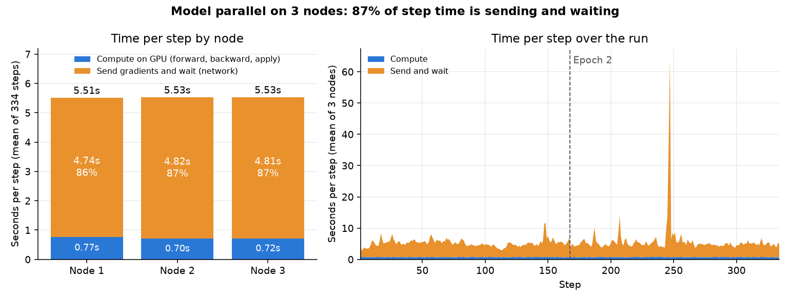

**ทั้งรอบ**

| รายการ | ค่า |
|---|---|
| batch ต่อ Node / รวม | 8 / 24 · 167 step ต่อ Epoch · รวม 334 step |
| ตัวอย่างต่อวินาที | **4.32** (8,000 ตัวอย่างใน 1,852 วินาที) |
| ส่วนของเวลาที่เป็นการส่งและรอ | **ราว 87%** |
| Gradient ต่อ step ต่อ Node | ส่งขึ้น 15.34 MB · รับค่าเฉลี่ยกลับ 15.34 MB (float32 ไม่บีบอัด) |
| การเชื่อมต่อหลุด | 0 ครั้ง |

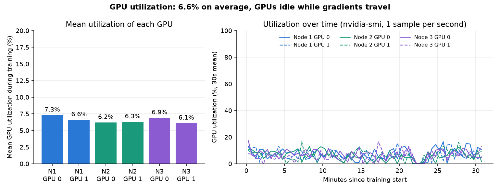

| จุดวัด | train loss | test loss | Exact Match (200 ข้อ) | น้ำหนัก LoRA ของ 3 Node |
|---|---|---|---|---|
| Base | – | 1.915 | 1.5% (3/200) | – |
| จบ Epoch 1 | 0.152 | 0.066 | 69.0% (138/200) | เท่ากัน (sha256 ตรงกัน) |
| จบ Epoch 2 | 0.043 | 0.059 | **71.0%** (142/200) | เท่ากัน (sha256 ตรงกัน) |

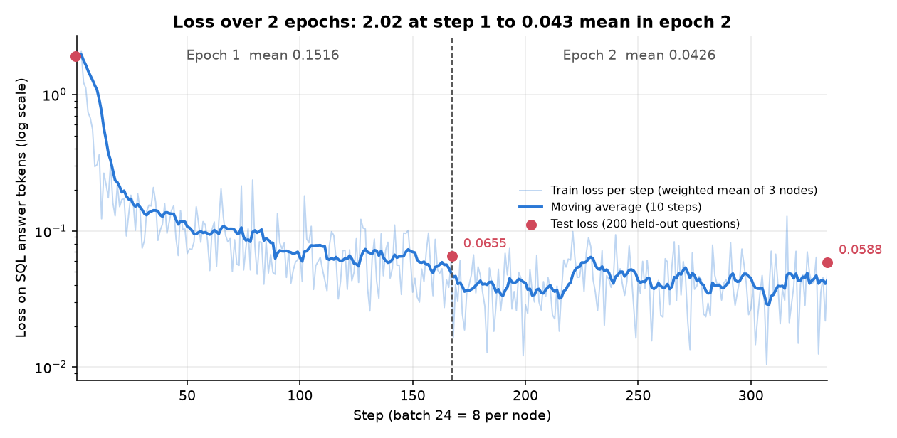

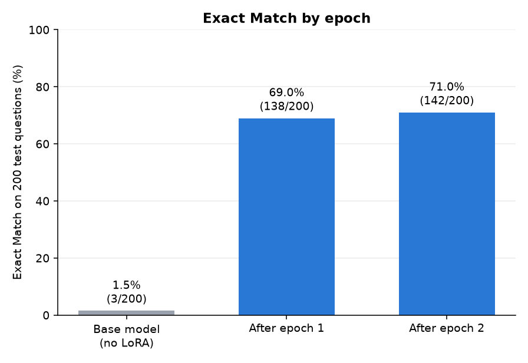

ตัวอย่างโค้ดที่ AI เขียนให้ในรอบจริง (ของคุณอาจต่างกัน): [coordinator.py](code_reference/node3/code/coordinator.py) · [worker.py](code_reference/node3/code/worker.py) · [eval.py](code_reference/node3/code/eval.py) · [common.py](code_reference/node3/code/common.py) · [launch.sh](code_reference/node3/launch.sh) · ผลราย step: [node3/results/train/](node3/results/train/)

**อ่านผลอย่างไร**

- **เวลาคำนวณเท่าเดิม เวลาส่งและรอนานขึ้นเกือบ 2 เท่า** · คำนวณ 0.70–0.77 วินาที (2 Node: 0.70) ส่วนส่งและรอราว 4.8 วินาที (2 Node: 2.56) · ตรงกับที่คาดไว้ในทฤษฎีข้อ 7
- **แถว "ส่ง / รอ / รับ" บอกว่าใครรอใคร** · Node 1 อยู่เครื่องเดียวกับ Coordinator จึงส่งและรับเกือบทันที แต่ต้อง **รอ** 4.69 วินาทีให้ Gradient ของอีก 2 Node มาถึง · Node 3 ใช้เวลาส่งนานที่สุด (1.26 วินาที) ตรงกับเส้นทางที่วัดได้ช้าที่สุดในขั้นที่ 4
- **รอบนี้ AI ส่ง Gradient แบบ float32 เต็มทั้งสองขา** (15.34 MB) ส่วน 2 Node ส่งขาขึ้นแบบ bf16 (7.67 MB) · เป็นค่าที่พรอมต์ไม่ได้ตรึง และเป็นส่วนหนึ่งที่ทำให้เวลาส่งและรอของ 3 Node นานกว่า
- **บั๊กเดิมกลับมาอีก** · รอบทดสอบแรกช้า 20–70 วินาทีต่อ step เพราะ AI ตั้งขนาด buffer ของ socket เอง เลิกตั้งแล้วเหลือราว 3.5 วินาที · เกิดแบบเดียวกันใน [LAB 5.1 ขั้นที่ 5](../1_data_parallel/README.md) · ถ้า step ช้าผิดปกติ ให้ถาม AI เรื่องนี้ก่อน
- **Exact Match 71.0% ต่ำกว่า 2 Node (74.0%) 6 ข้อ** · batch รวม 24 ปรับน้ำหนักเพียง 167 ครั้งต่อ Epoch · Test Set 200 ข้อ ความต่างระดับนี้ยังสรุปไม่ได้ชัด
- รอบนี้ไม่มีการหลุด การต่อใหม่อัตโนมัติจึงยังไม่ถูกทดสอบจริง และบันทึก LoRA เฉพาะตอนจบ Epoch

## ขั้นที่ 6 · สรุป คิดเงิน และลบเครื่องทั้ง 3 Node (ห้ามข้าม)

```text
[ที่ทำงาน]
container `multi-account` · โฟลเดอร์ /workspace/vastapp_lab · สกิล vastai
เครื่อง: ป้าย vapp-lab5-3mp-1 (Node 1) vapp-lab5-3mp-2 (Node 2) และ vapp-lab5-3mp-3 (Node 3) · กุญแจ SSH: /workspace/vastai_lab/Devtool_SSH/devtoolSSH
เก็บโค้ดและผลที่: lab5_cluster/2_model_parallel/node3 ของโฟลเดอร์ที่เปิด Claude Code อยู่ (ไม่ใช่ใน container)

[งาน]
สรุปผลเป็นกราฟ แล้วลบเครื่องทั้ง 3 Node

[ขั้นตอน]
1. นำผลดิบของทั้ง 3 Node กลับมาที่ results/raw
2. เขียน code/report.py รวมตัวเลขลง results/metrics.json พร้อมเงินต่อ 1,000 ตัวอย่าง (คิดจากราคาของ 3 เครื่องรวมกัน)
3. ให้สคริปต์วาดกราฟที่ results/images (ข้อความอังกฤษ): เวลาต่อ step แยกเวลาคำนวณกับเวลาส่งและรอ · GPU util ของแต่ละใบ · loss ตลอด 2 Epoch · Exact Match ของแต่ละ Epoch
4. ลบเครื่องป้าย vapp-lab5-3mp-1 vapp-lab5-3mp-2 และ vapp-lab5-3mp-3 แล้วตรวจว่าไม่เหลือ (ห้ามแตะเครื่องป้ายอื่น)

[รายงาน]
สรุปเป็นตาราง: ตัวอย่างต่อวินาที · สัดส่วนเวลาที่ใช้ส่งและรอ · Exact Match · เงินต่อ 1,000 ตัวอย่าง
ค่าใช้จ่ายจริงของแต่ละเครื่อง: อายุเครื่อง · ยอดที่ถูกคิด · ห้ามแสดงค่า key
```


*ใช้เวลา 5 นาที*

| รายการ | ค่า |
|---|---|
| ราคา 3 เครื่องรวมกัน | $1.3300 ต่อชั่วโมง |
| เงินต่อ 1,000 ตัวอย่าง | 1.33 ÷ 3600 ÷ 4.32 × 1,000 = **$0.0855** |
| ค่าเช่าเฉพาะช่วงเทรน 30.9 นาที | $0.68 |
| ใบคิดเงินจริงของทั้ง 3 เครื่อง | **$1.730** = $0.553 + $0.568 + $0.609 (ในนี้เป็นค่าดาวน์โหลดและอัปโหลด $0.284) ([node3/results/raw/billing/charges.json](node3/results/raw/billing/charges.json)) |

ตัวอย่างโค้ดที่ AI เขียนให้ในรอบจริง (ของคุณอาจต่างกัน): [report.py](code_reference/node3/code/report.py) · [billing.py](code_reference/node3/code/billing.py) · ผล: [node3/results/metrics.json](node3/results/metrics.json) · [node3/results/summary.json](node3/results/summary.json)

**อ่านผลอย่างไร**

- **$0.0855 ต่อ 1,000 ตัวอย่าง แพงกว่า 1 Node ($0.01115) ราว 7.7 เท่า** · จ่ายค่า GPU 6 ใบที่ว่างราว 93% ของเวลา
- **Node 1 อัปโหลดมากที่สุด** ($0.050 เทียบ $0.027 และ $0.024) เพราะเครื่องที่รัน Coordinator ต้องส่งค่าเฉลี่ยกลับให้ทุก Node ทุก step
- ต้องเห็นว่าไม่มีเครื่องป้าย `vapp-lab5-3mp` เหลือในบัญชี

## 1 Node เทียบ 2 Node เทียบ 3 Node


| | 1 Node (LAB 4.3) | 2 Node | 3 Node |
|---|---|---|---|
| GPU ทั้งหมด / จำนวนโมเดล | 2 / 1 | 4 / 2 | 6 / 3 |
| ทางที่ Gradient เดินทาง | ไม่ต้องส่งข้ามเครื่อง | อินเทอร์เน็ต · RTT 30 ms · ราว 82–93 Mbps | อินเทอร์เน็ต · RTT 29–36 ms · 82–644 Mbps (แกว่ง) |
| batch ต่อ Node / รวม | 8 / 8 | 8 / 16 | 8 / 24 |
| วินาทีต่อ step | 0.79 | 3.27 | 5.52 |
| – คำนวณ | 0.79 | 0.70 | 0.73 |
| – ส่งและรอ | – | 2.56 (78.5%) | 4.79 (87%) |
| ตัวอย่างต่อวินาที | **10.13** | **4.90** | **4.32** |
| Speedup เทียบ 1 Node | 1.00 | **0.48** | **0.43** |
| Efficiency | 100% | 24% | 14% |
| GPU util เฉลี่ย | 46.5% / 51.8% | ราว 10% | 6–7% |
| Exact Match หลัง Epoch 1 → 2 | 70.0% → 77.5% | 69.5% → 74.0% | 69.0% → 71.0% |
| ราคาต่อชั่วโมง | $0.4067 | $0.9058 | $1.3300 |
| เงินต่อ 1,000 ตัวอย่าง | **$0.01115** | **$0.0513** | **$0.0855** |

ตัวเลข 1 Node มาจาก [LAB 4.3](../../lab4_multigpu/3_model_parallel/README.md) (ความเร็วรวม 3 Epoch · Exact Match ของ Epoch 1 และ 2 · วินาทีต่อ step คำนวณจาก 8 ÷ 10.13)

**อ่านผลอย่างไร**

- **เพิ่มเครื่องผ่านอินเทอร์เน็ตแล้วช้าลงราวครึ่งหนึ่ง** · 1 Node ได้ 10.13 ตัวอย่างต่อวินาที ส่วน 2 Node ได้ 4.90 และ 3 Node ได้ 4.32 · Speedup 0.48 และ 0.43
- **สาเหตุคือเครือข่าย** · เวลาคำนวณต่อ step อยู่ที่ 0.7–0.8 วินาทีทุกแบบ · ที่เพิ่มคือเวลาส่งและรอ 2.6–4.8 วินาที
- **ถ้าเครือข่ายเร็วพอ ผลจะกลับกัน** · ถ้า step ใช้เวลาเท่าเวลาคำนวณ 2 Node จะได้ 16 ÷ 0.70 ≈ 23 ตัวอย่างต่อวินาที และ 3 Node จะได้ 24 ÷ 0.73 ≈ 33 (ตัวเลขนี้เป็นการ **คำนวณ** ไม่ได้วัด)
- **2 Node → 3 Node ช้าลงเล็กน้อย** · ได้ตัวอย่างต่อ step เพิ่ม 1.5 เท่า แต่เวลาต่อ step นานขึ้น 1.7 เท่า (3.27 → 5.52 วินาที)
- **เสียน้อยกว่า Data Parallelism บนคลัสเตอร์** (Speedup 0.48 เทียบ 0.24 ที่ 2 Node) · ส่วนหนึ่งเพราะมี Worker แค่ 1 ตัวต่อ Node จึงมี Gradient เข้า Coordinator ครึ่งเดียว และอีกส่วนเพราะตัวเทียบ 1 Node ของแบบนี้ช้ากว่าอยู่แล้ว · ความเร็วจริงของทั้งสองแบบบนคลัสเตอร์ใกล้กันมาก (4.3–4.9 ตัวอย่างต่อวินาที) เพราะถูกเครือข่ายกำหนดเหมือนกัน
- **ข้อดีเดิมยังอยู่** · VRAM ต่อใบใช้ราว 13–14.7 GB จาก 24 GB ยังมีที่ว่างสำหรับ batch หรือโมเดลที่ใหญ่กว่านี้

**ข้อจำกัดของการเทียบนี้**

| ข้อจำกัด | ผลต่อการอ่านตัวเลข |
|---|---|
| ทั้ง 3 แบบรันบนเครื่องเช่าคนละชุด คนละประเทศ | ความเร็วเน็ตต่างกันมากและแกว่งระหว่างวัน · รอบของคุณอาจต่างจากนี้หลายเท่า |
| โค้ดของ 2 Node และ 3 Node เขียนคนละรอบ | วิธีส่งต่างกัน: 2 Node ส่ง Gradient ขาขึ้นแบบ bf16 ผ่าน 4 สาย · 3 Node ส่ง float32 เต็ม |
| 2 Node มีเครื่องดับกลางรัน | ความเร็ว 4.90 นับเฉพาะเวลาของ step ไม่นับช่วงที่เครื่องดับราว 5 นาที |
| batch รวมไม่เท่ากัน (8, 16, 24) | จำนวนครั้งที่ปรับน้ำหนักต่อ Epoch ต่างกัน (500, 250, 167) Exact Match จึงมีผลของ batch ปนอยู่ |
| 1 Node เทรน 3 Epoch ส่วนคลัสเตอร์เทรน 2 Epoch | ใช้ Exact Match ของ Epoch 1 และ 2 เทียบกัน |
| ค่าที่พรอมต์ไม่ได้ตรึงต่างกันได้ | เช่น ตารางลด learning rate และกติกา Exact Match (1 Node รอบนั้นนับ `;` ท้ายคำสั่ง) |
| เงินต่อ 1,000 ตัวอย่างนับเฉพาะเวลาเทรน | ไม่รวมเวลาเตรียมเครื่อง การทดสอบ การวัดผล และค่าส่งข้อมูล |

## เมื่อไรควรใช้

| สถานการณ์ | ควรทำ |
|---|---|
| โมเดลหรือ batch ใส่ GPU ใบเดียวไม่ลง แต่ใส่ GPU หลายใบของ 1 เครื่องได้ | Model Parallelism บน 1 Node ([LAB 4.3](../../lab4_multigpu/3_model_parallel/README.md)) ไม่ต้องใช้คลัสเตอร์ |
| ต้องแบ่งโมเดลในเครื่องอยู่แล้ว และอยากให้เสร็จเร็วขึ้นด้วย | แบบของ LAB นี้ · แต่จะคุ้มเมื่อ Node ต่อกันด้วยเครือข่ายเร็ว (ห้องเดียวกัน) |
| Node ต่อกันผ่านอินเทอร์เน็ตเท่านั้น | วัดเน็ตก่อน · ถ้าเวลาส่ง Gradient ที่คำนวณได้นานกว่าเวลาคำนวณ ไม่คุ้ม |

การเทียบกับ Data Parallelism บนคลัสเตอร์อยู่ที่ [หน้ารวม LAB 5](../README.md)

## ไฟล์ในโฟลเดอร์นี้

| ไฟล์ | คืออะไร |
|---|---|
| [PROMPTS.md](PROMPTS.md) | พรอมต์ทั้ง 6 ขั้น |
| `code/` | โค้ดที่ AI ของคุณเขียน (เริ่มจากว่าง · ไม่อยู่ใน repo) |
| [code_reference/](code_reference/) | ตัวอย่างโค้ดที่ AI เขียนให้ในรอบจริงของส่วน 2 Node · [code_reference/node3/](code_reference/node3/) ของส่วน 3 Node |
| [results/](results/) | ผลของส่วน 2 Node: `metrics.json` `summary.json` กราฟใน `images/` คำตอบของ AI ใน `answers/` |
| [node3/results/](node3/results/) | ผลของส่วน 3 Node แบบเดียวกัน |
| `image/` | ภาพประกอบของหน้านี้ |
