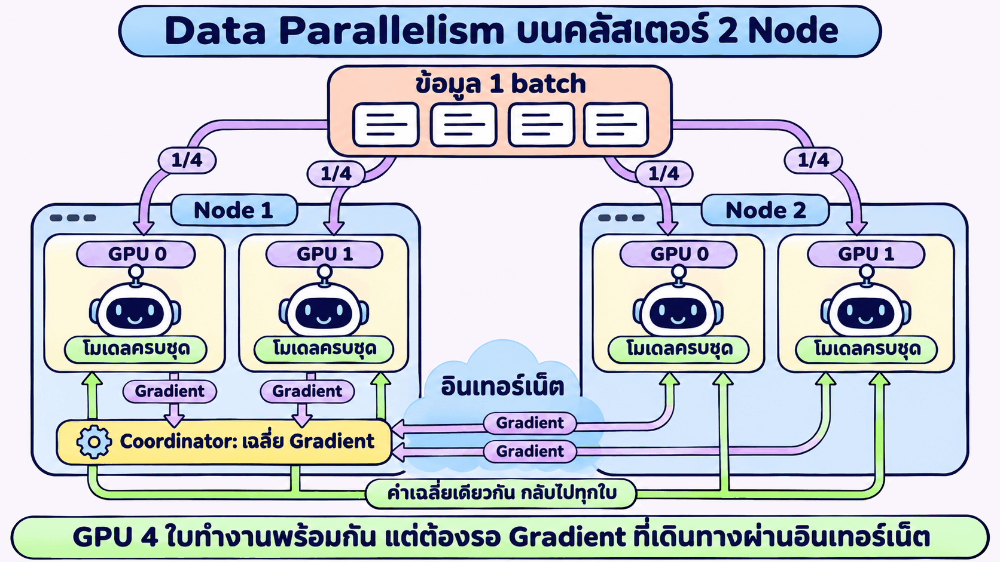
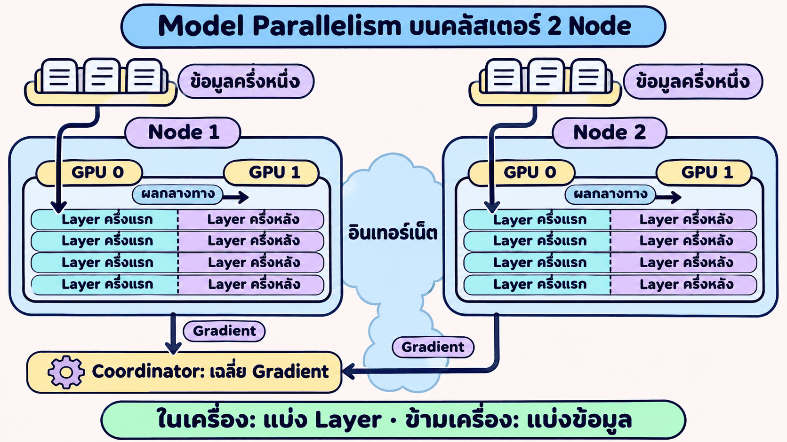

# LAB 5 · เทรน LLM บนคลัสเตอร์หลายเครื่อง: เพิ่มเครื่องแล้วเร็วขึ้นไหม (1 Node เทียบ 2 Node เทียบ 3 Node)

[← กลับหน้ารวมของบท](../README.md) · [สไลด์ประกอบการสอน (HTML)](LAB5_Cluster_Slides.html) · [LAB 4 GPU หลายใบในเครื่องเดียว](../lab4_multigpu/README.md) · เปิด Claude Code ที่โฟลเดอร์ของบท `02_VastAi_Application`

## ทำไปเพื่ออะไร

- **1 Node = เครื่องคอมพิวเตอร์ (เซิร์ฟเวอร์) 1 เครื่อง** (ใน LAB นี้ทุกเครื่องเสียบ **GPU 2 ใบ** คือ RTX 3090 24 GB × 2)
- **คลัสเตอร์ (Cluster)** = การนำเครื่องคอมพิวเตอร์หลายเครื่อง (**หลาย Node**) มาต่อเข้าด้วยกันผ่านเครือข่าย
- [LAB 4](../lab4_multigpu/README.md) ใช้ GPU หลายใบ **ใน 1 เครื่อง (1 Node)** ต่อกันผ่าน PCIe · LAB นี้ขยายเป็น **2 เครื่อง (2 Node = 4 GPU)** และ **3 เครื่อง (3 Node = 6 GPU)** ต่อกันผ่านอินเทอร์เน็ต

คำถามของ LAB: **เพิ่มเครื่องเป็น 2 Node และ 3 Node แล้วเทรนเร็วขึ้นกี่เท่า คุ้มเงินไหม และเวลาของ 1 step หมดไปกับอะไร**

- งานเดิมของ LAB 4: เทรน Qwen3-8B ด้วย LoRA ให้แปลงคำถามเป็น SQL · โมเดล Dataset และ batch ต่อหน่วยเท่ากับ LAB 4
- **1 Node ไม่ต้องรันใหม่** ใช้ผล 1 เครื่อง (GPU 2 ใบ) ของ LAB 4.2 และ LAB 4.3 เป็นตัวเทียบ
- คลัสเตอร์เทรน **2 Epoch** · เก็บรอบ 2 Node ที่รากของแต่ละ LAB ย่อย และรอบ 3 Node ในโฟลเดอร์ `node3/`

## LAB ย่อย 2 แบบ

| LAB ย่อย | ในเครื่อง (GPU 2 ใบ) | ข้ามเครื่อง | ตัวเทียบ 1 Node | ขั้น |
|---|---|---|---|---|
| [LAB 5.1 · Data Parallelism](1_data_parallel/README.md) | GPU ละ 1 โมเดลครบชุด · batch 4 ต่อ GPU | เฉลี่ย Gradient ของทุก GPU | [LAB 4.2](../lab4_multigpu/2_data_parallel/README.md) | 6 (2 Node แล้ว 3 Node) |
| [LAB 5.2 · Model Parallelism](2_model_parallel/README.md) | โมเดล 1 ชุดแบ่ง Layer ลง 2 ใบ · batch 8 ต่อ Node | เฉลี่ย Gradient ของทุก Node | [LAB 4.3](../lab4_multigpu/3_model_parallel/README.md) | 6 (2 Node แล้ว 3 Node) |

ทั้งสองแบบใช้วิธีเดียวกันข้ามเครื่อง: โปรแกรมกลาง (**Coordinator**) บน Node 1 รอ Gradient ของ LoRA จากทุก Worker ให้ครบ เฉลี่ย แล้วส่งค่าเดียวกันกลับ (Synchronous)

|  |  |
|---|---|
| LAB 5.1 · โมเดล 4 ชุด | LAB 5.2 · โมเดล 2 ชุด |

## ผลรวม: 1 Node เทียบ 2 Node เทียบ 3 Node

| | Data Parallelism | | | Model Parallelism | | |
|---|---|---|---|---|---|---|
| | **1 Node** | **2 Node** | **3 Node** | **1 Node** | **2 Node** | **3 Node** |
| GPU ทั้งหมด / จำนวนโมเดล | 2 / 2 | 4 / 4 | 6 / 6 | 2 / 1 | 4 / 2 | 6 / 3 |
| batch รวม | 8 | 16 | 24 | 8 | 16 | 24 |
| วินาทีต่อ step | 0.42 | 3.56 | 5.34 | 0.79 | 3.27 | 5.52 |
| – คำนวณ | – | 0.43 | 0.36 | 0.79 | 0.70 | 0.73 |
| – ส่งและรอ Gradient | สั้นมาก | 3.11 (88%) | 4.97 (93%) | – | 2.56 (78.5%) | 4.79 (87%) |
| ตัวอย่างต่อวินาที | **19.08** | **4.50** | **4.49** | **10.13** | **4.90** | **4.32** |
| Speedup เทียบ 1 Node | 1.00 | 0.24 | 0.24 | 1.00 | 0.48 | 0.43 |
| Efficiency | 100% | 12% | 8% | 100% | 24% | 14% |
| GPU util เฉลี่ย | ราว 98% | 12.7% | 6.6% | ราว 49% | ราว 10% | 6.6% |
| Exact Match หลัง Epoch 2 | 77.5% | 75.0% | 74.5% | 77.5% | 74.0% | 71.0% |
| ราคาต่อชั่วโมง (ทุกเครื่องรวมกัน) | $0.3767 | $0.9802 | $1.3484 | $0.4067 | $0.9058 | $1.3300 |
| เงินต่อ 1,000 ตัวอย่าง | **$0.0055** | **$0.0605** | **$0.0835** | **$0.0112** | **$0.0513** | **$0.0855** |
| ใบคิดเงินจริงของรอบนั้น | – | $1.588 | $1.883 | – | $1.838 | $1.730 |

ตัวเลข 1 Node มาจาก LAB 4 (GPU 2 ใบ) · รายละเอียดของแต่ละช่องอยู่ในหน้าของ LAB ย่อย

**อ่านผลอย่างไร**

- **เพิ่มเครื่องผ่านอินเทอร์เน็ตแล้วช้าลงทั้งสองแบบ** · Speedup 0.24–0.48 ไม่ใช่ 2 หรือ 3
- **GPU ไม่ได้ช้าลง ที่ช้าคือเครือข่าย** · เวลาคำนวณต่อ step ยังอยู่ที่ 0.4–0.8 วินาที แต่ต้องส่ง Gradient ของ LoRA ราว 15 MB ต่อ Worker ไปกลับผ่านอินเทอร์เน็ตทุก step ใช้ 2.6–5.0 วินาที · **78–93% ของแต่ละ step คือการส่งและรอ** GPU util จึงเหลือ 6–13%
- **ทั้งสองแบบบนคลัสเตอร์ได้ความเร็วเกือบเท่ากัน** (4.3–4.9 ตัวอย่างต่อวินาที) ทั้งที่บน 1 Node ต่างกันเกือบ 2 เท่า · เมื่อเครือข่ายเป็นคอขวด วิธีจัดวางบน GPU แทบไม่มีผลต่อความเร็ว
- **2 Node → 3 Node ไม่เร็วขึ้น** · ได้ตัวอย่างต่อ step เพิ่ม 1.5 เท่า แต่เวลาต่อ step ก็นานขึ้น 1.5–1.7 เท่า เพราะ Coordinator ต้องรอ Worker ที่ช้าที่สุดจากจำนวนที่มากขึ้น
- **แพงขึ้น 5–15 เท่าต่อตัวอย่าง** · จ่ายค่าเช่าทุกเครื่อง แต่ GPU ว่างราว 90% ของเวลา · และค่าส่งข้อมูลกลายเป็นเงินจริง (ราว $0.2–0.4 ต่อรอบ)
- **ถ้าเครือข่ายเร็วพอ ผลจะกลับกัน** · ถ้า step ใช้เวลาเท่าเวลาคำนวณ Data Parallelism 2 Node จะได้ราว 37 ตัวอย่างต่อวินาที และ 3 Node ราว 66 (ตัวเลขนี้เป็นการ **คำนวณ** ไม่ได้วัด) · คลัสเตอร์จริงจึงวาง Node ไว้ในห้องเดียวกันและต่อด้วยเครือข่ายความเร็วสูง
- **การเฉลี่ยข้ามเครื่องทำงานถูกทุกรอบ** · น้ำหนัก LoRA ของทุก Worker เท่ากันทุกค่าหลังจบทุก Epoch · Exact Match 71.0–75.0% ใกล้กับ 1 Node (77.5%)

**สิ่งที่เจอจริงระหว่างทำ** (อยู่ในหน้าของ LAB ย่อย)

| เรื่อง | เกิดที่ | บทเรียน |
|---|---|---|
| ความเร็วระหว่างเครื่องต่ำกว่าที่หน้าเช่าบอกมาก (82–143 Mbps เทียบกับที่กรองไว้ 700 Mbps) | ทั้งสอง LAB ย่อย | ต้องวัดเน็ตระหว่าง Node เองก่อนเทรน |
| ความเร็วเน็ตแกว่ง บาง step ค้างเป็นสิบถึงร้อยวินาที | ทุกรอบ | ดูค่ากลางคู่กับค่าเฉลี่ย · ต้องมีการต่อใหม่และรันต่อจาก checkpoint |
| AI ตั้งขนาด buffer ของ socket เอง ทำให้ช้า 16–70 วินาทีต่อ step | 3 Node ทั้งสอง LAB ย่อย | การตั้งค่าเครือข่ายเล็กน้อยเปลี่ยนความเร็วได้หลายเท่า |
| เครื่องเช่า reboot เองกลางการเทรน | LAB 5.2 ส่วน 2 Node | ยิ่งมากเครื่อง ยิ่งมีโอกาสที่เครื่องใดเครื่องหนึ่งจะมีปัญหา |
| batch ที่ตรึงไว้ Out of Memory ตอนลอง 3 step | LAB 5.1 ส่วน 2 Node | ลองด้วย batch ที่มี padding ก่อนเทรนจริงเสมอ |

**ข้อจำกัดของการเทียบนี้**

| ข้อจำกัด | ผลต่อการอ่านตัวเลข |
|---|---|
| ทุกแบบรันบนเครื่องเช่าคนละชุด คนละประเทศ | ความเร็วเน็ตของแต่ละรอบต่างกันและแกว่ง · ตัวเลขของ 2 Node กับ 3 Node และของสอง LAB ย่อย เทียบกันได้แค่คร่าว ๆ · รอบของคุณอาจต่างจากนี้หลายเท่า |
| 1 Node ใช้ PyTorch ในเครื่องเดียว ส่วนคลัสเตอร์ใช้ Coordinator ที่ AI เขียน | วิธีส่ง Gradient ต่างกัน และโค้ดของแต่ละรอบเขียนใหม่ทุกครั้ง (บางรอบส่ง Gradient ขาขึ้นแบบ bf16 ขนาดครึ่งเดียว บางรอบส่ง float32 เต็ม) |
| batch รวมไม่เท่ากัน (8, 16, 24) | จำนวนครั้งที่ปรับน้ำหนักต่อ Epoch ต่างกัน Exact Match จึงมีผลของ batch ปนอยู่ |
| 1 Node เทรน 3 Epoch ส่วนคลัสเตอร์เทรน 2 Epoch | ใช้ Exact Match หลัง Epoch 2 เทียบกัน · ความเร็วของ 1 Node เป็นค่ารวม 3 Epoch |
| Test Set มี 200 ข้อ | 1 ข้อ = 0.5 จุด ความต่าง 2–3 จุดยังสรุปไม่ได้ว่าแบบไหนดีกว่า |
| เงินต่อ 1,000 ตัวอย่างนับเฉพาะเวลาเทรน | ไม่รวมเวลาเตรียมเครื่อง การทดสอบ การวัดผล และค่าส่งข้อมูล · ใบคิดเงินจริงของแต่ละรอบสูงกว่าค่าเทรน 2.5–4.5 เท่า |

## เมื่อไรควรใช้คลัสเตอร์

| สถานการณ์ | ควรทำ | เหตุผล |
|---|---|---|
| งานเทรนบน 1 Node ได้ | อยู่บน 1 Node · อยากเร็วขึ้นให้เพิ่ม GPU ในเครื่องเดียว | ใน [LAB 4](../lab4_multigpu/README.md) Data Parallelism 4 ใบในเครื่องเดียวเร็วกว่า 2 ใบ 1.87 เท่า |
| GPU ในเครื่องเดียวไม่พอ และ Node อยู่ในเครือข่ายเร็วเดียวกัน | ใช้คลัสเตอร์ | เวลาส่ง Gradient สั้นเมื่อเทียบกับเวลาคำนวณ |
| มีแต่ Node ที่ต่อกันผ่านอินเทอร์เน็ต | วัดก่อน: ขนาด Gradient ÷ ความเร็วเน็ต เทียบกับเวลาคำนวณต่อ step | ถ้าเวลาส่งนานกว่าเวลาคำนวณ เพิ่มเครื่องแล้วช้าลงและแพงขึ้น (ผลของ LAB นี้) |
| ต้องใช้ผ่านอินเทอร์เน็ตจริง ๆ | ส่งให้เล็กลง (เช่น แปลง Gradient เป็น bf16) หรือส่งให้ห่างขึ้น (เฉลี่ยทุกหลาย step) | ลดเวลาส่งและรอต่อ step |

## สิ่งที่เหมือนกันทั้ง 2 LAB ย่อย

| หัวข้อ | ค่า |
|---|---|
| โมเดล | [Qwen/Qwen3-8B](https://huggingface.co/Qwen/Qwen3-8B) แบบ bf16 · LoRA r 8 alpha 16 ที่ `q_proj` กับ `v_proj` (เทรน 3,833,856 parameter) |
| Dataset | [b-mc2/sql-create-context](https://huggingface.co/datasets/b-mc2/sql-create-context) · Training Set 4,000 · Test Set 200 · สับด้วย seed 0 · ทุก Node ได้ชุดเดียวกัน |
| ค่าที่ตรึง | learning rate 2e-4 · seed 0 · ข้อความยาวไม่เกิน 256 token · ปิด thinking · ไม่ใช้ Gradient Checkpointing · 2 Epoch · batch เท่ากับ LAB 4 |
| เครื่อง | RTX 3090 24 GB × 2 ต่อ Node · ไม่เกิน $0.60 ต่อชั่วโมงต่อเครื่อง · IP สาธารณะต่างกัน · Node 1 เปิด 1 port |
| สิ่งที่วัด | เน็ตระหว่าง Node · เวลาต่อ step แยกเป็นคำนวณ กับ ส่งและรอ · ตัวอย่างต่อวินาที · GPU util · น้ำหนัก LoRA ของทุก Worker เท่ากันหรือไม่ · Exact Match ของ Base และหลังจบแต่ละ Epoch · เงินต่อ 1,000 ตัวอย่าง |

แต่ละ LAB ย่อยมี **6 ขั้น ทุกขั้นคือ 1 พรอมต์** · โค้ดทุกไฟล์ AI เขียนให้จากพรอมต์ เริ่มจากโฟลเดอร์ว่าง

| ขั้น | ทำอะไร |
|---|---|
| 1 (และ 4) | เช่า 2 (3) เครื่อง โหลดโมเดลและ Dataset ลงทุก Node วัดเน็ตระหว่าง Node |
| 2 (และ 5) | AI เขียน Coordinator กับ Worker · ลอง 3 step · เทรน 2 Epoch พร้อมจับเวลา · วัด Exact Match |
| 3 (และ 6) | สรุปเป็นกราฟ คิดเงิน และลบเครื่องทุก Node |

แนะนำให้ทำ [LAB 4](../lab4_multigpu/README.md) ก่อน แล้วทำ 5.1 → 5.2 · ทุกส่วนเช่าเครื่องของตัวเองและลบเครื่องในขั้นสุดท้ายเสมอ

> ⚠️ คลัสเตอร์คิดเงินพร้อมกันทุกเครื่อง · 3 Node ราว $1.35 ต่อชั่วโมง · **ห้ามข้ามขั้นลบเครื่อง** และตรวจซ้ำว่าไม่มีเครื่องค้างในบัญชี

## เวลาและค่าเช่าจริง

| ส่วน | เวลา 3 ขั้น | ใบคิดเงิน |
|---|---|---|
| LAB 5.1 · 2 Node | 84 นาที | $1.588 |
| LAB 5.1 · 3 Node | 75 นาที | $1.883 |
| LAB 5.2 · 2 Node | 117 นาที | $1.838 |
| LAB 5.2 · 3 Node | 73 นาที | $1.730 |
| **รวม** | **ราว 5.8 ชั่วโมง** | **$7.04** |

## ไฟล์ในโฟลเดอร์นี้

| ไฟล์ | คืออะไร |
|---|---|
| [1_data_parallel/](1_data_parallel/README.md) | LAB 5.1 · Data Parallelism บนคลัสเตอร์ (2 Node และ 3 Node ใน `node3/`): README พรอมต์ ตัวอย่างโค้ด และผลจริง |
| [2_model_parallel/](2_model_parallel/README.md) | LAB 5.2 · Model Parallelism บนคลัสเตอร์ (2 Node และ 3 Node ใน `node3/`): README พรอมต์ ตัวอย่างโค้ด และผลจริง |
| [LAB5_Cluster_Slides.html](LAB5_Cluster_Slides.html) | สไลด์ประกอบการสอนแบบ HTML ไฟล์เดียว (80 หน้า · ครบทั้ง 2 LAB และพรอมต์ 12 ขั้น · สร้างด้วย `python tools/build_slides.py`) |
| `tools/` | สคริปต์สร้างสไลด์ (`slides_engine.py` · `slides_figures.py` · `build_slides.py`) |
| `image/` | ภาพประกอบของหน้านี้ และภาพสไลด์ใน `image/slides/` |
