# LAB 6 · Inference บน 1 โหนด หลาย GPU (Single-Node Multi-GPU): Load Test, Micro-batching และ NGINX Load Balancer

[← กลับหน้ารวมของบท](../README.md) · [สไลด์ประกอบการสอน (HTML)](LAB6_Microbatch_LB_Slides.html) · [พรอมต์ทั้ง 12 ขั้น](PROMPTS.md) · เปิด Claude Code ที่โฟลเดอร์ของบท `02_VastAi_Application` · ทำ [LAB 0](../README.md#lab-0--เตรียม-key-3-ตัว) ก่อน

## ขอบเขตของบทนี้ (อ่านก่อนเริ่ม)

> **บทนี้ใช้เพียง 1 โหนด (เครื่องเช่า 1 เครื่อง) ที่มี GPU หลายใบ (RTX 3090 × 2 ใบ) สำหรับงาน Inference / API Serving — ไม่ใช่คลัสเตอร์หลายโหนด (Multi-Node)**
>
> ทุกองค์ประกอบในระบบ — **NGINX Load Balancer** (container พอร์ต `8080`), **FastAPI server สูงสุด 8 โปรแกรม** (`127.0.0.1:8101–8104` บน GPU 0 และ `8201–8204` บน GPU 1) และ **ตัวยิงโหลด (`loadgen.py`)** — รันอยู่ใน **โหนดเดียว (เครื่องเดียวกันทั้งหมด)** เพื่อให้วัดผลของ Micro-batching, multi-process และ Load Balancer โดยไม่มีความช้าของเครือข่ายข้ามเครื่องมาปน (การกระจายงาน Serving ข้ามหลายโหนดจริงอยู่ใน [LAB 7](../lab7_llm_serving_lb/README.md))


| LAB | งานหลัก | จำนวนโหนด (เครื่อง) | GPU ในแต่ละโหนด | สิ่งที่ทดลอง |
|---|---|---|---|---|
| [LAB 4](../lab4_multigpu/README.md) | Training (เทรน LLM) | **1 โหนด** (Single-Node) | 1, 2 หรือ 4 ใบ | Data Parallelism และ Model Parallelism ในเครื่องเดียว |
| [LAB 5](../lab5_cluster/README.md) | Training (เทรน LLM) | **2–3 โหนด** (Multi-Node) | โหนดละ 2 ใบ | คลัสเตอร์เทรนข้ามอินเทอร์เน็ต เพิ่มเครื่องแล้วเร็วขึ้นไหม |
| **LAB 6 (บทนี้)** | **Inference / API Serving** | **1 โหนด** (Single-Node) | **RTX 3090 × 2 ใบ** | **Micro-batching · multi-process · NGINX Load Balancer** |
| [LAB 7](../lab7_llm_serving_lb/README.md) | Inference / LLM Serving | **2 โหนด** (Multi-Node) | โหนดละ 2 ใบ (รวม 4) | ขยาย NGINX แจกงานข้าม 2 โหนดผ่านอินเทอร์เน็ต |

คำถามของ LAB: **API ตรวจภาพ (Inference) บน 1 โหนดที่มี GPU 1 ใบรับผู้ใช้พร้อมกันได้กี่คน ทำอย่างไรให้รับได้มากขึ้นบนโหนดเดิม และเมื่อเปิดใช้ GPU ใบที่ 2 ในโหนดเดียวกัน NGINX ควรแจกงานด้วยวิธีใด**

## 4 แบบที่วัด (ทั้งหมดรันใน 1 โหนดเดิม)


ทุกการทดลองรันงาน **Inference** บน **โหนดเดิมเพียง 1 โหนด** (ป้าย `vapp-lab6-nginx`) ต่างกันที่จำนวน GPU ที่เปิดใช้ และจำนวนโปรแกรม API (`server.py`) ที่เปิดพร้อมกันภายในเครื่อง:

| แบบ | จำนวนโหนด | GPU ที่ใช้ (ในโหนดเดียว) | โปรแกรม API ที่เปิด (process) | วิธีเรียกโมเดล |
|---|---|---|---|---|
| 1 (`base`) | **1 โหนด** | 1 ใบ (GPU 0) | **1 ตัว** (`:8101`) | ตรวจทีละ 1 รูป (Baseline) |
| 2 (`batch`) | **1 โหนด** | 1 ใบ (GPU 0) | **1 ตัว** (`:8101`) | Micro-batching (รวมสูงสุด 32 รูป · รอไม่เกิน 5 ms) |
| 3 (`multi`) | **1 โหนด** | 1 ใบ (GPU 0) | **4 ตัว** (`:8101–:8104`) ใช้ GPU 0 ร่วมกัน | Micro-batching · NGINX แจกงานให้ 4 โปรแกรม |
| 4 (`gpu2`) | **1 โหนด** | **2 ใบ (GPU 0 + GPU 1)** | **8 ตัว** (GPU 0 4 ตัว + GPU 1 4 ตัว) | Micro-batching · NGINX แจกงานข้าม 2 GPU ในโหนดเดียว |

- **คำว่า "server 1 ตัว" ใน LAB นี้ = โปรแกรม FastAPI 1 ตัว (1 process)** ที่รันบน `127.0.0.1` ไม่ใช่คอมพิวเตอร์แยกคนละเครื่อง
- **ทำไมแบบที่ 3 เปิด 4 ตัวบน GPU ใบเดียว**: โปรแกรม Python 1 ตัวรับรูปและแปลง JPEG บน CPU ได้ทีละ 1 core (ติด GIL) การเปิด 4 โปรแกรมพร้อมกันช่วยให้ 4 CPU cores เตรียมรูปป้อนให้ GPU 0 ใบเดียวได้เต็มกำลัง
- **ทำไมแบบที่ 4 มี 8 ตัว**: เปิดใช้ GPU ใบที่ 2 ในโหนดเดิม โดยเปิดเพิ่มอีก 4 โปรแกรม (`:8201–:8204`) คู่กับ GPU 1 รวมเป็น 8 โปรแกรมหลัง NGINX ประตูเดียว (`:8080`)
- เกณฑ์ผ่านของทุกแบบ: **p95 ไม่เกิน 500 ms และ error ต่ำกว่า 1%** · ความจุ = จำนวนผู้ใช้พร้อมกัน (N) สูงสุดที่ยังผ่าน

## สารบัญของบท (เรียงตามหัวข้อ)

| ส่วน | หัวข้อ | เนื้อหา |
|---|---|---|
| 1 | [ผลสรุป · ข้อมูลทดสอบ · กติกาการทดลอง](#ผลสรุป) | ภาพรวมความจุทั้ง 4 แบบ · ผลวิธีแจกงาน 3 วิธี · รูปทดสอบ 6 รูป · ค่าที่ตรึง |
| 2 | [ภาคทฤษฎี · แนวคิดพื้นฐาน 10 เรื่อง](#ภาคทฤษฎี--แนวคิดพื้นฐาน-10-เรื่อง) | System Architecture · N/Throughput/Latency/p95 · Load Test · Micro-batching · Multi-process · Load Balancer (RR / LC / p2c) · Failover · NGINX container |
| 3 | [ภาคปฏิบัติ · LAB 12 ขั้นด้วย NGINX](#ภาคปฏิบัติ--lab-12-ขั้นด้วย-nginx) | ลงมือทำ 12 ขั้น (ส่วน A–E, ขั้นที่ 10 มี 10.1 และ 10.2) · พรอมต์ครบทุกขั้น · ผลวัดจริง |
| 4 | [สรุปผลการทดลองและแนวทางเลือกใช้งานจริง](#สรุปผลการทดลอง) | 6 คำถาม 6 คำตอบ · Least Connections เทียบ Power of Two Choices · ลำดับ 5 ขั้นถ้าต้องใช้จริง |

---

## ผลสรุป


| GPU | แบบ | ความจุ (คน) | Throughput สูงสุด (คำขอ/วินาที) | p95 ที่ความจุ (ms) | เท่าของแบบที่ 1 |
|---|---|---|---|---|---|
| 1 | 1 · ทำทีละรูป | **29** | 62.6 | 494.4 | 1.00 |
| 1 | 2 · Micro-batching | **52** | 142.9 | 490.0 | 1.79 |
| 1 | 3 · Micro-batching + server 4 ตัว | **90** | 278.7 | 468.4 | 3.10 |
| 2 | 4 · GPU 2 ใบ + NGINX (Round Robin) | **180** | 566.5 | 490.3 | 6.21 |

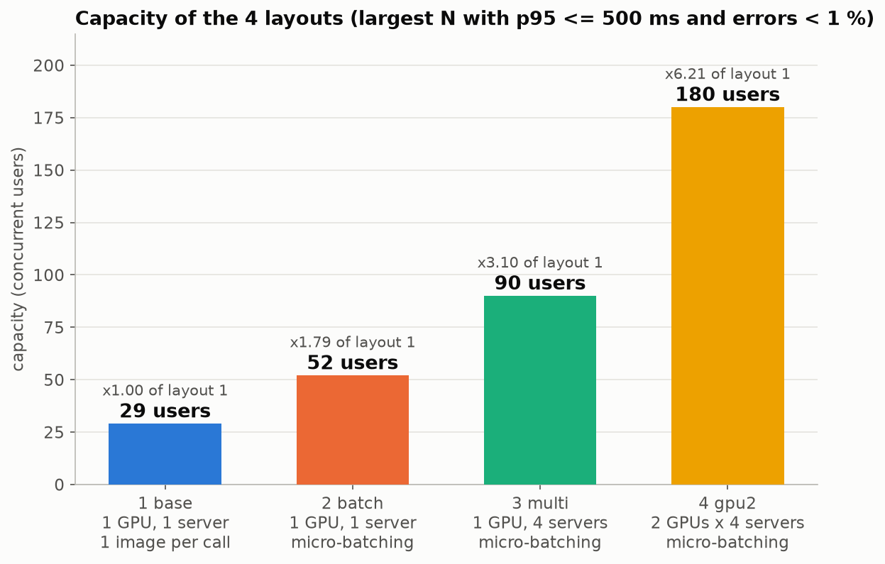

- **GPU ใบเดิม ค่าเช่าเท่าเดิม รับได้ 3.10 เท่า** (29 → 90 คน) จาก Micro-batching และการเปิด server 4 ตัว
- **ตัวถ่วงย้ายที่ทุกครั้ง**: แบบที่ 1 คือการทำทีละรูป (GPU ทำงาน 22%) → แบบที่ 2 น่าจะเป็น CPU ของ server ตัวเดียว (GPU 31% · ยังไม่ได้วัดยืนยัน) → แบบที่ 3 และ 4 GPU ทำงาน 82–85% และ Throughput ไม่เพิ่มอีก
- **เพิ่ม GPU ใบที่ 2 ได้ 2.00 เท่า** (90 → 180 คน) · Efficiency ราว 100%
- **วิธีแจกงาน เมื่อ GPU ใบที่ 2 ช้าลง 3 เท่า**: Least Connections > p2c > Round Robin บนทุกเครื่องที่วัด · Least Connections รับได้ราว 2 เท่าของ Round Robin และ 1.33–1.37 เท่าของ p2c
- **วิธีแจกงาน เมื่อ GPU เร็วเท่ากัน**: วิธีที่ดูงานค้างไม่แย่กว่า Round Robin บนทุกเครื่อง แต่ขนาดของส่วนต่างแกว่งมาก และ Least Connections กับ p2c สลับลำดับกันระหว่างเครื่อง
- **GPU ล่มกลางทาง**: ไม่ป้องกัน error 34.2% ของคำขอทั้งหมด (HTTP 502 ทั้งหมด) · ป้องกันแล้ว error 0

**วิธีแจกงาน 3 วิธี** (ความจุ คน · เทียบกันได้เฉพาะภายในคอลัมน์เดียวกัน)

| กรณี | วิธี | เครื่องหลัก (10.1) | เครื่อง A (10.2) | เครื่อง B (10.2) |
|---|---|---|---|---|
| GPU ใบที่ 2 ช้าลง 3 เท่า | Round Robin | 52 | 49 | 54 |
| GPU ใบที่ 2 ช้าลง 3 เท่า | Power of Two Choices | – | 72 | 81 |
| GPU ใบที่ 2 ช้าลง 3 เท่า | Least Connections | **103** | **96** | **111** |
| GPU เร็วเท่ากัน | Round Robin | 180 | 128 | 203 |
| GPU เร็วเท่ากัน | Power of Two Choices | – | 196 | **238** |
| GPU เร็วเท่ากัน | Least Connections | **250** | **221** | 230 |

คำตอบ: **ระบบที่มี Load Balancer 1 ตัวและ server 8 ตัว เลือก Least Connections** · p2c ได้ผลไปทางเดียวกันแต่น้อยกว่าเมื่อ server เร็วไม่เท่ากัน

**ข้อที่ต้องอ่านคู่กับตัวเลข**

- วัดแบบละ 1 รอบ ระดับละ 20 วินาที · ความจุของแบบที่ 1 และ 2 ผ่านที่การวัดครั้งที่สอง (N = 29: 507.4 แล้ว 494.4 ms · N = 52: 511.5 แล้ว 490.0 ms) จึงอยู่ชิดเส้น 500 ms มาก
- Throughput สูงสุดของแบบที่ 2–4 เกิดที่ระดับที่ไม่ผ่านเกณฑ์ (N = 64, 128, 512) · ที่ความจุได้ 135.2, 268.7 และ 553.4 คำขอ/วินาที
- "2.00 เท่า" อ่านว่า **ประมาณ 2 เท่า**: ยิง Round Robin ซ้ำที่ N = 180 อีก 3 ครั้ง ได้ p95 392.2 และ 468.7 ms (ผ่าน) กับ 640.6 ms (ไม่ผ่าน)
- NGINX ใช้ค่าเริ่มต้น `max_fails=1 fail_timeout=10s`: บางระดับ server ตัดการเชื่อมต่อ 1–3 ครั้ง แล้ว NGINX พัก server ตัวนั้น 10 วินาที ทำให้ p95 ของระดับนั้นแกว่ง (ดูขั้นที่ 8–10) · สาเหตุที่ server ตัดการเชื่อมต่อยังไม่ได้วัด
- ผู้ใช้จำลองส่งรูปต่อทันทีไม่หยุดพัก และตัวยิงโหลดอยู่ในเครื่องเดียวกัน · ผู้ใช้จริงที่หยุดดูผล ระบบจะรับได้มากกว่านี้
- "GPU ช้า" เป็นการจำลอง: server ของ GPU ใบที่ 2 เรียกโมเดล 3 ครั้งต่อ 1 รอบ
- ขั้นที่ 10.2 วัดบนเครื่อง A และ B ซึ่งไม่ใช่เครื่องหลัก · Round Robin กรณี GPU เท่ากันได้ 180, 128 และ 203 คนบน 3 เครื่อง จึงเทียบตัวเลขเฉพาะภายในเครื่องเดียวกัน

## รู้จักข้อมูลที่ใช้ทดสอบ


| รูป | ขนาดไฟล์ | วัตถุที่โมเดลตรวจได้ | รวม | เวลาที่โมเดลใช้ รอบ 1 / รอบ 2 |
|---|---|---|---|---|
| sample-1.jpg | 47.6 KB | Person 6 · Hardhat 5 · NO-Safety Vest 5 · Safety Vest 1 · NO-Hardhat 1 | 18 | 55.04 / 16.48 ms |
| sample-2.jpg | 49.9 KB | Person 3 · Hardhat 2 · NO-Safety Vest 2 · NO-Hardhat 1 · Mask 1 | 9 | 23.41 / 18.25 ms |
| sample-3.jpg | 53.1 KB | Person 2 · NO-Safety Vest 2 · Hardhat 1 · NO-Hardhat 1 · NO-Mask 1 | 7 | 18.04 / 16.14 ms |
| sample-4.jpg | 78.1 KB | Hardhat 21 · Safety Vest 20 · Person 19 · NO-Mask 19 | 79 | 16.86 / 15.86 ms |
| sample-5.jpg | 60.4 KB | Person 2 · Hardhat 2 · Safety Vest 2 · vehicle 2 | 8 | 17.89 / 18.97 ms |
| sample-6.jpg | 40.7 KB | Person 3 · Hardhat 2 · Safety Vest 2 · NO-Mask 2 | 9 | 15.42 / 16.81 ms |

**1 คำขอ** = `POST /v1/detect` + รูป 1 รูปในช่อง `file` + `Authorization: Bearer <key>` · คำตอบจริงของ sample-6 (ตัดเหลือ 2 จาก 9 วัตถุ)

```json
{"filename": "sample-6.jpg", "server": "gpu0-8001", "mode": "single", "batch_size": 1,
 "queue_ms": 0.06, "model_ms": 15.42, "image": {"width": 640, "height": 640}, "count": 9,
 "detections": [
  {"class_id": 5, "class_name": "Person",  "confidence": 0.8917,
   "box": {"x1": 380.1, "y1": 194.3, "x2": 480.3, "y2": 550.4}},
  {"class_id": 0, "class_name": "Hardhat", "confidence": 0.8858,
   "box": {"x1": 255.4, "y1": 124.3, "x2": 300.4, "y2": 168.7}}]}
```

| ช่อง | บอกอะไร |
|---|---|
| `server` | server ตัวไหนตอบ (GPU ใบไหน · พอร์ตไหน) |
| `batch_size` | รูปนี้เข้าโมเดลพร้อมกันกี่รูป |
| `queue_ms` · `model_ms` | เวลารอคิว · เวลาที่โมเดลใช้ในการเรียกครั้งนั้น |
| `detections[]` | คลาส · Confidence (0.35 ขึ้นไป) · กรอบเป็นพิกเซลของรูปต้นฉบับ |

- ที่มาของรูป: Test Set ของ [Construction Site Safety](https://universe.roboflow.com/roboflow-universe-projects/construction-site-safety) รุ่น 28 บน Roboflow Universe · สัญญาอนุญาต CC BY 4.0
- โมเดล: YOLO11s ที่ Fine-tune ใน LAB 1 (ไฟล์ `best.pt`) · ดูการ์ดโมเดลที่ [หน้าทฤษฎี ส่วนที่ 1](#1--โจทย์และระบบที่จะสร้าง)

## การทดลอง

| หัวข้อ | ค่า |
|---|---|
| โหลด | ผู้ใช้จำลอง N คน · ส่งรูป รอคำตอบ แล้วส่งรูปถัดไปทันที · วนรูปทดสอบ 6 รูป · รอเกิน 10 วินาทีนับเป็น error |
| โมเดล | YOLO11s (`best.pt`) · ขนาดภาพ 640 · Confidence ขั้นต่ำ 0.35 |
| สิ่งที่เทียบ | 4 แบบ · Round Robin เทียบ Least Connections เทียบ Power of Two Choices · GPU ล่มแบบไม่ป้องกันเทียบป้องกัน |
| วัด 1 ระดับ | 20 วินาที · 5 วินาทีแรกเป็นช่วงอุ่นเครื่อง ไม่นับ |
| เกณฑ์ผ่าน | p95 ไม่เกิน 500 ms **และ** error ต่ำกว่า 1% · ความจุ = N สูงสุดที่ผ่าน |
| หาความจุ จังหวะ 1 หาช่วง | ไล่ N = 1, 2, 4, 8, … จนไม่ผ่าน 2 ระดับติดกัน |
| หาความจุ จังหวะ 2 ประมาณ | ใช้ p95 ของสองระดับที่วัดแล้ว เดาว่าควรลอง N ค่าไหนต่อ แล้ววัดยืนยัน |
| หาความจุ จังหวะ 3 ปรับ | ทำซ้ำจนระดับที่ผ่านกับระดับที่ไม่ผ่านห่างกันไม่เกิน 2 คน (N เกิน 100 ใช้ 4 คน) |
| ระดับที่ไม่ผ่าน | วัดซ้ำอีก 1 ครั้งก่อนตัดสิน · ตัวยิงโหลดของรอบนี้ถือว่าผ่านถ้าครั้งใดครั้งหนึ่งผ่าน |
| เครื่องหลัก | RTX 3090 × 2 ใบ · Quebec, CA · CPU ที่ใช้ได้จริงราว 24.6 cores · $0.3578 ต่อชั่วโมง |
| เครื่องของขั้นที่ 10.2 | RTX 3090 × 2 ใบ 2 เครื่อง · A 46 cores · B 30.7 cores |
| เวลาและเงินจริง | 12 ขั้นรวม 130 นาที · เครื่องเปิด 2 ชั่วโมง 04 นาที · หน้า billing แสดง **$0.644** เมื่ออ่านหลังลบเครื่อง 10 นาที · คิดตามอายุเครื่องเต็มราว **$0.74** · ขั้นที่ 10.2 เครื่อง A $0.43 และเครื่อง B $0.33 |

**ค่าประมาณมีไว้เลือก N ที่จะวัดต่อเท่านั้น คำตอบคือค่าที่วัดได้** · ผลจริงของ 4 แบบ

| แบบ | ช่วงที่หาได้ (ผ่าน / ไม่ผ่าน) | ค่าประมาณรอบแรก | ความจุที่วัดได้ | วัดกี่ระดับ (กี่ครั้ง) | สูตร Throughput สูงสุด × 0.5 วินาที |
|---|---|---|---|---|---|
| 1 `base` | 16 / 32 | 28.7 | **29** | 9 (13) | 31.3 |
| 2 `batch` | 32 / 64 | 53.9 | **52** | 12 (17) | 71.5 |
| 3 `multi` | 64 / 128 | 102.4 | **90** | 15 (20) | 139.4 |
| 4 `gpu2` | 128 / 256 | 142.1 | **180** | 15 (19) | 283.2 |

- ค่าประมาณรอบแรกห่างจากความจุจริง 0–2 คนในแบบที่ 1 และ 2 · แบบที่ 3 ห่าง 12 คน และแบบที่ 4 ห่าง 38 คน จึงต้องวัดเพิ่มอีก 4–5 ระดับ
- สูตรคิดในใจ `N ≈ Throughput สูงสุด × 0.5 วินาที` ใช้ได้กับแบบที่ 1 เท่านั้น (31.3 เทียบ 29) · แบบที่มี Micro-batching สูงเกินจริง 37–57% เพราะ p95 สูงกว่าเวลาเฉลี่ยมาก

---

---

# ภาคทฤษฎี · แนวคิดพื้นฐาน 10 เรื่อง

ส่วนที่ 1–9 เรียงตามลำดับที่ใช้จริงใน LAB: ระบบหน้าตาเป็นอย่างไร → วัดอย่างไร → ทำให้ GPU 1 ใบรับได้มากขึ้นอย่างไร → เพิ่ม GPU แล้วแจกงานอย่างไร · ส่วนที่ 10 เป็นเรื่อง NGINX ที่ใช้เป็น Load Balancer ตั้งแต่ขั้นที่ 3 อ่านก่อนลงมือขั้นนั้น

| ส่วน | เรื่อง | ใช้ในขั้น |
|---|---|---|
| [1](#1--โจทย์และระบบที่จะสร้าง) | โจทย์และ System Architecture | 1–3 |
| [2](#2--ตัวเลข-3-ตัว-และคำว่า-ความจุ) | N · Throughput · Latency · p95 · ความจุ | ทุกขั้น |
| [3](#3--load-test-วัดอย่างไร-และรู้ได้อย่างไรว่าวัดถูก) | Load Test และการพิสูจน์ตัวยิงโหลด | 4–5 |
| [4](#4--แบบที่-1-ทำทีละรูป) | แบบที่ 1 ทำทีละรูป | 6 |
| [5](#5--แบบที่-2-micro-batching) | แบบที่ 2 Micro-batching | 7 |
| [6](#6--แบบที่-3-micro-batching--server-หลายตัว) | แบบที่ 3 Micro-batching + server หลายตัว | 8 |
| [7](#7--แบบที่-4-load-balancer-กับ-gpu-2-ใบ) | แบบที่ 4 Load Balancer กับ GPU 2 ใบ | 9 |
| [8](#8--วิธีแจกงาน-round-robin--least-connections--power-of-two-choices) | วิธีแจกงาน: Round Robin · Least Connections · Power of Two Choices | 10 |
| [9](#9--เมื่อ-gpu-ล่มกลางทาง) | เมื่อ GPU ล่มกลางทาง | 11 |
| [10](#10--nginx-แบบ-container) | NGINX แบบ container | 3 |

**คำที่ใช้ในหน้านี้**

| คำที่ใช้ | คำทางการ | หมายถึง |
|---|---|---|
| server 1 ตัว | process | โปรแกรม API ที่เปิดอยู่ 1 ตัว มีคิวและโมเดลของตัวเอง |
| ชุด server ของ GPU 1 ใบ | replica | server ทุกตัวที่ใช้ GPU ใบเดียวกัน |
| ตัวยิงโหลด | load generator | โปรแกรมที่จำลองผู้ใช้หลายคนส่งรูปพร้อมกัน |
| ตัวถ่วง | bottleneck | ส่วนที่เต็มก่อนส่วนอื่น |

---

## 1 · โจทย์และระบบที่จะสร้าง


LAB 1 ได้โมเดลตรวจอุปกรณ์ความปลอดภัยมาแล้ว · LAB นี้เปิดโมเดลนั้นเป็น API แล้วตอบคำถามเดียว

> **GPU 1 ใบรับผู้ใช้พร้อมกันได้กี่คน และทำอย่างไรให้รับได้มากขึ้น**

เราไม่เดา · สร้างระบบ 4 แบบบนเครื่องเดียวกัน แล้ววัดด้วยวิธีเดียวกัน

### System Architecture

> **ขอบเขตสำคัญ: LAB 6 เป็นงาน Inference บนโหนดเดียวที่มีหลาย GPU (Single-Node Multi-GPU: 1 เครื่อง × RTX 3090 จำนวน 2 ใบ) — ไม่ใช่คลัสเตอร์หลายโหนดแบบ LAB 5** · คำว่า "server 1 ตัว" คือ FastAPI 1 process บน `127.0.0.1` ภายในเครื่องเดียวกัน (ส่วนการกระจาย Serving ข้ามหลายโหนดผ่านอินเทอร์เน็ตจะอยู่ใน [LAB 7](../lab7_llm_serving_lb/README.md))


| ส่วน | หน้าที่ | สร้างในขั้น |
|---|---|---|
| **Load Balancer** (container) | ประตูเดียวของระบบที่พอร์ต 8080 · รับทุกคำขอแล้วเลือกว่าจะส่งให้ server ตัวไหน | 3 |
| **server** (FastAPI) | รับรูป เข้าคิว เรียกโมเดล แล้วตอบเป็น JSON · เปิดได้หลายตัวต่อ GPU | 2 |
| **GPU** | รันโมเดล YOLO11s ตรวจรูป | 1 |
| **ตัวยิงโหลด** | จำลองผู้ใช้ N คน อยู่บนเครื่องเดียวกับ server | 4 |

ทั้ง 4 แบบใช้โครงเดียวกันนี้ ต่างกันแค่ 3 ค่า: ใช้ GPU กี่ใบ · server กี่ตัวต่อ GPU · ทำทีละรูปหรือ Micro-batching

### คำขอ 1 รายการเดินทางอย่างไร

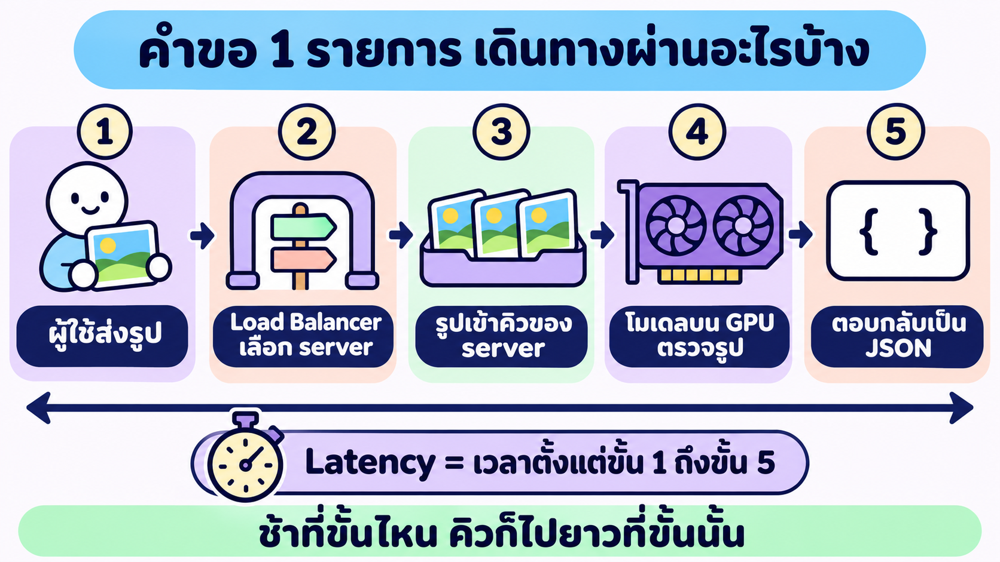

ผู้ใช้ส่ง `POST /v1/detect` พร้อมรูป 1 รูปและ API key · ได้ JSON กลับมาว่าเจอวัตถุอะไร อยู่ตรงไหน มั่นใจแค่ไหน

### โมเดลที่อยู่หลัง API


| หัวข้อ | YOLO11s (ไฟล์ `best.pt`) |
|---|---|
| Input / Output | ภาพ 1 รูป (ย่อเป็น 640 × 640) → รายการกรอบ คลาส และ Confidence |
| ขนาด | 9.4 ล้าน parameter · ไฟล์ราว 19 MB |
| ที่มา | [Ultralytics YOLO11](https://docs.ultralytics.com/models/yolo11/) รุ่น small ที่ Fine-tune ใน [LAB 1](../lab1_yolo/README.md) |
| LAB นี้ใช้ทำอะไร | ตอบอย่างเดียว (Inference) ไม่เทรนเพิ่ม |

โมเดลเล็กแบบนี้ GPU ตรวจ 1 รูปเสร็จในเวลาสั้นมาก งานส่วนใหญ่ของ 1 คำขอจึงอยู่ที่ CPU (รับรูป ถอดไฟล์ JPEG เตรียมรูป แปลงผล) · ข้อนี้เป็นกุญแจของทั้ง LAB

---

## 2 · ตัวเลข 3 ตัว และคำว่า "ความจุ"


| ตัวเลข | หมายถึง | หน่วย |
|---|---|---|
| **N** (Concurrent Users) | ผู้ใช้ที่กำลังส่งรูปหรือรอคำตอบพร้อมกัน | คน |
| **Throughput** | คำขอที่ระบบตอบสำเร็จ | คำขอต่อวินาที |
| **Latency** | เวลาที่ผู้ใช้ 1 คนรอคำตอบ 1 รูป | ms |

- ช่วงแรก เพิ่ม N แล้ว Throughput เพิ่มตาม
- เมื่อระบบเต็ม Throughput หยุดเพิ่ม คนที่เข้ามาใหม่ไปต่อคิว **Latency จึงเพิ่มแทน**
- สามค่านี้ผูกกันด้วย **Little's Law**: `Latency เฉลี่ย (วินาที) ≈ N ÷ Throughput` (ใช้ได้ตรงเพราะผู้ใช้จำลองส่งรูปถัดไปทันทีไม่หยุดพัก)

### p95


วิธีหา p95 ของ 1 ระดับ N:

1. ยิงโหลดที่ N คงที่ แล้วเก็บเวลารอของทุกคำขอ
2. เรียงเวลารอจากเร็วไปช้า
3. **p50** คือค่าตรงกลาง · **p95** คือค่าที่ตำแหน่ง 95% ของคำขอ

ตัวอย่างจากผลจริงของแบบที่ 1 ที่ N = 29 คน: มี 939 คำขอ คำขอลำดับที่ 892 (95% ของ 939) ใช้เวลา 494.4 ms จึงได้ **p95 = 494.4 ms** · p95 1 ค่านี้คือ **1 จุด** บนกราฟความจุในหัวข้อถัดไป (แกน X = 29 คน, แกน Y = 494.4 ms)

ระบบที่ p50 ดีแต่ p95 แย่ คือระบบที่ผู้ใช้ 1 ใน 20 เจออาการค้าง

### ความจุ


| แกน | คือ | หน่วย |
|---|---|---|
| **X** | N ผู้ใช้ที่ส่งรูปพร้อมกัน ที่ตัวยิงโหลดตั้งไว้ในระดับนั้น | คน |
| **Y** | p95 ของ Latency ที่วัดได้ในระดับนั้น (ได้มาตามวิธีในหัวข้อ p95 ด้านบน) | ms |

1 จุดบนกราฟ = วัด 1 ระดับ N นาน 20 วินาที · จุดใต้เส้นประ 500 ms คือผ่าน · ดาวคือจุดที่ N มากที่สุดที่ยังผ่าน · ในตัวอย่างนี้ N = 29 ได้ 494.4 ms ผ่าน แต่ N = 30 ได้ 521.5 ms ไม่ผ่าน ความจุจึงเป็น 29 คน

| คำ | นิยามที่ใช้ทั้ง LAB |
|---|---|
| **ผ่านเกณฑ์** (SLO) | p95 ไม่เกิน 500 ms **และ** error ต่ำกว่า 1% |
| **ความจุ** | N สูงสุดที่ยังผ่านเกณฑ์ |

ระบบที่รับ 1,000 คนแต่ทุกคนรอ 10 วินาที ไม่นับว่ารับได้ · เปลี่ยนเกณฑ์ ตัวเลขความจุก็เปลี่ยน จึงต้องบอกเกณฑ์คู่กับตัวเลขเสมอ

---

## 3 · Load Test: วัดอย่างไร และรู้ได้อย่างไรว่าวัดถูก

### ผู้ใช้จำลองทำอะไร


| การออกแบบ | เหตุผล |
|---|---|
| ผู้ใช้แต่ละคนส่งรูป รอ แล้วส่งต่อทันที (closed-loop) | จำนวนคนที่ค้างอยู่ในระบบเท่ากับ N พอดี จึงตอบคำถาม "กี่คน" ได้ตรง |
| ไม่มีเวลาหยุดคิดระหว่างรูป | เป็นภาระหนักที่สุดต่อคน · ผู้ใช้จริงที่หยุดดูผลก่อนส่งรูปต่อ ระบบจะรับได้มากกว่านี้ |
| 5 วินาทีแรกไม่นับ | ช่วงแรกระบบยังไม่นิ่ง |
| ตัวยิงโหลดอยู่บนเครื่องเดียวกับ server | ยิงจากนอกเครื่องจะได้เวลาของอินเทอร์เน็ตปนเข้ามา |
| รอเกิน 10 วินาที นับเป็น error | คำขอที่ค้างต้องถูกนับว่าล้ม ไม่ใช่หายไปเฉย ๆ |

### หาความจุอย่างไร


| จังหวะ | ทำอะไร | เหตุผล |
|---|---|---|
| **1 หาช่วง** | ไล่ N = 1, 2, 4, 8, … ทีละเท่าตัว จนไม่ผ่าน 2 ระดับติดกัน (ภาพแสดงตั้งแต่ N = 4) | รู้เร็วว่าความจุอยู่ระหว่างค่าไหนกับค่าไหน (เช่น ผ่านที่ 64 ไม่ผ่านที่ 128) |
| **2 ประมาณ** | ใช้ p95 ของระดับสุดท้ายที่ผ่านกับระดับแรกที่ไม่ผ่าน ลากเส้นตรงหาว่า p95 จะถึง 500 ms ที่ N เท่าไร แล้ววัดที่ N นั้นเลย | ผลที่วัดมาแล้วบอกได้ว่าคำตอบน่าจะอยู่ตรงไหน ไม่ต้องเดาค่ากึ่งกลาง |
| **3 ปรับ** | ประมาณซ้ำจากจุดที่วัดเพิ่ม จนระดับที่ผ่านกับระดับที่ไม่ผ่านห่างกันไม่เกิน 2 คน (N เกิน 100 ใช้ 4 คน) | ได้ความจุที่ละเอียดด้วยการวัดไม่กี่รอบ |

- **ระดับที่ไม่ผ่าน วัดซ้ำอีก 1 ครั้งก่อนตัดสิน** เพราะเครื่องอาจสะดุดชั่วขณะ การวัดครั้งเดียวเชื่อไม่ได้
- **ค่าประมาณอีกแบบที่คิดในใจได้**: เมื่อระบบเต็มแล้ว `Latency ≈ N ÷ Throughput` ดังนั้น `N ≈ Throughput สูงสุด × 0.5 วินาที` · เช่น ระบบที่ทำได้สูงสุด 200 คำขอต่อวินาที น่าจะรับได้ราว 100 คน · ค่านี้ใช้ได้ดีกับแบบที่ทำทีละรูป (ผลจริงของแบบที่ 1: ประมาณ 31 วัดได้ 29) · เมื่อใช้ Micro-batching ค่านี้สูงเกินจริงมาก (เกิน 37–57%) เพราะ Throughput สูงสุดเกิดที่ระดับซึ่ง p95 เกินเกณฑ์ไปแล้ว จึงใช้เป็นเพดานคร่าว ๆ เท่านั้น คำตอบต้องมาจากการวัด

### พิสูจน์ตัวยิงโหลดก่อนใช้


ตัวยิงโหลดเป็นโค้ดที่ AI เขียน ถ้ามันวัดผิด ตัวเลขทุกตัวของ LAB ก็ผิด · จึงต้องพิสูจน์กับ **server จำลองที่เรารู้คำตอบล่วงหน้า** ก่อน

| ทดสอบ | ทำอะไร | ค่าที่ควรได้ | ถ้าไม่ผ่านแปลว่า |
|---|---|---|---|
| **A** ตัวเลขตรงไหม | ยิง server จำลองที่รอ 50 ms ด้วย N = 1, 10, 50, 100 | p50 ราว 50 ms · Throughput ราว N ÷ 0.05 (20, 200, 1,000, 2,000) | จับเวลาหรือนับ Throughput ผิด |
| **B** นับครบไหม | เทียบจำนวนคำขอที่ตัวยิงโหลดส่ง กับที่ server จำลองนับได้ | ต่างกันไม่เกิน 1% | มีคำขอหายหรือถูกนับซ้ำ |
| **C** เร็วพอไหม | ให้ server จำลองตอบทันที แล้วยิง N = 200 | มากกว่า 2,000 คำขอต่อวินาที | ตัวยิงโหลดช้ากว่าระบบ ตัวเลขที่ได้จะเป็นความจุของตัวยิงโหลดเอง |
| **D** Load Balancer ถ่วงไหม | ยิง server จำลองผ่าน Load Balancer เทียบกับยิงตรง | ช้ากว่ากันไม่เกิน 10 ms | Load Balancer ตั้งค่าผิดหรือเป็นตัวถ่วง |
| **E** วัดซ้ำได้ผลเดิมไหม | ยิง API จริงที่ N = 8 ซ้ำ 3 ครั้ง | ต่างกันไม่เกิน 10% | ผลแกว่งเกินไป ต้องวัดนานขึ้นหรือวัดซ้ำ |

### หาตัวถ่วงจากอะไร


ทุกระดับ N ตัวยิงโหลดบันทึก 4 ค่านี้คู่กับ Latency · ส่วนที่เต็มก่อนคือ **ตัวถ่วง** และเป็นตัวกำหนด Throughput ของทั้งระบบ · ถ้าตัวถ่วงไม่ใช่ GPU การเช่า GPU เพิ่มคือจ่ายเงินโดยไม่ได้อะไร

---

## 4 · แบบที่ 1: ทำทีละรูป

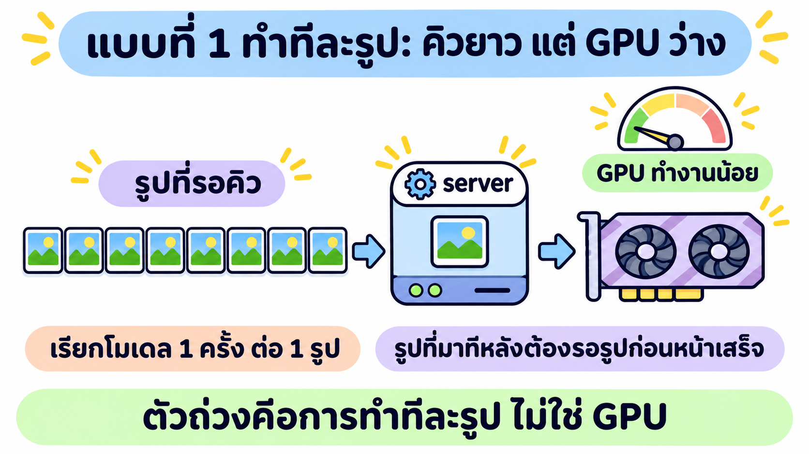

- server 1 ตัว หยิบรูปจากคิวครั้งละ 1 รูป เรียกโมเดล 1 ครั้ง แล้วหยิบรูปถัดไป
- ผู้ใช้ 1 คน: เร็วที่สุด เพราะไม่ต้องรอใคร
- ผู้ใช้หลายคน: ทุกคนต่อคิวหลังคนก่อนหน้า **ทั้งที่ GPU ยังทำงานไม่ถึงครึ่ง**

นี่คือ Baseline ที่ใช้เทียบกับแบบอื่น

---

## 5 · แบบที่ 2: Micro-batching

**แนวคิด**: GPU ตรวจหลายรูปพร้อมกันได้ในเวลาใกล้เคียงกับรูปเดียว · จึงให้ server รวมรูปที่รออยู่ แล้วเรียกโมเดลครั้งเดียว


### ทำงานอย่างไร


| จังหวะ | เกิดอะไรขึ้น |
|---|---|
| 1 | รูปของผู้ใช้แต่ละคนเข้ามาต่อคิวใน server |
| 2 | เมื่อโมเดลว่าง server **หยิบทุกรูปที่รออยู่** (ไม่เกิน 32 รูป) · ถ้ายังไม่ครบ รอรูปเพิ่มได้ไม่เกิน 5 ms |
| 3 | เรียกโมเดล **1 ครั้ง** ตรวจทุกรูปพร้อมกัน · รูปที่มาระหว่างนี้รอรอบถัดไป |
| 4 | แยกผลของแต่ละรูป แล้วตอบกลับเจ้าของทีละคน |

ผู้ใช้ไม่ต้องเปลี่ยนอะไร ยังส่งทีละ 1 รูปเหมือนเดิม · คำว่า **batch** คือชุดรูปที่เข้าโมเดลพร้อมกัน 1 รอบ · "Micro" เพราะรวมแค่ช่วงสั้น ๆ ระดับมิลลิวินาที

### ทำไมรวมแล้วเร็วขึ้น


การเรียกโมเดล 1 ครั้งมีงาน 2 ส่วน

| ส่วน | ทำทีละรูป (4 รูป) | Micro-batching (4 รูป) |
|---|---|---|
| งานเตรียมต่อการเรียก 1 ครั้ง (ฝั่ง Python และการสั่งงาน GPU) | จ่าย 4 ครั้ง | จ่าย **1 ครั้ง** |
| GPU คำนวณ | 4 ครั้ง ครั้งละ 1 รูป | 1 ครั้ง 4 รูปพร้อมกัน (นานขึ้นเพียงเล็กน้อย) |

### ปุ่มปรับ 2 ปุ่ม และราคาที่ต้องจ่าย


| ปุ่ม | ค่าใน LAB | ตั้งมากไป | ตั้งน้อยไป |
|---|---|---|---|
| จำนวนรูปสูงสุดต่อรอบ | 32 | รอบหนึ่งนานขึ้น และใช้ VRAM มาก | รวมได้น้อย ได้ประโยชน์น้อย |
| รอรูปเพิ่มได้นานสุด | 5 ms | ผู้ใช้คนเดียวก็ต้องรอนาน | รวมได้น้อยตอนผู้ใช้ไม่มาก |

- **จำนวนรูปต่อรอบปรับเองตามคิว** ผู้ใช้น้อยได้รอบละ 1–2 รูป ผู้ใช้มากได้รอบละหลายสิบรูป
- **ราคาที่จ่าย**: ตอนมีผู้ใช้คนเดียว แบบนี้ช้ากว่าทำทีละรูปเล็กน้อย · ผลจริงช้าลง 5.1 ms · ตรงกับจังหวะรอรูปเพิ่มไม่เกิน 5 ms ที่ตั้งไว้

---

## 6 · แบบที่ 3: Micro-batching + server หลายตัว

### ทำไม server ตัวเดียวยังไม่พอ


Micro-batching ทำให้ส่วนของ GPU เร็วขึ้น แต่ก่อนและหลังเรียกโมเดลยังมีงานที่ใช้ CPU: รับรูป ถอดไฟล์ JPEG เตรียมรูป แปลงผลเป็น JSON · โค้ด Python ส่วนใหญ่ใน process เดียวรันได้ทีละ 1 core (ข้อจำกัดชื่อ GIL มีเพียงบางช่วง เช่นตอน PyTorch คำนวณ ที่ปล่อยให้ทำงานคู่ขนานได้) · **ตัวถ่วงจึงน่าจะย้ายไปอยู่ที่ CPU ของ server ตัวเดียว** ขณะที่ GPU ยังว่าง

หลักฐานจาก LAB: ที่ 32 รูปต่อรอบ งานเตรียมรูปและแปลงผลกินเวลา 56% ของรอบ (74.8 จาก 134.4 ms) และ GPU ทำงานแค่ 31% · LAB ไม่ได้วัด CPU ทีละ core โดยตรง แต่เมื่อเปิด server 4 ตัวบน GPU ใบเดิม (แบบที่ 3) Throughput เพิ่มเกือบ 2 เท่า ซึ่งสนับสนุนข้อนี้

### แก้อย่างไร


| ของแบบที่ 3 | รายละเอียด |
|---|---|
| server | 4 ตัว (4 process) บน GPU ใบเดียวกัน |
| คิวและ Micro-batching | แต่ละตัวมีของตัวเอง แยกกัน |
| ใครแจกงานให้ 4 ตัว | Load Balancer ตัวเดียวกับที่ใช้ตั้งแต่แบบที่ 1 |
| สิ่งที่ได้ | งานที่ใช้ CPU กระจายไป 4 core · GPU ได้งานถี่ขึ้นจนใกล้เต็ม |
| ราคาที่จ่าย | แต่ละตัวโหลดโมเดลของตัวเอง จึงใช้ VRAM เพิ่มตามจำนวนตัว · รูปถูกแบ่งไป 4 คิว รอบหนึ่งจึงรวมได้น้อยรูปลง |

แบบที่ 2 และ 3 คือ **การใช้ GPU ใบเดิมให้เต็ม** โดยค่าเช่าเท่าเดิม · ทำสองข้อนี้ก่อน แล้วค่อยคิดเรื่องเพิ่ม GPU

---

## 7 · แบบที่ 4: Load Balancer กับ GPU 2 ใบ (ในโหนดเดียว)


- GPU 1 ใบมีเพดาน · ใน LAB นี้เราเปิดใช้ **GPU ใบที่ 2 ภายในโหนดเช่า 1 โหนดเดิม** (รวม 8 process) แล้วให้ **ตัวแจกงาน (Load Balancer)** อยู่ข้างหน้า เพื่อจำลองหลักการ Horizontal Scaling โดยไม่มีความช้าของอินเทอร์เน็ตข้ามเครื่องมาปน
- ทำได้เพราะ server ไม่เก็บข้อมูลของผู้ใช้ไว้ในตัว (stateless) · ส่งรูปให้ตัวไหนก็ได้คำตอบเหมือนกัน
- ผู้ใช้ยังใช้ที่อยู่เดิม ไม่รู้ว่าข้างหลังมีกี่ GPU · และเมื่อใช้งานจริงจนเต็ม 1 โหนดแล้ว ก็นำ NGINX ชุดเดียวกันนี้ขยายข้ามหลายโหนด (Multi-Node) ได้ทันทีตามที่ทดลองต่อใน [LAB 7](../lab7_llm_serving_lb/README.md)

### คุ้มไหม

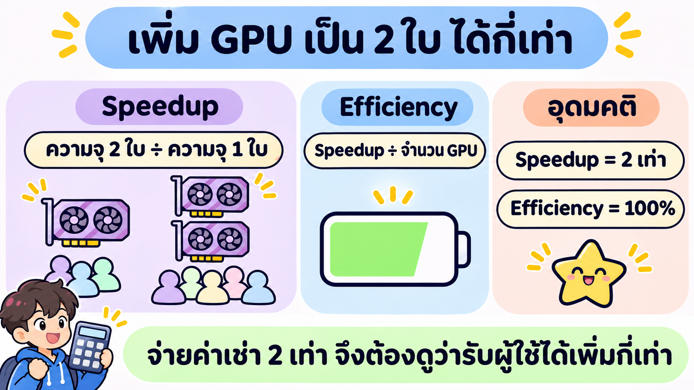

| ค่า | สูตร | อุดมคติ |
|---|---|---|
| Speedup | ความจุ 2 ใบ ÷ ความจุ 1 ใบ | 2 เท่า |
| Efficiency | Speedup ÷ จำนวน GPU | 100% |

ต้องเทียบกับ **แบบที่ 3** (1 ใบที่ปรับเต็มแล้ว) ไม่ใช่แบบที่ 1 · ไม่อย่างนั้นจะนับผลของ Micro-batching ปนเข้าไปในผลของ GPU ใบที่ 2

---

## 8 · วิธีแจกงาน: Round Robin · Least Connections · Power of Two Choices

Load Balancer ต้องตัดสินใจทุกคำขอว่า **จะส่งให้ server ตัวไหน** · LAB นี้เทียบ Round Robin กับวิธีที่ดูงานค้าง 2 วิธี คือ Least Connections และ Power of Two Choices (ขั้นที่ 10)

### Round Robin: แจกวนทีละตัว


- แจกตามลำดับ A → B → C → A … ทุกตัวได้ **จำนวนคำขอเท่ากัน**
- **ไม่ดู** ว่าตอนนี้ใครยังมีงานค้างอยู่เท่าไร
- ดีเมื่อทุกตัวเร็วเท่ากัน · ถ้ามีตัวช้า งานไปกองที่ตัวนั้น และผู้ใช้ที่ถูกส่งไปตัวนั้นรอนาน ทั้งที่ตัวอื่นว่าง

### Least Connections: ส่งให้ตัวที่งานค้างน้อยที่สุด


| ขั้น | Load Balancer ทำอะไร |
|---|---|
| 1 | จำว่าส่งคำขอไปให้ server แต่ละตัวกี่รายการแล้ว **ที่ยังไม่ได้คำตอบกลับ** (งานค้าง) |
| 2 | คำขอใหม่เข้ามา ส่งให้ตัวที่งานค้างน้อยที่สุดในตอนนั้น |
| 3 | เมื่อ server ตอบกลับ งานค้างของตัวนั้นลดลง 1 |

Load Balancer **ไม่ต้องรู้** ว่า server ตัวไหนช้าหรือเร็ว · ตัวที่ช้าคืนงานช้า งานค้างจึงสูง แล้วได้งานใหม่น้อยลงเอง · "โหลดน้อย" ในที่นี้จึงหมายถึง **จำนวนคำขอที่ยังค้างอยู่** ไม่ใช่ % ของ GPU

### เทียบกันเมื่อมี GPU ช้า 1 ใบ


| | Round Robin | Least Connections |
|---|---|---|
| ตัดสินจาก | ลำดับ (ถึงตาใคร) | งานค้างของแต่ละตัวในตอนนั้น |
| GPU เร็วเท่ากัน | แบ่งเท่ากัน ได้ผลดี | ได้ผลใกล้เคียงกัน |
| มี GPU ช้า (คนละรุ่น · มีงานอื่นแย่ง) | ตัวช้าได้งานครึ่งหนึ่ง จึงลากทั้งระบบ | งานไหลไปตัวเร็วเอง |
| ต้องเก็บอะไรเพิ่ม | ไม่ต้อง | ตัวนับงานค้างของทุก server |

ใน LAB จำลอง "GPU ช้า" โดยให้ server ของ GPU ใบที่ 2 เรียกโมเดลช้าลง 3 เท่า

### Power of Two Choices (p2c): สุ่ม 2 ตัว แล้วส่งให้ตัวที่งานค้างน้อยกว่า


| ขั้น | Load Balancer ทำอะไร |
|---|---|
| 1 | สุ่ม server มา 2 ตัว |
| 2 | เทียบงานค้างของ 2 ตัวนั้น |
| 3 | ส่งคำขอให้ตัวที่งานค้างน้อยกว่า |

p2c เป็น **อีกวิธีหนึ่ง** ไม่ใช่ชื่ออื่นของ Least Connections · ใช้ข้อมูลเดียวกันคือจำนวนงานค้าง แต่ไม่เทียบทุกตัว · ตัวที่งานกองจะถูกเลือกก็ต่อเมื่อสุ่มได้คู่กับตัวที่งานกองมากกว่า จึงได้งานใหม่น้อยลงเองเช่นกัน

### Least Connections เทียบ Power of Two Choices


| | Least Connections | Power of Two Choices (p2c) |
|---|---|---|
| ข้อมูลที่ใช้ตัดสิน | จำนวนงานค้าง | จำนวนงานค้าง |
| ดู server กี่ตัว | **ทุกตัว** | **สุ่มมา 2 ตัว** |
| server ที่ได้งาน | ตัวที่งานค้างน้อยที่สุดเสมอ | ตัวที่น้อยกว่าใน 2 ตัวที่สุ่มได้ (อาจไม่ใช่ตัวที่น้อยที่สุด) |
| งานของ Load Balancer ต่อ 1 คำขอ | เพิ่มตามจำนวน server | คงที่ ไม่ขึ้นกับจำนวน server |
| เมื่อมี Load Balancer หลายตัว | ทุกตัวเห็นตัวที่ว่างตัวเดียวกัน แล้วส่งงานไปกองพร้อมกันได้ | การสุ่มช่วยกระจาย ไม่ไปกองที่ตัวเดียว |
| เหมาะกับ | Load Balancer 1 ตัว · server ไม่กี่สิบตัว | server หลายร้อยตัว หรือ Load Balancer หลายตัว |

**เขียนในไฟล์ตั้งค่าอย่างไร**

| วิธี | บรรทัดใน `nginx.conf` (ในบล็อก `upstream`) |
|---|---|
| Round Robin | ค่าเริ่มต้น (ไม่ต้องเขียนอะไร) |
| Least Connections | `least_conn;` |
| Power of Two Choices | `random two least_conn;` |

- [ขั้นที่ 10.2](#102--เพิ่ม-power-of-two-choices-3-วิธีบนเครื่องเดียวกัน) วัดทั้ง 3 วิธีบน NGINX เครื่องเดียวกัน: เมื่อ server เร็วไม่เท่ากัน Least Connections รับได้ 1.33–1.37 เท่าของ p2c
- ระบบของ LAB นี้มี Load Balancer 1 ตัวกับ server 8 ตัว จึงเข้าเงื่อนไขของ Least Connections · ผลวัดและข้อสรุปว่าควรเลือกตัวไหนอยู่ที่ [หน้ารวม หัวข้อสรุปผลการทดลอง](#3--least-connections-เทียบ-power-of-two-choices-p2c)

---

## 9 · เมื่อ GPU ล่มกลางทาง


| การป้องกัน | ทำอะไร | ถ้าไม่มี |
|---|---|---|
| **Retry** | คำขอที่ส่งไปแล้วล้ม ถูกส่งต่อให้ server ตัวอื่นทันที ผู้ใช้ไม่เห็น error | ผู้ใช้ที่ถูกส่งไปตัวที่ล่มได้ error |
| **Health Check** | เลิกส่งงานให้ตัวที่ล่ม จนกว่าจะกลับมาปกติ | Load Balancer ส่งงานให้ตัวที่ล่มซ้ำไปเรื่อย ๆ |

Health Check มี 2 แบบ

| แบบ | รู้ได้อย่างไรว่าตัวไหนล่ม | ใช้ใน |
|---|---|---|
| **Passive Health Check** | ดูจากคำขอจริงที่ล้ม · ล้มครบจำนวนที่ตั้งไว้ ก็พักตัวนั้นชั่วคราว | NGINX (`max_fails` · `fail_timeout`) · ใช้ใน LAB นี้ |
| **Active Health Check** | Load Balancer ถาม `/health` ของทุกตัวเป็นรอบ ๆ เอง ตัวที่ไม่ตอบถูกถอดออก | NGINX รุ่นฟรีไม่มี |

ข้อควรระวังที่เจอในการวัดจริง

- ค่าเริ่มต้นของ NGINX `max_fails=1 fail_timeout=10s` พัก server 10 วินาทีเมื่อคำขอล้มเพียงครั้งเดียว · ตอนวัดความจุที่โหลดสูง server ที่ตัดการเชื่อมต่อ 1–3 ครั้งจึงหายจากวงแจกงานชั่วคราว ทำให้ p95 แกว่ง

- ส่งซ้ำได้อย่างปลอดภัยเพราะการตรวจรูปเดิมซ้ำได้ผลเดิม (idempotent) · งานอย่างการตัดเงินส่งซ้ำแบบนี้ไม่ได้
- หลังล่ม ระบบเหลือ GPU ใบเดียว · ถ้าผู้ใช้ตอนนั้นมากกว่าความจุของ 1 ใบ ผู้ใช้จะไม่เจอ error แต่รอนานขึ้น จึงต้องเผื่อกำลังไว้

---

## 10 · NGINX แบบ container

| | NGINX ใน LAB นี้ |
|---|---|
| image ที่ใช้ | `nginx:1.27` |
| ไฟล์ตั้งค่า | `nginx.conf` ไฟล์เดียว: รายชื่อ server · วิธีแจกงาน · การป้องกัน |
| วิธีแจกงานที่เทียบ | Round Robin · Least Connections · Power of Two Choices |
| ดูสถานะของ server | จาก log |
| แก้ไฟล์ตั้งค่าแล้ว | สั่งโหลดค่าใหม่ |

### ทำไมรันเป็น container


- **ไม่ต้องติดตั้งโปรแกรมลงเครื่อง** ดึง image ทางการ เขียนไฟล์ตั้งค่า แล้วรัน
- ทุกอย่างของ Load Balancer อยู่ในไฟล์ตั้งค่า จึงอ่าน เทียบ และแก้ได้ง่าย
- เครื่องเช่าของ Vast.ai เป็น container อยู่แล้ว จึงรัน Docker ซ้อนข้างในไม่ได้ · LAB ใช้ [udocker](https://github.com/indigo-dc/udocker) ซึ่งรัน image เดียวกันได้โดยไม่ต้องมีสิทธิ์พิเศษ
- ไฟล์ตั้งค่าที่ได้ นำไปใช้กับ Docker หรือ Docker Compose บนเครื่องของเราเองได้เลย

---

## สรุปใน 1 ตาราง

| แบบ | เปลี่ยนอะไร | แก้ตัวถ่วงไหน | จ่ายเพิ่ม |
|---|---|---|---|
| 1 ทำทีละรูป | – | – | – |
| 2 Micro-batching | รวมรูปที่รออยู่เข้าโมเดลครั้งเดียว | การเรียกโมเดลทีละรูป | ผู้ใช้คนเดียวช้าลงเล็กน้อย |
| 3 + server 4 ตัว | เปิด server หลายตัวบน GPU ใบเดิม | CPU ของ server ตัวเดียว | VRAM และ CPU |
| 4 GPU 2 ใบ + Load Balancer | เพิ่ม GPU แล้วแจกงาน | GPU | ค่าเช่า GPU ใบที่ 2 |

ผลวัดจริงของทั้ง 4 แบบอยู่ใน [หน้า LAB](#ภาคปฏิบัติ--lab-12-ขั้นด้วย-nginx) · เทียบ 3 วิธีแจกงานบนเครื่องเดียวกันใน [ขั้นที่ 10.2](#102--เพิ่ม-power-of-two-choices-3-วิธีบนเครื่องเดียวกัน) · ข้อสรุปว่าควรเลือกอะไร: [หน้ารวม หัวข้อสรุปผลการทดลอง](#สรุปผลการทดลอง)

---

# ภาคปฏิบัติ · LAB 12 ขั้นด้วย NGINX

- **12 ขั้น ทุกขั้นคือ 1 พรอมต์** (ขั้นที่ 10 มี 2 ตอน รวม 13 พรอมต์ · คัดลอกรวมไว้ที่ [PROMPTS.md](PROMPTS.md)) · โค้ดทุกไฟล์ AI เขียนให้จากพรอมต์ลงใน `code/` เริ่มจากโฟลเดอร์ว่าง
- ทั้งหมดรันบน **1 โหนด (RTX 3090 × 2 ใบ)** · ส่วนขั้นที่ 10.2 เช่าโหนดเดี่ยวแยกต่างหาก (เครื่อง A และ B) เพื่อเทียบวิธีแจกงาน 3 วิธีบนเครื่องเดียวกัน


## ระบบที่จะสร้าง


Load Balancer ของ LAB นี้คือ **NGINX**

![System Architecture ของ LAB 6 ที่ใช้ NGINX: ผู้ใช้ N คนส่ง POST /v1/detect พร้อมรูป 1 รูปและ API key เข้าที่พอร์ต 8080 ของ NGINX ซึ่งรันเป็น container จาก image nginx:1.27 ด้วย udocker ตั้งค่าด้วยไฟล์เดียวคือ code/nginx.conf ที่มีรายชื่อ server วิธีแจกงาน และการป้องกัน ดูสถานะจาก log ในโฟลเดอร์ logs/nginx NGINX แจกงานให้ server 4 ตัวของ GPU 0 คือ gpu0-8101 ถึง gpu0-8104 ที่พอร์ต 8101 ถึง 8104 และ server 4 ตัวของ GPU 1 คือ gpu1-8201 ถึง gpu1-8204 ที่พอร์ต 8201 ถึง 8204 ตัวยิงโหลด code/loadgen.py อยู่ในเครื่องเดียวกันและยิงเข้าที่ 127.0.0.1:8080](images/lab/arch-nginx.png)

| ส่วน | ใน LAB นี้คือ | สร้างในขั้น |
|---|---|---|
| เครื่อง | Vast.ai · RTX 3090 × 2 ใบ · image `pytorch/pytorch:2.8.0-cuda12.8-cudnn9-runtime` | 1 |
| server | `code/server.py` (FastAPI + YOLO11s) · ฟังเฉพาะ `127.0.0.1` · server ของ GPU 0 ใช้พอร์ต `8101–8104` · server ของ GPU 1 ใช้พอร์ต `8201–8204` | 2, 3 |
| Load Balancer | NGINX จาก image `nginx:1.27` (รุ่น 1.27.5) รันด้วย udocker · ผู้ใช้เข้าพอร์ต **8080** · ไม่มี Dashboard ดูสถานะจาก log และ `cluster.sh status` | 3 |
| ไฟล์ตั้งค่า | `code/nginx.conf` ไฟล์เดียว (รายชื่อ server · วิธีแจกงาน · การป้องกัน) | 3, 10, 11 |
| คำสั่งเปิดระบบ | `code/cluster.sh up --gpus … --per-gpu … --mode …` | 3 |
| ตัวยิงโหลด | `code/loadgen.py` อยู่บนเครื่องเดียวกัน ยิงเข้า `127.0.0.1:8080` | 4 |

# ส่วน A · เตรียมระบบ

## ขั้นที่ 1 · เช่าเครื่อง 2 GPU

เช่าเครื่องที่มี RTX 3090 2 ใบ แล้วตรวจว่าเห็น GPU ครบและนับ CPU ที่ใช้ได้จริง · เงินเริ่มเดินตั้งแต่ขั้นนี้


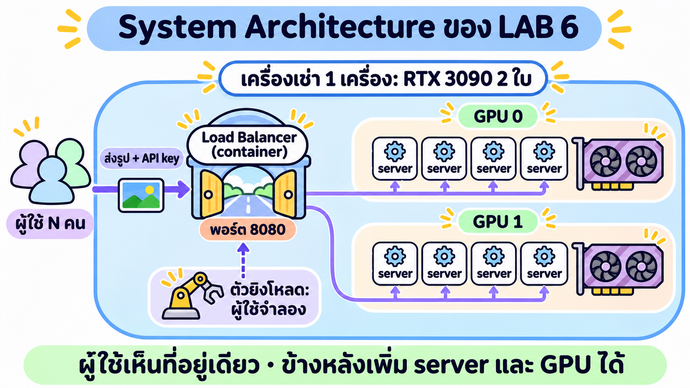

server หลายตัวและตัวยิงโหลดอยู่ในเครื่องเดียวกัน จึงต้องมี CPU มากพอ · พรอมต์จึงขอ CPU ที่ใช้ได้จริง 24 cores ขึ้นไป

```text
[ที่ทำงาน]
container `multi-account` · โฟลเดอร์ /workspace/vastapp_lab · สกิล vastai
กุญแจ SSH: /workspace/vastai_lab/Devtool_SSH/devtoolSSH
เก็บโค้ดและผลที่: lab6_microbatch_lb ของโฟลเดอร์ที่เปิด Claude Code อยู่ (ไม่ใช่ใน container)

[งาน]
เช่าเครื่อง GPU 2 ใบ ไว้ทดลองว่า API ตรวจภาพรับผู้ใช้พร้อมกันได้กี่คน

[เครื่องที่ต้องการ]
GPU: RTX 4090 2 ใบในเครื่องเดียว · ราคาไม่เกิน $0.60 ต่อชั่วโมง · ป้าย vapp-lab6-nginx
เงื่อนไข: verified · reliability 0.95 ขึ้นไป · ความเร็วเน็ตไม่ต่ำกว่า 1,200 Mbps · CPU ที่ได้ใช้จริง 24 cores ขึ้นไป · ไม่อยู่ในจีน
ระบบ: PyTorch 2.8 ที่มี CUDA 12.8 · disk 40 GB · เปิดพอร์ต 8080 ให้เรียก API จากนอกเครื่อง

[ขั้นตอน]
1. เช่าเครื่องที่ถูกที่สุดตามเงื่อนไข ถ้าเกิน 10 นาทียังไม่พร้อม ให้ลบแล้วเช่าเครื่องอื่น
2. เข้าไปตรวจว่าเห็น GPU ครบ 2 ใบ และนับ CPU ที่ใช้ได้จริง

[รายงาน]
สรุปเป็นตาราง: GPU · ราคาต่อชั่วโมง · ที่ตั้ง · CPU ที่ใช้ได้จริง · เวลาที่รอจนเครื่องพร้อม
ห้ามแสดงค่า key · บอกว่าเครื่องยังเปิดอยู่
```

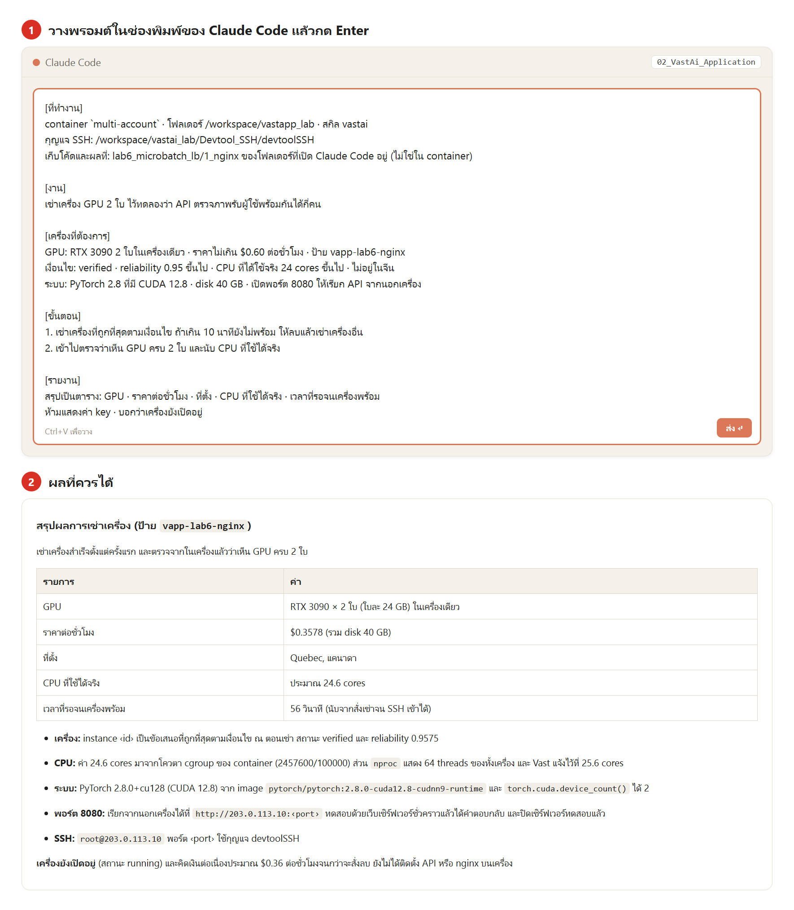

*ใช้เวลา 2 นาที*

| รายการ | ผลจริง |
|---|---|
| GPU | RTX 3090 × 2 ใบ (ใบละ 24 GB) |
| ราคา | $0.3578 ต่อชั่วโมง (รวม disk 40 GB) |
| ที่ตั้ง | Quebec, CA |
| CPU ที่ใช้ได้จริง | ราว 24.6 cores (เครื่องแสดง 64 threads) |
| รอจนเครื่องพร้อม | 56 วินาที |

ตัวอย่างโค้ดที่ AI เขียนให้ในรอบจริง (ของคุณอาจต่างกัน): [rent.sh](code_reference/rent.sh) · [ssh.sh](code_reference/ssh.sh) · ผลตรวจเครื่อง [machine_verify.txt](results/machine_verify.txt) · คำตอบเต็ม [answer_01.md](results/answers/answer_01.md)

**อ่านผลอย่างไร**

- จำนวน threads ที่เครื่องแสดง (64) ไม่ใช่ CPU ที่ใช้ได้ · ค่าจริงมาจากโควตาของ container (24.6 cores)
- 24.6 cores ผ่านเกณฑ์ 24 แบบเฉียด · แบบที่ 4 ใช้ CPU ของ server ราว 10.9 cores จึงยังพอ
- เครื่องยังเปิดและคิดเงินอยู่จนถึงขั้นที่ 12

## ขั้นที่ 2 · เขียน API ตรวจภาพ

AI เขียน `code/server.py` ที่มี 2 โหมดในตัว (ทีละรูป · Micro-batching) แล้วเปิด 1 ตัวบน GPU ใบแรกและส่งรูปทดสอบ 6 รูป

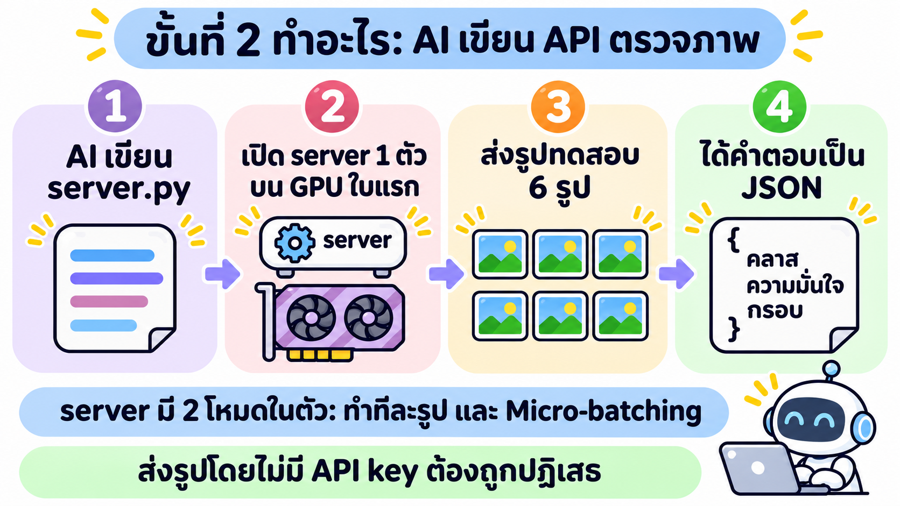


ขั้นนี้สร้างขั้น 3–5 ของภาพ: คิวของ server · การเรียกโมเดล · คำตอบ JSON

```text
[ที่ทำงาน]
container `multi-account` · โฟลเดอร์ /workspace/vastapp_lab · สกิล vastai
เครื่อง: ป้าย vapp-lab6-nginx · กุญแจ SSH: /workspace/vastai_lab/Devtool_SSH/devtoolSSH
เก็บโค้ดและผลที่: lab6_microbatch_lb ของโฟลเดอร์ที่เปิด Claude Code อยู่ (ไม่ใช่ใน container)

[งาน]
เขียน API ตรวจภาพ แล้วเปิดบน GPU ใบแรกของเครื่องที่เช่า

[ขั้นตอน]
1. เขียน code/server.py ด้วย FastAPI: รับรูป 1 รูป แล้วตอบเป็น JSON ว่าเจอวัตถุอะไรบ้าง (ชื่อคลาส · ความมั่นใจ · กรอบ)
2. server 1 ตัวเรียกโมเดลได้ทีละครั้ง รูปที่มาระหว่างนั้นเข้าคิวรอ และมีตัวหยิบงานตัวเดียวที่ทำงานบน thread เดียวตลอด ตั้งค่าได้ 2 โหมด
   - ทีละรูป: หยิบจากคิวครั้งละ 1 รูป
   - Micro-batching: หยิบทุกรูปที่รออยู่ในคิว (ไม่เกิน 32 รูป) เข้าโมเดลพร้อมกันในครั้งเดียว ถ้ายังไม่ครบ 32 รูป รอรูปเพิ่มได้ไม่เกิน 5 ms
3. ในคำตอบให้บอกด้วย: server ตัวไหนตอบ · รูปนี้เข้าโมเดลพร้อมกันกี่รูป · เวลารอคิว และเวลาที่โมเดลใช้ (ms)
4. ตอนเปิด server ให้ลองเรียกโมเดลล่วงหน้าทุกขนาด ตั้งแต่ 1 รูปถึงจำนวนสูงสุดของโหมดนั้น แล้วจึงตอบว่าพร้อม
5. นำโค้ด โมเดล และรูปทดสอบขึ้นเครื่อง ติดตั้งสิ่งที่ต้องใช้ แล้วเปิด server 1 ตัวบน GPU ใบแรก โหมดทีละรูป
6. ทดสอบบนเครื่อง: ส่งรูปทั้ง 6 รูปพร้อม API key · ส่งแบบไม่มี key ต้องถูกปฏิเสธ
7. ทำภาพตาราง 6 รูป วาดกรอบและชื่อคลาสที่โมเดลตรวจได้ กำกับขนาดไฟล์ใต้รูป เก็บที่ results/dataset_samples.jpg

[ค่าที่ตรึง]
โมเดล: lab6_microbatch_lb/best.pt (YOLO11s ที่เทรนใน LAB 1) · ขนาดภาพ 640 · ความมั่นใจขั้นต่ำ 0.35
รูปทดสอบ: lab6_microbatch_lb/samples (6 รูป)
ทางเข้า: POST /v1/detect (ช่องชื่อ file) · API key แบบ Bearer ไม่มีหรือผิดตอบ 401 · GET /health

[รายงาน]
อธิบายโค้ด 3–5 บรรทัด · ยก JSON จริง 1 ตัวอย่างแล้วอธิบายแต่ละช่อง
สรุปเป็นตาราง: รูป · ขนาดไฟล์ · จำนวนวัตถุของแต่ละคลาส · เวลาที่โมเดลใช้
ห้ามแสดงค่า key · บอกว่าเครื่องยังเปิดอยู่
```

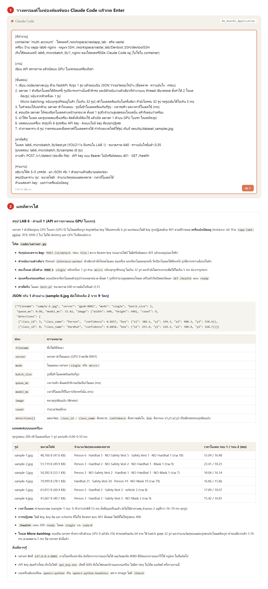

*ใช้เวลา 4 นาที*

| ทดสอบ | ผลจริง |
|---|---|
| ส่ง 6 รูปพร้อม key | HTTP 200 ทุกรูป · รอบที่ 2 โมเดลใช้ 15.9–19.0 ms ต่อรูป · รอคิว 0.06–0.10 ms |
| ไม่มี key · key ผิด · ไม่ใช่ Bearer | HTTP 401 ทั้งสามกรณี |
| ส่งไฟล์ที่ไม่ใช่รูป | HTTP 400 |
| ส่ง 256 คำขอ พร้อมกัน 64 สาย โหมด Micro-batching | รวมได้สูงสุด 32 รูปต่อรอบ · คำขอเดี่ยวรอคิว 5.16 ms |
| VRAM ของ server 1 ตัว โหมดทีละรูป | 522 MiB |

ตัวอย่างโค้ดที่ AI เขียนให้ในรอบจริง (ของคุณอาจต่างกัน): [server.py](code_reference/server.py) · [run_server.sh](code_reference/run_server.sh) · [test_api.py](code_reference/test_api.py) · [requirements.lock](code_reference/requirements.lock) · ผลดิบ [test_results.json](results/test_results.json)

**อ่านผลอย่างไร**

- โมเดลใช้ราว 16–19 ms ต่อรูป · ผู้ใช้คนเดียวจึงได้คำตอบเร็วมาก
- คำขอแรกสุดใช้ 55 ms ทั้งที่อุ่นโมเดลแล้ว · รอบนี้ไม่ได้วัดหาสาเหตุ
- คำขอเดี่ยวในโหมด Micro-batching รอคิว 5.16 ms · นี่คือจังหวะรอรูปเพิ่ม 5 ms ที่ตั้งไว้
- `server.py` ใน `code_reference/` เป็นฉบับสุดท้ายของ LAB · มีส่วนที่เพิ่มในขั้นที่ 9 (จำกัด VRAM ต่อ server) และขั้นที่ 10 (จำลอง GPU ช้า) อยู่ด้วย

## ขั้นที่ 3 · ตั้ง NGINX เป็น Load Balancer แบบ container

รัน NGINX จาก image ทางการด้วย udocker ให้เป็นประตูเดียวที่พอร์ต 8080 · ได้ `code/cluster.sh` ไว้เปิดระบบทุกแบบในคำสั่งเดียว


```text
[ที่ทำงาน]
container `multi-account` · โฟลเดอร์ /workspace/vastapp_lab · สกิล vastai
เครื่อง: ป้าย vapp-lab6-nginx · กุญแจ SSH: /workspace/vastai_lab/Devtool_SSH/devtoolSSH
เก็บโค้ดและผลที่: lab6_microbatch_lb ของโฟลเดอร์ที่เปิด Claude Code อยู่ (ไม่ใช่ใน container)

[งาน]
ตั้ง NGINX เป็นประตูเดียวของระบบ (Load Balancer) โดยรันเป็น container ไม่ติดตั้งลงเครื่อง

[ขั้นตอน]
1. รัน NGINX จาก image ทางการ nginx:1.27 เป็น container ด้วย udocker (เครื่องเช่าเป็น container อยู่แล้ว จึงใช้ Docker ซ้อนไม่ได้)
2. การตั้งค่าทั้งหมดอยู่ในไฟล์ code/nginx.conf แล้วเชื่อมไฟล์เข้า container
3. ผู้ใช้เข้าที่พอร์ต 8080 แล้ว NGINX ส่งต่อให้ server · วิธีแจกงานเริ่มต้นคือ Round Robin (แจกวนทีละตัว) · server รับเฉพาะคำขอจากภายในเครื่อง
4. เขียน code/cluster.sh ไว้เปิดระบบใหม่ในคำสั่งเดียว เลือกได้ 3 อย่าง: ใช้ GPU กี่ใบ (1 หรือ 2) · server กี่ตัวต่อ GPU · โหมดทีละรูปหรือ Micro-batching
   มีคำสั่งดูสถานะและปิดทั้งระบบ · คำสั่งเปิดต้องรอจน server ทุกตัวพร้อมก่อนจึงบอกว่าเสร็จ
5. API key สุ่มครั้งแรก แล้วใช้ค่าเดิมทุกครั้งที่เปิดใหม่
6. เปิดระบบแบบที่ 1 (GPU 1 ใบ · server 1 ตัว · โหมดทีละรูป) แล้วทดสอบจากนอกเครื่องผ่านพอร์ต 8080: ส่งรูป 1 รูปพร้อม key · ส่งแบบไม่มี key ต้องถูกปฏิเสธ

[รายงาน]
อธิบายไฟล์ตั้งค่าของ NGINX ทีละส่วน · วาดแผนภาพข้อความว่าคำขอ 1 รายการเดินทางผ่านอะไรบ้าง
สรุปผลทดสอบเป็นตาราง · ห้ามแสดงค่า key · บอกว่าเครื่องยังเปิดอยู่
```

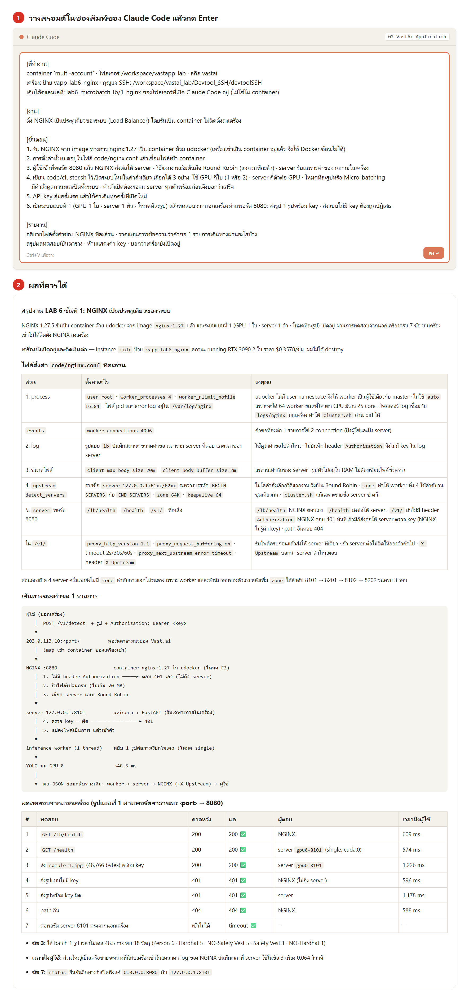

*ใช้เวลา 6 นาที*

| ทดสอบจากนอกเครื่อง | ผลจริง |
|---|---|
| `GET /lb/health` | HTTP 200 · NGINX ตอบเอง |
| `GET /health` | HTTP 200 · ส่งต่อให้ server `gpu0-8101` |
| ส่งรูป 1 รูปพร้อม key ผ่านพอร์ต 8080 | HTTP 200 · เจอ 18 วัตถุ · ตอบโดย `gpu0-8101` |
| ส่งรูปแบบไม่มี key | HTTP 401 · NGINX ตอบเอง ไม่ถึง server |
| ส่งรูปพร้อม key ผิด | HTTP 401 · server เป็นผู้ตอบ |
| path อื่น | HTTP 404 · NGINX ตอบเอง |
| ต่อพอร์ต 8101 ของ server ตรงจากนอกเครื่อง | เข้าไม่ได้ (timeout) |

ส่วนสำคัญของ `code/nginx.conf` (ตอนเปิดครบ 8 ตัว)

```nginx
worker_processes 4;                      # ไม่ใช้ auto เพราะเครื่องแสดง 64 threads แต่โควตามีราว 25 cores

upstream detect_servers {
    zone detect_servers 64k;             # worker ทั้ง 4 ใช้ลำดับวนชุดเดียวกัน
    # BEGIN LB (written by cluster.sh)
    # (no directive)                     # ไม่ใส่คำสั่ง = Round Robin
    # END LB
    # BEGIN SERVERS (written by cluster.sh)
    server 127.0.0.1:8101;               # gpu0 server 1
    server 127.0.0.1:8201;               # gpu1 server 1
    # ... ถึง 8104 และ 8204
    # END SERVERS
    keepalive 64;                        # เก็บ connection ไปยัง server ไว้ใช้ซ้ำ
}

server {
    listen 8080 backlog=4096;
    location /v1/ {
        if ($http_authorization = "") { return 401 '{"detail":"missing API key"}\n'; }
        proxy_pass http://detect_servers;
        proxy_http_version 1.1;
        proxy_set_header Connection "";
        proxy_next_upstream error timeout;   # ต่อ server ไม่ติด ให้ลองตัวถัดไป
        add_header X-Upstream $upstream_addr always;
    }
}
```

- `upstream detect_servers` คือรายชื่อ server · ไม่ใส่คำสั่งเลือกวิธีแจกงาน NGINX จึงใช้ Round Robin
- `zone` ให้ worker ทั้ง 4 ตัวใช้ลำดับวนชุดเดียวกัน · ตอนลองครั้งแรกยังไม่มีบรรทัดนี้ ลำดับการแจกไม่วนตรง
- `cluster.sh` แก้เฉพาะบรรทัดระหว่าง `BEGIN` กับ `END` ตามจำนวน GPU และ server ที่สั่ง
- คำขอที่ไม่มี header `Authorization` NGINX ตอบ 401 เอง · ค่า key ตรวจที่ server เพราะ NGINX ไม่รู้ค่า key
- `X-Upstream` บอกว่า server ตัวไหนตอบ ใช้ตอนทดสอบ

NGINX ไม่มี Dashboard · ดูว่าคำขอไปตัวไหนจาก log (`upstream=`) และดูสถานะทั้งระบบด้วย `cluster.sh status`

```log
203.0.113.10 [2026-11-23T00:58:28+00:00] "POST /v1/detect HTTP/1.1" 200 bytes_in=49275 total=0.647 upstream=127.0.0.1:8101 upstream_time=0.064
203.0.113.10 [2026-11-23T00:58:29+00:00] "POST /v1/detect HTTP/1.1" 401 bytes_in=263 total=0.595 upstream=- upstream_time=-
```

ตัวอย่างโค้ดที่ AI เขียนให้ในรอบจริง (ของคุณอาจต่างกัน): [nginx.conf](code_reference/nginx.conf) · [cluster.sh](code_reference/cluster.sh) · [test_lb.py](code_reference/test_lb.py) · ผลดิบ [lb_test.json](results/lb_test.json) · [cluster_status.txt](results/cluster_status.txt) · [nginx_access.log](results/nginx_access.log)

**อ่านผลอย่างไร**

- ผู้ใช้เห็นแค่พอร์ต 8080 · server ฟังเฉพาะ `127.0.0.1` จึงเข้าตรงจากนอกเครื่องไม่ได้
- บรรทัดที่ 2 ของ log: คำขอที่ไม่มี key มี `upstream=-` แปลว่าไม่ถูกส่งถึง server เลย
- บรรทัดแรกของ log: เวลารวม 0.647 วินาที แต่ server ใช้ 0.064 วินาที · ส่วนที่เหลือคือเครือข่ายระหว่างผู้ทดสอบกับเครื่องเช่า
- log ไม่บันทึก header `Authorization` จึงไม่มี key หลุดลงไฟล์
- เปิดระบบแบบที่ 1 ใช้ราว 7 วินาที

# ส่วน B · Load Test

## ขั้นที่ 4 · เขียนตัวยิงโหลด

AI เขียน `code/loadgen.py` ที่จำลองผู้ใช้ N คน วัดทีละระดับ และหาความจุเองแบบ 3 จังหวะ · ได้เครื่องมือวัดตัวเดียวที่ใช้กับทุกแบบ


เส้นตรงในภาพมีหน้าที่เดียว: บอกว่าควรวัด N ค่าไหนต่อ · ความจุคือค่าที่วัดแล้วผ่านจริง


```text
[ที่ทำงาน]
container `multi-account` · โฟลเดอร์ /workspace/vastapp_lab · สกิล vastai
เครื่อง: ป้าย vapp-lab6-nginx · กุญแจ SSH: /workspace/vastai_lab/Devtool_SSH/devtoolSSH
เก็บโค้ดและผลที่: lab6_microbatch_lb ของโฟลเดอร์ที่เปิด Claude Code อยู่ (ไม่ใช่ใน container)

[งาน]
เขียนตัวยิงโหลด (Load Test) ไว้วัดว่าระบบรับผู้ใช้พร้อมกันได้กี่คน

[ขั้นตอน]
1. เขียน code/loadgen.py รันบนเครื่องเดียวกับ server ยิงเข้าที่พอร์ต 8080
2. จำลองผู้ใช้ N คน: แต่ละคนส่งรูป รอคำตอบ แล้วส่งรูปถัดไปทันที วนรูปทดสอบ 6 รูป · รอเกิน 10 วินาทีนับเป็น error
3. วัด 1 ระดับ = ยิง 20 วินาที โดย 5 วินาทีแรกเป็นช่วงอุ่นเครื่อง ไม่นับ
4. ต่อ 1 ระดับให้บันทึก: Throughput (คำขอที่สำเร็จต่อวินาที) · เวลารอ p50 p95 p99 · error · GPU ทำงานกี่ % ของแต่ละใบ · CPU ที่ server, NGINX และตัวยิงโหลดใช้
   คำขอที่ server แต่ละตัวตอบ · เวลารอคิวและเวลาของโมเดล · จำนวนรูปเฉลี่ยที่เข้าโมเดลพร้อมกัน
5. โหมดหาความจุ ทำ 3 จังหวะ
   - หาช่วง: ไล่ N = 1, 2, 4, 8, 16, 32, 64, 128, 256, 512 จนไม่ผ่าน 2 ระดับติดกัน (ระดับที่ไม่ผ่านให้วัดซ้ำอีก 1 ครั้งก่อนตัดสิน)
   - ประมาณ: ใช้ p95 ของระดับสุดท้ายที่ผ่านกับระดับแรกที่ไม่ผ่าน ลากเส้นตรงหาว่า p95 จะถึง 500 ms ที่ N เท่าไร แล้ววัดที่ N นั้น
   - ปรับ: ประมาณซ้ำจากจุดที่วัดเพิ่ม จนระดับที่ผ่านกับระดับที่ไม่ผ่านห่างกันไม่เกิน 2 คน (N เกิน 100 ใช้ 4 คน)
   และพิมพ์ค่าประมาณอีกแบบไว้เทียบ: N ≈ Throughput สูงสุด × 0.5 วินาที
6. โหมดระดับเดียว: ยิงด้วย N ค่าเดียวตามเวลาที่กำหนด และบันทึกผลรายวินาที
7. ตั้งชื่อผลได้ บันทึกเป็น JSON ชื่อละไฟล์ (รวมค่าที่ประมาณไว้ทุกรอบ) พิมพ์ผลทีละระดับ จบแล้วพิมพ์ความจุกับคำว่า DONE
8. ลองยิงระบบแบบที่ 1 ด้วย N = 4 สั้น ๆ ให้เห็นว่าใช้งานได้

[เกณฑ์]
ผ่าน = p95 ไม่เกิน 500 ms และ error ต่ำกว่า 1%
ความจุ = จำนวนผู้ใช้พร้อมกัน (N) สูงสุดที่ผ่าน

[รายงาน]
อธิบายโค้ด 3–5 บรรทัด · วาดแผนภาพข้อความของผู้ใช้จำลอง 1 คน · ผลของการลองยิง N = 4
บอกว่าเครื่องยังเปิดอยู่
```

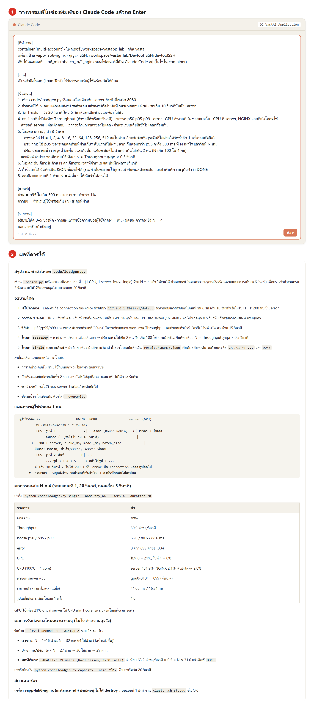

*ใช้เวลา 10 นาที*

| ลองยิงระบบแบบที่ 1 ด้วย N = 4 | ผลจริง |
|---|---|
| Throughput | 59.9 คำขอ/วินาที |
| p50 · p95 | 65.0 ms · 80.6 ms |
| error | 0 จาก 899 คำขอ |
| GPU ใบที่ 0 | 21% |
| CPU ของ server | 1.32 cores |
| เวลารอคิว · เวลาของโมเดล | 41.1 ms · 16.3 ms |

ตัวอย่างโค้ดที่ AI เขียนให้ในรอบจริง (ของคุณอาจต่างกัน): [loadgen.py](code_reference/loadgen.py) · ผลดิบ [try_n4.json](results/try_n4.json) · [selftest_capacity_short.json](results/selftest_capacity_short.json)

**อ่านผลอย่างไร**

- แค่ 4 คน เวลารอคิว (41.1 ms) ก็ยาวกว่าเวลาของโมเดล (16.3 ms) แล้ว ทั้งที่ GPU ทำงาน 21%
- ตัวยิงโหลดบันทึกค่าประมาณทุกรอบลง JSON ด้วย จึงย้อนดูได้ว่าแต่ละรอบเลือกวัด N ค่าไหนเพราะอะไร
- สิ่งที่ตัวยิงโหลดของรอบนี้ทำเพิ่มจากพรอมต์: วัดซ้ำระดับที่ไม่ผ่านในทุกจังหวะ · ถ้าเส้นตรงขยับปลายเดิมซ้ำ 2 รอบ รอบถัดไปใช้จุดกึ่งกลางแทน
- ตัวเลขยังเชื่อไม่ได้จนกว่าจะผ่านขั้นที่ 5

## ขั้นที่ 5 · พิสูจน์ว่าตัวยิงโหลดวัดถูก

ยิงตัวยิงโหลดใส่ server จำลองที่รู้คำตอบล่วงหน้า (รอ 50 ms แล้วตอบ) 5 ทดสอบ · ผ่านครบจึงนำไปวัดระบบจริง

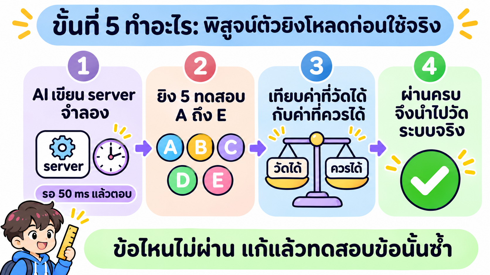


```text
[ที่ทำงาน]
container `multi-account` · โฟลเดอร์ /workspace/vastapp_lab · สกิล vastai
เครื่อง: ป้าย vapp-lab6-nginx · กุญแจ SSH: /workspace/vastai_lab/Devtool_SSH/devtoolSSH
เก็บโค้ดและผลที่: lab6_microbatch_lb ของโฟลเดอร์ที่เปิด Claude Code อยู่ (ไม่ใช่ใน container)

[งาน]
พิสูจน์ว่าตัวยิงโหลดวัดถูก ก่อนนำไปวัดระบบจริง โดยยิงใส่ server จำลองที่รู้คำตอบล่วงหน้า

[ขั้นตอน]
1. เขียน code/fake_server.py: server จำลองที่ไม่ใช้โมเดล รับรูปแบบเดียวกับ API จริง รอตามเวลาที่ตั้งไว้แล้วตอบ รับได้พร้อมกันไม่จำกัด และนับจำนวนคำขอที่ได้รับ
2. ทดสอบ A ตัวเลขตรงกับที่คำนวณไหม: ตั้งให้รอ 50 ms แล้วยิงตรงที่ server จำลองด้วย N = 1, 10, 50, 100 · ที่ควรได้คือ p50 ราว 50 ms และ Throughput ราว N ÷ 0.05
3. ทดสอบ B นับครบไหม: เทียบจำนวนคำขอที่ตัวยิงโหลดส่ง (รวมช่วงอุ่นเครื่อง) กับจำนวนที่ server จำลองนับได้ในรอบเดียวกัน
4. ทดสอบ C ตัวยิงโหลดเร็วพอไหม: ตั้งให้ server จำลองตอบทันที แล้วยิงด้วย N = 200 ดูว่าส่งได้สูงสุดกี่คำขอต่อวินาที
5. ทดสอบ D NGINX ถ่วงไหม: ให้ NGINX ส่งต่อไปที่ server จำลอง (รอ 50 ms) แล้วยิงผ่านพอร์ต 8080 ด้วย N = 50 เทียบกับยิงตรง
6. ทดสอบ E วัดซ้ำได้ผลเดิมไหม: เปิดระบบแบบที่ 1 กลับมา แล้วยิง API จริงที่ N = 8 ซ้ำ 3 ครั้ง
7. บันทึกผลที่ results/loadtest_check.json และวาดกราฟ results/loadtest_check.png (ข้อความอังกฤษ): Throughput ที่วัดได้เทียบกับที่คำนวณของทดสอบ A
8. ข้อไหนไม่ผ่าน ให้หาสาเหตุ แก้ แล้วทดสอบข้อนั้นซ้ำ

[เกณฑ์ผ่าน]
A ต่างจากที่คำนวณไม่เกิน 10% · B ต่างกันไม่เกิน 1% · C มากกว่า 2,000 คำขอต่อวินาที
D p50 ช้ากว่ายิงตรงไม่เกิน 10 ms · E ทั้ง 3 ครั้งต่างกันไม่เกิน 10%

[รายงาน]
สรุปเป็นตาราง: ทดสอบ · ค่าที่ควรได้ · ค่าที่วัดได้ · ผ่านหรือไม่
บอกสิ่งที่ต้องแก้ระหว่างทาง (ถ้ามี) และบอกว่าเครื่องยังเปิดอยู่
```

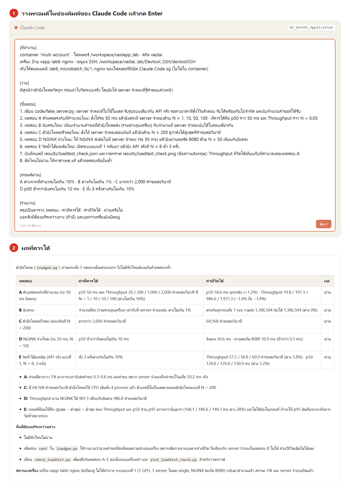

*ใช้เวลา 9 นาที*

| ทดสอบ | ค่าที่ควรได้ | ค่าที่วัดได้ | ผล | ถ้าไม่ผ่านจะจับอะไรได้ |
|---|---|---|---|---|
| **A** ตัวเลขตรงไหม (N = 1, 10, 50, 100) | p50 50 ms · Throughput 20 / 200 / 1,000 / 2,000 ต่างไม่เกิน 10% | p50 50.6 ms ทุกระดับ · Throughput 19.8 / 197.3 / 986.6 / 1,971.3 (ต่ำกว่า 1.0–1.4%) | ผ่าน | จับเวลาหรือนับ Throughput ผิด |
| **B** นับครบไหม | ที่ส่งกับที่ server จำลองนับได้ ต่างไม่เกิน 1% | ตรงกันทั้ง 7 รอบ รวม 1,386,504 คำขอ ต่าง 0 | ผ่าน | คำขอหายหรือถูกนับซ้ำ |
| **C** เร็วพอไหม (N = 200 ตอบทันที) | มากกว่า 2,000 คำขอ/วินาที | 64,168 คำขอ/วินาที | ผ่าน | ตัวยิงโหลดช้ากว่าระบบที่จะวัด |
| **D** NGINX ถ่วงไหม (N = 50) | p50 ช้ากว่ายิงตรงไม่เกิน 10 ms | ยิงตรง 50.6 ms · ผ่าน NGINX 50.9 ms (ช้าลง 0.3 ms) | ผ่าน | Load Balancer ตั้งค่าผิดหรือเป็นตัวถ่วง |
| **E** วัดซ้ำได้ผลเดิมไหม (API จริง N = 8 × 3 ครั้ง) | ต่างกันไม่เกิน 10% | Throughput 57.5 / 58.8 / 60.9 (ต่าง 5.8%) · p50 134.0 / 129.8 / 130.9 ms (ต่าง 3.2%) | ผ่าน | ผลแกว่งเกินไป ต้องวัดนานขึ้น |

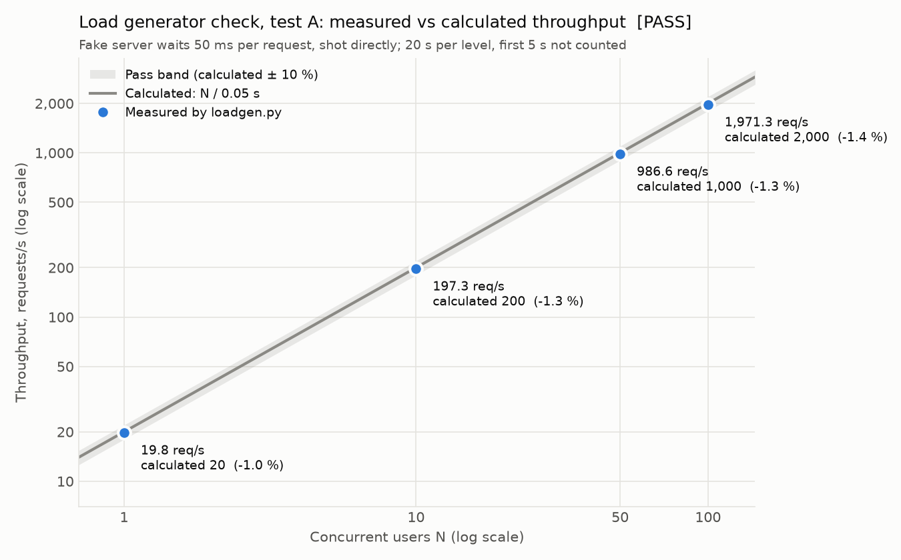

ตัวอย่างโค้ดที่ AI เขียนให้ในรอบจริง (ของคุณอาจต่างกัน): [fake_server.py](code_reference/fake_server.py) · [check_loadtest.py](code_reference/check_loadtest.py) · [plot_loadtest_check.py](code_reference/plot_loadtest_check.py) · ผลดิบ [loadtest_check.json](results/loadtest_check.json) · [loadtest_check_log.txt](results/loadtest_check_log.txt)

**อ่านผลอย่างไร**

- A ต่ำกว่าที่คำนวณราว 1% เพราะ server จำลองถือคำขอไว้เฉลี่ย 50.2 ms บวกเวลารับส่งรูป
- C: ตัวยิงโหลดส่งได้ราว 64,000 คำขอ/วินาที · ระบบจริงทำได้สูงสุดราว 570 จึงไม่ใช่ตัวถ่วง
- D: NGINX เพิ่มเวลา 0.3 ms ต่อคำขอ
- E ผ่านด้วย Throughput และ p50 · แต่ **p95 ของ 3 ครั้งคือ 168.1 / 180.6 / 140.7 ms ต่างกัน 28%** · ความจุตัดสินด้วย p95 จึงต้องอ่านแบบมีความคลาดเคลื่อน
- สิ่งที่ต้องแก้ระหว่างทาง: เพิ่มช่อง `sent` ในผลของตัวยิงโหลด เพราะเดิมนับเฉพาะช่วงที่นับผล จึงเทียบข้อ B ไม่ได้

# ส่วน C · GPU 1 ใบ

## ขั้นที่ 6 · แบบที่ 1: ทำทีละรูป

วัดความจุของ Baseline: GPU 1 ใบ · server 1 ตัว · ทำทีละรูป · ได้ผลชื่อ `base` ไว้เทียบกับทุกแบบ

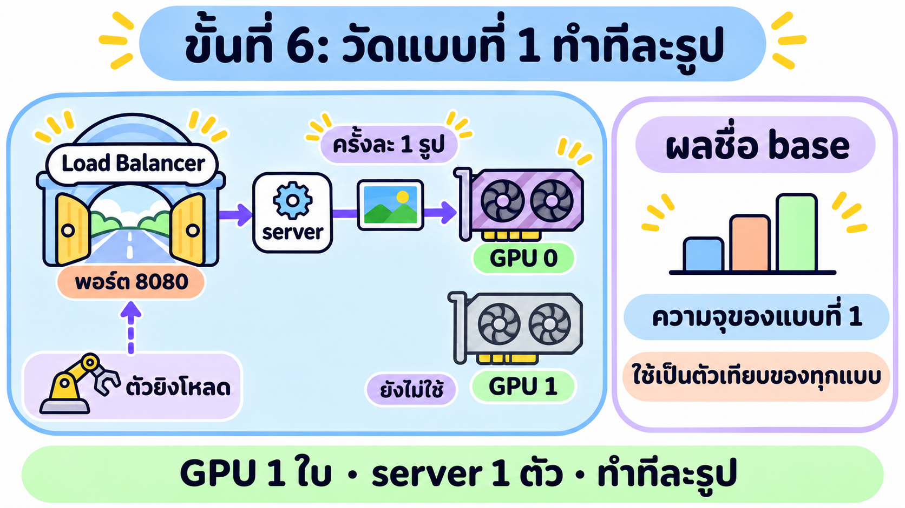


```text
[ที่ทำงาน]
container `multi-account` · โฟลเดอร์ /workspace/vastapp_lab · สกิล vastai
เครื่อง: ป้าย vapp-lab6-nginx · กุญแจ SSH: /workspace/vastai_lab/Devtool_SSH/devtoolSSH
เก็บโค้ดและผลที่: lab6_microbatch_lb ของโฟลเดอร์ที่เปิด Claude Code อยู่ (ไม่ใช่ใน container)

[งาน]
วัดความจุของแบบที่ 1: GPU 1 ใบ · server 1 ตัว · ทำทีละรูป

[ขั้นตอน]
1. เปิดระบบแบบที่ 1 (GPU 1 ใบ · server 1 ตัว · โหมดทีละรูป)
2. หาความจุด้วยตัวยิงโหลด ตั้งชื่อผลว่า base · รันเป็นงานเบื้องหลัง แล้วเช็กจนเห็น DONE

[เกณฑ์]
ผ่าน = p95 ไม่เกิน 500 ms และ error ต่ำกว่า 1%
ความจุ = จำนวนผู้ใช้พร้อมกัน (N) สูงสุดที่ผ่าน

[รายงาน]
สรุปเป็นตารางทุกระดับ N: Throughput · p50 · p95 · GPU ทำงานกี่ % · CPU ของ server · เวลารอคิว · เวลาของโมเดล · ผ่านหรือไม่
ประโยค "แบบที่ 1 รับผู้ใช้พร้อมกันได้ N คน" · ตอนเต็มความจุ GPU ทำงานกี่ % และส่วนไหนเป็นตัวถ่วง
ตารางการประมาณ: ค่าที่ประมาณไว้แต่ละรอบ เทียบกับผลที่วัดได้ และค่าจากสูตร N ≈ Throughput สูงสุด × 0.5 วินาที ห่างจากความจุจริงเท่าไร
บอกว่าเครื่องยังเปิดอยู่
```

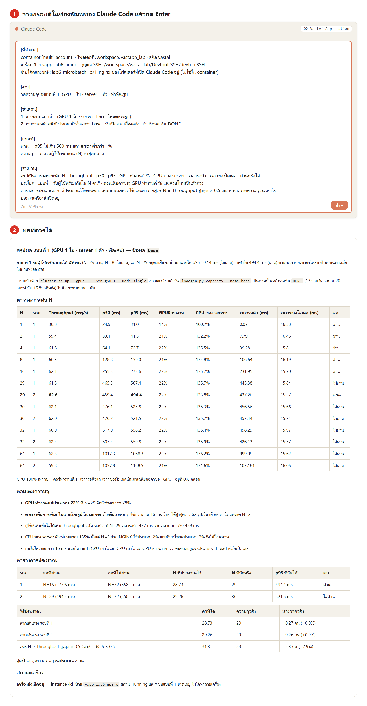

*ใช้เวลา 6 นาที*

| N | Throughput | p50 (ms) | p95 (ms) | GPU | เวลารอคิว (ms) | เวลาของโมเดล (ms) | ผล |
|---|---|---|---|---|---|---|---|
| 1 | 38.8 | 24.9 | 31.0 | 14% | 0.07 | 16.6 | ผ่าน |
| 2 | 59.4 | 33.1 | 41.5 | 21% | 7.8 | 16.5 | ผ่าน |
| 8 | 60.3 | 128.8 | 159.0 | 21% | 106.6 | 16.2 | ผ่าน |
| 16 | 62.1 | 255.3 | 273.6 | 22% | 231.9 | 15.7 | ผ่าน |
| **29** | 62.6 | 459.4 | **494.4** | 22% | 437.3 | 15.6 | **ผ่าน · ความจุ** (ครั้งแรกได้ 507.4 ไม่ผ่าน) |
| 30 | 62.0–62.1 | 476.1–476.2 | 521.5–525.8 | 22% | 457 | 15.7 | ไม่ผ่าน 2 ครั้ง |
| 32 | 60.9–62.4 | 507.4–517.9 | 558.2–559.8 | 22% | 486–498 | 15.6–16.0 | ไม่ผ่าน 2 ครั้ง |
| 64 | 59.8–62.3 | 1,017.3–1,057.8 | 1,068.3–1,168.5 | 21–22% | 999–1,038 | 15.6–16.1 | ไม่ผ่าน 2 ครั้ง |

CPU ที่ความจุ: server 1.36 cores · NGINX 0.02 core · ตัวยิงโหลด 0.03 core

**การหาความจุของรอบนี้** (วัด 9 ระดับ 13 ครั้ง ใช้ 282 วินาที)

| รอบ | ใช้ p95 ของสองระดับ | เดาว่าควรลอง N | วัดจริงที่ N | ผลที่วัดได้ |
|---|---|---|---|---|
| หาช่วง | N = 1 ถึง 64 | – | – | ผ่านสุดท้ายที่ 16 · ไม่ผ่านที่ 32 |
| 1 | N = 16 (274 ms) กับ N = 32 (558 ms) | 28.7 | 29 | 507.4 ms ไม่ผ่าน · วัดซ้ำ 494.4 ms ผ่าน |
| 2 | N = 29 (494 ms) กับ N = 32 (558 ms) | 29.3 | 30 | 525.8 และ 521.5 ms ไม่ผ่าน → ความจุ = **29** |
| สูตรคิดในใจ | Throughput สูงสุด 62.6 × 0.5 วินาที | 31.3 | – | สูงกว่าความจุจริง 2 คน |

ตัวอย่างโค้ดที่ AI เขียนให้ในรอบจริง (ของคุณอาจต่างกัน): [loadgen.py](code_reference/loadgen.py) · [cluster.sh](code_reference/cluster.sh) · ผลดิบ [base.json](results/base.json) · [base_log.txt](results/base_log.txt)

**อ่านผลอย่างไร**

- Throughput ตันที่ราว 60–62 คำขอ/วินาทีตั้งแต่ N = 2 · เพิ่มผู้ใช้แล้วได้แค่คิวยาวขึ้น
- ที่ความจุ เวลารอคิว 437 ms จาก p50 459 ms (ราว 95%) · โมเดลใช้แค่ 15.6 ms
- **GPU ทำงาน 22%** ตัวถ่วงจึงไม่ใช่ GPU แต่คือการเรียกโมเดลทีละรูปของ server ตัวเดียว
- ความจุ 29 อยู่ชิดเส้น: N = 29 วัด 2 ครั้งได้ 507.4 (ไม่ผ่าน) และ 494.4 ms (ผ่าน) · ตัวยิงโหลดตัดสินว่าไม่ผ่านเฉพาะเมื่อไม่ผ่านทั้งสองครั้ง · ถ้าใช้กติกาเข้มกว่านี้ ความจุจะต่ำกว่า 29
- p95 เพิ่มเกือบเป็นเส้นตรงตาม N การเดาด้วยเส้นตรงจึงแม่นตั้งแต่รอบแรก

## ขั้นที่ 7 · แบบที่ 2: Micro-batching

เปิด server ตัวเดิมในโหมด Micro-batching (รวมไม่เกิน 32 รูป รอไม่เกิน 5 ms) แล้ววัดความจุ · ได้ผลชื่อ `batch`


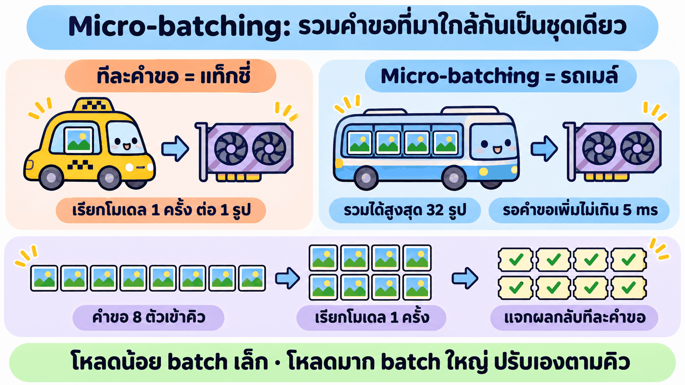

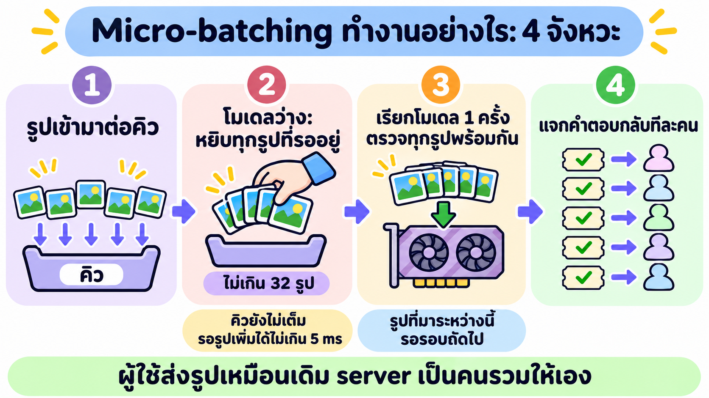

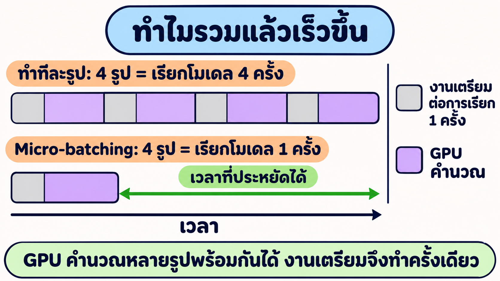

```text
[ที่ทำงาน]
container `multi-account` · โฟลเดอร์ /workspace/vastapp_lab · สกิล vastai
เครื่อง: ป้าย vapp-lab6-nginx · กุญแจ SSH: /workspace/vastai_lab/Devtool_SSH/devtoolSSH
เก็บโค้ดและผลที่: lab6_microbatch_lb ของโฟลเดอร์ที่เปิด Claude Code อยู่ (ไม่ใช่ใน container)

[งาน]
วัดความจุของแบบที่ 2: GPU ใบเดิม · server 1 ตัว · Micro-batching (รวมรูปที่รออยู่เข้าโมเดลพร้อมกัน)

[ขั้นตอน]
1. เปิดระบบใหม่: GPU 1 ใบ · server 1 ตัว · โหมด Micro-batching (ไม่เกิน 32 รูป รอไม่เกิน 5 ms)
2. หาความจุด้วยตัวยิงโหลด ตั้งชื่อผลว่า batch · รันเป็นงานเบื้องหลัง แล้วเช็กจนเห็น DONE
3. ถ้าผลแย่กว่าแบบที่ 1 แปลว่าโค้ดมีปัญหา ให้หาสาเหตุและแก้ แล้ววัดแบบที่ 1 (base) ซ้ำด้วยโค้ดฉบับแก้

[เกณฑ์]
ผ่าน = p95 ไม่เกิน 500 ms และ error ต่ำกว่า 1%
ความจุ = จำนวนผู้ใช้พร้อมกัน (N) สูงสุดที่ผ่าน

[รายงาน]
สรุปเป็นตารางเทียบแบบที่ 1 กับแบบที่ 2: ความจุ · Throughput สูงสุด · p95 ที่ความจุ · GPU ทำงานกี่ % · CPU ของ server · เป็นกี่เท่าของแบบที่ 1
ตารางของแบบที่ 2 ทุกระดับ N: จำนวนรูปเฉลี่ยที่เข้าโมเดลพร้อมกัน · เวลาของโมเดลต่อครั้ง · p50 · p95
บอกว่าตอนมีผู้ใช้คนเดียว แบบที่ 2 ช้ากว่าแบบที่ 1 กี่ ms และส่วนไหนเป็นตัวถ่วงของแบบที่ 2
บอกว่าเครื่องยังเปิดอยู่
```


*ใช้เวลา 21 นาที*

| | แบบที่ 1 `base` | แบบที่ 2 `batch` | เท่า |
|---|---|---|---|
| ความจุ | 29 | **52** | 1.79 |
| Throughput สูงสุด | 62.6 | 142.9 | 2.28 |
| p95 ที่ความจุ | 494.4 ms | 490.0 ms | – |
| GPU ที่ความจุ | 22% | 31% | – |
| CPU ของ server ที่ความจุ | 1.36 cores | 1.81 cores | – |
| p50 ตอนผู้ใช้คนเดียว | 24.9 ms | 30.0 ms | ช้าลง 5.1 ms |

**Micro-batching ของจริงทีละระดับ**

| N | รูปเฉลี่ยต่อการเรียกโมเดล 1 ครั้ง | เวลาของโมเดลต่อครั้ง (ms) | Throughput | p95 (ms) | GPU | ผล |
|---|---|---|---|---|---|---|
| 1 | 1.0 | 16.9 | 32.7 | 36.2 | 11% | ผ่าน |
| 4 | 3.3 | 22.9 | 84.1 | 57.2 | 21% | ผ่าน |
| 8 | 4.0 | 28.6 | 110.4 | 80.6 | 28% | ผ่าน |
| 16 | 8.0 | 47.8 | 136.9 | 136.6 | 32% | ผ่าน |
| 32 | 16.0 | 98.9 | 137.4 | 336.4 | 32% | ผ่าน |
| 50 | 25.1 | 171.8 | 132.0 | 492.7 | 32% | ผ่าน (ครั้งแรกได้ 531.7 ไม่ผ่าน) |
| 51 | 25.5 | 166.2 | 134.2 | 484.0 | 30% | ผ่าน |
| **52** | **26.0** | 174.0 | 135.2 | **490.0** | 31% | **ผ่าน · ความจุ** (ครั้งแรกได้ 511.5 ไม่ผ่าน) |
| 54 | 27.0 | 180.3–186.1 | 129.6–133.2 | 538.0–562.8 | 29–31% | ไม่ผ่าน 2 ครั้ง |
| 64 | 32.0 | 212.5–217.0 | 138.7–142.9 | 575.0–594.9 | 32–33% | ไม่ผ่าน 2 ครั้ง |

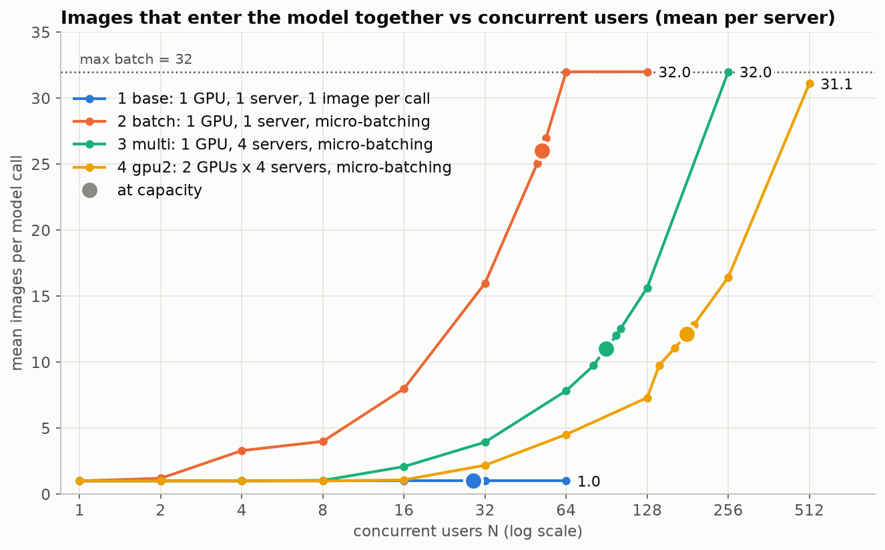

**การหาความจุของรอบนี้** (วัด 12 ระดับ 17 ครั้ง ใช้ 593 วินาที)

| รอบ | ใช้ p95 ของสองระดับ | เดาว่าควรลอง N | วัดจริงที่ N | ผลที่วัดได้ |
|---|---|---|---|---|
| หาช่วง | N = 1 ถึง 128 | – | – | ผ่านสุดท้ายที่ 32 · ไม่ผ่านที่ 64 |
| 1 | N = 32 (336 ms) กับ N = 64 (575 ms) | 53.9 | 54 | 538.0 ms ไม่ผ่าน |
| 2 | N = 32 (336 ms) กับ N = 54 (538 ms) | 49.9 | 50 | 492.7 ms ผ่าน (ครั้งที่สอง) |
| 3 | N = 50 (493 ms) กับ N = 54 (538 ms) | 50.6 | 51 | 484.0 ms ผ่าน |
| 4 | N = 51 กับ N = 54 · ใช้จุดกึ่งกลาง | 52.5 | 52 | 490.0 ms ผ่าน (ครั้งที่สอง) → ความจุ = **52** |
| สูตรคิดในใจ | Throughput สูงสุด 142.93 × 0.5 วินาที | 71.5 | – | สูงกว่าความจุจริง 19 คน |

**วัดแยกการเรียกโมเดล 1 ครั้ง** (บน GPU ใบที่ว่าง นอก server)

| รูปต่อครั้ง | รวม (ms) | ต่อรูป (ms) | เตรียมรูป | GPU คำนวณ | แปลงผล |
|---|---|---|---|---|---|
| 1 | 13.3 | 13.3 | 0.6 | 11.0 | 1.4 |
| 4 | 20.7 | 5.2 | 5.3 | 10.9 | 4.3 |
| 8 | 35.2 | 4.4 | 11.1 | 15.5 | 8.3 |
| 32 | 134.4 | 4.2 | 44.4 | 59.1 | 30.4 |

ตัวอย่างโค้ดที่ AI เขียนให้ในรอบจริง (ของคุณอาจต่างกัน): [server.py](code_reference/server.py) · [probe_model_call.py](code_reference/probe_model_call.py) · ผลดิบ [batch.json](results/batch.json) · [batch_model_call_probe.txt](results/batch_model_call_probe.txt) · [batch_log.txt](results/batch_log.txt)

**อ่านผลอย่างไร**

- จำนวนรูปต่อรอบปรับเองตามคิว: N = 4 ได้ 3.3 รูป · N = 52 ได้ 26 รูป · N = 64 ชนเพดาน 32 รูป
- Throughput สูงสุดเพิ่ม 2.28 เท่า (วัดได้ที่ N = 64 ซึ่งไม่ผ่าน · ที่ความจุเพิ่ม 2.16 เท่า) แต่ความจุเพิ่ม 1.79 เท่า · น่าจะเพราะรอบหนึ่งที่มี 26 รูปใช้ 174 ms คำขอที่มาไม่ทันรอบต้องรอทั้งรอบ (ยังไม่ได้วัดยืนยัน)
- **GPU ยังทำงานแค่ 31%** · ตัวถ่วงน่าจะย้ายมาที่งานฝั่ง CPU ของ server ตัวเดียว (ยังไม่ได้วัดยืนยัน · ขั้นที่ 8 ที่เปิด server 4 ตัวบน GPU ใบเดิมได้ Throughput เกือบ 2 เท่าสนับสนุนข้อนี้): ที่ 32 รูปต่อรอบ การเตรียมรูปและแปลงผลรวม 74.8 จาก 134.4 ms (56%)
- รวมเกิน 4 รูปแล้วเวลาต่อรูปแทบไม่ลดอีก (5.2 → 4.2 ms)
- ใน server จริง รอบ 32 รูปใช้ 217 ms ช้ากว่าที่วัดแยก (134 ms) · น่าจะเพราะ thread ที่เรียกโมเดลแย่ง CPU กับ thread ที่รับคำขอและสร้าง JSON (ยังไม่ได้วัดยืนยัน)
- ราคาที่จ่าย: ผู้ใช้คนเดียวช้าลง 5.1 ms · ตรงกับจังหวะรอรูปเพิ่ม 5 ms (เวลารอคิวเพิ่มจาก 0.07 เป็น 5.17 ms)
- ความจุ 52 ชิดเส้น: N = 50 และ N = 52 ผ่านที่ครั้งที่สอง · N = 53 ไม่ได้วัด · ครั้งแรกของ N = 50 Throughput ตกเหลือ 100 คำขอ/วินาที น่าจะเพราะเครื่องเช่าถูกผู้เช่ารายอื่นใช้หนักช่วงนั้น (ยังไม่ได้วัดยืนยัน)
- ผลไม่แย่กว่าแบบที่ 1 จึงไม่ต้องแก้โค้ดและไม่ต้องวัด `base` ซ้ำ

## ขั้นที่ 8 · แบบที่ 3: Micro-batching + server 4 ตัว

เปิด server 4 ตัวบน GPU ใบเดิม ให้ NGINX แจกงานแบบ Round Robin แล้ววัดความจุ · ได้ผลชื่อ `multi`


```text
[ที่ทำงาน]
container `multi-account` · โฟลเดอร์ /workspace/vastapp_lab · สกิล vastai
เครื่อง: ป้าย vapp-lab6-nginx · กุญแจ SSH: /workspace/vastai_lab/Devtool_SSH/devtoolSSH
เก็บโค้ดและผลที่: lab6_microbatch_lb ของโฟลเดอร์ที่เปิด Claude Code อยู่ (ไม่ใช่ใน container)

[งาน]
วัดความจุของแบบที่ 3: GPU ใบเดิม · server 4 ตัวใช้ GPU ใบเดียวกัน · Micro-batching

[ขั้นตอน]
1. เปิดระบบใหม่: GPU 1 ใบ · server 4 ตัว · โหมด Micro-batching (ไม่เกิน 32 รูป รอไม่เกิน 5 ms) · NGINX แจกงานให้ทั้ง 4 ตัวแบบ Round Robin
2. หาความจุด้วยตัวยิงโหลด ตั้งชื่อผลว่า multi · รันเป็นงานเบื้องหลัง แล้วเช็กจนเห็น DONE

[เกณฑ์]
ผ่าน = p95 ไม่เกิน 500 ms และ error ต่ำกว่า 1%
ความจุ = จำนวนผู้ใช้พร้อมกัน (N) สูงสุดที่ผ่าน

[รายงาน]
สรุปเป็นตารางเทียบ 3 แบบ (ทีละรูป · Micro-batching · Micro-batching + server 4 ตัว)
หัวตาราง: ความจุ · Throughput สูงสุด · p95 ที่ความจุ · จำนวนรูปเฉลี่ยที่เข้าโมเดลพร้อมกัน · GPU ทำงานกี่ % · CPU ของ server · VRAM ที่ใช้ · เป็นกี่เท่าของแบบที่ 1
บอกว่าคำขอกระจายไป server 4 ตัวเท่ากันไหม และส่วนไหนเป็นตัวถ่วงของแต่ละแบบ
บอกว่าเครื่องยังเปิดอยู่
```


*ใช้เวลา 16 นาที*

| ที่ความจุ | แบบที่ 1 | แบบที่ 2 | แบบที่ 3 `multi` |
|---|---|---|---|
| ความจุ | 29 | 52 | **90** |
| Throughput สูงสุด | 62.6 | 142.9 | 278.7 |
| p95 | 494.4 ms | 490.0 ms | 468.4 ms |
| รูปเฉลี่ยต่อการเรียกโมเดล 1 ครั้ง | 1.0 | 26.0 | 11.0 |
| เวลาของโมเดลต่อครั้ง | 15.6 ms | 174.0 ms | 147.3 ms |
| GPU | 22% | 31% | **82%** |
| CPU ของ server | 1.36 cores | 1.81 cores | 5.35 cores |
| VRAM ที่ใช้ทั้งใบ | 522 MiB | 13,812 MiB | 14,001–14,017 MiB |
| เท่าของแบบที่ 1 | 1.00 | 1.79 | **3.10** |

**แบบที่ 3 ทีละระดับ**

| N | Throughput | p95 (ms) | รูปเฉลี่ยต่อครั้ง | เวลาของโมเดลต่อครั้ง (ms) | GPU | CPU ของ server (cores) | ผล |
|---|---|---|---|---|---|---|---|
| 4 | 118.7 | 39.1 | 1.0 | 18.2 | 59% | 3.31 | ผ่าน |
| 8 | 169.5 | 55.0 | 1.0 | 18.2 | 80% | 4.47 | ผ่าน |
| 16 | 225.9 | 88.8 | 2.1 | 29.6 | 83% | 5.02 | ผ่าน |
| 32 | 260.5 | 135.6 | 3.9 | 51.1 | 83% | 5.32 | ผ่าน |
| 64 | 266.9 | 272.1 | 7.8 | 103.4 | 82% | 5.34 | ผ่าน |
| 81 | 272.3 | 466.1 | 9.8 | 125.3 | 82% | 5.36 | ผ่าน |
| 88 | 272.3 | 452.2 | 10.8 | 137.2 | 81% | 5.36 | ผ่าน |
| **90** | 268.7 | **468.4** | 11.0 | 147.3 | 82% | 5.35 | **ผ่าน · ความจุ** |
| 91 | 271.7–277.7 | 513.3–537.2 | 11.0–11.1 | 139.4–141.5 | 83–84% | 5.33–5.41 | ไม่ผ่าน 2 ครั้ง |
| 98 | 269.4–275.5 | 525.1–531.3 | 12.0–12.1 | 158.5 | 81–82% | 5.38–5.39 | ไม่ผ่าน 2 ครั้ง |
| 102 | 275.5–276.9 | 523.4–604.5 | 12.2–12.5 | 160.2–161.4 | 83–85% | 5.39–5.42 | ไม่ผ่าน 2 ครั้ง |

**การหาความจุของรอบนี้** (วัด 15 ระดับ 20 ครั้ง ใช้ 433 วินาที)

| รอบ | ใช้ p95 ของสองระดับ | เดาว่าควรลอง N | วัดจริงที่ N | ผลที่วัดได้ |
|---|---|---|---|---|
| หาช่วง | N = 1 ถึง 256 | – | – | ผ่านสุดท้ายที่ 64 · ไม่ผ่านที่ 128 |
| 1 | N = 64 (272 ms) กับ N = 128 (652 ms) | 102.4 | 102 | 523.4 ms ไม่ผ่าน |
| 2 | N = 64 (272 ms) กับ N = 102 (523 ms) | 98.5 | 98 | 525.1 ms ไม่ผ่าน |
| 3 | N = 64 กับ N = 98 · ใช้จุดกึ่งกลาง | 81.0 | 81 | 466.1 ms ผ่าน |
| 4 | N = 81 (466 ms) กับ N = 98 (525 ms) | 90.8 | 91 | 513.3 ms ไม่ผ่าน |
| 5 | N = 81 (466 ms) กับ N = 91 (513 ms) | 88.2 | 88 | 452.2 ms ผ่าน |
| 6 | N = 88 (452 ms) กับ N = 91 (513 ms) | 90.4 | 90 | 468.4 ms ผ่าน → ความจุ = **90** |
| สูตรคิดในใจ | Throughput สูงสุด 278.73 × 0.5 วินาที | 139.4 | – | สูงกว่าความจุจริง 49 คน |

ตัวอย่างโค้ดที่ AI เขียนให้ในรอบจริง (ของคุณอาจต่างกัน): [cluster.sh](code_reference/cluster.sh) · [nginx.conf](code_reference/nginx.conf) · ผลดิบ [multi.json](results/multi.json) · [multi_log.txt](results/multi_log.txt) · [multi_summary.md](results/multi_summary.md) · [multi_nginx_error.log](results/multi_nginx_error.log)

**อ่านผลอย่างไร**

- งานที่ใช้ CPU กระจายไป 4 ตัว (5.35 cores รวม ตัวละราว 1.3) · GPU ได้งานถี่ขึ้นจนทำงาน **82%** และ Throughput ตันที่ราว 260–279 คำขอ/วินาทีตั้งแต่ N = 32
- ตัวถ่วงของแบบนี้น่าจะเป็น GPU ใบเดียวที่ server 4 ตัวแย่งกันใช้ (ยังไม่ได้วัดแยกยืนยัน) · หลักฐานที่มี: รอบ 11 รูปใช้ 147 ms เทียบกับราว 35–68 ms ของรอบ 8–16 รูปตอนใช้ GPU ลำพัง และขั้นที่ 9 เพิ่ม GPU แล้ว Throughput เพิ่ม 2 เท่า
- รูปถูกแบ่งไป 4 คิว รอบหนึ่งจึงรวมได้ 11 รูป ไม่ใช่ 26 รูป
- คำขอกระจายเท่ากัน: ที่ N = 90 แต่ละตัวได้ 1,007 / 1,007 / 1,008 / 1,008 คำขอ
- ค่าประมาณรอบแรก (102) สูงกว่าความจุจริง 12 คน เพราะ p95 ช่วง N = 64–128 ไม่เป็นเส้นตรง · ตัวยิงโหลดจึงวัดต่ออีก 5 ระดับ
- 2 ระดับที่สูงกว่าความจุมาก (N = 128 ครั้งที่สอง และ N = 256 ครั้งแรก) คำขอกระจายไม่เท่า: server ตัวหนึ่งตัดการเชื่อมต่อ แล้ว NGINX พักตัวนั้น 10 วินาที (ค่าเริ่มต้น `max_fails=1 fail_timeout=10s`) · N = 256 มี HTTP 502 3 ครั้ง (0.08%) · ไม่กระทบค่า 90

# ส่วน D · GPU 2 ใบหลัง Load Balancer

## ขั้นที่ 9 · แบบที่ 4: GPU 2 ใบ

เปิด server ใบละ 4 ตัวบน GPU ทั้ง 2 ใบ ให้ NGINX แจกงานแบบ Round Robin แล้ววัดความจุ · ได้ผลชื่อ `gpu2`


```text
[ที่ทำงาน]
container `multi-account` · โฟลเดอร์ /workspace/vastapp_lab · สกิล vastai
เครื่อง: ป้าย vapp-lab6-nginx · กุญแจ SSH: /workspace/vastai_lab/Devtool_SSH/devtoolSSH
เก็บโค้ดและผลที่: lab6_microbatch_lb ของโฟลเดอร์ที่เปิด Claude Code อยู่ (ไม่ใช่ใน container)

[งาน]
วัดความจุของแบบที่ 4: GPU 2 ใบ · ใบละ 4 server · Micro-batching · NGINX แจกงานแบบ Round Robin

[ขั้นตอน]
1. เปิดระบบใหม่: GPU 2 ใบ · server 4 ตัวต่อ GPU · โหมด Micro-batching (ไม่เกิน 32 รูป รอไม่เกิน 5 ms)
2. หาความจุด้วยตัวยิงโหลด ตั้งชื่อผลว่า gpu2 · รันเป็นงานเบื้องหลัง แล้วเช็กจนเห็น DONE

[เกณฑ์]
ผ่าน = p95 ไม่เกิน 500 ms และ error ต่ำกว่า 1%
ความจุ = จำนวนผู้ใช้พร้อมกัน (N) สูงสุดที่ผ่าน

[รายงาน]
สรุปเป็นตาราง 4 แบบ: จำนวน GPU · แบบ · ความจุ · Throughput สูงสุด · p95 ที่ความจุ · เป็นกี่เท่าของแบบที่ 3 · Efficiency (กี่เท่าของแบบที่ 3 ÷ จำนวน GPU)
ประโยค "GPU 1 ใบ N1 คน → 2 ใบ N2 คน (x เท่า)" · คำขอกระจายไป GPU 2 ใบเท่ากันไหม · ถ้าได้ไม่ถึง 2 เท่า ส่วนไหนเป็นตัวถ่วง
บอกว่าเครื่องยังเปิดอยู่
```


*ใช้เวลา 10 นาที*

| GPU | แบบ | ความจุ | Throughput สูงสุด | p95 ที่ความจุ | เท่าของแบบที่ 3 | Efficiency |
|---|---|---|---|---|---|---|
| 1 | 3 · server 4 ตัว | 90 | 278.7 | 468.4 ms | 1.00 | – |
| 2 | 4 · server 8 ตัว | **180** | 566.5 | 490.3 ms | **2.00** | **ราว 100%** |

| ที่ความจุ (N = 180) | ค่า |
|---|---|
| สัดส่วนคำขอ GPU 0 / GPU 1 | 50.0% / 50.0% (4,149 / 4,150 คำขอ) |
| GPU ทำงาน GPU 0 / GPU 1 | 85% / 83% |
| รูปเฉลี่ยต่อการเรียกโมเดล 1 ครั้ง | 12.1 · เวลาของโมเดลต่อครั้ง 155.6 ms |
| CPU | server 10.90 cores · NGINX 0.12 core · ตัวยิงโหลด 0.19 core |
| VRAM ต่อ GPU | 8,057–9,681 MiB (หลังจำกัด VRAM ต่อ server) |

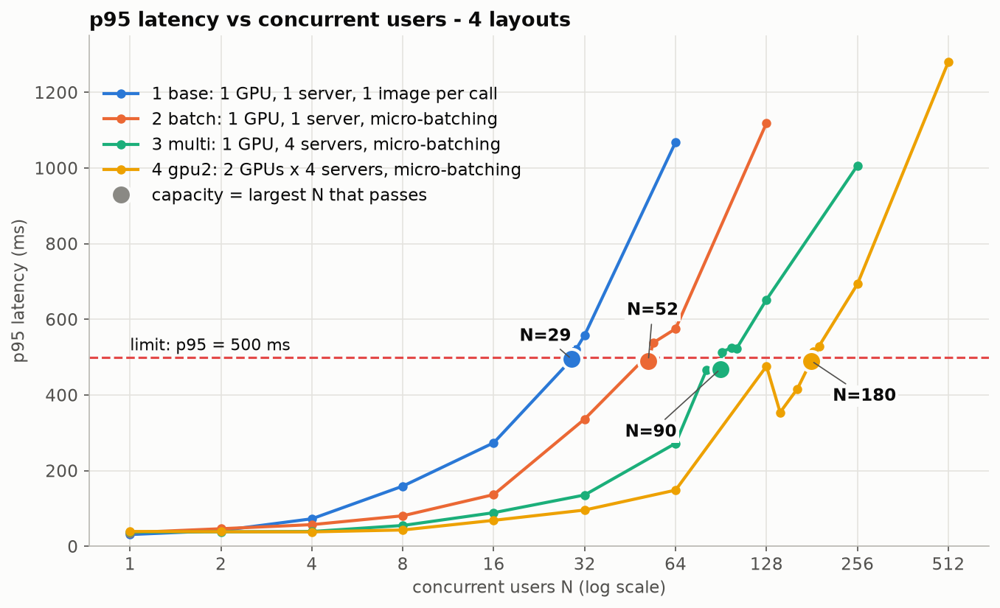

**การหาความจุของรอบนี้** (วัด 15 ระดับ 19 ครั้ง ใช้ 412 วินาที)

| รอบ | ใช้ p95 ของสองระดับ | เดาว่าควรลอง N | วัดจริงที่ N | ผลที่วัดได้ |
|---|---|---|---|---|
| หาช่วง | N = 1 ถึง 512 | – | – | ผ่านสุดท้ายที่ 128 · ไม่ผ่านที่ 256 |
| 1 | N = 128 (476 ms) กับ N = 256 (693 ms) | 142.1 | 142 | 354.0 ms ผ่าน |
| 2 | N = 142 (354 ms) กับ N = 256 (693 ms) | 191.1 | 191 | 529.1 ms ไม่ผ่าน |
| 3 | N = 142 (354 ms) กับ N = 191 (529 ms) | 182.9 | 183 | 514.0 ms ไม่ผ่าน |
| 4 | N = 142 กับ N = 183 · ใช้จุดกึ่งกลาง | 162.5 | 162 | 416.3 ms ผ่าน |
| 5 | N = 162 (416 ms) กับ N = 183 (514 ms) | 180.0 | 180 | 490.3 ms ผ่าน → ความจุ = **180** |
| สูตรคิดในใจ | Throughput สูงสุด 566.47 × 0.5 วินาที | 283.2 | – | สูงกว่าความจุจริง 103 คน |

ตัวอย่างโค้ดที่ AI เขียนให้ในรอบจริง (ของคุณอาจต่างกัน): [cluster.sh](code_reference/cluster.sh) · [run_capacity_bg.sh](code_reference/run_capacity_bg.sh) · ผลดิบ [gpu2.json](results/gpu2.json) · [gpu2_log.txt](results/gpu2_log.txt) · [gpu2_summary.md](results/gpu2_summary.md) · [gpu2_cluster_status.txt](results/gpu2_cluster_status.txt) · [gpu2_nginx_error.log](results/gpu2_nginx_error.log)

**อ่านผลอย่างไร**

- GPU 1 ใบ 90 คน → 2 ใบ 180 คน · ได้ประมาณ 2 เท่า และ Throughput สูงสุดเพิ่ม 2.03 เท่า · NGINX กับตัวยิงโหลดใช้ CPU ไม่ถึง 0.2 core จึงไม่ใช่ตัวถ่วง
- N เกิน 100 ใช้ช่วงห่าง 4 คน: ผ่านที่ 180 ไม่ผ่านที่ 183 · N = 181–182 ไม่ได้วัด
- N = 128 ได้ p95 476 ms แต่ N = 142 ได้ 354 ms: ที่ N = 128 server `gpu0-8102` ได้ 277 คำขอ ตัวอื่นได้ราว 1,027 เพราะ NGINX พักตัวนั้น 10 วินาทีหลัง server ตัดการเชื่อมต่อ 2 ครั้ง (HTTP 502 2 ครั้ง = 0.03%) · ค่าประมาณรอบแรก (142) จึงต่ำกว่าความจุจริง 38 คน
- เปิด server 8 ตัวครั้งแรกล้มด้วย CUDA out of memory ตอนอุ่นโมเดลพร้อมกัน · แก้โดยจำกัด VRAM ต่อ server เป็น 0.85 ÷ จำนวน server ต่อ GPU (`GPU_MEM_FRACTION` ใน `cluster.sh` และ `server.py`)
- แบบที่ 3 ไม่ได้วัดซ้ำด้วยค่าจำกัดนี้ · "2.00 เท่า" จึงเทียบกับผลเดิม · Throughput ต่อ GPU ของสองรอบใกล้กัน (267–279 เทียบ 275–283 คำขอ/วินาที)

## ขั้นที่ 10 · วิธีแจกงาน: Round Robin · Least Connections · Power of Two Choices

เทียบวิธีแจกงานบนระบบแบบที่ 4 ใน 2 สถานการณ์: GPU เร็วเท่ากัน และ GPU ใบที่ 2 ช้าลง 3 เท่า · ขั้นนี้มี 2 ตอน


| ตอน | เครื่อง | วิธีที่เทียบ | ตอบคำถาม |
|---|---|---|---|
| 10.1 | เครื่องหลัก (ป้าย `vapp-lab6-nginx`) | Round Robin · Least Connections | วิธีที่ดูงานค้างช่วยได้แค่ไหน |
| 10.2 | เช่าใหม่ 2 เครื่อง A และ B (ป้าย `vapp-lab6-p2c`) | Round Robin · Least Connections · Power of Two Choices | Least Connections กับ p2c วิธีใดรับได้มากกว่า |

ทฤษฎีของ 3 วิธี: [หน้าทฤษฎี ส่วนที่ 8](#8--วิธีแจกงาน-round-robin--least-connections--power-of-two-choices)

### 10.1 · Round Robin เทียบ Least Connections (เครื่องหลัก)

เทียบ 2 วิธีบนเครื่องหลักที่เปิดอยู่ตั้งแต่ขั้นที่ 1


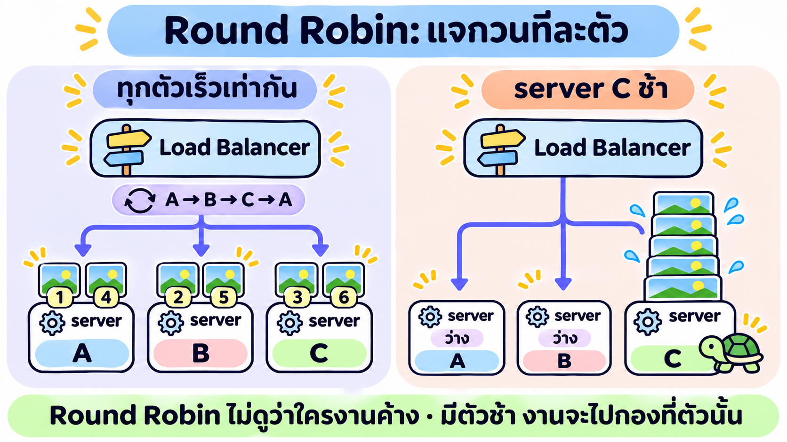


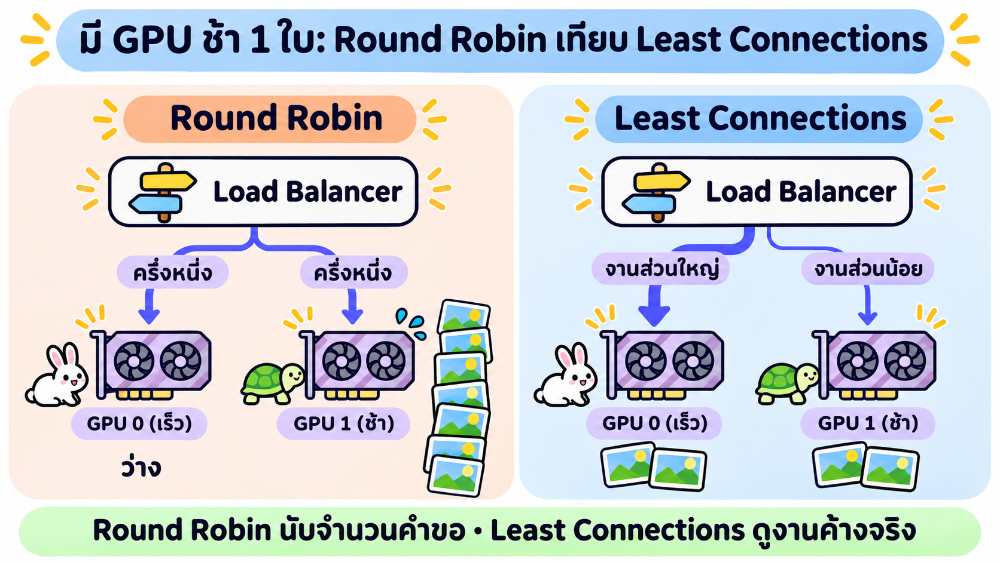

```text
[ที่ทำงาน]
container `multi-account` · โฟลเดอร์ /workspace/vastapp_lab · สกิล vastai
เครื่อง: ป้าย vapp-lab6-nginx · กุญแจ SSH: /workspace/vastai_lab/Devtool_SSH/devtoolSSH
เก็บโค้ดและผลที่: lab6_microbatch_lb ของโฟลเดอร์ที่เปิด Claude Code อยู่ (ไม่ใช่ใน container)

[งาน]
เทียบวิธีแจกงานของ NGINX 2 วิธี บนระบบแบบที่ 4 (GPU 2 ใบ · ใบละ 4 server · Micro-batching)
Round Robin: แจกวนทีละตัว ไม่ดูว่าใครงานค้างมาก
Least Connections: ส่งให้ server ที่มีงานค้างน้อยที่สุดในตอนนั้น

[ขั้นตอน]
1. เพิ่มให้ code/cluster.sh เลือกวิธีแจกงานได้ 2 วิธีข้างบน และสั่งให้ server ของ GPU ใบที่เลือกเรียกโมเดลช้าลงกี่เท่าได้ (จำลอง GPU ที่ช้ากว่า)
2. ทั้งสองวิธีต้องใช้การตั้งค่าของ NGINX เหมือนกันทุกอย่าง ต่างกันแค่วิธีแจกงาน
3. กรณี GPU เร็วเท่ากัน: หาความจุของ Least Connections ตั้งชื่อผลว่า lc_equal (ตัวเทียบคือ gpu2 ที่เป็น Round Robin)
4. กรณี GPU ใบที่ 2 ช้าลง 3 เท่า: หาความจุ 2 รอบ · Round Robin ตั้งชื่อผลว่า rr_slow · Least Connections ตั้งชื่อผลว่า lc_slow
5. เสร็จแล้วเอาการหน่วงออก และเปิดระบบแบบที่ 4 กลับมาแบบ Round Robin

[เกณฑ์]
ผ่าน = p95 ไม่เกิน 500 ms และ error ต่ำกว่า 1%
ความจุ = จำนวนผู้ใช้พร้อมกัน (N) สูงสุดที่ผ่าน

[รายงาน]
สรุปเป็น 2 ตาราง (GPU เร็วเท่ากัน · GPU ใบที่ 2 ช้า) เทียบ 2 วิธี: ความจุ · Throughput สูงสุด · p95 ที่ความจุ · สัดส่วนคำขอที่ GPU แต่ละใบได้ · GPU แต่ละใบทำงานกี่ %
อธิบาย 3–4 บรรทัดว่าทำไมผลต่างกัน แล้วบอกว่าเครื่องยังเปิดอยู่
```


*ใช้เวลา 25 นาที (หาความจุ 3 รอบ และยิงตรวจซ้ำ 5 ครั้ง)*

บรรทัดเดียวใน `code/nginx.conf` ที่ต่างกันระหว่าง 2 วิธี

```nginx
        # (no directive)                 # Round Robin        (cluster.sh up --lb rr)
        least_conn;                      # Least Connections  (cluster.sh up --lb lc)
```

ไฟล์ตั้งค่าที่ใช้จริงของ `rr_slow` กับ `lc_slow` ต่างกันบรรทัดนี้บรรทัดเดียว และของ `lc_equal` เหมือน `lc_slow` ทุกบรรทัด ([rr_slow_nginx.conf](results/rr_slow_nginx.conf) · [lc_slow_nginx.conf](results/lc_slow_nginx.conf) · [lc_equal_nginx.conf](results/lc_equal_nginx.conf)) · `gpu2` วัดไว้ในขั้นที่ 9 ก่อนมีตัวเลือก `--lb` ด้วยไฟล์ที่ไม่มีคำสั่งเลือกวิธี ซึ่งคือ Round Robin เช่นกัน

**กรณีที่ 1 · GPU เร็วเท่ากัน**

| วิธี | ผล | ความจุ | Throughput สูงสุด | p50 / p95 ที่ความจุ | คำขอ GPU 0 / GPU 1 | GPU ทำงาน GPU 0 / GPU 1 |
|---|---|---|---|---|---|---|
| Round Robin | `gpu2` (ขั้นที่ 9) | 180 | 566.5 | 312.6 / 490.3 ms | 50.0% / 50.0% | 85% / 83% |
| Least Connections | `lc_equal` | **250** | 561.1 | 443.6 / 493.3 ms | 49.8% / 50.2% | 82% / 83% |

p95 ของสองวิธีที่ N เดียวกัน (ระดับที่วัด 2 ครั้งแสดงทั้งสองค่า)

| N | Round Robin p95 (ms) | Least Connections p95 (ms) | p50 ของสองวิธี (ms) |
|---|---|---|---|
| 64 | 148.4 | 133.9 | 117.9 · 121.4 |
| 128 | 476.1 (มี server ถูกพัก 10 วินาที) | 253.3 | 235.5 · 237.8 |
| 180 | 490.3 · ยิงซ้ำ 392.2 / 468.7 / 640.6 (ครั้งนี้มี server ถูกพัก 10 วินาที) | ไม่ได้วัด | – |
| 250 | ยิงซ้ำ 705.3 / 696.6 (ไม่ผ่าน) | 493.3 (ผ่าน) | 418–422 · 443.6 |
| 256 | 740.8 / 693.1 | 543.5 / 564.8 | 419.5–448.5 · 459.7–459.8 |
| 512 | 1,354.2 / 1,280.5 | 949.1 / 953.3 | 894.3–901.7 · 924.8–925.2 |

**อ่านกรณีที่ 1 แค่ไหน**: บนเครื่องนี้ Least Connections ได้ p95 ต่ำกว่า Round Robin ทุกระดับตั้งแต่ N = 128 ขึ้นไป ทั้งที่ p50 และ Throughput ใกล้กัน และ Round Robin ที่ N = 250 ไม่ผ่านทั้ง 2 ครั้ง · ทิศทางจึงเชื่อได้ · แต่ตัวเลข "180 เทียบ 250" มาจากการหาความจุวิธีละ 1 รอบ และ Round Robin ที่ N = 180 ยิงซ้ำ 3 ครั้งได้ p95 ตั้งแต่ 392 ถึง 641 ms · ขนาดของส่วนต่างจึงยังไม่แน่น ต้องวัดซ้ำหลายรอบถ้าจะใช้ตัวเลขนี้

**กรณีที่ 2 · GPU ใบที่ 2 ช้าลง 3 เท่า**

| วิธี | ผล | ความจุ | Throughput สูงสุด | p95 ที่ความจุ | คำขอ GPU 0 / GPU 1 | GPU ทำงาน GPU 0 / GPU 1 |
|---|---|---|---|---|---|---|
| Round Robin | `rr_slow` | **52** | 223.4 | 495.9 ms | 50.0% / 50.0% | 55% / 95% |
| Least Connections | `lc_slow` | **103** | 389.3 | 493.5 ms | **70.8% / 29.2%** | 82% / 93% |

| ที่ความจุ ต่อ server 1 ตัว | Round Robin (N = 52) GPU 0 · GPU 1 | Least Connections (N = 103) GPU 0 · GPU 1 |
|---|---|---|
| คำขอที่ได้ | 412–413 · 412–413 | 974–995 · 403–410 |
| เวลารอคิว (ms) | 12–13 · 160–176 | 79 · 213–220 |
| เวลาของโมเดลต่อครั้ง (ms) | 23 · 212–234 | 83–86 · 223–234 |


**การหาความจุของ 3 รอบ**

| ผล | ช่วงที่หาได้ | ค่าประมาณรอบแรก | ความจุที่วัดได้ | วัดกี่ระดับ (กี่ครั้ง) |
|---|---|---|---|---|
| `lc_equal` | 128 / 256 | 236.8 | 250 | 14 (18) |
| `rr_slow` | 32 / 64 | 53.4 | 52 | 10 (13) |
| `lc_slow` | 64 / 128 | 106.5 | 103 | 11 (14) |

ตัวอย่างโค้ดที่ AI เขียนให้ในรอบจริง (ของคุณอาจต่างกัน): [cluster.sh](code_reference/cluster.sh) · [nginx.conf](code_reference/nginx.conf) · [server.py](code_reference/server.py) · [make_lb_summary.py](code_reference/make_lb_summary.py) · ผลดิบ [lc_equal.json](results/lc_equal.json) · [rr_slow.json](results/rr_slow.json) · [lc_slow.json](results/lc_slow.json) · ยิงตรวจซ้ำ [rr_equal_check_n180.json](results/rr_equal_check_n180.json) · [_b](results/rr_equal_check_n180_b.json) · [_c](results/rr_equal_check_n180_c.json) · [rr_equal_check_n250_a.json](results/rr_equal_check_n250_a.json) · [_b](results/rr_equal_check_n250_b.json) · [lb_summary.md](results/lb_summary.md)

**อ่านผลอย่างไร**

- **GPU ช้า + Round Robin**: ยังแจก 50/50 · server ของใบช้ารอคิว 160–176 ms และโมเดลใช้ 212–234 ms ต่อครั้ง ขณะที่ใบเร็วทำงานแค่ 55% · ใบช้าเป็นตัวกำหนด p95 ของทั้งระบบ
- **GPU ช้า + Least Connections**: server ของใบช้าคืนงานช้า งานค้างจึงสูงและได้งานใหม่น้อยลงเอง · คำขอ 70.8% ไหลไปใบเร็ว ใบเร็วทำงาน 82% · ความจุเพิ่มจาก 52 เป็น 103 (1.98 เท่า)
- ช่องว่าง 52 กับ 103 กว้างกว่าความแกว่งระหว่างรอบมาก และสัดส่วนคำขอเปลี่ยนจริง · ข้อสรุปของกรณีที่ 2 จึงเชื่อได้ แม้วัดอย่างละรอบ
- Least Connections ดูแค่จำนวนงานค้าง ไม่รู้ความเร็วจริง · ใบช้ายังได้งานราว 29% และยังเป็นตัวกำหนด p95
- **GPU เร็วเท่ากัน**: ที่ N = 250 แบบ Least Connections server ทั้ง 8 ตัวรอคิว 174–184 ms ใกล้กันมาก ส่วน Round Robin ที่ N = 180 รอคิว 97–132 ms ต่างกันระหว่างตัว · p95 ของ Least Connections จึงอยู่ใกล้ p50 (493 เทียบ 444 ms) · น่าจะเป็นเหตุที่รับผู้ใช้ได้มากกว่าก่อน p95 ชน 500 ms (ยังไม่ได้ทดลองแยกยืนยัน)
- "GPU ช้า" จำลองโดยให้ server ของ GPU 1 เรียกโมเดล 3 ครั้งต่อรอบ (ตัวแปร `MODEL_SLOWDOWN` ใน `server.py`) · GPU ทำงานจริงนานขึ้น · ตรวจตรงทีละ server ที่ N = 8 ได้ 109.7 เทียบ 52.6 คำขอ/วินาที ซึ่งไม่ถึง 3 เท่าพอดี · น่าจะเพราะจำนวนรูปต่อรอบต่างกัน (6.0 เทียบ 4.0 รูป · ยังไม่ได้วัดยืนยัน)
- ช่วงที่ไม่ได้วัด: `lc_equal` N = 251–252 · `lc_slow` N = 104–106 · `lc_equal` มี HTTP 502 1 ครั้ง (0.01%)

### 10.2 · เพิ่ม Power of Two Choices: 3 วิธีบนเครื่องเดียวกัน

เช่าเครื่องใหม่ (โหนดเดี่ยว 1 เครื่อง × 2 GPU) แล้ววัด Round Robin, Least Connections และ Power of Two Choices บนเครื่องเดียวกัน · ทำหลัง 10.1 เพราะใช้ `code/cluster.sh` ที่เลือกวิธีแจกงานและจำลอง GPU ช้าได้แล้ว · พรอมต์นี้เช่าและลบเครื่องของตัวเอง จึงวางต่อทันทีหรือวางหลังขั้นที่ 12 ก็ได้ (**หมายเหตุ:** เครื่อง A และเครื่อง B ในผลตัวอย่างคือโหนดเดี่ยว 2 รอบที่วัดแยกกันคนละเครื่อง ไม่ได้ต่อกันเป็นคลัสเตอร์)


- วิธีเดียวกัน ระบบเดียวกัน แต่คนละเครื่อง ได้ 128 ถึง 203 คน · ตัวเลขข้ามเครื่องจึงใช้เทียบวิธีแจกงานไม่ได้
- 10.2 จึงวัดครบ 3 วิธีบนเครื่องเดียวกัน และทำ 2 เครื่องพร้อมกัน · เครื่อง B วัดกลับลำดับ (p2c → Least Connections → Round Robin) เพื่อไม่ให้ลำดับการวัดเอนเอียงไปทางวิธีใด

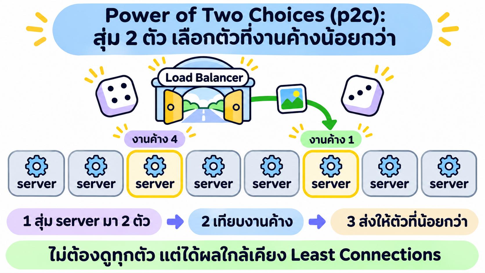


```text
[ที่ทำงาน]
container `multi-account` · โฟลเดอร์ /workspace/vastapp_lab · สกิล vastai
กุญแจ SSH: /workspace/vastai_lab/Devtool_SSH/devtoolSSH
เก็บโค้ดและผลที่: lab6_microbatch_lb/same_machine ของโฟลเดอร์ที่เปิด Claude Code อยู่ (ไม่ใช่ใน container)
โค้ดตั้งต้น: คัดลอกโค้ดจาก lab6_microbatch_lb/code มาไว้ที่ lab6_microbatch_lb/same_machine/code
โมเดล: lab6_microbatch_lb/best.pt · รูปทดสอบ: lab6_microbatch_lb/samples (6 รูป)

[งาน]
เทียบวิธีแจกงานของ NGINX 3 วิธีบนเครื่องเดียวกัน ว่าวิธีใดรับผู้ใช้พร้อมกันได้มากกว่า
Round Robin: แจกวนทีละตัว
Least Connections: ส่งให้ server ที่มีงานค้างน้อยที่สุด
Power of Two Choices (p2c): สุ่ม server มา 2 ตัว แล้วส่งให้ตัวที่มีงานค้างน้อยกว่า

[ขั้นตอน]
1. เช่าเครื่อง RTX 4090 2 ใบในเครื่องเดียว ราคาไม่เกิน $0.60 ต่อชั่วโมง ป้าย vapp-lab6-p2c
   (verified · reliability 0.95 ขึ้นไป · ความเร็วเน็ตไม่ต่ำกว่า 1,200 Mbps · CPU ที่ใช้ได้จริง 24 cores ขึ้นไป · ไม่อยู่ในจีน · PyTorch 2.8 ที่มี CUDA 12.8 · disk 40 GB)
2. นำโค้ดตั้งต้น โมเดล และรูปทดสอบขึ้นเครื่อง ติดตั้งสิ่งที่ต้องใช้ และรัน NGINX เป็น container ด้วย udocker (image nginx:1.27)
3. เพิ่มให้ code/cluster.sh เลือกวิธีแจกงานแบบ p2c ได้ โดยไฟล์ตั้งค่าของ 3 วิธีต้องต่างกันเฉพาะบรรทัดเลือกวิธีแจกงาน
   แล้วตรวจจากไฟล์ตั้งค่าที่ NGINX ใช้จริงว่าแต่ละวิธีถูกเปิดตามที่สั่ง
4. เปิดระบบ GPU 2 ใบ ใบละ 4 server โหมด Micro-batching (ไม่เกิน 32 รูป รอไม่เกิน 5 ms)
5. กรณี GPU เร็วเท่ากัน: หาความจุด้วยตัวยิงโหลดของทั้ง 3 วิธี วิธีละ 1 รอบ ตามลำดับ Round Robin → Least Connections → p2c
6. กรณี GPU ใบที่ 2 ช้าลง 3 เท่า: ทำแบบเดียวกับข้อ 5 ด้วยลำดับเดียวกัน
7. ตั้งชื่อผลเป็น <วิธี>_<กรณี> คือ rr_equal lc_equal p2c_equal rr_slow lc_slow p2c_slow และเก็บไฟล์ตั้งค่าที่ใช้จริงของทุกผลไว้ใน results
8. เขียน code/report3.py รวมผลลง results/metrics.json และวาดกราฟที่ results/images (ข้อความอังกฤษ):
   ความจุของ 3 วิธีทั้ง 2 กรณี · สัดส่วนคำขอที่ GPU แต่ละใบได้ · p95 เทียบ N ของ 3 วิธีในแต่ละกรณี
9. นำผลและโค้ดทั้งหมดกลับมา ตรวจว่ามาครบ แล้วลบเครื่องป้าย vapp-lab6-p2c และตรวจว่าไม่เหลือ (ห้ามแตะเครื่องป้ายอื่น)

[เกณฑ์]
ผ่าน = p95 ไม่เกิน 500 ms และ error ต่ำกว่า 1%
ความจุ = จำนวนผู้ใช้พร้อมกัน (N) สูงสุดที่ผ่าน

[รายงาน]
สรุปเป็น 2 ตาราง (GPU เร็วเท่ากัน · GPU ใบที่ 2 ช้า): วิธี · ความจุ · ระดับแรกที่ไม่ผ่าน · Throughput สูงสุด · p95 ที่ความจุ · สัดส่วนคำขอ GPU 0 / GPU 1 · GPU ทำงานกี่ %
บรรทัดตั้งค่าของ NGINX ที่ต่างกันของ 3 วิธี · สิ่งผิดปกติระหว่างวัด (เช่น server ถูกพัก error หรือระดับที่ต้องวัดซ้ำ)
เครื่องที่เช่า: ที่ตั้ง · ราคาต่อชั่วโมง · CPU ที่ใช้ได้จริง · อายุเครื่อง · ยอดที่ถูกคิด
ไม่ต้อง commit · ห้ามแสดงค่า key
```


*ใช้เวลา 73 นาที (เครื่อง A) และ 51 นาที (เครื่อง B)*

| | เครื่อง A | เครื่อง B |
|---|---|---|
| GPU | RTX 3090 × 2 | RTX 3090 × 2 |
| CPU ที่ใช้ได้จริง | 46 cores (AMD EPYC 7R32) | 30.7 cores (AMD EPYC 7542) |
| ลำดับที่วัด | Round Robin → Least Connections → p2c | p2c → Least Connections → Round Robin |


**กรณีที่ 2 · GPU ใบที่ 2 ช้าลง 3 เท่า**

| วิธี | เครื่อง | ความจุ (คน) | เท่าของ Round Robin | p95 ที่ความจุ (ms) | Throughput สูงสุด | คำขอ GPU 0 / GPU 1 | GPU ทำงาน GPU 0 / GPU 1 |
|---|---|---|---|---|---|---|---|
| Round Robin | A | 49 | 1.00 | 492.3 | 212.5 | 50.0% / 50.0% | 58% / 84% |
| Round Robin | B | 54 | 1.00 | 499.0 | 232.3 | 50.0% / 50.0% | 52% / 91% |
| Power of Two Choices | A | 72 | 1.47 | 489.1 | 348.5 | 68.7% / 31.3% | 80% / 84% |
| Power of Two Choices | B | 81 | 1.50 | 492.3 | 408.9 | 70.0% / 30.0% | 85% / 94% |
| Least Connections | A | **96** | 1.96 | 488.8 | 366.2 | 70.5% / 29.5% | 74% / 86% |
| Least Connections | B | **111** | 2.06 | 498.4 | 409.3 | 71.1% / 28.9% | 83% / 94% |

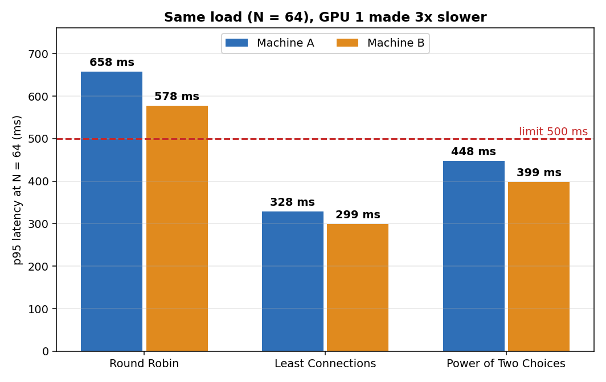

- **Least Connections > p2c > Round Robin ทั้งสองเครื่อง** · ผู้ใช้ 64 คนเท่ากัน Round Robin เกินเกณฑ์ (658 และ 578 ms) · p2c ได้ 448 และ 399 ms · Least Connections ได้ 328 และ 299 ms
- p2c กับ Least Connections ส่งคำขอราว 70% ไป GPU ใบเร็วพอกัน · คำอธิบายตามทฤษฎี: p2c เทียบเพียง 2 ตัวที่สุ่มได้ บางครั้งจึงไม่ได้ตัวที่งานค้างน้อยที่สุด ส่วน Least Connections เทียบครบทั้ง 8 ตัวทุกคำขอ

**กรณีที่ 1 · GPU เร็วเท่ากัน**

| วิธี | เครื่อง | ความจุ (คน) | เท่าของ Round Robin | p95 ที่ความจุ (ms) | Throughput สูงสุด | คำขอ GPU 0 / GPU 1 |
|---|---|---|---|---|---|---|
| Round Robin | A | 128 | 1.00 | 464.2 | 489.3 | 50.0% / 50.0% |
| Round Robin | B | 203 | 1.00 | 488.1 | 600.9 | 50.0% / 50.0% |
| Power of Two Choices | A | 196 | 1.53 | 494.1 | 497.1 | 49.9% / 50.1% |
| Power of Two Choices | B | **238** | 1.17 | 497.7 | 594.1 | 50.2% / 49.8% |
| Least Connections | A | **221** | 1.73 | 487.4 | 495.5 | 50.7% / 49.3% |
| Least Connections | B | 230 | 1.13 | 474.3 | 615.4 | 50.2% / 49.8% |

- Throughput สูงสุดของ 3 วิธีบนเครื่องเดียวกันแทบเท่ากัน (489–497 บนเครื่อง A · 594–615 บนเครื่อง B) · วิธีแจกงานไม่ได้เพิ่มกำลังของ GPU แต่ลดคิวที่ไม่เท่ากัน p95 จึงถึง 500 ms ช้าลง
- ทุกวิธีแบ่งคำขอราว 50 ต่อ 50 ระหว่าง GPU สองใบ · ส่วนต่างของความจุมาจากการกระจายงานระหว่าง server 8 ตัวในแต่ละขณะ
- Least Connections กับ p2c สลับลำดับกันระหว่างสองเครื่อง (221 กับ 196 · 230 กับ 238)

ตัวอย่างโค้ดที่ AI เขียนให้ในรอบจริง (ของคุณอาจต่างกัน): [cluster.sh](same_machine/run_a/code_reference/cluster.sh) · [run_lb3.sh](same_machine/run_a/code_reference/run_lb3.sh) · [report3.py](same_machine/run_a/code_reference/report3.py) · ผลดิบ [เครื่อง A](same_machine/run_a/results) · [เครื่อง B](same_machine/run_b/results) · ไฟล์ตั้งค่าที่ NGINX ใช้จริง เช่น [p2c_slow_nginx_running.conf](same_machine/run_a/results/p2c_slow_nginx_running.conf) · ตัวเลขรวม [summary.json](same_machine/summary.json)

**อ่านผลอย่างไร**

| ข้อสรุป | หลักฐาน | เชื่อได้แค่ไหน |
|---|---|---|
| server เร็วไม่เท่ากัน: Least Connections ดีกว่า p2c | 96 กับ 72 · 111 กับ 81 | **เชื่อได้** ลำดับเดียวกันทั้งสองเครื่อง ทั้งที่วัดกลับลำดับกัน และส่วนต่างกว้างกว่าความแกว่งใกล้เส้นเกณฑ์ |
| server เร็วไม่เท่ากัน: p2c ดีกว่า Round Robin | 72 กับ 49 · 81 กับ 54 | **เชื่อได้** ด้วยเหตุผลเดียวกัน |
| server เร็วเท่ากัน: ทั้งสองวิธีดีกว่า Round Robin | 221 และ 196 กับ 128 · 230 และ 238 กับ 203 | ทิศทางตรงกันทั้งสองเครื่อง แต่ขนาดของส่วนต่างต่างกันมาก (1.13–1.73 เท่า) |
| server เร็วเท่ากัน: Least Connections กับ p2c วิธีใดดีกว่า | 221 กับ 196 · 230 กับ 238 | **ยังสรุปไม่ได้** ลำดับสลับกันระหว่างสองเครื่อง |

- วัดวิธีละ 1 รอบต่อเครื่อง ระดับละ 20 วินาที · ความจุ 6 จาก 12 ค่าผ่านที่การวัดครั้งที่สองของระดับนั้น จึงอยู่ชิดเส้น 500 ms
- เครื่อง A มีผู้เช่ารายอื่นใช้ CPU ของเครื่องหนักตลอดการวัด (load average ราว 100 บน 96 threads) · Round Robin กรณี GPU เท่ากันของเครื่อง A จึงได้ 128 คน ต่ำกว่าเครื่อง B (203 คน) มาก
- NGINX พัก server 10 วินาทีเมื่อ server ตัดการเชื่อมต่อ (ค่าเริ่มต้น `max_fails=1 fail_timeout=10s`) รวม 12 ครั้งบนเครื่อง A และ 3 ครั้งบนเครื่อง B · error ทุกระดับไม่เกิน 0.04% · ความจุ 111 ของ Least Connections บนเครื่อง B ผ่านในรอบที่มี server ถูกพัก 1 ตัว
- ค่าเครื่อง: เครื่อง A เปิด 1 ชั่วโมง 11 นาที ถูกคิด $0.43 · เครื่อง B เปิดราว 50 นาที ถูกคิด $0.33

### สรุปขั้นที่ 10

ความจุ (คน) ของทุกวิธี · เทียบกันได้เฉพาะภายในคอลัมน์เดียวกัน

| กรณี | วิธี | เครื่องหลัก (10.1) | เครื่อง A (10.2) | เครื่อง B (10.2) |
|---|---|---|---|---|
| GPU ใบที่ 2 ช้าลง 3 เท่า | Round Robin | 52 | 49 | 54 |
| GPU ใบที่ 2 ช้าลง 3 เท่า | Power of Two Choices | – | 72 | 81 |
| GPU ใบที่ 2 ช้าลง 3 เท่า | Least Connections | **103** | **96** | **111** |
| GPU เร็วเท่ากัน | Round Robin | 180 | 128 | 203 |
| GPU เร็วเท่ากัน | Power of Two Choices | – | 196 | **238** |
| GPU เร็วเท่ากัน | Least Connections | **250** | **221** | 230 |

- **GPU เร็วไม่เท่ากัน**: Least Connections รับได้ราว 2 เท่าของ Round Robin บนทั้ง 3 เครื่อง (1.96–2.06 เท่า) และ 1.33–1.37 เท่าของ p2c
- **GPU เร็วเท่ากัน**: วิธีที่ดูงานค้างไม่แย่กว่า Round Robin บนทั้ง 3 เครื่อง แต่ขนาดของส่วนต่างแกว่งมาก และยังบอกไม่ได้ว่า Least Connections หรือ p2c ดีกว่า
- **ระบบขนาดนี้ (Load Balancer 1 ตัว · server 8 ตัว) เลือก Least Connections**

## ขั้นที่ 11 · server ล่มกลางทาง

ยิงโหลด 60 วินาทีด้วยผู้ใช้ 60 คน (180 ÷ 3) แล้วปิด server ทั้ง 4 ตัวของ GPU ใบที่ 2 ที่วินาทีที่ 20 · ทำ 2 รอบ: ไม่ป้องกัน และป้องกัน


```text
[ที่ทำงาน]
container `multi-account` · โฟลเดอร์ /workspace/vastapp_lab · สกิล vastai
เครื่อง: ป้าย vapp-lab6-nginx · กุญแจ SSH: /workspace/vastai_lab/Devtool_SSH/devtoolSSH
เก็บโค้ดและผลที่: lab6_microbatch_lb ของโฟลเดอร์ที่เปิด Claude Code อยู่ (ไม่ใช่ใน container)

[งาน]
ดูว่าเมื่อ GPU 1 ใบล่มกลางทาง ผู้ใช้เจอ error หรือไม่ บนระบบแบบที่ 4 (GPU 2 ใบ · ใบละ 4 server · Round Robin)

[ขั้นตอน]
1. เพิ่มให้ code/cluster.sh ปิด server ทั้งหมดของ GPU ใบที่เลือกแบบกะทันหันได้
   และเลือกได้ว่า NGINX จะป้องกันหรือไม่ · ป้องกัน = ส่งคำขอที่ล้มต่อให้ server ตัวอื่น และเลิกส่งงานให้ตัวที่ล่ม
2. ยิงโหมดระดับเดียว 60 วินาที ด้วยผู้ใช้เท่ากับหนึ่งในสามของความจุแบบที่ 4 (ผล gpu2) · วินาทีที่ 20 ปิด server ของ GPU ใบที่ 2
3. ทำ 2 รอบ: ไม่ป้องกัน ตั้งชื่อผลว่า fail_off · ป้องกัน ตั้งชื่อผลว่า fail_on
4. เสร็จแล้วเปิดระบบแบบที่ 4 กลับมา

[รายงาน]
สรุปเป็นตารางเทียบ 2 รอบ: error จากคำขอทั้งหมด · Throughput ที่สำเร็จก่อนล่มและหลังล่ม · p95 หลังล่ม · หลังล่มยังผ่านเกณฑ์ p95 ไม่เกิน 500 ms ไหม
อธิบายการตั้งค่าของ NGINX ที่ใช้ป้องกัน 2–3 บรรทัด แล้วบอกว่าเครื่องยังเปิดอยู่
```


แถวสุดท้ายของตารางในภาพเขียนว่ารอบไม่ป้องกัน "ผ่าน" โดยดู p95 อย่างเดียว · ตามเกณฑ์ของ LAB (p95 ไม่เกิน 500 ms **และ** error ต่ำกว่า 1%) รอบนั้น **ไม่ผ่าน** เพราะ error หลังล่ม 50%

*ใช้เวลา 7 นาที*

| | `fail_off` ไม่ป้องกัน | `fail_on` ป้องกัน |
|---|---|---|
| error จากคำขอทั้งหมด (60 วินาที) | 11,206 / 32,769 = **34.2%** (HTTP 502 ทั้งหมด) | 0 / 20,413 = **0%** |
| error ของคำขอที่ค้างอยู่ตอนล่ม (60 คำขอ) | 21 | 0 |
| error ของคำขอที่เริ่มหลังล่ม | 11,087 / 22,175 = 50.0% | 0 / 10,218 |
| Throughput ที่สำเร็จ ก่อนล่ม | 522.1 | 506.3 |
| Throughput ที่สำเร็จ หลังล่ม | 279.6 | 257.4 |
| p95 ก่อนล่ม / หลังล่ม (เฉพาะคำขอที่สำเร็จ) | 153.4 / 197.4 ms | 168.7 / 346.3 ms |
| หลังล่มผ่านเกณฑ์ไหม | **ไม่ผ่าน** (error 50%) | **ผ่าน** |
| CPU ของ NGINX ก่อนล่ม / หลังล่ม | 0.14 / 0.16 core | 0.15 / 0.07 core |


บรรทัดที่ทำหน้าที่ป้องกันใน `code/nginx.conf` (`cluster.sh up --failover on`)

```nginx
upstream detect_servers {
    server 127.0.0.1:8101 max_fails=1 fail_timeout=10s;   # ล้ม 1 ครั้ง พักไม่รับงาน 10 วินาที
    server 127.0.0.1:8201 max_fails=1 fail_timeout=10s;
    # ... ครบ 8 ตัว
}
    location /v1/ {
        proxy_next_upstream error timeout non_idempotent;   # คำขอที่ล้มส่งต่อให้ตัวถัดไป แม้เป็น POST ที่ส่งออกไปแล้ว
    }
```

รอบไม่ป้องกัน (`--failover off`) ใช้ `max_fails=0` และ `proxy_next_upstream off;` · ไฟล์เต็มของทั้งสองรอบ: [fail_off_nginx.conf](results/fail_off_nginx.conf) · [fail_on_nginx.conf](results/fail_on_nginx.conf)

ตัวอย่างโค้ดที่ AI เขียนให้ในรอบจริง (ของคุณอาจต่างกัน): [cluster.sh](code_reference/cluster.sh) · [run_failover.sh](code_reference/run_failover.sh) · [loadgen.py](code_reference/loadgen.py) · ผลดิบ [fail_off.json](results/fail_off.json) · [fail_on.json](results/fail_on.json) · [fail_summary.md](results/fail_summary.md) · [fail_on_nginx_error.log](results/fail_on_nginx_error.log)

**อ่านผลอย่างไร**

- **ไม่ป้องกัน**: NGINX ยังวนส่งงานให้ server 4 ตัวที่ล่ม · ครึ่งหนึ่งของคำขอหลังล่มได้ HTTP 502 และไม่หยุดจนจบรอบ
- **ป้องกัน**: `proxy_next_upstream … non_idempotent` ส่งคำขอที่ล้มต่อให้ตัวอื่น (Retry) · `max_fails=1 fail_timeout=10s` เลิกส่งงานให้ตัวที่ล่มครั้งละ 10 วินาที แล้วลองใหม่ด้วยคำขอ 1 รายการ (Passive Health Check) · ผู้ใช้ไม่เห็น error เลย
- ต้องมี `non_idempotent` เพราะ `/v1/detect` เป็น POST · ปกติ NGINX ไม่ส่ง POST ซ้ำเมื่อส่งออกไปแล้ว · ใช้ได้เมื่อการส่งซ้ำไม่ก่อผลซ้ำ เช่นการตรวจรูป
- หลังล่มเหลือ GPU ใบเดียว Throughput เหลือราวครึ่ง · p95 ยังผ่านเพราะผู้ใช้ 60 คนน้อยกว่าความจุของ 1 ใบ (90) · นี่คือเหตุผลที่ต้องเผื่อกำลัง
- p95 ของรอบไม่ป้องกันดูดี (197.4 ms) เพราะคิดจากคำขอที่สำเร็จเท่านั้น · ส่วนที่ต่ำกว่ารอบป้องกัน (346.3 ms) ทั้งที่ GPU 0 ตอบได้มากกว่า (279.6 เทียบ 257.4 คำขอ/วินาที) น่าจะเพราะคำขอครึ่งหนึ่งล้มทันที ผู้ใช้จำลองที่รอคิวอยู่ที่ GPU 0 พร้อมกันจึงน้อยกว่า (ยังไม่ได้วัดยืนยัน) · ต้องดู error คู่กันเสมอ
- รอบไม่ป้องกันมีคำขอรวมมากกว่า (32,769 เทียบ 20,413) เพราะ error ตอบกลับเร็ว ผู้ใช้จำลองจึงส่งรูปถัดไปได้ถี่ขึ้น
- รอบป้องกัน NGINX ใช้ CPU ไม่เกิน 0.15 core ทั้งก่อนและหลังล่ม · มี 2 วินาที (วินาทีที่ 33 และ 37) ที่ p95 รายวินาทีเกิน 500 ms (506.7 และ 532.9 ms) ซึ่งยังไม่ได้หาสาเหตุ
- ค่าเริ่มต้นของ NGINX ที่ใช้ตอนวัดความจุ (ขั้นที่ 6–10) ก็มี `max_fails=1 fail_timeout=10s` อยู่แล้ว · เป็นที่มาของการพัก server 10 วินาทีที่เห็นในขั้นที่ 8–10

# ส่วน E · สรุป

## ขั้นที่ 12 · กราฟ สรุป และลบเครื่อง (ห้ามข้าม)

AI เขียน `code/report.py` รวมตัวเลขทุกผลและวาดกราฟ 7 ภาพ นำผลและโค้ดกลับมา แล้วลบเครื่อง


```text
[ที่ทำงาน]
container `multi-account` · โฟลเดอร์ /workspace/vastapp_lab · สกิล vastai
เครื่อง: ป้าย vapp-lab6-nginx · กุญแจ SSH: /workspace/vastai_lab/Devtool_SSH/devtoolSSH
เก็บโค้ดและผลที่: lab6_microbatch_lb ของโฟลเดอร์ที่เปิด Claude Code อยู่ (ไม่ใช่ใน container)

[งาน]
สรุปผลเป็นกราฟ เก็บผลกลับ แล้วลบเครื่อง

[ขั้นตอน]
1. เขียน code/report.py รวมตัวเลขของทุกผล (base batch multi gpu2 lc_equal rr_slow lc_slow fail_off fail_on) ลง results/metrics.json
2. ให้สคริปต์วาดกราฟที่ results/images (ข้อความอังกฤษ)
   - p95 เทียบ N ของ 4 แบบ พร้อมเส้นเกณฑ์ 500 ms และจุดความจุ
   - Throughput เทียบ N ของ 4 แบบ
   - แท่งความจุของ 4 แบบ
   - จำนวนรูปเฉลี่ยที่เข้าโมเดลพร้อมกัน เทียบ N
   - GPU ทำงานกี่ % และ CPU ของ server ที่ความจุของ 4 แบบ
   - Round Robin เทียบ Least Connections: ความจุและสัดส่วนคำขอ ทั้ง 2 กรณี
   - คำขอต่อวินาทีตอน GPU ล่ม แยกสีตาม GPU และ error ทั้ง 2 รอบ
3. นำผลทั้งหมดกลับมาที่ results และโค้ดทุกไฟล์ที่ code ตรวจว่ามาครบ และเปิดดูกราฟว่าอ่านออก
4. ลบเครื่องป้าย vapp-lab6-nginx แล้วตรวจว่าไม่เหลือ (ห้ามแตะเครื่องป้ายอื่น)

[รายงาน]
สรุปเป็นตาราง 4 แบบ: จำนวน GPU · แบบ · ความจุ · Throughput สูงสุด · p95 ที่ความจุ · เป็นกี่เท่าของแบบที่ 1
ค่าใช้จ่ายจริงของเครื่อง: อายุเครื่อง · ราคาต่อชั่วโมง · ยอดที่ถูกคิด · ห้ามแสดงค่า key
```


*ใช้เวลา 14 นาที*

| ที่ความจุ | แบบที่ 1 | แบบที่ 2 | แบบที่ 3 | แบบที่ 4 |
|---|---|---|---|---|
| ความจุ (คน) | 29 | 52 | 90 | 180 |
| GPU ทำงาน | 22% | 31% | 82% | 85% + 83% |
| CPU ของ server (cores) | 1.36 | 1.81 | 5.35 | 10.90 |
| ตัวถ่วง | การทำทีละรูป | น่าจะเป็น CPU ของ server ตัวเดียว (ยังไม่ได้วัดแยก) | น่าจะเป็น GPU (ยังไม่ได้วัดแยก) | น่าจะเป็น GPU ทั้ง 2 ใบ (ยังไม่ได้วัดแยก) |

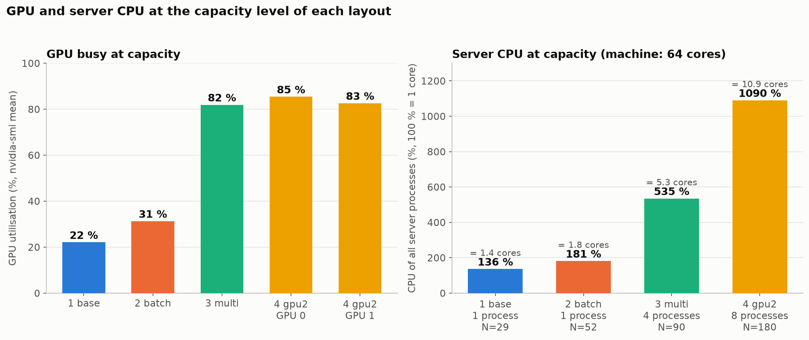

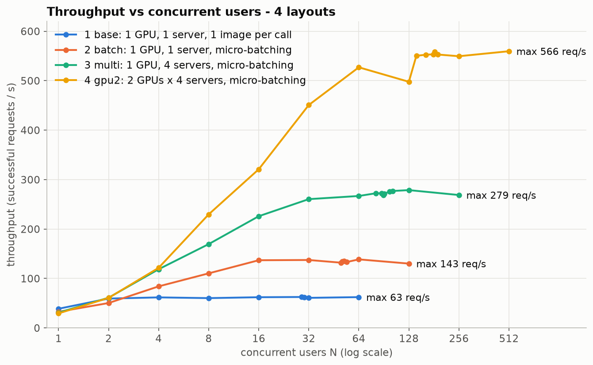

| ค่าใช้จ่ายจริง | ค่า |
|---|---|
| อายุเครื่อง | 2 ชั่วโมง 04 นาที (7,442 วินาที) |
| ราคา | $0.3578 ต่อชั่วโมง (GPU $0.3467 + disk $0.0111) |
| ยอดในหน้า billing | **$0.644** (GPU $0.621 + disk $0.020 + ดาวน์โหลด $0.003) · อ่านหลังลบเครื่องราว 10 นาที ตอนนั้น billing นับได้ 1.79 จาก 2.07 ชั่วโมง |
| คิดตามอายุเครื่องเต็ม | 2.067 ชั่วโมง × $0.3578 = ราว **$0.74** · ยอดสุดท้ายน่าจะขึ้นมาใกล้ค่านี้ |
| หลังลบ | ตรวจซ้ำ 2 ครั้ง ไม่เหลือเครื่องป้าย `vapp-lab6-nginx` |

ตัวอย่างโค้ดที่ AI เขียนให้ในรอบจริง (ของคุณอาจต่างกัน): [report.py](code_reference/report.py) · ผลดิบ [metrics.json](results/metrics.json) · [cost.md](results/cost.md) · ตัวเลขหลักทั้งหมดของหน้านี้ [summary.json](results/summary.json) · กราฟทั้ง 7 ภาพที่ [results/images](results/images)

**อ่านผลอย่างไร**

- ลำดับที่คุ้ม: ใช้ GPU ใบเดิมให้เต็มก่อน (แบบที่ 2 และ 3 ไม่เสียค่าเช่าเพิ่ม) แล้วค่อยเพิ่ม GPU
- ถ้าเพิ่ม GPU ใบที่ 2 ตั้งแต่แบบที่ 1 จะจ่าย 2 เท่าเพื่อ GPU ที่ทำงานแค่ 22%
- ดู GPU % คู่กับ CPU ของ server ทุกครั้ง · ตัวที่เต็มก่อนคือตัวถ่วง
- ยอดใน billing ขึ้นช้ากว่าอายุเครื่อง · อ่านทันทีหลังลบจะได้ค่าต่ำกว่าจริง ให้เทียบกับ อายุเครื่อง × ราคา ทุกครั้ง
- LAB ทั้งหมดใช้เงินจริงราว $0.74 · ลบเครื่องทุกครั้งที่จบ

## สิ่งที่เจอจริงระหว่างทำ

| เกิดอะไรขึ้น | ขั้น | บทเรียน |
|---|---|---|
| เครื่องแสดง 64 threads แต่ใช้ได้จริง 24.6 cores | 1 | นับ CPU จากโควตาของ container ไม่ใช่จากจำนวน threads |
| `opencv-python` ตัวเต็ม import ไม่ได้บน image นี้ (ไม่มี `libxcb`) | 2 | ใช้ `opencv-python-headless` แทน |
| คำขอแรกสุดใช้ 55 ms ทั้งที่อุ่นโมเดลแล้ว | 2 | ช่วงอุ่นเครื่องของตัวยิงโหลด (5 วินาทีแรก ไม่นับ) มีไว้กันเรื่องนี้ |
| ยังไม่มี `zone` ใน `upstream` ลำดับ Round Robin ไม่วนตรง | 3 | NGINX มี worker หลายตัว ต้องมี `zone` ให้ใช้ลำดับชุดเดียวกัน |
| `worker_processes auto` จะได้ 64 worker บนโควตา 25 cores | 3 | ตั้งจำนวน worker เอง เมื่อเครื่องแสดง CPU มากกว่าที่ใช้ได้ |
| ตัวยิงโหลดนับเฉพาะช่วงที่นับผล เทียบกับ server จำลองไม่ได้ | 5 | เพิ่มช่อง `sent` นับคำขอทั้งหมดที่ส่ง |
| วัดซ้ำที่ N = 8 Throughput ต่าง 5.8% แต่ p95 ต่าง 28% | 5 | p95 แกว่งกว่าค่าเฉลี่ยมาก · ความจุที่ตัดสินด้วย p95 มีความคลาดเคลื่อน |
| N = 29, 50 และ 52 ไม่ผ่านครั้งแรก ผ่านครั้งที่สอง | 6, 7 | ใกล้เส้นเกณฑ์ ผลขึ้นกับรอบที่วัด · บอกกติกาตัดสินไว้คู่กับตัวเลขเสมอ |
| server ตัดการเชื่อมต่อ แล้ว NGINX พักตัวนั้น 10 วินาที | 8, 9, 10 | ค่าเริ่มต้น `max_fails=1 fail_timeout=10s` ทำให้ความผิดพลาดครั้งเดียวกลายเป็น p95 ที่แกว่ง · ดู error log ของ NGINX เมื่อคำขอกระจายไม่เท่า |
| เปิด server 8 ตัวพร้อมกัน เจอ CUDA out of memory | 9 | จำกัด VRAM ต่อ server (`GPU_MEM_FRACTION`) แล้วเปิดใหม่ได้ครบใน 15 วินาที |
| Round Robin ที่ N = 180 ยิงซ้ำ 3 ครั้ง ได้ p95 392, 469 และ 641 ms | 10 | วัดรอบเดียวเทียบกันไม่ได้ ถ้าผลต่างอยู่ในช่วงความแกว่ง |
| Round Robin กรณี GPU เท่ากัน ได้ 180, 128 และ 203 คนบน 3 เครื่อง | 10.2 | เครื่องเช่ามีผู้เช่ารายอื่นใช้ CPU ร่วมได้ (เครื่อง A load average ราว 100) · เทียบวิธีบนเครื่องเดียวกันเสมอ |
| ยอดใน billing ($0.644) ต่ำกว่า อายุเครื่อง × ราคา ($0.74) | 12 | billing ขึ้นช้า · อย่าใช้ยอดที่อ่านทันทีหลังลบเป็นค่าใช้จ่ายสุดท้าย |

---

## สรุปผลการทดลอง


### 1 · ความจุของ 4 แบบ


| แบบ | ความจุ (คน) | เท่าของแบบที่ 1 | Throughput สูงสุด (คำขอ/วินาที) | GPU ทำงานที่ความจุ |
|---|---|---|---|---|
| 1 · ทำทีละรูป | **29** | 1.00 | 62.6 | 22% |
| 2 · Micro-batching | **52** | 1.79 | 142.9 | 31% |
| 3 · Micro-batching + server 4 ตัว | **90** | 3.10 | 278.7 | 82% |
| 4 · GPU 2 ใบ + NGINX | **180** | 6.21 | 566.5 | 85% + 83% |

รายละเอียดทุกระดับ N: [ผลสรุปของหน้า LAB](#ผลสรุป)

### 2 · วิธีไหนดีกว่า: 6 คำถาม 6 คำตอบ

| คำถาม | ผลวัด | คำตอบ |
|---|---|---|
| ทำทีละรูป หรือ Micro-batching | 29 → 52 คน | **Micro-batching** · ได้ 1.79 เท่า ค่าเช่าเท่าเดิม |
| server 1 ตัว หรือ 4 ตัวต่อ GPU | 52 → 90 คน · GPU ทำงาน 31% → 82% | **4 ตัว** · ใช้ GPU ใบเดิมให้เต็ม |
| GPU 1 ใบ หรือ 2 ใบ | 90 → 180 คน | **2 ใบได้ประมาณ 2 เท่า** · คุ้มเมื่อใบแรกเต็มแล้ว |
| Round Robin หรือ Least Connections (GPU ใบที่ 2 ช้าลง 3 เท่า) | 52 → 103 คน · บนเครื่องเดียวกันอีก 2 เครื่อง 49 → 96 และ 54 → 111 คน | **Least Connections** · ได้ 1.96–2.06 เท่า |
| Least Connections หรือ p2c (GPU ใบที่ 2 ช้าลง 3 เท่า) | 96 กับ 72 คน · 111 กับ 81 คน | **Least Connections** · ได้ 1.33–1.37 เท่าของ p2c |
| ป้องกัน GPU ล่มหรือไม่ | error 34.2% → 0 | **ป้องกัน** ด้วย Retry + Health Check |

- เมื่อ GPU เร็วเท่ากัน วิธีที่ดูงานค้างไม่แย่กว่า Round Robin ในทุกเครื่องที่วัด แต่ขนาดของส่วนต่างสรุปไม่ได้ เพราะผลใกล้เส้น 500 ms แกว่งมาก (Round Robin ระบบเดียวกันได้ 180, 128 และ 203 คนบน 3 เครื่อง)
- หลัง GPU ล่ม 1 ใบ ระบบเหลือความจุของใบเดียว · ต้องเผื่อกำลังไว้ ไม่อย่างนั้นผู้ใช้ไม่เจอ error แต่รอนานขึ้น

### 3 · Least Connections เทียบ Power of Two Choices (p2c)


สองวิธีนี้ **เป็นคนละวิธี** แต่อยู่ตระกูลเดียวกัน: ตัดสินจาก **จำนวนงานค้าง** (คำขอที่ส่งไปแล้วยังไม่ได้คำตอบ) ของ server · ต่างกันที่ **ดู server กี่ตัวก่อนเลือก**

| | Least Connections | Power of Two Choices (p2c) |
|---|---|---|
| ข้อมูลที่ใช้ตัดสิน | จำนวนงานค้าง | จำนวนงานค้าง |
| ดู server กี่ตัว | **ทุกตัว** | **สุ่มมา 2 ตัว** |
| server ที่ได้งาน | ตัวที่งานค้างน้อยที่สุดเสมอ | ตัวที่น้อยกว่าใน 2 ตัวที่สุ่มได้ (อาจไม่ใช่ตัวที่น้อยที่สุด) |
| งานของ Load Balancer ต่อ 1 คำขอ | เพิ่มตามจำนวน server | คงที่ ไม่ขึ้นกับจำนวน server |
| เมื่อมี Load Balancer หลายตัว | ทุกตัวเห็นตัวที่ว่างตัวเดียวกัน แล้วส่งงานไปกองพร้อมกันได้ | การสุ่มช่วยกระจาย ไม่ไปกองที่ตัวเดียว |
| เขียนใน NGINX | `least_conn;` | `random two least_conn;` |

**ผลวัดจริงบนเครื่องเดียวกัน ([ขั้นที่ 10.2](#102--เพิ่ม-power-of-two-choices-3-วิธีบนเครื่องเดียวกัน) · โหนดเดี่ยว 2 เครื่องแยกกัน คือ เครื่อง A และเครื่อง B — ไม่ได้ต่อเป็นคลัสเตอร์)**


| กรณี | วิธี | เครื่อง A (คน) | เครื่อง B (คน) |
|---|---|---|---|
| GPU ใบที่ 2 ช้าลง 3 เท่า | Round Robin | 49 | 54 |
| GPU ใบที่ 2 ช้าลง 3 เท่า | Power of Two Choices | 72 | 81 |
| GPU ใบที่ 2 ช้าลง 3 เท่า | Least Connections | **96** | **111** |
| GPU เร็วเท่ากัน | Round Robin | 128 | 203 |
| GPU เร็วเท่ากัน | Power of Two Choices | 196 | **238** |
| GPU เร็วเท่ากัน | Least Connections | **221** | 230 |

- **server เร็วไม่เท่ากัน: Least Connections > p2c > Round Robin ทั้งสองเครื่อง** · สองเครื่องวัดกลับลำดับกัน ผลจึงไม่ได้มาจากลำดับการวัด
- **server เร็วเท่ากัน: ทั้งสองวิธีสูงกว่า Round Robin** แต่ Least Connections กับ p2c สลับลำดับกันระหว่างสองเครื่อง จึงยังสรุปไม่ได้ว่าวิธีใดดีกว่า
- ทั้งสองวิธีส่งงานราว 70% ไป GPU ใบเร็วเอง โดยไม่ต้องบอกว่าใบไหนช้า

**ควรเลือกตัวไหน**

| สถานการณ์ | เลือก | เหตุผล |
|---|---|---|
| Load Balancer 1 ตัว · server ไม่กี่สิบตัว (ระบบของ LAB นี้) | **Least Connections** | เห็นทุกตัว จึงเลือกได้ดีที่สุด · วัดได้ 1.33–1.37 เท่าของ p2c เมื่อ server เร็วไม่เท่ากัน |
| server หลายร้อยตัว หรือมี Load Balancer หลายตัวแจกงานพร้อมกัน | **p2c** | งานต่อคำขอคงที่ และไม่ส่งงานไปกองที่ server ตัวเดียว (เหตุผลตามทฤษฎี LAB นี้ไม่ได้วัด) |
| server เร็วเท่ากันทุกตัว และงานแต่ละคำขอใช้เวลาใกล้กัน | Round Robin ก็พอ | ไม่มีตัวช้าให้หลบ |

ทฤษฎีของ 3 วิธี: [หน้าทฤษฎี ส่วนที่ 8](#8--วิธีแจกงาน-round-robin--least-connections--power-of-two-choices)

### 4 · ถ้าต้องเลือกใช้จริง

ทำตามลำดับนี้ เพราะขั้นบนถูกกว่าขั้นล่าง

| ลำดับ | เลือก | เหตุผลจากผลวัด |
|---|---|---|
| 1 | เปิด **Micro-batching** | รับได้ 1.79 เท่า ไม่เสียเงินเพิ่ม · ผู้ใช้คนเดียวช้าลง 5.1 ms |
| 2 | เปิด **server หลายตัวต่อ GPU** จน GPU ทำงานเกิน 80% | รวมสองข้อแรกได้ 3.10 เท่าบน GPU ใบเดิม |
| 3 | **เพิ่ม GPU** เมื่อใบเดิมเต็มแล้วเท่านั้น | ได้ประมาณ 2 เท่า แต่จ่ายค่าเช่า 2 เท่า |
| 4 | ใช้ **Least Connections** เป็นค่าตั้งต้น | ไม่แย่กว่า Round Robin ในทุกรอบที่วัด และดีกว่าราว 2 เท่าเมื่อ server เร็วไม่เท่ากัน |
| 5 | เปิด **Retry + Health Check** เสมอ | error 34.2% เหลือ 0 · ใช้ได้กับงานที่ส่งซ้ำแล้วได้ผลเดิม |

- NGINX ไม่ใช่ตัวถ่วง: ผ่าน Load Balancer แล้ว Latency เพิ่มราว 0.3 ms (p50) และใช้ CPU ราว 0.15 core ที่ผู้ใช้ 60 คน
- **ข้อควรระวังของ NGINX**: ค่าเริ่มต้น `max_fails=1 fail_timeout=10s` พัก server 10 วินาทีเมื่อคำขอล้มครั้งเดียว ทำให้ p95 แกว่ง

### ข้อที่ต้องอ่านคู่กับตัวเลข

- วัดแบบละ 1 รอบ ระดับละ 20 วินาที · ผลใกล้เส้น 500 ms แกว่งได้หลายสิบ ms จึงอ่านจำนวนเท่าเป็นค่าประมาณ
- ขั้นที่ 10.2 วัดบนเครื่อง A และ B ซึ่งไม่ใช่เครื่องของขั้นอื่น · เทียบตัวเลขเฉพาะภายในเครื่องเดียวกัน
- ผู้ใช้จำลองส่งรูปต่อทันทีไม่หยุดพัก · ผู้ใช้จริงที่หยุดดูผล ระบบจะรับได้มากกว่านี้
- "GPU ช้า" เป็นการจำลอง: server ของ GPU ใบที่ 2 เรียกโมเดล 3 ครั้งต่อ 1 รอบ
- ค่าเครื่อง: เครื่องหลักเปิด 2 ชั่วโมง 04 นาที ราว **$0.74** · ขั้นที่ 10.2 สองเครื่องรวม **$0.77**

---

---

## ไฟล์ในโฟลเดอร์นี้

| ไฟล์ / โฟลเดอร์ | คืออะไร |
|---|---|
| [README.md](README.md) | เอกสารหลักฉบับรวมหน้าเดียว: ขอบเขต 1 โหนดหลาย GPU · 4 การทดลอง · ทฤษฎี 10 เรื่อง · LAB 12 ขั้นด้วย NGINX · สรุปผล |
| [PROMPTS.md](PROMPTS.md) | พรอมต์ Copy & Paste ทั้ง 12 ขั้น (13 พรอมต์ · ขั้นที่ 10 มี 2 ตอน) |
| [LAB6_Microbatch_LB_Slides.html](LAB6_Microbatch_LB_Slides.html) | สไลด์ประกอบการสอน (เปิดในเบราว์เซอร์) · สร้างใหม่ด้วย `python tools/build_slides.py` |
| `images/` | ภาพประกอบและภาพสไลด์ทั้งหมด รวมศูนย์ที่เดียว (`images/theory/`, `images/lab/`, `images/slides/`) |
| `code/` | โค้ดที่ AI เขียนให้ในรอบของคุณเอง (ไม่อยู่ใน git) |
| [code_reference/](code_reference) | โค้ดอ้างอิงและไฟล์ตั้งค่าจากรอบรันจริง (`server.py`, `nginx.conf`, `cluster.sh`, `loadgen.py` ฯลฯ) |
| [results/](results) | ผลวัดจริงของทุกรอบ (`summary.json`, `metrics.json`, ผลดิบ `.json`, log, กราฟ 7 ภาพใน `results/images/`, คำตอบ `results/answers/`) |
| [same_machine/](same_machine) | ผลทดลองขั้นที่ 10.2 บนโหนดเดี่ยว 2 เครื่องแยกกัน (`run_a`, `run_b`) เทียบ 3 วิธีแจกงานบนเครื่องเดียวกัน |
| [samples/](samples) | รูปทดสอบ 6 รูป (`sample-1.jpg`–`sample-6.jpg`) |
| `tools/` | สคริปต์สร้างสไลด์ (`build_slides.py`, `slides_engine.py`, `slides_figures.py`) |
