# LAB 7 · LLM Serving บน RTX 4090 หลัง NGINX แบบ Least Connections: Single GPU, Data Parallelism (2 GPU) และ Model Parallelism (4 GPU แบบ 2+2)

[← กลับหน้ารวมของบท](../README.md) · [สไลด์ประกอบการสอน (HTML)](LAB7_LLM_Serving_LB_Slides.html) · [พรอมต์ทั้ง 10 ขั้น](PROMPTS.md) · เปิด Claude Code ที่โฟลเดอร์ของบท `02_VastAi_Application` · ทำ [LAB 0](../README.md#lab-0--เตรียม-key-3-ตัว) และ [LAB 6](../lab6_microbatch_lb/README.md) ก่อน

## ขอบเขตของบทนี้ (อ่านก่อนเริ่ม)

> **[LAB 6](../lab6_microbatch_lb/README.md) พิสูจน์แล้วว่า สูตรที่ให้ผลดีที่สุดสำหรับงาน Inference บน 1 โหนด คือ `Multi-GPU + Batching + NGINX (Least Connections)`**
>
> **LAB 7** นำสูตรชนะนั้นมาประยุกต์ใช้กับงานที่ต่างออกไปอย่างสิ้นเชิงคือ **แชทบอท LLM ที่ตอบแบบ Streaming ทีละ Token** (`Qwen/Qwen3-4B-Instruct-2507` ผ่าน vLLM) โดยเช่าเครื่อง **RTX 4090** (เน็ต ≥ 1,000 Mbps) แยกกัน **2 เครื่องคนละแทร็ก (แต่ละเครื่องเป็น Single-Node Multi-GPU ไม่ได้ต่อเป็นคลัสเตอร์ข้ามอินเทอร์เน็ต)** เพื่อวัดเทียบโดยไม่มีความช้าของเครือข่ายข้ามเครื่องมาปน:
> 1. **แทร็กที่ 1 (`vapp-lab7-dp2` · 1 โหนด × 2× RTX 4090):** ไต่ระดับจาก **Single GPU (ตอบทีละคำถาม → Continuous Batching)** ไปสู่ **Data Parallelism (2×1 GPU) + NGINX `least_conn`** — GPU 1 ใบถือโมเดลเต็ม 1 ตัว (สูตรชนะของ LAB 6) พร้อมทดสอบ Concurrency Limit, คำตอบสั้น-ยาว และ Replica Failover
> 2. **แทร็กที่ 2 (`vapp-lab7-mp4` · 1 โหนด × 4× RTX 4090):** ทดลอง **Model Parallelism (Tensor Parallelism = 2) แบบ 2+2 หลัง NGINX `least_conn`** — แบ่ง 4 GPU ออกเป็น 2 หน่วย (`gpu0+1` สับโมเดลอย่างละครึ่งเป็นหน่วยที่ 1 และ `gpu2+3` เป็นหน่วยที่ 2) แล้ววัดเทียบทั้ง **ความเร็วต่อผู้ใช้ (tok/s)**, **TTFT**, **ความจุ (Concurrent Users)** และ **Throughput ต่อ GPU**


| LAB | งานหลัก | จำนวนโหนด (เครื่อง) | GPU ในแต่ละโหนด | สิ่งที่ทดลอง |
|---|---|---|---|---|
| [LAB 4](../lab4_multigpu/README.md) | Training (เทรน LLM) | **1 โหนด** (Single-Node) | 1, 2 หรือ 4 ใบ | Data Parallelism และ Model Parallelism สำหรับงานเทรนในเครื่องเดียว |
| [LAB 5](../lab5_cluster/README.md) | Training (เทรน LLM) | **2–3 โหนด** (Multi-Node) | โหนดละ 2 ใบ | คลัสเตอร์เทรนข้ามอินเทอร์เน็ต เพิ่มเครื่องแล้วเร็วขึ้นไหม |
| [LAB 6](../lab6_microbatch_lb/README.md) | Inference (API ตรวจภาพ) | **1 โหนด** (Single-Node) | RTX 3090 × 2 ใบ | Micro-batching · multi-process · NGINX Round Robin / Least Connections / p2c |
| **LAB 7 (บทนี้)** | **Inference (LLM Streaming)** | **2 เครื่องแยกแทร็ก** (แทร็กละ 1 โหนด) | **2× RTX 4090** (แทร็ก 1) · **4× RTX 4090** (แทร็ก 2) | **Continuous Batching · Concurrency Limit · Data Parallelism เทียบ Model Parallelism (2+2) · NGINX `least_conn` & Failover** |

คำถามของ LAB: **เมื่อนำสูตรชนะของ LAB 6 (Multi-GPU + Batching + NGINX `least_conn`) มาใช้กับแชทบอท LLM แบบ Streaming บน RTX 4090 — ระหว่าง Data Parallelism (1 GPU ถือโมเดลเต็ม 1 ตัว) กับ Model Parallelism (สับโมเดลครึ่งใบ 2+2) แบบไหนตอบเร็วกว่าต่อคน แบบไหนรับผู้ใช้พร้อมกันได้มากกว่า และคุ้มค่าต่อ GPU มากกว่ากัน**

## 4 แบบที่วัด (บน RTX 4090 · 2 เครื่องแยกกันคนละแทร็ก)


| แบบ | เครื่องเช่า (RTX 4090) | จำนวนโหนด | GPU ที่ใช้ | จำนวน Replica | การวางโมเดล | วิธีประมวลผล |
|---|---|---|---:|---:|---|---|
| **1 (`dp1_seq`)** | `vapp-lab7-dp2` | 1 โหนด | 1 ใบ (`GPU 0`) | 1 ตัว | 1 GPU = 1 โมเดลเต็ม | ตอบทีละ 1 คำถาม (`max-num-seqs 1`) · Baseline |
| **2 (`dp1_cb`)** | `vapp-lab7-dp2` | 1 โหนด | 1 ใบ (`GPU 0`) | 1 ตัว | 1 GPU = 1 โมเดลเต็ม | **Continuous Batching** (`max-num-seqs 256`) |
| **3 (`dp2_cb`)** | `vapp-lab7-dp2` | 1 โหนด | **2 ใบ** (`GPU 0, 1`) | **2 ตัว** | **Data Parallelism** (1 GPU = 1 โมเดลเต็ม) | Continuous Batching + **NGINX `least_conn`** *(สูตร LAB 6)* |
| **4 (`mp4_cb`)** | `vapp-lab7-mp4` | 1 โหนด | **4 ใบ** (`GPU 0+1, 2+3`) | **2 หน่วย** | **Model Parallelism** (`TP=2`, สับโมเดลครึ่งใบ 2+2) | Continuous Batching + **NGINX `least_conn`** |

- **replica 1 ตัว** = โปรแกรม vLLM 1 process ที่เปิดรับคำถามที่ `127.0.0.1` · ในแบบ Data Parallelism ใช้ 1 GPU ต่อ replica ส่วน Model Parallelism ใช้ 2 GPU ต่อ replica
- **เพดาน (Concurrency Limit)** = ค่า `--max-num-seqs` คือจำนวนคำถามสูงสุดที่ replica 1 ตัวทำพร้อมกัน · คำถามส่วนเกินต้องรอในคิวของ vLLM
- เกณฑ์ผ่าน (SLO) มี **2 ระดับ** คือ **Standard** (เร็วกว่าการอ่านของมนุษย์: TTFT p95 ≤ 2.0 วินาที, ความเร็วต่อผู้ใช้ p5 ≥ 15.0 token/วินาที) และ **Fast** (ไหลลื่นใกล้เคียงใช้งานคนเดียว: ความเร็ว p5 ≥ 50% ของผู้ใช้ 1 คนบน 1× RTX 4090) พร้อม error < 1%

## สารบัญของบท (เรียงตามหัวข้อ)

| ส่วน | หัวข้อ | เนื้อหา |
|---|---|---|
| 1 | [ผลสรุป · ข้อมูลทดสอบ · กติกาการทดลอง](#ผลสรุป) | ตารางเทียบครบ 4 แบบ · 3 กราฟผลสรุป · 2 ไฟล์ GIF 1× จริง · ตัวอย่างคำถาม-คำตอบ 8 ข้อ · กติกาและตารางหาความจุ |
| 2 | [ภาคทฤษฎี · แนวคิดพื้นฐาน LLM Serving 9 เรื่อง](#ภาคทฤษฎี--แนวคิดพื้นฐาน-llm-serving-9-เรื่อง) | System Architecture · vLLM · ตัวชี้วัด TTFT/Speed/Throughput · SLO · Load Test Streaming · Continuous Batching · Concurrency Limit · Data Parallelism vs Model Parallelism · NGINX `least_conn` & Failover |
| 3 | [ภาคปฏิบัติ · LAB 10 ขั้นบน RTX 4090](#ภาคปฏิบัติ--lab-10-ขั้นบน-rtx-4090) | ลงมือทำ 10 ขั้น (ส่วน A–E) · พรอมต์ครบทุกขั้น · ตารางผลจริงทุกระดับ N · โค้ดอ้างอิง · อ่านผลอย่างไร · สิ่งที่เจอจริง |
| 4 | [สรุปผลการทดลองและแนวทางเลือกใช้งานจริง](#สรุปผลการทดลองและแนวทางเลือกใช้งานจริง) | 6 คำถาม 6 คำตอบ · Data Parallelism เทียบ Model Parallelism เชิงลึก · ลำดับ 5 ขั้นก่อนขึ้นระบบจริง · รายการไฟล์ในโฟลเดอร์ |

---

## ผลสรุป


### เกณฑ์ที่ใช้ตัดสิน (SLO)

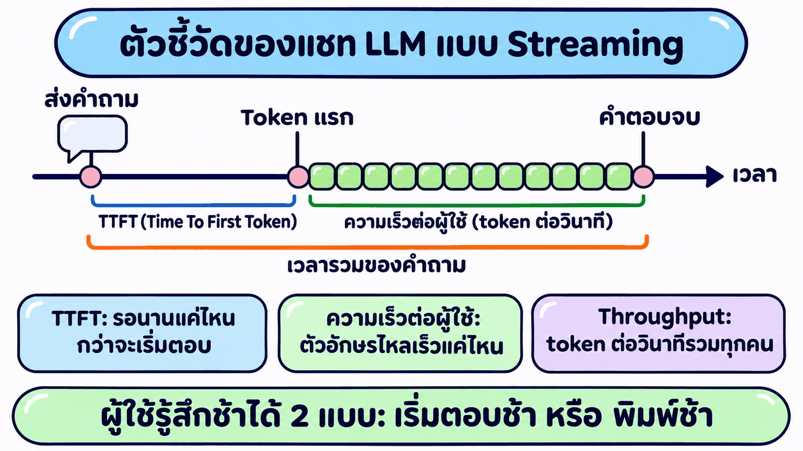

| ระดับบริการ (SLO) | TTFT p95 | ความเร็วต่อผู้ใช้ p5 | error | ความหมายสำหรับผู้ใช้ |
|---|---|---|---|---|
| **Standard** | ไม่เกิน **2.0 วินาที** | ไม่ต่ำกว่า **15.0 token/วินาที** | ต่ำกว่า 1% | เร็วกว่าความเร็วการอ่านของคนทั่วไป (~4–6 คำ/วินาที) |
| **Fast** | ไม่เกิน **2.0 วินาที** | ไม่ต่ำกว่า **ครึ่งหนึ่งของผู้ใช้ 1 คนบน 1× RTX 4090** (`52.44 tok/s` บน `dp2`, `50.07 tok/s` บน `mp4`) | ต่ำกว่า 1% | ตอบไหลลื่นใกล้เคียงใช้งานคนเดียว |

**ความจุ (Capacity)** = จำนวนผู้ใช้พร้อมกัน (`N`) สูงสุดที่ยังผ่านเกณฑ์ของระดับนั้น

### ตารางผลวัดจริงครบ 4 แบบ (RTX 4090 · Qwen3-4B-Instruct-2507)

| ระบบบน RTX 4090 | GPU | Replica | 1-User TTFT | 1-User Speed | ความจุ Standard | ความจุ Fast | Throughput สูงสุด | Throughput / GPU |
|---|---:|---:|---:|---:|---:|---:|---:|---:|
| **1 · `dp1_seq`** (1 GPU · ตอบทีละคำถาม · `cap=1`) | 1 | 1 | 0.036 s | 104.9 tok/s | **2 คน** | **2 คน** | 99.1 tok/s | 99 tok/s |
| **2 · `dp1_cb`** (1 GPU · Continuous Batching · `cap=256`) | 1 | 1 | 0.036 s | 104.9 tok/s | **≥ 384 คน** *(TTFT 1.970 s)* | **128 คน** | **7,152 tok/s** | **7,152 tok/s** |
| **3 · `dp2_cb`** (2 GPU Data Parallelism + NGINX `least_conn` · สูตร LAB 6) | **2** | **2** | 0.036 s | 104.9 tok/s | **≥ 768 คน** *(TTFT 1.941 s)* | **265 คน** | **14,242 tok/s** | **7,121 tok/s** *(99.6% eff.)* |
| **4 · `mp4_cb`** (4 GPU Model Parallelism 2+2 `TP=2` + NGINX `least_conn`) | **4** | **2 หน่วย** | **0.024 s** | **164.0 tok/s** *(1.56×–1.64×)* | **661 คน** *(TTFT 1.931 s)* | **149 คน** | **9,547 tok/s** | **2,387 tok/s** |

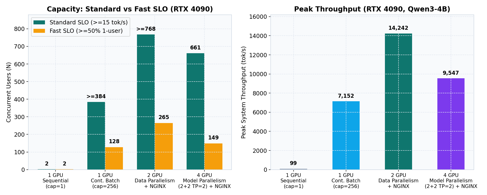

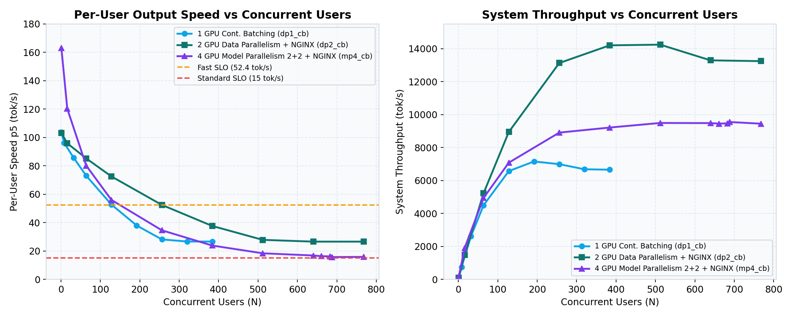


### เห็นกับตา: ไฟล์ `.gif` ความเร็ว 1× จริงของแชทบอท (RTX 4090 · Qwen3-4B)

**1. เปรียบเทียบความเร็วการไหลของ Token จริง (1× Real-Time · ยาว 10.6 วินาที):** คำถามเดียวกัน (240 tokens) เทียบ 4 สภาวะพร้อมกัน — `Model Parallelism TP=2 (N=1: 160.7 tok/s)` vs `Data Parallelism 1 GPU (N=1: 104.9 tok/s)` vs `2×4090 Data Parallelism + NGINX (N=128: 73.9 tok/s)` vs `2×4090 Data Parallelism + NGINX (N=512: 29.8 tok/s)`

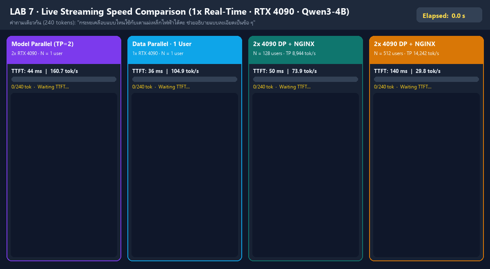

**2. แชทต่อเนื่อง 3 รอบของ 4 ผู้ใช้พร้อมกันหลัง NGINX `least_conn` (1× Real-Time · ยาว 9.2 วินาที):** ผู้ใช้ 4 คนส่งคำถามสั้น-ยาวต่อเนื่องพร้อมกันภายใต้โหลด `N=64–128` โดย NGINX สลับแจกงานไประหว่าง `gpu0` และ `gpu1` อัตโนมัติ

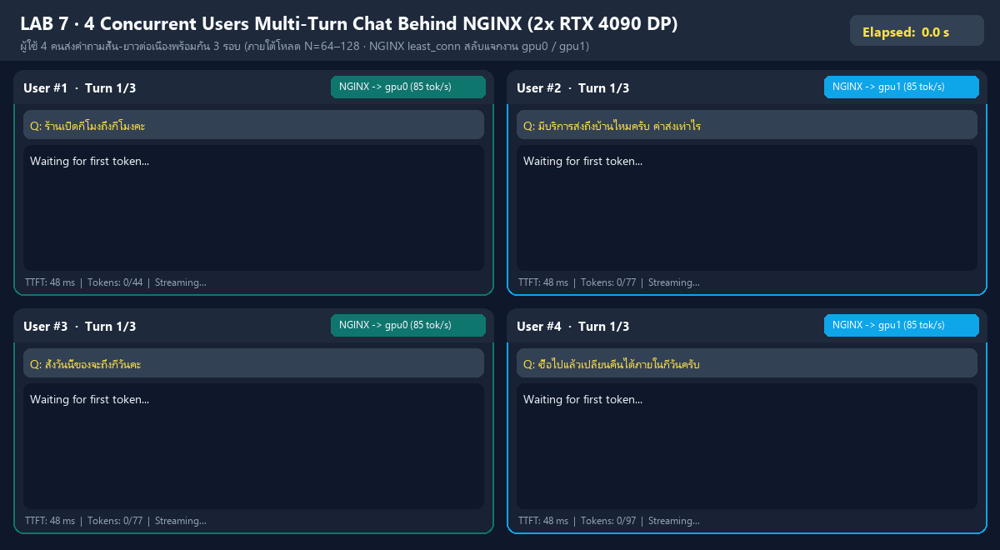

### ข้อสรุปสำคัญจากตัวเลขจริง

| ข้อค้นพบ | ตัวเลขที่วัดได้จริงบน RTX 4090 |
|---|---|
| **Continuous Batching บน GPU 1 ใบเดิม** | ความจุ Standard พุ่งจาก **2 → ≥ 384 คน** (≥ 192×) · Fast **2 → 128 คน** (64×) · Peak Throughput พุ่ง **99.1 → 7,152 tok/s** (**72×**) |
| **สูตรชนะ LAB 6 (`2×4090 Data Parallelism + NGINX least_conn`)** | ความจุ Standard เพิ่มเป็น **≥ 768 คน** (2.00×) · Fast **265 คน** (2.07×) · Peak Throughput **14,242 tok/s** (**Scaling Efficiency 99.6%**) |
| **Model Parallelism 2+2 (`4×4090 TP=2 + NGINX`)** | ผู้ใช้ 1 คนเร็วขึ้นชัดเจน (**164.0 vs 104.9 tok/s**, TTFT **24 ms vs 36 ms**) แต่ overhead การซิงค์ AllReduce ข้าม PCIe ทำให้กำลังไฟต่อ GPU เหลือเพียง **~192–253 W** (เทียบ ~420 W บน Data Parallelism) · Throughput รวม 4 ใบเหลือ **9,547 tok/s** และ Throughput ต่อ GPU เหลือเพียง **1 ใน 3 ของ Data Parallelism** |
| **Concurrency Limit เมื่อผู้ใช้เกินความจุ (`N = 1,152`)** | `cap=32` ได้ความเร็ว 82.7 tok/s แต่ TTFT p95 พุ่ง 18.32 s · `cap=256` ลด TTFT เหลือ 4.38 s แต่ความเร็วตกเหลือ 26.57 tok/s — **เพดานไม่ช่วยให้ผ่านเกณฑ์เมื่อโหลดเกิน** ทำได้แค่เลือกแลกเวลารอคิวกับความเร็วอ่าน |
| **NGINX `least_conn` กับคำตอบยาวไม่เท่ากัน (`N=307`, ยาว 20%)** | งานค้างเฉลี่ยของ `gpu0` (`151.7`) กับ `gpu1` (`151.2`) ต่างกันเพียง **0.5 คำถาม** · error 0 · Throughput 11,351 tok/s |
| **Replica ล่มกลางการ Streaming (`N=307`, ปิด `gpu1` ที่ t=29.4 s)** | คำตอบที่กำลังไหลบน `gpu1` ถูกตัด **153 ข้อ** (`ClientPayloadError`) · ทุกวินาทีหลังจากนั้น **error 0** ตลอดช่วงที่เหลือ · `gpu0` รับ 307 คนต่อได้ทันทีที่เฉลี่ย ~6,599 tok/s |

### หลักฐานเครื่องเช่า Vast.ai จริงที่ใช้ทดลอง (RTX 4090 · เน็ต ≥ 1,000 Mbps)

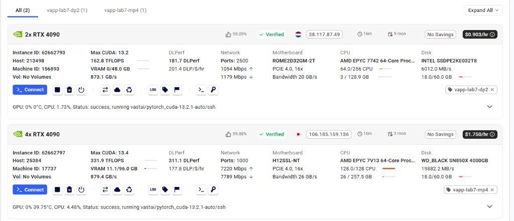

| รายการ | แทร็กที่ 1 `vapp-lab7-dp2` (Single GPU & Data Parallelism 2×1) | แทร็กที่ 2 `vapp-lab7-mp4` (Model Parallelism 2+2) |
|---|---|---|
| Instance ID | `62662793` | `62662797` |
| จำนวนโหนด / GPU | **1 โหนด × 2× RTX 4090** (VRAM 48 GB รวม · ตอนว่าง 22–25 °C) | **1 โหนด × 4× RTX 4090** (VRAM 96 GB รวม · ตอนว่าง 30–47 °C) |
| ที่ตั้ง / เน็ตขาเข้า-ออก | The Netherlands, NL · **1,179↓ / 1,054↑ Mbps** | Japan, JP · **7,789↓ / 7,220↑ Mbps** |
| CPU / RAM / PCIe | AMD EPYC 7742 (64 vCPUs) · 128.9 GB · PCIe 4.0 x16 (20 GB/s) | AMD EPYC 7V13 (128 vCPUs) · 257.5 GB · PCIe 4.0 x16 (26 GB/s) |
| ราคาเช่า | **\$0.903 / ชม.** | **\$1.750 / ชม.** |
| ซอฟต์แวร์ | vLLM `0.34.0` · PyTorch `2.14.0+cu130` · NGINX `1.27` (udocker) | vLLM `0.34.0` · PyTorch `2.14.0+cu130` · NGINX `1.27` (udocker) |

### ข้อที่ต้องอ่านคู่กับตัวเลข

- **ความจุ Standard ของ `dp1_cb` (`≥ 384`) และ `dp2_cb` (`≥ 768`):** รายการสแกนหยุดที่ 384 และ 768 คนโดยทั้งคู่ยังผ่านเกณฑ์ (จึงบันทึกขอบล่างเป็น `>=`) แต่ TTFT p95 อยู่ที่ **1.970 s** และ **1.941 s** ซึ่งประชิดเส้นเกณฑ์ 2.000 s มากแล้ว ความจุจริงจึงอยู่ที่ราว 384–390 คน และ 768–780 คน
- **วัดระดับละ 1 รอบ (30 วินาที · นับผล 20 วินาทีหลัง) และวัดซ้ำ 1 ครั้งเมื่อไม่ผ่าน:** ใน `mp4_cb` ที่ `N = 661` รอบแรกไม่ผ่านเพราะ `gpu2+3` หยุดรับงานชั่วคราว (NGINX พักชั่วคราว 30 s) แต่รอบวัดซ้ำผ่านครบทั้ง 2 หน่วย (`TTFT p95 = 1.931 s`, `speed p5 = 16.32 tok/s`)
- **ความเร็ว 1-User ระหว่าง 2 เครื่องต่างกันเล็กน้อย (4.5%):** 1× RTX 4090 บน `vapp-lab7-dp2` วัดได้ **104.87 tok/s** ส่วน 1× RTX 4090 บน `vapp-lab7-mp4` วัดได้ **100.14 tok/s** จึงตั้งเกณฑ์ Fast SLO แยกตามเครื่องของตัวเอง (`52.44` vs `50.07 tok/s`) · การเทียบความเร็ว 1 คนของ Tensor Parallelism = 2 (`164.01 tok/s`) บนเครื่องเดียวกัน (`mp4`) จึงเร็วขึ้น **1.64×** (และเทียบกับ `dp2` คือ **1.56×**)
- **ผู้ใช้จำลองไม่มี Think Time (Closed Loop):** แต่ละคนได้รับคำตอบจบแล้วถามข้อใหม่ทันทีและยิงจากในเครื่องเดียวกับ NGINX · ผู้ใช้จริงที่หยุดอ่านคำตอบและพิมพ์คำถามถัดไป ระบบจะรองรับผู้ใช้ออนไลน์ได้มากกว่า `N` หลายเท่า
- **Peak Throughput ไม่ได้เกิดที่ระดับความจุเสมอไป:** ของ `dp1_cb` เกิดที่ `N = 192` (`7,152 tok/s`), ของ `dp2_cb` เกิดที่ `N = 512` (`14,242 tok/s`) และของ `mp4_cb` เกิดที่ `N = 688` (`9,547 tok/s` ซึ่งไม่ผ่าน TTFT)
- **เวลาที่ปิด `gpu1` จริงใน `fail_replica` คือวินาทีที่ 29.4 ของกราฟ** (สคริปต์ตั้งเวลาปิดไว้ที่ `now + 35 s` ก่อนเริ่ม `loadgen.py` ซึ่งใช้เวลาเปิด worker process ราว 5.6 วินาที)

---

## รู้จักข้อมูลที่ใช้ทดสอบ

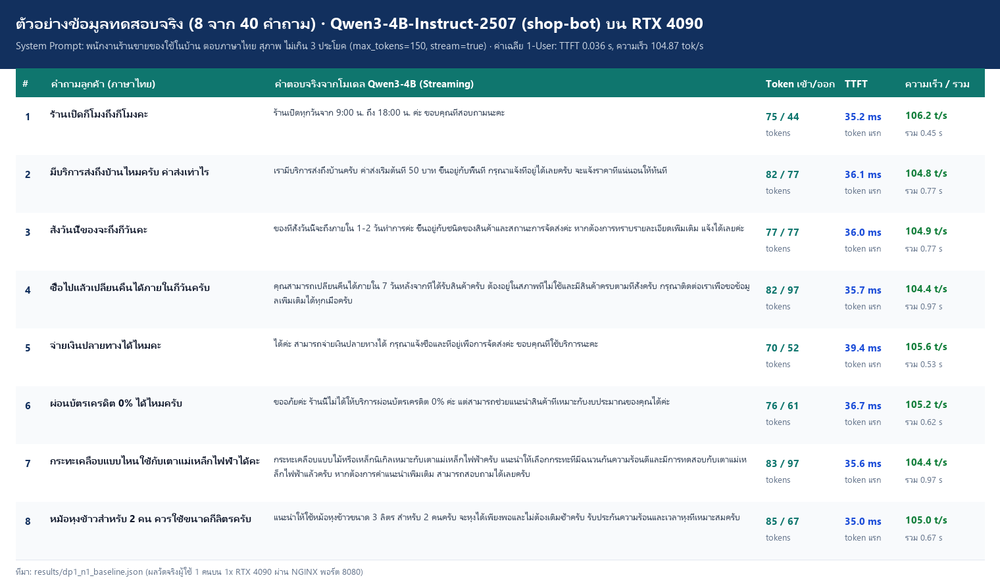

ผู้ใช้จำลองใน LAB นี้คือ **ลูกค้าร้านขายของใช้ในบ้าน** ตัวยิงโหลดสุ่ม 1 ใน **40 คำถามภาษาไทย** (อยู่ใน [code_reference/loadgen.py](code_reference/loadgen.py)) โดยมี 2 โหมดคำสั่งระบบ:
- **คำตอบสั้น (`SYSTEM_SHORT`, `max_tokens = 150`):** *"คุณเป็นพนักงานร้านขายของใช้ในบ้าน ตอบลูกค้าเป็นภาษาไทย ด้วยความสุภาพ และตอบไม่เกิน 3 ประโยค"* (ค่าเฉลี่ยจริง: ขาเข้า ~82 token · ขาออก ~86–88 token)
- **คำตอบยาว (`SYSTEM_LONG`, `max_tokens = 600`):** เพิ่มคำขอ *"ช่วยอธิบายแบบละเอียดเป็นข้อ ๆ ด้วยนะคะ"* ใช้ในขั้นที่ 7 (`mix_long`, สัดส่วน 20% ของคำถาม ทำให้ค่าเฉลี่ยขาออกเพิ่มจาก 86.1 เป็น 193.9 token)

**ตัวอย่าง 8 คำถาม-คำตอบจริงจากผู้ใช้ 1 คนบน 1× RTX 4090 (`results/dp1_n1_baseline.json`):**

| # | คำถามของลูกค้า | คำตอบจริงของ `shop-bot` (ย่อ) | Token เข้า / ออก | TTFT | ความเร็ว | เวลารวม |
|---:|---|---|---:|---:|---:|---:|
| 1 | ร้านเปิดกี่โมงถึงกี่โมงคะ | ร้านเปิดทุกวันจาก 9:00 น. ถึง 18:00 น. ค่ะ ขอบคุณที่สอบถามนะคะ | 75 / 44 | 35.2 ms | 106.2 tok/s | 0.45 s |
| 2 | มีบริการส่งถึงบ้านไหมครับ ค่าส่งเท่าไร | เรามีบริการส่งถึงบ้านครับ ค่าส่งเริ่มต้นที่ 50 บาท ขึ้นอยู่กับพื้นที่… | 82 / 77 | 36.1 ms | 104.8 tok/s | 0.77 s |
| 3 | สั่งวันนี้ของจะถึงกี่วันคะ | ของที่สั่งวันนี้จะถึงภายใน 1-2 วันทำการค่ะ ขึ้นอยู่กับชนิดของสินค้า… | 77 / 77 | 36.0 ms | 104.9 tok/s | 0.77 s |
| 4 | ซื้อไปแล้วเปลี่ยนคืนได้ภายในกี่วันครับ | คุณสามารถเปลี่ยนคืนได้ภายใน 7 วันหลังจากที่ได้รับสินค้าครับ… | 82 / 97 | 35.7 ms | 104.4 tok/s | 0.97 s |
| 5 | จ่ายเงินปลายทางได้ไหมคะ | ได้ค่ะ สามารถจ่ายเงินปลายทางได้ กรุณาแจ้งชื่อและที่อยู่… | 70 / 52 | 39.4 ms | 105.6 tok/s | 0.53 s |
| 6 | ผ่อนบัตรเครดิต 0% ได้ไหมครับ | ขออภัยค่ะ ร้านนี้ไม่ได้ให้บริการผ่อนบัตรเครดิต 0% ค่ะ… | 76 / 61 | 36.7 ms | 105.2 tok/s | 0.62 s |
| 7 | กระทะเคลือบแบบไหนใช้กับเตาแม่เหล็กไฟฟ้าได้คะ | กระทะเคลือบแบบไม้หรือเหล็กนิเกิลเหมาะกับเตาแม่เหล็กไฟฟ้าครับ… | 83 / 97 | 35.6 ms | 104.4 tok/s | 0.97 s |
| 8 | หม้อหุงข้าวสำหรับ 2 คน ควรใช้ขนาดกี่ลิตรครับ | แนะนำให้ใช้หม้อหุงข้าวขนาด 3 ลิตร สำหรับ 2 คนครับ… | 85 / 67 | 35.0 ms | 105.0 tok/s | 0.67 s |

**1 คำขอ** = `POST /v1/chat/completions` + header `Authorization: Bearer <key>` + JSON body แบบ OpenAI-compatible:

```json
{
  "model": "shop-bot",
  "messages": [
    {"role": "system", "content": "คุณเป็นพนักงานร้านขายของใช้ในบ้าน ตอบลูกค้าเป็นภาษาไทย ด้วยความสุภาพ และตอบไม่เกิน 3 ประโยค"},
    {"role": "user", "content": "ร้านเปิดกี่โมงถึงกี่โมงคะ"}
  ],
  "max_tokens": 150,
  "temperature": 0.7,
  "stream": true,
  "stream_options": {"include_usage": true, "continuous_usage_stats": true}
}
```

| ช่องของคำขอ / คำตอบ | บอกอะไร |
|---|---|
| `model` | ชื่อโมเดลที่ vLLM เปิดให้บริการ (`shop-bot`) |
| `max_tokens` | ความยาวคำตอบสูงสุด (`150` สำหรับคำถามทั่วไป · `600` สำหรับคำถามละเอียดใน `mix_long`) |
| `stream: true` | สั่งให้ vLLM ส่งคำตอบกลับมาทีละ Token แบบ Server-Sent Events (SSE) จนถึง `data: [DONE]` |
| `stream_options` | ให้ vLLM แนบจำนวน `completion_tokens` จริงในทุก chunk เพื่อคำนวณความเร็วได้แม่นยำ |
| Header `X-Replica` | NGINX เติมให้ทุกคำตอบ (`gpu0`, `gpu1`, `gpu0+1`, `gpu2+3`) เพื่อนับสัดส่วนการกระจายงานจริง |

### โมเดลที่อยู่หลัง API


| หัวข้อ | Qwen3-4B-Instruct-2507 |
|---|---|
| Input / Output | คำสั่งระบบ (`system`) + คำถามผู้ใช้ (`user`) → คำตอบที่สร้างทีละ Token (Streaming) |
| ขนาด | **4 พันล้าน parameter** · ขนาดไฟล์โมเดล **8.06 GB** (`8,061,178,820` bytes) · ความยาวบริบท 4,096 token |
| การใช้ VRAM | ใส่ใน **RTX 4090 1 ใบ (24 GB)** ได้ทั้งก้อนสบาย เหลือพื้นที่ VRAM กว่า 13 GB สำหรับ KV Cache |
| ที่มา | [Qwen/Qwen3-4B-Instruct-2507](https://huggingface.co/Qwen/Qwen3-4B-Instruct-2507) โดย Alibaba · สัญญาอนุญาต Apache-2.0 · เปิดชื่อ `shop-bot` |
| LAB นี้ใช้ทำอะไร | ตอบอย่างเดียว (**Inference**) ไม่เทรนเพิ่ม |

---

## การทดลอง

| หัวข้อ | ค่าที่ใช้จริงใน LAB 7 |
|---|---|
| โหลด | ผู้ใช้จำลอง N คนแบบ Closed Loop · สุ่ม 1 ใน 40 คำถามภาษาไทย · อ่านสตรีมจนจบแล้วถามข้อใหม่ทันที · รอเกิน 60 วินาทีนับเป็น error |
| โมเดลและ Server | `Qwen/Qwen3-4B-Instruct-2507` ผ่าน **vLLM `0.34.0`** (`--max-model-len 4096 --gpu-memory-utilization 0.90`) หลัง **NGINX `1.27`** (udocker) พอร์ต `8080` |
| สิ่งที่เทียบ | 4 การออกแบบ (`dp1_seq`, `dp1_cb`, `dp2_cb`, `mp4_cb`) · Concurrency Limit 4 ค่า (`cap=32, 64, 128, 256` ที่ `N=1,152`) · คำตอบสั้นล้วนเทียบยาว 20% (`N=307`) · ปิด `gpu1` กลางทาง (`N=307`) |
| วัด 1 ระดับ (โหมดหาความจุ) | **30 วินาที** · **10 วินาทีแรกเป็นช่วงอุ่นเครื่อง (Warm-up)** ไม่นับผล · นับผลจริง **20 วินาทีหลัง** |
| เกณฑ์ผ่าน (SLO) | **Standard:** TTFT p95 ≤ 2.0 s, Speed p5 ≥ 15.0 tok/s, error < 1% · **Fast:** TTFT p95 ≤ 2.0 s, Speed p5 ≥ 50% ของผู้ใช้ 1 คน (`52.44` / `50.07 tok/s`), error < 1% |
| หาความจุ 3 จังหวะ | **1 หาช่วง:** ไล่ N ตามรายการจนไม่ผ่าน 2 ระดับติดกัน (ไม่ผ่านวัดซ้ำ 1 ครั้ง) → **2 ประมาณ:** ลากเส้นตรงระหว่างจุดผ่านสุดท้ายกับไม่ผ่านแรก → **3 ปรับ:** วัดและประมาณซ้ำจนห่างกัน ≤ 5% ของ N (อย่างน้อย 2 คน) |
| เวลาติดตั้งจริง | `dp2` รวม **164.2 วินาที** (vLLM 88.4s + โหลดโมเดล 44.9s + NGINX udocker 30.9s) · `mp4` รวม **79.2 วินาที** (vLLM 26.1s + โหลดโมเดล 22.3s + NGINX 30.8s) |
| เครื่องเช่าจริง | แทร็ก 1 `vapp-lab7-dp2`: 2× RTX 4090 (NL, 1,179/1,054 Mbps, \$0.903/ชม.) · แทร็ก 2 `vapp-lab7-mp4`: 4× RTX 4090 (JP, 7,789/7,220 Mbps, \$1.750/ชม.) |

**สรุปการหาความจุของทุกรอบที่วัดจริง:**

| รอบทดลอง | เกณฑ์ SLO | ช่วงที่สแกน (ผ่าน / ไม่ผ่าน) | ค่าประมาณเส้นตรง | ความจุที่วัดได้ | ระยะห่างสุดท้าย (gap) | หมายเหตุ |
|---|---|---|---:|---:|---:|---|
| `dp1_seq` | Standard | 2 / 4 | 2.94 | **2 คน** | 2 (≤ 2) | ที่ N=4 TTFT p95 พุ่ง 3.203 s |
| `dp1_cb` | Standard | สูงสุด 384 / – | – | **≥ 384 คน** | – | ที่ N=384 TTFT p95 = 1.970 s (ชิดเส้น 2.0 s) |
| `dp1_cb_fast` | Fast (≥ 52.44) | 128 / 192 | 128.53 | **128 คน** | 1 (≤ 6) | ที่ N=129 speed p5 = 52.05 / 52.23 tok/s ไม่ผ่าน |
| `dp2_cb` | Standard | สูงสุด 768 / – | – | **≥ 768 คน** | – | ที่ N=768 TTFT p95 = 1.941 s (ชิดเส้น 2.0 s) |
| `dp2_cb_fast` | Fast (≥ 52.44) | 256 / 384 | 266.79 | **265 คน** | 6 (≤ 13) | ที่ N=271 speed p5 = 51.27 / 51.22 tok/s ไม่ผ่าน |
| `mp4_cb` | Standard | 640 / 768 | 668.67 | **661 คน** | 22 (≤ 33) | ที่ N=683 TTFT p95 = 2.051 / 2.129 s ไม่ผ่าน |
| `mp4_cb_fast` | Fast (≥ 50.07) | 128 / 192 | 149.98 | **149 คน** | 2 (≤ 7) | ที่ N=151 speed p5 = 49.80 tok/s ไม่ผ่าน |

---

# ภาคทฤษฎี · แนวคิดพื้นฐาน LLM Serving 9 เรื่อง

ส่วนที่ 1–9 เรียงตามลำดับที่ใช้งานจริงใน LAB 7: ระบบหน้าตาเป็นอย่างไร → วัดอะไรและเกณฑ์ SLO → Load Test แบบ Streaming → ทำให้ GPU 1 ใบรับผู้ใช้ได้หลายร้อยคนด้วย Continuous Batching → Concurrency Limit → ขยายหลาย GPU ด้วย Data Parallelism เทียบ Model Parallelism → NGINX `least_conn` และ Failover → ลำดับการออกแบบ

| ส่วน | เรื่อง | ใช้ในขั้น |
|---|---|---|
| [1](#1--โจทย์-เทียบกับ-lab-6-system-architecture-โมเดล-และ-vllm) | โจทย์ · เทียบ LAB 6 (4 server) vs LAB 7 (1 vLLM) · System Architecture · โมเดล Qwen3-4B · vLLM | 1–2 |
| [2](#2--ตัวชี้วัด-3-ตัวของ-llm-serving-และเกณฑ์-slo-2-ระดับ) | TTFT · ความเร็วต่อผู้ใช้ · Throughput · Speed Retention · SLO Standard และ Fast | ทุกขั้น |
| [3](#3--load-test-แบบ-streaming-think-time-และการหาความจุ) | Load Test แบบ Streaming · Think Time · การพิสูจน์ตัวยิงโหลด · การหาความจุ 3 จังหวะ | 3–5, 8 |
| [4](#4--continuous-batching-เวอร์ชัน-llm-ของ-micro-batching) | ตอบทีละคำถาม เทียบ Continuous Batching · ทำไมรวมแล้วเกือบได้ฟรี · จุดอิ่มตัว | 4 |
| [5](#5--concurrency-limit-เมื่อผู้ใช้เกินความจุ) | Concurrency Limit (`max-num-seqs`) แลกเวลารอคิวกับความเร็วอ่าน | 6 |
| [6](#6--data-parallelism-เทียบกับ-model-parallelism-tp2) | Data Parallelism (2×1 GPU) · Model Parallelism (2+2, TP=2) · เลือกแบบไหนเมื่อไร | 5, 8 |
| [7](#7--nginx-least_conn-และ-streaming) | Least Connections · ทำไมเหมาะกับ LLM · ปิด `proxy_buffering` | 2, 5, 7 |
| [8](#8--replica-ล่มกลางการ-streaming-failover) | Replica ล่มกลางการตอบแบบ Streaming (Client Retry + Passive Health Check) | 7 |
| [9](#9--ลำดับการออกแบบ-llm-serving-และทฤษฎีเทียบผลวัดจริง) | บันได 5 ขั้นของการออกแบบ · ตารางทฤษฎีเทียบผลวัดจริงบน RTX 4090 | 10 |

**คำที่ใช้ในหน้านี้**

| คำที่ใช้ | คำทางการ | หมายถึง |
|---|---|---|
| replica | model server instance | โปรแกรม vLLM 1 ตัวที่ถือโมเดลครบชุด (ใช้ 1 GPU ใน Data Parallelism หรือ 2 GPU ใน Model Parallelism) |
| เพดาน | Concurrency Limit (`max-num-seqs`) | จำนวนคำถามสูงสุดที่ replica 1 ตัวประมวลผลพร้อมกัน คำถามที่เกินต้องรอในคิว |
| TTFT | Time To First Token | เวลาตั้งแต่ผู้ใช้ส่งคำถามจนได้รับ Token แรกของคำตอบ (วินาที) |
| ความเร็วต่อผู้ใช้ | per-user decode speed | จำนวน Token ต่อวินาทีที่ผู้ใช้ 1 คนได้รับหลัง Token แรก (tok/s) |
| Throughput | system throughput | จำนวน Token ต่อวินาทีรวมที่ทั้งระบบผลิตได้ให้ผู้ใช้ทุกคนรวมกัน (tok/s) |
| ความจุ | capacity | จำนวนผู้ใช้พร้อมกัน (`N`) สูงสุดที่ยังผ่านเกณฑ์ SLO ของระดับที่เลือก |
| ตัวยิงโหลด | load generator | โปรแกรม (`loadgen.py`) ที่จำลองผู้ใช้ N คนถามพร้อมกันและวัดเวลา Streaming ทุกคำตอบ |

---

## 1 · โจทย์, เทียบกับ LAB 6, System Architecture, โมเดล และ vLLM

### เทียบกับ LAB 6: ทำไม LAB 6 เปิด 4 FastAPI server ต่อ 1 GPU แต่ LAB 7 เปิด vLLM แค่ 1 ตัว


| ประเด็นเปรียบเทียบ | LAB 6 · API ตรวจภาพ (`YOLO11s`) | LAB 7 · แชทบอท LLM (`Qwen3-4B`) |
|---|---|---|
| **ขนาดไฟล์โมเดล** | ~19 MB (เล็กมาก · GPU ตรวจเสร็จไว) | **8.06 GB** (ใหญ่กว่า 400 เท่า + ต้องจอง **KV Cache** เก็บประวัติข้อความ) |
| **คอขวดหลัก** | **งานเตรียมภาพบน CPU / Python GIL** (กินเวลา 56% ของรอบ · 1 server ทำให้ GPU ทำงานแค่ 31%) | **แบนด์วิดท์ VRAM ของ GPU** (ต้องอ่านน้ำหนัก 8.06 GB ทุกครั้งที่สร้าง 1 Token) |
| **จำนวน Server ต่อ 1 GPU** | เปิด **4 FastAPI server** (`:8101–:8104`) แชร์ 1 GPU ให้ 4 CPU core ช่วยกันป้อนงาน | เปิด **1 vLLM replica** (`:8001` บน GPU 0, `:8002` บน GPU 1) ตั้ง `--gpu-memory-utilization 0.90` |
| **วิธีรวมงาน (Batching)** | **Micro-batching** (แยก 4 คิว · รอสูงสุด 5 ms · ทุกรูปคำนวณเสร็จพร้อมกัน) | **Continuous Batching** ใน vLLM ตัวเดียว (`--max-num-seqs 256` · รับคำถามใหม่แทรกได้ทุก Token) |
| **ถ้าเปิด 4 vLLM บน 1 GPU?** | *(ทำได้เพราะโมเดลแค่ 19 MB)* | **ไม่ควรทำ** — โหลดน้ำหนักซ้ำ 4 ชุดเกิน 24 GB VRAM (Out of Memory) และแบ่งเสี้ยว KV Cache |

### System Architecture บน 1 โหนด (Single-Node Multi-GPU)


| ส่วน | หน้าที่ | สร้างในขั้น |
|---|---|---|
| **โหนดเช่า RTX 4090** | แทร็ก 1 ใช้ 1 โหนด × 2× RTX 4090 (`dp2`) · แทร็ก 2 ใช้ 1 โหนด × 4× RTX 4090 (`mp4`) | 1 |
| **NGINX Container (udocker)** | ประตูเดียวที่พอร์ต `8080` · ตรวจ Bearer API key · ปิด buffering · แจกงานแบบ `least_conn` | 2 |
| **vLLM replica** | รับคำถามจาก `127.0.0.1:8001–8002` สร้างคำตอบทีละ Token ด้วย Continuous Batching | 2 |
| **ตัวยิงโหลด (`loadgen.py`)** | จำลองผู้ใช้ N คนบนโหนดเดียวกับ NGINX และเก็บค่า GPU/CPU/คิวทุกวินาที | 3 |

### คำถาม 1 ข้อเดินทางอย่างไร

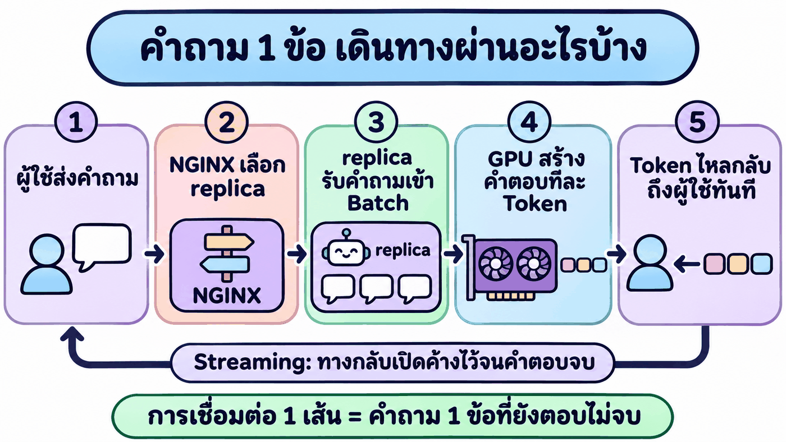

- ผู้ใช้ส่ง `POST /v1/chat/completions` พร้อม API key แบบ Bearer
- คำตอบไม่ได้มาเป็น JSON ก้อนเดียวแบบ LAB 6 แต่ไหลกลับมา **ทีละ Token (Streaming)** ผ่านการเชื่อมต่อ HTTP ที่เปิดค้างไว้จนคำตอบจบ
- ดังนั้นในทุกวินาที **จำนวนการเชื่อมต่อที่เปิดอยู่ = จำนวนคำถามที่กำลังประมวลผลอยู่จริงบน GPU**

### vLLM: ชั้นที่ทำให้โมเดลให้บริการหลายคนได้


- ไฟล์น้ำหนักของโมเดลเปล่า ๆ ตอบคำถามพร้อมกันหลายร้อยคนไม่ได้ **vLLM** ทำ 3 หน้าที่หลักคือ (1) เปิด OpenAI-compatible API, (2) ส่งคำตอบแบบ Streaming ทีละ Token, และ (3) จัดการ **Continuous Batching + PagedAttention** เพื่อใช้ VRAM (KV Cache) และแบนด์วิดท์หน่วยความจำของ GPU ให้คุ้มค่าที่สุด

---

## 2 · ตัวชี้วัด 3 ตัวของ LLM Serving และเกณฑ์ SLO 2 ระดับ

งานตรวจภาพใน LAB 6 วัดเพียง Latency และ Throughput (req/s) เพราะคำตอบมาเป็นก้อนเดียว แต่งานแชทบอทแบบ Streaming ผู้ใช้รู้สึกช้าได้ **2 แบบ** คือ **เริ่มตอบช้า** หรือ **ตัวอักษรไหลช้า** จึงต้องวัด **3 ตัวชี้วัดคู่กัน**:

| ตัวชี้วัด | วัดอะไร | หน่วย | ผู้ใช้รู้สึกอย่างไรเมื่อค่าแย่ |
|---|---|---|---|
| **TTFT** | ส่งคำถาม → ได้ Token แรก | วินาที | กดส่งแล้วหน้าจอนิ่ง รู้สึกว่าแชทบอท "ค้าง" |
| **ความเร็วต่อผู้ใช้** | Token ต่อวินาทีหลัง Token แรก (ดูที่ **p5**) | tok/s | ข้อความค่อย ๆ พิมพ์ออกมาอืด อ่านแล้วหงุดหงิด |
| **System Throughput** | Token ที่ผลิตได้รวมทุกคนต่อวินาที | tok/s | ผู้ใช้ไม่เห็นโดยตรง แต่เป็นตัววัดความคุ้มค่าของ GPU |

### ความเร็วต่อผู้ใช้กับ System Throughput ดึงกันคนละทาง

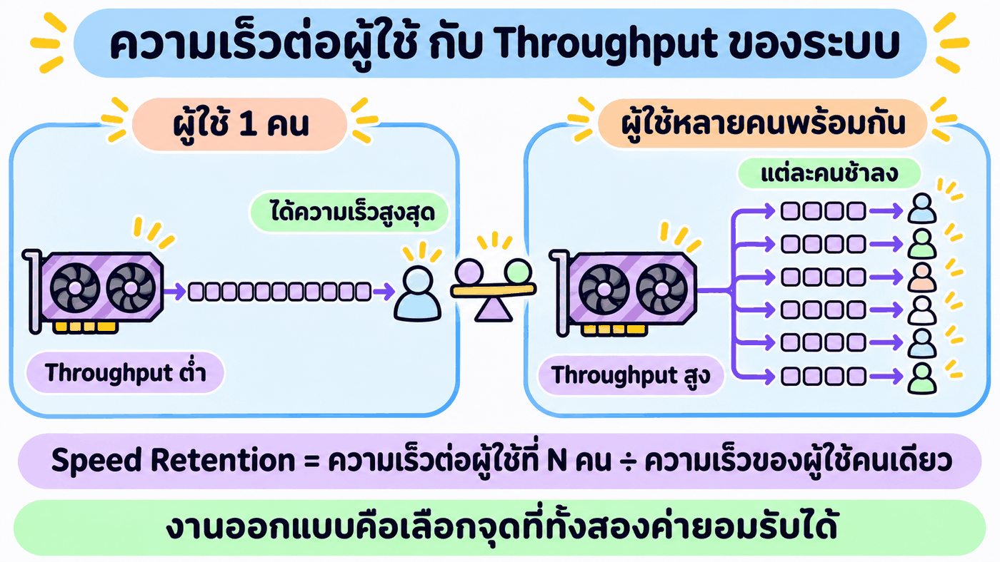

- **ผู้ใช้ 1 คน** ได้ความเร็วสูงสุด (เช่น `104.9 tok/s` บน 1× RTX 4090) แต่ GPU ทำงานไม่เต็มกำลัง Throughput รวมจึงต่ำ (~100 tok/s)
- **ผู้ใช้หลายคนพร้อมกัน** GPU สร้าง Token รวมได้สูงขึ้นมาก (ถึง `7,152 tok/s` บน 1 ใบ) แต่แบนด์วิดท์ถูกแบ่งให้ทุกคน ความเร็วต่อคนจึงลดลง
- **Speed Retention** = ความเร็วต่อผู้ใช้ที่ `N` คน ÷ ความเร็วของผู้ใช้คนเดียว · บอกว่าผู้ใช้ยังได้ความเร็วเดิมกี่ส่วน

### SLO 2 ระดับ (Standard และ Fast)


- **TTFT p95:** 95% ของคำถามต้องเริ่มได้ Token แรกภายใน 2.0 วินาที · **ความเร็ว p5:** 95% ของผู้ใช้ต้องได้ความเร็วไม่ต่ำกว่าเกณฑ์ · ทั้งสองค่าดูกลุ่มผู้ใช้ที่โชคร้ายที่สุด 5% ไม่ใช่ค่าเฉลี่ย
- **Standard (≥ 15 tok/s):** เร็วกว่าความเร็วการอ่านของคนทั่วไป (~4–6 คำ/วินาที) · **Fast (≥ 50% ของผู้ใช้ 1 คน):** ให้ความรู้สึกไหลลื่นใกล้เคียงใช้งานคนเดียว (`52.44 tok/s` บน `dp2`, `50.07 tok/s` บน `mp4`)
- ต้องระบุระดับ SLO คู่กับตัวเลขความจุเสมอ เพราะบนระบบเดียวกัน ความจุ Standard สูงกว่าความจุ Fast เกือบ **3 เท่า**

---

## 3 · Load Test แบบ Streaming, Think Time และการหาความจุ

### ผู้ใช้จำลองแบบ Closed Loop

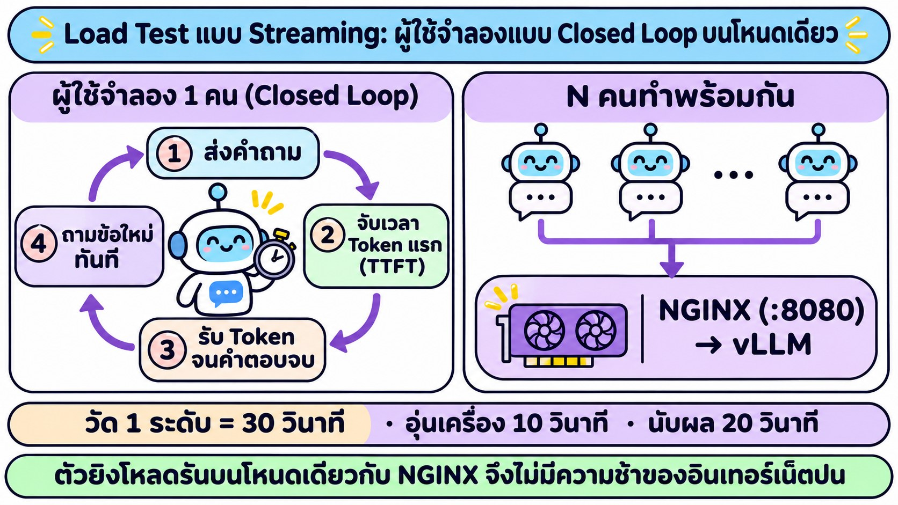

| การออกแบบ | เหตุผล |
|---|---|
| Closed Loop (ส่ง → อ่านจนจบ → ถามข้อใหม่ทันที) | จำนวนคำถามที่ค้างในระบบเท่ากับ `N` พอดี ตอบคำถาม "รับพร้อมกันได้กี่คน" ได้ตรง |
| วัด 1 ระดับ = 30 วินาที (อุ่นเครื่อง 10 วินาทีแรกไม่นับ) | ให้ Batch ของ vLLM และคิวเข้าสู่สภาวะนิ่งก่อนเริ่มนับผล 20 วินาทีหลัง |
| แยกหลาย worker process บนโหนดเดียวกับ NGINX | ไม่ให้เวลาอินเทอร์เน็ตฝั่งผู้ใช้มาปน และไม่ให้ตัวยิงโหลดติด GIL จนเป็นตัวถ่วงเสียเอง |
| รอเกิน 60 วินาทีนับเป็น error | คำถามที่ค้างต้องถูกนับเป็นความล้มเหลว ไม่ใช่หายไปเงียบ ๆ |

### `N` (ผู้ใช้พร้อมกัน) ไม่ใช่จำนวนผู้ใช้ออนไลน์

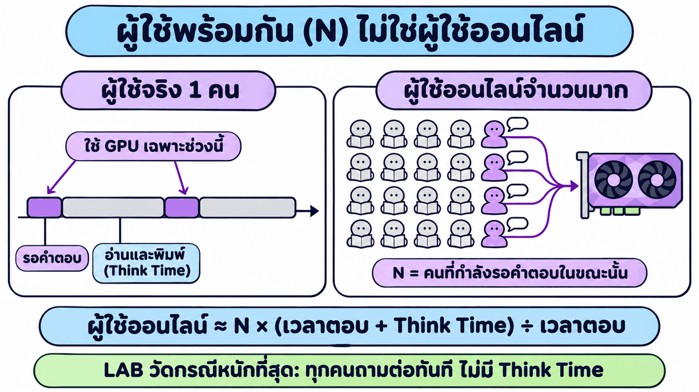

- ผู้ใช้จริงใช้เวลาส่วนใหญ่อ่านคำตอบและพิมพ์คำถามถัดไป (**Think Time**) ซึ่งไม่ใช้ GPU เลย · `N` ใน LAB คือจำนวนคนที่ **กำลังรอคำตอบพร้อมกันในวินาทีนั้น**
- แปลงเป็นผู้ใช้ออนไลน์ได้คร่าว ๆ ด้วย `ผู้ใช้ออนไลน์ ≈ N × (เวลาตอบ + Think Time) ÷ เวลาตอบ` เช่น หากคำตอบใช้ 3 วินาที และลูกค้าอ่าน+พิมพ์ 27 วินาที (`Think Time = 27 s`) ระบบที่รับ `N = 265 คน` จะรองรับผู้ใช้ออนไลน์ได้ราว **2,650 คน**

### พิสูจน์ตัวยิงโหลดก่อนใช้ และหาความจุ 3 จังหวะ


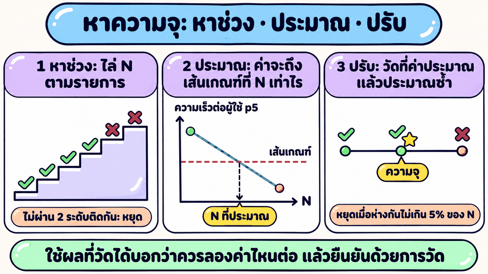

- ก่อนวัด vLLM จริง เราทดสอบ `loadgen.py` กับ `fake_llm.py` (ตั้งค่า TTFT = 200 ms, 50 tok/s, 100 tokens → 1 คำตอบใช้ 2.2 วินาที → `Throughput ควรได้ ≈ N × 100 ÷ 2.2 = 45.45 × N tok/s`) ทั้งแบบยิงตรงและยิงผ่าน NGINX เพื่อยืนยันว่าตัวยิงโหลดจับเวลาแม่นและ NGINX ไม่พักรวม Token
- โหมดหาความจุของ `loadgen.py` ใช้ **3 จังหวะ (หาช่วง → ประมาณด้วยเส้นตรง → ปรับจนช่วงแคบ ≤ 5% ของ N)** พร้อมวัดซ้ำ 1 ครั้งเมื่อระดับใดไม่ผ่าน

---

## 4 · Continuous Batching (เวอร์ชัน LLM ของ Micro-batching)

### แบบตอบทีละคำถาม (`cap = 1`)

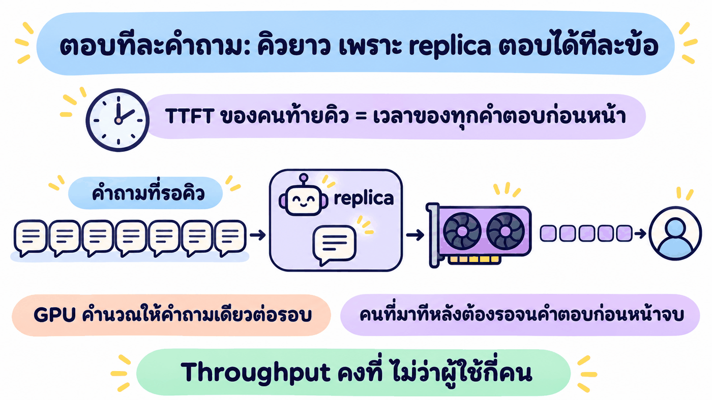

- เมื่อจำกัด `--max-num-seqs 1` replica ทำได้ทีละ 1 คำถาม ผู้ใช้คนแรกได้ 104.9 tok/s แต่คนที่ 3–4 ต้องรอจนคนก่อนหน้าตอบจบทั้งหมด **TTFT ของคนท้ายคิว = ผลรวมเวลาของทุกคำตอบก่อนหน้า** และ Throughput ตันอยู่ที่ ~99 tok/s ตลอดไป

### Static Batching เทียบกับ Continuous Batching

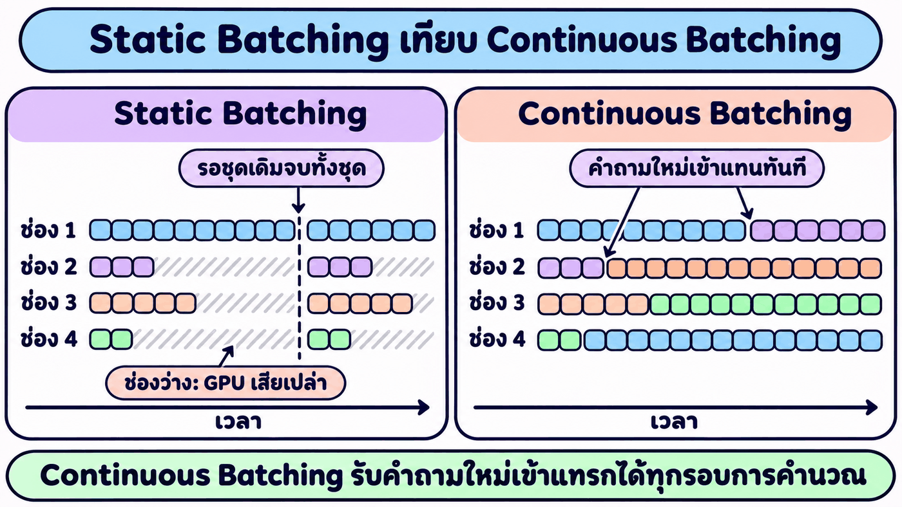

- **งานตรวจภาพ (LAB 6):** ใช้ Micro-batching รวมรูปเข้า GPU เป็นรอบ ๆ เพราะทุกรูปใช้เวลาคำนวณเท่ากัน
- **งาน LLM (LAB 7):** คำตอบแต่ละข้อสั้น-ยาวไม่เท่ากัน (44–600 tokens) ถ้าใช้ Static Batching ช่องของคนที่ตอบสั้นจะปล่อย GPU ว่างรอคนที่ตอบยาว · **Continuous Batching** ของ vLLM จัดกลุ่มใหม่ **ทุก 1 Token** ทันทีที่ใครตอบจบ ช่องว่างจะรับคำถามใหม่เข้า GPU ทันที

### ทำไมรวมหลายคำถามแล้วเกือบได้ฟรี และจุดอิ่มตัว (Saturation)

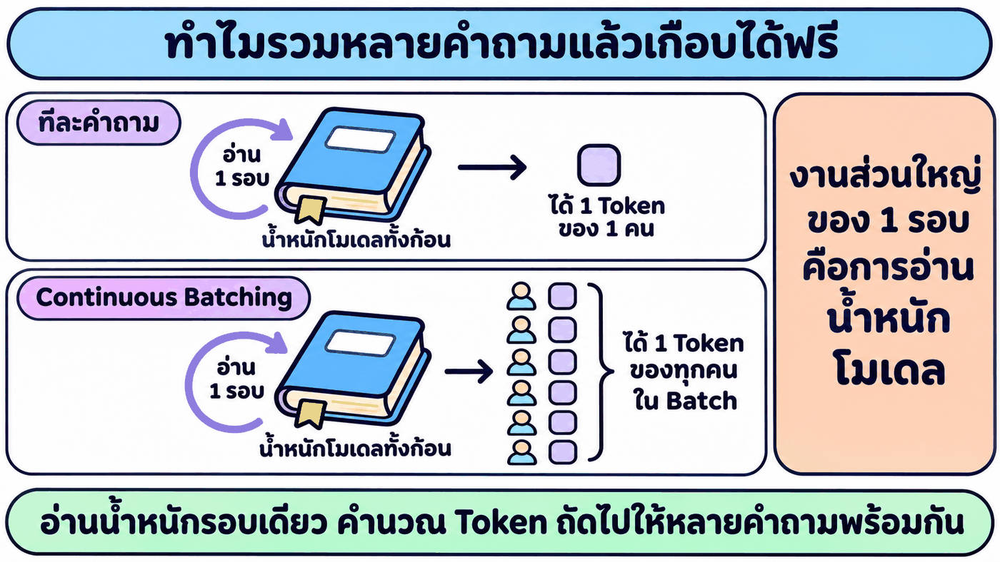

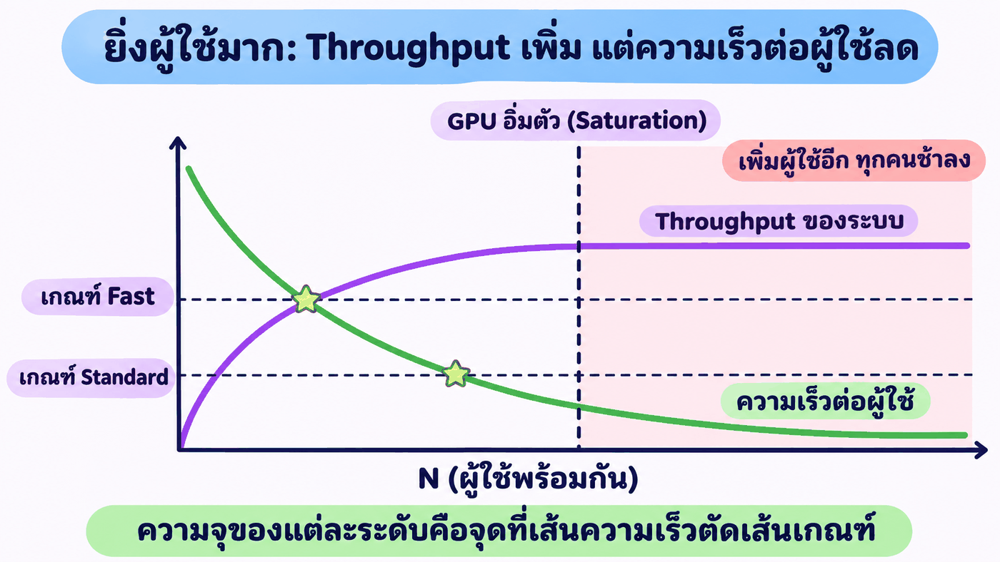

- **Memory-bandwidth bound:** การสร้าง 1 Token ต้องอ่านน้ำหนักโมเดลทั้งก้อน (8.06 GB) จาก VRAM 1 รอบ ซึ่งเป็นงานส่วนใหญ่ของแต่ละรอบ · การอ่านน้ำหนัก 1 รอบแล้วคำนวณ Token ถัดไปให้ 1 คน หรือ 128 คน ใช้เวลาอ่านน้ำหนักเท่าเดิม Throughput จึงพุ่งหลายสิบเท่า
- เมื่อ Batch ใหญ่จนถึง **จุดอิ่มตัว (Saturation)** (บน 1× RTX 4090 อยู่ที่ราว `N = 192` ที่ `7,152 tok/s`) การเพิ่มผู้ใช้ต่อจากนั้น Throughput จะไม่เพิ่มอีก แต่ความเร็วต่อผู้ใช้จะลดลงเรื่อย ๆ

---

## 5 · Concurrency Limit (`max-num-seqs`) เมื่อผู้ใช้เกินความจุ

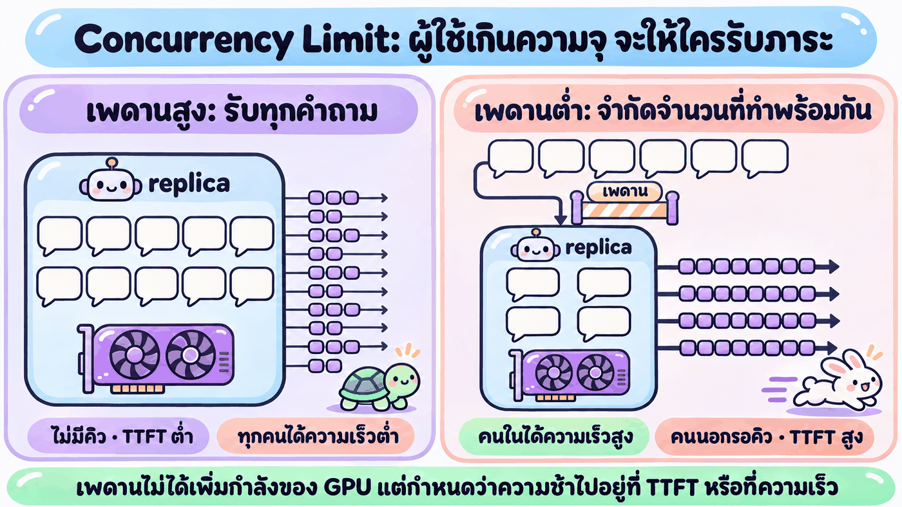

| มิติเปรียบเทียบ | เพดานต่ำ (เช่น `cap = 32`) | เพดานสูง (เช่น `cap = 256`) |
|---|---|---|
| คำถามที่ทำพร้อมกัน | ไม่เกิน 32 ข้อต่อ replica · ที่เหลือรอคิว | รับได้ถึง 256 ข้อต่อ replica |
| **TTFT p95** | **สูงมาก** (คนรอคิวนาน) | **ต่ำกว่ามาก** (คิวสั้นกว่า) |
| **ความเร็วต่อผู้ใช้ p5** | **สูง** (คนที่ได้เข้า Batch อ่านเร็ว) | **ต่ำลง** (ทุกคนแบ่งแบนด์วิดท์กัน) |
| **System Throughput** | ต่ำกว่า เพราะ Batch เล็กกว่าจุดอิ่มตัว | สูงสุด เพราะ GPU เต็มกำลัง |

- **ข้อสำคัญ:** เพดานไม่ได้เสกกำลัง GPU เพิ่ม เมื่อผู้ใช้เข้ามาเกินความจุ (`N = 1,152`) ไม่ว่าตั้งเพดานเท่าไรก็ไม่ผ่าน SLO ทำได้เพียงเลือกว่าจะย้ายความช้าไปอยู่ที่ **เวลารอคิว (TTFT)** หรือ **ความเร็วอ่าน (tok/s)**

---

## 6 · Data Parallelism เทียบกับ Model Parallelism (`TP=2`)

### ภาพรวมความต่าง: โมเดลเต็ม 1 ใบ (Data Parallelism) vs แบ่งโมเดลลง 2 ใบ (Model Parallelism)


### Data Parallelism: 1 GPU ถือโมเดลเต็ม 1 ตัว (`dp2_cb`)

- GPU ทุกใบถือโมเดล `Qwen3-4B` ครบทั้งก้อน (สัญลักษณ์หุ่นยนต์เต็มตัว 1 ตัวต่อ 1 การ์ด) · คำถาม 1 ข้อจบภายใน GPU ใบเดียว ไม่ต้องสื่อสารข้ามการ์ดจอ
- เพิ่ม GPU จาก 1 เป็น 2 ใบ คือเพิ่ม replica จาก 1 เป็น 2 ตัวให้ NGINX แจกงาน จึงขยายความจุได้เกือบเป็นเส้นตรง (วัดจริงบน 2× RTX 4090 ได้ **Scaling Efficiency 99.6%**)

### ซูมข้างใน 1 หน่วย Model Parallelism (`Tensor Parallelism = 2`, `mp4_cb` = 2 replica × TP=2)

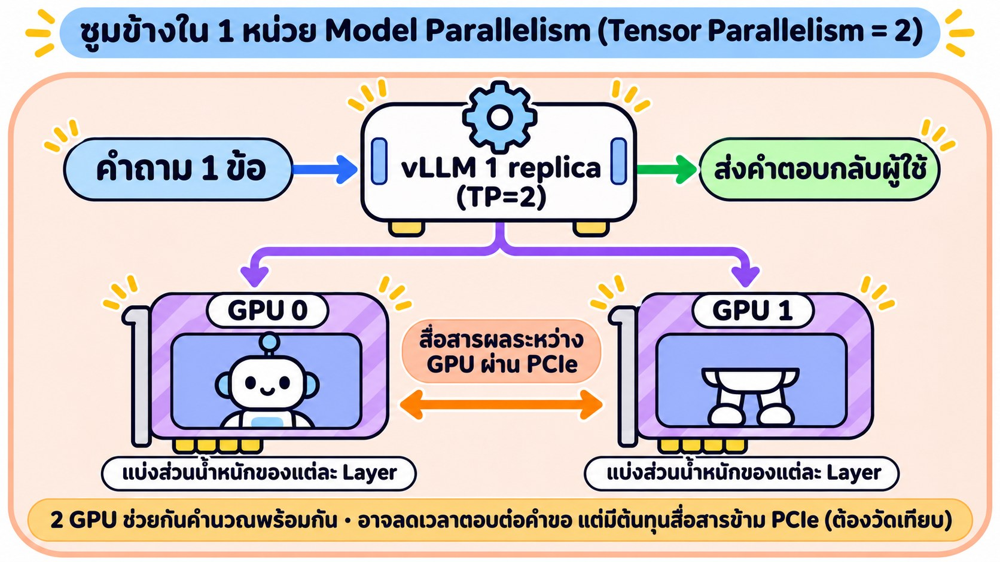

- ในระบบ `mp4_cb` (`4× RTX 4090`) เราแบ่งเป็น **2 replica (`gpu0+1` และ `gpu2+3`)** โดยแต่ละ replica ใช้ **`Tensor Parallelism = 2`** แบ่งส่วนน้ำหนักของแต่ละ Layer กระจายลง 2 GPU (จึงเป็นการผสมทั้ง Model Parallelism ภายในหน่วย และ Data Parallelism ระหว่าง 2 หน่วยหลัง NGINX)
- **ข้อดี:** ทั้ง 2 GPU ช่วยกันอ่านน้ำหนักและคำนวณคำถามเดียวกันพร้อมกัน ผู้ใช้ 1 คนจึงเร็วขึ้นชัดเจน (**164.0 vs 104.9 tok/s**, TTFT **24 ms vs 36 ms**) และรวม VRAM ได้ 48 GB ต่อหน่วยเพื่อรองรับโมเดลขนาดใหญ่
- **ข้อเสีย:** ระหว่างสร้างแต่ละ Token ทั้ง 2 GPU ต้องสื่อสารรวมผลข้าม **PCIe 4.0** (AllReduce) เมื่อมีคำขอพร้อมกันหลายร้อยข้อ GPU ต้องเสียเวลารอซิงค์ ทำให้ Throughput ต่อ GPU ลดลงเหลือเพียง **1 ใน 3 ของ Data Parallelism**

### เลือกแบบไหนเมื่อไร

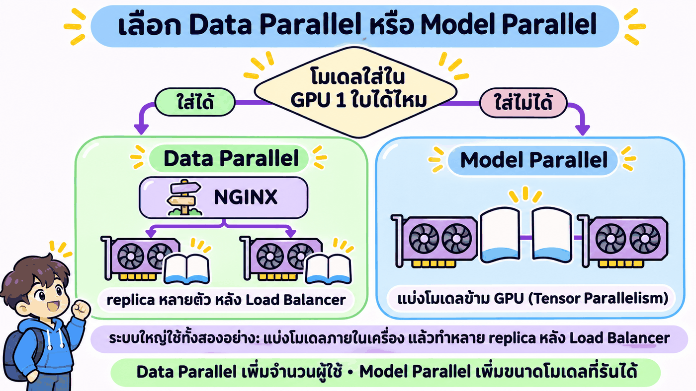

| สถานการณ์ | เลือกใช้ | เหตุผล |
|---|---|---|
| โมเดลใส่ใน GPU 1 ใบได้ และต้องการรับผู้ใช้มากที่สุด | **Data Parallelism** | ไม่เสียเวลาซิงค์ข้าม GPU · ได้ Throughput ต่อ GPU สูงสุด (3× ของ Model Parallelism ใน LAB นี้) |
| โมเดลใหญ่เกิน VRAM ของ GPU 1 ใบ (เช่น 32B–70B) | **Model Parallelism** | เป็นทางเดียวที่รันโมเดลได้ โดยรวม VRAM หลายใบเข้าด้วยกัน |
| โมเดลใส่ 1 ใบได้ แต่ต้องการความเร็วต่อ 1 ผู้ใช้สูงสุดจริง ๆ | **Model Parallelism** | ยอมจ่ายค่า GPU มากขึ้นเพื่อแลกความเร็วต่อคน (+56–64%) เช่น coding / voice agent |
| โมเดลใหญ่ **และ** ผู้ใช้จำนวนมาก | **ใช้ทั้งคู่ร่วมกัน** | ทำ Model Parallelism ภายในหน่วย แล้วทำหลายหน่วยแบบ Data Parallelism หลัง NGINX (เหมือนแบบ 2+2 ของแทร็ก 2) |

---

## 7 · NGINX `least_conn` และ Streaming

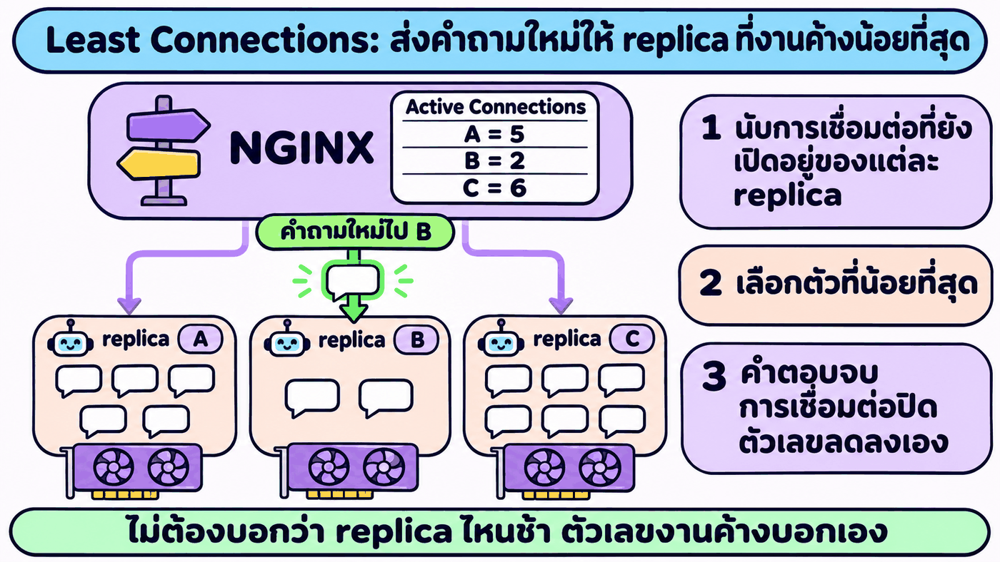

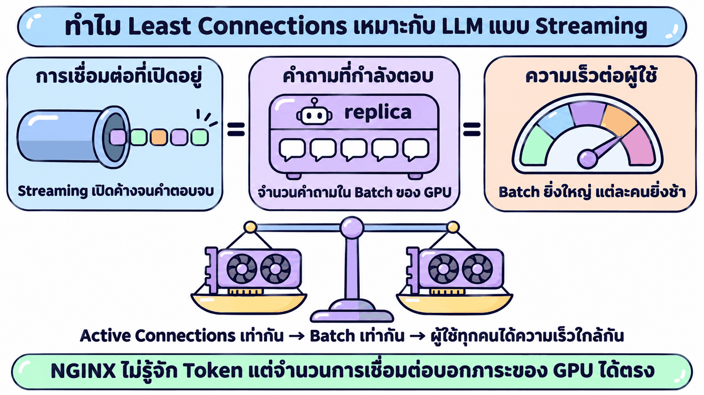

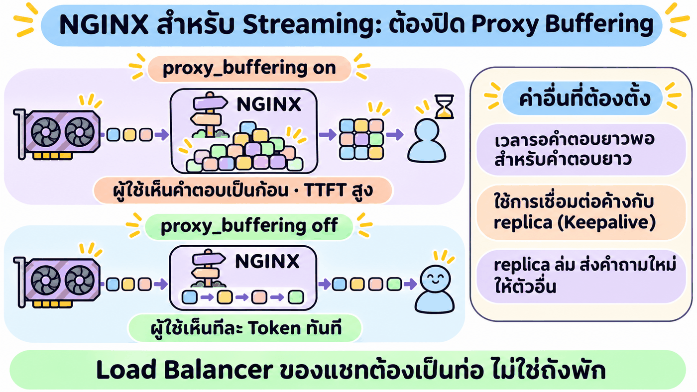

- **ทำไม `least_conn` เหมาะกับ LLM:** เพราะคำตอบ LLM ยาวไม่เท่ากัน (30–600 tokens) การใช้ `least_conn` คู่กับ `zone ... 64k;` ให้ทุก worker ของ NGINX นับจำนวนการเชื่อมต่อที่ยังเปิดสตรีมอยู่ร่วมกัน จึงรักษาจำนวนคำถามใน Batch ของทุก replica ให้สมดุลอัตโนมัติ
- **ทำไมต้องปิด Buffering:** ค่าเริ่มต้นของ NGINX จะพักข้อมูลไว้ใน buffer ก่อนส่ง ทำให้ผู้ใช้ไม่เห็น Token แรกทันที ต้องตั้ง `proxy_buffering off;`, `proxy_cache off;`, `gzip off;` และ `proxy_http_version 1.1;`

---

## 8 · Replica ล่มกลางการ Streaming (Failover)

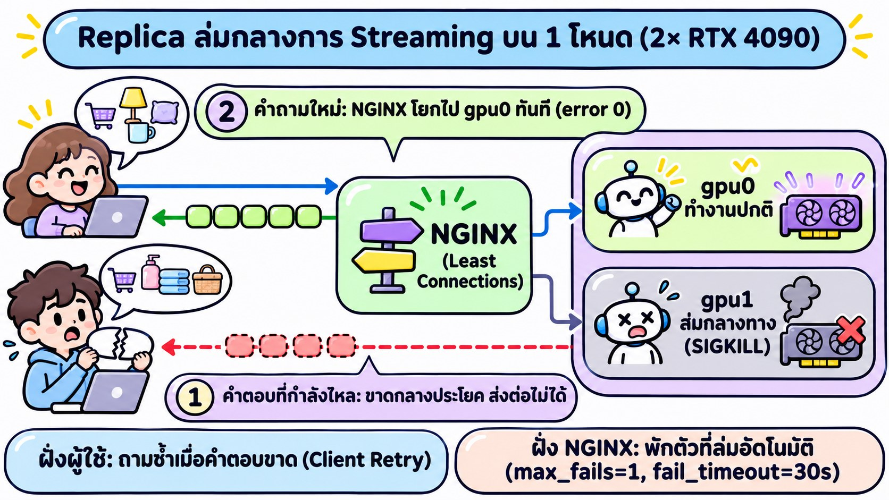

| กลุ่มคำถาม | เกิดอะไรขึ้นเมื่อ `gpu1` ล่ม | ใครเป็นคนจัดการ |
|---|---|---|
| **1 · กำลัง Streaming อยู่บน `gpu1`** | การเชื่อมต่อขาดกลางประโยค (`ClientPayloadError`) NGINX ต่อคำตอบกลางทางให้ไม่ได้ | **ฝั่งผู้ใช้/แอป (Client Retry)** ถามซ้ำอัตโนมัติหรือให้ผู้ใช้กดลองใหม่ |
| **2 · คำถามใหม่หลัง `gpu1` ล่ม** | NGINX จับ error ด้วย `max_fails=1 fail_timeout=30s` + `proxy_next_upstream ... non_idempotent` แล้วโยกไป `gpu0` ทันที | **NGINX (Passive Health Check & Retry)** ได้ **error 0** |

---

## 9 · ลำดับการออกแบบ LLM Serving และทฤษฎีเทียบผลวัดจริง


| เรื่อง | ทฤษฎีบอกอะไร | ผลวัดจริงใน LAB 7 บน RTX 4090 |
|---|---|---|
| **Continuous Batching (ขั้นที่ 4)** | อ่านน้ำหนักโมเดลรอบเดียวใช้ร่วมกันทั้ง Batch ทำให้ Throughput พุ่งมาก | 1× RTX 4090: ความจุ Standard **2 → ≥ 384 คน** · Fast **2 → 128 คน** · Peak Throughput **99.1 → 7,152 tok/s (72×)** |
| **Data Parallelism 2 GPU (ขั้นที่ 5)** | แยกทำงานอิสระ ไม่ต้องซิงค์ข้าม GPU ขยายได้เกือบ 2 เท่า | 2× RTX 4090: Standard **≥ 768 คน (2.00×)** · Fast **265 คน (2.07×)** · Peak Throughput **14,242 tok/s (Efficiency 99.6%)** |
| **Concurrency Limit (ขั้นที่ 6)** | เพดานไม่เพิ่มกำลัง GPU เพียงย้ายความช้าระหว่าง TTFT กับความเร็วอ่าน | `N=1,152`: `cap=32` ได้ TTFT 18.32 s / 82.7 tok/s · `cap=256` ได้ TTFT 4.38 s / 26.6 tok/s · ไม่มีเพดานใดผ่าน SLO |
| **NGINX `least_conn` คำตอบยาว (ขั้นที่ 7)** | งานค้างของแต่ละ replica เท่ากันเองแม้คำตอบยาวไม่เท่ากัน | `N=307` (ยาว 20%): งานค้าง `gpu0 = 151.7` vs `gpu1 = 151.2` (ต่างกัน **0.5 คำถาม**) · error 0 |
| **Replica Failover (ขั้นที่ 7)** | คำตอบที่กำลังสตรีมขาด คำถามใหม่ไป replica ที่เหลือ | ปิด `gpu1` ที่ t=29.4 s (`N=307`): ถูกตัด **153 ข้อ** · หลังล่ม **error 0 ทุกวินาที** · `gpu0` รับต่อทันทีที่ ~6,599 tok/s |
| **Model Parallelism 2+2 (ขั้นที่ 8)** | 2 GPU ช่วยกันอ่านน้ำหนักทำให้ 1 คนเร็วขึ้น แต่เสียเวลาซิงค์ AllReduce ทุกชั้น | 4× RTX 4090: 1 คนเร็วขึ้น **164.0 vs 104.9 tok/s** (+56–64%) แต่ความจุเหลือ **661 / 149 คน** และ Throughput/GPU เหลือ **1 ใน 3** ของ Data Parallelism |

---

# ภาคปฏิบัติ · LAB 10 ขั้นบน RTX 4090

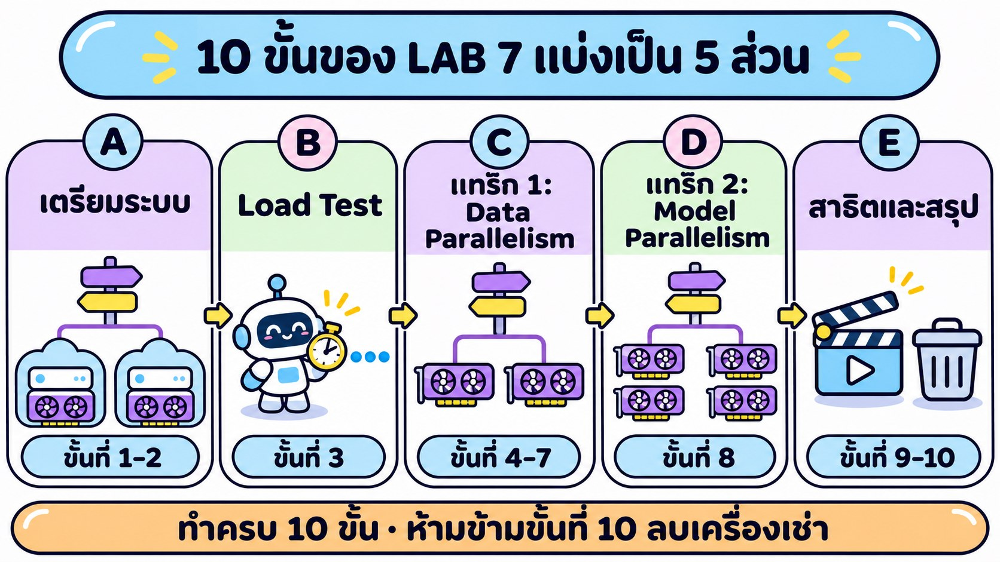

วางทีละพรอมต์ในช่องพิมพ์ของ Claude Code ที่เปิดโฟลเดอร์ `02_VastAi_Application` · **เครื่องคิดเงินตลอดเวลาที่เปิด ห้ามข้ามขั้นที่ 10**

| ส่วน | ขั้น | ทำอะไร | เครื่องที่ใช้ | ชื่อผล |
|---|---|---|---|---|
| **A · เตรียมระบบ** | 1 | เช่าเครื่อง RTX 4090 พร้อมกัน 2 เครื่อง (2 GPU และ 4 GPU · เน็ต ≥ 1,000 Mbps) | `dp2`, `mp4` | ภาพ Vast.ai Console |
| | 2 | ติดตั้ง vLLM + โมเดล Qwen3-4B + NGINX `least_conn` (udocker) และวัด 1-User Baseline | `dp2`, `mp4` | `dp1_n1_baseline`, `mp4_n1_baseline` |
| **B · Load Test** | 3 | เขียนตัวยิงโหลดแบบ Streaming และพิสูจน์ความแม่นยำด้วย `fake_llm.py` | `dp2` | `loadtest_check_summary` |
| **C · แทร็ก 1 (1→2 GPU DP)** | 4 | **Single GPU:** วัดแบบที่ 1 ตอบทีละคำถาม (`dp1_seq`) เทียบแบบที่ 2 Continuous Batching (`dp1_cb`) | `dp2` | `dp1_seq`, `dp1_cb`, `dp1_cb_fast` |
| | 5 | **2 GPU Data Parallelism + NGINX (สูตร LAB 6):** วัด `dp2_cb` (Standard & Fast) | `dp2` | `dp2_cb`, `dp2_cb_fast` |
| | 6 | **Concurrency Limit:** กวาดเพดาน `cap = 32, 64, 128, 256` เมื่อโหลดเกินความจุ (`N = 1,152`) | `dp2` | `cap_32..256` |
| | 7 | **NGINX `least_conn` & Failover:** คำตอบสั้น-ยาว (`mix_short/long`) และปิด GPU 1 กลางทาง (`fail_replica`) | `dp2` | `mix_short`, `mix_long`, `fail_replica` |
| **D · แทร็ก 2 (4 GPU MP 2+2)** | 8 | **Model Parallelism 2+2 + NGINX:** แบ่ง 4× RTX 4090 เป็น 2 หน่วย (`gpu0+1`, `gpu2+3`, TP=2) วัด `mp4_cb` | `mp4` | `mp4_cb`, `mp4_cb_fast` |
| **E · สาธิต & สรุป** | 9 | อัด Trace Token จริงสร้างไฟล์ `.gif` ความเร็ว 1× (เทียบโหลด + แชท 4 ผู้ใช้พร้อมกัน) | `dp2` / `mp4` | `demo-speed-by-load.gif`, `demo-4users-live.gif` |
| | 10 | สร้างกราฟทั้งหมด สรุปตารางออกแบบ และ **ลบเครื่องเช่าทั้ง 2 เครื่อง** | ทั้งคู่ | `metrics.json`, `01..06_*.png` |

---

# ส่วน A · เตรียมระบบ

## ขั้นที่ 1 · เช่าเครื่อง RTX 4090 พร้อมกัน 2 เครื่อง (2 GPU และ 4 GPU)

เช่าเครื่อง Vast.ai พร้อมกัน 2 โหนดแยกกันคนละแทร็ก: แทร็กที่ 1 ใช้ 1 โหนด × 2× RTX 4090 (`vapp-lab7-dp2`) และแทร็กที่ 2 ใช้ 1 โหนด × 4× RTX 4090 (`vapp-lab7-mp4`) เพื่อให้วัดเทียบ Data Parallelism และ Model Parallelism ขนานกันได้เร็วและไม่มีความช้าของเน็ตข้ามเครื่องปน

```text
[ที่ทำงาน]
container `multi-account` · โฟลเดอร์ /workspace/vastapp_lab · สกิล vastai · SSH key: /root/.ssh/id_ed25519
เก็บโค้ดและผลที่: lab7_llm_serving_lb ของโฟลเดอร์ที่เปิด Claude Code อยู่

[งาน]
เช่าเครื่อง Vast.ai พร้อมกัน 2 เครื่องแบบ Single-Node แยกแทร็ก (ไม่ใช่คลัสเตอร์ Multi-Node):
1. `vapp-lab7-dp2`: 1 โหนด × 2× RTX 4090 (Track 1: Single GPU และ Data Parallelism 2×1 หลัง NGINX)
2. `vapp-lab7-mp4`: 1 โหนด × 4× RTX 4090 (Track 2: Model Parallelism 2+2 หลัง NGINX)

[ขั้นตอน]
1. ค้นหาข้อเสนอที่ถูกที่สุดตามเงื่อนไข: verified · reliability ≥ 0.95 · เน็ตขาเข้า/ออก ≥ 1,000 Mbps · CUDA ≥ 12.8 · ไม่อยู่ในจีน · disk ≥ 60 GB · direct_port_count ≥ 1
2. สร้างเครื่องทั้ง 2 ด้วย `--image vastai/pytorch:@vastai-automatic-tag --disk 60 --ssh --direct --env '-p 8080:8080'` (ถ้าเกิน 10 นาทียังไม่พร้อมให้ลบแล้วเช่าใหม่)
3. SSH เข้าทั้ง 2 เครื่องตรวจ `nproc` และ `nvidia-smi` ให้เห็น RTX 4090 ครบทุกใบ และอุณหภูมิตอนว่าง ≤ 60°C

[รายงาน]
สรุปตารางสเปก 2 เครื่อง (Instance ID · ที่ตั้ง · GPU · เน็ตขาเข้า/ออก · CPU/RAM · ราคา/ชม. · เวลาบูต) · ห้ามแสดงค่า key · บอกว่าเครื่องทั้ง 2 ยังเปิดอยู่
```

**ผลจริงที่เช่าได้:**

| รายการ | เครื่องที่ 1 `vapp-lab7-dp2` | เครื่องที่ 2 `vapp-lab7-mp4` |
|---|---|---|
| Instance ID | `62662793` | `62662797` |
| GPU / VRAM | **2× RTX 4090** (48 GB รวม · 22–25 °C) | **4× RTX 4090** (96 GB รวม · 30–47 °C) |
| ที่ตั้ง | The Netherlands, NL | Japan, JP |
| เน็ตขาเข้า / ขาออก | **1,179↓ / 1,054↑ Mbps** | **7,789↓ / 7,220↑ Mbps** |
| CPU / RAM | AMD EPYC 7742 (64 vCPUs) · 128.9 GB | AMD EPYC 7V13 (128 vCPUs) · 257.5 GB |
| PCIe / Disk | PCIe 4.0 x16 (20 GB/s) · 60 GB NVMe | PCIe 4.0 x16 (26 GB/s) · 60 GB NVMe |
| ราคาเช่า | \$0.903 / ชม. | \$1.750 / ชม. |

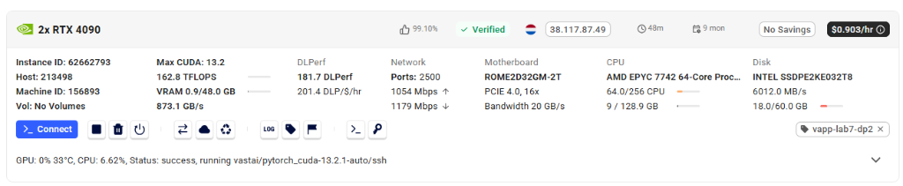

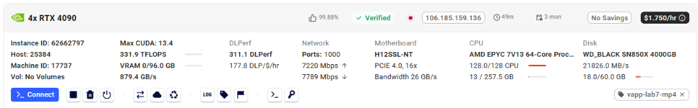

**อ่านผลอย่างไร**

- ทั้ง 2 เครื่องผ่านเกณฑ์ครบทุกข้อ (verified, เน็ต ≥ 1,000 Mbps, อุณหภูมิตอนว่างต่ำกว่า 60 °C, CPU และ RAM เหลือเฟือสำหรับทั้ง NGINX และตัวยิงโหลดหลาย process)
- เครื่อง `mp4` มีเน็ตระดับ 7.7 Gbps จึงดาวน์โหลดโมเดลและติดตั้ง vLLM ได้เร็วกว่าเครื่อง `dp2` กว่าเท่าตัวในขั้นถัดไป

---

## ขั้นที่ 2 · ติดตั้ง vLLM, NGINX (udocker) และวัด 1-User Baseline

ติดตั้งซอฟต์แวร์ชุดเดียวกันบนทั้ง 2 เครื่องพร้อมกัน เขียนไฟล์ตั้งค่า NGINX สำหรับงาน Streaming และสคริปต์สลับโหมด `node_single.sh` จากนั้นวัดความเร็วผู้ใช้ 1 คน (10 คำถาม) เพื่อตั้งเกณฑ์ **Fast SLO (= 50% ของผู้ใช้ 1 คนบน 1× RTX 4090)** และดูผลของ Tensor Parallelism = 2 ตั้งแต่ผู้ใช้คนแรก

```text
[ที่ทำงาน]
container `multi-account` · /workspace/vastapp_lab · เครื่อง `vapp-lab7-dp2` และ `vapp-lab7-mp4` · SSH `/root/.ssh/id_ed25519` · เก็บที่ `lab7_llm_serving_lb`

[งาน]
ติดตั้งซอฟต์แวร์ชุดเดียวกันบนทั้ง 2 เครื่องขนานกัน ตั้ง NGINX แบบ container และวัดความเร็วผู้ใช้ 1 คน (1-User Baseline)

[ขั้นตอน]
1. เขียน `code/install_single.sh` รันขนานบนทั้ง 2 เครื่อง: สร้าง `uv venv` (Python 3.12), ติดตั้ง `vllm` และ `aiohttp` รุ่นเดียวกัน, ดาวน์โหลด `Qwen/Qwen3-4B-Instruct-2507` (ส่ง `HF_TOKEN` จาก `.env`/`.env_host` ทาง env เฉพาะตอนโหลดแล้ว `unset` และลบไฟล์ token ทันที), ติดตั้ง `udocker` + image `nginx:1.27`, สร้าง API key แบบสุ่มเก็บใน `runtime/api_key` และบันทึกเวลาลง `timings.json`
2. เขียน `code/nginx.conf`: พอร์ต 8080 · `worker_processes 4` · `zone ... 64k` · `least_conn` · pool `shop_dp1` (`:8001`), `shop_dp2` (`:8001–8002`), `shop_mp2` (`:8001–8002`), `shop_fake` (`:9000`) · `proxy_buffering off` · `gzip off` · `max_fails=1 fail_timeout=30s` · `proxy_next_upstream ... non_idempotent` · ตรวจ Bearer API key (ไม่มีตอบ 401) · แนบ header `X-Replica`
3. เขียน `code/node_single.sh` สลับโหมด `up <dp1|dp2|mp2> <cap>`, `set-pool`, `kill-port`, `stop`, `status` (ตั้ง `NCCL_CUMEM_HOST_ENABLE=0`, `--served-model-name shop-bot`, `--max-model-len 4096`, `--gpu-memory-utilization 0.90`, `HF_HUB_OFFLINE=1` และรอ ready สูงสุด 300 s สำหรับ cold start รอบแรก)
4. ตรวจ API key (`200` / `401`) แล้ววัด 1-User Baseline (อุ่นเครื่อง 2 + วัด 10 คำถาม) บน 1× RTX 4090 ของทั้ง 2 เครื่อง (ตั้งเกณฑ์ Fast SLO = 50% ของแต่ละเครื่อง) และบน 2× RTX 4090 (`TP=2`)

[รายงาน]
เวลาติดตั้งและโหลดโมเดลของทั้ง 2 เครื่อง · ยืนยันไม่เหลือ `HF_TOKEN` · ตารางเทียบ 1-User TTFT และความเร็ว (1× RTX 4090 vs `TP=2`) · บอกว่าเครื่องยังเปิดอยู่
```

**ผลเวลาติดตั้งจริง (`results/timings_dp2.json`, `results/timings_mp4.json`):**

| รายการ | `vapp-lab7-dp2` (NL · 1.1 Gbps) | `vapp-lab7-mp4` (JP · 7.7 Gbps) |
|---|---:|---:|
| ซอฟต์แวร์ | vLLM `0.34.0` · PyTorch `2.14.0+cu130` | vLLM `0.34.0` · PyTorch `2.14.0+cu130` |
| ติดตั้ง vLLM + Python venv (`uv`) | 88.4 วินาที | 26.1 วินาที |
| ดาวน์โหลดโมเดล Qwen3-4B (8.06 GB) | 44.9 วินาที | 22.3 วินาที |
| ติดตั้ง udocker + image `nginx:1.27` | 30.9 วินาที | 30.8 วินาที |
| **รวมเวลาติดตั้งทั้งหมด** | **164.2 วินาที** | **79.2 วินาที** |

**ผล 1-User Baseline (10 คำถามหลังอุ่นเครื่อง 2 ข้อ):**

| การตั้งค่า | เครื่อง | TTFT เฉลี่ย | TTFT p50 | ความเร็วเฉลี่ย | ความเร็ว p50 | เกณฑ์ Fast SLO (50%) |
|---|---|---:|---:|---:|---:|---:|
| **1× RTX 4090 (Data Parallelism · 1 GPU)** | `vapp-lab7-dp2` | 0.036 s | 0.0357 s | **104.87 tok/s** | 104.83 tok/s | **52.44 tok/s** |
| **1× RTX 4090 (อ้างอิงบนเครื่อง `mp4`)** | `vapp-lab7-mp4` | 0.035 s | – | **100.14 tok/s** | – | **50.07 tok/s** |
| **2× RTX 4090 (Model Parallelism `TP=2`)** | `vapp-lab7-mp4` | **0.024 s** | **0.0247 s** | **164.01 tok/s** | **163.71 tok/s** | *(ใช้เกณฑ์ 50.07 ของเครื่อง)* |

**ส่วนสำคัญของ `code_reference/nginx.conf`:**

```nginx
upstream shop_dp2 {
    zone shop_dp2 64k;
    least_conn;
    server 127.0.0.1:8001 max_fails=1 fail_timeout=30s;
    server 127.0.0.1:8002 max_fails=1 fail_timeout=30s;
    keepalive 64;
}
# ภายใน location / :
proxy_http_version 1.1;
proxy_set_header Connection "";
proxy_buffering off;
proxy_cache off;
gzip off;
proxy_next_upstream error timeout http_502 http_503 http_504 non_idempotent;
add_header X-Replica $replica always;
```

ตัวอย่างโค้ดและผลดิบ: [install_single.sh](code_reference/install_single.sh) · [nginx.conf](code_reference/nginx.conf) · [node_single.sh](code_reference/node_single.sh) · [dp1_n1_baseline.json](results/dp1_n1_baseline.json) · [mp4_dp1_ref.json](results/mp4_dp1_ref.json) · [mp4_n1_baseline.json](results/mp4_n1_baseline.json)

**อ่านผลอย่างไร**

- เมื่อเปิด **Tensor Parallelism = 2** บนเครื่อง `mp4` ความเร็วผู้ใช้ 1 คนพุ่งจาก `100.14` เป็น **`164.01 tok/s` (+64%)** และ TTFT ลดจาก `34.6 ms` เหลือ **`23.7 ms`** เพราะ GPU 2 ใบช่วยกันอ่านน้ำหนักโมเดลคนละครึ่ง
- การมี `zone shop_dp2 64k;` ใน NGINX สำคัญมาก เพราะตั้ง `worker_processes 4;` หากไม่มี `zone` แต่ละ worker จะนับงานค้างแยกกันเอง
- `HF_TOKEN` ใช้เฉพาะช่วงดาวน์โหลดใน environment แล้ว `unset` และลบไฟล์ token ทันที ไม่ทิ้งค้างบนเครื่องเช่า

---

# ส่วน B · Load Test

## ขั้นที่ 3 · เขียนตัวยิงโหลดแบบ Streaming และพิสูจน์ว่าวัดถูก

ก่อนนำ `loadgen.py` ไปวัด vLLM จริง ต้องพิสูจน์ว่าเครื่องมือวัดจับเวลา TTFT และความเร็วต่อผู้ใช้แม่นยำ และ NGINX ไม่ได้พักรวม Token โดยยิงใส่ server จำลอง `fake_llm.py` ที่ตั้งค่าตายตัวไว้ที่ **TTFT = 200 ms · ความเร็ว = 50.0 tok/s · ยาว 100 tokens/คำตอบ**

```text
[ที่ทำงาน]
container `multi-account` · /workspace/vastapp_lab · เครื่อง `vapp-lab7-dp2` · SSH `/root/.ssh/id_ed25519` · เก็บที่ `lab7_llm_serving_lb`

[งาน]
เขียนตัวยิงโหลดแบบ Streaming (`code/loadgen.py`) และพิสูจน์ความแม่นยำกับ server จำลอง (`code/fake_llm.py`) ก่อนนำไปวัด vLLM จริง

[ขั้นตอน]
1. เขียน `code/loadgen.py` รันบนเครื่องเดียวกับ NGINX (หลาย worker process): จำลองผู้ใช้ N คนแบบ closed-loop สุ่ม 1 ใน 40 คำถามลูกค้าร้านขายของใช้ในบ้านภาษาไทย (`stream: true`, `max_tokens=150` สั้น / `600` ยาว) วัดระดับละ 30 s (อุ่นเครื่อง 10 s + นับผล 20 s) บันทึก TTFT p50/p95, Speed p50/p5, Throughput, error, สัดส่วน `X-Replica`, GPU (%/W) และ CPU
2. รองรับ 2 โหมด: `single` (ยิงระดับเดียวพร้อมผลรายวินาที) และ `capacity` (หาความจุ 3 จังหวะ: หาช่วง → ประมาณเส้นตรง → ปรับจนห่าง ≤ 5% โดยวัดซ้ำ 1 ครั้งเมื่อไม่ผ่าน)
3. เขียน `code/fake_llm.py` พอร์ต 9000 ตั้งค่าตายตัว TTFT = 200 ms, ความเร็ว 50 tok/s (20 ms/tok), 100 tokens/คำตอบ
4. สลับ NGINX เป็น `shop_fake` แล้วทดสอบ 3 กรณี (20 s, อุ่นเครื่อง 5 s): ยิงตรง `N=1`, ยิงตรง `N=50` และยิงผ่าน NGINX พอร์ต 8080 ที่ `N=50` บันทึก `results/loadtest_check_summary.json` และวาด `results/images/06_loadtest_check.png`

[เกณฑ์ผ่าน]
TTFT p50 คลาดเคลื่อนไม่เกิน 20 ms · ความเร็ว p50 อยู่ในช่วง 50±1 tok/s · Throughput ใกล้เคียงทฤษฎี (`N × 100 ÷ 2.2`) · error = 0 · NGINX ไม่พักรวม Token

[รายงาน]
ตารางเทียบค่าที่ควรได้กับค่าที่วัดได้ทั้ง 3 กรณี · CPU ของ loadgen และ NGINX · บอกว่าเครื่องยังเปิดอยู่
```

**ผลจริง (`results/loadtest_check_summary.json` · ยิง 20 วินาที อุ่นเครื่อง 5 วินาที นับผล 15 วินาที):**

| กรณีทดสอบ | TTFT p50 ที่ควรได้ / วัดได้ | TTFT p95 | ความเร็ว p50 ที่ควรได้ / วัดได้ | ความเร็ว p5 | Throughput ที่ควรได้ / วัดได้ | error | CPU (loadgen / NGINX) |
|---|---|---:|---|---:|---|---:|---|
| Direct `N=1` | 200 ms / **201.0 ms** | 201.0 ms | 50.00 / **50.01 tok/s** | 49.99 tok/s | 45.5 / **45.3 tok/s** | 0 | 0.6% / 0% |
| Direct `N=50` | 200 ms / **201.0 ms** | 202.0 ms | 50.00 / **50.00 tok/s** | 49.99 tok/s | 2,273 / **2,271.9 tok/s** | 0 | 22.8% / 0% |
| ผ่าน NGINX `N=50` | ≤ 220 ms / **201.0 ms** | 202.0 ms | 50.00 / **50.00 tok/s** | 49.98 tok/s | 2,273 / **2,271.3 tok/s** | 0 | 24.8% / 12.8% |

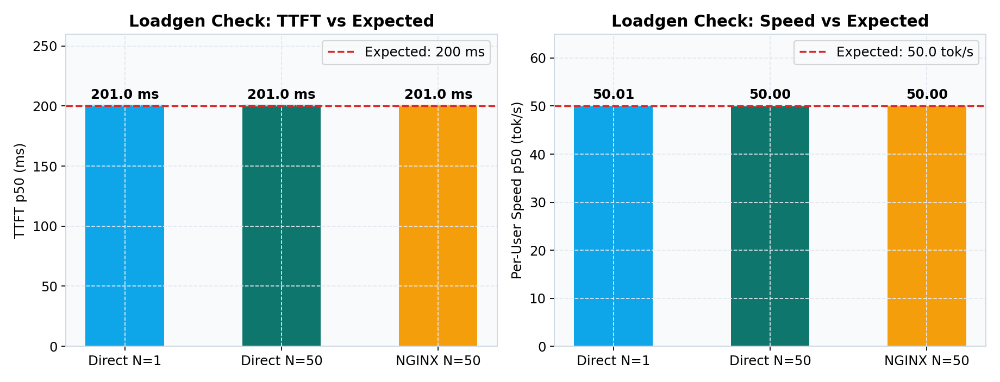

ตัวอย่างโค้ดและผลดิบ: [loadgen.py](code_reference/loadgen.py) · [fake_llm.py](code_reference/fake_llm.py) · [loadtest_check_summary.json](results/loadtest_check_summary.json)

**อ่านผลอย่างไร**

- 1 คำตอบของ `fake_llm.py` ใช้เวลารวม `0.2 + 100 ÷ 50 = 2.2 วินาที` · ที่ `N = 50` Throughput ทฤษฎีคือ `50 × 100 ÷ 2.2 = 2,272.7 tok/s` ซึ่งตัวยิงโหลดวัดได้ `2,271.9 tok/s` (คลาดเคลื่อนเพียง **0.04%**)
- ยิงผ่าน NGINX พอร์ต 8080 ได้ `TTFT p50 = 201.0 ms` และ `Speed p50 = 50.00 tok/s` แทบไม่ต่างจากยิงตรงเลย ยืนยันว่า **`proxy_buffering off;` ทำงานถูกต้องและ NGINX ไม่พักรวม Token**
- CPU ของ NGINX ที่ 50 ผู้ใช้ใช้เพียง `0.13 core` (`12.8%` ของ 1 core) ไม่ใช่ตัวถ่วง

---

# ส่วน C · แทร็กที่ 1 (1 โหนด × 2× RTX 4090 · Single GPU → Data Parallelism)

## ขั้นที่ 4 · Single GPU: ตอบทีละคำถาม เทียบ Continuous Batching

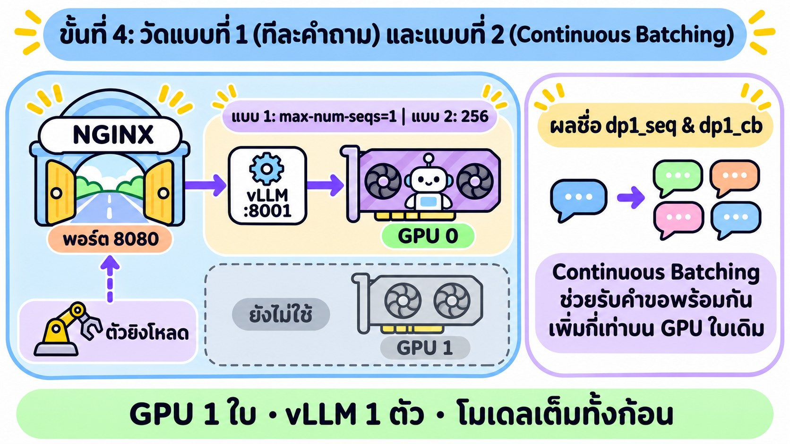

วัดบนการ์ดจอใบเดียว (`GPU 0` ของ `vapp-lab7-dp2`) เพื่อเปรียบเทียบ Baseline แบบตอบทีละคำถาม (`dp1_seq`, `--max-num-seqs 1`) กับ Continuous Batching (`dp1_cb`, `--max-num-seqs 256`) ทั้งระดับ Standard และ Fast

```text
[ที่ทำงาน]
container `multi-account` · /workspace/vastapp_lab · เครื่อง `vapp-lab7-dp2` (GPU 0 ใบเดียว) · SSH `/root/.ssh/id_ed25519` · เก็บที่ `lab7_llm_serving_lb`

[งาน]
วัดความจุบน 1× RTX 4090 ใบเดิม เทียบแบบที่ 1 ตอบทีละคำถาม (`dp1_seq`) กับแบบที่ 2 Continuous Batching (`dp1_cb`)

[ขั้นตอน]
1. เปิดโหมด 1 GPU ตอบทีละคำถาม (`node_single.sh up dp1 1`, `--max-num-seqs 1`) แล้วรัน `loadgen.py capacity` หาความจุ Standard ตั้งชื่อผล `dp1_seq`
2. เปิดโหมด 1 GPU Continuous Batching (`node_single.sh up dp1 256`, `--max-num-seqs 256`) บน GPU 0 ใบเดิม แล้วหาความจุ Standard (`dp1_cb`) และความจุ Fast (`dp1_cb_fast`, ใช้ค่า Fast SLO = 50% ของ 1-User จากขั้นที่ 2)
3. บันทึกผลลง `results/dp1_seq.json`, `results/dp1_cb.json`, `results/dp1_cb_fast.json` และดึงตัวอย่างคำถาม-คำตอบจริง 8 ข้อจาก 1-User Baseline วาด `results/dataset_samples.png`

[เกณฑ์ SLO]
Standard: TTFT p95 ≤ 2.0 s, Speed p5 ≥ 15.0 tok/s, error < 1% · Fast: TTFT p95 ≤ 2.0 s, Speed p5 ≥ 50% ของ 1-User, error < 1%

[รายงาน]
ตารางรายระดับ N และตารางเทียบ `dp1_seq` กับ `dp1_cb`: ความจุ Standard, ความจุ Fast, Peak Throughput (เพิ่มกี่เท่า), Running/Waiting และกำลังไฟ GPU (W) · บอกว่าเครื่องยังเปิดอยู่
```

**ผลจริงแบบที่ 1: `dp1_seq` (1× RTX 4090 · ตอบทีละคำถาม · `cap = 1` · `results/dp1_seq.json`):**

| N | TTFT p50 | TTFT p95 | Speed p50 | Speed p5 | Throughput | คำถาม/วินาที | Running / Waiting | GPU 0 (% / W) | ผล (Standard) |
|---:|---:|---:|---:|---:|---:|---:|---|---|---|
| 1 | 0.053 s | 0.055 s | 104.9 tok/s | 104.1 tok/s | 96.8 tok/s | 1.20 | 0.9 / 0.0 | 95% / 289 W | ผ่าน |
| **2** | 0.805 s | **1.073 s** | 104.7 tok/s | **104.1 tok/s** | **98.7 tok/s** | 1.25 | 0.9 / 1.0 | 98% / 295 W | **ผ่าน · ความจุ** |
| 4 | 2.447 s | 3.203 s | 104.8 tok/s | 104.0 tok/s | 99.0 tok/s | 1.25 | 0.9 / 3.0 | 97% / 295 W | ไม่ผ่าน 2 ครั้ง (TTFT > 2.0s) |
| 8 | 6.010 s | 6.489 s | 104.6 tok/s | 104.0 tok/s | 98.2 tok/s | 1.20 | 0.9 / 7.0 | 97% / 293 W | ไม่ผ่าน 2 ครั้ง (TTFT > 2.0s) |

**ผลจริงแบบที่ 2: `dp1_cb` & `dp1_cb_fast` (1× RTX 4090 · Continuous Batching · `cap = 256` · `results/dp1_cb.json`, `results/dp1_cb_fast.json`):**

| N | TTFT p50 | TTFT p95 | Speed p50 | Speed p5 | Throughput | คำถาม/วินาที | Running / Waiting | GPU 0 (% / W) | ผล Standard / Fast |
|---:|---:|---:|---:|---:|---:|---:|---|---|---|
| 1 | 0.024 s | 0.036 s | 104.7 tok/s | 103.8 tok/s | 99.6 tok/s | 1.25 | 0.9 / 0.0 | 99% / 295 W | ผ่าน / ผ่าน |
| 32 | 0.044 s | 0.062 s | 86.8 tok/s | 85.7 tok/s | 2,617.5 tok/s | 31.15 | 31.1 / 0.0 | 99% / 325 W | ผ่าน / ผ่าน |
| 64 | 0.050 s | 0.067 s | 74.2 tok/s | 73.0 tok/s | 4,497.6 tok/s | 51.45 | 62.2 / 0.0 | 100% / 372 W | ผ่าน / ผ่าน |
| **128** | 0.074 s | **0.106 s** | 54.5 tok/s | **52.68 tok/s** | 6,569.8 tok/s | 76.50 | 124.7 / 0.0 | 100% / 429 W | ผ่าน / **ผ่าน · ความจุ Fast** |
| 129 | 0.071 s | 0.099 s | 53.8 tok/s | 52.05 tok/s | 6,543.6 tok/s | 76.25 | 125.3 / 0.0 | 100% / 431 W | ผ่าน / ไม่ผ่าน 2 ครั้ง |
| 192 | 0.109 s | 0.255 s | 39.9 tok/s | 37.95 tok/s | **7,152.4 tok/s** | **84.70** | 183.4 / 0.0 | 100% / 432 W | ผ่าน / ไม่ผ่าน *(Peak TP)* |
| 256 | 0.137 s | 0.200 s | 29.0 tok/s | 28.12 tok/s | 6,989.3 tok/s | 80.15 | 247.8 / 0.0 | 100% / 427 W | ผ่าน / ไม่ผ่าน |
| 320 | 0.923 s | 1.015 s | 27.1 tok/s | 26.66 tok/s | 6,678.5 tok/s | 77.30 | 253.3 / 60.4 | 100% / 420 W | ผ่าน / ไม่ผ่าน |
| **384** | 1.747 s | **1.970 s** | 27.1 tok/s | **26.63 tok/s** | 6,652.9 tok/s | 77.60 | 253.5 / 122.1 | 100% / 421 W | **ผ่าน · ความจุ Standard (≥ 384)** |

ผลดิบ: [dp1_seq.json](results/dp1_seq.json) · [dp1_cb.json](results/dp1_cb.json) · [dp1_cb_fast.json](results/dp1_cb_fast.json)

**อ่านผลอย่างไร**

- **บน GPU ใบเดิม ค่าเช่าเท่าเดิม** การเปิด Continuous Batching เพิ่มความจุ Standard จาก **2 → ≥ 384 คน (≥ 192×)**, ความจุ Fast จาก **2 → 128 คน (64×)** และ Peak Throughput จาก **99.1 → 7,152.4 tok/s (72×)**
- สังเกตจุดอิ่มตัวของ 1× RTX 4090: Throughput พุ่งสูงสุดที่ `N = 192` (`7,152 tok/s`, กำลังไฟ `432 W`) จากนั้นเมื่อเพิ่ม `N` เป็น `320–384` คำถามส่วนเกินจาก `cap=256` เริ่มไปต่อคิว (`waiting` เพิ่มจาก 0 เป็น 60.4 และ 122.1 ข้อ) ทำให้ TTFT p95 กระโดดจาก `0.200 s` เป็น `1.015 s` และ `1.970 s` ทันที ขณะที่ความเร็วอ่านใน Batch คงที่ราว `26.6 tok/s`

---

## ขั้นที่ 5 · 2 GPU Data Parallelism + NGINX `least_conn` (สูตรชนะ LAB 6)

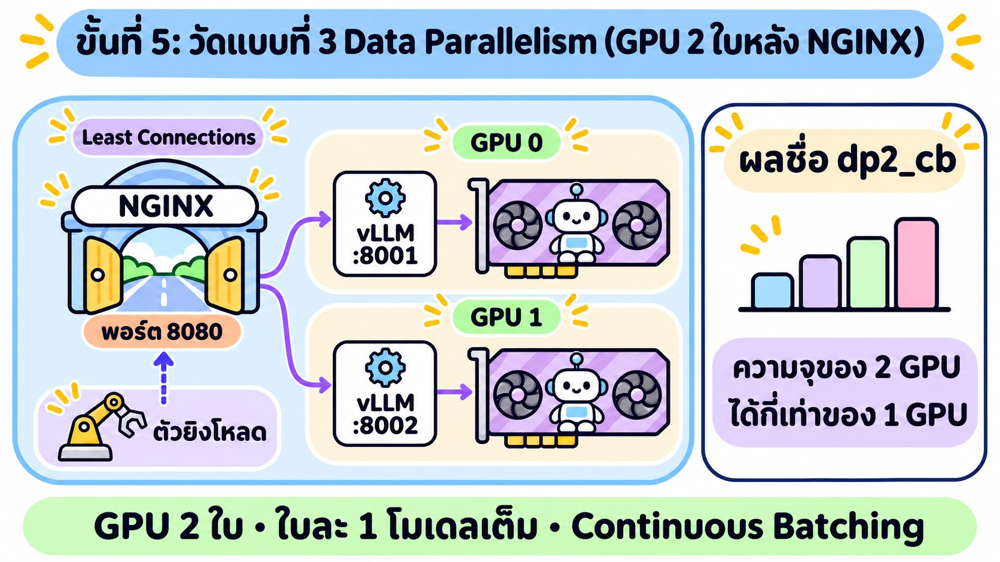

เปิดใช้ GPU ทั้ง 2 ใบของ `vapp-lab7-dp2` แบบ **Data Parallelism** (`gpu0` พอร์ต 8001 และ `gpu1` พอร์ต 8002, ใบละ 1 โมเดลเต็ม, `cap=256`) วางหลัง NGINX `least_conn` พอร์ต 8080 แล้ววัดทั้ง Standard และ Fast SLO

```text
[ที่ทำงาน]
container `multi-account` · /workspace/vastapp_lab · เครื่อง `vapp-lab7-dp2` (2× RTX 4090) · SSH `/root/.ssh/id_ed25519` · เก็บที่ `lab7_llm_serving_lb`

[งาน]
เปิดครบ 2× RTX 4090 แบบ Data Parallelism (GPU ใบละ 1 โมเดลเต็ม) หลัง NGINX `least_conn` วัดความจุแบบที่ 3 (`dp2_cb`)

[ขั้นตอน]
1. เปิดโหมด 2 GPU Data Parallelism (`node_single.sh up dp2 256` · `gpu0 :8001` และ `gpu1 :8002` · NGINX `least_conn` พอร์ต 8080)
2. รัน `loadgen.py capacity` หาความจุ Standard ตั้งชื่อผล `dp2_cb` (ไล่ถึงระดับที่ชิดเกณฑ์หรือล้ม 2 ระดับติดกัน)
3. รัน `loadgen.py capacity` หาความจุ Fast (`dp2_cb_fast`, ใช้ค่า Fast SLO = 50% ของ 1-User บนเครื่อง `dp2` และ `--seed-from dp2_cb.json` เพื่อประหยัดเวลา)
4. บันทึกผลลง `results/dp2_cb.json` และ `results/dp2_cb_fast.json`

[เกณฑ์ SLO]
Standard: TTFT p95 ≤ 2.0 s, Speed p5 ≥ 15.0 tok/s, error < 1% · Fast: TTFT p95 ≤ 2.0 s, Speed p5 ≥ 50% ของ 1-User, error < 1%

[รายงาน]
ตารางรายระดับ N และตารางเทียบ 1 GPU (`dp1_cb`) กับ 2 GPU (`dp2_cb`): Speedup, Scaling Efficiency (%), สัดส่วนงาน `gpu0`/`gpu1` และกำลังไฟ (W) · บอกว่าเครื่องยังเปิดอยู่
```

**ผลจริงแบบที่ 3: `dp2_cb` & `dp2_cb_fast` (2× RTX 4090 Data Parallelism + NGINX `least_conn` · `results/dp2_cb.json`, `results/dp2_cb_fast.json`):**

| N | TTFT p50 | TTFT p95 | Speed p50 | Speed p5 | Throughput | สัดส่วน `gpu0 / gpu1` | GPU 0 / 1 (W) | ผล Standard / Fast |
|---:|---:|---:|---:|---:|---:|---|---|---|
| 1 | 0.033 s | 0.038 s | 104.8 tok/s | 103.1 tok/s | 98.8 tok/s | 50.0% / 50.0% | 185 / 194 W | ผ่าน / ผ่าน |
| 64 | 0.045 s | 0.063 s | 86.7 tok/s | 85.2 tok/s | 5,229.1 tok/s | 49.6% / 50.4% | 324 / 326 W | ผ่าน / ผ่าน |
| 128 | 0.050 s | 0.068 s | 73.9 tok/s | 72.5 tok/s | 8,943.9 tok/s | 50.3% / 49.7% | 371 / 371 W | ผ่าน / ผ่าน |
| 256 | 0.072 s | 0.100 s | 54.4 tok/s | 52.44 tok/s | 13,125.3 tok/s | 50.3% / 49.7% | 429 / 426 W | ผ่าน / ผ่าน |
| **265** | 0.104 s | **0.216 s** | 55.2 tok/s | **52.96 tok/s** | 13,416.9 tok/s | 49.5% / 50.5% | 437 / 436 W | ผ่าน / **ผ่าน · ความจุ Fast** |
| 271 | 0.093 s | 0.197 s | 53.5 tok/s | 51.27 tok/s | 13,428.0 tok/s | 49.8% / 50.2% | 439 / 438 W | ผ่าน / ไม่ผ่าน 2 ครั้ง |
| 384 | 0.105 s | 0.230 s | 39.4 tok/s | 37.59 tok/s | 14,198.8 tok/s | 50.0% / 50.0% | 430 / 428 W | ผ่าน / ไม่ผ่าน |
| 512 | 0.140 s | 0.412 s | 29.8 tok/s | 27.82 tok/s | **14,241.6 tok/s** | 50.1% / 49.9% | 428 / 425 W | ผ่าน / ไม่ผ่าน *(Peak TP)* |
| 640 | 0.924 s | 1.051 s | 27.0 tok/s | 26.58 tok/s | 13,288.0 tok/s | 50.2% / 49.8% | 420 / 417 W | ผ่าน / ไม่ผ่าน |
| **768** | 1.747 s | **1.941 s** | 27.0 tok/s | **26.58 tok/s** | 13,240.0 tok/s | 50.3% / 49.7% | 420 / 417 W | **ผ่าน · ความจุ Standard (≥ 768)** |

**เทียบ Scaling 1 GPU (`dp1_cb`) → 2 GPU Data Parallelism (`dp2_cb`):**

| ตัวชี้วัด | 1× RTX 4090 (`dp1_cb`) | 2× RTX 4090 DP (`dp2_cb`) | Speedup | Scaling Efficiency |
|---|---:|---:|---:|---:|
| ความจุ Standard | ≥ 384 คน | **≥ 768 คน** | **2.00×** | **100.0%** |
| ความจุ Fast (≥ 52.44 tok/s) | 128 คน | **265 คน** | **2.07×** | **~100%** |
| Peak System Throughput | 7,152.4 tok/s | **14,241.6 tok/s** | **1.991×** | **99.6%** |

ผลดิบ: [dp2_cb.json](results/dp2_cb.json) · [dp2_cb_fast.json](results/dp2_cb_fast.json)

**อ่านผลอย่างไร**

- **สูตรชนะของ LAB 6 ใช้กับ LLM ได้ผลแทบสมบูรณ์แบบ:** ขยายจาก 1 เป็น 2 GPU ได้ Peak Throughput **14,242 tok/s** (**Scaling Efficiency 99.6%**) และความจุเพิ่มขึ้นเป็น 2 เท่าทั้ง Standard และ Fast โดยมี error 0 ทุกระดับ
- NGINX `least_conn` กระจายงานระหว่าง `gpu0` และ `gpu1` แทบเท่ากันเป๊ะ (`49.5%–50.5%` ทุกระดับ N) และ CPU ของ NGINX ที่ 768 ผู้ใช้ใช้เพียง **0.71 core** (`70.8%` ของ 1 core)
- GPU ทั้ง 2 ใบทำงานเต็ม 100% ที่กำลังไฟ **~420–438 W ต่อใบ** แทบเท่ากับ 1 GPU เดี่ยว พิสูจน์ว่าไม่มีการเสียเวลาซิงค์ข้ามการ์ดจอเลย

---

## ขั้นที่ 6 · Concurrency Limit เมื่อผู้ใช้เกินความจุ (`N = 1,152`)

ยิงโหลดเกินความจุที่ **`N = 1,152` คน** (`1.5×` ของ 768 คน) นาน 45 วินาที (อุ่นเครื่อง 10 วินาที นับผล 35 วินาที) บน `dp2` แล้วเปลี่ยนเพดาน `--max-num-seqs` ต่อ replica เป็น 4 ค่า (`32`, `64`, `128`, `256`) เพื่อดูว่าเพดานช่วยรับคนเพิ่มได้จริงหรือไม่

```text
[ที่ทำงาน]
container `multi-account` · /workspace/vastapp_lab · เครื่อง `vapp-lab7-dp2` (2× RTX 4090) · SSH `/root/.ssh/id_ed25519` · เก็บที่ `lab7_llm_serving_lb`

[งาน]
ทดสอบผลของเพดาน Concurrency Limit (`--max-num-seqs`) เมื่อมีผู้ใช้เข้ามาเกินความจุของระบบ 1.5 เท่า

[ขั้นตอน]
1. คำนวณระดับโหลดเกินความจุ `OVERLOAD_N = round(1.5 × ความจุ Standard จากขั้นที่ 5)` (เช่น 1,152 คนเมื่อความจุ 768)
2. วนทดสอบเพดาน 4 ค่า: `32`, `64`, `128` และ `256` ต่อ replica โดยสลับด้วย `node_single.sh up dp2 <cap>` แล้วรัน `loadgen.py single` ที่ `N = OVERLOAD_N` นาน 45 s (อุ่นเครื่อง 10 s นับผล 35 s)
3. บันทึกผลลง `results/cap_32.json` ถึง `results/cap_256.json` และวาดกราฟเปรียบเทียบ `results/images/04_cap_sweep.png`

[รายงาน]
ตารางเทียบทั้ง 4 เพดาน (Running/Waiting, TTFT p95, Speed p5, Throughput, กำลังไฟ GPU, ผ่าน SLO หรือไม่) · สรุปว่าเพดานช่วยรับคนเพิ่มได้จริงหรือไม่ และควรเลือกค่าไหนสำหรับ Fast vs Standard · บอกว่าเครื่องยังเปิดอยู่
```

**ผลจริง (`results/cap_32.json` .. `cap_256.json` · `N = 1,152` คนบน 2× RTX 4090):**

| เพดาน (`max-num-seqs` ต่อ replica) | Running / Waiting เฉลี่ยต่อใบ | TTFT p50 | TTFT p95 | Speed p50 | Speed p5 | Throughput | GPU 0 / 1 (W) | error | ผ่าน SLO ไหม |
|---:|---|---:|---:|---:|---:|---:|---|---:|---|
| **32** | 31.5 / 543.6 | 17.93 s | 18.32 s | 85.3 tok/s | **82.71 tok/s** | 5,235 tok/s | 321 / 321 W | 0 | ไม่ผ่าน (TTFT เกิน 9×) |
| **64** | 63.2 / 510.8 | 9.92 s | 10.12 s | 72.6 tok/s | 71.24 tok/s | 8,931 tok/s | 372 / 372 W | 0 | ไม่ผ่าน (TTFT เกิน 5×) |
| **128** | 126.8 / 445.9 | 6.16 s | 6.34 s | 51.2 tok/s | 50.13 tok/s | 12,582 tok/s | 425 / 423 W | 0 | ไม่ผ่าน (TTFT เกิน 3×) |
| **256** | 253.4 / 314.2 | 4.23 s | **4.38 s** | 27.0 tok/s | 26.57 tok/s | **13,275 tok/s** | 417 / 415 W | 0 | ไม่ผ่าน (TTFT เกิน 2×) |

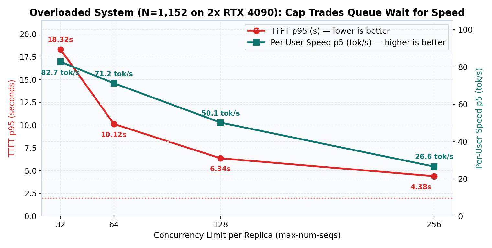

ผลดิบ: [cap_32.json](results/cap_32.json) · [cap_64.json](results/cap_64.json) · [cap_128.json](results/cap_128.json) · [cap_256.json](results/cap_256.json)

**อ่านผลอย่างไร**

- **เพดานไม่ช่วยให้ผ่านเกณฑ์เมื่อโหลดเกินความจุ:** ที่ `N = 1,152` ไม่มีค่าเพดานใดที่ผ่านเกณฑ์ TTFT ≤ 2.0 s เลย
- **การตั้งเพดานต่ำเกินไป (`cap=32`) เสีย Throughput ฟรี:** GPU ทำงานไม่ถึงจุดอิ่มตัว (กำลังไฟตกเหลือ 321 W, Throughput เหลือ 5,235 tok/s) คิวจึงยาวสะสมถึง 544 คำถามต่อ GPU และ TTFT พุ่งถึง 18.32 วินาที
- **แนวทางเลือกเพดานที่เหมาะสม:** หากต้องการ **Fast SLO** ควรคุมเพดานไว้แถว **128 ต่อใบ** (ตรงกับความจุ Fast ของ 1× RTX 4090) และใช้ Admission Control / Rate Limit ปฏิเสธโหลดส่วนเกินแทนการปล่อยให้คิวยาวเป็นสิบวินาที · หากต้องการ **Standard SLO** และ Throughput สูงสุด ใช้ **256 ต่อใบ**

---

## ขั้นที่ 7 · NGINX `least_conn` กับคำตอบยาวไม่เท่ากัน และ Replica Failover

ทดสอบ 2 สถานการณ์จริงของการทำงานบน Production ที่ `N = 307` คน (40% ของความจุ Standard 768 คน) บน `dp2` (`cap=256`):
1. **คำตอบยาวไม่เท่ากัน (`mix_short` vs `mix_long`):** ยิง 60 วินาทีแบบคำตอบสั้นล้วน (0% ยาว) เทียบกับมีคำตอบละเอียดยาวถึง 600 tokens ปนอยู่ 20%
2. **Replica ล่มกลางการ Streaming (`fail_replica`):** ยิง 75 วินาทีแล้วส่ง `SIGKILL` ปิด replica ของ `gpu1` (พอร์ต 8002) กะทันหันกลางการตอบ (เกิดจริงที่ `t = 29.4 s`)

```text
[ที่ทำงาน]
container `multi-account` · /workspace/vastapp_lab · เครื่อง `vapp-lab7-dp2` (2× RTX 4090) · SSH `/root/.ssh/id_ed25519` · เก็บที่ `lab7_llm_serving_lb`

[งาน]
ทดสอบ 2 สถานการณ์จริงบน Production ด้วย NGINX `least_conn`: (1) คำตอบสั้น-ยาวผสมกัน และ (2) Replica ล่มกลางการ Streaming

[ขั้นตอน]
1. เปิด `node_single.sh up dp2 256` และตั้งโหลด `MIX_N = round(0.4 × ความจุ Standard จากขั้นที่ 5)` (เช่น 307 คน)
2. วัดสมดุลคำตอบสั้น-ยาว (60 s, อุ่นเครื่อง 10 s): รัน `mix_short` (`--long-pct 0`, `max_tokens=150`) เทียบกับ `mix_long` (`--long-pct 20`, คำตอบยาว `max_tokens=600`)
3. วัด Replica Failover (`fail_replica`, 75 s, อุ่นเครื่อง 10 s): ตั้งเวลาสั่ง `node_single.sh kill-port 8002` (`SIGKILL`) ที่ +35 s กลางการ Streaming พร้อมบันทึก timestamp ลง `results/fail_event.json`
4. บันทึก `mix_short.json`, `mix_long.json`, `fail_replica.json` และวาด `results/images/05_mix_and_failover.png` (ปักเส้นเวลาปิด GPU 1 ตาม `kill_scheduled_epoch - t0_epoch` จริง)

[รายงาน]
ตารางเทียบ `mix_short` vs `mix_long` (งานค้างเฉลี่ย `gpu0`/`gpu1`, TTFT, Speed, error) และผล `fail_replica` (จำนวนสตรีมที่ขาดตอนล่ม, error หลังล่ม, Throughput ของ `gpu0` ที่เหลือ) · บอกว่าเครื่องยังเปิดอยู่
```

**ผลจริงส่วนที่ 1: คำตอบสั้นล้วน เทียบ มีคำตอบยาว 20% (`N = 307`, นับผล 50 วินาทีหลัง):**

| กรณี | ความยาวคำตอบเฉลี่ย | งานค้างเฉลี่ย `gpu0` / `gpu1` | สัดส่วนคำถาม `gpu0` / `gpu1` | TTFT p95 | Speed p5 | Throughput | error |
|---|---:|---|---|---:|---:|---:|---:|
| **`mix_short`** (สั้น 100%) | 86.1 tok | **144.0 / 145.9** *(ต่าง 1.9)* | 50.3% / 49.7% | 0.249 s | 47.03 tok/s | **13,860 tok/s** | 0 |
| **`mix_long`** (ยาว 20% · 623 ข้อ) | 193.9 tok | **151.7 / 151.2** *(ต่าง 0.5)* | 50.9% / 49.1% | 0.131 s | 36.04 tok/s | **11,351 tok/s** | 0 |

**ผลจริงส่วนที่ 2: ปิด `gpu1` กะทันหันกลางการ Streaming (`fail_replica`, `N = 307`, ปิดจริงที่ `t = 29.4 s`):**

| ช่วงเวลา | ตัวชี้วัดที่วัดได้จริง |
|---|---|
| ก่อนล่ม (`t = 10..28 s`) | `gpu0` + `gpu1` ทำงานคู่กันที่ Throughput เฉลี่ย **~13,800 tok/s** (ก่อน t=35 รวมช่วงเปลี่ยนผ่านเฉลี่ย 12,214 tok/s) · error 0 |
| วินาทีที่ล่ม (`t = 29 s`) | `gpu1` ถูกปิดด้วย `SIGKILL` ที่ `t = 29.37 s` · คำตอบที่กำลัง Streaming บน `gpu1` ขาดกลางประโยค **153 ข้อ** (`conn_ClientPayloadError`) |
| หลังล่ม (`t = 30..74 s`) | **error 0 ทุกวินาที** ตลอด 45 วินาทีที่เหลือ · `gpu0` รับ 307 คนคนเดียวทันที (Running ~253, Waiting ~45) ที่ Throughput เฉลี่ย **6,599 tok/s** |
| ตลอดทั้งรอบ (65 วินาทีนับผล) | ตอบสำเร็จ **6,647 ข้อ** (`gpu0` 5,085 + `gpu1` 1,562) · TTFT p95 **0.846 s** · Speed p5 **26.60 tok/s** |

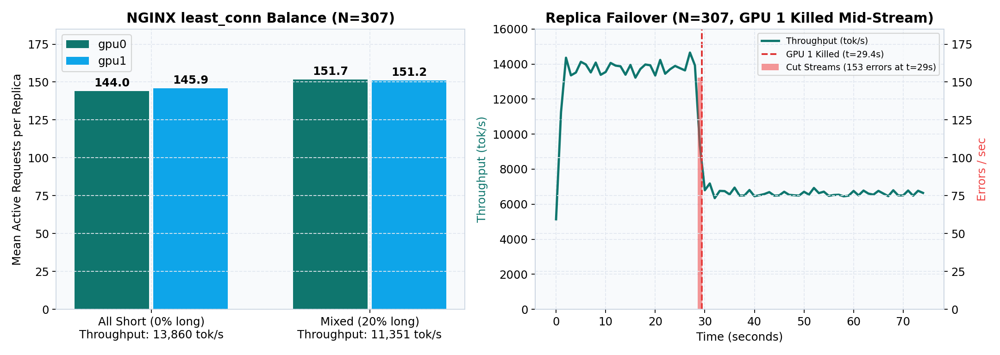

ผลดิบ: [mix_short.json](results/mix_short.json) · [mix_long.json](results/mix_long.json) · [fail_replica.json](results/fail_replica.json) · [fail_event.json](results/fail_event.json)

**อ่านผลอย่างไร**

- **NGINX `least_conn` รับมือคำตอบยาวไม่เท่ากันได้ยอดเยี่ยม:** เมื่อมีคำตอบยาว 20% ค่าเฉลี่ยความยาวคำตอบพุ่งกว่า 2 เท่า (`86.1 → 193.9 tokens`) แต่งานค้างเฉลี่ยของ `gpu0` (`151.7`) และ `gpu1` (`151.2`) ต่างกันเพียง **0.5 คำถาม** · ความเร็ว p5 ลดจาก 47.0 เหลือ 36.0 tok/s เพราะ KV Cache ของคำตอบยาวกินแบนด์วิดท์หน่วยความจำมากขึ้น
- **Failover ของ Streaming ต่างจาก LAB 6:** ใน LAB 6 คำขอตรวจภาพที่ยังไม่ตอบส่งซ้ำได้ error 0 ทั้งหมด แต่ใน LLM Streaming คำตอบที่กำลังไหลอยู่บน `gpu1` **153 ข้อ** ถูกตัดทันที (ต้องให้ฝั่ง client ถามซ้ำ) · จุดที่ NGINX ทำได้ดีเยี่ยมคือ **ตั้งแต่ `t = 30 s` เป็นต้นไปไม่มี error เกิดขึ้นอีกเลยแม้แต่ข้อเดียว** และ `gpu0` ใบเดียวยังรับผู้ใช้ 307 คนผ่านเกณฑ์ Standard SLO ได้ต่อเนื่อง (เพราะ 307 < ความจุ 1 ใบ ≥ 384 คน!)

---

# ส่วน D · แทร็กที่ 2 (1 โหนด × 4× RTX 4090 · Model Parallelism แบบ 2+2)

## ขั้นที่ 8 · 4× RTX 4090 Model Parallelism แบบ 2+2 + NGINX `least_conn`

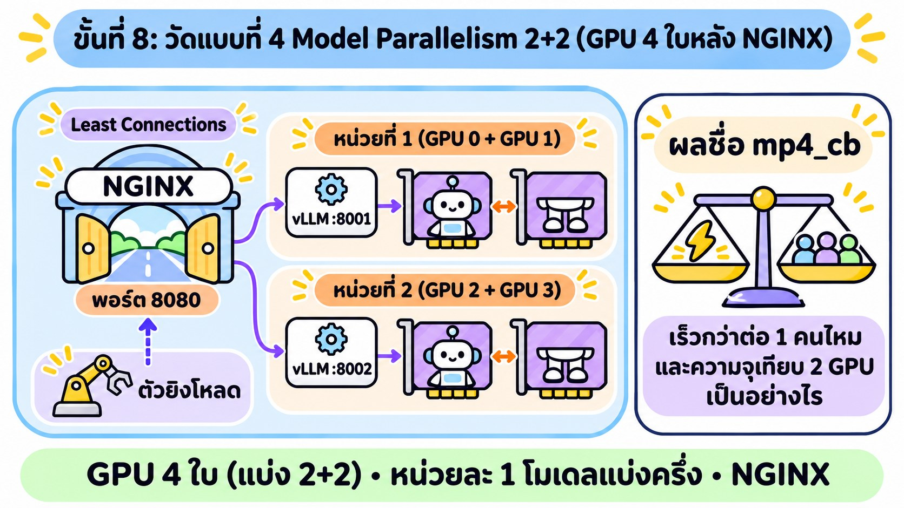

บนเครื่องที่ 2 (`vapp-lab7-mp4` · 1 โหนด × 4× RTX 4090) แบ่ง GPU 4 ใบออกเป็น **2 replica แบบ Model Parallelism (`2 replica × TP=2`, `--tensor-parallel-size 2`)**: หน่วยที่ 1 คือ `gpu0+1` (พอร์ต 8001) และหน่วยที่ 2 คือ `gpu2+3` (พอร์ต 8002) วางหลัง NGINX `least_conn` (`cap = 512` ต่อหน่วย) แล้ววัดเทียบตรง ๆ กับ `2× RTX 4090 Data Parallelism`

```text
[ที่ทำงาน]
container `multi-account` · /workspace/vastapp_lab · เครื่อง `vapp-lab7-mp4` (4× RTX 4090) · SSH `/root/.ssh/id_ed25519` · เก็บที่ `lab7_llm_serving_lb`

[งาน]
วัดความจุแบบที่ 4: Model Parallelism แบบ 2+2 (`2 replica × TP=2`) บน 4× RTX 4090 หลัง NGINX `least_conn` เพื่อเทียบตรงกับ 2 GPU Data Parallelism

[ขั้นตอน]
1. เปิดโหมด Model Parallelism 2+2 (`node_single.sh up mp2 512`) แบ่ง 4 GPU เป็น 2 replica: `gpu0+1` (`:8001`, `--tensor-parallel-size 2`) และ `gpu2+3` (`:8002`, `--tensor-parallel-size 2`) วางหลัง NGINX `least_conn` พอร์ต 8080
2. รัน `loadgen.py capacity` หาความจุ Standard (`mp4_cb`) และความจุ Fast (`mp4_cb_fast`, ใช้ Fast SLO = 50% ของ 1-User 1 GPU บนเครื่อง `mp4` และ `--seed-from mp4_cb.json`)
3. บันทึกผลลง `results/mp4_cb.json` และ `results/mp4_cb_fast.json`

[เกณฑ์ SLO]
Standard: TTFT p95 ≤ 2.0 s, Speed p5 ≥ 15.0 tok/s, error < 1% · Fast: TTFT p95 ≤ 2.0 s, Speed p5 ≥ 50% ของ 1-User 1 GPU บนเครื่อง `mp4`, error < 1%

[รายงาน]
ตารางรายระดับ N และตารางเทียบ `mp4_cb` (4 GPU) กับ `dp2_cb` (2 GPU): 1-User Speed, TTFT, ความจุ Standard/Fast, Peak Throughput, Throughput/GPU และกำลังไฟ GPU (W) · บอกว่าเครื่องยังเปิดอยู่
```

**ผลจริงแบบที่ 4: `mp4_cb` & `mp4_cb_fast` (4× RTX 4090 Model Parallelism 2+2 + NGINX `least_conn` · `results/mp4_cb.json`, `results/mp4_cb_fast.json`):**

| N | TTFT p50 | TTFT p95 | Speed p50 | Speed p5 | Throughput | สัดส่วน `0+1 / 2+3` | กำลังไฟเฉลี่ย 4 GPU (W) | ผล Standard / Fast |
|---:|---:|---:|---:|---:|---:|---|---|---|
| 1 | 0.022 s | **0.024 s** | **164.4 tok/s** | **163.0 tok/s** | 155.2 tok/s | 50.0% / 50.0% | 169/188/184/148 W | ผ่าน / ผ่าน |
| 32 | 0.033 s | 0.043 s | 106.7 tok/s | 104.6 tok/s | 3,237.1 tok/s | 50.8% / 49.2% | 230/240/225/199 W | ผ่าน / ผ่าน |
| 64 | 0.044 s | 0.056 s | 81.5 tok/s | 80.1 tok/s | 4,940.0 tok/s | 50.0% / 50.0% | 216/235/223/189 W | ผ่าน / ผ่าน |
| 128 | 0.060 s | 0.074 s | 59.1 tok/s | 56.0 tok/s | 7,079.7 tok/s | 51.6% / 48.4% | 224/243/221/186 W | ผ่าน / ผ่าน |
| **149** | 0.063 s | **0.074 s** | 53.7 tok/s | **50.33 tok/s** | 7,447.4 tok/s | 52.2% / 47.8% | 239/250/228/199 W | ผ่าน / **ผ่าน · ความจุ Fast** |
| 151 | 0.064 s | 0.076 s | 53.2 tok/s | 49.80 tok/s | 7,471.2 tok/s | 51.8% / 48.2% | 239/253/228/199 W | ผ่าน / ไม่ผ่าน 2 ครั้ง |
| 256 | 0.092 s | 0.103 s | 37.8 tok/s | 34.55 tok/s | 8,904.4 tok/s | 51.9% / 48.1% | 233/253/224/192 W | ผ่าน / ไม่ผ่าน |
| 512 | 0.173 s | 0.192 s | 20.4 tok/s | 18.34 tok/s | 9,488.7 tok/s | 53.4% / 46.6% | 233/249/223/192 W | ผ่าน / ไม่ผ่าน |
| 640 | 0.988 s | 1.557 s | 18.1 tok/s | 16.81 tok/s | 9,480.2 tok/s | 52.5% / 47.5% | 233/247/222/191 W | ผ่าน / ไม่ผ่าน |
| **661** | 1.114 s | **1.931 s** | 18.4 tok/s | **16.32 tok/s** | 9,448.0 tok/s | 53.8% / 46.2% | 236/248/220/193 W | **ผ่าน · ความจุ Standard** *(รอบ 2)* |
| 683 | 1.244 s | 2.051 s | 18.2 tok/s | 16.19 tok/s | 9,466.0 tok/s | 52.4% / 47.6% | 236/248/222/193 W | ไม่ผ่าน 2 ครั้ง (TTFT > 2.0s) |
| 688 | 1.321 s | 2.118 s | 17.9 tok/s | 15.71 tok/s | **9,547.4 tok/s** | 52.0% / 48.0% | 236/248/222/192 W | ไม่ผ่าน 2 ครั้ง *(Peak TP)* |

ผลดิบ: [mp4_cb.json](results/mp4_cb.json) · [mp4_cb_fast.json](results/mp4_cb_fast.json) · [mp4_n1_baseline.json](results/mp4_n1_baseline.json)

**อ่านผลอย่างไร**

- **ผู้ใช้ 1 คนเร็วขึ้นชัดเจน (+56%–64%):** `164.0 tok/s` และ `TTFT 24 ms` ชนะ Data Parallelism (`104.9 tok/s`, `36 ms`) ตั้งแต่คำถามแรก
- **แต่เมื่อผู้ใช้หลายคนพร้อมกัน 4× RTX 4090 Model Parallelism แพ้ 2× RTX 4090 Data Parallelism ทุกมิติความจุ:** ความจุ Standard (`661 vs ≥ 768 คน`), ความจุ Fast (`149 vs 265 คน`), Peak Throughput (`9,547 vs 14,242 tok/s`) และ **Throughput ต่อ GPU ต่ำกว่าถึง 3.0 เท่า** (`2,387 vs 7,121 tok/s/GPU`)
- **หลักฐานเชิงกายภาพของ PCIe AllReduce Overhead:** แม้ `nvidia-smi` จะรายงาน `GPU utilization = 99.8%` แต่กำลังไฟจริงของทั้ง 4 การ์ดอยู่เพียง **191–253 W** (~ครึ่งหนึ่งของ 420–438 W บน Data Parallelism) เพราะเคอร์เนล NCCL กำลัง **busy-wait รอซิงค์ข้อมูลข้าม PCIe 4.0** ทุก Layer แทนที่จะใช้ Compute เต็มที่
- **ข้อสังเกตเรื่องรอบวัดซ้ำที่ N = 661:** รอบแรกของ N = 661 ล้มเหลวเพราะ `gpu2+3` หยุดรับงานชั่วคราว (งาน 100% ไปกองที่ `gpu0+1`) และรอบวัดซ้ำผ่านปกติ (TTFT p95 `1.931 s`)

---

# ส่วน E · สาธิตความเร็ว 1× และสรุป

## ขั้นที่ 9 · บันทึก Trace Token จริงและสร้างไฟล์ `.gif` ความเร็ว 1×

เพื่อให้ผู้เรียนเห็นความแตกต่างของความเร็ว Token ด้วยตาเปล่าโดยไม่ต้องจินตนาการจากตัวเลขอย่างเดียว เราอัด Timestamp ของทุก Token จริงจาก RTX 4090 (`results/stream_mp2_n1.json` และ `results/dp1_n1_baseline.json`) แล้วเรนเดอร์เป็นไฟล์ `.gif` ความเร็ว **1× Real-Time** ด้วยฟอนต์ภาษาไทยคมชัด 2 ไฟล์

```text
[ที่ทำงาน]
container `multi-account` · /workspace/vastapp_lab · เครื่อง `vapp-lab7-dp2` และ `vapp-lab7-mp4` · เก็บที่ `lab7_llm_serving_lb`

[งาน]
อัด Timestamp ของทุก Token จริงจาก RTX 4090 แล้วเรนเดอร์เป็นไฟล์ `.gif` ความเร็ว 1× จริง (Real-Time) 2 ไฟล์เพื่อให้เห็นความเร็วการไหลด้วยตาเปล่า

[ขั้นตอน]
1. เขียนสคริปต์อัด trace การ Streaming จริง (`stream_options: include_usage`) จาก `TP=2 N=1` บน `mp4` และจาก `DP 1 GPU N=1`, `DP 2 GPU` โหลดกลาง/สูง บน `dp2` บันทึกลง `results/stream_*.json`
2. เขียนสคริปต์เรนเดอร์ `.gif` ความเร็ว 1× (10 FPS, ยาว 9–11 วินาที, ใช้ฟอนต์ไทยคมชัดและกรองอักขระนอกฟอนต์ไม่ให้เป็นกล่องสี่เหลี่ยม) 2 ไฟล์:
   - `images/lab/demo-speed-by-load.gif`: เทียบ 4 สภาวะพร้อมกัน (`TP=2 N=1`, `DP 1-GPU N=1`, `DP 2-GPU โหลดกลาง`, `DP 2-GPU โหลดสูง`)
   - `images/lab/demo-4users-live.gif`: แชทสั้น-ยาวต่อเนื่อง 3 รอบของ 4 ผู้ใช้พร้อมกันหลัง NGINX `least_conn` แสดงป้าย `gpu0` / `gpu1`
3. ตรวจเฟรมตัวอย่างของทั้ง 2 ไฟล์ว่าข้อความภาษาไทยคมชัด ไม่มีช่องสี่เหลี่ยม

[รายงาน]
เวลาจบของแต่ละสภาวะ · จำนวนเฟรมและความยาวจริงของทั้ง 2 ไฟล์ `.gif` · บอกว่าเครื่องยังเปิดอยู่
```

**ผลจริง:**
- [demo-speed-by-load.gif](images/lab/demo-speed-by-load.gif) (106 เฟรม · **10.6 วินาที** ความเร็ว 1× จริง · คำถามเดียวกัน 240 tokens):
  - `Model Parallelism (TP=2, N=1)` (`160.7 tok/s`) ตอบจบใน **1.54 วินาที**
  - `Data Parallelism 1 GPU (N=1)` (`104.9 tok/s`) ตอบจบใน **2.32 วินาที**
  - `2× RTX 4090 Data Parallelism (N=128)` (`73.9 tok/s`) ตอบจบใน **3.30 วินาที**
  - `2× RTX 4090 Data Parallelism (N=512)` (`29.8 tok/s`) ใช้เวลาราว **8.19 วินาที** — ยังอ่านได้ลื่นสบายและเร็วกว่าความเร็วอ่านของมนุษย์
- [demo-4users-live.gif](images/lab/demo-4users-live.gif) (92 เฟรม · **9.2 วินาที** ความเร็ว 1× จริง): แสดง 4 ผู้ใช้ส่งคำถามสั้น-ยาวต่อเนื่อง 3 รอบพร้อมกันพร้อมป้าย `NGINX -> gpu0 / gpu1` สลับทำงานจริง

ผลดิบและสคริปต์: [stream_mp2_n1.json](results/stream_mp2_n1.json) · [generate_results_and_gifs.py](tools/generate_results_and_gifs.py)

---

## ขั้นที่ 10 · สร้างกราฟสรุปและลบเครื่องเช่าทั้ง 2 เครื่อง (ห้ามข้าม)

ดึงไฟล์ผลทั้งหมดกลับเข้าโฟลเดอร์ `results/` สร้างกราฟสรุปทั้ง 6 ภาพและสไลด์ HTML จากนั้น **ลบเครื่องเช่าทั้ง 2 เครื่องทันที** และตรวจซ้ำให้เหลือ 0 เครื่อง

```text
[ที่ทำงาน]
container `multi-account` · /workspace/vastapp_lab · สกิล vastai · เก็บที่ `lab7_llm_serving_lb`

[งาน]
ดึงไฟล์ผลทั้งหมดกลับเข้าเครื่อง สร้างกราฟสรุปครบทุกการทดลอง และลบเครื่องเช่าทั้ง 2 เครื่องทันทีเพื่อหยุดค่าบริการ

[ขั้นตอน]
1. ดึงไฟล์ผลดิบ `.json` และ log จากทั้ง `vapp-lab7-dp2` และ `vapp-lab7-mp4` ลงมาเก็บที่ `lab7_llm_serving_lb/results/` และรวมตัวเลขสำคัญเป็น `results/metrics.json`
2. ลบเครื่องเช่าทั้ง 2 เครื่องทันทีด้วย `vastai destroy instance <id_dp2> -y` และ `vastai destroy instance <id_mp4> -y` แล้วตรวจ `vastai show instances` ให้เหลือ **0 instances**
3. วาดกราฟสรุปครบทุกภาพลง `results/images/` (`01_capacity_and_throughput.png`, `02_speed_and_throughput_curves.png`, `03_dp2_vs_mp4_tradeoff.png`, `04_cap_sweep.png`, `05_mix_and_failover.png`, `06_loadtest_check.png`)

[รายงาน]
ยืนยันผล `vastai show instances` = 0 เครื่อง · รายการไฟล์ผลและกราฟทั้งหมด · สรุปตารางเปรียบเทียบทั้ง 4 การออกแบบครบทุกมิติ
```

**ผลจริง:**
- ดึงไฟล์ผล JSON ครบทั้งหมดลง `results/` และสร้าง [metrics.json](results/metrics.json) กับกราฟ 6 ภาพใน [results/images/](results/images/) ครบถ้วน
- ลบเครื่อง `62662793` (`vapp-lab7-dp2`) และ `62662797` (`vapp-lab7-mp4`) เรียบร้อยแล้ว ตรวจ `vastai show instances` เหลือ **0 instances**

---

## สิ่งที่เจอจริงระหว่างทำ

| เกิดอะไรขึ้น | ขั้น | บทเรียน |
|---|---|---|
| `dp1_cb` (N=384) และ `dp2_cb` (N=768) ผ่านถึงระดับสุดท้ายของรายการสแกน โดย TTFT p95 อยู่ที่ `1.970 s` และ `1.941 s` | 4, 5 | รายงานเป็นขอบล่าง (`≥ 384`, `≥ 768`) ตรงตามข้อมูลจริง เพราะยังไม่ล้ม 2 ระดับติดกัน แม้จะชิดเส้น 2.0 s แล้วก็ตาม |
| 1× RTX 4090 บนเครื่อง `dp2` (104.87 tok/s) เร็วกว่าเครื่อง `mp4` (100.14 tok/s) ราว 4.5% | 2 | เครื่องเช่าคนละโฮสต์มีความเร็วต่างกันเล็กน้อย (PCIe, พัดลม, โหลดร่วม) จึงตั้งเกณฑ์ Fast SLO แยกตาม baseline ของแต่ละเครื่อง |
| `mp4_cb` ที่ `N=661` รอบแรก `gpu2+3` หยุดรับงานชั่วคราว (งาน 100% ไปลง `gpu0+1`) แล้วรอบสองผ่านปกติ | 8 | `max_fails=1 fail_timeout=30s` ของ NGINX พัก replica 30 วินาทีหากมีข้อผิดพลาดครั้งเดียว การวัดซ้ำเมื่อไม่ผ่านช่วยแยก hiccup ชั่วคราวออกจากขีดจำกัดจริง |
| 4× RTX 4090 Model Parallelism รายงาน `GPU utilization = 99.8%` แต่กินไฟเพียง 191–253 W ต่อใบ (เทียบ ~420 W บน Data Parallelism) | 8 | อย่าดู `GPU utilization %` อย่างเดียวในงาน Multi-GPU — NCCL polling นับเป็น 100% GPU utilization แม้การ์ดจอจะรอซิงค์ PCIe อยู่ ให้ดูกำลังไฟ (W) และ Throughput/GPU คู่กันเสมอ |
| ใน `fail_replica` สคริปต์ตั้งเวลาปิด `gpu1` ที่ `+35 s` แต่เหตุการณ์จริงเกิดที่ `t = 29.4 s` บนกราฟ | 7 | `loadgen.py` ใช้เวลาราว 5.6 วินาทีเปิด worker processes ก่อนเริ่มนับ `t = 0` จึงต้องเทียบ `kill_scheduled_epoch - t0_epoch` เสมอเวลาวาดกราฟ |
| อีโมจิในคำตอบจริงของ Qwen3-4B แสดงเป็นกล่องสี่เหลี่ยมเมื่อเรนเดอร์ด้วยฟอนต์ Leelawadee UI | 9 | กรองสัญลักษณ์นอกชุดฟอนต์ก่อนเรนเดอร์ GIF และภาพตาราง เพื่อให้ข้อความภาษาไทยคมชัด 100% |

---

# สรุปผลการทดลองและแนวทางเลือกใช้งานจริง


## 1 · ความจุและ Throughput ของทั้ง 4 แบบ

| แบบ | GPU | ความจุ Standard | ความจุ Fast | Peak Throughput | Throughput / GPU | 1-User Speed |
|---|---:|---:|---:|---:|---:|---:|
| 1 · `dp1_seq` (ตอบทีละคำถาม) | 1 | **2 คน** | **2 คน** | 99 tok/s | 99 tok/s | 104.9 tok/s |
| 2 · `dp1_cb` (Continuous Batching) | 1 | **≥ 384 คน** | **128 คน** | **7,152 tok/s** | **7,152 tok/s** | 104.9 tok/s |
| 3 · `dp2_cb` (2 GPU Data Parallelism + NGINX) | **2** | **≥ 768 คน** | **265 คน** | **14,242 tok/s** | **7,121 tok/s** | 104.9 tok/s |
| 4 · `mp4_cb` (4 GPU Model Parallelism 2+2 + NGINX) | **4** | **661 คน** | **149 คน** | **9,547 tok/s** | **2,387 tok/s** | **164.0 tok/s** |

## 2 · 6 คำถาม 6 คำตอบ

| คำถาม | คำตอบจากผลวัดจริงบน RTX 4090 |
|---|---|
| 1. Continuous Batching สำคัญแค่ไหน? | **สำคัญที่สุด** — บน 1× RTX 4090 ใบเดิม เพิ่มความจุ Standard จาก 2 เป็น **≥ 384 คน** และ Peak Throughput เพิ่ม **72 เท่า** (99 → 7,152 tok/s) โดยไม่ต้องจ่ายค่าฮาร์ดแวร์เพิ่ม |
| 2. สูตรชนะจาก LAB 6 (`Multi-GPU + Batching + NGINX least_conn`) ใช้กับ LLM ได้ดีไหม? | **ดีมาก** — ขยายจาก 1 เป็น 2 GPU แบบ Data Parallelism ได้ Scaling Efficiency **99.6%** (7,152 → **14,242 tok/s**, ความจุ Standard **≥ 768 คน**, Fast **265 คน**) |
| 3. ถ้าโมเดลใส่ใน 1 GPU พอ ควรเลือก Data Parallelism หรือ Model Parallelism? | **เลือก Data Parallelism เสมอ** — 2× RTX 4090 Data Parallelism ชนะ 4× RTX 4090 Model Parallelism 2+2 ทั้งความจุ Standard (`≥ 768 vs 661`), ความจุ Fast (`265 vs 149`), Peak Throughput (`14,242 vs 9,547 tok/s`) และให้ Throughput/GPU สูงกว่า **3.0 เท่า** |
| 4. แล้ว Model Parallelism (`TP=2`) มีประโยชน์ตอนไหน? | ใช้เมื่อ **(ก) ต้องการความเร็วต่อผู้ใช้ 1 คนสูงสุด** (`164.0 vs 104.9 tok/s`, TTFT `24 ms`) เช่น coding/voice agent หรือ **(ข) โมเดลใหญ่เกิน VRAM ของ GPU 1 ใบ** (เช่น 32B–70B ที่ใส่ใน 24 GB ไม่ได้) |
| 5. ตั้ง Concurrency Limit ช่วยรับคนเพิ่มตอนระบบเต็มได้ไหม? | **ไม่ได้** — เมื่อโหลดเกินความจุ (`N=1,152`) ไม่ว่าจะตั้งเพดาน 32, 64, 128 หรือ 256 ก็ไม่ผ่าน SLO ทำได้เพียงเลือกแลกระหว่างเวลารอคิว (TTFT) กับความเร็วต่อผู้ใช้ |
| 6. ถ้า GPU ใบหนึ่งล่มกลางการ Streaming เกิดอะไรขึ้น? | คำตอบที่กำลังไหลอยู่บน GPU นั้นถูกตัดกลางทาง (**153 ข้อ**, ต้องให้ client ถามซ้ำ) แต่ด้วย NGINX `max_fails=1` + `proxy_next_upstream` คำถามใหม่ทั้งหมด **error 0** และถูกโยกไป GPU ที่เหลือทันที |

## 3 · Data Parallelism เทียบ Model Parallelism เชิงลึก

| มิติเปรียบเทียบ | 2× RTX 4090 Data Parallelism (`dp2_cb`) | 4× RTX 4090 Model Parallelism 2+2 (`mp4_cb`) | ผู้ชนะ |
|---|---|---|---|
| ความเร็วผู้ใช้ 1 คน (1-User Speed) | 104.9 tok/s | **164.0 tok/s** (+56%–64%) | **Model Parallelism** |
| เวลา Token แรกผู้ใช้ 1 คน (1-User TTFT) | 36 ms | **24 ms** (-33%) | **Model Parallelism** |
| ความจุ Standard (≥ 15 tok/s) | **≥ 768 คน** | 661 คน | **Data Parallelism** |
| ความจุ Fast (≥ 50% ของผู้ใช้ 1 คน) | **265 คน** | 149 คน | **Data Parallelism** |
| Peak System Throughput | **14,242 tok/s** | 9,547 tok/s | **Data Parallelism** |
| Throughput ต่อ GPU 1 ใบ | **7,121 tok/s/GPU** | 2,387 tok/s/GPU | **Data Parallelism (3.0×)** |
| กำลังไฟเฉลี่ยต่อ GPU ที่โหลดหนัก | ~420–438 W (คำนวณเต็มกำลัง) | ~192–253 W (รอซิงค์ PCIe AllReduce) | **Data Parallelism** |
| ขนาดโมเดลสูงสุดที่รองรับ (VRAM ต่อหน่วย) | 24 GB (1 การ์ด) | **48 GB** (รวม 2 การ์ด) | **Model Parallelism** |

## 4 · ลำดับ 5 ขั้นถ้าต้องขึ้นระบบ LLM Serving ใช้งานจริง

| ลำดับ | เลือกทำอะไร | เหตุผลจากผลวัดจริงใน LAB 7 |
|---:|---|---|
| 1 | **เปิด Continuous Batching ก่อนเสมอ** (vLLM / SGLang) | เพิ่ม Throughput **72 เท่า** และความจุ **≥ 192 เท่า** บน GPU ใบเดิมโดยไม่เสียค่าฮาร์ดแวร์เพิ่ม |
| 2 | **เลือกขนาด GPU ให้โมเดลใส่พอใน 1 ใบ (Data Parallelism)** เป็นค่าตั้งต้น | ได้ Scaling Efficiency **99.6%** และ Throughput/GPU สูงกว่า Model Parallelism **3.0 เท่า** |
| 3 | **วาง NGINX `least_conn` (ปิด buffering + เปิด `zone`)** หน้า replica ทุกตัว | รองรับคำตอบสั้น-ยาวสมดุล (งานค้างต่าง 0.5 คำถาม) และ Failover คำถามใหม่ **error 0** |
| 4 | **กำหนด SLO คู่ทั้ง `TTFT p95` และ `Speed p5`** แล้วทำ Load Test แบบ Streaming | ระดับ Standard กับ Fast ให้ความจุต่างกันเกือบ **3 เท่า** (`≥ 768` vs `265` คน) · คุมโหลดส่วนเกินด้วย Rate Limit แทนการปล่อยคิวยาว |
| 5 | **ใช้ Model Parallelism (`TP=2/4`) เฉพาะกรณีจำเป็น** | เมื่อโมเดลใหญ่เกิน VRAM 1 ใบ หรือต้องการลด latency ต่อผู้ใช้ 1 คนให้ต่ำสุดจริง ๆ (`164 tok/s`, TTFT `24 ms`) |

---

## ไฟล์ในโฟลเดอร์นี้

| ไฟล์ / โฟลเดอร์ | คืออะไร |
|---|---|
| [README.md](README.md) | เอกสารหลักฉบับรวมหน้าเดียว: ขอบเขต 2 แทร็ก · 4 การออกแบบ · ผลสรุป · ข้อมูลทดสอบ · ทฤษฎี 9 เรื่อง · LAB 10 ขั้น · สรุปผล |
| [PROMPTS.md](PROMPTS.md) | พรอมต์ Copy & Paste ทั้ง 10 ขั้น (ตรงกับ README.md ทุกตัวอักษร) |
| [LAB7_LLM_Serving_LB_Slides.html](LAB7_LLM_Serving_LB_Slides.html) | สไลด์ประกอบการสอน HTML ไฟล์เดียว · สร้างใหม่ด้วย `python tools/build_slides.py` |
| `images/` | ภาพประกอบและภาพสไลด์ทั้งหมด รวมศูนย์ที่เดียว (`images/theory/`, `images/lab/`, `images/slides/`) |
| [code_reference/](code_reference) | โค้ดอ้างอิงและไฟล์ตั้งค่าจากรอบรันจริง (`nginx.conf`, `node_single.sh`, `loadgen.py`, `fake_llm.py`, `install_single.sh` ฯลฯ) |
| [results/](results) | ผลวัดจริงของทุกรอบ (`metrics.json`, ผลดิบ `.json`, `dataset_samples.png` และกราฟ 6 ภาพใน `results/images/`) |
| `tools/` | สคริปต์สร้างกราฟ/GIF (`generate_results_and_gifs.py`) และสร้างสไลด์ (`build_slides.py`, `slides_engine.py`, `slides_figures.py`) |
