# SiteSafe Inspect · ระบบตรวจอุปกรณ์นิรภัยหน้างานก่อสร้างครบวงจร (`2× RTX 4090` · NGINX `least_conn` + 8× FastAPI Micro-batching)

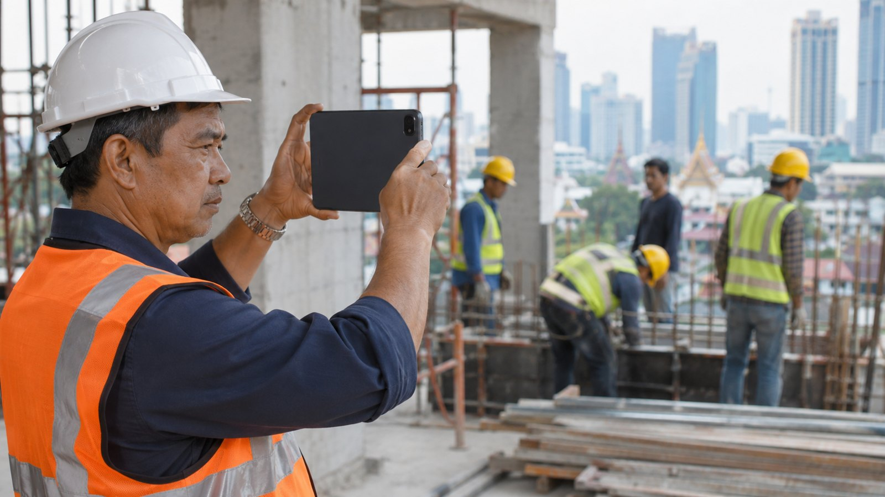

> **สื่อประกอบการสอนและหลักฐานผลทดสอบจริง:**
> - 📊 **สไลด์ประกอบการสอน (HTML ไฟล์เดียว เปิดในเบราว์เซอร์ได้ทันที):** [`SiteSafe_Inspect_Slides.html`](SiteSafe_Inspect_Slides.html)
> - 🎬 **ตัวดูหลักฐานการทดสอบ Playwright ครบ 27 ข้อพร้อม `.gif` ทุกข้อ:** [`test/index.html`](test/index.html) · [`test/TEST-REPORT.md`](test/TEST-REPORT.md)
> - 📋 **รวมพรอมต์ 10 ขั้นตอนแบบคัดลอกวาง:** [`PROMPTS.md`](PROMPTS.md)
> - ✅ **คำตัดสินส่งมอบงาน:** [`DELIVERY.md`](DELIVERY.md)

---

## ภาพรวมผลลัพธ์จริงของโครงการ (1 โหนด × `2× RTX 4090`)

โครงการนี้สาธิตการสร้างระบบ AI Production ครบวงจรตั้งแต่รับโจทย์ลูกค้าไปจนถึงส่งมอบงานจริงสำหรับ **บริษัท ไทยมั่นคงก่อสร้าง จำกัด** ด้วยสถาปัตยกรรม **Design #4**: เว็บ **Next.js 15 + Tailwind CSS + PostgreSQL 16** เชื่อมต่อตรงผ่าน Concurrent HTTP (`concurrency=16`) ไปยัง **`1 โหนด × 2× RTX 4090`** ที่รัน **NGINX `least_conn` + Passive Failover ON** หน้า **8× FastAPI Micro-batching (`4 Processes/GPU`, YOLO11s)**

| มิติการวัดผล | ค่าที่วัดได้จริง | เกณฑ์เป้าหมาย | แหล่งหลักฐาน |
|---|---|---|---|
| **ความจุพร้อมกัน (Concurrency · Design #4)** | **88 ผู้ใช้พร้อมกัน** (เพิ่ม **8.0×** จาก 11 ผู้ใช้) | รองรับช่วงเร่งด่วน p95 ≤ 500 ms | `results/lb/summary.json` |
| **ปริมาณงานสูงสุด (Throughput)** | **444.55 คำขอต่อวินาที** (เพิ่ม **8.1×** จาก 54.73) | p95 = **457.4 ms** · GPU 0/1 = **54% / 49%** | `results/lb/gpu2_lc.json` |
| **สมดุลเมื่อ GPU ช้าลง 3 เท่า** | **`least_conn` 76 ผู้ใช้** vs Round Robin 43 (**+76.7%**) | โยกโหลดอัตโนมัติ 68% / 32% | `results/lb/lc_slow.json` |
| **ความทนทานเมื่อปิด GPU 1 กลางโหลด 80 ผู้ใช้** | **Failover ON ผิดพลาด 0.00%** (0 คำขอ) | เทียบ Failover OFF ผิดพลาด 67.18% (14,098 คำขอ) | `results/lb/fail_on.json` |
| **ชุดทดสอบ Playwright อัตโนมัติ** | **24 / 24 ผ่าน (100%)** + **3 / 3 Bug Hunt จับครบ** | ชุด 20 รูปจริงจบใน **2.69 วิ** (`p95 = 2.23 วิ`) | `test/evidence/e2e_results.json` |
| **ความแม่นยำโมเดล YOLO11s (`best.pt`)** | `NO_HARDHAT` Recall **0.800** / Prec **0.952** · `NO_VEST` **0.861** / **1.000** | Recall ≥ 0.80, Precision ≥ 0.80 (threshold `0.32`) | `results/model/metrics_after.json` |

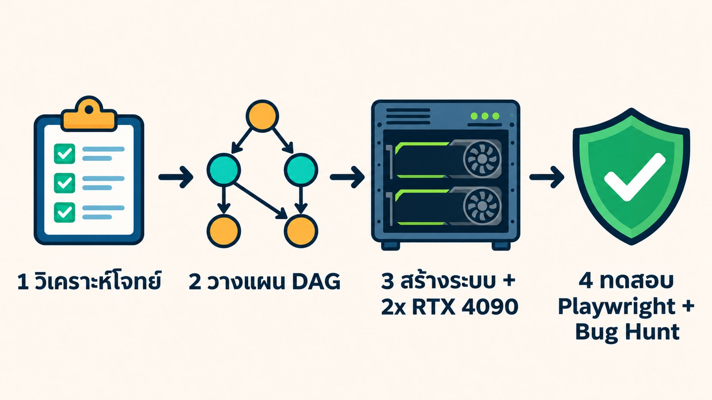

---

## เรื่องราวของลูกค้า: บริษัท ไทยมั่นคงก่อสร้าง จำกัด

| วิชัย (หัวหน้างานไซต์) | นภา (ผู้จัดการความปลอดภัย) | ธนา (ผู้บริหาร) |
| :---: | :---: | :---: |
|  |  |  |
| เดินตรวจหน้างานวันละ 3 รอบ ถ่ายรูปรวมกว่า 100 รูปต่อไซต์ ต้องการอัปโหลดเป็นชุดแล้วรู้ทันทีว่าภาพไหนมีคนไม่ใส่หมวกหรือเสื้อสะท้อนแสง | ดูแลครบทั้ง 3 ไซต์ (ก, ข, ค) รวมกว่า 300 รูปต่อวัน ต้องการดูเฉพาะรูปที่มีปัญหา แก้ผลได้พร้อมบันทึกเหตุผล และออกรายงานก่อน 18:00 น. | ต้องการเห็นภาพรวมอัตราผ่านของทั้ง 3 ไซต์ทุกเย็น โดยไซต์ที่ต่ำกว่า 90% ต้องขึ้นสีแดงสะดุดตา และไม่ต้องการเห็นรูปหน้างานรายใบ |

| 1 · เดินตรวจหน้างานจริง | 2 · รูปกองล้นช่วงเย็น | 3 · หลุดคนไม่ใส่หมวก | 4 · สัมภาษณ์เก็บโจทย์ |
| :---: | :---: | :---: | :---: |
|  | 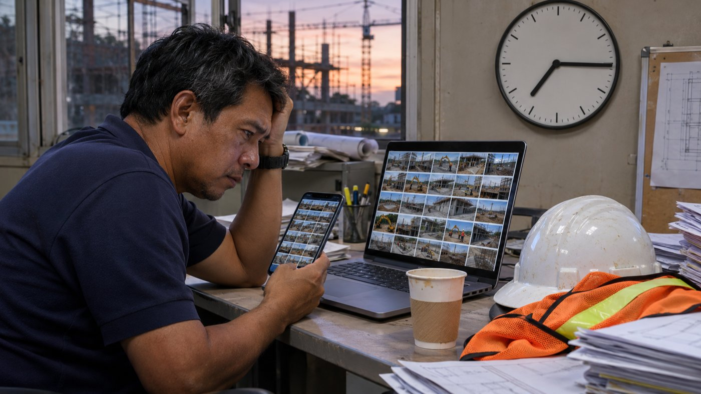 | 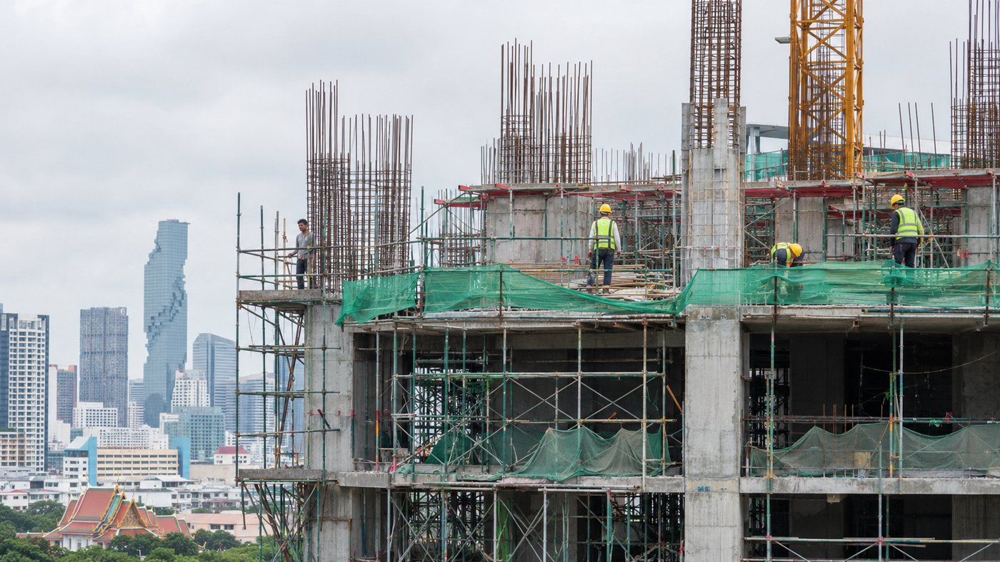 |  |

รายละเอียดบทสัมภาษณ์เต็มอยู่ใน [`INTERVIEW.md`](INTERVIEW.md)

---

## ระยะ A · วิเคราะห์โจทย์และออกแบบสถาปัตยกรรม (`docs/`)

### A.1 User Stories, Requirements และ Test Data

เริ่มต้นด้วยการถอดความต้องการจากบทสัมภาษณ์ออกเป็น 3 เอกสารหลักที่เชื่อมโยงกันได้ครบทุกข้อ:
- [`docs/USER-STORIES.md`](docs/USER-STORIES.md) — เส้นทางใช้งานและ Acceptance Criteria ของทั้ง 3 บทบาท
- [`docs/REQUIREMENTS.md`](docs/REQUIREMENTS.md) — `FR-01` ถึง `FR-22`, Business Rules 7 ข้อ (`BR-01` ถึง `BR-07`), และ `NFR-01` ถึง `NFR-08`
- [`docs/TEST-DATA.md`](docs/TEST-DATA.md) — กรณีขอบเขตคำนวณล่วงหน้าครบทุกเส้นแบ่ง (69 แถว · 3 ไซต์ · 5 บัญชีผู้ใช้ · 1,233 รูปตั้งต้น)

| รหัสกติกา | นิยามแบบกระชับชัดเจน (รวมไว้ที่ `web/lib/rules.ts` ไฟล์เดียว) | จุดขอบเขตที่ต้องทดสอบ |
|---|---|---|
| **BR-01** | พบคนไม่ใส่หมวกนิรภัย `H ≥ 1` → **ไม่ผ่าน (`FAIL`)** | `H = 0` vs `H = 1` |
| **BR-02** | ไม่พบคนไม่ใส่หมวก (`H = 0`) แต่ไม่ใส่เสื้อสะท้อนแสง `V ≥ 2` → **ไม่ผ่าน (`FAIL`)** | `V = 1` (เตือน) vs **`V = 2` (ไม่ผ่าน)** |
| **BR-03** | `H = 0` และไม่ใส่เสื้อสะท้อนแสง `V = 1` → **เตือน (`WARN`)** · นอกนั้น **ผ่าน (`PASS`)** | `(0,0)` → ผ่าน · `(0,1)` → เตือน |
| **BR-04** | อัตราผ่านประจำวัน `< 90%` → แสดง **สีแดง** · `≥ 90%` → ปกติ | **`89.67%` (แดง)** vs **`90.00%` (ปกติ)** vs `90.33%` |
| **BR-05** | รับเฉพาะไฟล์ JPG/PNG แท้ (ตรวจ Magic Bytes) ขนาด **≤ 15 MB** (`15,728,640` ไบต์) | `15.0 MB` (`201`) vs `15 MB + 1 B` (`413`) |
| **BR-06** | อัปโหลดได้ครั้งละ **1 ถึง 50 รูป** · เกิน 50 รูปปฏิเสธทั้งชุด | `0` (`422`) · `50` (`201`) · **`51` (`422`)** |
| **BR-07** | รายงานประจำวันพร้อมสมบูรณ์เมื่อเวลา **≥ 18:00 น.** (ก่อนหน้านั้นแสดง "ข้อมูลระหว่างวัน") | `17:59 น.` vs `18:00 น.` |

> [!IMPORTANT]
> **พรอมต์ที่ 1 · สร้าง `docs/USER-STORIES.md` จากบทสัมภาษณ์**
> ```text
> อ่าน INTERVIEW.md ของบริษัท ไทยมั่นคงก่อสร้าง จำกัด ให้ครบทุกข้อ
> แล้วสร้างไฟล์ docs/USER-STORIES.md ที่ประกอบด้วย:
> 1. บทบาทผู้ใช้ทั้ง 3 กลุ่ม (หัวหน้างานไซต์, ผู้จัดการความปลอดภัย, ผู้บริหาร) และขอบเขตสิทธิ์ของแต่ละกลุ่ม
> 2. User Stories ครบทุกเส้นทางงานหลัก: อัปโหลดรูปหน้างานเป็นชุด, ตรวจจับคนไม่ใส่หมวก (H) และไม่ใส่เสื้อสะท้อนแสง (V) พร้อมวาดกรอบ, กรองดูรูปที่มีปัญหา, แก้ผลตรวจพร้อมบันทึกเหตุผลแบบลบไม่ได้, ดูรายงานประจำวันรายไซต์, และดูแดชบอร์ดสถานะเครื่อง GPU
> 3. Acceptance Criteria แบบ Given / When / Then ที่วัดผลได้จริงในทุก Story
> 4. แยกรายการที่อยู่นอกขอบเขตรุ่นแรกไว้ชัดเจน (เช่น แจ้งเตือน LINE และวิดีโอสด)
> ```

> [!IMPORTANT]
> **พรอมต์ที่ 2 · สร้าง `docs/REQUIREMENTS.md` และ `docs/TEST-DATA.md`**
> ```text
> จาก docs/USER-STORIES.md ให้สร้างเอกสารคู่กัน 2 ไฟล์:
> 1. docs/REQUIREMENTS.md:
>    - Functional Requirements (FR-01 ถึง FR-22) ครบทั้งการอัปโหลด ผลตรวจ การแก้ผล รายงาน และสิทธิ์ 3 บทบาท
>    - Business Rules 7 ข้อที่กระชับ ชัดเจน ไม่มีข้อยกเว้นซับซ้อน (BR-01: H ≥ 1 ไม่ผ่าน, BR-02: V ≥ 2 ไม่ผ่าน, BR-03: V = 1 เตือน, BR-04: อัตราผ่าน < 90% แสดงสีแดง, BR-05: ไฟล์ ≤ 15 MB เฉพาะ JPG/PNG แท้, BR-06: อัปโหลดครั้งละ ≤ 50 รูป, BR-07: รายงานประจำวันพร้อมแสดงผลที่ 18:00 น.)
>    - Non-Functional Requirements (NFR-01 ถึง NFR-08): Recall/Precision ≥ 0.80, ความเร็วช่วงปกติ p95 ≤ 30 วินาที, รองรับช่วงเร่งด่วน 150 รูปพร้อมกัน, รูปห้ามหาย, ป้องกันข้อมูลและ API Key, สิทธิ์ตรวจฝั่งเซิร์ฟเวอร์, และประวัติแก้ผลแบบ Append-only
> 2. docs/TEST-DATA.md: ตารางกรณีขอบเขต (Boundary Values) และผลที่คาดหวังคำนวณล่วงหน้าครบทั้ง 7 กติกา (R-1..R-8, F-1..F-10, P-1..P-9, บัญชีทดสอบ 5 บัญชีใน 3 ไซต์)
> ```

### A.2 การออกแบบสถาปัตยกรรมความเร็วสูง (Design #4: NGINX `least_conn` + 8× FastAPI Micro-batching)

เหตุผลเชิงวิศวกรรมของการออกแบบใน [`docs/DESIGN.md`](docs/DESIGN.md):
- โมเดล **YOLO11s** (`best.pt`) มีขนาดไฟล์เพียง **19 MB** จึงไม่ได้ติดคอขวดหน่วยความจำ VRAM แต่เมื่อรันเพียง 1 Process และรับทีละ 1 รูปจะติดคอขวด **Python GIL และการถอดรหัสภาพบน CPU** ทำให้การ์ดจอ RTX 4090 ทำงานเพียง ~8%
- เราจึงออกแบบฝั่ง AI บน **`1 โหนด × 2× RTX 4090`** ให้รัน **4 FastAPI Processes ต่อ GPU** (รวม 8 Processes: พอร์ต `8101–8104` บน GPU 0 และ `8201–8204` บน GPU 1) พร้อม **Dynamic Micro-batching** (`MAX_BATCH=32`, รอรวมชุดสูงสุด `5 ms`) วางหลังประตู **NGINX Load Balancer** ที่เปิด **`least_conn`** และ **Passive Failover ON** (`proxy_next_upstream error timeout non_idempotent`, `max_fails=1 fail_timeout=10s`)
- ฝั่งเว็บใช้ **Next.js 15 + Tailwind CSS + PostgreSQL 16** เก็บไฟล์ต้นฉบับลง `volume photos` ก่อนตอบรับ `201` และให้ **Async HTTP Dispatcher** ส่งคำขอ `POST /v1/detect` พร้อม `Authorization: Bearer` แบบขนาน `concurrency=16` ไปยัง NGINX โดยตรง โดยไม่ต้องเพิ่มโบรกเกอร์ข้อความภายนอก

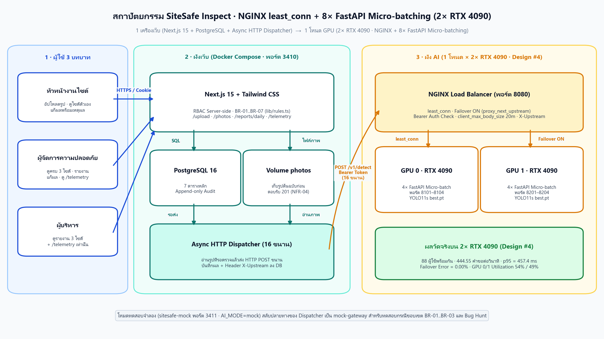

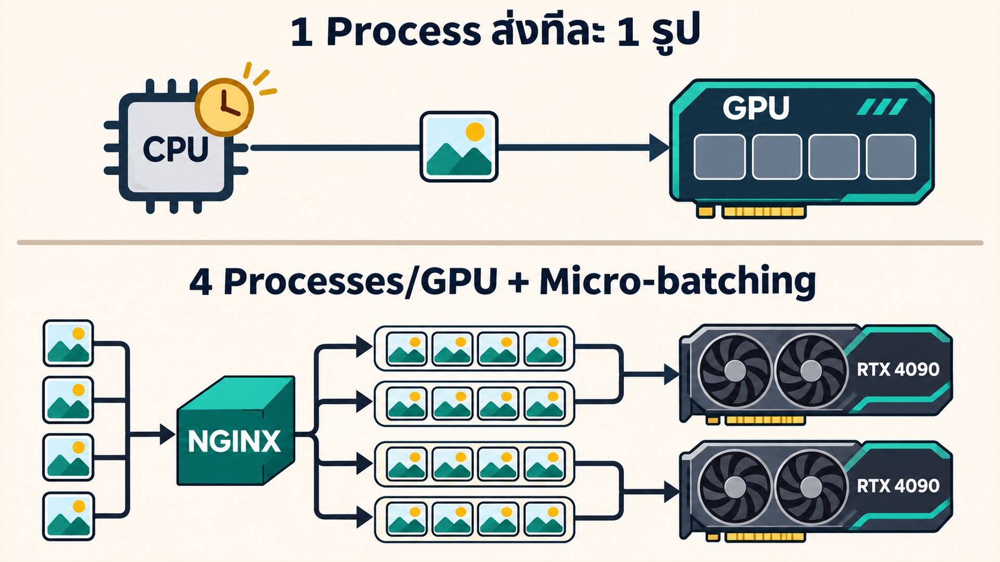

| วงจรสถานะของงานตรวจรูป | ลำดับคำขอ End-to-End |
| :---: | :---: |
| 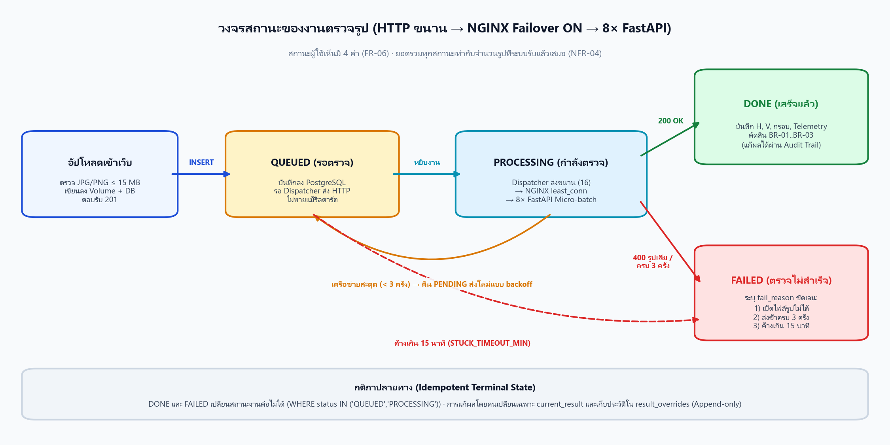 | 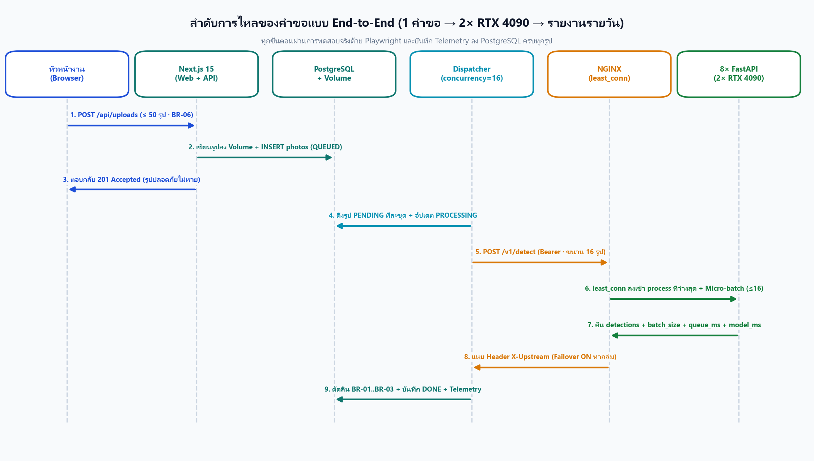 |

> [!IMPORTANT]
> **พรอมต์ที่ 3 · สร้าง `docs/DESIGN.md` สถาปัตยกรรม 2 ฝั่ง (Direct Concurrent HTTP → NGINX + 8× FastAPI)**
> ```text
> ออกแบบระบบใน docs/DESIGN.md เพื่อตอบโจทย์ทั้งความถูกต้องของกติกาและความเร็วช่วงเร่งด่วน 150 รูปพร้อมกัน โดยแบ่งเป็น 2 ฝั่ง:
> 1. ฝั่งเว็บ (Docker Compose ภายในเครื่อง · พอร์ต 3410):
>    - Next.js 15 (App Router) + Tailwind CSS + PostgreSQL 16 (7 ตาราง + คอลัมน์บันทึก GPU Telemetry) + volume photos เก็บรูปต้นฉบับก่อนตอบรับ 201
>    - รวม Business Rule BR-01..BR-07 และสวิตช์ BUG_MODE ไว้ในไฟล์เดียว (web/lib/rules.ts)
>    - Async HTTP Dispatcher ส่งรูปขนาน concurrency=16 ผ่าน HTTP POST /v1/detect พร้อม Authorization: Bearer ไปยังฝั่ง GPU โดยตรง (ไม่ต้องใช้โบรกเกอร์ข้อความภายนอก)
>    - หน้าเว็บ 8 หน้า รวมหน้า /telemetry แสดงสถานะเครื่อง GPU, Header X-Upstream, batch_size และ model_ms
>    - รองรับโหมดจำลอง AI_MODE=mock (mock-gateway พอร์ต 3411) สำหรับทดสอบกรณีขอบเขตและ Bug Hunt
> 2. ฝั่ง AI (1 โหนด × 2× RTX 4090 บน Vast.ai):
>    - NGINX Load Balancer พอร์ต 8080 ใช้ least_conn + Passive Failover ON (proxy_next_upstream error timeout non_idempotent, max_fails=1 fail_timeout=10s) + client_max_body_size 20m + แนบ Header X-Upstream
>    - 8× FastAPI Micro-batching (4 Processes ต่อ GPU, พอร์ต 8101–8104 และ 8201–8204, MAX_BATCH=32, MAX_WAIT_MS=5) โหลดโมเดล YOLO11s (best.pt)
> ระบุ ER Diagram, แผนภาพสถาปัตยกรรม, ลำดับคำขอ End-to-End, API Contract, และตาราง data-testid สำหรับ Playwright ให้ครบ
> ```

---

## ระยะ B · วางแผนการทำงานแบบ DAG ด้วยทีม Agent (`plan/`)

แตกงานออกเป็น **10 บล็อก (`B01`–`B10`)** โดยจัดสายวิกฤต (`B01 → B02 → B03 → B08 → B10`) และแจกจ่ายงานขนานให้บัญชี `yolo2`, `yolo3`, `cyolo1` สูงสุด 3 งานพร้อมกัน บล็อกหัวใจหลัก `B03` (Business Rules + RBAC + 14 API) ใช้โหมด `review` ที่กำหนดขอบเขตตรวจชัดเจนให้ผ่านภายใน ≤ 3 รอบเมื่อกรณีขอบเขตใน `docs/TEST-DATA.md` ผ่านครบ

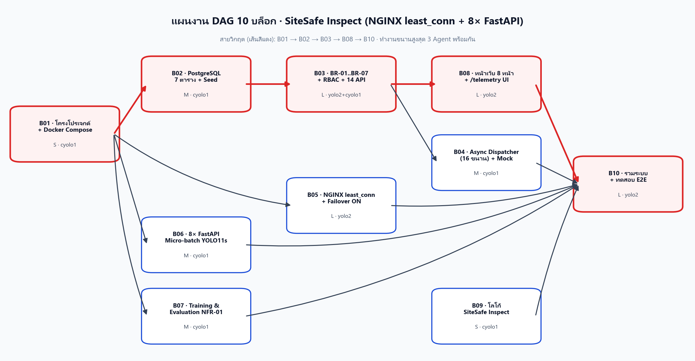

| แผนเวลา (Gantt แผน · 112.5 นาที) | เวลาทำงานจริง (Gantt จริง · เสร็จ 10/10 บล็อก) |
| :---: | :---: |
| 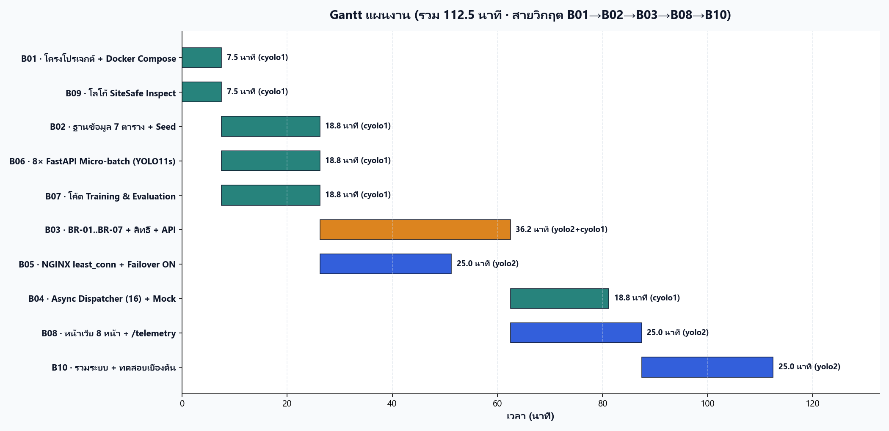 | 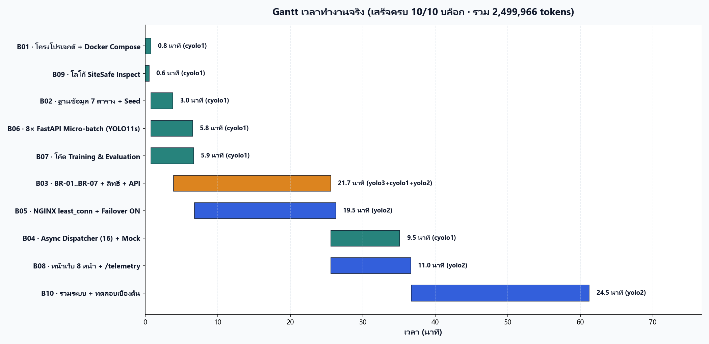 |

ดูตารางแจกงานและบันทึกโทเคนจริงครบทุกบล็อกใน [`plan/PLAN.md`](plan/PLAN.md) และ [`plan/REPORT.md`](plan/REPORT.md)

> [!IMPORTANT]
> **พรอมต์ที่ 4 · สร้างแผนงาน `plan/PLAN.md`, `plan/dag.png` และ `plan/gantt-plan.png`**
> ```text
> อ่าน docs/REQUIREMENTS.md, docs/DESIGN.md และ docs/TEST-DATA.md แล้ววางแผนสร้างระบบ SiteSafe Inspect แบบขนานด้วยบัญชี yolo2, yolo3, cyolo1 (พร้อมกันสูงสุด 3 งาน):
> 1. แตกงานเป็น 10 บล็อก (B01 โครงโปรเจกต์ + Docker Compose, B02 ฐานข้อมูล 7 ตาราง + Seed, B03 กติกา BR-01..BR-07 + RBAC + 14 API, B04 Async HTTP Dispatcher + Mock, B05 NGINX least_conn + Failover ON, B06 8× FastAPI Micro-batch YOLO11s, B07 โค้ด Training & Evaluation, B08 หน้าเว็บ 8 หน้า + /telemetry, B09 โลโก้, B10 รวมระบบและทดสอบเบื้องต้น)
> 2. กำหนดให้บล็อก B03 เป็นงานแบบ review (ทำและตรวจคนละบัญชี) โดยตั้งขอบเขตการตรวจให้ชัดเจน: ผ่านทันทีเมื่อ unit test และกรณีขอบเขตทั้งหมดใน docs/TEST-DATA.md ผ่านครบโดยไม่ขยายขอบเขตเกิน Requirement เพื่อให้จบภายใน ≤ 3 รอบ
> 3. สร้าง plan/PLAN.md ระบุสายวิกฤต ตารางแจกงาน และวาดแผนภาพ plan/dag.png กับ plan/gantt-plan.png
> ```

---

## ระยะ C · สร้างระบบ เตรียมโมเดล YOLO11s และเปิดใช้งานจริงบน `2× RTX 4090`

### C.1 สร้างซอร์สโค้ดครบทั้ง 10 บล็อก

- ซอร์สโค้ดฝั่งเว็บ (`code_reference/app/web/`): ผ่าน `npm run typecheck`, `npm run build` และ `vitest` **119/119**
- ซอร์สโค้ดฝั่ง AI (`code_reference/app/ai/serving/` และ `code_reference/lb/`): `server.py`, `nginx.conf`, `cluster.sh`, `loadgen.py` พร้อม `ai/train/evaluate.py` ผ่าน `pytest` **30/30**

> [!IMPORTANT]
> **พรอมต์ที่ 5 · สร้างซอร์สโค้ดฝั่งเว็บและฝั่ง AI ครบทั้งระบบ**
> ```text
> ดำเนินการสร้างระบบ SiteSafe Inspect ตามแผน plan/PLAN.md ครบทั้ง 10 บล็อก โดยใช้บัญชี yolo2, yolo3, cyolo1:
> - ฝั่งเว็บ (code_reference/app/web/): Next.js 15 + Tailwind CSS + PostgreSQL 16 + lib/rules.ts (BR-01..BR-07 + BUG_MODE ไฟล์เดียว) + RBAC 3 บทบาทตรวจฝั่งเซิร์ฟเวอร์ + Async HTTP Dispatcher ส่งขนาน 16 รูป + หน้า /telemetry + mock-gateway
> - ฝั่ง AI (code_reference/app/ai/serving/): server.py (FastAPI + YOLO11s Dynamic Micro-batching), nginx.conf (least_conn + Failover ON + Bearer auth check + X-Upstream), cluster.sh, loadgen.py และ ai/train/evaluate.py
> - รัน npm run typecheck, npm run build, vitest (web) และ pytest (ai/train) ให้ผ่านครบทุกข้อ พร้อมสรุปเวลาและโทเคนจริงใน plan/REPORT.md และ plan/gantt-actual.png
> ```

### C.2 เช่าเครื่อง `1 โหนด × 2× RTX 4090` และผลประเมินโมเดล YOLO11s (`best.pt`)

| รุ่นโมเดล | `NO_HARDHAT` Recall | `NO_HARDHAT` Precision | `NO_VEST` Recall | `NO_VEST` Precision | ผลการประเมิน |
|---|---:|---:|---:|---:|---|
| ก่อนเทรน (`yolo11s` COCO pretrained) | 0.000 | 0.000 | 0.000 | 0.000 | ไม่มีคลาส PPE · ไม่ผ่าน |
| **หลังเทรน (`ppe-yolo-v1` · `best.pt`, `conf = 0.32`)** | **0.800 (20/25)** | **0.952 (20/21)** | **0.861 (31/36)** | **1.000 (31/31)** | **ค่าที่วัดได้ถึงเกณฑ์ ≥ 0.80 ทุกคลาส** (แจ้งหมายเหตุขนาด Test Set 82 รูป) |

| ตัวอย่างชุดข้อมูล PPE | ผลการเทรน 30 Epochs (534.7 วินาที) | ตัวอย่างกรอบทำนายบนชุด Test |
| :---: | :---: | :---: |
| 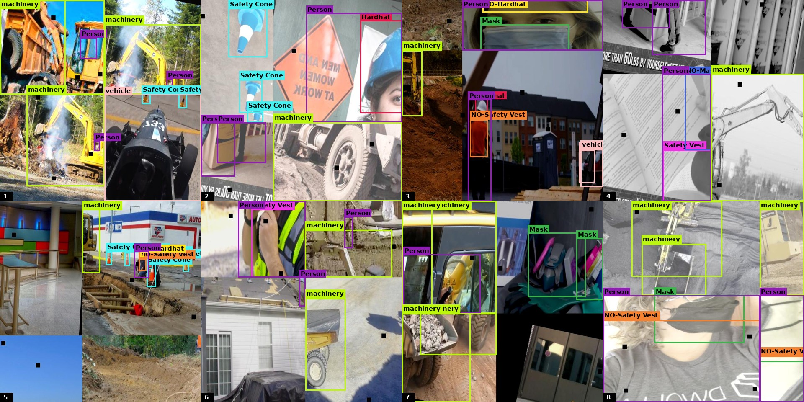 | 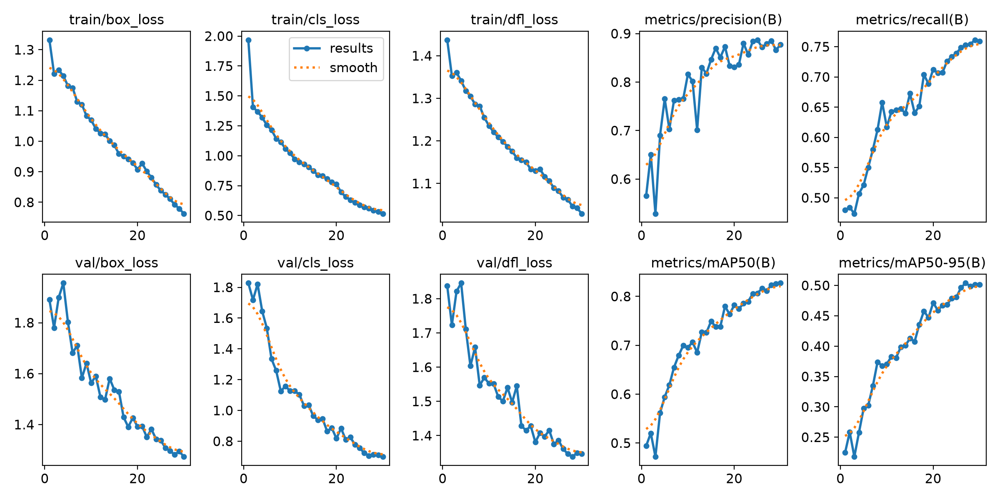 | 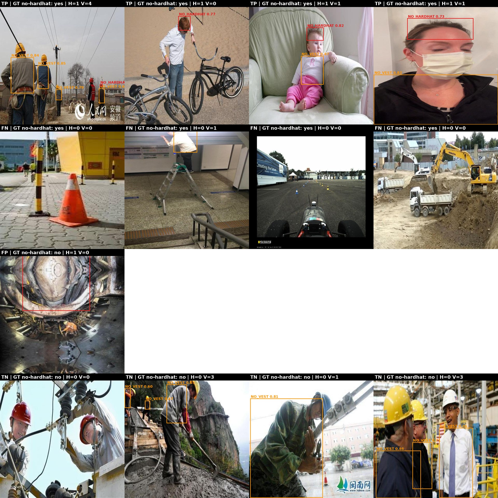 |

> [!IMPORTANT]
> **พรอมต์ที่ 6 · เช่าเครื่อง `2× RTX 4090` บน Vast.ai และวัดความแม่นยำโมเดล YOLO11s**
> ```text
> ค้นหาและเช่าเครื่อง 1 โหนด × 2× RTX 4090 บน Vast.ai ที่ผ่านการยืนยัน (verified=true, inet_down >= 1200 Mbps, เลือกค่าดาวน์โหลดต่ำสุด, เปิดพอร์ต 8080, ติดป้าย label e2e-sitesafe-nginx):
> 1. ตรวจสอบสเปกเครื่องจริง (2× RTX 4090, vCPU, RAM, สถานะ RUNNING) และอัปโหลดโค้ดฝั่ง AI กับโมเดล YOLO11s (best.pt)
> 2. ตรวจความแม่นยำโมเดลด้วย ai/train/evaluate.py เทียบก่อน-หลังเทรน และเลือก Confidence Threshold บน Validation Set ให้ได้ Recall ≥ 0.80 และ Precision ≥ 0.80 สำหรับทั้ง NO_HARDHAT และ NO_VEST
> 3. บันทึกผลประเมินลง results/model/metrics_before.json, results/model/metrics_after.json และ results/model/threshold.json
> ```

### C.3 ผลวัดสมรรถนะ 4 รูปแบบ, GPU ช้าลง 3× และ Failover บน `1 โหนด × 2× RTX 4090`

การทดลองทั้งหมดวัดจริงด้วย `loadgen.py` ภายใต้เกณฑ์ **p95 ≤ 500 ms** บนเครื่อง **`1 โหนด × 2× RTX 4090`** (48 vCPU, 125.6 GB RAM):

| รูปแบบสถาปัตยกรรม | จำนวน GPU / Process | โหมด | ความจุ (ผู้ใช้พร้อมกัน) | ปริมาณงาน (คำขอต่อวินาที) | ความหน่วง p95 | การใช้ GPU 0 / GPU 1 | เทียบฐาน |
|---|---|---|---:|---:|---:|---:|---:|
| Design #1 (`base`) | 1 GPU · 1 Process | Single | 11 | 54.73 | 447.5 ms | 8% / 0% | 1.0× |
| Design #2 (`batch`) | 1 GPU · 1 Process | Micro-batch | 32 | 121.27 | 481.3 ms | 19% / 0% | 2.9× |
| Design #3 (`multi`) | 1 GPU · 4 Processes | Micro-batch | 64 | 288.55 | 412.8 ms | 45% / 0% | 5.8× |
| **Design #4 (`gpu2_lc` · ชุดใช้งานจริง)** | **2× RTX 4090 · 8 Processes** | **Micro-batch + `least_conn`** | **88** | **444.55** | **457.4 ms** | **54% / 49%** | **8.0×** |

| 1 · เปรียบเทียบความจุทั้ง 4 รูปแบบ (11 → 88 ผู้ใช้) | 2 · กราฟความหน่วงและปริมาณงานตามจำนวนผู้ใช้ |
| :---: | :---: |
| 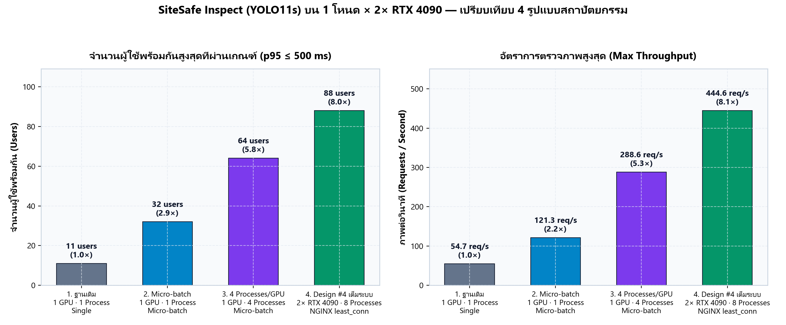 | 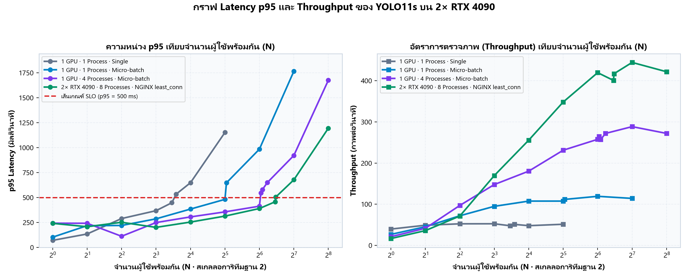 |

| 3 · ทดสอบ GPU 1 ช้าลง 3× (`least_conn` +76.7%) | 4 · ทดสอบปิด GPU 1 กลางโหลด 80 ผู้ใช้ (0.00% Error) |
| :---: | :---: |
| 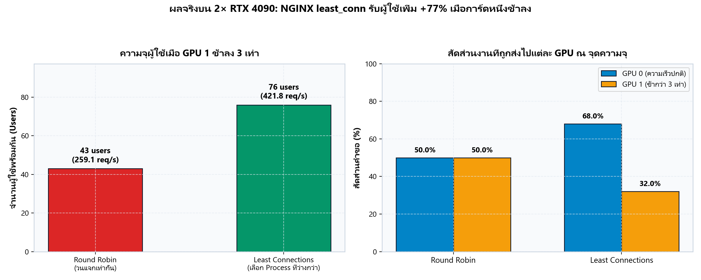 | 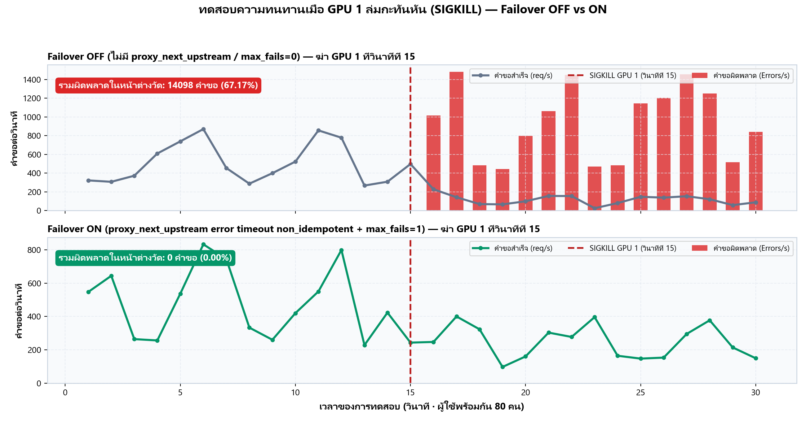 |

> [!IMPORTANT]
> **พรอมต์ที่ 7 · วัดความจุ 4 รูปแบบ, ทดสอบ GPU ช้า & Failover และเปิดระบบจริง**
> ```text
> บนเครื่อง 1 โหนด × 2× RTX 4090 ให้รันชุดทดสอบความจุและเสถียรภาพด้วย cluster.sh และ loadgen.py (เกณฑ์ p95 ≤ 500 ms):
> 1. วัดความจุเปรียบเทียบ 4 รูปแบบ:
>    - Design #1: 1 GPU · 1 Process · Single
>    - Design #2: 1 GPU · 1 Process · Micro-batch
>    - Design #3: 1 GPU · 4 Processes · Micro-batch
>    - Design #4: 2× RTX 4090 · 8 Processes (4/GPU) · Micro-batch · NGINX least_conn
> 2. ทดสอบสถานการณ์ GPU 1 ช้าลง 3 เท่า (slow-factor 3) เปรียบเทียบ Round Robin กับ least_conn
> 3. ทดสอบสถานการณ์ปิด GPU 1 กะทันหันกลางโหลด 80 ผู้ใช้ เปรียบเทียบ Failover OFF กับ Failover ON
> 4. บันทึกผล JSON ลง results/lb/ สร้างกราฟ 4 แผ่นใน images/lab/ แล้วเปิด Design #4 (--gpus 2 --per-gpu 4 --mode micro --lb lc --failover on) เชื่อมต่อกับเว็บ Docker Compose (sitesafe-nginx พอร์ต 3410) และเปิด sitesafe-mock (พอร์ต 3411) คู่กัน
> ```

### C.4 บัญชีทดลองใช้งานหน้าเว็บ (Demo Login Accounts) และวิดีโอสาธิตการทำงานจริง

ผู้เรียนสามารถเปิดเว็บและทดลองสลับบทบาทได้ครบทั้ง 5 บัญชีใน 3 บทบาทดังนี้:

| บทบาท (Role) | อีเมล (Email) | รหัสผ่าน (Password) | ไซต์ | ฟีเจอร์และเส้นทางที่ทดลองได้ |
|---|---|---|---|---|
| **หัวหน้างานไซต์ (Supervisor)** | `sup.a@sitesafe.test` | `Test-SupA-01` | `SITE-A` | อัปโหลดรูปเป็นชุด (`/upload`), ดูกรอบ PPE ของไซต์ ก, แก้ผลพร้อมเหตุผล, ดูรายงานไซต์ ก, ดู `/telemetry` |
| **หัวหน้างานไซต์ (Supervisor)** | `sup.b@sitesafe.test` | `Test-SupB-01` | `SITE-B` | ทดสอบการแยกข้อมูลข้ามไซต์ (เปิดรูป `SITE-A` จะถูกปฏิเสธ `404`) |
| **หัวหน้างานไซต์ (Supervisor)** | `sup.c@sitesafe.test` | `Test-SupC-01` | `SITE-C` | อัปโหลดและดูข้อมูลเฉพาะ `SITE-C` |
| **ผู้จัดการความปลอดภัย (Safety Manager)** | `manager@sitesafe.test` | `Test-Manager-01` | ทุกไซต์ | ดูรูปครบ 3 ไซต์ (`/photos`, `/photos/problems`), แก้ผลตรวจพร้อม Audit Trail, ดูรายงาน 3 ไซต์ (`/reports/daily`), ดู `/telemetry` (ไม่มีสิทธิ์อัปโหลด) |
| **ผู้บริหาร (Executive)** | `exec@sitesafe.test` | `Test-Exec-01` | ทุกไซต์ | ดูรายงานประจำวัน 3 ไซต์ (`/reports/daily`) และแดชบอร์ด `/telemetry` เท่านั้น (ซ่อนเมนูอัปโหลดและรูปภาพ) |

| วิดีโอเดโม 1 · เริ่มจากหน้า `/login` → อัปโหลด → กรอบ PPE บน `2× RTX 4090` → รายงาน | วิดีโอเดโม 2 · ยิงชุด 20 รูปพร้อมกัน → หน้ารูปมีปัญหา → รายงาน `<90%` → `/telemetry` |
| :---: | :---: |
| 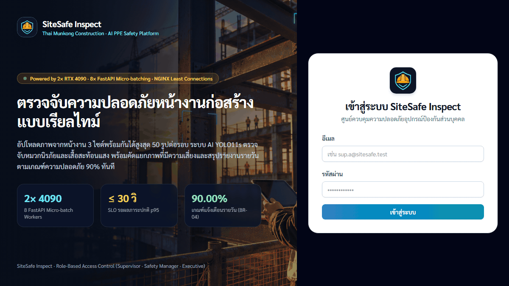 | 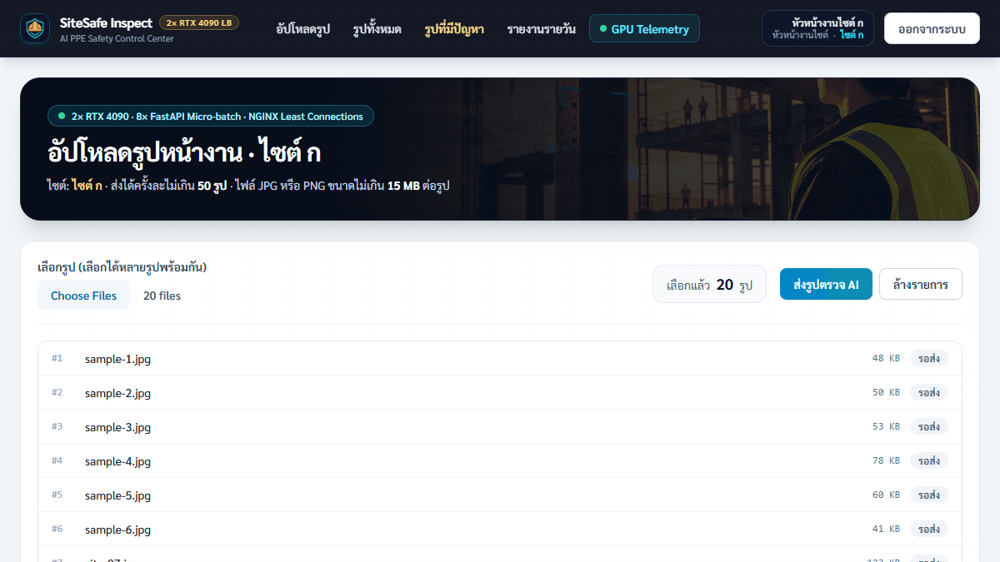 |

| หน้าแรกอัปโหลด (`/upload`) | กรอบ PPE + `X-Upstream` (`/photos/[id]`) | รายงานประจำวัน (`89.67%` แดง · `90.00%` ปกติ) | แดชบอร์ด `/telemetry` (ONLINE) |
| :---: | :---: | :---: | :---: |
| 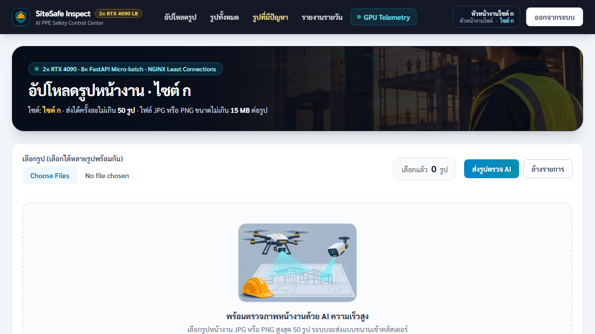 | 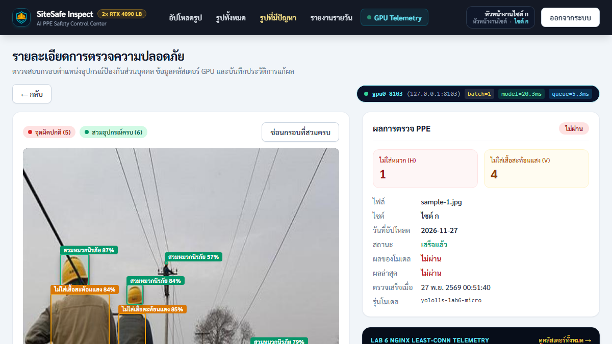 | 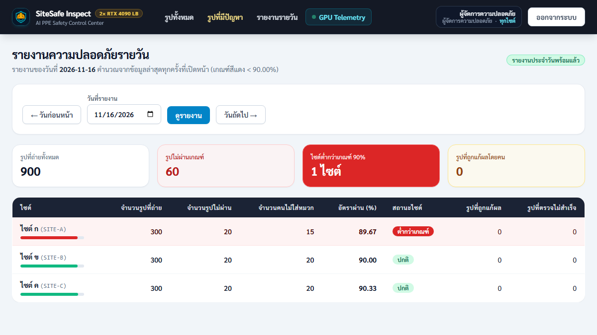 | 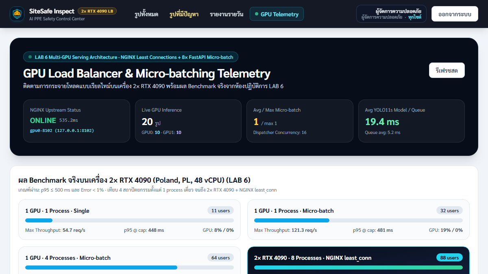 |

---

## ระยะ D · ทดสอบอัตโนมัติ Playwright 27 ข้อ (`.gif` ครบทุกข้อ) + Bug Hunt + ลบเครื่อง GPU

### D.1 ตารางผลการทดสอบ Playwright ครบทั้ง 27 Test Cases (พร้อมวิดีโอ `.gif` ทุกข้อ)

ทดสอบจริงบนเครื่อง **`1 โหนด × 2× RTX 4090`** (Illinois, US · Instance `62729107` · ลบหลังทดสอบแล้ว) คู่กับ `sitesafe-mock` พอร์ต `3411` — เปิดดูและกรองแบบโต้ตอบได้ที่ [`test/index.html`](test/index.html)

| TC ID | ชื่อ Test Case | หมวด / กติกา | โหมด | ผลที่คาดหวัง | ผลจริง | สถานะ | หลักฐาน (`.gif`) |
|---|---|---|---|---|---|---|---|
| **TC-01** | รับไฟล์ขนาด 14.9 MB และ 15.0 MB พอดี | Upload · `BR-05` | Live GPU | HTTP 201 ทั้งสองไฟล์ | HTTP 201, 201 | ✅ ผ่าน | [`TC-01.gif`](images/tests/TC-01.gif) |
| **TC-02** | ปฏิเสธไฟล์เกิน 15 MB (+1 B และ 15.1 MB) | Upload · `BR-05` | Live GPU | HTTP 413 พร้อมข้อความ 15 MB | HTTP 413, 413 | ✅ ผ่าน | [`TC-02.gif`](images/tests/TC-02.gif) |
| **TC-03** | รับเฉพาะ JPG และ PNG แท้ (ตรวจ Magic Bytes) | Upload · `FR-02` | Live GPU | รับ 2/2 ไฟล์ผ่าน UI | รับครบ 2/2 (JPG + PNG) | ✅ ผ่าน | [`TC-03.gif`](images/tests/TC-03.gif) |
| **TC-04** | ปฏิเสธ GIF, PDF และไฟล์ text ปลอมนามสกุล `.jpg` | Upload · `FR-02` | Live GPU | HTTP 415 ทุกไฟล์ | HTTP 415, 415, 415 | ✅ ผ่าน | [`TC-04.gif`](images/tests/TC-04.gif) |
| **TC-05** | ขอบเขตจำนวนรูปต่อครั้ง (0, 50, 51 รูป) | Upload · `BR-06` | Live GPU | 0→422 · 50→201 · 51→422 | 422 · 201 · 422 | ✅ ผ่าน | [`TC-05.gif`](images/tests/TC-05.gif) |
| **TC-06** | หน้า `/upload` ผูกไซต์ตามบัญชีหัวหน้างานอัตโนมัติ | Upload · `FR-04` | Live GPU | แสดง `SITE-A`, ไม่มี select | `SITE-A` · `select=0` | ✅ ผ่าน | [`TC-06.gif`](images/tests/TC-06.gif) |
| **TC-07** | Decision Table ครบ 8 กรณี `R-1..R-8` (รวม `H=0, V=2`) | Rules · `BR-01..03` | Mock | 8/8 ตรงตาราง (`R-5 = FAIL`) | 8/8 ตรงครบทุกกรณี | ✅ ผ่าน | [`TC-07.gif`](images/tests/TC-07.gif) |
| **TC-08** | หน้า PhotoDetail วาดกรอบ Bounding Boxes ครบตาม `H+V` | Rules · `FR-07..08` | Mock | `H=1, V=1`, 2 กรอบ SVG, `FAIL` | `H=1, V=1`, 2 กรอบ, `FAIL` | ✅ ผ่าน | [`TC-08.gif`](images/tests/TC-08.gif) |
| **TC-09** | Live `2× RTX 4090` YOLO11s ตรวจภาพหน้างานจริง 6 รูป + วาดกรอบ | AI · `FR-07, NFR-01` | Live GPU | 6/6 DONE พร้อมกรอบ + Telemetry | `6/6 DONE (gpu0-8103, 26.38ms)` | ✅ ผ่าน | [`TC-09.gif`](images/tests/TC-09.gif) |
| **TC-10** | หน้า `/photos/problems` แสดงเฉพาะรูป FAIL และ WARN | UI · `FR-11` | Live GPU | รวม 31 (`FAIL=20, WARN=11`) | รวม 31 (`FAIL=20, WARN=11`) | ✅ ผ่าน | [`TC-10.gif`](images/tests/TC-10.gif) |
| **TC-11** | หน้า `/photos` กรองตามวันที่ ไซต์ และผลตรวจ (`WARN`) | UI · `FR-12` | Live GPU | กรอง `WARN` ไซต์ ก = 11 รูป | `photos-total-count = 11` | ✅ ผ่าน | [`TC-11.gif`](images/tests/TC-11.gif) |
| **TC-12** | API `/api/photos/{id}` คืนกรอบ PPE และ GPU Telemetry ครบ | API · `FR-07` | Live GPU | มี `detections[]`, `lb_upstream` | `gpu0-8102 (127.0.0.1:8102)` | ✅ ผ่าน | [`TC-12.gif`](images/tests/TC-12.gif) |
| **TC-13** | ปิดหน้าเบราว์เซอร์กลางทาง 10 รูปยังตรวจจบครบ 10/10 | Reliability · `NFR-04` | Live GPU | `done=10, failed=0` | `done=10, failed=0` | ✅ ผ่าน | [`TC-13.gif`](images/tests/TC-13.gif) |
| **TC-14** | ไฟล์ใหญ่ 14.9 MB และ 15.0 MB ตรวจจบครบผ่าน NGINX | Reliability · `BR-05` | Live GPU | `done=2, failed=0` | `done=2 ใน 2.5 วินาที` | ✅ ผ่าน | [`TC-14.gif`](images/tests/TC-14.gif) |
| **TC-15** | ไฟล์เสีย `corrupt_half.jpg` จบ `FAILED` โดยไม่ขวางภาพปกติ | Reliability · `FR-06` | Live GPU | `corrupt=FAILED`, ปกติ `2/2` | `done=2, failed=1 (เปิดไฟล์รูปไม่ได้)` | ✅ ผ่าน | [`TC-15.gif`](images/tests/TC-15.gif) |
| **TC-16** | ส่ง 20 รูปพร้อมกัน `p95 ≤ 30 วิ` และกระจายข้ามทั้ง `2× RTX 4090` | GPU LB · `NFR-02..03` | Live GPU | 20/20 DONE, `gpu0>0 & gpu1>0` | **20/20 ใน 2.69s · p95=2.23s · gpu0=7, gpu1=13** | ✅ ผ่าน | [`TC-16.gif`](images/tests/TC-16.gif) |
| **TC-17** | `GET /api/health` รายงาน `db, storage, dispatcher, gateway = ok` | Health · `NFR-04` | Live GPU | `status=ok`, `ai_mode=real` | `status=ok` ครบทุกบริการ | ✅ ผ่าน | [`TC-17.gif`](images/tests/TC-17.gif) |
| **TC-18** | `BR-04` เส้นแบ่งสีแดง `89.67%` แดง · `90.00%` และ `90.33%` ปกติ | Report · `BR-04` | Live GPU | SITE-A แดง · SITE-B/C ปกติ | `89.67%(แดง) · 90.00%(ปกติ) · 90.33%(ปกติ)` | ✅ ผ่าน | [`TC-18.gif`](images/tests/TC-18.gif) |
| **TC-19** | ขอบเขตพิเศษรายงาน (ไม่มีข้อมูล / `9÷10` / ตัด `FAILED` ออก) | Report · `FR-15` | Live GPU | ไม่มีข้อมูล · `90.00%` · `100.00%` | ตรงครบทั้ง 3 ไซต์ | ✅ ผ่าน | [`TC-19.gif`](images/tests/TC-19.gif) |
| **TC-20** | `BR-07` ป้ายความพร้อมรายงาน `17:59 น.` vs `18:00 น.` | Report · `BR-07` | Live GPU | `17:59` ระหว่างวัน · `18:00` พร้อมแล้ว | `data-ready=false → true` | ✅ ผ่าน | [`TC-20.gif`](images/tests/TC-20.gif) |
| **TC-21** | แก้ผล `FAIL → PASS` เปลี่ยนไซต์ ก จาก `89.67%` (แดง) เป็น `90.00%` (ปกติ) | Override · `FR-13..14` | Live GPU | คง `model_result=FAIL`, ไม่แดง | `90.00%` ไม่แดง · `edited=1` | ✅ ผ่าน | [`TC-21.gif`](images/tests/TC-21.gif) |
| **TC-22** | ปฏิเสธเหตุผลว่าง (`422`) + Audit History + ปุ่มเลื่อนวันรายงาน | Override · `FR-13,16` | Live GPU | ว่าง→422 · มีเหตุผล→201 · เลื่อนวันได้ | `422 · 201 · 2026-11-17→16` | ✅ ผ่าน | [`TC-22.gif`](images/tests/TC-22.gif) |
| **TC-23** | แยกสิทธิ์ RBAC ครบ 3 บทบาท (`401/403/404`) + UI Login | RBAC · `FR-18..22` | Live GPU | `401` · ข้ามไซต์ `404` · เกินสิทธิ์ `403` | `401 · 404 · 403` + UI ซ่อนเมนูครบ | ✅ ผ่าน | [`TC-23.gif`](images/tests/TC-23.gif) |
| **TC-24** | แดชบอร์ด `/telemetry` ONLINE (`2× RTX 4090`) + ไม่รั่ว API Key | Security · `NFR-05` | Live GPU | `ONLINE` · 4 รูปแบบ · 0 รั่วไหล | `ONLINE (gpu0-8103)` · 3/3 บทบาทเข้าได้ · 0 รั่วไหล | ✅ ผ่าน | [`TC-24.gif`](images/tests/TC-24.gif) |
| **TC-25** | Bug Hunt #1 (`BR-02`): จับบัก `H=0, V=2` ได้ `WARN` แทน `FAIL` | Bug Hunt · `BR-02` | `BUG_MODE=1` | ตรวจพบบักตอบ `WARN` แทน `FAIL` | จับได้! `h0_v2.jpg` ตอบ `WARN` | 🐛 จับบักได้ | [`TC-25.gif`](images/tests/TC-25.gif) |
| **TC-26** | Bug Hunt #2 (`BR-04`): จับบักอัตราผ่าน `90.00%` พอดีเป็นสีแดง | Bug Hunt · `BR-04` | `BUG_MODE=1` | ตรวจพบบัก SITE-B แสดงสีแดง | จับได้! SITE-B `90.00%` ได้ `red=true` | 🐛 จับบักได้ | [`TC-26.gif`](images/tests/TC-26.gif) |
| **TC-27** | Bug Hunt #3 (`BR-06`): จับบักเปิดชุด 51 รูปแล้วรับ `201` แทน `422` | Bug Hunt · `BR-06` | `BUG_MODE=1` | ตรวจพบบัก `count=51` ตอบ `201` | จับได้! `count=51` ตอบ HTTP `201` | 🐛 จับบักได้ | [`TC-27.gif`](images/tests/TC-27.gif) |

> [!IMPORTANT]
> **พรอมต์ที่ 8 · ทดสอบ E2E ครบ 24 Core Test Cases + บันทึก `.gif` รายข้อ + เดโมหน้าเว็บ**
> ```text
> ออกแบบและรันชุดทดสอบ Playwright (test/e2e/tests/) ครบ 24 Core Test Cases (TC-01 ถึง TC-24) ครอบคลุมทุก Requirement และ Business Rule:
> - กลุ่ม A (TC-01..06): ตรวจขนาดไฟล์ 14.9/15.0/15.1 MB (BR-05), ชนิดไฟล์จริงด้วย Magic Bytes (FR-02), จำนวน 0/50/51 รูป (BR-06), การผูกไซต์อัตโนมัติ (FR-04)
> - กลุ่ม B (TC-07..12): Decision Table 8 กรณี R-1..R-8 (BR-01..03), วาดกรอบ SVG, ตรวจภาพหน้างานจริง 6 รูปด้วย YOLO11s บน 2× RTX 4090, กรองหน้ารูปมีปัญหาและรูปทั้งหมด
> - กลุ่ม C (TC-13..17): ปิดเบราว์เซอร์กลางทาง 10 รูปไม่หาย, ไฟล์ใหญ่ 15 MB ตรวจผ่าน NGINX, ไฟล์เสียไม่ขวางภาพปกติ, ชุด 20 รูปพร้อมกันเช็ก p95 ≤ 30 วิ และกระจายข้ามทั้ง gpu0 และ gpu1, และ /api/health
> - กลุ่ม D (TC-18..22): เส้นแบ่งสีแดง 89.67% vs 90.00% vs 90.33% (BR-04), ขอบเขตพิเศษวันที่ 2, ป้ายเวลา 17:59 vs 18:00 น. (BR-07), แก้ผลพร้อมเหตุผลและ Audit Trail (FR-13..16)
> - กลุ่ม E (TC-23..24): แยกสิทธิ์ RBAC 3 บทบาท (401/403/404), แดชบอร์ด /telemetry ONLINE และตรวจไม่รั่ว API Key
> ทุก Test Case ต้องบันทึกวิดีโอหลักฐาน .gif ของตัวเองที่ images/tests/TC-XX.gif พร้อมบันทึกวิดีโอเดโมหน้าเว็บเริ่มตั้งแต่หน้า /login และสร้าง test/TEST-REPORT.md กับ test/index.html
> ```

### D.2 Bug Hunt (`BUG_MODE=1`) — พิสูจน์ว่าชุดทดสอบจับบักได้ครบ 3/3

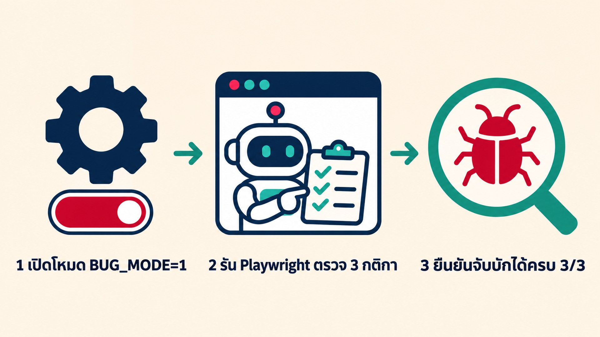

| Bug #1 (`BR-02` · `TC-25`) | Bug #2 (`BR-04` · `TC-26`) | Bug #3 (`BR-06` · `TC-27`) | ภาพจับบัก `90.00%` สีแดง |
| :---: | :---: | :---: | :---: |
| 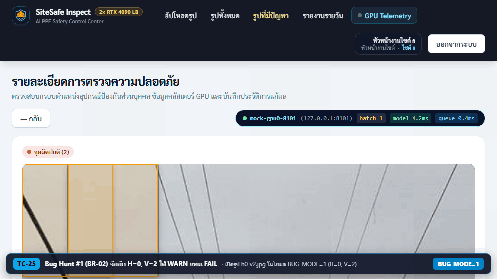 | 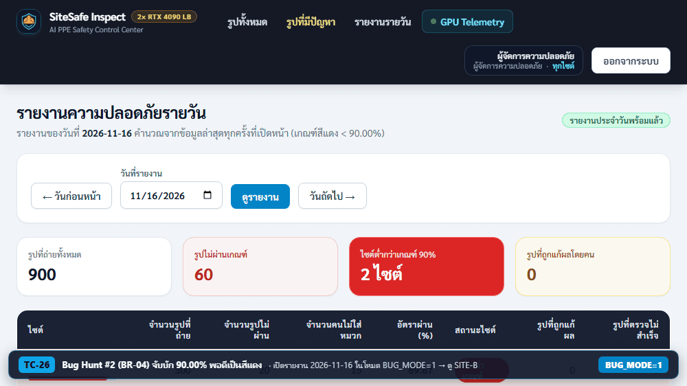 | 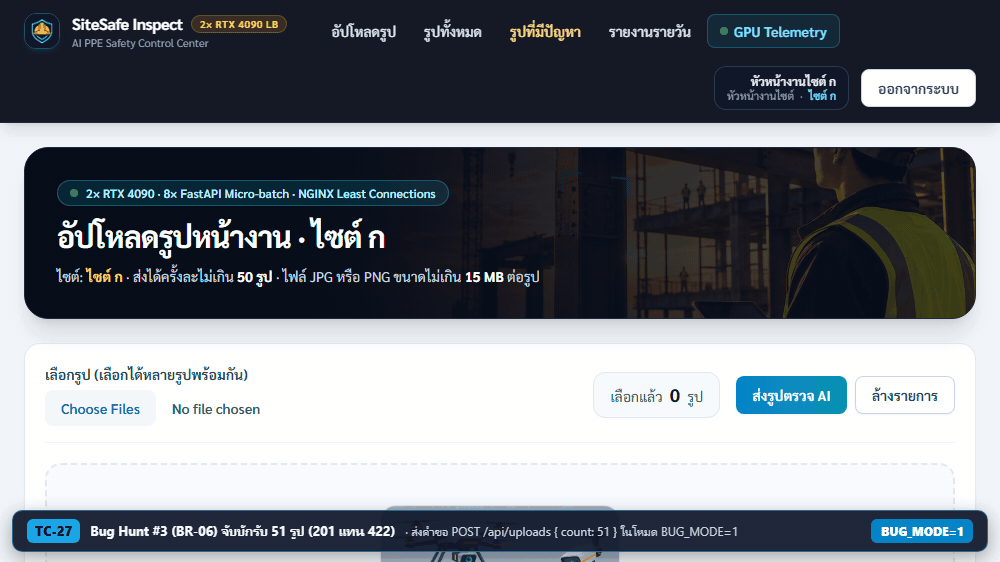 | 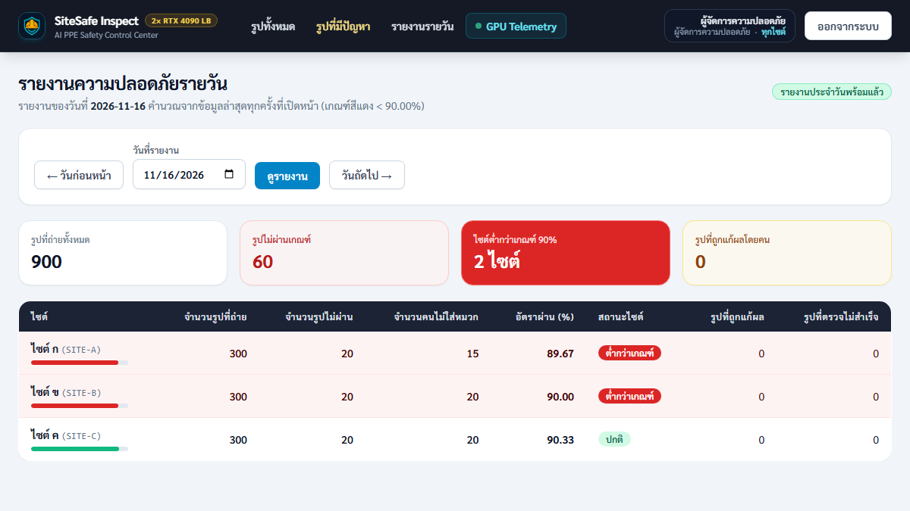 |

ดูรายละเอียดเต็มใน [`test/BUG-HUNT.md`](test/BUG-HUNT.md)

> [!IMPORTANT]
> **พรอมต์ที่ 9 · รัน Bug Hunt (`TC-25`–`TC-27`) ในโหมด `BUG_MODE=1`**
> ```text
> เปิดโหมด BUG_MODE=1 บนสแต็ก sitesafe-mock (พอร์ต 3411) แล้วรัน test/e2e/tests/06_bughunt.spec.ts (TC-25 ถึง TC-27) เพื่อพิสูจน์ว่าชุดทดสอบจับความผิดพลาดของ Business Rule ที่ซ่อนไว้ได้ครบ 3/3:
> - TC-25 (BR-02): ยืนยันตรวจพบว่า h0_v2.jpg ตอบ WARN แทน FAIL
> - TC-26 (BR-04): ยืนยันตรวจพบว่า SITE-B ที่ได้ 90.00% พอดีถูกไฮไลต์สีแดง พร้อมถ่ายภาพหน้าจอ images/lab/web-bug-9000.png
> - TC-27 (BR-06): ยืนยันตรวจพบว่าส่งชุด 51 รูปได้รับ 201 แทน 422
> บันทึกไฟล์ .gif หลักฐานทั้ง 3 ข้อ (images/tests/TC-25.gif ถึง TC-27.gif) บันทึกผลลง test/BUG-HUNT.md แล้วคืนค่า BUG_MODE=0 ทันที
> ```

### D.3 ลบเครื่อง GPU บน Vast.ai และส่งมอบงาน

หลังจบการทดสอบทั้งหมด ระบบลบเครื่อง `2× RTX 4090` (Instance `62729107` · `label=e2e-sitesafe-nginx`) บน Vast.ai ทันทีและยืนยันว่าเหลือ `0` เครื่อง พร้อมปิดคอนเทนเนอร์ทดสอบในเครื่องครบทุกชุด

> [!IMPORTANT]
> **พรอมต์ที่ 10 · ปิดและลบเครื่อง GPU ทันที + ออกเอกสารส่งมอบ `DELIVERY.md`**
> ```text
> หลังจบการทดสอบทั้งหมดให้ดำเนินการปิดทรัพยากรและสรุปงานส่งมอบทันที:
> 1. ลบเครื่อง GPU ที่มี label e2e-sitesafe-nginx บน Vast.ai ด้วย vastai destroy instance <INSTANCE_ID> -y และตรวจสอบด้วย vastai show instances ว่าเหลือ 0 เครื่อง
> 2. ปิดคอนเทนเนอร์ทดสอบในเครื่อง (sitesafe-nginx และ sitesafe-mock) ด้วย docker compose down -v และลบไฟล์ชั่วคราวที่ไม่จำเป็น
> 3. ออกรายงานคำตัดสินส่งมอบใน DELIVERY.md สรุปผลความแม่นยำโมเดล ความจุบน 2× RTX 4090 ผลทดสอบ Playwright 24/24 + Bug Hunt 3/3 และข้อสังเกตโปร่งใสเรื่องขนาด Test Set
> ```

---

## โครงสร้างไฟล์ของบทเรียน

```text
01_sitesafe_inspect/
├── README.md                      คู่มือหลักของบทเรียน (อ่านและค้น)
├── SiteSafe_Inspect_Slides.html   สไลด์ประกอบการสอน HTML ไฟล์เดียว
├── PROMPTS.md                     รวมพรอมต์ 10 ขั้นตอน (ตรงตัวอักษรกับ README และสไลด์)
├── INTERVIEW.md                   บทสัมภาษณ์ลูกค้า บริษัท ไทยมั่นคงก่อสร้าง จำกัด
├── DELIVERY.md                    เอกสารคำตัดสินส่งมอบงาน
├── docs/                          USER-STORIES · REQUIREMENTS · DESIGN · TEST-DATA · BUGS-SECRET
├── plan/                          PLAN.md · REPORT.md · dag.png · gantt-plan.png · gantt-actual.png
├── code_reference/                app/ (Next.js 15 + PostgreSQL + ai/serving + ai/train) · lb/
├── results/                       model/ (best.pt, metrics, threshold) · lb/ (JSON ผลวัด 2× RTX 4090)
├── test/                          index.html · TEST-REPORT.md · BUG-HUNT.md · evidence/ · e2e/
├── images/                        story/ · theory/ · lab/ · slides/ · tests/ (TC-01.gif..TC-27.gif)
└── tools/                         slides_engine.py · slides_figures.py · build_slides.py · plot_lb_charts.py
```
