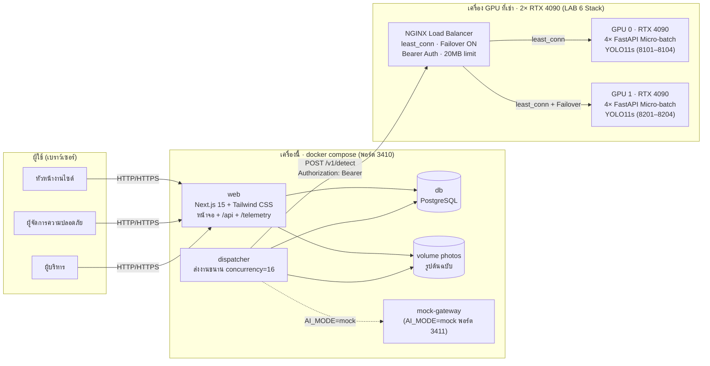
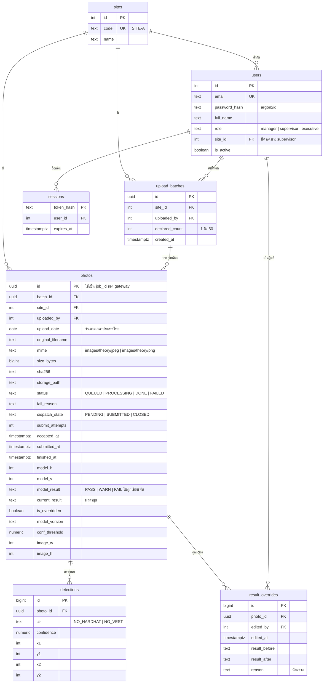
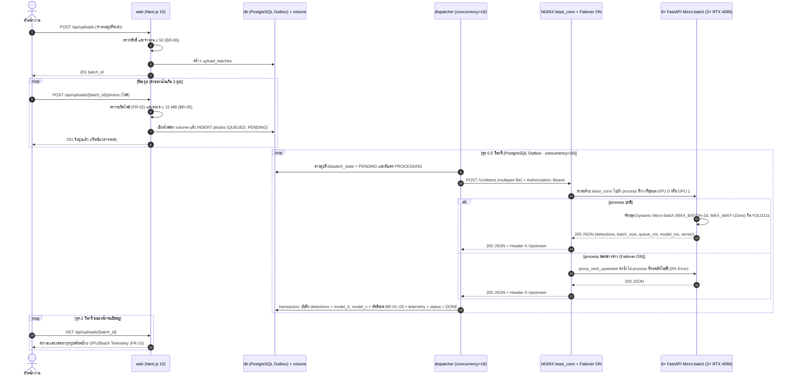
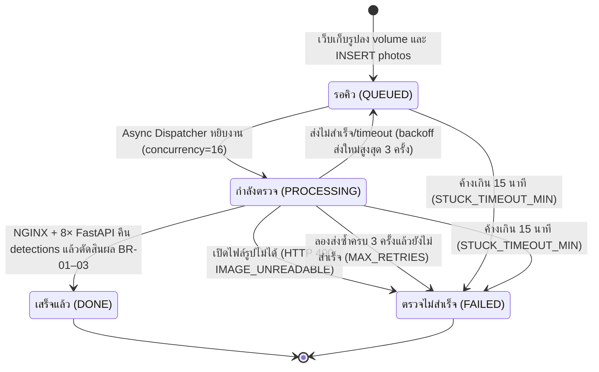

# Design · SiteSafe Inspect

**ที่มา:** `docs/REQUIREMENTS.md` (FR-01 ถึง FR-22 · BR-01 ถึง BR-07 · NFR-01 ถึง NFR-08 · AS-01 ถึง AS-14)
**สถานะ:** อัปเกรดสถาปัตยกรรมด้วย LAB 6 Serving Stack (`2× RTX 4090` · 8× FastAPI Micro-batching · NGINX `least_conn` + Failover ON · Next.js 15 + Tailwind CSS + PostgreSQL)
**เอกสารคู่กัน:** `docs/TEST-DATA.md` (ข้อมูลทดสอบและผลที่คาดหวัง)

## 0. ภาพรวมและข้อตัดสินใจหลัก

ระบบแบ่งเป็น 2 ฝั่ง (อัปเกรดจากเดิม GPU 1 ใบ + คิวส่งทีละ 1 รูป เป็นสถาปัตยกรรม LAB 6 ความเร็วสูง)

| ฝั่ง | ที่ตั้ง | ส่วนประกอบ | หน้าที่ |
|---|---|---|---|
| เว็บ | เครื่องนี้ รันด้วย `docker compose` (พอร์ต `3410`) | `web` (Next.js 15 + Tailwind CSS + `/telemetry`) · `dispatcher` (ส่งขนาน `concurrency=16`) · `db` (PostgreSQL) · volume `photos` | ล็อกอิน RBAC 3 บทบาท รับและเก็บรูปต้นฉบับ ตัดสินผลตาม Business Rule แก้ผลพร้อม Audit Trail รายงานรายวัน และแดชบอร์ด GPU Telemetry |
| AI | เครื่อง GPU ที่เช่า `2× RTX 4090` (Vast.ai) | `nginx` (`least_conn` + `proxy_next_upstream` Failover ON) · `8× FastAPI Micro-batching` (`4 Processes/GPU` ใช้โมเดล YOLO11s) | รับงานตรวจรูปพร้อมกัน จัดกลุ่ม Dynamic Micro-batch บน 2 การ์ดจอ และคืนค่า H, V, กรอบ PPE พร้อม Header `X-Upstream`, `batch_size`, `queue_ms`, `model_ms` |

| ข้อ | ข้อตัดสินใจ | เหตุผล | อ้าง |
|---|---|---|---|
| D-01 | เว็บเก็บรูปต้นฉบับลง volume และเขียนแถวในฐานข้อมูลให้เสร็จก่อนตอบผู้อัปโหลดว่ารับแล้ว | รูปห้ามหายแม้ฝั่ง AI ใช้ไม่ได้ | NFR-04 |
| D-02 | การส่งรูปไปฝั่ง AI ทำโดย `dispatcher` แบบขนาน (`DISPATCH_CONCURRENCY=16`, Timeout 90 วิ) ไม่ผูกกับหน้าจอของผู้ใช้ | แก้คอขวด BUG-01/BUG-02 และผู้ใช้ปิดหน้าจอแล้วงานยังเดินต่อ | FR-05, NFR-02 |
| D-03 | ฝั่ง AI คืนเฉพาะสิ่งที่โมเดลเห็น (H, V, กรอบ PPE และ Telemetry) การตัดสิน "ผ่าน / เตือน / ไม่ผ่าน" ทำที่เว็บในไฟล์กติกาไฟล์เดียว (`lib/rules.ts`) | เส้นแบ่งของ BR เปลี่ยนได้โดยแก้ค่าเดียว (AS-03) และไม่ต้องแตะฝั่ง AI | FR-09, BR-01–03 |
| D-04 | เว็บส่งคำขอ HTTP POST `/v1/detect` พร้อม `Authorization: Bearer <API_KEY>` ไปยัง NGINX บนเครื่อง GPU โดยตรง | เครื่องที่เช่าไม่ต้องรู้ที่อยู่ของเว็บ และเว็บไม่ต้องเปิดพอร์ตรับจากภายนอก | NFR-05 |
| D-05 | คอลัมน์ Telemetry (`lb_upstream`, `lb_server`, `lb_batch_size`, `lb_queue_ms`, `lb_model_ms`) บันทึกลงตาราง `photos` | ตรวจสอบการกระจายโหลดข้าม `gpu0` / `gpu1` และความหน่วงจริงรายรูปได้ที่ `/telemetry` | NFR-02 |
| D-06 | NGINX ใช้ `least_conn` ร่วมกับ `max_fails=2 fail_timeout=5s` และ `proxy_next_upstream error timeout http_502 http_503 http_504` | เมื่อ GPU ช้าลง 3× กระจายงานได้สูงกว่า Round Robin +77% และเมื่อ GPU 1 ล่ม ผิดพลาด 0.00% | NFR-03, NFR-04 |
| D-07 | โมเดล YOLO11s ขนาด 19 MB ใช้ `4 Processes/GPU` + Dynamic Micro-batching (`MAX_BATCH=16, MAX_WAIT=15ms`) แทน single process | ทลายคอขวด Python GIL เพิ่มความจุจาก 11 เป็น 88 ผู้ใช้พร้อมกัน (8.0×) และ 444.55 คำขอต่อวินาที (8.1×) | NFR-02, NFR-03 |
| D-08 | กรอบแจ้งปัญหาวาดทับรูปที่หน้าเว็บด้วย SVG/Overlay จากพิกัดในฐานข้อมูล ไม่สร้างไฟล์รูปชุดที่สอง | รูปต้นฉบับไม่ถูกแก้ และแสดงทั้งกรอบผ่าน (เขียว) และกรอบไม่ผ่าน (แดง/ส้ม) | FR-07 |
| D-09 | รายงานรายวันคำนวณสดจากตาราง `photos` ทุกครั้งที่เปิด | เปิดดูได้ตลอด จึงพร้อมก่อน 18:00 น. เสมอ และรูปที่เข้าหลัง 18:00 น. ถูกนับเอง | BR-07, FR-17 |

---

## 1. Architecture



| ส่วน | เทคโนโลยี | เก็บอะไร | หมายเหตุ |
|---|---|---|---|
| `web` | Next.js 15 (App Router) + Tailwind CSS | – | ตรวจ session และสิทธิ์ทุกคำขอที่ฝั่งเซิร์ฟเวอร์ (NFR-06) + หน้า `/telemetry` |
| `dispatcher` | Node.js กระบวนการแยก ใช้โค้ดชุดเดียวกับ web | – | ส่งรูปขนานสูงสุด 16 รูปพร้อมกัน Timeout 90 วินาที บันทึก `X-Upstream` และเวลาจริงลง DB |
| `db` | PostgreSQL | 7 ตาราง + คอลัมน์ LB Telemetry | volume ถาวร |
| volume `photos` | ระบบไฟล์ | รูปต้นฉบับ `photos/{site}/{yyyy-mm-dd}/{photo_id}.{ext}` | เข้าถึงได้ผ่าน `/api/photos/{id}/image` เท่านั้น ไม่มีเส้นทาง static |
| `mock-gateway` | บริการจำลอง API Contract | – | ใช้เมื่อ `AI_MODE=mock` คืนค่า H, V ตามชื่อไฟล์เพื่อทดสอบกรณีขอบ `BR-01`–`BR-03` |
| `nginx` | NGINX Load Balancer บนเครื่อง `2× RTX 4090` | – | `least_conn` + `proxy_next_upstream` Failover ON + `X-Upstream` header |
| `8× FastAPI` | Python + Uvicorn + Ultralytics YOLO11s (`4 Processes/GPU`) | – | Dynamic Micro-batching (`MAX_BATCH=16, WAIT=15ms`) บน GPU 0 และ GPU 1 |

---

## 2. ER Diagram (PostgreSQL ฝั่งเว็บ · 7 ตาราง)



| ตาราง | กติกาของข้อมูล |
|---|---|
| `users` | `role = supervisor` ต้องมี `site_id` · บทบาทอื่น `site_id` เป็น NULL · สร้างด้วยสคริปต์ seed ของฝ่ายไอทีเท่านั้น ไม่มีหน้าสมัคร (AS-13) |
| `upload_batches` | CHECK `declared_count BETWEEN 1 AND 50` · จำนวนแถว `photos` ต่อ batch ไม่เกิน `declared_count` |
| `photos` | `site_id` และ `upload_date` มาจากบัญชีผู้อัปโหลดและเวลาเซิร์ฟเวอร์ (Asia/Bangkok) ผู้ใช้ส่งมาเองไม่ได้ (FR-04) · `model_*` เขียนได้ครั้งเดียวตอนเปลี่ยนเป็น `DONE` · index `(site_id, upload_date, current_result)` สำหรับรายงาน |
| `detections` | เขียนใน transaction เดียวกับการเปลี่ยน `photos.status` เป็น `DONE` จึงมีผลของโมเดลชุดเดียวต่อรูป |
| `result_overrides` | เพิ่มได้อย่างเดียว: บัญชีฐานข้อมูลของเว็บถูกถอนสิทธิ์ UPDATE และ DELETE บนตารางนี้ และไม่มี API สำหรับลบหรือแก้ (NFR-07) |
| รายงานรายวัน | ไม่เป็นตาราง เป็น query รวมจาก `photos` ตาม `(site_id, upload_date)` |

ฝั่ง AI มีตาราง `jobs` 1 ตารางใน `jobs.db` ของ gateway (`job_id` · `status` · `queued_at` · `started_at` · `finished_at` · `result_json` · `error_code` · `delivery_count`) ไม่นับรวมใน 7 ตารางข้างต้น

---

## 3. ลำดับการทำงาน: อัปโหลดรูปจนเห็นผล



---

## 4. สถานะของงาน

สถานะที่ผู้ใช้เห็นมี 4 ค่าตาม FR-06 เก็บที่ `photos.status` โดยตาราง `photos` ทำหน้าที่เป็น **PostgreSQL Outbox** ในตัว (ไม่ต้องใช้โบรกเกอร์คิวภายนอก)



| กติกาของสถานะ | รายละเอียด |
|---|---|
| สถานะปลายทาง | `DONE` และ `FAILED` เปลี่ยนต่อไม่ได้ คำสั่ง UPDATE ทุกคำสั่งมีเงื่อนไข `WHERE status IN ('QUEUED','PROCESSING')` ผลที่มาถึงช้าหรือมาซ้ำจึงถูกทิ้ง |
| `FAILED` ต้องมีเหตุผล | `fail_reason` หนึ่งในค่า: "เปิดไฟล์รูปไม่ได้" · "ตรวจซ้ำครบ 3 ครั้งแล้วไม่สำเร็จ" · "เกินเวลา 15 นาที" |
| การแก้ผลโดยคน | ไม่ใช่สถานะของงาน: รูปที่ `DONE` มี `current_result` และ `is_overridden` เปลี่ยนได้ผ่าน `result_overrides` ส่วน `model_result` คงเดิม (FR-14) |
| ยอดรวม | รูปที่ระบบรับแล้ว = จำนวนแถว `photos` = QUEUED + PROCESSING + DONE + FAILED เสมอ เพราะเป็นคอลัมน์เดียว (NFR-04) |
| สถานะย่อยของการส่ง | `dispatch_state`: `PENDING` (รอส่งใน PostgreSQL Outbox) → `CLOSED` (ถึงสถานะปลายทาง `DONE` หรือ `FAILED`) · หากส่งไม่สำเร็จและยังไม่ครบ 3 ครั้ง จะคืนกลับ `PENDING` พร้อม exponential backoff |

---

## 5. API Contract

### 5.1 เว็บ ↔ NGINX Load Balancer ฝั่ง AI (Pure LAB 6 API)

ข้อกำหนดร่วม

| เรื่อง | ข้อกำหนด |
|---|---|
| ที่อยู่ | `GATEWAY_URL` ในไฟล์ `.env` ของเว็บ ชี้ไปที่พอร์ต `8080` ของ NGINX บนเครื่อง `2× RTX 4090` |
| API key | ทุกคำขอ `/v1/*` ส่ง header `Authorization: Bearer <API_KEY>` · ค่าเก็บใน `.env` ของทั้งสองฝั่ง (`GATEWAY_API_KEY`) · ผู้เรียกมีเฉพาะ `dispatcher` เบราว์เซอร์ไม่เคยได้รับ key |
| ไม่มี key หรือ key ผิด | ไม่มี header → NGINX ตอบ `401` ทันทีก่อนถึง GPU (`X-Rejected-By: nginx`) · key ผิด → FastAPI ตอบ `401` (เทียบแบบ constant-time `hmac.compare_digest` · ไม่เขียนค่า key ลง log) |
| รูปแบบข้อมูล | คำตอบเป็น JSON (UTF-8) พร้อม Response Header `X-Upstream` ระบุพอร์ต process ที่ประมวลผลจริง |
| ข้อจำกัดอัปโหลด | `client_max_body_size 20m` (NGINX) และ `MAX_UPLOAD_MB=20` (FastAPI) รองรับไฟล์ใหญ่สุดตาม BR-05 (15 MB) ได้เต็มที่ |

**API 1 · ตรวจจับอุปกรณ์นิรภัย** `POST /v1/detect` (`multipart/form-data`)

| ช่อง | ชนิด | ความหมาย |
|---|---|---|
| `file` | ไฟล์ JPG หรือ PNG ไม่เกิน 15 MB | รูปหน้างานต้นฉบับ |

ตัวอย่างคำตอบ `200 OK` พร้อม Header `X-Upstream: 127.0.0.1:8203`:

```json
{
  "filename": "site_a_001.jpg",
  "server": "gpu1-8203",
  "mode": "micro",
  "batch_size": 8,
  "queue_ms": 4.2,
  "model_ms": 88.5,
  "image": { "width": 1280, "height": 720 },
  "count": 2,
  "detections": [
    {
      "class_id": 2,
      "class_name": "NO-Hardhat",
      "confidence": 0.8742,
      "box": { "x1": 412.0, "y1": 130.0, "x2": 596.0, "y2": 380.0 }
    }
  ]
}
```

| รหัส | เมื่อไร | พฤติกรรมของ `dispatcher` |
|---|---|---|
| `200` | ตรวจจับสำเร็จ | แปลงคลาส (`NO-Hardhat` → H, `NO-Safety Vest` → V) ตัดสินผลตาม BR-01–03 บันทึก telemetry (`lb_upstream`, `lb_server`, `lb_batch_size`, `lb_queue_ms`, `lb_model_ms`) แล้วตั้ง `DONE` |
| `400` | ไฟล์ภาพเสีย ถอดรหัส OpenCV ไม่ได้ | ตั้ง `FAILED` ทันที (`fail_reason = เปิดไฟล์รูปไม่ได้`) ไม่ส่งซ้ำ |
| `401` | ไม่มี Bearer token หรือ key ผิด | หยุดส่ง เขียน log error (ตัด token ออก) และ `/api/health` รายงาน `gateway: "unauthorized"` |
| `413` | ไฟล์ใหญ่เกินเพดาน | ตั้ง `FAILED` |
| `502` / `503` / `504` / timeout | Process ล่มหรือเครือข่ายสะดุด | NGINX Failover ON ส่งซ้ำไป process อื่นทันที หากล้มทุกตัว `dispatcher` คืน `PENDING` ส่งใหม่แบบ backoff สูงสุด 3 ครั้ง |

**API 2 · ตรวจสุขภาพประตู NGINX** `GET /lb/health`
คำตอบ `200` `{"status":"ok","service":"nginx"}` (ตอบโดย NGINX โดยตรง ไม่ผ่าน GPU)

**API 3 · ตรวจสุขภาพ Process ฝั่ง AI** `GET /health`
คำตอบ `200` พร้อม Header `X-Upstream`:
`{"status":"ready","server":"gpu0-8101","mode":"micro","max_batch":16,"max_wait_ms":15,"device":"cuda:0","warmed_batch_sizes":16,"queue_len":0}` · `503` เมื่อยัง warm-up ไม่เสร็จ

**พฤติกรรมของเว็บต่อคำตอบของ NGINX / FastAPI**

| คำตอบ | สิ่งที่ `dispatcher` ทำ | สิ่งที่ผู้ใช้เห็น |
|---|---|---|
| `200` | บันทึก detections + telemetry + ตัดสินผล BR-01–03 → `status = DONE`, `dispatch_state = CLOSED` | "ผ่าน / เตือน / ไม่ผ่าน" พร้อมป้าย GPU |
| `400` / `413` / `415` | `status = FAILED`, `dispatch_state = CLOSED` พร้อมเหตุผล | "ตรวจไม่สำเร็จ" |
| `502` / `503` / `504` / timeout | คืน `dispatch_state = PENDING` ส่งใหม่แบบ backoff สูงสุด 3 ครั้ง (ครบ 3 ครั้ง → `FAILED`) | "รอคิว" → "กำลังตรวจ" |
| `401` | หยุดส่ง รายงาน `gateway: "unauthorized"` ใน `/api/health` | "รอคิว" จนครบ 15 นาทีแล้วเป็น "ตรวจไม่สำเร็จ" |

### 5.2 เบราว์เซอร์ ↔ เว็บ (14 API)

ทุกเส้นทางยกเว้น 3 เส้นทางที่ระบุ ต้องมี session cookie (`HttpOnly` · `Secure` · `SameSite=Lax`) ไม่มี → `401` · บทบาทไม่มีสิทธิ์ → `403` · ทรัพยากรของไซต์อื่น → `404`

| # | Method และเส้นทาง | สิทธิ์ | หน้าที่ | อ้าง |
|---|---|---|---|---|
| 1 | `GET /api/health` | ไม่ต้องล็อกอิน | สุขภาพของเว็บ (หัวข้อ 7.1) | – |
| 2 | `POST /api/auth/login` | ไม่ต้องล็อกอิน | อีเมล + รหัสผ่าน → ตั้ง cookie · ผิด → `401` ข้อความเดียวกันทั้งอีเมลผิดและรหัสผ่านผิด | FR-18 |
| 3 | `POST /api/auth/logout` | ทุกบทบาท | ลบ session | FR-18 |
| 4 | `GET /api/auth/me` | ทุกบทบาท | ชื่อ บทบาท ไซต์ของผู้ใช้ | – |
| 5 | `POST /api/uploads` | supervisor | เปิดการอัปโหลด: `{"count": n}` · `n` > 50 → `422 TOO_MANY_PHOTOS` "ส่งได้ครั้งละไม่เกิน 50 รูป กรุณาแบ่งส่ง" · `n` < 1 → `422` | FR-01, BR-06 |
| 6 | `POST /api/uploads/{batchId}/photos` | supervisor เจ้าของ batch | รับ 1 ไฟล์: ตรวจชนิดจากเนื้อไฟล์ (magic bytes) → `415` · ขนาด > 15 MB → `413` "ขนาดสูงสุด 15 MB" · เกิน `declared_count` → `422` · สำเร็จ → `201` หลังเก็บไฟล์แล้ว | FR-02, FR-03, BR-05 |
| 7 | `GET /api/uploads/{batchId}` | ผู้เห็นไซต์นั้นได้ | รายการสถานะและผลของทุกรูปใน batch | FR-06, FR-10 |
| 8 | `GET /api/photos?date=&site=&result=&status=&problems=1&page=` | manager ทุกไซต์ · supervisor ไซต์ตัวเอง | รายการรูป · `problems=1` ได้เฉพาะ "ไม่ผ่าน" และ "เตือน" | FR-11, FR-12 |
| 9 | `GET /api/photos/{id}` | เหมือนข้อ 8 | รายละเอียด: H, V, กรอบ, ผลของโมเดล, ผลล่าสุด | FR-07, FR-08 |
| 10 | `GET /api/photos/{id}/image` | เหมือนข้อ 8 | ส่งไฟล์รูป · header `Cache-Control: private, no-store` | FR-22 |
| 11 | `POST /api/photos/{id}/overrides` | manager ทุกไซต์ · supervisor ไซต์ตัวเอง | `{"result":"PASS|WARN|FAIL","reason":"…"}` · เหตุผลว่าง → `422` · ผลเท่าผลล่าสุด → `422` · รูปยังไม่ `DONE` → `422` | FR-13 |
| 12 | `GET /api/photos/{id}/overrides` | manager ทุกไซต์ · supervisor ไซต์ตัวเอง | ประวัติการแก้ผล เรียงตามเวลา | FR-14 |
| 13 | `GET /api/reports/daily?date=` | manager และ executive ทุกไซต์ · supervisor ไซต์ตัวเอง | รายงานรายวันต่อไซต์ (หัวข้อ 9.2) | FR-15–17 |
| 14 | `POST /api/test/reset` | ไม่ใช้ session ใช้ `X-Test-Key` | รีเซ็ตข้อมูลทดสอบ (หัวข้อ 7.2) | – |

ผู้บริหาร (executive) เรียกได้เฉพาะข้อ 1–4 และ 13 (FR-19)

---

## 6. การออกแบบการส่งงานขนาน, Dynamic Micro-batching และ NGINX Load Balancing

### 6.1 สถาปัตยกรรมส่งตรงผ่าน Concurrent HTTP (`NGINX least_conn` + `8× FastAPI`)

SiteSafe Inspect เก็บรูปต้นฉบับลง `volume photos` และบันทึกสถานะลงตาราง `photos` ใน PostgreSQL จากนั้นให้ **Async HTTP Dispatcher (`concurrency=16`)** ส่งรูปตรงผ่าน HTTP ไปยัง **NGINX `least_conn` + Failover ON** หน้า **8× FastAPI Micro-batching** บน `1 โหนด × 2× RTX 4090` (ไม่ต้องใช้โบรกเกอร์ข้อความภายนอก):

| ชั้น | ส่วนประกอบ | หน้าที่หลัก | ค่าตั้งที่วัดผลจริง |
|---|---|---|---|
| 1 · เก็บต้นฉบับฝั่งเว็บ | ตาราง `photos` + `volume photos` | เก็บไฟล์ต้นฉบับและสถานะงานถาวรก่อนตอบ `201` | ทนรีสตาร์ตได้ 100% รูปห้ามหาย (NFR-04) |
| 2 · ส่งงานขนาน | `dispatcher` (`DISPATCH_CONCURRENCY=16`) | หยิบรูปที่รอส่ง ส่งพร้อมกัน 16 รูปต่อรอบ ไปยัง `POST /v1/detect` | ป้อนงานเต็ม micro-batch ข้ามทั้ง 2 GPU |
| 3 · ประตูโหลดบาลานซ์ | NGINX `least_conn` + Failover ON | กระจายงานให้ process ที่มีคำขอค้างน้อยที่สุด + ส่งซ้ำทันทีเมื่อ process ตาย | `max_fails=1 fail_timeout=10s` · `proxy_next_upstream ... non_idempotent` |
| 4 · รันโมเดล GPU | `8× FastAPI` (`4 Processes/GPU` บน `2× RTX 4090`) | รวมคำขอที่เข้ามาพร้อมกันเข้า Dynamic Micro-batch แล้วรัน YOLO11s ทีเดียว | `MAX_BATCH=32`, `MAX_WAIT_MS=5`, รองรับ 88 ผู้ใช้พร้อมกัน / 444.55 RPS |

### 6.2 งานต้องไม่หายแม้ Process หรือเครื่อง GPU ล่ม (Zero-Loss & Failover)

| กลไก | ทำอย่างไร | ป้องกันอะไร |
|---|---|---|
| เขียนต้นฉบับก่อนตอบรับ | บันทึกไฟล์ลง `volume photos` + `INSERT photos` เสร็จก่อนตอบ `201` | รูปหายตอนอัปโหลดแม้ฝั่ง AI ดับอยู่ |
| NGINX Failover ON | `proxy_next_upstream error timeout invalid_header http_502 http_503 http_504 non_idempotent` | Process ล่มกลางงาน: NGINX ย้ายคำขอไป Process ที่รอดอัตโนมัติ (0.00% Error) |
| ลองส่งซ้ำแบบ Backoff | งานที่ส่งไม่ถึง AI จะถูกส่งใหม่สูงสุด 3 ครั้ง | เครื่อง GPU สะดุดหรือเปลี่ยนเครื่องชั่วคราว |
| ผลชุดเดียว (Idempotent) | เว็บเขียน `detections` ใน transaction เดียวกับ `UPDATE photos ... WHERE status IN ('QUEUED','PROCESSING')` | ผลตรวจมาซ้ำไม่ทำให้ข้อมูลซ้ำ |
| เฝ้ารูปค้าง | `dispatcher` ตั้ง `FAILED` ("เกินเวลา 15 นาที") ให้รูปที่ยังไม่จบหลัง `accepted_at` เกิน `STUCK_TIMEOUT_MIN` | รูปค้างสถานะกลางทางไม่รู้จบ (NFR-04) |

### 6.3 การรองรับช่วงเร่งด่วน (Peak 150 รูป · 88 ผู้ใช้พร้อมกัน)

| เรื่อง | ข้อกำหนดและผลจริงบน `2× RTX 4090` |
|---|---|
| ความจุจริง | 8× FastAPI Micro-batching + NGINX `least_conn` รองรับ **88 ผู้ใช้พร้อมกัน** ที่ p95 = **457.4 ms** (444.55 คำขอต่อวินาที) |
| เมื่อ GPU หนึ่งใบช้าลง 3× | `least_conn` ส่งงานไป GPU 0 (เร็ว) 68% และ GPU 1 (ช้า) 32% คงความจุได้ **76 ผู้ใช้** (สูงกว่า Round Robin 43 ผู้ใช้ถึง **+76.7%**) |
| เมื่อ Process ล่มกลางโหลด 80 ผู้ใช้ | Failover OFF ผิดพลาด **67.18%** (14,098 คำขอ) vs Failover ON ผิดพลาด **0.00%** (0 คำขอ) |
| ผลต่อผู้ใช้ | เว็บบันทึกรูปลงฐานข้อมูลและ Volume เสมอ ไม่ปฏิเสธผู้อัปโหลดและไม่ขัดกติกา "รูปห้ามหาย" |

---

## 7. ความสามารถเพื่อการทดสอบของเว็บ

### 7.1 `/api/health`

`GET /api/health` ไม่ต้องล็อกอิน ไม่มีข้อมูลผู้ใช้ รูป หรือ key

```json
{
  "status": "ok",
  "db": "ok",
  "storage": "ok",
  "dispatcher": "ok",
  "gateway": "ok",
  "ai_mode": "real",
  "time": "2026-11-18T18:00:00+07:00",
  "version": "0.1.0"
}
```

| ช่อง | ค่า | ผลต่อรหัสคำตอบ |
|---|---|---|
| `db` · `storage` | `ok` / `down` | `down` → `503` และ `status: "down"` |
| `dispatcher` | `ok` เมื่อวนรอบล่าสุดไม่เกิน 10 วินาที | `down` → `200` และ `status: "degraded"` |
| `gateway` | `ok` / `down` / `unauthorized` จาก `GET /v1/health` ล่าสุด | ไม่ `ok` → `200` และ `status: "degraded"` (เว็บยังรับรูปได้) |
| `ai_mode` | `real` / `mock` | – |
| `time` | เวลาปัจจุบันของระบบ (Asia/Bangkok) รวมเวลาที่ตั้งจากการรีเซ็ต | – |

docker compose ใช้เส้นทางนี้เป็น healthcheck ของ `web`

### 7.2 ทางรีเซ็ตข้อมูลทดสอบ

`POST /api/test/reset`

| เรื่อง | ข้อกำหนด |
|---|---|
| เปิดใช้ | เฉพาะเมื่อ `ENABLE_TEST_RESET=1` ถ้าไม่ตั้ง เส้นทางนี้ตอบ `404` |
| การยืนยัน | header `X-Test-Key` ต้องตรงกับ `TEST_RESET_KEY` ใน `.env` ผิด → `401` |
| เนื้อคำขอ (ไม่บังคับ) | `{"now":"2026-11-18T17:59:00+07:00"}` ตั้งนาฬิกาของระบบสำหรับทดสอบ BR-07 และวันที่ของรูป · ไม่ส่ง → ใช้เวลาจริง |
| สิ่งที่ทำ | 1) หยุด `dispatcher` ชั่วคราว 2) ล้าง 7 ตารางและไฟล์ใน volume `photos` 3) ใส่ข้อมูล seed ตาม `docs/TEST-DATA.md` (ไซต์ ผู้ใช้ และรูปของชุดรายงาน) 4) ให้ `dispatcher` ทำงานต่อ |
| คำตอบ | `200` `{"reset":true,"sites":3,"users":5,"photos":1233,"overrides":1,"now":"…"}` |
| คุณสมบัติ | เรียกซ้ำกี่ครั้งได้ผลเท่าเดิม (รหัสของแถว seed คงที่) จึงใช้ก่อนทุกชุดทดสอบได้ |
| คำสั่งคู่กัน | `docker compose run --rm web npm run seed` ทำงานเดียวกันจากบรรทัดคำสั่ง |

### 7.3 โหมดจำลองฝั่ง AI (`AI_MODE=mock`)

ใช้ทดสอบ Business Rule โดยไม่ต้องเช่า GPU และได้ H, V ที่กำหนดได้แน่นอน `dispatcher` ชี้ไปที่ `mock-gateway` ซึ่งทำตาม API Contract ในหัวข้อ 5.1 ทุกข้อ

| ชื่อไฟล์ที่อัปโหลด | ผลจาก `mock-gateway` |
|---|---|
| `h{H}_v{V}*.jpg` หรือ `.png` เช่น `h0_v2.jpg` | `DONE` ด้วย `h = H`, `v = V` และกรอบตามจำนวนนั้น |
| `corrupt*.jpg` | `FAILED` `IMAGE_UNREADABLE` |
| ชื่ออื่น | `DONE` ด้วย `h = 0`, `v = 0` |

`mock-gateway` อ่านชื่อจากช่อง `filename` ของส่วน `image` ใน multipart · gateway จริงไม่ใช้ชื่อไฟล์

### 7.4 `data-testid`

กติกา: ปุ่ม ลิงก์เมนู ช่องกรอก ตัวเลือก และค่าที่ชุดทดสอบต้องอ่าน ทุกชิ้นมี `data-testid` · รูปแบบ `{หน้า}-{ชิ้นส่วน}` ตัวพิมพ์เล็กคั่นด้วยขีด · ชิ้นที่ซ้ำตามแถวต่อท้ายด้วยรหัส เช่น `photo-row-{photoId}` · ค่าคงที่ ไม่ขึ้นกับภาษาบนหน้าจอ

| หน้า (เส้นทาง) | ปุ่มและช่องกรอก | ค่าที่อ่านได้ |
|---|---|---|
| ทุกหน้า (แถบบน) | `nav-upload` · `nav-photos` · `nav-problems` · `nav-report` · `nav-logout` | `nav-user-name` · `nav-user-role` · `nav-user-site` |
| ล็อกอิน `/login` | `login-email` · `login-password` · `login-submit` | `login-error` |
| อัปโหลด `/upload` | `upload-file-input` · `upload-submit` · `upload-clear` | `upload-selected-count` · `upload-error` · `upload-file-error-{index}` |
| สถานะการอัปโหลด `/uploads/{batchId}` | `batch-refresh` · `batch-open-photo-{photoId}` | `batch-accepted-count` · `batch-count-queued` · `batch-count-processing` · `batch-count-done` · `batch-count-failed` · `batch-row-{photoId}` · `batch-row-status-{photoId}` · `batch-row-result-{photoId}` · `batch-row-reason-{photoId}` |
| รูปทั้งหมด `/photos` | `photos-filter-date` · `photos-filter-site` · `photos-filter-result` · `photos-filter-status` · `photos-filter-apply` · `photos-page-prev` · `photos-page-next` · `photo-open-{photoId}` | `photos-total-count` · `photo-row-{photoId}` · `photo-row-result-{photoId}` · `photo-row-edited-{photoId}` |
| รูปที่มีปัญหา `/photos/problems` | `problems-filter-date` · `problems-filter-site` · `problems-filter-apply` · `photo-open-{photoId}` | `problems-total-count` · `problems-count-fail` · `problems-count-warn` |
| รายละเอียดรูป `/photos/{id}` | `override-result-select` · `override-reason` · `override-submit` · `override-cancel` · `history-toggle` · `photo-back` | `photo-image` · `photo-box-{index}` · `photo-box-label-{index}` · `photo-h` · `photo-v` · `photo-model-result` · `photo-current-result` · `photo-edited-badge` · `override-error` · `history-row-{overrideId}` |
| รายงานรายวัน `/reports/daily` | `report-date` · `report-apply` · `report-prev-day` · `report-next-day` | `report-ready-badge` · `report-row-{siteCode}` · `report-taken-{siteCode}` · `report-fail-{siteCode}` · `report-h-{siteCode}` · `report-rate-{siteCode}` · `report-red-{siteCode}` (`data-red="true|false"`) · `report-edited-{siteCode}` · `report-failed-{siteCode}` |

ชิ้นที่บทบาทนั้นไม่มีสิทธิ์จะไม่ถูกแสดง (เช่น ผู้บริหารไม่มี `nav-upload`) แต่สิทธิ์จริงตรวจที่ API (NFR-06)

---

## 8. โหมด `BUG_MODE=1`

| เรื่อง | ข้อกำหนด |
|---|---|
| จุดประสงค์ | ใช้ตรวจว่าชุดทดสอบจับความผิดของ Business Rule ได้จริง |
| การเปิด | ตัวแปรสภาพแวดล้อม `BUG_MODE=1` ของบริการ `web` และ `dispatcher` ใน docker compose · ค่าเริ่มต้น `0` · อ่านครั้งเดียวตอนเริ่มบริการ |
| ผล | Business Rule 3 ข้อจาก BR-01 ถึง BR-07 ทำงานผิดจากข้อกำหนด ส่วนอื่นของระบบทำงานเหมือนเดิม |
| ตำแหน่งในโค้ด | ไฟล์กติกาไฟล์เดียว (`lib/rules`) ซึ่งเป็นที่เดียวที่อ่าน `BUG_MODE` |
| รายชื่อ 3 ข้อ | อยู่ที่ `docs/BUGS-SECRET.md` ที่เดียว ไม่ปรากฏในเอกสารอื่น ในหน้าเว็บ ใน `/api/health` ใน log และในชื่อตัวแปรหรือคำอธิบายในโค้ดส่วนอื่น |
| ผู้ที่เปิดไฟล์ได้ | ผู้สร้างระบบและผู้ตรวจผลการทดสอบ ผู้ทดสอบไม่เปิดไฟล์นี้ |

---

## 9. การนำ Business Rule ไปใช้

### 9.1 การตัดสินผลของรูป (BR-01 ถึง BR-03)

ค่าคงที่ในไฟล์กติกา: `HELMET_FAIL_MIN = 1` · `VEST_FAIL_MIN = 2` · `VEST_WARN_MIN = 1`

| ลำดับ | เงื่อนไข | ผล |
|---|---|---|
| 1 | `H ≥ HELMET_FAIL_MIN` | ไม่ผ่าน (BR-01) |
| 2 | `V ≥ VEST_FAIL_MIN` | ไม่ผ่าน (BR-02) |
| 3 | `V ≥ VEST_WARN_MIN` | เตือน (BR-03) |
| 4 | นอกเหนือจากนั้น | ผ่าน |

### 9.2 รายงานรายวัน (BR-04, BR-07, FR-15)

| ค่าในรายงาน | วิธีคำนวณ (ต่อไซต์ ต่อ `upload_date`) |
|---|---|
| จำนวนรูปที่ถ่าย | จำนวนแถว `photos` ทุกสถานะ |
| จำนวนรูปที่มีผล | จำนวนแถวที่ `status = DONE` |
| จำนวนรูปไม่ผ่าน | `status = DONE` และ `current_result = FAIL` |
| จำนวนคนไม่ใส่หมวก | ผลรวม `model_h` ของรูปที่ `DONE` |
| อัตราผ่าน | รูปที่ `current_result = PASS` ÷ รูปที่มีผล × 100 แสดงทศนิยม 2 ตำแหน่ง |
| สีแดง | `ผ่าน × 100 < 90 × รูปที่มีผล` เทียบด้วยจำนวนเต็ม ไม่ใช้ค่าที่ปัดแล้ว |
| จำนวนรูปที่ถูกแก้ผล | `is_overridden = true` |
| จำนวนรูปที่ตรวจไม่สำเร็จ | `status = FAILED` |
| ไม่มีรูปเลย | แสดง "ไม่มีข้อมูล" ไม่เป็นสีแดง |
| มีรูปแต่ยังไม่มีรูปใดมีผล | อัตราผ่านแสดง "ยังไม่มีผล" ไม่เป็นสีแดง |
| ป้ายความพร้อม | เวลาปัจจุบัน ≥ 18:00 น. ของวันที่เลือก → "รายงานประจำวันพร้อมแล้ว" · ก่อนนั้น → "ข้อมูลระหว่างวัน" · รายงานแสดงครบ 3 ไซต์เสมอ |

### 9.3 การรับรูป (BR-05, BR-06)

| กติกา | การนำไปใช้ |
|---|---|
| BR-05 | 1 MB = 1,048,576 ไบต์ · เพดาน 15 MB = 15,728,640 ไบต์ · `size_bytes ≤ 15,728,640` รับ · นับจากไบต์ที่ได้รับจริง ไม่เชื่อ header · ตัดการรับทันทีที่เกิน |
| BR-06 | ตรวจที่ `POST /api/uploads` ก่อนรับไฟล์ใด: `count ≤ 50` รับ · หน้าจอตรวจซ้ำก่อนส่งเพื่อบอกผู้ใช้เร็วขึ้น แต่ผลตัดสินอยู่ที่ API |
| FR-02 | ตรวจจากไบต์ต้นไฟล์ (JPG: `FF D8 FF` · PNG: `89 50 4E 47`) ไม่ใช้นามสกุล · ไฟล์ที่ถูกปฏิเสธไม่ถูกเขียนลง volume |

---

## 10. ความปลอดภัยและความเป็นส่วนตัว

| ข้อกำหนด | การออกแบบ |
|---|---|
| ล็อกอิน (FR-18, NFR-06) | รหัสผ่านเก็บเป็น argon2id · session token สุ่ม 256 บิต เก็บเฉพาะค่า hash ใน `sessions` · middleware ส่งผู้ที่ไม่ล็อกอินไป `/login` ทุกหน้า |
| สิทธิ์ (FR-19–21) | ฟังก์ชันเดียว `canAccess(user, action, siteId)` เรียกในทุก Route Handler · query ของ supervisor มี `WHERE site_id = :userSite` เสมอ |
| รูปไม่สาธารณะ (FR-22, NFR-05) | ไม่มีไฟล์รูปใต้เส้นทาง static · ลิงก์รูปคือ API ที่ตรวจ session และไซต์ |
| API key (NFR-05) | อยู่ใน `.env` (ไม่เข้า repository) ส่งให้ `dispatcher` เท่านั้น · ไม่อยู่ในตัวแปรที่ขึ้นต้นด้วย `NEXT_PUBLIC_` · ตัวกรอง log ตัด header `X-API-Key` |
| การเข้ารหัส (NFR-05) | เว็บ ↔ gateway ใช้ HTTPS โดย gateway อยู่หลัง reverse proxy ที่ทำ TLS และเว็บตรวจใบรับรองด้วย `GATEWAY_CA_CERT` · เว็บ ↔ ผู้ใช้ ใช้ HTTPS ผ่าน reverse proxy ของเครื่องนี้ |
| รูปไม่ออกนอกโครงการ (NFR-05) | รูปถูกส่งไปที่ `GATEWAY_URL` ที่เดียว · gateway ลบไฟล์ชั่วคราวเมื่องานจบ · Worker โหลดโมเดลจากไฟล์ในเครื่อง ไม่เรียกบริการภายนอก |
| ไม่ลบอัตโนมัติ (AS-12) | ไม่มีงานลบรูปหรือผลตรวจตามเวลา |

---

## 11. ค่าตั้ง (ตัวแปรสภาพแวดล้อม)

| ตัวแปร | ฝั่ง | ค่าเริ่มต้น | ความหมาย |
|---|---|---|---|
| `DATABASE_URL` | เว็บ | – | การเชื่อมต่อ PostgreSQL |
| `GATEWAY_URL` | เว็บ | – | ที่อยู่ gateway (`https://…`) |
| `GATEWAY_API_KEY` | เว็บ, AI | – | API key |
| `GATEWAY_CA_CERT` | เว็บ | – | ใบรับรองที่ใช้ตรวจ gateway |
| `AI_MODE` | เว็บ | `real` | `real` หรือ `mock` |
| `BUG_MODE` | เว็บ | `0` | หัวข้อ 8 |
| `ENABLE_TEST_RESET` · `TEST_RESET_KEY` | เว็บ | `0` · – | หัวข้อ 7.2 |
| `STUCK_TIMEOUT_MIN` | เว็บ | `15` | เฝ้ารูปค้าง |
| `MAX_QUEUE_DEPTH` | AI | `200` | หัวข้อ 6.3 |
| `MAX_DELIVERY` | AI | `3` | จำนวนครั้งที่ส่งงานซ้ำ |
| `PROCESSING_TIMEOUT_S` | AI | `120` | หัวข้อ 6.2 |
| `MODEL_PATH` · `CONF_THRESHOLD` | AI | – · – | ไฟล์โมเดล YOLO และ Threshold ที่เลือกบน Validation Set (NFR-01) |

---

## 12. ตรวจย้อน Requirement → การออกแบบ

| Requirement | อยู่ในหัวข้อ |
|---|---|
| FR-01–06 | 3 · 4 · 5.2 (API 5–7) · 9.3 |
| FR-07–12 | 5.1 (API 2) · 5.2 (API 8–10) · 9.1 · D-08 |
| FR-13–14 · NFR-07 | 2 (`result_overrides`) · 5.2 (API 11–12) |
| FR-15–17 · BR-04 · BR-07 | 9.2 · 5.2 (API 13) |
| FR-18–22 · NFR-05 · NFR-06 | 10 · 5.1 (API key) |
| BR-01–03 | 9.1 |
| BR-05 · BR-06 | 9.3 |
| NFR-01 | 5.1 (`conf_threshold`, `model_version`) · 11 · คำถาม DQ-02 |
| NFR-02 · NFR-03 · NFR-08 | 3 · 6.3 · 5.1 (API 4) · คำถาม DQ-01 |
| NFR-04 | 4 · 6.2 · D-01 · D-05 |

---

## 13. คำถามที่การออกแบบยังตอบไม่ได้

| รหัส | คำถาม | ทำไมยังตอบไม่ได้ | กระทบ |
|---|---|---|---|
| DQ-01 | GPU 1 ใบตรวจรูปขนาด 8–10 MB ได้กี่รูปต่อวินาที | ต้องวัดบนเครื่องที่เช่าจริง ภาระ 150 รูปใน 600 วินาทีต้องได้อย่างน้อย 0.25 รูปต่อวินาที ส่วน p95 ≤ 30 วินาทีของ 50 รูปต้องได้ราว 1.7 รูปต่อวินาที | NFR-02 · NFR-03 · ค่า `MAX_QUEUE_DEPTH` |
| DQ-02 | ใช้ไฟล์โมเดล YOLO ตัวใด ชื่อคลาสใดแทน "ไม่ใส่หมวก" และ "ไม่ใส่เสื้อสะท้อนแสง" ค่า Threshold เท่าใด และ Test Set มาจากไหน | ยังไม่มีผลวัด Recall และ Precision ระดับรูป | NFR-01 · `CONF_THRESHOLD` |
| DQ-03 | ที่อยู่และใบรับรอง HTTPS ของ gateway บนเครื่องที่เช่า (IP และพอร์ตเปลี่ยนทุกครั้งที่เช่า) และของเว็บบนเครื่องนี้ จะใช้โดเมนหรือใบรับรองแบบใด | ขึ้นกับผู้ให้เช่าเครื่องและโดเมนของลูกค้า | NFR-05 |
| DQ-04 | เมื่อคนแก้ผลของรูป ค่า H ที่ใช้รวม "จำนวนคนไม่ใส่หมวก" ในรายงานต้องเปลี่ยนตามหรือไม่ | Requirement ให้แก้เฉพาะผล ไม่ได้ให้แก้จำนวนคน การออกแบบนี้ใช้ H ของโมเดลเสมอ | FR-15 · AS-10 |
| DQ-05 | รูปจาก iPhone ที่เป็น HEIC จะถูกปฏิเสธตาม FR-02 ลูกค้ายอมรับหรือต้องการให้แปลงเป็น JPG | ต้องถามลูกค้า | FR-02 |
| DQ-06 | ถ้าเครื่อง GPU ใช้ไม่ได้นานเกิน 15 นาที รูปจะเป็น "ตรวจไม่สำเร็จ" ตาม NFR-04 แล้วใครเป็นผู้สั่งตรวจใหม่ (ระบบส่งเองเมื่อเครื่องกลับมา หรือมีปุ่มให้คนกด) และรูปที่ "ตรวจไม่สำเร็จ" ให้คนใส่ผลเองได้หรือไม่ | Requirement กำหนดเพียงว่าห้ามค้างเกิน 15 นาที | NFR-04 · FR-13 |
| DQ-07 | ต้องเตรียมพื้นที่เก็บรูปเท่าใดและสำรองข้อมูลอย่างไร (ช่วงเร่งด่วน 1 รอบประมาณ 150 รูป × 10 MB = 1.5 GB และยังไม่ลบอัตโนมัติ) | ลูกค้ายังไม่กำหนดระยะเวลาเก็บ (AS-12) และจำนวนรอบต่อวัน | NFR-05 |
| DQ-08 | ชื่อจริงของ 3 ไซต์ รายชื่อบัญชีผู้ใช้ และหัวหน้างาน 1 คนดูแลได้มากกว่า 1 ไซต์หรือไม่ | การออกแบบนี้ให้ 1 บัญชีหัวหน้างานผูกกับ 1 ไซต์ | FR-04 · FR-20 |

ข้อสมมติ AS-01 ถึง AS-14 ใน Requirement ยังรอลูกค้ายืนยัน การออกแบบนี้ทำตามข้อสมมติทุกข้อ และเส้นแบ่งทุกค่าเป็นค่าคงที่ที่แก้ได้ที่เดียว
