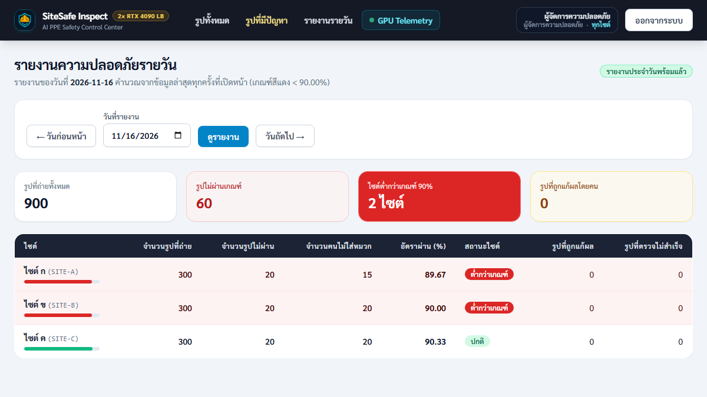

# รายงาน Bug Hunt (`BUG_MODE=1`) · SiteSafe Inspect

การทดสอบ **Bug Hunt** มีไว้พิสูจน์ว่าชุดทดสอบอัตโนมัติ (Playwright) ไม่ใช่แค่ "ผ่านทุกข้อเพราะตรวจหลวม" แต่สามารถ **จับความผิดพลาดของ Business Rule ที่ซ่อนอยู่ในโค้ดได้จริง**

## วิธีทดสอบ
1. เปิด `sitesafe-mock` (พอร์ต `3411`) ด้วยตัวแปร `BUG_MODE=1` (อ่านที่ `web/lib/rules.ts` เพียงจุดเดียว)
2. รันชุดทดสอบ `tests/06_bughunt.spec.ts` (`TC-25`, `TC-26`, `TC-27`) พร้อมบันทึกวิดีโอ `.gif` หลักฐานทุกข้อ
3. คืนค่า `BUG_MODE=0` หลังยืนยันจับบักครบ 3/3

## ผลการจับบักทั้ง 3 ข้อ (3/3 · 100%)

| TC ID | กติกา | พฤติกรรมที่ถูก (`BUG_MODE=0`) | พฤติกรรมที่จับได้ (`BUG_MODE=1`) | สถานะ | หลักฐาน |
|---|---|---|---|---|---|
| **TC-25** | `BR-02` | `H = 0, V = 2` → **ไม่ผ่าน (`FAIL`)** | ระบบตอบ **เตือน (`WARN`)** (ใช้ `V > 2` แทน `V ≥ 2`) | 🐛 จับบักได้ | [`TC-25.gif`](../images/tests/TC-25.gif) |
| **TC-26** | `BR-04` | อัตราผ่าน `90.00%` พอดี → **ปกติ (ไม่แดง)** | SITE-B (`90.00%`) ถูกไฮไลต์ **สีแดง** (ใช้ `≤ 90%` แทน `< 90%`) | 🐛 จับบักได้ | [`TC-26.gif`](../images/tests/TC-26.gif) · [`web-bug-9000.png`](../images/lab/web-bug-9000.png) |
| **TC-27** | `BR-06` | ส่ง `count = 51` รูป → ปฏิเสธ **`422`** | ระบบตอบรับ **`201`** (ใช้ `> 51` แทน `> 50`) | 🐛 จับบักได้ | [`TC-27.gif`](../images/tests/TC-27.gif) |

