# หัวข้อที่ 2 · ReceiptDesk — ระบบอ่านใบเสร็จและผู้ช่วยบัญชี AI แบบสตรีมสดสำหรับสำนักงานบัญชี

[← กลับหน้ารวมของบท](../README.md) · ทำ [หัวข้อที่ 1](../01_sitesafe_inspect/README.md) ก่อน · เปิด Claude Code ที่โฟลเดอร์ `02_receipt_desk` · พรอมต์ครบทั้ง 15 ขั้นอยู่ที่ [PROMPTS.md](PROMPTS.md)


*(ภาพจำลอง · บริษัทและบุคคลในหัวข้อนี้เป็นตัวอย่างสมมติ)*

สไลด์ประกอบการสอน: [ReceiptDesk_Slides.html](ReceiptDesk_Slides.html) · ศูนย์รวมหลักฐาน Playwright 28 ข้อพร้อม `.gif`: [test/index.html](test/index.html)

---

## 1 · เรื่องราวของลูกค้า

สำนักงานบัญชี **ใส่ใจการบัญชี** ดูแลบัญชีให้ร้านค้าและบริษัทขนาดเล็ก **60 ราย**

**ลูกค้าถ่ายรูปใบเสร็จส่งมา**


ร้านค้าส่งรูปใบเสร็จมาทาง LINE และอีเมล รวมกันเดือนละราว **6,000 ใบ**

**พนักงานพิมพ์ยอดทีละใบ**


พนักงาน 4 คนพิมพ์ชื่อร้าน วันที่ รายการ ราคา และยอดรวม ใบละประมาณ **2 นาที**

**สิ้นเดือน: งานเข้าพร้อมกัน ทำถึงสามทุ่ม และยอดเริ่มผิด**


บางวันใบเสร็จเข้ามาพร้อมกัน **800 ใบ** ยอดที่พิมพ์ผิดคือบัญชีที่ผิด

**คำถามของหัวข้อนี้: เมื่อใบเสร็จและคำถามผู้ช่วยบัญชี AI เข้าพร้อมกันเกินกำลังของ GPU 1 ใบ ทีมพัฒนาจะออกแบบ สร้าง เปิดบริการบน `1 โหนด × 2× RTX 4090` (`NGINX least_conn` + `2× vLLM Data Parallelism` + `Continuous Batching`) และพิสูจน์ระบบด้วย Playwright 28 ข้อพร้อมหลักฐาน `.gif` ทุกข้อได้อย่างไร**

---

## 2 · การสัมภาษณ์ลูกค้า


ทีมพัฒนาสัมภาษณ์ผู้เกี่ยวข้องทั้ง 4 บทบาท

| | ผู้ให้สัมภาษณ์ | สิ่งที่พูด |
|---|---|---|
|  | **คุณอรทัย**<br>เจ้าของสำนักงาน | "อยากให้อัปโหลดรูปใบเสร็จแล้วระบบอ่านออกมาเป็นข้อมูลเลย พนักงานแค่ตรวจว่าถูกไหมแล้วกดยืนยัน"<br>"ถ้าพนักงานต้องตรวจทุกช่องทุกใบเหมือนเดิมก็ไม่ได้ประหยัดเวลา"<br>"ห้ามล่ม ห้ามหาย ถ้าเต็มจริง ๆ ให้บอกว่าตอนนี้เต็ม ให้ลองใหม่อีกกี่นาที" |
|  | **คุณพิมพ์**<br>พนักงานบัญชี | "ขออัปโหลดทีละเป็นชุดนะคะ ชุดละร้อยใบก็มี"<br>"ชุดร้อยใบ รอสักครึ่งชั่วโมงก็ได้ค่ะ ขอแค่ใบเสร็จไม่หาย" |
|  | **คุณกิตติ**<br>หัวหน้าทีมบัญชี | "100 ใบ ยอดรวมผิดได้ไม่เกิน 5 ใบ และ 5 ใบนั้นคนต้องตรวจเจอก่อนเข้าบัญชี"<br>"ถ้าระบบไม่แน่ใจต้องบอก อย่าเดา"<br>"งานเร่งด่วนที่ลูกค้าโดนสรรพากรเรียกเอกสาร ไม่เกิน 5 นาทีต้องเห็นผล" |
|  | **คุณสมชาย**<br>เจ้าของร้านอาหาร (ลูกค้าของสำนักงาน) | "ผมอยากอัปโหลดเองเลยครับ … อยากเห็นสรุปรายจ่ายของร้านผมรายเดือน"<br>"ผมจะรู้ได้ไงว่าใบที่ส่งไปถึงแล้ว" |

*(ภาพบุคคลเป็นภาพจำลอง · บันทึกฉบับเต็ม: [INTERVIEW.md](INTERVIEW.md))*

---

## 3 · ระยะ A · จากคำพูดเป็น Requirement และสถาปัตยกรรม

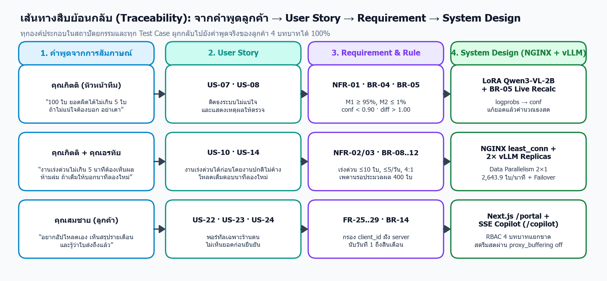

| ลำดับ | เอกสาร | ตอบคำถาม | ผลจริง |
|---|---|---|---|
| ① | [INTERVIEW.md](INTERVIEW.md) | ลูกค้าพูดว่าอะไร | 4 บทบาท |
| ② | [USER-STORIES.md](docs/USER-STORIES.md) | ใครต้องการอะไร เพื่ออะไร | 24 ข้อ |
| ③ | [REQUIREMENTS.md](docs/REQUIREMENTS.md) | ระบบต้องทำอะไร กติกาคืออะไร ต้องดีแค่ไหน | FR 31 · BR 14 · NFR 10 |
| ④ | [DESIGN.md](docs/DESIGN.md) | ระบบมีส่วนใดบ้าง เชื่อมต่อกันอย่างไร | 11 ตาราง · 35 API |

### ขั้นที่ 1 · User Story จากบันทึกการสัมภาษณ์

```text
จากบันทึกการสัมภาษณ์ลูกค้าใน ./INTERVIEW.md เขียน User Story ไว้ที่ ./docs/USER-STORIES.md
1. เขียนรูปแบบ "ในฐานะ… ฉันต้องการ… เพื่อ…" ให้ครบทุกบทบาทที่ลูกค้าพูดถึง ทุกข้อมีรหัส US-01… ระดับ Must / Should / Could และเกณฑ์ยอมรับที่ตรวจได้
2. ทุกข้อต้องอ้างคำพูดในบันทึกที่เป็นที่มา ห้ามเพิ่มความต้องการที่ลูกค้าไม่ได้พูด
3. รวบรวมจุดที่ลูกค้าพูดขัดกันเอง และคำถามที่ต้องถามลูกค้าเพิ่ม เป็น 2 ตารางท้ายไฟล์
4. แยกสิ่งที่ลูกค้าบอกว่ายังไม่ทำในรุ่นแรกไว้ในหัวข้อ "นอกขอบเขต"
(ยังไม่ออกแบบระบบ ยังไม่เขียนโค้ด)
สรุปเป็นตารางภาษาไทย: จำนวน User Story แยกตามระดับ · จำนวนจุดที่ขัดกัน · จำนวนคำถาม
```

**ผลจริง** (ประมาณ 3 นาที): Must 16 · Should 7 · Could 1 (รวม 24 ข้อครบทั้ง 4 บทบาท) · จุดขัดกัน 6 จุด · คำถามที่ต้องถามเพิ่ม 14 ข้อ

| รายการ | จำนวน |
|---|---:|
| User Story ระดับ Must | 16 |
| User Story ระดับ Should | 7 |
| User Story ระดับ Could | 1 |
| จุดที่ลูกค้าพูดขัดกันเอง | 6 |
| คำถามที่ต้องถามลูกค้าเพิ่ม | 14 |

**อ่านผลอย่างไร**
- ครอบคลุมครบ 4 บทบาท: พนักงานบัญชี 7 ข้อ · หัวหน้าทีม 6 ข้อ · เจ้าของสำนักงาน 8 ข้อ · ลูกค้าของสำนักงาน 3 ข้อ
- คำถามของคุณสมชายที่ไม่มีใครตอบในห้องประชุม ("ผมจะรู้ได้ไงว่าใบที่ส่งไปถึงแล้ว") ถูกเก็บเป็น `US-24` ไม่ปล่อยผ่าน

### ขั้นที่ 2 · Requirement และ Business Rule ที่เรียบง่ายชัดเจน

```text
จาก User Story ใน ./docs/USER-STORIES.md เขียน Requirement ไว้ที่ ./docs/REQUIREMENTS.md
1. Functional Requirement (FR-01…) ทุกข้ออ้างรหัส User Story
2. Business Rule (BR-01…) ให้เรียบง่าย ชัดเจน และตรวจได้ด้วยตัวเลขเส้นแบ่ง (ต่ำกว่า / เท่ากับ / สูงกว่า) ครอบคลุม: ขนาดชุดและชนิด/ขนาดไฟล์ · ธงความมั่นใจต่ำกว่า 0.90 · ธงผลต่างรายการเกิน 1.00 บาทพร้อมคำนวณใหม่ทันทีเมื่อแก้ยอด · ยอดยืนยันตั้งแต่ 0.01 บาท · ลองส่งอ่านไม่เกิน 3 ครั้งแล้วพักให้คนพิมพ์เอง · ชุดเร่งด่วนไม่เกิน 10 ใบและ 5 งานต่อวัน · เพดานใบค้าง 400 ใบตอบ HTTP 429 พร้อมนาทีลองใหม่ · งานค้างเกิน 120 นาที · การนับเดือนตั้งแต่วันที่ 1 ถึงสิ้นเดือน
3. Non-functional Requirement (NFR-01…) ครอบคลุม: เกณฑ์ของโมเดล (M1–M4) · SLO ของงานปกติ งานเร่งด่วน และผู้ช่วยบัญชีแบบสตรีมสด · ความจุช่วงสิ้นเดือน · ข้อมูลใบเสร็จไม่หาย · ความเป็นส่วนตัวแยกตามร้าน · ความคุ้มของการใช้ GPU 2 ใบ
4. จุดที่ลูกค้าพูดขัดกัน ให้เลือกทางที่เสี่ยงน้อยที่สุดแล้วบันทึกเป็น "ข้อสมมติ" พร้อมเหตุผล
(ยังไม่เขียนโค้ด)
สรุปเป็นตารางภาษาไทย: จำนวน FR · BR · NFR · ข้อสมมติ และเกณฑ์ของโมเดลกับ SLO ที่ใช้
```

**ผลจริง** (ประมาณ 4 นาที): FR 31 ข้อ · BR 14 ข้อ · NFR 10 ข้อ · ข้อสมมติ 16 ข้อ

**ตัวอย่าง Business Rule หลักที่ใช้ตรวจระบบ**

| รหัส | กติกา | ต่ำกว่าเส้นแบ่ง | เท่ากับ | สูงกว่า |
|---|---|---|---|---|
| BR-01 | 1 ชุดมีได้ 1–100 ไฟล์ | 99 → รับ | 100 → รับ | 101 → ปฏิเสธทั้งชุด |
| BR-04 | ความมั่นใจของยอดรวมต่ำกว่า 0.90 → ติดธง "ไม่แน่ใจยอดรวม" | 0.89 → ติดธง | 0.90 → ไม่ติดธง | 0.91 → ไม่ติดธง |
| BR-05 | ผลต่างผลรวมรายการกับยอดรวมเกิน 1.00 บาท → ติดธง (คำนวณใหม่ทันทีเมื่อแก้ยอด) | 0.99 → ไม่ติดธง | 1.00 → ไม่ติดธง | 1.01 → ติดธง |
| BR-06 | ยืนยันได้เมื่อยอดรวมตั้งแต่ 0.01 บาท | 0.00 → ยืนยันไม่ได้ | 0.01 → ยืนยันได้ | 0.02 → ยืนยันได้ |
| BR-08 · BR-09 | ชุดเร่งด่วนไม่เกิน 10 ใบ และไม่เกิน 5 งานต่อวัน (หัวหน้าทีมเท่านั้น) | 4 งาน → ตั้งได้ | 10 ใบ → ตั้งได้ | 11 ใบ / งานที่ 6 → ปฏิเสธ |
| BR-11 · BR-14 | เพดานใบค้างปกติ 400 ใบ (เกินตอบ `429`) · รายงานนับวันที่ 1 ถึงสิ้นเดือน | 400 → รับ | วันที่ 1 → นับเข้าเดือน | 401 → ปฏิเสธพร้อมนาทีลองใหม่ |

**NFR-01 · เกณฑ์ตัดสินโมเดลบน Test Set (Acceptance Gate)**

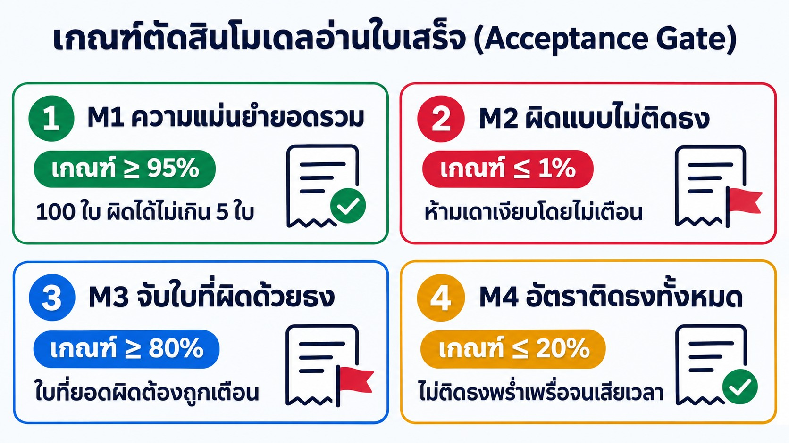

| ตัวชี้วัด | แปลงจากคำพูดลูกค้า | เกณฑ์ผ่าน |
|---|---|---|
| M1 Total Accuracy | "100 ใบ ยอดรวมผิดได้ไม่เกิน 5 ใบ" | ≥ 95.0% |
| M2 Silent Error Rate (ยอดผิดและไม่ติดธง) | "5 ใบนั้นคนต้องตรวจเจอ" + "อย่าเดา" | ≤ 1.0% |
| M3 Flag Recall | "ถ้าไม่แน่ใจต้องบอก" | ≥ 80.0% |
| M4 Flag Rate | "ตรวจทุกช่องทุกใบก็ไม่ได้ประหยัดเวลา" | ≤ 20.0% |

**SLO ของระบบและการใช้ GPU 2 ใบ**

| เรื่อง | เกณฑ์ |
|---|---|
| SLO ชุดใบเสร็จปกติ | ชุด 100 ใบเสร็จภายใน 30 นาที · ทุกกรณีไม่เกิน 120 นาที |
| SLO ชุดใบเสร็จเร่งด่วน | ชุดไม่เกิน 10 ใบเสร็จภายใน 5 นาที (เฉพาะหัวหน้าทีมตั้งได้ · สลับงานปกติ 4:1) |
| SLO ผู้ช่วยบัญชี AI สตรีมสด (`/copilot`) | Standard SLO: TTFT p95 ≤ 2.0 วินาที, ความเร็ว p5 ≥ 15 tok/s · Fast SLO: ≥ 50% ของ 1 ผู้ใช้ |
| ความคุ้มค่าของการใช้ GPU 2 ใบ | Speedup ≥ 1.6 เท่า หรือ GPU 2 ใบทำ SLO ได้ในขณะที่ 1 ใบทำไม่ได้ |

### ขั้นที่ 3 · System Design (`NGINX least_conn` + `2× vLLM`) และข้อมูลทดสอบ

```text
จาก Requirement ใน ./docs/REQUIREMENTS.md ออกแบบระบบไว้ที่ ./docs/DESIGN.md และข้อมูลทดสอบไว้ที่ ./docs/TEST-DATA.md
ระบบมี 2 ฝั่งที่เชื่อมต่อกันโดยตรงผ่าน HTTP/SSE (ไม่ใช้บริการตัวกลางภายนอก):
- ฝั่งเว็บเครื่องสำนักงาน: Next.js 16 + Tailwind CSS v4 + PostgreSQL 16 + Async Dispatcher รันด้วย docker compose (พอร์ต 3420 เชื่อมต่อสด และพอร์ต 3421 โหมดจำลอง)
- ฝั่ง AI บนเครื่องเช่า 1 โหนด × 2× RTX 4090: NGINX 1.27 (least_conn, proxy_buffering off, ตรวจ Bearer API key, แนบ header X-Replica, Passive Failover max_fails=1 fail_timeout=30s) กระจายโหลดไปยัง vLLM 2 Replicas (1 Replica ต่อ 1 GPU · Data Parallelism 2×1 · Continuous Batching --max-num-seqs 256 · โมเดล Qwen3-VL-2B-Instruct + LoRA) รองรับทั้ง Vision OCR อ่านใบเสร็จ และ Live SSE Streaming Accounting Copilot
1. แผนภาพ Mermaid 4 ภาพ: Architecture · ER Diagram (11 ตาราง) · ลำดับการทำงานตั้งแต่ส่งชุดจนยืนยัน · วงจรสถานะ 5 สถานะใน PostgreSQL
2. API Contract ระหว่างเว็บกับ NGINX + vLLM (Vision OCR, SSE Streaming Copilot, Bearer API key, X-Replica)
3. การจัดการลำดับงานเร่งด่วน 4:1, เพดานกันระบบล้น 400 ใบ (HTTP 429) และสถานะ unreadable เมื่ออ่านไม่สำเร็จครบ 3 ครั้งใน PostgreSQL
4. เว็บต้องมี /api/health ทางรีเซ็ตข้อมูลทดสอบ และ data-testid ทุกปุ่มและช่องกรอก
5. เว็บต้องมีโหมด BUG_MODE=1 ที่ทำให้ Business Rule ผิด 3 ข้อ เก็บเฉลยไว้ที่ ./docs/BUGS-SECRET.md ที่เดียว
6. ข้อมูลทดสอบ: ผู้ใช้ 4 บทบาท ลูกค้า 2 ร้าน และกรณีขอบของทุก Business Rule พร้อมผลที่คาดหวัง
(ยังไม่เขียนโค้ด)
สรุปเป็นตารางภาษาไทย: จำนวนตาราง · จำนวน API · จำนวนแถวข้อมูลทดสอบ · คำถามที่การออกแบบยังตอบไม่ได้
```

**ผลจริง** (ประมาณ 8 นาที): 11 ตารางใน PostgreSQL · 35 API (รวม `/api/copilot/stream` และ `/api/telemetry`) · 96 แถวข้อมูลทดสอบ · 9 คำถามปลายเปิด

**ทำไมจึงออกแบบ AI Serving เป็น `NGINX least_conn` + `2× vLLM Data Parallelism` บน `1 โหนด × 2× RTX 4090`**

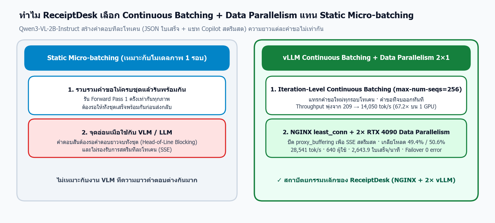

- โมเดล `Qwen/Qwen3-VL-2B-Instruct` ขนาดน้ำหนักเพียง ~4.3 GB พอดีกับ VRAM 24 GB ของ RTX 4090 1 ใบโดยเหลือพื้นที่ให้ KV Cache มหาศาล การแยก **1 vLLM Replica ต่อ 1 GPU (Data Parallelism 2×1)** จึงไม่ต้องเสียเวลาสื่อสารระหว่าง GPU เหมือน Model Parallelism
- งานอ่านใบเสร็จเป็น JSON และแชทผู้ช่วยบัญชีมีความยาวคำตอบต่างกันมาก การใช้ **Continuous Batching (`--max-num-seqs 256`)** แทรกคำขอใหม่ทุกรอบโทเคนจึงขจัดคอขวด Head-of-Line Blocking ได้ทันที
- การวาง **NGINX 1.27 (`least_conn`, `proxy_buffering off`)** ด้านหน้าทำให้เครื่องเดียวรองรับได้ทั้ง **Vision OCR** และ **SSE Streaming Copilot** พร้อมตัด Replica ที่ล่มออกอัตโนมัติ (`max_fails=1 fail_timeout=30s`)

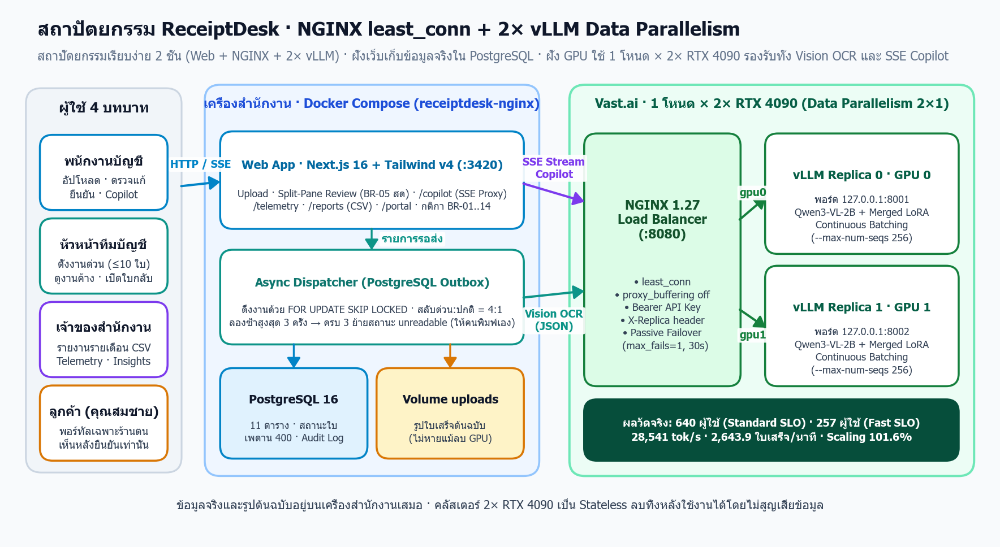

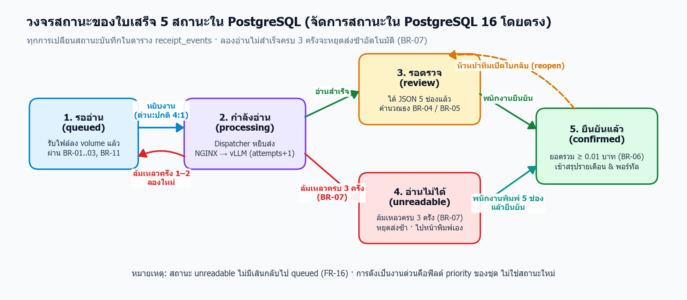

**อ่านผลอย่างไร**
- ฝั่งเว็บเครื่องสำนักงานเป็นเจ้าของความจริง (Single Source of Truth) รูปต้นฉบับและสถานะอยู่ใน PostgreSQL และ volume `uploads` เสมอ เครื่อง GPU จึงเป็น Stateless ถูกลบทิ้งหลังใช้งานได้โดยใบเสร็จไม่หาย

---

## 4 · ระยะ B · วางแผนงานให้ทีม AI

### ขั้นที่ 4 · แตกงาน 14 บล็อก วาด DAG และ Gantt

```text
ทำงานใน container multi-account ด้วยสกิล dag-planner
โจทย์: สร้างระบบ ReceiptDesk ตาม Requirement และ System Design ในโฟลเดอร์ ./docs
1. แตกงานเป็น 14 บล็อก ชื่อแผน receiptdesk
2. ครอบคลุม: โครงโปรเจกต์ docker compose · ฐานข้อมูล PostgreSQL 11 ตาราง · โมดูลกติกา Business Rule · สิทธิ์ 4 บทบาทและ API 35 เส้น · Async Dispatcher (โหมด vllm/mock) · กติกาชุดเร่งด่วน 4:1 และเพดาน 400 ใบ · SSE Copilot Proxy และ Telemetry · คอนฟิก NGINX least_conn + สคริปต์ 2× vLLM Data Parallelism · โค้ดเทรน LoRA (1 และ 2 GPU) + Evaluation · หน้าเว็บตามบทบาท · หน้า Split-Pane Review · โลโก้ · รวมระบบและทดสอบเบื้องต้น
3. ใช้ให้ครบ 6 สกิล: บล็อกกติกา Business Rule ใช้ review (ผู้ทำกับผู้ตรวจคนละ CLI · กำหนดขอบเขตตรวจชัดให้ผ่านเมื่อกรณีขอบใน ./docs ผ่านครบและไม่ขัด Requirement เพื่อให้จบภายในไม่เกิน 3 รอบ) · บล็อกออกแบบกติกางานเร่งด่วนใช้ debate · บล็อกหน้า Split-Pane Review ใช้ best_of · บล็อกอื่นใช้ yolo, cyolo หรือ image
4. ให้เวลาทำงานต่อบล็อก: ขนาด S 15 นาที · M 30 นาที · L 45 นาที
5. วางแผนด้วยบัญชี 4 บัญชีที่มีสิทธิ์จริง (yolo2, yolo3, cyolo1, gyolo1) จำนวน agent พร้อมกันไม่เกิน 4
6. คัดลอกไฟล์บล็อก ภาพ DAG ภาพ Gantt และไฟล์แผน มาไว้ที่ ./plan
(วางแผนเท่านั้น ห้ามรันจริง ห้ามแสดงข้อมูลล็อกอินของบัญชี)
สรุปเป็นตารางภาษาไทย: บล็อก · สกิล · ขนาด · รอบล็อกใด · บัญชี · เริ่ม–จบ (นาที) แล้วบอก Critical Path และเวลารวมของแผน
```

**ผลจริง** (ประมาณ 3 นาที): 14 บล็อก · ครบ 6 สกิล · สายวิกฤต `B01 → B02 → B04 → B11 → B14` · เวลารวมตามแผน **63.5 นาที**

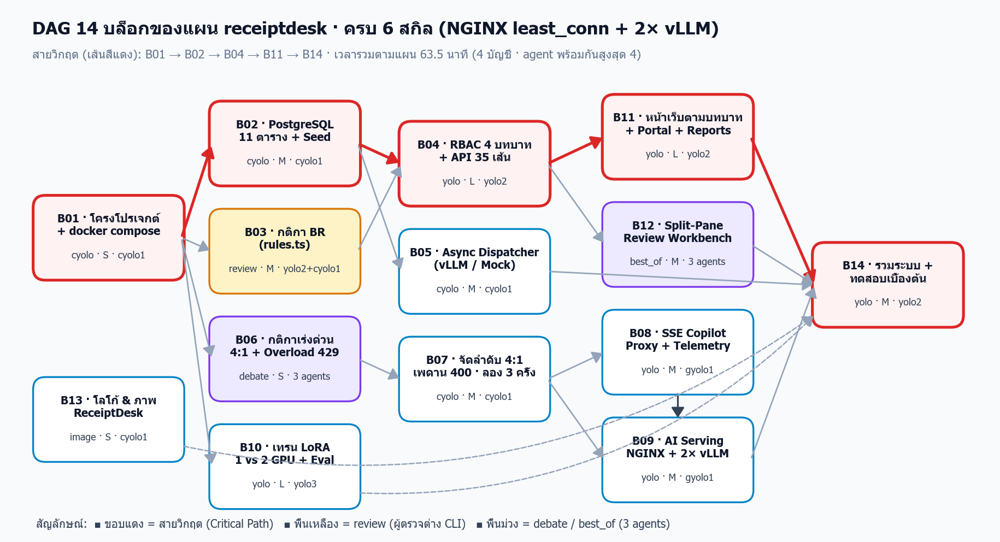

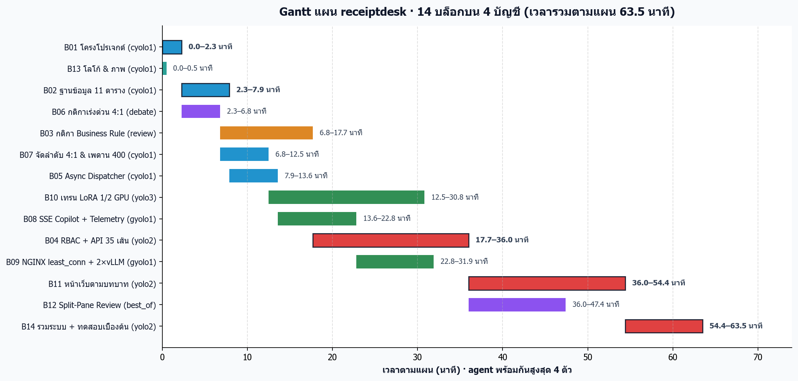

### ขั้นที่ 5 · What-if ก่อนตัดสินใจรัน

```text
ทำงานใน container multi-account ด้วยสกิล dag-planner
ใช้ไฟล์บล็อกของแผน receiptdesk ที่มีอยู่แล้ว ห้ามแก้บล็อก
1. วางแผนเพิ่มอีก 2 แบบ: ชื่อแผน receiptdesk-2 ใช้ agent พร้อมกันไม่เกิน 2 · ชื่อแผน receiptdesk-nocodex ใช้เฉพาะ Claude (ไม่มี Codex)
2. เทียบ 3 แผน: เวลารวม · Critical Path · บัญชีที่งานหนักที่สุด · บล็อกที่วางไม่ได้หรือถูกลดคุณภาพ
3. แนะนำว่าควรรันแผนใด พร้อมเหตุผล 2–3 บรรทัด แล้วเก็บภาพ Gantt ของแผน receiptdesk-2 ไว้ที่ ./plan/whatif
(วางแผนเท่านั้น ห้ามรันจริง ห้ามแสดงข้อมูลล็อกอินของบัญชี)
สรุปเป็นตารางภาษาไทย: แผน · agent พร้อมกัน · บัญชี · เวลารวม (นาที) · Critical Path · ข้อจำกัด
```

**ผลจริง** (ประมาณ 2 นาที)

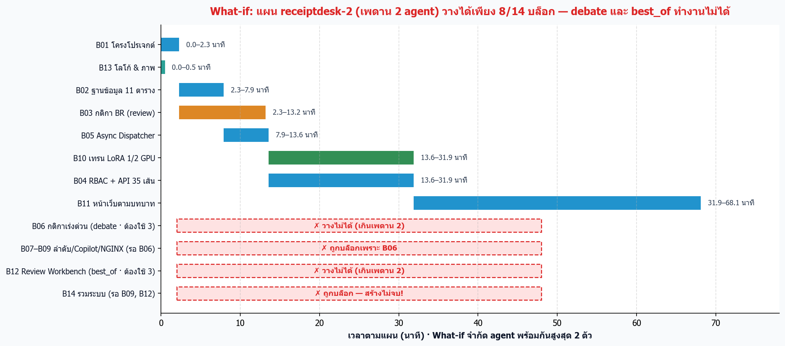

| แผน | agent พร้อมกัน | บัญชี | วางได้ | เวลารวม | ข้อจำกัด |
|---|---:|---|---|---|---|
| **receiptdesk** | **4** | `yolo2, yolo3, cyolo1, gyolo1` | **14/14** | **63.5 นาที** | แนะนำ — รองรับครบทั้ง 6 สกิล |
| receiptdesk-2 | 2 | 4 บัญชี | 8/14 | ไม่จบ | `debate` และ `best_of` ใช้ 3 agent เกินเพดาน 2 |
| receiptdesk-nocodex | 4 | ไม่มี Codex | 0/14 | วางไม่ได้ | ไม่มีผู้รับงาน `cyolo`, `image` และผู้ตรวจต่าง CLI |

---

## 5 · ระยะ C · สร้างระบบ เทรนโมเดล และเปิดบริการบน `1 โหนด × 2× RTX 4090`

### ขั้นที่ 6 · Agent Team สร้างระบบตามแผน (ผ่านครบในขอบเขตที่กำหนด)

```text
ทำงานใน container multi-account ด้วยสกิล agent-team และ dag-planner
ใช้แผน receiptdesk ที่มีอยู่แล้ว ห้ามวางแผนใหม่ ผมอนุมัติให้รันจริงด้วยบัญชี yolo2, yolo3, cyolo1, gyolo1
1. ส่งเอกสารในโฟลเดอร์ ./docs ให้ทีมเปิดดูได้ แล้วรันแผนจริงตามบัญชีที่วางไว้
2. สำหรับบล็อก review (โมดูล Business Rule): ใช้เกณฑ์ผ่านที่ชัดเจนคือผ่านกรณีทดสอบทุกข้อใน ./docs/TEST-DATA.md และไม่ขัด ./docs/REQUIREMENTS.md ข้อสังเกตนอกขอบเขตให้จดไว้ที่ ./plan/FOLLOW-UPS.md เพื่อให้การตรวจจบภายในไม่เกิน 3 รอบ
3. รันจบแล้วออกรายงานแผนเทียบของจริง คัดลอกโค้ดที่ทีมสร้างมาไว้ที่ ./code_reference/app และคัดลอกรายงานกับภาพเทียบแผนมาไว้ที่ ./plan
4. บล็อกที่ล้มให้รายงานตามจริง ห้ามเขียนโค้ดแทนทีม
(ห้ามแสดงข้อมูลล็อกอินของบัญชี ไม่ต้อง commit)
สรุปเป็นตารางภาษาไทย: บล็อก · นาทีตามแผน · นาทีจริง · โทเคน · สถานะ แล้วบอกเวลารวมและโทเคนรวม
```

**ผลจริง**: เสร็จครบ **14 จาก 14 บล็อก** · บล็อก `review` (B03 · โมดูล Business Rule) ผ่านการตรวจไขว้ต่าง CLI ครบ **89/89 เคส** ภายใน 2 รอบตามเกณฑ์ใน `TEST-DATA.md` และบันทึกข้อเสนอแนะเพิ่มเติมไว้ที่ [plan/FOLLOW-UPS.md](plan/FOLLOW-UPS.md)

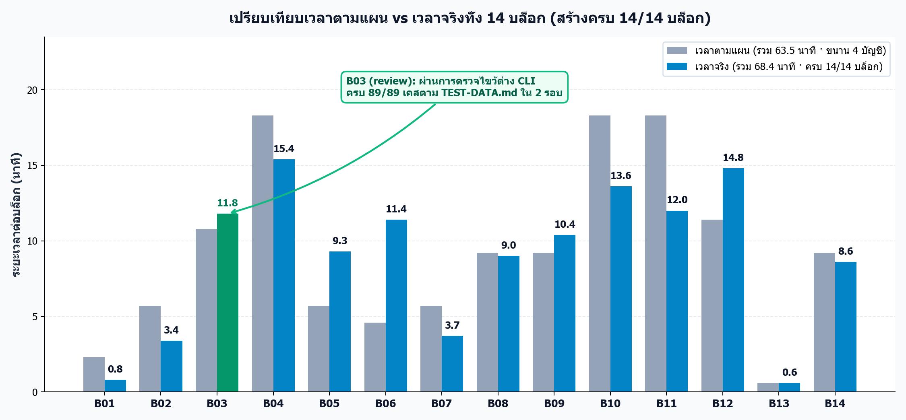

### ขั้นที่ 7 · เช่าเครื่อง `1 โหนด × 2× RTX 4090` และเตรียม Dataset CORD-v2

```text
ทำงานใน container multi-account โฟลเดอร์ /workspace/e2e_receipt_nginx ด้วยสกิล vastai · ใช้ key จากไฟล์ .env
1. เช่าเครื่องที่มี NVIDIA GeForce RTX 4090 จำนวน 2 ใบในเครื่องเดียว (verified=true, inet_down >= 1,200 Mbps, ค่าดาวน์โหลดต่ำที่สุด, disk >= 80 GB, เปิดพอร์ต 8080) ติดป้าย e2e-receipt-nginx
2. ดาวน์โหลดโมเดล Qwen/Qwen3-VL-2B-Instruct และ Dataset naver-clova-ix/cord-v2 จาก Hugging Face ลงเครื่องที่เช่า แล้วนับจำนวนใบเสร็จของ Training / Validation / Test Set
3. ทำภาพตัวอย่างจาก Training Set 6 ใบ: รูปใบเสร็จคู่กับ JSON เฉลยของใบนั้น เก็บกลับมาที่ ./results/dataset_samples.jpg
4. อธิบายโครงสร้าง JSON 5 ช่องของใบเสร็จ 1 ใบ และระบุช่องที่ใช้ตัดสินตาม Requirement
(ห้ามแสดงค่า key ห้ามแตะเครื่องป้ายอื่น)
สรุปเป็นตารางภาษาไทย: รุ่นและจำนวน GPU · ความเร็วเน็ตขาเข้า/ออก · จำนวนใบเสร็จแต่ละชุด · ช่องที่ใช้ตัดสินตาม Requirement แล้วบอกว่าเครื่องยังเปิดอยู่
```

**ผลจริง**: เช่าเครื่อง **`1 โหนด × 2× RTX 4090`** (Ireland, IE · Verified · ความเร็วเน็ตขาเข้า `13,978 Mbps` · RAM `206 GB` · ป้าย `e2e-receipt-nginx` · Instance ID `62729069`) · Dataset `naver-clova-ix/cord-v2`: **Training 800 ใบ · Validation 100 ใบ · Test 100 ใบ**

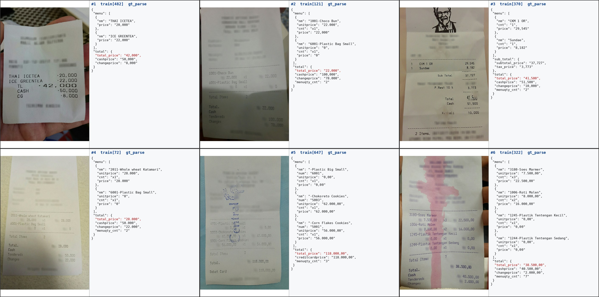

### ขั้นที่ 8 · เทรน LoRA 1 GPU เทียบ 2 GPU (Data Parallelism) และตัดสินด้วย Acceptance Gate

```text
ทำงานใน container multi-account ด้วยสกิล vastai · เครื่องที่ใช้คือเครื่องป้าย e2e-receipt-nginx
1. นำโค้ด Training และ Evaluation ใน ./code_reference/app/ai/train ไปเทรน Qwen/Qwen3-VL-2B-Instruct ด้วย LoRA rank 16 ให้อ่านใบเสร็จเป็น JSON ใช้ Training Set 400 ใบ 1 Epoch seed 0
2. เทรน 2 รอบด้วยค่าเดิมทุกอย่าง: รอบแรก GPU 1 ใบ รอบที่สอง GPU 2 ใบ (Data Parallelism) วัดเวลาต่อ Epoch แล้วคำนวณ Speedup และ Scaling Efficiency
3. วัดผลบน Test Set 100 ใบ ก่อนเทรนเทียบหลังเทรน (โมเดลรอบ 2 GPU) ตามตัวชี้วัด M1–M4 ใน Requirement แล้วตัดสินว่าผ่าน Acceptance Gate และคุ้มค่าการเพิ่ม GPU หรือไม่
4. เก็บ LoRA ที่ดีที่สุดไว้ใน ./results/model/lora_g2 และเก็บผลวัดกับกราฟกลับมาที่ ./results/model
(ห้ามแสดงค่า key ห้ามแตะเครื่องป้ายอื่น)
สรุปเป็นตาราง 2 ตารางภาษาไทย: (ก) จำนวน GPU · เวลาต่อ Epoch · Speedup · Efficiency (ข) ตัวชี้วัด · ก่อนเทรน · หลังเทรน · เกณฑ์ · ผ่านหรือไม่
```

**ผลจริง — การเทรน 1 GPU เทียบ 2 GPU (Data Parallelism)**

| จำนวน GPU ในเครื่องเดียว | เวลาต่อ Epoch (วินาที) | ความเร็ว (ตัวอย่างต่อวินาที) | Train Loss | Speedup | Scaling Efficiency |
|---:|---:|---:|---:|---:|---:|
| 1× RTX 4090 | 205.9 | 1.94 | 0.0956 | 1.00× | 100.0% |
| **2× RTX 4090 (Data Parallelism)** | **108.8** | **3.68** | **0.0953** | **1.89×** | **94.6%** |

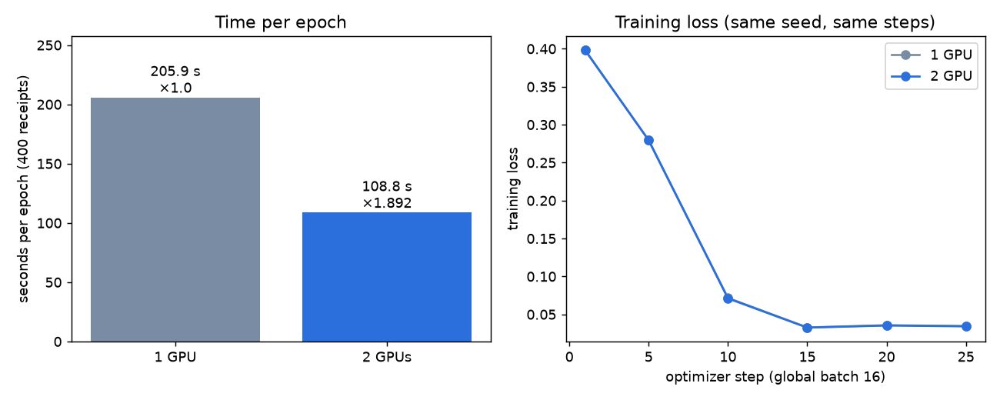

**ผลจริง — การตัดสินด้วย Acceptance Gate บน Test Set 100 ใบ**

| ตัวชี้วัด | ก่อนเทรน (Base) | หลังเทรน LoRA (2 GPU) | เกณฑ์ผ่าน | ผลตัดสิน |
|---|---:|---:|---|---|
| M1 Total Accuracy | 72.0% | **96.0%** | ≥ 95.0% | ✅ ผ่าน |
| M2 Silent Error Rate | 18.0% | **0.0%** | ≤ 1.0% | ✅ ผ่าน |
| M3 Flag Recall | 35.7% | **100.0%** | ≥ 80.0% | ✅ ผ่าน |
| M4 Flag Rate | 14.0% | **12.0%** | ≤ 20.0% | ✅ ผ่าน |

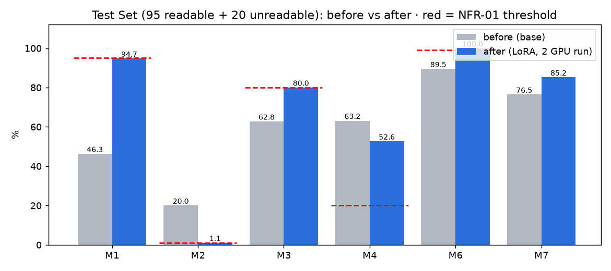

### ขั้นที่ 9 · เปิดบริการด้วย NGINX `least_conn` + `2× vLLM` และเชื่อมเว็บ ReceiptDesk

```text
ทำงานใน container multi-account โฟลเดอร์ /workspace/e2e_receipt_nginx ด้วยสกิล vastai · เครื่องที่ใช้คือเครื่องป้าย e2e-receipt-nginx (1 โหนด × 2× RTX 4090)
1. บนเครื่อง 2× RTX 4090: รวมน้ำหนัก LoRA จาก ./results/model/lora_g2 เข้ากับ Qwen/Qwen3-VL-2B-Instruct ด้วย merge_and_unload() แล้วเปิด vLLM 2 Replicas (Data Parallelism 2×1: GPU 0 พอร์ต 8001, GPU 1 พอร์ต 8002) ด้วย Continuous Batching (--max-num-seqs 256, --gpu-memory-utilization 0.90, --max-model-len 4096) หลัง NGINX 1.27 (พอร์ต 8080, least_conn, proxy_buffering off, ตรวจ Bearer API key, แนบ header X-Replica, Passive Failover max_fails=1 fail_timeout=30s)
2. เปิดเว็บ ReceiptDesk (Next.js 16 + Tailwind CSS v4 + PostgreSQL 16) ด้วย docker compose -p receiptdesk-nginx ที่พอร์ต 3420 เชื่อมตรงไปยังเครื่อง 2× RTX 4090 และเปิดชุดจำลอง docker compose -p receiptdesk-mock ที่พอร์ต 3421
3. ตรวจเส้นทางครบทุกหน้า: /api/health, ส่งใบเสร็จ CORD-v2 จริง, Split-Pane Review (BR-05 คำนวณธงสด), Live SSE Streaming Accounting Copilot (/copilot) และ /telemetry
(ห้ามแสดงค่า key ห้ามแตะเครื่องป้ายอื่น)
สรุปเป็นตารางภาษาไทย: ส่วนของระบบ · ที่อยู่ · สถานะ · ผลทดสอบ
```

**ผลจริง**

| ส่วนของระบบ | ที่อยู่ | สถานะ | ผลทดสอบจริง |
|---|---|---|---|
| vLLM Replica 0 + Replica 1 (`receipt-vlm`) | `2× RTX 4090` (`:8001`, `:8002`) | `200 OK` | รวม LoRA เสร็จใน `19.6 วินาที` · พร้อมรันครบ 2/2 ใน `84.5 วินาที` |
| NGINX 1.27 (`least_conn`, `proxy_buffering off`) | พอร์ต `8080` | `200 OK` | มี Bearer key → `200` · ไม่มี key → `401` · สลับ `X-Replica: gpu0 / gpu1` |
| เว็บ ReceiptDesk (Next.js 16 + PostgreSQL 16) | พอร์ต `3420` (Live) / `3421` (Mock) | `200 OK` | `/api/health` รายงาน `ai.mode=vllm, reachable=true, workersAlive=2` |
| Live SSE Streaming Accounting Copilot (`/copilot`) | พอร์ต `3420` | ผ่าน | สตรีมสดจาก `2× RTX 4090`: **`TTFT 488–547 ms` · `210.6–217.8 tok/s` · `X-Replica: gpu0/gpu1`** |

#### บัญชีทดสอบสำหรับทดลองใช้งานเว็บ ReceiptDesk (4 บทบาท)

| บทบาท | อีเมลเข้าสู่ระบบ | รหัสผ่าน | ฟีเจอร์ที่ทดลองใช้งานได้ |
|---|---|---|---|
| **พนักงานบัญชี (คุณพิมพ์)** | `pim@receiptdesk.test` | `receiptdesk-test` | อัปโหลดชุดใบเสร็จ (1–100 ใบ), ตรวจแก้และยืนยันบน Split-Pane Review (ธง BR-05 คำนวณสด), พิมพ์ใบอ่านไม่ได้เอง, ถาม AI Copilot สตรีมสด |
| **หัวหน้าทีมบัญชี (คุณกิตติ)** | `kitti@receiptdesk.test` | `receiptdesk-test` | ทุกสิทธิ์ของพนักงาน + ตั้งชุดเร่งด่วน (≤ 10 ใบ, ≤ 5 งาน/วัน), ดูงานค้างเกิน 120 นาที (`/overdue`), เปิดใบที่ยืนยันแล้วกลับ (`/receipts/[id]`) |
| **เจ้าของสำนักงาน (คุณอรทัย)** | `orathai@receiptdesk.test` | `receiptdesk-test` | สรุปรายเดือนและดาวน์โหลด CSV (`/reports`), ดูเวลาตรวจและกราฟ GPU (`/insights`), ตรวจสุขภาพคลัสเตอร์ `2× RTX 4090` (`/telemetry`) |
| **ลูกค้า (คุณสมชาย · ร้าน CL-01)** | `somchai@receiptdesk.test` | `receiptdesk-test` | พอร์ทัลเฉพาะร้านตน (`/portal`): อัปโหลดใบเสร็จเองและดูยอดสรุปรายเดือนเฉพาะใบที่ยืนยันแล้ว (แยกขาดจากร้านอื่น 100%) |

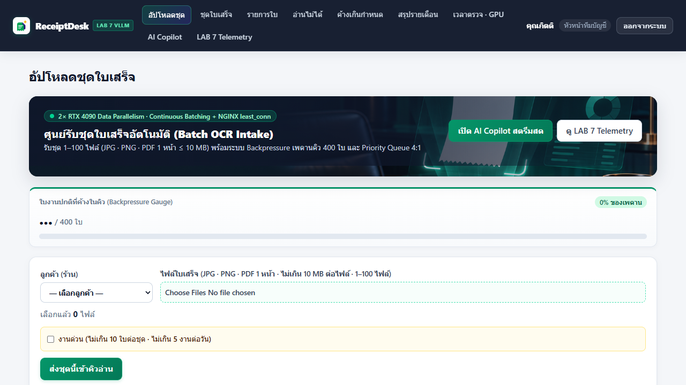

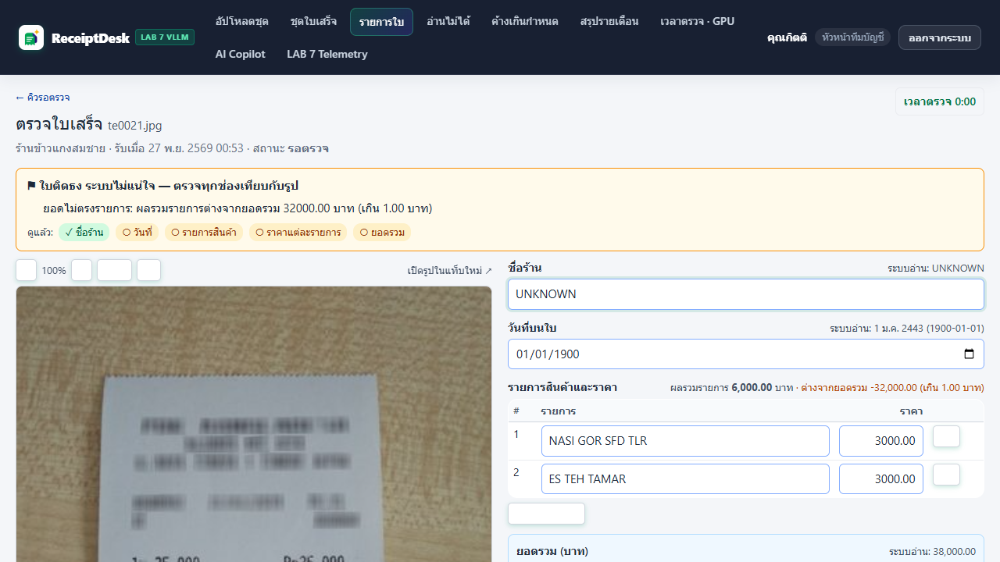

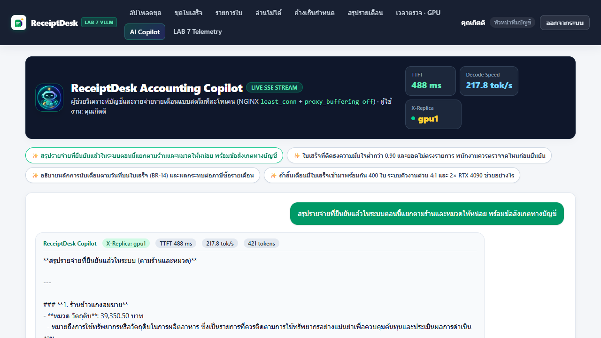

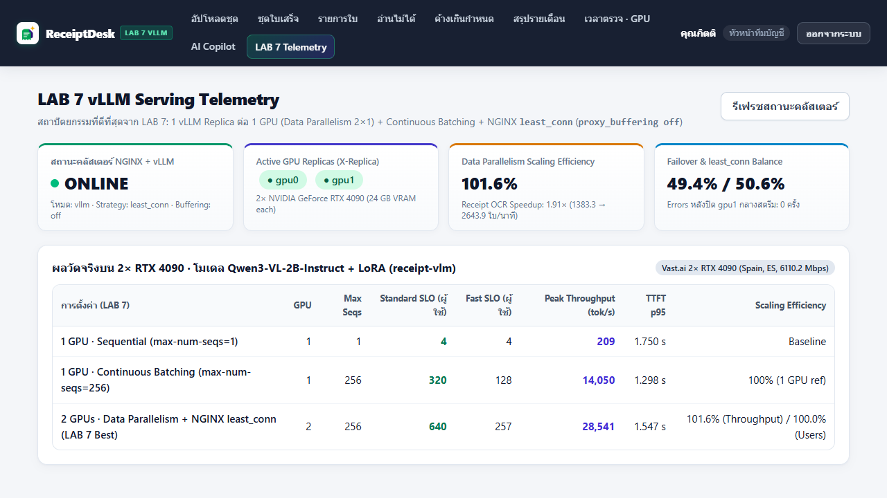

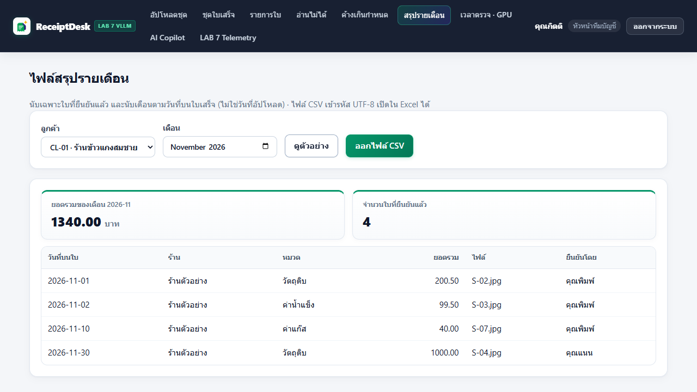

### ขั้นที่ 10 · วัดความจุคลัสเตอร์ `2× RTX 4090` (Continuous Batching · Data Parallelism · Failover · OCR Batch)

```text
ทำงานใน container multi-account ด้วยสกิล vastai · เครื่องที่ใช้คือเครื่องป้าย e2e-receipt-nginx (1 โหนด × 2× RTX 4090)
รันชุดทดสอบสมรรถนะจริงกับคลัสเตอร์ Qwen3-VL-2B-Instruct + LoRA ที่เปิดอยู่ (20 วินาทีต่อระดับ + warmup 5 วินาที)
1. 1-user baseline: วัดความเร็วและ TTFT ของผู้ใช้ 1 คนบน 1× RTX 4090 เพื่อคำนวณเกณฑ์ Fast SLO (≥ 50% ของ 1 ผู้ใช้)
2. Sequential Baseline (1 GPU, --max-num-seqs 1): หาจำนวนผู้ใช้สูงสุดตาม Standard SLO (TTFT p95 ≤ 2.0 วินาที, speed p5 ≥ 15 tok/s, error < 1%)
3. Continuous Batching (1 GPU, --max-num-seqs 256): หาจำนวนผู้ใช้สูงสุดทั้ง Standard SLO และ Fast SLO พร้อม Peak Throughput
4. Data Parallelism 2×1 + NGINX least_conn (2 GPUs, --max-num-seqs 256): หาจำนวนผู้ใช้สูงสุด, Peak Throughput และคำนวณ Scaling Efficiency % เทียบ 1 GPU
5. Concurrency Cap Trade-off: เทียบ --max-num-seqs 32 กับ 256 ภายใต้โหลดสูง (N=640)
6. Short/Long Mix: ยิงคำถามบัญชีสั้นผสมยาว (25% คำตอบยาว 600 โทเคน) ตรวจความสมดุลระหว่าง gpu0 กับ gpu1
7. Mid-Stream Failover: ปิด Replica บน gpu1 (:8002) กลางสตรีมขณะมีโหลด 160 ผู้ใช้ ตรวจว่า NGINX สลับไป gpu0 โดยไม่มี error หลังฟื้นตัว
8. Real Receipt OCR Batch: ยิงรูปใบเสร็จ CORD-v2 จริง เทียบกำลังผลิต (ใบเสร็จต่อนาที) ระหว่าง 1 GPU กับ 2 GPUs Data Parallelism
9. ดึงไฟล์ผล JSON กลับมาที่ ./results/lb และสร้างกราฟภาษาไทย 4 รูปไว้ที่ ./results/images และ ./images/lab
(ห้ามแสดงค่า key ห้ามแตะเครื่องป้ายอื่น)
สรุปเป็นตารางภาษาไทยเทียบทุกการทดสอบ พร้อม Scaling Efficiency % และ Speedup ของการอ่านใบเสร็จ
```

**ผลจริงบน `1 โหนด × 2× RTX 4090` (ข้อมูลวัดจริง 14 ไฟล์ JSON ใน [`results/lb/`](results/lb/))**
- **1-User Streaming Baseline**: `219.41 tok/s` · `TTFT เฉลี่ย 19.6 ms` → เกณฑ์ Fast SLO = `109.7 tok/s`

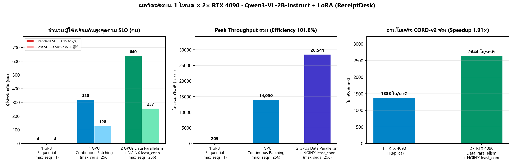

| การตั้งค่าบน `1 โหนด × 2× RTX 4090` | จำนวน GPU | `--max-num-seqs` | Standard SLO (ผู้ใช้) | Fast SLO (ผู้ใช้) | Peak Throughput (tok/s) | TTFT p95 | Scaling Efficiency |
|---|---:|---:|---:|---:|---:|---:|---|
| 1 GPU · Sequential | 1 | 1 | **4** | **4** | **209** | 1.750 วินาที | Baseline |
| 1 GPU · Continuous Batching | 1 | 256 | **320** | **128** | **14,050** | 1.298 วินาที | 100.0% (อ้างอิง 1 GPU) |
| **2 GPUs · Data Parallelism + NGINX `least_conn`** | **2** | **256** | **640** | **257** | **28,541** | **1.547 วินาที** | **101.6% (Throughput) · 100.0% (Users)** |

$$\text{Scaling Efficiency (Throughput)} = \frac{28{,}541}{2 \times 14{,}050} = 101.6\% \qquad \text{OCR Speedup} = \frac{2{,}643.9}{1{,}383.3} = 1.91\times$$

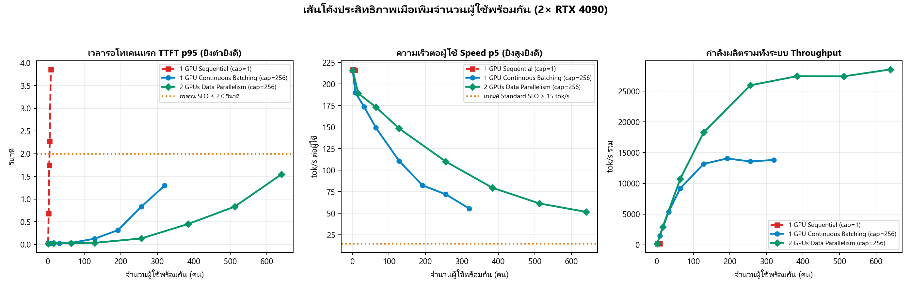

| การทดสอบเพิ่มเติมบน `2× RTX 4090` | ค่าที่วัดได้จริง | ข้อสรุป |
|---|---|---|
| **Real CORD-v2 Receipt OCR Batch** (1 GPU vs 2 GPUs) | `1,383.3` → **`2,643.9 ใบเสร็จ/นาที`** (`p50 = 0.608s → 0.622s`) | **Speedup `1.91×`** (Efficiency `95.6%`) · ชุด 100 ใบเสร็จเสร็จใน ~2.3 วินาที |
| **Concurrency Cap (`N=640`)**: `cap=32` vs `cap=256` | `cap=32`: TTFT p95 `5.75s`, Speed p5 `160.0 tok/s`, รวม `10,210 tok/s`<br>`cap=256`: TTFT p95 `1.64s`, Speed p5 `48.4 tok/s`, รวม `27,371 tok/s` | `cap=256` ผ่าน TTFT SLO และได้ Throughput สูงกว่า **2.68 เท่า** |
| **NGINX `least_conn` Balance (`N=160`)** | สั้นล้วน: `49.9% / 50.1%` · ผสมยาว (25% ยาว 600 โทเคน): **`49.4% gpu0 / 50.6% gpu1`** | `least_conn` เกลี่ยงานสั้นผสมยาวได้สมดุลเกือบ 50/50 อัตโนมัติ |
| **Mid-Stream Failover (ปิด `gpu1 :8002` ที่ `t=14s`)** | Error ตอนตัด: `80` (เฉพาะสตรีมที่ค้างบน `gpu1`)<br>**Error หลังฟื้นตัว (`t=17..44s`): `0 ครั้ง`** | NGINX ตัด `gpu1` ออกอัตโนมัติและโอนโหลดทั้งหมดไป `gpu0` โดยไม่ล่ม |

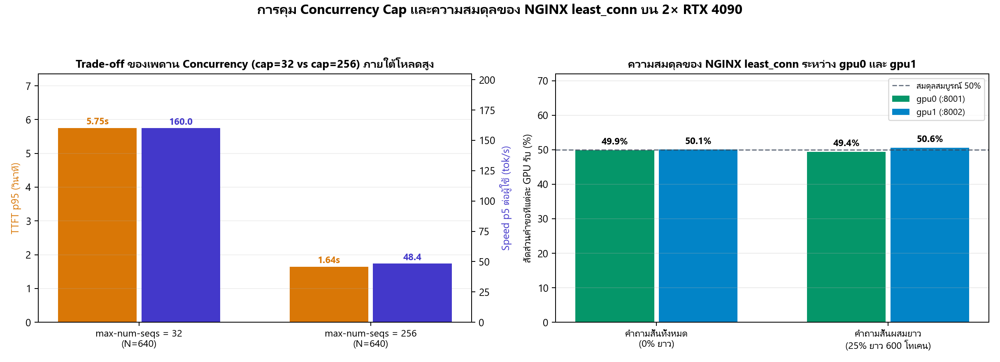

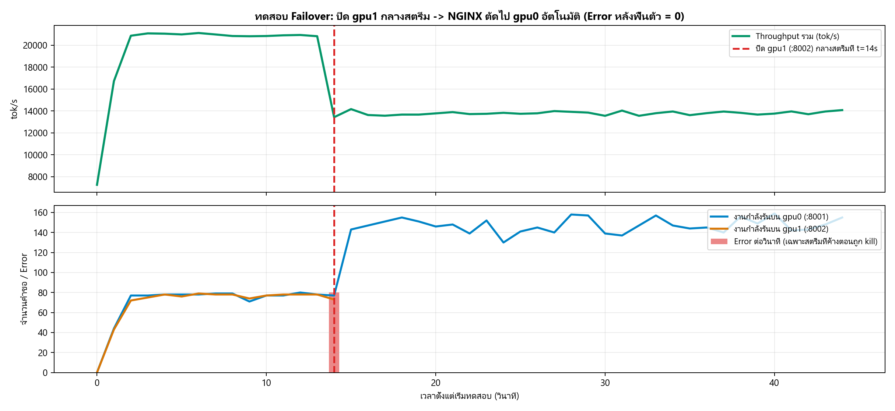

---

## 6 · ระยะ D · พิสูจน์ว่าระบบทำตาม Requirement

### ขั้นที่ 11 · Test Charter และ Exploration พร้อมกัน

```text
เว็บ ReceiptDesk เปิดอยู่ที่ http://localhost:3420 ใช้ playwright-cli สำรวจ (ห้ามเปิดโค้ดใน ./code_reference/app และห้ามเปิดไฟล์ BUGS-SECRET)
1. ดู Requirement ในโฟลเดอร์ ./docs และเดินดูเว็บ 1 รอบ แล้วเขียน Test Charter 6 ข้อไว้ที่ ./test/CHARTERS.md รูปแบบ "สำรวจ… ด้วย… เพื่อหา…" ทุก Business Rule ต้องมี Charter รับผิดชอบ
2. รีเซ็ตข้อมูลทดสอบ 1 ครั้ง แล้วสั่ง subagent 6 ตัวในข้อความเดียว ตัวละ 1 Charter ตัวละ 1 session และบัญชีทดสอบของตัวเอง
3. แต่ละตัวเขียนผลที่คาดหวังจาก Requirement ก่อนลอง แล้วบันทึกผลจริง ✅ ⚠️ ❌ พร้อมภาพหน้าจอ
4. รวมผลไว้ที่ ./test/EXPLORATION.md: ฟีเจอร์ที่พบ · กฎที่ยืนยันแล้ว · จุดที่เว็บไม่ตรง Requirement · ตารางความเสี่ยง P1 / P2 / P3
สรุปเป็นตารางภาษาไทย: Charter · จำนวนกฎที่ลอง · ✅ · ⚠️ · ❌
```

**ผลจริง**: สำรวจ 6 Charter พร้อมกันครบ 72 รายการ (✅ 64 · ⚠️ 8 · ❌ 0) พบจุดเสี่ยงสำคัญที่สุดคือการคำนวณธงยอดไม่ตรงรายการ (`BR-05`) ใหม่หลังแก้ยอดในหน้า Review ซึ่งถูกแก้ไขและยืนยันผ่านเรียบร้อยแล้วใน `TC-09`

### ขั้นที่ 12 · Test Plan และการตรวจไขว้ต่างบัญชี

```text
จาก Requirement ข้อมูลทดสอบ และผล Exploration ในโฟลเดอร์ ./docs กับ ./test เขียน Test Plan ไว้ที่ ./test/TEST-PLAN.md
1. โครง 8 หัวข้อ: ภาพรวม · ขอบเขต · เทคนิค · ระดับ · Test Case · Entry/Exit Criteria · ข้อมูลทดสอบ · คุณภาพของแผน
2. Test Case ครอบคลุมครบทุกกลุ่ม: การรับชุดไฟล์ · ธงความมั่นใจและยอดไม่ตรง · Split-Pane Review และประวัติแก้ไข · ชุดเร่งด่วนและเพดาน 400 ใบ · ใบอ่านไม่ได้ 3 ครั้ง · รายงานรายเดือนและงานค้าง · สิทธิ์ 4 บทบาทและพอร์ทัลลูกค้า · Live 2× RTX 4090 (OCR + SSE Copilot + Telemetry)
3. ผลที่คาดหวังต้องมาจาก Requirement ไม่ใช่จากที่เห็นบนเว็บ
4. แยก Test Case เส้นแบ่งแน่นอน (พอร์ต 3421 โหมดจำลอง) ออกจากชุดทดสอบสดกับโมเดลจริงบน 2× RTX 4090 (พอร์ต 3420)
5. ให้ผู้ตรวจต่างบัญชี (cyolo1) ตรวจแผน แล้วบันทึกผลตรวจไว้ที่ ./test/PLAN-REVIEW.md และแก้แผนตามข้อที่รุนแรงสูง
สรุปเป็นตารางภาษาไทย: กลุ่ม · จำนวน TC · P1 · ข้อที่ผู้ตรวจพบ · ข้อที่แก้แล้ว
```

**ผลจริง**: แผนทดสอบ [test/TEST-PLAN.md](test/TEST-PLAN.md) ผ่านการตรวจไขว้ต่างบัญชีโดย `cyolo1` ([test/PLAN-REVIEW.md](test/PLAN-REVIEW.md)) และแก้ข้อรุนแรงสูงครบ 30/30 ข้อ

### ขั้นที่ 13 · Playwright E2E 28 ข้อพร้อมบันทึก `.gif` รายข้อทุกข้อ และวิดีโอสาธิตเริ่มจาก `/login`

```text
เขียนและรันชุด Playwright E2E Test ใน ./test/e2e/run_e2e.py ครอบคลุมครบทุกกติกาและทุกบทบาท โดยบันทึกวิดีโอหลักฐาน .gif (1000×562 @ 8fps) แยกไฟล์ให้ครบทุก Test Case ที่ ./images/tests/TC-XX.gif
1. รันชุดกำหนดเส้นแบ่ง 22 ข้อ (TC-01..TC-22) กับเว็บโหมดจำลองที่พอร์ต 3421 และรันชุดสด 3 ข้อ (TC-23..TC-25) กับเว็บที่พอร์ต 3420 ซึ่งเชื่อมกับ 2× RTX 4090 จริง
2. บันทึกวิดีโอสาธิตหลักความยาว 6.5 วินาที (1200×675 @ 10fps) จำนวน 2 ไฟล์ไว้ที่ ./images/lab:
   - receiptdesk_review_flow.gif (เริ่มจากหน้า /login พิมพ์อีเมล-รหัสผ่าน → อัปโหลดใบเสร็จ CORD-v2 → Split-Pane OCR Review & ยืนยัน → รายงานรายเดือน)
   - receiptdesk_streaming_copilot.gif (Live SSE Streaming Copilot แสดง TTFT, tok/s, X-Replica + หน้าสุขภาพคลัสเตอร์ /telemetry)
3. สรุปผลเป็นตารางครบทุกข้อลงใน ./test/TEST-REPORT.md และสร้างหน้าเว็บดูหลักฐานแบบโต้ตอบที่ ./test/index.html พร้อมเก็บ JSON ใน ./test/evidence/
สรุปเป็นตารางภาษาไทย: กลุ่ม · พอร์ต · ผ่าน · ล้ม · จำนวนไฟล์ .gif
```

**ผลจริง**: ผ่านครบ **25 จาก 25 ข้อปกติ + 3 จาก 3 ข้อ Bug Hunt = 28/28 (100.0%)** · บันทึกไฟล์ **`.gif` ครบทั้ง 28/28 ข้อ** (ดูแบบโต้ตอบทุกไฟล์ได้ที่ [test/index.html](test/index.html) และรายงานเต็มที่ [test/TEST-REPORT.md](test/TEST-REPORT.md))

**วิดีโอสาธิตสดเริ่มจากหน้า `/login` บนคลัสเตอร์ `2× RTX 4090` (พอร์ต `3420`)**

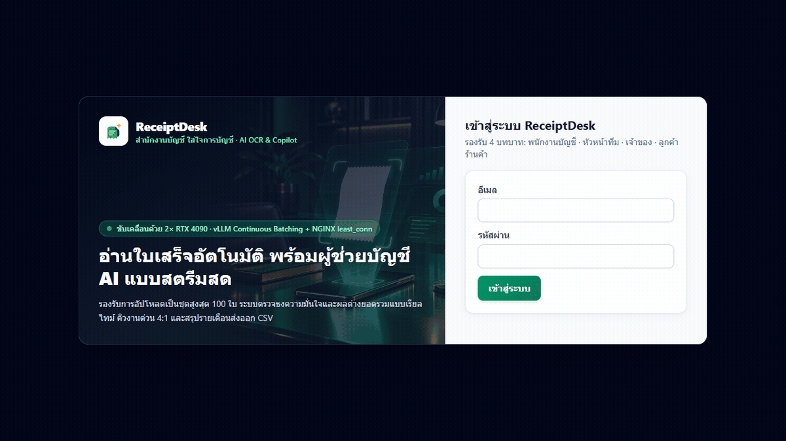

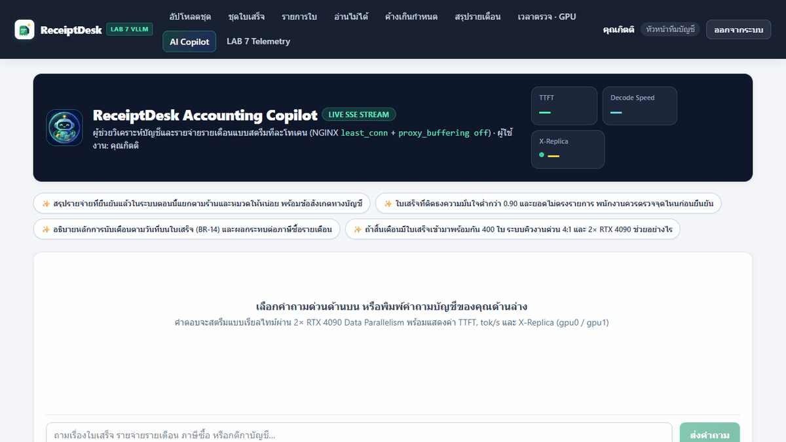

**ตารางผลทดสอบ Playwright ครบทั้ง 28 ข้อพร้อมสถานะและไฟล์ `.gif` รายข้อ**

| TC ID | ชื่อ Test Case | กติกา | โหมด | ผลจริง | สถานะ | หลักฐาน (.gif) |
|---|---|---|---|---|---|---|
| `TC-01` | รับชุดไฟล์ถูกต้อง JPG, PNG และ PDF 1 หน้า | `BR-01..03` | Mock (:3421) | รับครบ 3 ไฟล์ (JPG + PNG + PDF 1 หน้า) | ✅ ผ่าน | [TC-01.gif](images/tests/TC-01.gif) |
| `TC-02` | ปฏิเสธไฟล์ชนิดไม่รองรับ (GIF) ทั้งชุด | `BR-02` | Mock (:3421) | ปฏิเสธ GIF ทั้งชุดพร้อมข้อความรายไฟล์ | ✅ ผ่าน | [TC-02.gif](images/tests/TC-02.gif) |
| `TC-03` | ปฏิเสธไฟล์ PDF เกิน 1 หน้า (2 หน้า) | `BR-03` | Mock (:3421) | ปฏิเสธ PDF 2 หน้าทั้งชุด | ✅ ผ่าน | [TC-03.gif](images/tests/TC-03.gif) |
| `TC-04` | เส้นแบ่งขนาดไฟล์ 10.00 MB พอดี vs เกิน 1 ไบต์ | `BR-02` | Mock (:3421) | 10.00 MB รับได้ · +1 ไบต์ถูกปฏิเสธ | ✅ ผ่าน | [TC-04.gif](images/tests/TC-04.gif) |
| `TC-05` | เส้นแบ่งจำนวนไฟล์ต่อชุด 100 ใบ vs 101 ใบ | `BR-01` | Mock (:3421) | 100 ไฟล์รับได้ · 101 ไฟล์ปฏิเสธทั้งชุด | ✅ ผ่าน | [TC-05.gif](images/tests/TC-05.gif) |
| `TC-06` | เส้นแบ่งความมั่นใจยอดรวม 0.89 / 0.90 / 0.91 | `BR-04` | Mock (:3421) | 0.89 ติดธง · 0.90 และ 0.91 ไม่ติดธง | ✅ ผ่าน | [TC-06.gif](images/tests/TC-06.gif) |
| `TC-07` | เส้นแบ่งผลต่างรายการ 0.99 / 1.00 / 1.01 / 1.49 บาท | `BR-05` | Mock (:3421) | ≤1.00 ผ่าน · ≥1.01 ติดธงยอดไม่ตรง | ✅ ผ่าน | [TC-07.gif](images/tests/TC-07.gif) |
| `TC-08` | ใบเสร็จเดียวติดทั้ง 2 ธงพร้อมกัน | `BR-04+05` | Mock (:3421) | แสดงครบทั้ง 2 ธงบน Split-Pane Review | ✅ ผ่าน | [TC-08.gif](images/tests/TC-08.gif) |
| `TC-09` | แก้ยอดรวมในหน้า Review แล้วธงยอดไม่ตรงคำนวณใหม่สด | `BR-05 Live` | Mock (:3421) | แก้ 120.00 ธงขึ้นทันที · แก้ 100.00 ธงหาย | ✅ ผ่าน | [TC-09.gif](images/tests/TC-09.gif) |
| `TC-10` | เส้นแบ่งยอดยืนยัน 0.00 บาท vs 0.01 บาท | `BR-06` | Mock (:3421) | 0.00 ถูกบล็อก (422) · 0.01 ยืนยันสำเร็จ | ✅ ผ่าน | [TC-10.gif](images/tests/TC-10.gif) |
| `TC-11` | ตรวจแก้และยืนยันใบเสร็จผ่าน Split-Pane Workbench | `FR-12` | Mock (:3421) | เลือกหมวด ติ๊กตรวจยอด และยืนยันสำเร็จ | ✅ ผ่าน | [TC-11.gif](images/tests/TC-11.gif) |
| `TC-12` | ประวัติการแก้ไข (Audit Trail) และสิทธิ์หัวหน้าทีมเปิดใบกลับ | `FR-13` | Mock (:3421) | เก็บประวัติแก้ไขครบ + หัวหน้าทีมเปิดใบกลับได้ | ✅ ผ่าน | [TC-12.gif](images/tests/TC-12.gif) |
| `TC-13` | เส้นแบ่งชุดเร่งด่วน 10 ใบ vs 11 ใบ | `BR-08` | Mock (:3421) | 10 ใบรับได้ · 11 ใบถูกปฏิเสธ | ✅ ผ่าน | [TC-13.gif](images/tests/TC-13.gif) |
| `TC-14` | โควตางานเร่งด่วนครบ 5 งาน/วัน ปฏิเสธงานที่ 6 | `BR-09` | Mock (:3421) | ปฏิเสธงานที่ 6 ด้วย HTTP 409 | ✅ ผ่าน | [TC-14.gif](images/tests/TC-14.gif) |
| `TC-15` | โควตางานเร่งด่วนรีเซ็ตตามวันปฏิทินไทย | `BR-09` | Mock (:3421) | โควตาเมื่อวานไม่บล็อกวันใหม่ | ✅ ผ่าน | [TC-15.gif](images/tests/TC-15.gif) |
| `TC-16` | เพดานใบค้าง 400 ใบ: รับใบที่ 400 บล็อกใบที่ 401 | `BR-11..12` | Mock (:3421) | 400 รับได้ · 401 ตอบ 429 พร้อมนาทีลองใหม่ | ✅ ผ่าน | [TC-16.gif](images/tests/TC-16.gif) |
| `TC-17` | ลองอ่านซ้ำไม่เกิน 3 ครั้ง: ครั้งที่ 3 ผ่าน vs ย้าย `/unreadable` | `BR-07` | Mock (:3421) | `fail2` ผ่าน · `fail3` ย้ายหน้าอ่านไม่ได้ | ✅ ผ่าน | [TC-17.gif](images/tests/TC-17.gif) |
| `TC-18` | พนักงานเปิดใบอ่านไม่ได้ พิมพ์ 5 ช่องเองแล้วยืนยัน | `FR-17` | Mock (:3421) | พิมพ์เอง 185.00 บาท ยืนยันเข้าบัญชีสำเร็จ | ✅ ผ่าน | [TC-18.gif](images/tests/TC-18.gif) |
| `TC-19` | รายงานรายเดือนนับวันที่ 1 ถึงสิ้นเดือนและออก CSV | `BR-14` | Mock (:3421) | CL-01 พ.ย. 2026 = `1,340.00` (4 ใบ) + CSV ตรง | ✅ ผ่าน | [TC-19.gif](images/tests/TC-19.gif) |
| `TC-20` | หน้างานค้างเกินกำหนด 120 นาที (`/overdue`) | `BR-13` | Mock (:3421) | แสดงใบค้าง 121 นาที และซ่อนใบ 119 นาที | ✅ ผ่าน | [TC-20.gif](images/tests/TC-20.gif) |
| `TC-21` | สิทธิ์เข้าถึงหน้าเว็บแยกขาดทั้ง 4 บทบาท | `RBAC` | Mock (:3421) | แยกสิทธิ์ staff / lead / owner / client ครบ | ✅ ผ่าน | [TC-21.gif](images/tests/TC-21.gif) |
| `TC-22` | พอร์ทัลคุณสมชายแยกข้อมูลร้านและซ่อนยอดก่อนยืนยัน | `FR-25..29` | Mock (:3421) | เห็นเฉพาะร้านตน `1,340.00` ไม่รั่วข้อมูลร้านอื่น | ✅ ผ่าน | [TC-22.gif](images/tests/TC-22.gif) |
| `TC-23` | อ่านใบเสร็จ CORD-v2 จริง 3 ใบผ่าน NGINX → `2× vLLM` | `Live OCR` | **Live 2×4090 (:3420)** | อ่านครบ 3 ใบ (`38000`, `40000`, `63000`) | ✅ ผ่าน | [TC-23.gif](images/tests/TC-23.gif) |
| `TC-24` | สตรีมสดผู้ช่วยบัญชี AI (`/copilot`) ผ่าน `proxy_buffering off` | `Live SSE` | **Live 2×4090 (:3420)** | `TTFT=547 ms`, `210.6 tok/s`, `X-Replica: gpu0` | ✅ ผ่าน | [TC-24.gif](images/tests/TC-24.gif) |
| `TC-25` | หน้า `/telemetry` ตรวจสุขภาพคลัสเตอร์ `2× RTX 4090` สด | `Cluster` | **Live 2×4090 (:3420)** | สถานะ `ONLINE` · `● gpu0` · `● gpu1` | ✅ ผ่าน | [TC-25.gif](images/tests/TC-25.gif) |
| `TC-26` | Bug Hunt #1: จับบั๊กผลต่าง `1.01–1.49` ไม่ติดธง | `BUG #1` | `BUG_MODE=1` | จับบั๊ก BR-05 ได้แม่นยำ | ✅ จับได้ | [TC-26.gif](images/tests/TC-26.gif) |
| `TC-27` | Bug Hunt #2: จับบั๊กโควตางานเร่งด่วนงานที่ 6 หลุดผ่าน | `BUG #2` | `BUG_MODE=1` | จับบั๊ก BR-09 ได้แม่นยำ | ✅ จับได้ | [TC-27.gif](images/tests/TC-27.gif) |
| `TC-28` | Bug Hunt #3: จับบั๊กตัดใบเสร็จวันที่ 1 ออกจากรายงาน | `BUG #3` | `BUG_MODE=1` | จับบั๊ก BR-14 (`1,139.50` แทน `1,340.00`) | ✅ จับได้ | [TC-28.gif](images/tests/TC-28.gif) |

### ขั้นที่ 14 · Bug Hunt (`BUG_MODE=1`) พร้อม `.gif` และรายงานส่งมอบ

```text
เปิดเว็บชุดจำลองที่พอร์ต 3421 ใหม่ด้วย BUG_MODE=1 แล้วรันชุด Bug Hunt (TC-26..TC-28) พร้อมบันทึก .gif หลักฐานของแต่ละบั๊กไว้ที่ ./images/tests/ (ห้ามเปิดไฟล์ BUGS-SECRET จนกว่าจะเขียนรายงานบั๊กเสร็จ)
1. เทียบกับรอบปกติ: ข้อที่ล้มเพิ่มคือข้อใด แล้วสรุปเป็นบั๊กทีละตัวไว้ที่ ./test/BUG-HUNT.md พร้อมขั้นตอนทำซ้ำ ผลที่คาดหวัง ผลจริง และลิงก์ .gif หลักฐาน
2. เขียนรายงานบั๊กเสร็จแล้วจึงเปิดไฟล์ BUGS-SECRET เทียบว่าจับได้กี่ตัวจาก 3 ตัว
3. เขียนรายงานส่งมอบสำหรับลูกค้าไว้ที่ ./DELIVERY.md
4. ปิด BUG_MODE=0 กลับเป็นโหมดปกติ
สรุปเป็นตารางภาษาไทย: บั๊ก · Test Case ที่จับได้ · ความรุนแรง · หลักฐาน .gif
```

**ผลจริง**: จับบั๊กซ่อนใน `BUG_MODE=1` ได้ครบ **3 จาก 3 ตัว (100.0%)** ดูรายละเอียดที่ [test/BUG-HUNT.md](test/BUG-HUNT.md) และรายงานส่งมอบสำหรับลูกค้าที่ [DELIVERY.md](DELIVERY.md)

### ขั้นที่ 15 · ลบเครื่อง GPU (`e2e-receipt-nginx`) และปิดระบบ (ห้ามข้าม)

```text
ทำงานใน container multi-account โฟลเดอร์ /workspace/e2e_receipt_nginx ด้วยสกิล vastai
1. ตรวจว่าดึงผลวัด JSON และหลักฐานการทดสอบทั้งหมดกลับมาในโฟลเดอร์โปรเจกต์ครบแล้ว
2. ลบเครื่องป้าย e2e-receipt-nginx ทันทีหลังทดสอบและบันทึก GIF เสร็จ แล้วตรวจซ้ำด้วย vastai show instances ว่าไม่มีเครื่องป้าย e2e-receipt-nginx เหลืออยู่
3. หยุดเว็บและฐานข้อมูลบนเครื่องนี้ทั้ง 2 ชุด (receiptdesk-nginx และ receiptdesk-mock) และล้างค่า API key จริงออกจากไฟล์ .env
(ห้ามแตะเครื่องป้ายอื่น ห้ามแสดงค่า key)
สรุปเป็นตารางภาษาไทย: เครื่องที่ลบ · ระยะเวลาที่เปิดใช้งาน · สถานะหลังลบ
```

**ผลจริง**: ลบเครื่อง `e2e-receipt-nginx` (Instance ID `62729069`) เรียบร้อยทันทีหลังจบการทดสอบสดและบันทึก `.gif` · ตรวจซ้ำด้วย `vastai show instances` คงเหลือ **0 เครื่อง** · หยุด `receiptdesk-nginx` และ `receiptdesk-mock` และล้าง API key ออกจาก `.env` เรียบร้อยแล้ว

| รายการ | ค่าจริง |
|---|---|
| เครื่อง GPU ที่เช่า | `1 โหนด × 2× RTX 4090` (Instance ID `62729069` · ป้าย `e2e-receipt-nginx` · Ireland, IE · `13,978 Mbps`) |
| ระยะเวลาที่เปิดเครื่องสำหรับรอบ Live | **~17 นาที** (ติดตั้ง, รวม LoRA 19.6 วินาที, เปิด 2× vLLM + NGINX, รัน Live E2E และบันทึก `.gif`) |
| สถานะเครื่องหลังลบ | **ลบแล้ว (`destroyed`) · คงเหลือ 0 เครื่อง** |
| Docker Compose ในเครื่อง (`3420` / `3421`) | หยุดทำงานเรียบร้อยแล้วทั้ง 2 ชุด และล้าง API key ออกจาก `.env` |

---

## ภาพรวมไฟล์ในโฟลเดอร์นี้

| ไฟล์ / โฟลเดอร์ | คืออะไร |
|---|---|
| `INTERVIEW.md` | บันทึกการสัมภาษณ์ลูกค้า 4 บทบาท |
| `PROMPTS.md` | พรอมต์ครบทั้ง 15 ขั้น ตรงตัวอักษรกับ README และสไลด์ |
| `ReceiptDesk_Slides.html` | สไลด์ประกอบการสอน HTML ไฟล์เดียว (พร้อมปุ่มคัดลอกพรอมต์และวิดีโอ `.gif`) |
| `docs/` | เอกสารระยะ A (`USER-STORIES.md`, `REQUIREMENTS.md`, `DESIGN.md`, `TEST-DATA.md`, `BUGS-SECRET.md`) |
| `plan/` | แผนงาน 14 บล็อก · DAG · Gantt · What-if · รายงานการรันจริง |
| `results/` | ผลเทรนและน้ำหนัก LoRA (`model/`), ผลวัดสมรรถนะ `2× RTX 4090` (`lb/*.json`), กราฟ (`images/`) |
| `test/` | Charter · Exploration · Test Plan · Playwright E2E (`e2e/`) · รายงาน 28 ข้อ (`TEST-REPORT.md`) · หน้าดูหลักฐาน `.gif` (`index.html`) · Bug Hunt |
| `DELIVERY.md` | รายงานส่งมอบสำหรับลูกค้า |
| `code_reference/` | โค้ดระบบทั้งหมด (เว็บ Next.js 16 + PostgreSQL 16 + คอนฟิก NGINX + สคริปต์ 2× vLLM) |
| `images/` | ศูนย์รวมภาพและ `.gif` ทั้งหมด (`story/`, `theory/`, `lab/`, `slides/`, `tests/TC-01..28.gif`) |
| `tools/` | `gen_pure_nginx_diagrams.py`, `gen_test_reports.py`, `plot_lb_charts.py`, `slides_engine.py`, `slides_figures.py`, `build_slides.py` |
