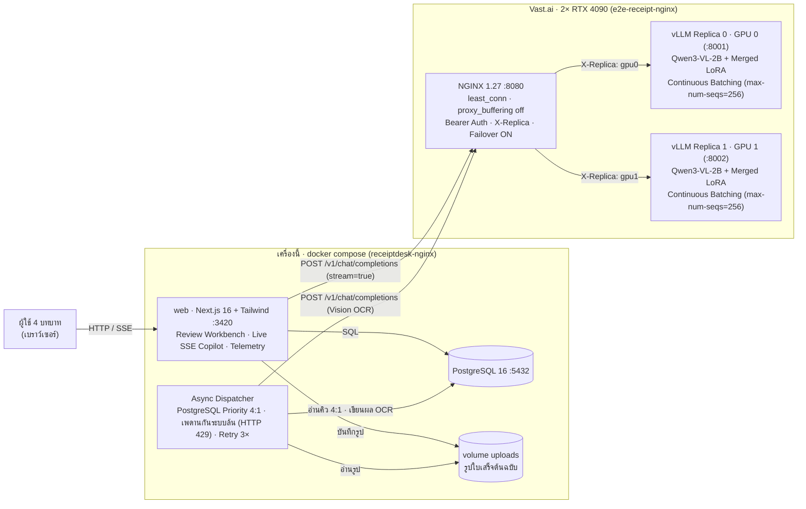
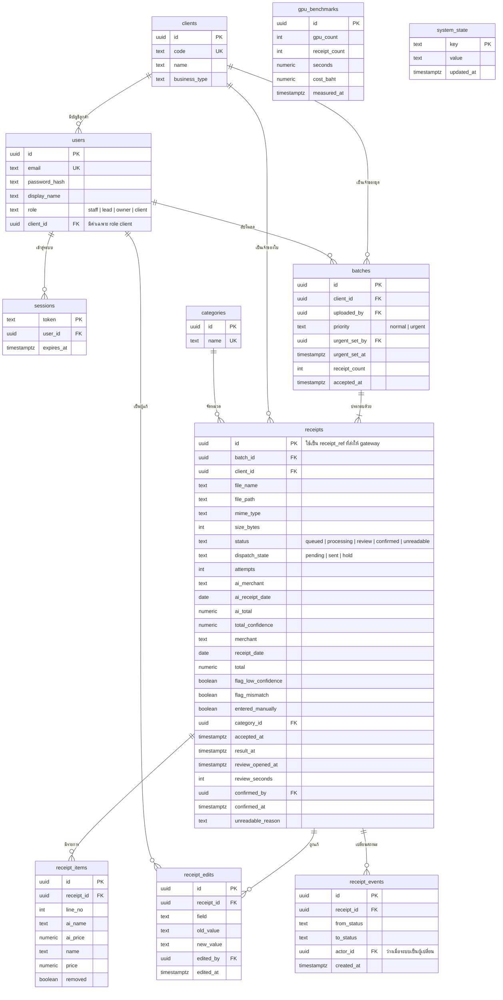
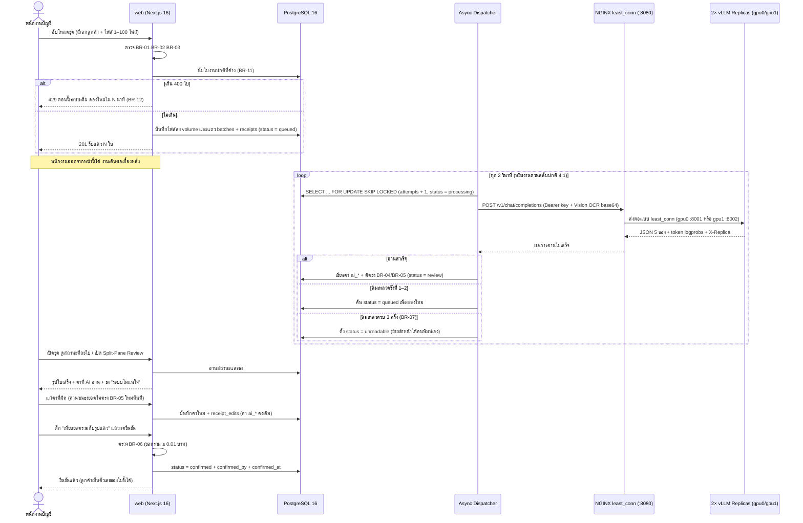
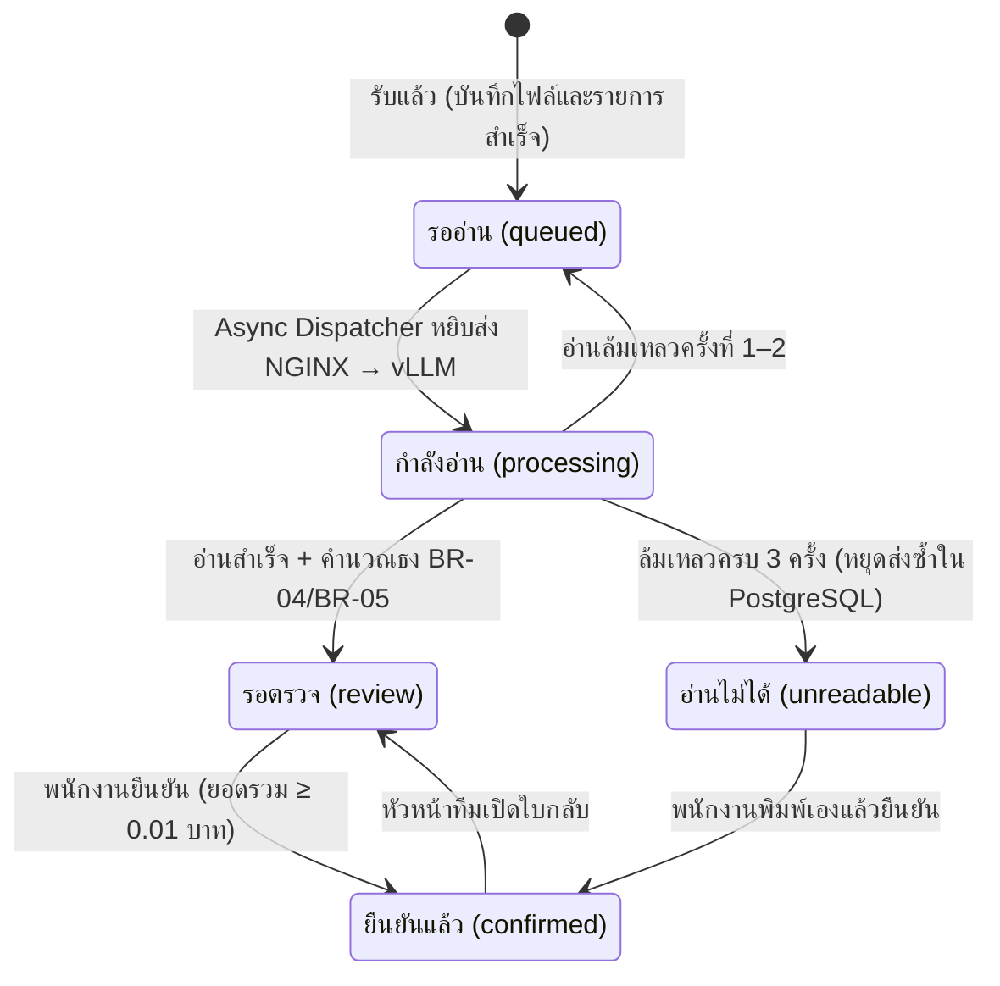

# Design · ReceiptDesk (2× RTX 4090 · NGINX + 2× vLLM Edition)

ที่มา: `docs/REQUIREMENTS.md` (FR-01 – FR-31 · BR-01 – BR-14 · NFR-01 – NFR-10 · ข้อสมมติ A-01 – A-16)
สถานะ: **อัปเกรดสถาปัตยกรรมฝั่ง AI Serving ด้วยสถาปัตยกรรม NGINX least_conn + 2× vLLM Data Parallelism (`2× RTX 4090` · 2× vLLM Data Parallelism + Continuous Batching · NGINX `least_conn` + `proxy_buffering off` SSE Streaming + Failover ON · Next.js 16 + Tailwind CSS v4 + PostgreSQL 16 + Live Streaming Accounting Copilot)**
ข้อมูลทดสอบอยู่ที่ `docs/TEST-DATA.md`

## 1. ภาพรวม

ระบบมี 2 ฝั่ง

| ฝั่ง | อยู่ที่ไหน | ส่วนประกอบ | หน้าที่ |
|---|---|---|---|
| เว็บ | เครื่องนี้ รันด้วย docker compose (พอร์ต `3420` Live · `3421` Mock) | `web` (Next.js 16 + Tailwind CSS v4 + `/copilot` SSE + `/telemetry`) · `dispatcher` (ส่งตรงเข้า vLLM Data Parallelism / Mock) · `db` (PostgreSQL 16) · volume `uploads` | รับใบเสร็จ เก็บข้อมูลจริงทั้งหมด บังคับ Business Rule (รวม BR-05 คำนวณธงยอดไม่ตรงสดหลังแก้) ให้คนตรวจยืนยัน และให้บริการผู้ช่วยบัญชี AI แบบ SSE Streaming |
| AI | เครื่องเช่า `2× RTX 4090` (Vast.ai) | **NGINX 1.27 `least_conn`** (`:8080`, `proxy_buffering off`, Bearer Auth, `X-Replica: gpu0/gpu1`, Passive Failover `max_fails=1 fail_timeout=30s`) · **2× vLLM Replicas** (`gpu0 :8001`, `gpu1 :8002`, Data Parallelism 2×1, Continuous Batching `--max-num-seqs 256`, `Qwen3-VL-2B-Instruct` Merged LoRA) | อ่านรูปใบเสร็จเป็น JSON 5 ช่องพร้อมความมั่นใจ และตอบคำถามผู้ช่วยบัญชี AI แบบ SSE Streaming พร้อมกันได้สูงสุด 640 ผู้ใช้ (Standard SLO) / 28,541 tok/s |

หลักที่ใช้ตัดสินใจ

1. **ฝั่งเว็บเป็นเจ้าของความจริง** ใบถูกนับว่า "รับแล้ว" เมื่อไฟล์และแถวข้อมูลอยู่ใน volume และ PostgreSQL แล้ว ไม่ขึ้นกับเครื่อง GPU (NFR-06) เครื่อง GPU ถูกลบทิ้งได้ทุกเมื่อโดยใบไม่หาย
2. **Async Dispatcher + PostgreSQL Outbox** อ่านใบที่ยังไม่ส่งจาก PostgreSQL ด้วย `FOR UPDATE SKIP LOCKED` (งานด่วนสลับปกติ 4:1) แล้วยิง HTTP/JSON Vision OCR ตรงไปยัง **NGINX `least_conn` (:8080)** บน `2× RTX 4090` ไม่ต้องมี บริการตัวกลางภายนอก
3. **ความเป็นส่วนตัวของข้อมูล** คลัสเตอร์ GPU เห็นเฉพาะภาพใบเสร็จ (base64 data URI) หรือข้อความคำถาม Copilot ไม่รู้จักชื่อลูกค้าหรือข้อมูลบัญชีอื่น (NFR-07)
4. **Business Rule ทั้งหมด (BR-01 – BR-14) อยู่ในฝั่งเว็บและ PostgreSQL** รวมไว้ในโมดูล `web/lib/rules.ts` และ `web/dispatcher/index.ts`

### 1.1 Architecture (NGINX + 2× vLLM · NGINX `least_conn` + 2× vLLM Data Parallelism)



### 1.2 บริการและพอร์ต

| บริการ | เครื่อง | พอร์ต | เปิดออกนอกเครื่อง | ข้อมูลที่เก็บถาวร |
|---|---|---|---|---|
| `web` (Next.js 16 + Tailwind v4) | นี้ | 3420 (Live) / 3421 (Mock) | ใช่ (ผู้ใช้) | — |
| `dispatcher` (Async Outbox) | นี้ | — | ไม่ | — |
| `db` (PostgreSQL 16) | นี้ | 5432 | ไม่ | volume `pgdata` |
| volume `uploads` | นี้ | — | ไม่ | รูปใบเสร็จต้นฉบับ |
| NGINX 1.27 (`least_conn`, udocker) | `2× RTX 4090` | 8080 | ใช่ (ต้องมี Bearer API key) | — |
| vLLM Replica 0, 1 (`receipt-vlm`) | `2× RTX 4090` | 8001, 8002 | ไม่ (ฟัง `127.0.0.1` เท่านั้น) | น้ำหนักโมเดล `Qwen3-VL-2B` + Merged LoRA |

---

## 2. ฐานข้อมูล (PostgreSQL · 11 ตาราง)



หมายเหตุของตาราง

- จำนวนเงินทุกช่องเป็น `numeric(12,2)` การเทียบตาม BR-05 และ BR-06 คิดเป็นสตางค์ (จำนวนเต็ม) ไม่ใช้เลขทศนิยมแบบ float
- คอลัมน์ `ai_*` เขียนครั้งเดียวตอนรับผลจาก AI และไม่ถูกแก้อีก (FR-14, NFR-10) ค่าที่คนแก้อยู่ในคอลัมน์ที่ไม่มี `ai_` และทุกการแก้มี 1 แถวใน `receipt_edits`
- ยอดตรวจนับ (FR-08): `count(receipts)` = ผลรวม `count` แยกตาม `status` เพราะ `status` มีได้ 5 ค่าและไม่มีค่าว่าง
- BR-09 นับจาก `batches.urgent_set_at` ของวันปฏิทิน (เขต Asia/Bangkok) · BR-11 นับจาก `receipts` ที่ `status` เป็น `queued` หรือ `processing` และชุดเป็น `normal` · BR-13 คิดจาก `accepted_at` เทียบเวลาปัจจุบัน
- `system_state` เก็บค่าที่ dispatcher อ่านจาก gateway ล่าสุด เช่น `workers_alive` ใช้คิด BR-12
- ฝั่ง gateway มีตารางของตัวเอง 1 ตารางใน SQLite (`gw_receipts`: receipt_ref · job_ref · priority · status · attempts · lease_until · result · error) ไม่อยู่ใน ER นี้เพราะเป็นข้อมูลชั่วคราว

---

## 3. ลำดับการทำงาน: อัปโหลดชุดใบเสร็จจนพนักงานยืนยันผล



---

## 4. สถานะของงาน

สถานะนี้เป็นของใบเสร็จ 1 ใบในฝั่งเว็บ (คอลัมน์ `receipts.status`) สถานะของชุดคิดจากจำนวนใบในแต่ละสถานะ



- การเป็นงานด่วนไม่ใช่สถานะ เป็นค่า `priority` ของชุด เปลี่ยนได้ขณะใบยังเป็น `queued`
- `unreadable` ไม่มีเส้นกลับไป `queued` (FR-16)
- ทุกเส้นบันทึก 1 แถวใน `receipt_events`
- การเขียนผลใช้เงื่อนไข "เปลี่ยนเฉพาะเมื่อสถานะปัจจุบันเป็น queued หรือ processing" ผลที่มาซ้ำจึงไม่ทับใบที่ไปถึง review แล้ว

---

## 5. API Contract ระหว่างเว็บกับคลัสเตอร์ AI (NGINX + 2× vLLM · NGINX + 2× vLLM)

ผู้เรียกคือ `dispatcher` (สำหรับ Vision OCR) และ Next.js SSE Proxy `/api/copilot/stream` (สำหรับ Accounting Copilot สตรีมสด) · ฐาน URL อยู่ในตัวแปร `VLLM_URL` (เช่น `http://<vast-ip>:<port>`)

### 5.1 การใช้ API key และความปลอดภัย

| เรื่อง | กติกา |
|---|---|
| ส่งอย่างไร | header `Authorization: Bearer <VLLM_API_KEY>` ทุกคำขอ ยกเว้น `GET /lb-health` |
| ไม่มี key หรือ key ผิด | NGINX ตอบ `401 {"error":{"message":"missing or invalid API key","type":"unauthorized","code":401}}` ทันทีก่อนถึง vLLM |
| เก็บที่ไหน | ไฟล์ `.env` ฝั่งเซิร์ฟเวอร์เท่านั้น ไม่อยู่ใน git ไม่อยู่ในโค้ดฝั่งเบราว์เซอร์ และไม่ถูกพิมพ์ลง log |
| header ระบุเครื่อง | NGINX แนบ `X-Replica: gpu0` หรือ `X-Replica: gpu1` และ `X-Replica-Addr` กลับมาทุกคำขอเพื่อตรวจสอบสมดุลโหลด |

### 5.2 รายการ Endpoint ของคลัสเตอร์ NGINX + vLLM

| # | Method + Path | ใช้ทำอะไร | ตอบสำเร็จ |
|---|---|---|---|
| L1 | `GET /lb-health` | ตรวจว่า NGINX `least_conn` ทำงานอยู่และรู้ pool ที่เปิด (`receipt_dp1` / `receipt_dp2`) | `200` |
| L2 | `GET /v1/models` | ตรวจว่า vLLM Replicas พร้อมให้บริการและตรวจสอบ Bearer API Key | `200` |
| L3 | `POST /v1/chat/completions` (`stream: false`, `logprobs: true`) | ส่งภาพใบเสร็จ (base64 data URI) ให้อ่านเป็น JSON 5 ช่องพร้อม logprobs คำนวณ `total_confidence` | `200` |
| L4 | `POST /v1/chat/completions` (`stream: true`) | สตรีมคำตอบ Accounting Copilot ทีละโทเคน (SSE) โดยปิด `proxy_buffering off` ที่ NGINX | `200` (SSE) |

---

## 6. การจัดการลำดับงานและเพดานใน PostgreSQL (Priority · เพดานกันระบบล้น (HTTP 429) · Retry Limit 3 ครั้ง)

ReceiptDesk ไม่ต้องติดตั้ง บริการตัวกลางภายนอก แต่ใช้ตาราง `batches` และ `receipts` ใน **PostgreSQL 16** เป็นแหล่งเก็บสถานะและคิวเดียว (Single Source of Truth) ร่วมกับ **Async Dispatcher** และคลัสเตอร์ **NGINX `least_conn` + 2× vLLM Continuous Batching**:

| กลไก | การออกแบบใน PostgreSQL + Async Dispatcher | ตอบ Requirement |
|---|---|---|
| **จัดลำดับงานเร่งด่วน (4:1)** | ดึงงานด้วย `FOR UPDATE SKIP LOCKED` เรียงตาม `priority DESC, urgent_set_at ASC, accepted_at ASC` และสลับใบปกติ 1 ใบทุกใบด่วน 4 ใบ | BR-08 · BR-09 · BR-10 · NFR-03 |
| **เพดานกันระบบล้น (HTTP 429) (เพดาน 400 ใบ)** | นับใบงานปกติที่ `queued` + `processing` ในธุรกรรมเดียวกับการสร้างชุด ถ้าเกิน 400 ตอบ `429` พร้อมคำนวณนาทีลองใหม่ (`BR-12`) โดยไม่บล็อกงานด่วน | BR-11 · BR-12 |
| **พักใบอ่านไม่ได้ (Retry Limit 3 ครั้ง)** | เพิ่ม `attempts` ทุกครั้งที่ส่งไป vLLM (`1 → 2 → 3`) ล้มเหลวครั้งที่ 1–2 คืน `queued` · ล้มเหลวครบ 3 ครั้งตั้ง `status = unreadable` และหยุดส่งซ้ำอัตโนมัติ (ไปหน้า `/unreadable`) | BR-07 · FR-16 · FR-17 |

### 6.1 การคำนวณเวลาตอบสนองเทียบ SLO บน `2× RTX 4090`

บนคลัสเตอร์จริง **`2× RTX 4090` Data Parallelism 2×1 (`--max-num-seqs 256`) + NGINX `least_conn`** วัดกำลังผลิตอ่านใบเสร็จ CORD-v2 จริงได้ **`2,643.9 ใบเสร็จต่อนาที`** (p50 `0.622 วินาที`):
- ชุดงานด่วน 10 ใบเสร็จเสร็จภายใน **< 3 วินาที** (SLO ≤ 5 นาที)
- ชุดงานปกติ 100 ใบเสร็จเสร็จภายใน **~2.3 วินาที** (SLO ≤ 30 นาที)
- แม้โหลดสูงสุด 400 ใบเสร็จ ก็ประมวลผลจบภายใน **< 10 วินาที** (SLO ≤ 120 นาที)

---

## 7. งานไม่หายเมื่อ Replica หรือเครื่อง GPU ล่ม (NFR-06)

| กลไก | รายละเอียด |
|---|---|
| **NGINX Passive Health Check** | `max_fails=1 fail_timeout=30s` + `proxy_next_upstream error timeout http_502 http_503 http_504 non_idempotent` — เมื่อ `gpu1` (:8002) ล่มกลางสตรีม NGINX ตัดออกทันทีและโอนโหลดทั้งหมดไป `gpu0` (:8001) โดยหลังฟื้นตัวมี error = `0` |
| **PostgreSQL Single Source of Truth** | ไฟล์รูปและสถานะทุกใบอยู่บนเครื่องสำนักงานตลอดเวลา แม้ลบเครื่อง GPU บน Vast.ai ทิ้ง ข้อมูลก็ไม่หาย |
| **Async Retry (สูงสุด 3 ครั้ง)** | หาก vLLM ตอบ error หรือ timeout ในครั้งที่ 1–2 Dispatcher จะลองส่งใหม่โดยอัตโนมัติ และหากครบ 3 ครั้งจะย้ายเข้าสถานะ `unreadable` ให้คนพิมพ์เอง |
| **เว็บทำงานต่อได้แม้ GPU ปิด** | พนักงานยังอัปโหลดชุดใหม่ ตรวจใบที่อ่านแล้ว ออกรายงานรายเดือน และให้ลูกค้าดูพอร์ทัลได้ตามปกติ |

---

## 8. ความเป็นส่วนตัว

- คลัสเตอร์ `2× RTX 4090` เป็นแบบ stateless ไม่เก็บรูปใบเสร็จลงดิสก์หลังตอบ JSON กลับ และไม่ได้รับชื่อร้านหรือชื่อลูกค้าจากฐานข้อมูล
- log ของ NGINX เก็บเฉพาะเวลา สถานะ HTTP, `X-Replica` และ latency ไม่มีเนื้อหาใบเสร็จหรือ API key
- เว็บ: ทุกหน้าและทุก API ต้องมี session ยกเว้น `/login` และ `/api/health` · รูปใบเสร็จเปิดผ่าน API ที่ตรวจสิทธิ์ ไม่มีลิงก์ตรงไปที่ไฟล์
- บัญชีลูกค้า: ทุกคำสั่งอ่านข้อมูลกรองด้วย `client_id` ของ session ที่ฝั่ง server ขอใบของร้านอื่นได้ `404` · ใบที่ยังไม่ `confirmed` ส่งให้ลูกค้าเฉพาะชื่อไฟล์ เวลาที่รับ และสถานะ ช่องตัวเลขไม่ถูกส่งออกจาก server

---

## 9. ฝั่งเว็บ

### 9.1 หน้าและสิทธิ์

| หน้า | Path | พนักงาน | หัวหน้าทีม | เจ้าของ | ลูกค้า |
|---|---|---|---|---|---|
| เข้าสู่ระบบ | `/login` | ✓ | ✓ | ✓ | ✓ |
| อัปโหลดชุด | `/upload` | ✓ | ✓ (ตั้งด่วนได้) | — | — |
| รายการชุด + ยอดตรวจนับ | `/batches` | ✓ | ✓ | ✓ | — |
| ชุด 1 ชุด (สถานะทีละใบ) | `/batches/[id]` | ✓ | ✓ (ปุ่มงานด่วน) | ✓ | — |
| รายการใบ (กรองสถานะ · ธง) | `/receipts` | ✓ | ✓ | ✓ | — |
| ตรวจและยืนยันใบ | `/receipts/[id]` | ✓ | ✓ (ดูค่าเดิม · เปิดใบกลับ) | ดูอย่างเดียว | — |
| อ่านไม่ได้ ให้คนพิมพ์เอง | `/unreadable` | ✓ | ✓ | ✓ | — |
| ค้างเกินกำหนด | `/overdue` | — | ✓ | ✓ | — |
| ไฟล์สรุปรายเดือน | `/reports` | ✓ | ✓ | ✓ | — |
| เวลาตรวจ · GPU 1 เทียบ 2 ใบ | `/insights` | — | ✓ (เวลาตรวจ) | ✓ | — |
| หน้าลูกค้า: ส่งใบ · ใบของร้าน · สรุปแยกหมวด | `/portal` | — | — | — | ✓ |

### 9.2 API ของเว็บ (23 เส้น)

| # | Method + Path | ใช้ทำอะไร | ใครเรียกได้ |
|---|---|---|---|
| W1 | `GET /api/health` | สุขภาพของเว็บ | ทุกคน ไม่ต้องเข้าสู่ระบบ |
| W2 | `POST /api/test/reset` | รีเซ็ตข้อมูลทดสอบ | ผู้ทดสอบ (มี token) |
| W3 | `POST /api/auth/login` | เข้าสู่ระบบ | ทุกคน |
| W4 | `POST /api/auth/logout` | ออกจากระบบ | ผู้เข้าสู่ระบบ |
| W5 | `GET /api/me` | บัญชีและบทบาทของตัวเอง | ผู้เข้าสู่ระบบ |
| W6 | `GET /api/clients` | รายชื่อลูกค้าของสำนักงาน | พนักงาน · หัวหน้า · เจ้าของ |
| W7 | `POST /api/batches` | อัปโหลดชุด (BR-01 – BR-03, BR-11, BR-12 · `urgent=true` ได้เฉพาะหัวหน้า) | พนักงาน · หัวหน้า · ลูกค้า (ร้านตัวเอง) |
| W8 | `GET /api/batches` | รายการชุด | พนักงาน · หัวหน้า · เจ้าของ |
| W9 | `GET /api/batches/{id}` | สถานะทุกใบและจำนวนต่อสถานะ | พนักงาน · หัวหน้า · เจ้าของ |
| W10 | `POST /api/batches/{id}/urgent` | ตั้งงานด่วน (BR-08, BR-09) | หัวหน้าเท่านั้น คนอื่นได้ `403` |
| W11 | `GET /api/receipts` | รายการใบ กรอง `status` · `flagged` · `client_id` · `overdue` | ทุกบทบาท (ลูกค้าได้เฉพาะร้านตัวเองและไม่มีตัวเลขก่อนยืนยัน) |
| W12 | `GET /api/receipts/{id}` | รายละเอียดใบ | เหมือน W11 |
| W13 | `GET /api/receipts/{id}/image` | รูปใบเสร็จ | เหมือน W11 |
| W14 | `PATCH /api/receipts/{id}` | แก้ค่า หรือพิมพ์เองสำหรับใบอ่านไม่ได้ | พนักงาน · หัวหน้า |
| W15 | `POST /api/receipts/{id}/confirm` | ยืนยัน (BR-06 · ต้องส่ง `totalChecked=true` และ `categoryId`) | พนักงาน · หัวหน้า |
| W16 | `POST /api/receipts/{id}/reopen` | เปิดใบที่ยืนยันแล้วกลับเป็นรอตรวจ | หัวหน้าเท่านั้น |
| W17 | `GET /api/receipts/{id}/history` | ค่าเดิมที่ระบบอ่านและประวัติการแก้ | พนักงาน · หัวหน้า · เจ้าของ |
| W18 | `GET /api/reports/monthly?clientId=&month=YYYY-MM` | ไฟล์สรุปรายเดือน CSV (BR-14) | พนักงาน · หัวหน้า · เจ้าของ |
| W19 | `GET /api/reports/categories?month=YYYY-MM` | ยอดแยกหมวดของร้าน | ลูกค้า (ร้านตัวเอง) · สำนักงานระบุ `clientId` |
| W20 | `GET /api/reports/reconcile` | ยอดตรวจนับ: รับแล้ว · รวมทุกสถานะ · ผลต่าง | พนักงาน · หัวหน้า · เจ้าของ |
| W21 | `GET /api/reports/review-time` | เวลาตรวจเฉลี่ยต่อใบ | หัวหน้า · เจ้าของ |
| W22 | `GET /api/reports/gpu` | เทียบ GPU 1 กับ 2 ใบ | เจ้าของ |
| W23 | `GET /api/queue` | ใบงานปกติที่ค้าง · เพดาน · งานด่วนที่ใช้ไปวันนี้ · จำนวน Worker | พนักงาน · หัวหน้า · เจ้าของ |

รูปแบบคำตอบเมื่อผิดกฎ: `{"error":"<รหัส>","rule":"BR-xx","message":"<ข้อความภาษาไทย>"}`

| สถานการณ์ | รหัส HTTP | `error` |
|---|---|---|
| ชุดว่าง หรือเกิน 100 ไฟล์ | `422` | `batch_size` |
| ไฟล์เกิน 10 MB | `422` | `file_too_large` (บอกชื่อไฟล์) |
| ชนิดไฟล์ไม่รับ / PDF ไม่ใช่ 1 หน้า | `422` | `file_type` / `pdf_pages` (บอกชื่อไฟล์) |
| ระบบเต็ม | `429` | `queue_full` + `retryAfterMinutes` |
| ยอดรวมต่ำกว่า 0.01 | `422` | `total_invalid` |
| งานด่วนเกิน 10 ใบ | `422` | `urgent_too_large` |
| งานด่วนครบ 5 งานของวัน | `409` | `urgent_quota` |
| ไม่มีสิทธิ์ | `403` | `forbidden` |
| ยังไม่เข้าสู่ระบบ | `401` | `unauthenticated` |
| ข้อมูลของร้านอื่น | `404` | `not_found` |

### 9.3 `/api/health`

ไม่ต้องเข้าสู่ระบบ ไม่มีข้อมูลใบเสร็จ ตอบ `200` เมื่อเว็บต่อฐานข้อมูลได้ ตอบ `503` เมื่อต่อไม่ได้ สถานะของฝั่ง AI รายงานแยก ไม่ทำให้เว็บเป็น `503` (เว็บต้องใช้ได้แม้ฝั่ง AI ล่ม)

```json
{ "status": "ok", "db": "ok", "ai": { "mode": "gateway", "reachable": true, "workersAlive": 2 }, "version": "1.0.0" }
```

### 9.4 ทางรีเซ็ตข้อมูลทดสอบ

`POST /api/test/reset` ลบข้อมูลทุกตารางแล้วใส่ข้อมูลตั้งต้นจาก `docs/TEST-DATA.md`

| เรื่อง | กติกา |
|---|---|
| เปิดใช้ | เฉพาะเมื่อ `ENABLE_TEST_RESET=1` ถ้าไม่ตั้ง เส้นนี้ตอบ `404` |
| ป้องกัน | header `X-Test-Token` ต้องตรงกับ `TEST_RESET_TOKEN` ใน `.env` |
| เนื้อหา (ไม่ใส่ก็ได้) | `{"pendingNormal":0,"urgentToday":0,"urgentYesterday":0,"workersAlive":2,"overdue":false}` |
| `pendingNormal` | สร้างใบงานปกติสถานะ `queued` ตามจำนวน โดย `dispatch_state = hold` (ไม่ถูกส่งไปอ่าน) ใช้ทดสอบ BR-11 และ BR-12 |
| `urgentToday` / `urgentYesterday` | สร้างชุดที่ถูกตั้งด่วนวันนี้ / เมื่อวาน 23:59 ตามจำนวน ใช้ทดสอบ BR-09 |
| `workersAlive` | ตั้งค่า `system_state.workers_alive` ใช้ทดสอบ BR-12 |
| `overdue` | สร้างใบที่รับมาแล้ว 119 · 120 · 121 นาที ใช้ทดสอบ BR-13 |
| ตอบ | `200 {"ok":true,"counts":{"users":6,"clients":3,"receipts":8}}` |

โหมดอ่านจำลอง: เมื่อ `AI_MODE=mock` dispatcher ไม่เรียก gateway แต่ให้ผลตาม**ชื่อไฟล์**ที่กำหนดใน `docs/TEST-DATA.md` (ค่าความมั่นใจ ยอดรวม รายการ จำนวนครั้งที่ล้มเหลว) ใช้ทดสอบเว็บโดยไม่ต้องเช่าเครื่อง GPU ค่าเริ่มต้นคือ `AI_MODE=gateway`

### 9.5 `data-testid`

ทุกปุ่ม ทุกช่องกรอก ทุกตัวเลือก และทุกข้อความผลลัพธ์ที่การทดสอบต้องอ่าน มี `data-testid` รูปแบบ `<หน้า>-<สิ่งนั้น>[-<รหัส>]` ตัวพิมพ์เล็ก คั่นด้วยขีด ห้ามเปลี่ยนชื่อโดยไม่แก้เอกสารนี้

| หน้า | `data-testid` |
|---|---|
| ทุกหน้า | `nav-upload` · `nav-batches` · `nav-receipts` · `nav-unreadable` · `nav-overdue` · `nav-reports` · `nav-insights` · `nav-portal` · `nav-user-name` · `nav-user-role` · `logout-button` |
| `/login` | `login-email-input` · `login-password-input` · `login-submit-button` · `login-error` |
| `/upload` | `upload-client-select` · `upload-file-input` · `upload-urgent-checkbox` · `upload-submit-button` · `upload-accepted-count` · `upload-error` · `upload-file-error-{ลำดับ}` · `upload-full-message` · `upload-retry-minutes` · `upload-queue-pending` |
| `/batches` | `batches-table` · `batch-row-{id}` · `batch-open-link-{id}` · `reconcile-accepted` · `reconcile-sum` · `reconcile-diff` |
| `/batches/[id]` | `batch-priority` · `batch-count-accepted` · `batch-count-queued` · `batch-count-processing` · `batch-count-review` · `batch-count-confirmed` · `batch-count-unreadable` · `batch-urgent-button` · `batch-urgent-error` · `receipt-row-{id}` · `receipt-status-{id}` · `receipt-flag-{id}` · `receipt-open-link-{id}` |
| `/receipts` | `filter-status-select` · `filter-flagged-checkbox` · `filter-client-select` · `filter-apply-button` · `receipts-table` · `receipts-count` · `receipt-row-{id}` · `receipt-status-{id}` · `receipt-flag-{id}` |
| `/receipts/[id]` | `receipt-image` · `receipt-status` · `flag-low-confidence` · `flag-mismatch` · `field-merchant-input` · `field-date-input` · `field-total-input` · `item-name-input-{บรรทัด}` · `item-price-input-{บรรทัด}` · `item-remove-button-{บรรทัด}` · `item-add-button` · `items-sum` · `category-select` · `total-checked-checkbox` · `save-button` · `confirm-button` · `confirm-error` · `confirmed-by` · `reopen-button` · `history-button` · `original-merchant` · `original-date` · `original-total` · `history-row-{ลำดับ}` |
| `/unreadable` | `unreadable-table` · `unreadable-count` · `unreadable-row-{id}` · `unreadable-reason-{id}` · `unreadable-open-link-{id}` |
| `/overdue` | `overdue-table` · `overdue-count` · `overdue-row-{id}` · `overdue-minutes-{id}` |
| `/reports` | `report-client-select` · `report-month-input` · `report-preview-button` · `report-total` · `report-receipt-count` · `report-export-button` |
| `/insights` | `review-time-average` · `review-time-table` · `gpu-table` · `gpu-speedup` · `gpu-efficiency` · `gpu-cost-per-100` · `gpu-verdict` |
| `/portal` | `portal-file-input` · `portal-upload-button` · `portal-accepted-count` · `portal-upload-error` · `portal-receipt-row-{id}` · `portal-receipt-status-{id}` · `portal-receipt-total-{id}` (มีเฉพาะใบที่ยืนยันแล้ว) · `portal-month-input` · `portal-summary-total` · `portal-category-total-{id}` |

### 9.6 โหมด `BUG_MODE=1`

- ใช้ฝึกการทดสอบ: เมื่อ `web` และ `dispatcher` เริ่มด้วย `BUG_MODE=1` Business Rule 3 ข้อจะคิดผิดโดยตั้งใจ ค่าเริ่มต้นคือ `BUG_MODE=0` (ทุกกฎถูก)
- รายชื่อ 3 ข้อและลักษณะที่ผิดอยู่ที่ `docs/BUGS-SECRET.md` **ที่เดียว** เอกสารอื่น ข้อความ commit ชื่อตัวแปร ข้อความบนหน้าเว็บ `/api/health` และ log ต้องไม่บอกว่าเป็นข้อใด
- กฎทุกข้ออยู่ในโมดูลกฎโมดูลเดียว จุดที่ผิดทั้ง 3 จุดอยู่ในโมดูลนี้และอ่านค่า `BUG_MODE` ตอนเริ่มโปรแกรม ไม่มีทางสลับจากหน้าเว็บ
- ข้อผิดเป็นแบบที่ข้อมูลทดสอบกรณีขอบใน `docs/TEST-DATA.md` จับได้ และไม่ทำให้ข้อมูลหายหรือข้ามร้าน
- ผู้ที่เขียนชุดทดสอบต้องไม่เปิด `docs/BUGS-SECRET.md`

### 9.7 ตัวแปรสภาพแวดล้อม (ไฟล์ `.env` ไม่อยู่ใน git)

| ตัวแปร | ใช้ที่ | ความหมาย |
|---|---|---|
| `DATABASE_URL` | web · dispatcher | ที่อยู่ PostgreSQL |
| `SESSION_SECRET` | web | ลงนาม cookie |
| `AI_MODE` | dispatcher | `gateway` หรือ `mock` |
| `GATEWAY_URL` · `GATEWAY_API_KEY` · `GATEWAY_CA_CERT` | dispatcher | ที่อยู่ กุญแจ และใบรับรองของ gateway |
| `ENABLE_TEST_RESET` · `TEST_RESET_TOKEN` | web | เปิดทางรีเซ็ตข้อมูลทดสอบ |
| `BUG_MODE` | web · dispatcher | `0` หรือ `1` |
| `TZ` | ทุกบริการ | `Asia/Bangkok` |

---

## 10. คำถามที่การออกแบบยังตอบไม่ได้

| # | คำถาม | กระทบ | ต้องทำอะไรจึงรู้ |
|---|---|---|---|
| D-01 | โมเดลบน GPU ที่เช่าอ่านได้ถึง 4 ใบ/นาทีต่อ Worker จริงหรือไม่ และ Worker 1 ตัวควรส่งคำขอพร้อมกันกี่ใบ | ทุกตัวเลขในหัวข้อ 6.1 · NFR-02 – NFR-05 | วัดบนเครื่องจริงด้วยใบเสร็จจริง |
| D-02 | ค่าความมั่นใจของยอดรวมคิดจากอะไร (ความน่าจะเป็นของ token ยอดรวมจาก vLLM) และเส้น 0.90 ให้ M2 – M4 ผ่านหรือไม่ | BR-04 · NFR-01 | วัดบน Test Set แล้วปรับเส้น |
| D-03 | โมเดลตั้งต้นผ่าน M1 – M6 หรือต้อง Fine-tune ก่อน | NFR-01 | Evaluation บน Test Set |
| D-04 | เครื่อง GPU ที่เช่าเปิด HTTPS ด้วยใบรับรองที่สร้างเองได้หรือต้องใช้อุโมงค์ SSH และรูปบนดิสก์เครื่องเช่าต้องเข้ารหัสหรือไม่ | NFR-07 · A-06 | ลองบนผู้ให้เช่าจริง + คำตอบ Q-08 ของลูกค้า |
| D-05 | BR-10 นับ "4 ใบติดกัน" แยกตาม Worker (ที่ออกแบบไว้) หรือต้องนับรวมทั้งระบบ | BR-10 | ยืนยันกับผู้เขียน Requirement การนับรวมต้องมีตัวนับกลางเพิ่ม |
| D-06 | งานด่วน 2 งานพร้อมกันขณะเหลือ Worker 1 ตัว (20 ใบ ÷ 3.2 = 6.3 นาที) เกิน 5 นาที จะปฏิเสธงานที่ 2 หรือยอมให้ช้า | NFR-03 | ลูกค้าตัดสิน (Q-04) |
| D-07 | อัปโหลดชุด 100 ไฟล์ × 10 MB (สูงสุด 1 GB) ในคำขอเดียว ตอบ "รับแล้ว" ภายใน 60 วินาทีได้หรือไม่บนเครือข่ายของสำนักงาน | NFR-02 · FR-04 | วัดจริง ถ้าไม่ได้ต้องส่งทีละไฟล์แล้วปิดชุด |
| D-08 | การแปลง PDF เป็นรูปและการย่อรูปก่อนส่งโมเดล ใช้ความละเอียดเท่าใดจึงไม่ทำให้ยอดรวมอ่านผิด | NFR-01 | ทดลองบน Test Set |
| D-09 | ไฟล์ CSV ต้องมีคอลัมน์อะไร และต้องเปิดใน Excel ภาษาไทยได้ตรง ๆ หรือไม่ | FR-28 · A-13 | คำตอบ Q-10 ของลูกค้า |
