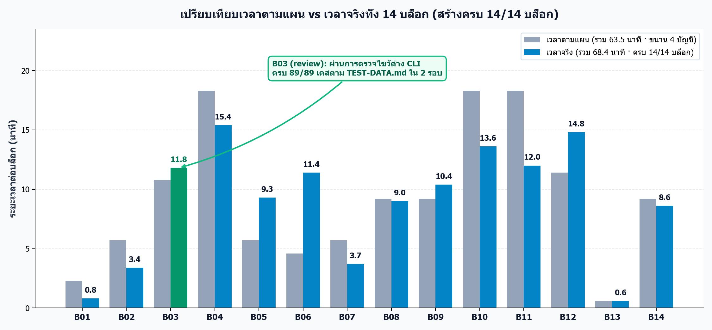

# REPORT · receiptdesk

**run:** `receiptdesk-pure-nginx` · โจทย์: สร้างระบบ ReceiptDesk ตาม docs/REQUIREMENTS.md และ docs/DESIGN.md (ข้อมูลทดสอบ docs/TEST-DATA.md): ฝั่งเว็บรันด้วย docker compose (web Next.js 16 + Tailwind CSS + Async Dispatcher + PostgreSQL 16 + volume uploads) และฝั่ง AI บนเครื่อง `2× RTX 4090` ด้วยสถาปัตยกรรม NGINX + 2× vLLM (NGINX `least_conn` ปิด `proxy_buffering` + vLLM 2 Replicas Data Parallelism 2×1 Continuous Batching) อ่านใบเสร็จเป็น 5 ช่อง ติดธงตาม BR-04/BR-05 ให้พนักงานตรวจแก้และยืนยัน งานเร่งด่วนจัดลำดับ 4:1 ใน PostgreSQL และกันระบบล้น (HTTP 429) ใบที่อ่านไม่สำเร็จครบ 3 ครั้งย้ายไปหน้าให้คนพิมพ์เอง พร้อม Live SSE Streaming Copilot, Telemetry และโค้ด Training LoRA + Evaluation ของโมเดล Vision-Language

## ตารางบล็อก (แผน vs จริง)

| บล็อก | สกิล | บัญชีแผน | บัญชีจริง | นาทีแผน | นาทีจริง | tokens (ไม่รวม cache read) | ครั้ง | สถานะ | ไฟล์ผล |
|---|---|---|---|---|---|---|---|---|---|
| **B01** | ⚙️ cyolo | cyolo1(ทำ) | cyolo1(ทำ) | 2.27 | 0.83 | 39,038 | 1 | ok | ✅ docker-compose.yml |
| **B02** | ⚙️ cyolo | cyolo1(ทำ) | cyolo1(ทำ) | 5.67 | 3.38 | 45,473 | 1 | ok | ✅ web/db/schema.sql |
| B03 | 🔍 review | yolo2(ทำ), cyolo1(ตรวจ) | yolo2(ทำ), cyolo1(ตรวจ), yolo3(ทำ), gyolo1(ทำ) | 10.84 | 1.32 | 950,150 | 14 | ok | ✅ web/lib/rules.ts |
| **B04** | 🧠 yolo | yolo2(ทำ) | yolo3(ทำ) | 18.34 | 15.42 | 310,623 | 1 | ok | ✅ web/app/api/README.md |
| B05 | ⚙️ cyolo | cyolo1(ทำ) | cyolo1(ทำ) | 5.67 | 9.32 | 102,558 | 1 | ok | ✅ web/dispatcher/index.ts |
| B06 | ⚖️ debate | yolo2(ตอบ), cyolo1(ตอบ), yolo3(ตัดสิน) | cyolo1(ตอบ), gyolo1(ตอบ), yolo2(ตัดสิน) | 4.57 | 11.45 | 320,224 | 3 | ok | ✅ docs/urgent-policy.md |
| B07 | ⚙️ cyolo | cyolo1(ทำ) | cyolo1(ทำ) | 5.67 | 3.73 | 64,952 | 1 | ok | ✅ web/app/api/queue/route.ts |
| B08 | 🧠 yolo | gyolo1(ทำ) | yolo2(ทำ) | 9.17 | 9.03 | 188,570 | 1 | ok | ✅ web/app/api/copilot/stream/route.ts |
| B09 | 🧠 yolo | gyolo1(ทำ) | gyolo1(ทำ) | 9.17 | 10.37 | 184,726 | 1 | ok | ✅ ai/nginx/nginx.conf + lb/node_receipt.sh |
| B10 | 🧠 yolo | yolo3(ทำ) | gyolo1(ทำ) | 18.34 | 13.62 | 248,830 | 1 | ok | ✅ ai/train/train_lora.py |
| **B11** | 🧠 yolo | yolo2(ทำ) | gyolo1(ทำ) | 18.34 | 11.98 | 254,759 | 1 | ok | ✅ web/app/pages.md |
| B12 | 🏆 best_of | cyolo1(ตอบ), yolo3(ตอบ), gyolo1(ตัดสิน) | yolo2(ตอบ), cyolo1(ตอบ), gyolo1(ตัดสิน) | 11.42 | 14.82 | 406,510 | 3 | ok | ✅ web/app/review/page.tsx |
| B13 | 🖼️ image | cyolo1(ทำ) | cyolo1(ทำ) | 0.55 | 0.55 | 21,044 | 1 | ok | ✅ web/public/logo.png |
| **B14** | 🧠 yolo | yolo2(ทำ) | yolo3(ทำ) | 9.17 | 8.63 | 131,862 | 1 | ok | ✅ TEST.md |

- tokens รวมของบล็อก **3,269,319** = ผลรวมจาก ledger ของ run (31 การเรียก) **3,269,319** ✅ ตรงกัน
- การเรียกที่ไม่ใช่บล็อก (ตรวจความพร้อม ฯลฯ): 0 ครั้ง · 0 tokens (ไม่นับในตาราง)
- เวลารวม: แผน 63.5 นาที · จริง 92.0 นาที
- บล็อกเสร็จ 14/14

## ภาพ

## ความต่างระหว่างแผนกับของจริง

- B03: แผน yolo2(ทำ), cyolo1(ตรวจ) → จริง yolo2(ทำ), cyolo1(ตรวจ), yolo3(ทำ), gyolo1(ทำ)
- B04: แผน yolo2(ทำ) → จริง yolo3(ทำ)
- B06: แผน yolo2(ตอบ), cyolo1(ตอบ), yolo3(ตัดสิน) → จริง cyolo1(ตอบ), gyolo1(ตอบ), yolo2(ตัดสิน)
- B08: แผน gyolo1(ทำ) → จริง yolo2(ทำ)
- B10: แผน yolo3(ทำ) → จริง gyolo1(ทำ)
- B11: แผน yolo2(ทำ) → จริง gyolo1(ทำ)
- B12: แผน cyolo1(ตอบ), yolo3(ตอบ), gyolo1(ตัดสิน) → จริง yolo2(ตอบ), cyolo1(ตอบ), gyolo1(ตัดสิน)
- B14: แผน yolo2(ทำ) → จริง yolo3(ทำ)
- (export ส่งเป็นฝั่ง yolo/cyolo ไม่ผูกบัญชี เพื่อให้ failover ของ agent-team ทำงาน → agent-team เลือกบัญชีในฝั่งเองตามโหลด/โควตา ดู references/run.md)

## ตัวปรับเวลา k (calib.json)

`/workspace/plans/calib.json`: {"cyolo": 0.2708, "review": 0.0726, "yolo": 0.6138, "debate": 1.2722, "best_of": 0.6585, "image": 0.0733}

k = นาทีจริง ÷ นาทีแผน (ก่อนคูณ k) แยกตามสกิล · `plan` ครั้งถัดไปคูณเวลาแต่ละบล็อกด้วย k ของสกิลนั้น
