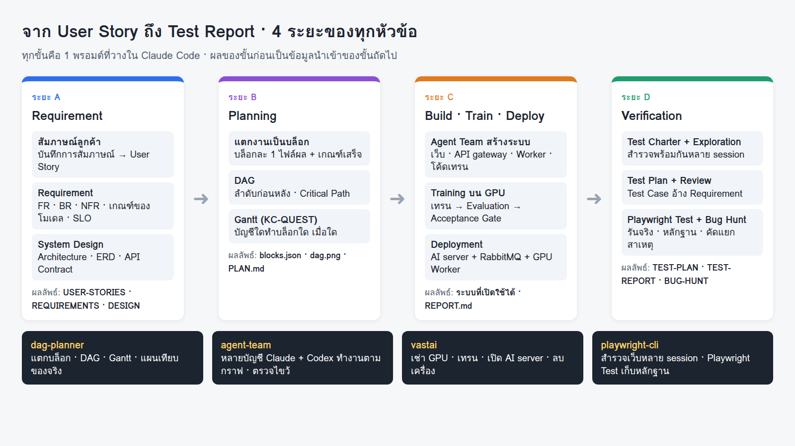
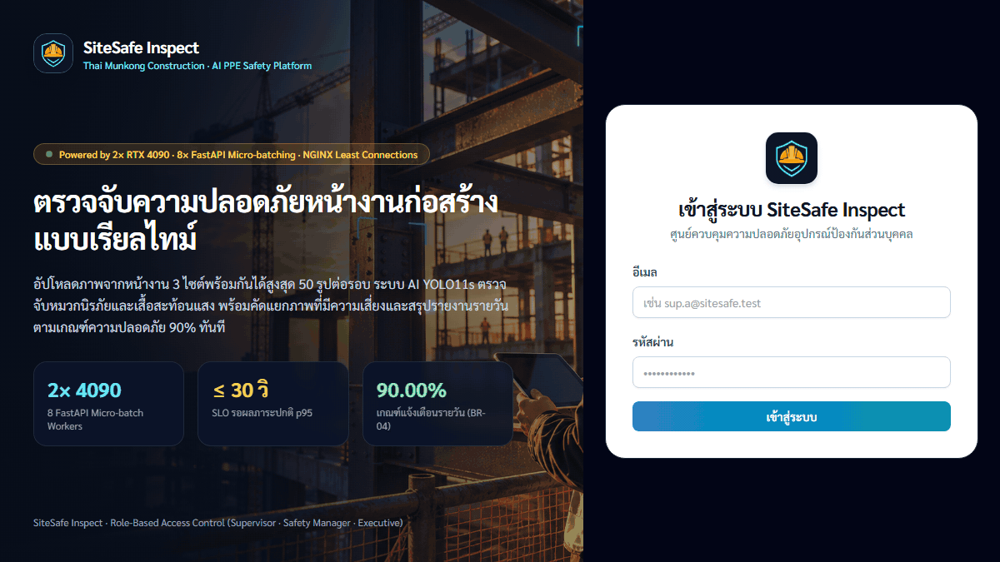
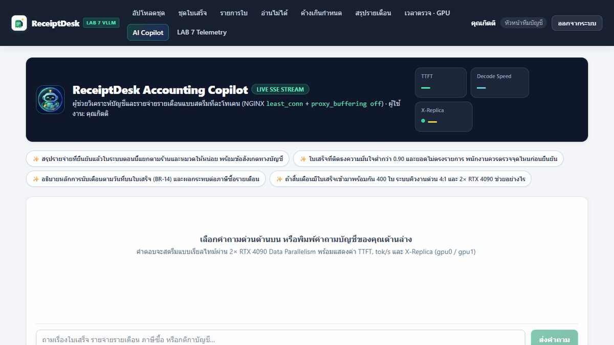

# Agent Team ส่งมอบระบบ AI ครบวงจร · จาก User Story ถึง Test Report (Single-Node Multi-GPU · NGINX Load Balancing บน 2× RTX 4090)

บทนี้รวมความรู้ 4 เรื่องเป็นงานเดียวแบบครบวงจร: **สัมภาษณ์ลูกค้าและเขียน Requirement → วางแผนงานให้ทีม AI หลายบัญชี → สร้าง เทรน และเปิดบริการบน `2× RTX 4090` หลัง NGINX `least_conn` + Failover คู่กับเว็บ Next.js & PostgreSQL → ทดสอบด้วย Playwright ครบทุก Test Case พร้อมคลิป `.gif` ทุกข้อและ Bug Hunt**

ทุกขั้นเป็นพรอมต์ Copy & Paste ใน **Claude Code** · พรอมต์บอกเป้าหมายเป็นข้อ ๆ โค้ดทุกไฟล์ทีม AI เขียนเอง

## ความรู้ที่นำมารวม

| ระยะ | ทำอะไร | เครื่องมือ |
|---|---|---|
| A · Requirement | สัมภาษณ์ลูกค้า → User Story → Requirement (FR / BR / NFR / SLO) → System Design | Claude Code |
| B · Planning | แตกงานเป็นบล็อก → DAG → Gantt (+ What-if) โดยใช้บัญชี `yolo2, yolo3, cyolo1, gyolo1` | สกิล `dag-planner` |
| C · Build · Train · Deploy | ทีมหลายบัญชีสร้างเว็บ **Next.js + Tailwind CSS + PostgreSQL** · เทรนโมเดล · เปิดบริการบน **`1 โหนด × 2× RTX 4090`** หลัง **NGINX `least_conn` + Failover** และวัดความจุจริง | สกิล `agent-team` · `vastai` · NGINX · FastAPI Micro-batching / vLLM |
| D · Verification | Test Charter → Exploration → Test Plan → Playwright Test พร้อมไฟล์ `.gif` แยกทุก Test Case → Bug Hunt (`BUG_MODE=1`) → Delivery Report | `playwright-cli` · Playwright Test |

## 2 หัวข้อ จากงานตรวจภาพสู่ Vision-Language & Streaming

ทั้ง 2 หัวข้อรันบนเครื่อง **Single-Node Multi-GPU (`1 โหนด × 2× RTX 4090`)** หลัง **NGINX `least_conn` + Passive Failover** เหมือนกัน แต่เลือกสถาปัตยกรรมฝั่งโมเดลต่างกันให้ตรงกับคอขวดของงานจริง:

| ประเด็นเปรียบเทียบ | [หัวข้อที่ 1 · SiteSafe Inspect](01_sitesafe_inspect/README.md) | [หัวข้อที่ 2 · ReceiptDesk](02_receipt_desk/README.md) |
|---|---|---|
| **ลูกค้าและโจทย์** | บริษัทรับเหมาก่อสร้าง (3 ไซต์ · 300 รูป/วัน) · ตรวจอุปกรณ์ความปลอดภัย + รายงานประจำวัน | สำนักงานบัญชี (60 ร้านค้า · 6,000 ใบ/เดือน) · อ่านใบเสร็จเป็น JSON + **ผู้ช่วยบัญชี AI แบบ SSE Streaming** + สรุปรายเดือน |
| **โมเดลและขนาด** | **YOLO11s** (`best.pt`, ~19 MB · Object Detection) | **Qwen3-VL-2B-Instruct + LoRA** (~4.3 GB + KV Cache · Vision-Language Model) |
| **คอขวดหลัก (Bottleneck)** | **CPU / Python GIL** ในการรับและถอดรหัสภาพ JPEG (โมเดลบน GPU ทำงานเร็วมาก) | **แบนด์วิดท์ VRAM และ KV Cache** ของ GPU (อ่านน้ำหนักโมเดลทุก Token ที่สร้าง) |
| **สถาปัตยกรรม AI Serving** | **8× FastAPI Micro-batching** (`4 process/GPU`, `MAX_BATCH=32`, `5 ms`) + **NGINX `least_conn`** + Failover ON | **2× vLLM Data Parallelism** (`1 replica/GPU`, Continuous Batching `max-num-seqs=256`, `gpu-memory-utilization=0.90`) + **NGINX `least_conn`** (`proxy_buffering off` SSE) + Failover ON |
| **ผลวัดจริงบน `2× RTX 4090`** | ความจุ **11 → 88 คน (`8.0×`)** · **444.55 req/s (`8.1×`)** · Slow GPU `least_conn` ชนะ RR **+77%** · Failover **0 error** | ความจุ Standard **4 → 640 คน (`160×`, 100% eff.)** · Fast **257 คน** · Peak **28,541 tok/s (`136.6×`)** · OCR **2,643.9 ใบ/นาที (`1.91×`)** · Failover **0 error หลังตัด** |
| **เว็บแอป (Local Docker)** | **Next.js 15 + Tailwind CSS + PostgreSQL** พอร์ต `3410` (Live) / `3411` (Mock) · กรอบ Bounding Box + `X-Upstream` + `/telemetry` | **Next.js 16 + Tailwind CSS v4 + PostgreSQL 16** พอร์ต `3420` (Live) / `3421` (Mock) · Split-Pane Review + **Live SSE `/copilot`** + `/telemetry` |
| **Playwright & หลักฐาน `.gif`** | ผ่านครบ **27/27 ข้อ (24 Core + 3/3 Bug Hunt)** · ไฟล์ `.gif` แยกครบ 27 ข้อ · [เปิดหน้าดูหลักฐาน](01_sitesafe_inspect/test/index.html) | ผ่านครบ **28/28 ข้อ (25 Core + 3/3 Bug Hunt)** · ไฟล์ `.gif` แยกครบ 28 ข้อ · [เปิดหน้าดูหลักฐาน](02_receipt_desk/test/index.html) |
| **สไลด์ประกอบการสอน** | [SiteSafe_Inspect_Slides.html](01_sitesafe_inspect/SiteSafe_Inspect_Slides.html) *(61 หน้า)* | [ReceiptDesk_Slides.html](02_receipt_desk/ReceiptDesk_Slides.html) *(71 หน้า)* |
| **พรอมต์ครบทุกขั้น** | [01_sitesafe_inspect/PROMPTS.md](01_sitesafe_inspect/PROMPTS.md) *(10 ขั้น)* | [02_receipt_desk/PROMPTS.md](02_receipt_desk/PROMPTS.md) *(15 ขั้น)* |

## ตัวอย่างเดโมเว็บจริง (เริ่มตั้งแต่หน้า `/login` · บันทึกด้วย Playwright)

**หัวข้อที่ 1 · SiteSafe Inspect (`http://localhost:3410` · บัญชีทดสอบ `manager@sitesafe.test` / `Test-Manager-01`):**

**หัวข้อที่ 2 · ReceiptDesk (`http://localhost:3420` · บัญชีทดสอบ `pim@receiptdesk.test` / `receiptdesk-test`):**

## ต้องมีก่อน

- container `multi-account` รันอยู่ มีสกิล `dag-planner` · `agent-team` · `yolo` · `cyolo` · `gyolo` · `vastai` และมีบัญชีพร้อม **`yolo2, yolo3, cyolo1, gyolo1`**
- เตรียมไฟล์ `.env` (key 3 ตัว: `VAST_API_KEY`, `HF_TOKEN`, `ROBOFLOW_API_KEY`) แล้วคัดลอกมาไว้ในโฟลเดอร์ของหัวข้อที่จะทำ
- เกณฑ์เช่าเครื่อง GPU บน Vast.ai: **`1 โหนด × 2× RTX 4090`** ความเร็วเน็ตขาลง **≥ 1,200 Mbps** และเลือกเครื่องที่ค่าดาวน์โหลด (`inet_down_cost`) ต่ำ
- Docker Desktop และ Claude Code บนเครื่องนี้

> ⚠️ **เสียเงินจริง** — ทุกหัวข้อจบด้วยพรอมต์ **ลบเครื่อง** ห้ามข้าม แล้วดูหน้า [Instances](https://cloud.vast.ai/instances/) ว่าว่าง (0 เครื่อง)

## ไฟล์ในโฟลเดอร์นี้

| โฟลเดอร์ / ไฟล์ | คืออะไร |
|---|---|
| `01_sitesafe_inspect/` | หัวข้อที่ 1 · SiteSafe Inspect (YOLO11s · 8× FastAPI Micro-batching + NGINX `least_conn` · Next.js + PostgreSQL · 27 TCs + 27 `.gif` · 61 สไลด์) |
| `02_receipt_desk/` | หัวข้อที่ 2 · ReceiptDesk (Qwen3-VL-2B + LoRA · 2× vLLM Data Parallelism + SSE Streaming + NGINX `least_conn` · Next.js + PostgreSQL · 28 TCs + 28 `.gif` · 71 สไลด์) |
| `images/` | ภาพประกอบของหน้ารวม |
| `PROMPTS.md` | หน้ารวมลิงก์พรอมต์และสไลด์ของทั้ง 2 หัวข้อ |
